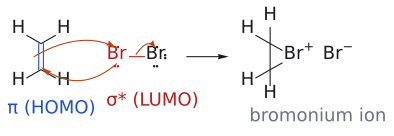
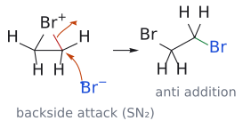
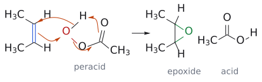
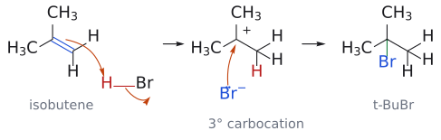
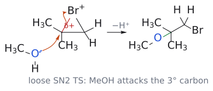

# L1. 알켄의 친전자성 첨가 반응 1부 (Electrophilic Addition to Alkenes, Part 1)

<!-- wiki-links:start -->

> **관련 위키 문서** ([[위키 대문]])
> - 반응: [[SN2 반응]], [[다이엔의 친전자성 첨가]], [[린들라 환원]], [[에폭시화]], [[촉매 수소화]], [[할로젠 첨가]], [[할로젠화수소 첨가]], [[할로하이드린 형성]]
> - 시약: [[mCPBA]], [[린들라 촉매]]
> - 개념: [[느슨한 SN2 전이 상태]], [[마르코프니코프 규칙]], [[브로모늄 이온]], [[속도론적 지배와 열역학적 지배]], [[알릴 양이온]], [[입체특이성과 입체선택성]], [[친전자체와 친핵체]], [[탄소 양이온]]

<!-- wiki-links:end -->

## 개요

알켄(alkene)의 C=C 이중결합은 유기화학에서 가장 쓸모 있는 "출발점" 중 하나다. 이중결합 하나에 무엇을 더하느냐에 따라 할로젠화 알킬(alkyl halide), 에폭사이드(epoxide), 알코올(alcohol), 에터(ether)가 만들어진다. 이 강의는 그 변환들이 모두 **하나의 원리**, 즉 "전자가 풍부한 π 결합이 전자를 원하는 시약(친전자체, electrophile)을 공격한다"는 원리로 설명된다는 것을 보여준다.

강의의 질문은 크게 세 가지다.
1. 알켄은 왜, 어떻게 친전자체와 반응하는가? (메커니즘)
2. 비대칭 알켄이라면 어느 쪽 탄소에 무엇이 붙는가? (위치선택성, regioselectivity)
3. 이 반응들로 무엇을 만들 수 있는가? (합성 응용)

이 강의에서 처음 나오는 **브로모늄 이온(bromonium ion)** 과 **탄소 양이온(carbocation)** 이라는 두 중간체는 L2, L3, L4까지 계속 다시 등장하니, 여기서 확실히 잡아두는 것이 좋다. (출처: L1 p.4)

---

## 1. 출발점: 첨가와 제거는 서로 거울 관계

포화 화합물(saturated)에서 무언가를 떼어내면 이중결합이 생기고(제거 반응, elimination), 이중결합에 무언가를 붙이면 다시 포화된다(첨가 반응, addition).

- 제거의 예: 2-브로모뷰테인 --[NaOEt]--> 2-뷰텐. 이때 *E*-알켄이 주생성물, *Z*-알켄이 부생성물이다.
- 첨가의 예: 알카인 --[H₂, 린들라 촉매(Lindlar's catalyst = Pd, CaCO₃, Pb(OAc)₂)]--> *Z*-알켄. 슬라이드 예시에서는 수율 79%, 전부 *Z*였다.

린들라 환원이 왜 *Z*만 주는가? 두 수소 원자가 금속 촉매 **표면의 같은 쪽**에서 알카인에 동시에 올라타기 때문이다(syn 첨가). 같은 면에서 들어오니 두 H가 같은 쪽에 놓이고, 결과적으로 R¹과 R²도 같은 쪽에 남는 *Z*-알켄이 된다. (출처: L1 p.5)

> 여담으로, 강의는 PVC(폴리염화비닐)를 예로 든다. PVC의 단량체인 염화비닐(vinyl chloride)은 (a) 아세틸렌에 HCl을 첨가하거나, (b) 에틸렌에 Cl₂를 첨가해 1,2-다이클로로에테인을 만든 뒤 HCl을 제거해서 얻는다. 첨가와 제거가 실제 산업에서 짝을 이뤄 쓰이는 사례다.[1] (출처: L1 p.6)

---

## 2. 친전자성 첨가 반응 한눈에 보기

강의 p.8의 표는 이후 두 강의 전체의 "목차" 역할을 한다. R-CH=CH₂를 기준으로:

| 반응 | 시약 | 결과 |
|---|---|---|
| 수소화 (hydrogenation) | H₂, Pd | 두 탄소에 H 하나씩 |
| 할로젠화수소 첨가 (hydrohalogenation) | HX (X = Cl, Br, I) | X는 치환기가 많은 탄소에, H는 CH₂ 쪽에 |
| 수화 (hydration) | H₂O, H⁺ | OH는 치환기가 많은 탄소에 |
| 할로젠화 (halogenation) | X₂ | 두 탄소에 X 하나씩 |
| 할로하이드린 형성 (halohydrin formation) | X₂, H₂O | OH는 치환기가 많은 탄소에, X는 CH₂ 쪽에 |
| 수소붕소화 (hydroboration) | BH₃ | B는 CH₂ 쪽에 (이후 산화로 이어짐 → L2) |
| 다이하이드록실화 (dihydroxylation) | OsO₄ | 두 탄소에 OH 하나씩 |
| 에폭시화 (epoxidation) | mCPBA | 3원 고리 에폭사이드 |

(출처: L1 p.7)

---

## 3. 알켄과 브로민: 브로모늄 이온의 등장

### 3.1 관찰: 브로민수가 탈색된다

주황색 브로민수(bromine water)에 사이클로헥세인(알케인)을 넣고 흔들면 색이 그대로 남는다. 사이클로헥센(알켄)을 넣으면 색이 사라진다. 이것이 고전적인 **알켄 검출법**이다. 에틸렌(ethene)은 Br₂와 실온에서 반응해 무색의 1,2-다이브로모에테인이 된다. (출처: L1 p.8)

> 슬라이드에는 "물속에서 반응하면 Br-CH₂-CH₂-OH가 생기지 않을까?"라는 물음표가 붙어 있다. 정답은 "생길 수 있다"이다. 이 물음은 5절의 할로하이드린 이야기로 이어진다.

### 3.2 왜 반응하는가: 궤도함수로 보기

Br-Br 결합은 약하다. 그래서 친핵체(Nu⁻)가 한쪽 Br을 공격하면 다른 쪽 Br이 Br⁻으로 떨어져 나간다.

그런데 알켄에는 음전하가 없다. 무엇이 친핵체 역할을 할까? 답은 **알켄의 HOMO, 즉 채워진 C=C π 궤도함수**다. 이 전자쌍이 Br₂의 **LUMO, 즉 비어 있는 Br-Br σ\* 궤도함수**로 흘러 들어간다. σ\*에 전자가 차면 Br-Br 결합이 끊어진다. (출처: L1 p.9)

### 3.3 1단계: 브로모늄 이온 형성

*그림: Br₂가 π 결합의 가운데로 끝부분부터(end-on) 다가온다. 파란색은 친핵체 쪽(π 결합, HOMO), 빨간색은 친전자체 쪽(Br–Br σ\*, LUMO), 주황색 굽은 화살표는 전자쌍의 이동이다. 화살표 셋은 (1) π 전자가 가까운 Br로, (2) Br–Br 결합 전자가 먼 Br로(Br⁻로 이탈), (3) 가까운 Br의 비공유 전자쌍이 반대쪽 탄소로 가서 3원 고리를 닫는 과정을 나타낸다.*

π 궤도함수의 전자 밀도는 두 탄소의 **정중앙**에서 가장 높다. 그리고 π HOMO가 σ\* LUMO와 결합성으로 겹치려면 Br₂가 **끝부분부터(end-on)** 다가와야 한다.

그 결과 Br 원자 하나가 두 탄소에 동시에 걸쳐 앉은 **3원 고리 양이온, 브로모늄 이온**이 생기고 Br⁻ 하나가 떨어져 나간다. 이 단계 덕분에 이 반응을 "이중결합에 대한 친전자성 첨가"라 부르며, 여기서 친전자체는 브로민이다. (출처: L1 p.10)

> 브로모늄 이온은 보통 금방 반응해 사라지는 불안정한 중간체다. 그런데 바이(아다만틸리덴)(bi(adamantylidene))에서 만든 브로모늄 이온은 양쪽의 거대한 아다만틸기가 뒤쪽 공격을 막아서 **분리할 수 있을 만큼 안정**하다. 이 화합물은 브로모늄 이온이 실제로 존재한다는 구조적 증거가 되었다.[2] (출처: L1 p.11)

### 3.4 2단계: Br⁻의 SN2 공격

*그림: Br⁻(파랑, 친핵체)가 C–Br⁺ 결합(빨강)의 정반대편에서 탄소를 공격한다(backside attack). C–Br 결합 전자는 Br로 돌아가고, 새로 생긴 C–Br 결합(초록)은 원래 Br의 반대편에 놓이므로 두 Br이 anti가 된다.*

브로모늄 이온은 양전하를 띤 친전자체이고, 1단계에서 떨어져 나간 Br⁻은 친핵체다. 이 둘의 반응은 **평범한 SN2 치환**이다.

SN2이므로 친핵체는 C-Br σ\* 궤도함수와 최대로 겹치기 위해 **이탈기의 정반대편에서** 일직선으로 들어온다. 그래서 공격받는 탄소의 입체배치가 **반전(inversion)** 된다. 결과적으로 두 Br은 서로 반대 면(anti)에 붙는다. 이 "anti 첨가"는 L2에서 사이클로헥센 브로민화의 입체화학으로 다시 다룬다. (출처: L1 p.12)

---

## 4. 알켄의 산화: 에폭사이드

### 4.1 에폭사이드는 "산소판 브로모늄 이온"

에폭사이드는 브로모늄 이온의 Br⁺ 자리에 O가 들어간 3원 고리라고 볼 수 있다. 차이점은 에폭사이드는 **중성이고 꽤 안정**해서 분리하여 보관할 수 있다는 것이다.

에폭시화에는 주로 **과산(peroxy-carboxylic acid, peracid)** 을 쓴다. 과산은 카복실산의 C(=O)와 산성 H 사이에 **산소가 하나 더 끼어 있는** 구조(R-C(=O)-O-O-H)다. (출처: L1 p.13)

과산은 왜 산소 쪽이 친전자성일까? 친핵체가 말단 OH의 산소를 공격하면 약한 O-O 결합이 끊어지면서 **카복실레이트(좋은 이탈기)** 가 떨어져 나가기 때문이다. 즉 "산소 원자에서 일어나는 SN2"다. (출처: L1 p.13)

### 4.2 mCPBA

*그림: 네 개의 화살표가 한 번에 움직인다. (1) π 결합이 친전자성 산소(빨강)를 공격하고, (2) 약한 O–O 결합이 끊어지며 그 전자가 새 C=O를 만들고, (3) 원래의 C=O가 H를 받아 가며, (4) O–H 결합 전자가 두 번째 C–O 결합이 된다. 그림에서는 과산의 R을 CH₃로 단순화했다(mCPBA는 R = *m*-ClC₆H₄). 두 메틸이 같은 쪽에 있던 알켄은 두 메틸이 같은 쪽에 있는 에폭사이드가 된다(입체특이성).*

가장 흔히 쓰는 과산은 **mCPBA(*meta*-chloroperoxybenzoic acid)** 다. 결정성 고체라서 비교적 안전하게 다룰 수 있다. 예를 들어 사이클로헥센 --[mCPBA]--> 사이클로헥센 옥사이드의 수율은 95%이고, 부산물로 *m*-클로로벤조산이 나온다. (출처: L1 p.14)

메커니즘은 한 번에 일어나는 협동(concerted) 과정이다.
1. 알켄의 π 전자가 과산의 말단(친전자성) 산소를 공격한다.
2. 동시에 약한 O-O 결합이 끊어진다.
3. 원래 O-H의 수소는 카보닐 산소로 옮겨가 카복실산 부산물이 된다.
4. 그 산소의 비공유 전자쌍이 알켄의 다른 탄소와 결합해 3원 고리가 닫힌다.

전이 상태는 고리 모양으로 그려진다. (출처: L1 p.14)

### 4.3 입체특이성과 반응 속도

두 개의 새 C-O 결합이 π 결합의 **같은 면**에서 동시에 생기므로, 알켄의 기하 구조가 에폭사이드에 그대로 옮겨진다. *trans*-스틸벤은 *trans*-스틸벤 옥사이드가 되고, *cis*-스틸벤은 *cis* 에폭사이드가 된다. 출발 물질의 입체화학이 생성물의 입체화학을 결정하므로 이 반응은 **입체특이적(stereospecific)** 이다. (출처: L1 p.15)

치환기가 많은 알켄일수록 더 빨리 반응한다. mCPBA에 대한 상대 속도는 다음과 같다.

| 알켄 | 상대 속도 |
|---|---|
| H₂C=CH₂ | 1 |
| 프로펜 | 24 |
| *cis*-2-뷰텐 | 500 |
| 2-메틸프로펜 | 500 |
| 2-메틸-2-뷰텐 (삼치환) | 6500 |
| 2,3-다이메틸-2-뷰텐 (사치환) | >6500 |

이유는 **알킬기가 전자를 주는 기(electron-donating)** 이기 때문이다. 알킬기가 많을수록 π 결합이 더 친핵성이 된다. (출처: L1 p.15)

---

## 5. HBr 첨가: 탄소 양이온과 마르코프니코프 규칙

### 5.1 메커니즘

할로젠화수소 첨가는 형식상 **제거 반응의 역반응**이다. 사이클로헥센 + HBr 반응은 두 단계로 진행된다.
1. π 결합이 H-Br의 H를 공격한다(친전자성 공격). 그 결과 Br⁻가 떨어지고 탄소 양이온이 생긴다.
2. Br⁻가 탄소 양이온을 공격해 브로모사이클로헥세인이 된다.

(출처: L1 p.16)

### 5.2 비대칭 알켄이면 어디에 붙는가?

스타이렌(styrene, Ph-CH=CH₂)에 HBr을 첨가하면 Br이 붙을 수 있는 자리는 두 곳이다. Ph가 붙은 탄소(1-브로모-1-페닐에테인)일 수도 있고, 끝 탄소(2-브로모-1-페닐에테인)일 수도 있다. 실제로는 **앞의 것만** 생긴다.

이유는 1단계에서 H가 어디에 붙느냐에 있다.
- H가 끝 CH₂에 붙으면 Ph 옆에 **벤질 탄소 양이온**이 생긴다. 이 양이온은 공명으로 안정화된다.
- H가 Ph 쪽 탄소에 붙으면 **1차 탄소 양이온**이 생긴다. 이 양이온은 불안정해서 사실상 생기지 않는다.

정리하면, 브로민은 **치환기가 더 많은 탄소**에 붙는다. (출처: L1 p.17)

### 5.3 마르코프니코프 규칙

*그림: 1단계: π 결합(파랑)이 H–Br의 H(빨강)를 공격한다. H는 CH₂ 쪽 탄소에 붙고(빨간 H), 양전하는 메틸 두 개가 안정화하는 3차 탄소에 남는다. 2단계: Br⁻가 3차 탄소 양이온을 공격해 *t*-BuBr이 된다(초록 결합).*

2-메틸프로펜 + HBr 반응도 같은 원리다. H가 CH₂에 붙어 **3차 탄소 양이온**이 생기므로 생성물은 *tert*-뷰틸 브로마이드다.

이 경험칙을 **마르코프니코프 규칙(Markovnikov's rule)** 이라 한다. "수소는 원래 수소를 더 많이 가진 이중결합 탄소에 붙는다." 그러나 그 밑바탕에는 **더 안정한 탄소 양이온을 거치는 경로가 이긴다**는 원리가 있다. 규칙을 외우기보다 이 원리를 기억하는 편이 훨씬 응용 범위가 넓다. (출처: L1 p.18)

---

## 6. 다이엔의 친전자성 첨가 (1,4-첨가)

### 6.1 아이소프렌 + HBr

아이소프렌(isoprene, 2-메틸-1,3-뷰타다이엔)에 H⁺가 붙는 경우를 보자.
- **메틸이 붙은 쪽 이중결합**의 말단에 H⁺가 붙으면 **알릴 양이온(allylic cation)** 이 생긴다. 양전하가 공명으로 퍼지며, 그중 한 공명 구조에서는 양전하가 메틸이 붙은 3차 탄소에 놓여 추가로 안정화된다.
- **다른 쪽 이중결합**에 H⁺가 붙어도 알릴 양이온이 생기지만, 양전하가 메틸이 붙은 탄소까지 퍼지지 않는다. 그래서 메틸의 안정화 효과를 받지 못한다.

따라서 앞의 경로가 선택된다.

이렇게 생긴 알릴 양이온을 Br⁻가 공격하는데, 공격은 **덜 붐비는 말단**에서 일어난다. 생성물은 **프레닐 브로마이드(prenyl bromide)** 이다. 결과적으로 H와 Br이 **다이엔 계의 양 끝(1,4 위치)** 에 붙는다. (출처: L1 p.19)

### 6.2 1,3-뷰타다이엔 + Br₂ (1 당량)

슬라이드 p.20은 빈칸으로 남겨져 있고, 답은 L2 p.6에 나온다.
- **0 °C**에서는 3,4-다이브로모-1-뷰텐(1,2-첨가)이 생긴다. 이것이 **속도론적 생성물(kinetic product)** 이다.
- **가열**하면 1,4-다이브로모-2-뷰텐(1,4-첨가, *E*)이 생긴다. 이것이 **열역학적 생성물(thermodynamic product)** 이다.

브로모늄 이온이 생긴 뒤 Br⁻가 가까운 탄소를 바로 공격하면 1,2-생성물이 된다. 반면 이웃한 이중결합을 통해 고리가 열리면서 먼 끝(4번 탄소)이 공격받으면 1,4-생성물이 된다. 두 생성물은 가역적으로 서로 바뀔 수 있다(⇌). 그래서 온도를 높이면 더 안정한 1,4-생성물, 즉 이치환 내부 알켄 쪽으로 쏠린다.[3] (출처: L1 p.20, L2 p.6)

---

## 7. 비대칭 브로모늄 이온의 위치선택성

### 7.1 용매가 친핵체가 될 때

브로민화를 물이나 메탄올 같은 **친핵성 용매** 속에서 하면 어떻게 될까? 용매 분자가 Br⁻와 경쟁해 브로모늄 이온을 연다. 용매는 Br⁻보다 압도적으로 농도가 높아서 대부분 용매가 먼저 반응한다.

- 2-메틸프로펜 --[Br₂, H₂O]--> 브로모하이드린(bromohydrin). OH는 3차 탄소에, Br은 CH₂에 붙는다.
- 이 브로모하이드린을 염기(HO⁻)로 처리하면 알콕사이드(O⁻)가 생긴다. 이 알콕사이드가 분자 안에서 SN2로 옆 탄소의 Br을 밀어내면 **에폭사이드**가 된다. 즉 브로모하이드린은 에폭사이드의 전구체다.

(출처: L1 p.21)

### 7.2 왜 "더 치환된" 쪽이 공격받는가?

*그림: 아이소뷰텐에서 생긴 브로모늄 이온에서 C–Br 결합이 늘어나면 부분 양전하(δ+)가 3차 탄소에 쌓인다. 그래서 MeOH의 산소(파랑)가 그 3차 탄소를 뒤쪽에서 공격한다. 이어서 양성자를 잃으면(−H⁺) 에터가 된다.*

대칭 브로모늄 이온(에틸렌에서 생긴 것)이라면 어느 탄소를 공격하든 결과가 같다. 그런데 2-메틸프로펜 --[Br₂, MeOH]--> 반응에서는 메탄올이 **더 치환된 쪽(3차 탄소)** 을 공격해 에터를 만든다. (출처: L1 p.22)

SN2라면 보통 덜 붐비는 쪽을 공격하지 않나? 여기가 바로 이 강의의 핵심 포인트다.

답은 **"느슨한 SN2 전이 상태(loose SN2 transition state)"** 다. 브로모늄 이온이 열릴 때는 친핵체가 들어오기 전에 C-Br 결합이 먼저 상당히 늘어난다. 그러면 탄소 위에 **부분 양전하**가 쌓인다. 이때 3차 탄소 쪽은 알킬기들이 이 양전하를 안정화해 주므로 Br이 더 많이 떨어져 나간 상태에 도달할 수 있다. 그래서 **입체 효과가 아닌 전자 효과가 위치선택성을 결정**한다. (출처: L1 p.23)

치환기가 많을수록 반응 속도도 급격히 빨라진다(Br₂/MeOH 기준 상대 속도).

| 알켄 | 상대 속도 |
|---|---|
| H₂C=CH₂ | 1 |
| 1-헥센 (*n*-Bu) | 100 |
| 3,3-다이메틸-1-뷰텐 (*t*-Bu) | 27 |
| *cis*-2-뷰텐 | 2700 |
| *trans*-2-뷰텐 | 1750 |
| 2-메틸프로펜 | 5700 |
| 2-메틸-2-뷰텐 | 13000 |
| 2,3-다이메틸-2-뷰텐 | 1900000 |

(출처: L1 p.23)

> *t*-Bu 치환체가 *n*-Bu 치환체보다 느린 점(27 대 100)에 주목하자. 전자 효과는 비슷하지만 부피가 큰 *t*-Bu가 Br₂의 접근을 방해하는 입체 효과로 해석할 수 있다. 이는 슬라이드 데이터를 바탕으로 한 해석이다.

---

## 흔한 오해

- **"Br₂ 첨가에서 Br⁻는 덜 붐비는 탄소를 공격한다"**: 대칭 브로모늄 이온에서는 상관이 없다. 비대칭 브로모늄 이온에서는 오히려 **더 치환된 탄소**가 공격받는다. 느슨한 SN2 전이 상태에서 양전하가 그쪽에 더 잘 쌓이기 때문이다.
- **"마르코프니코프 규칙은 외워야 하는 규칙이다"**: 이 규칙은 "더 안정한 양이온을 거친다"는 원리를 경험적으로 요약한 것일 뿐이다. L2에서 배울 "δ⁻ 원자는 더 치환된 탄소로 간다"도 같은 원리를 다르게 표현한 것이다.
- **"에폭시화는 브로민화처럼 2단계로 일어난다"**: 에폭시화는 고리형 전이 상태를 거치는 **한 단계 협동 반응**이다. 그래서 alkene의 *cis*/*trans* 정보가 그대로 보존된다.
- **"치환기가 많으면 입체 장애 때문에 느릴 것이다"**: mCPBA나 Br₂ 첨가에서는 반대다. 알킬기의 전자 공여로 π 결합이 더 친핵성이 되어 **빨라진다**.

---

## 반응 정리표

| 반응 | 시약/조건 | 생성물 | 위치선택성 | 입체화학 | 비고 |
|---|---|---|---|---|---|
| 할로젠화 | Br₂ (또는 Cl₂) | 1,2-다이할라이드 | 해당 없음 (대칭) | anti 첨가 | 브로모늄 이온 → SN2 |
| 할로하이드린 | Br₂, H₂O | β-브로모알코올 | OH는 더 치환된 C에 | anti | 느슨한 SN2 |
| 할로에터 | Br₂, MeOH | β-브로모에터 | OMe는 더 치환된 C에 | anti | 용매가 Br⁻를 이김 |
| 에폭시화 | mCPBA (과산) | 에폭사이드 | 해당 없음 | syn, 입체특이적 | 협동, 고리 TS |
| 브로모하이드린 → 에폭사이드 | 염기 (HO⁻) | 에폭사이드 | 해당 없음 | 분자내 SN2 | |
| HBr 첨가 | HBr | 알킬 브로마이드 | 마르코프니코프 | (이번 강의 범위 아님) | 탄소 양이온 중간체 |
| 다이엔 + HBr | HBr | 1,4-첨가 생성물 | H와 Br은 다이엔 양 끝에 | | 알릴 양이온 |
| 다이엔 + Br₂ | Br₂ 1 당량 | 0 °C: 1,2-첨가 / 가열: 1,4-첨가 | | 1,4 생성물은 *E* | 속도론적/열역학적 지배 |
| 린들라 환원 | H₂, Pd/CaCO₃/Pb(OAc)₂ | *Z*-알켄 | | syn | 촉매 표면 |

---

## 연습 문제

1. 사이클로헥세인과 사이클로헥센을 각각 브로민수에 넣고 흔들었다. 각각 어떤 변화가 관찰되는지 쓰고, 그 이유를 설명하시오.
2. 알켄 + Br₂ 반응에서 알켄의 HOMO와 Br₂의 LUMO는 각각 무엇인가? Br₂가 "끝부분부터(end-on)" 접근해야 하는 이유도 설명하시오.
3. *cis*-2-뷰텐과 *trans*-2-뷰텐을 각각 mCPBA로 처리했을 때의 생성물을 입체화학까지 포함해 쓰시오.
4. 스타이렌(Ph-CH=CH₂)에 HBr을 반응시킬 때의 주생성물을 쓰고, 다른 위치 이성질체가 생기지 않는 이유를 중간체 안정성으로 설명하시오.
5. 1,3-뷰타다이엔에 Br₂ 1 당량을 0 °C에서 반응시킨 경우와 가열한 경우의 주생성물을 각각 쓰고, 어느 쪽이 속도론적/열역학적 생성물인지 밝히시오. (슬라이드 p.20의 빈칸 문제)
6. 2-메틸프로펜을 Br₂/MeOH로 처리한 생성물을 쓰시오. 메탄올이 3차 탄소를 공격하는 이유도 설명하시오.
7. 2-메틸프로펜에서 출발해 2,2-다이메틸옥시레인(에폭사이드)을 만드는 두 가지 방법을 제시하시오.
8. 다음 알켄들을 mCPBA와의 반응 속도가 빠른 순서로 나열하시오: 에틸렌, 2-메틸-2-뷰텐, 프로펜, 2,3-다이메틸-2-뷰텐.

## 정답 및 해설

1. 사이클로헥세인은 변화가 없다(주황색 유지). 사이클로헥센은 브로민수가 탈색된다. 알케인에는 친핵성 π 결합이 없어 Br₂와 반응하지 못하지만, 알켄은 Br₂와 친전자성 첨가를 일으켜 Br₂가 소모되기 때문이다. (L1 p.8)
2. HOMO는 채워진 C=C π 궤도함수, LUMO는 비어 있는 Br-Br σ\* 궤도함수다. π 전자 밀도는 두 탄소의 중앙에서 가장 높다. 그리고 σ\*는 Br-Br 결합축 방향으로 뻗어 있으므로, 결합성 겹침이 일어나려면 Br₂가 결합축을 따라 끝부분부터 다가와야 한다. (L1 p.9-10)
3. *cis*-2-뷰텐에서는 *cis*-2,3-다이메틸옥시레인(메소 화합물)이, *trans*-2-뷰텐에서는 *trans*-2,3-다이메틸옥시레인(라세미체)이 생긴다. 두 C-O 결합이 같은 면에서 동시에 생기므로 입체특이적이다. 메소/라세미 판정은 보충 설명이며, 원리는 L1 p.15의 스틸벤 예와 같다.
4. 주생성물은 1-브로모-1-페닐에테인(PhCHBrCH₃)이다. H⁺가 말단 CH₂에 붙으면 공명 안정화된 벤질 양이온이 생긴다. 반대로 붙으면 불안정한 1차 양이온이 생기므로 그 경로는 일어나지 않는다. (L1 p.17)
5. 0 °C에서는 3,4-다이브로모-1-뷰텐(1,2-첨가, 속도론적 생성물)이, 가열하면 (*E*)-1,4-다이브로모-2-뷰텐(1,4-첨가, 열역학적 생성물)이 주생성물이다. 1,4-생성물은 이치환 내부 알켄이라 더 안정하고, 가열하면 두 생성물 사이의 평형이 열역학적 생성물 쪽으로 이동한다. (L2 p.6)
6. 생성물은 1-브로모-2-메톡시-2-메틸프로페인((CH₃)₂C(OMe)CH₂Br)이다. 브로모늄 이온이 열리는 느슨한 SN2 전이 상태에서 C-Br 결합이 먼저 늘어나며 부분 양전하가 생긴다. 이 양전하는 알킬기 두 개가 안정화하는 3차 탄소 쪽에 더 잘 쌓이므로 메탄올이 그쪽을 공격한다. 이는 전자 효과에 의한 선택성이다. (L1 p.22-23)
7. (a) mCPBA로 직접 에폭시화한다. (b) Br₂/H₂O로 브로모하이드린((CH₃)₂C(OH)CH₂Br)을 만든 뒤, 염기로 알콕사이드를 만들어 분자내 SN2로 고리를 닫는다. (L1 p.14, p.21)
8. 2,3-다이메틸-2-뷰텐 > 2-메틸-2-뷰텐 > 프로펜 > 에틸렌 순이다(>6500 > 6500 > 24 > 1). 알킬기가 많을수록 π 결합이 전자가 풍부해져 친핵성이 커진다. (L1 p.15)

---

## 각주

[1] 강의 슬라이드에서는 PVC가 라디칼 연쇄 중합(radical chain polymerization)으로 만들어지며 파이프나 키보드 자판 등에 쓰인다고 소개한다. 라디칼 반응은 이 과목의 후반부(Radical chemistry)에서 다룬다.

[2] 슬라이드 p.11에는 사이클로펜텐에서 만든 브로모늄 이온의 3D 모형과 바이(아다만틸리덴) 브로모늄 양이온이 "stable"이라는 설명과 함께 나온다.

[3] 보충: 1,2-생성물이 낮은 온도에서 빨리 생기는 이유는 Br⁻가 브로모늄 이온의 가까운 탄소를 공격하는 경로의 활성화 에너지가 더 낮기 때문으로 설명한다. 1,4-생성물이 더 안정한 이유는 이중결합이 더 많이 치환되어 있고 *E* 배치이기 때문이다. Clayden 등 표준 교재의 속도론적/열역학적 지배 설명과 같은 내용이다.
