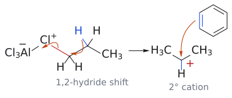
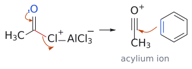
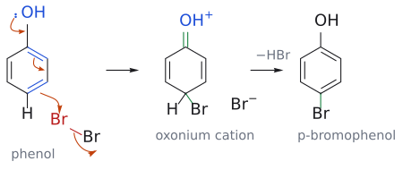

# L3. 친전자성 방향족 치환 반응 1부 (Electrophilic Aromatic Substitution, Part 1)

<!-- wiki-links:start -->

> **관련 위키 문서** ([[위키 대문]])
> - 반응: [[나이트로화]], [[다이아조늄 염 반응]], [[방향족 할로젠화]], [[설폰화]], [[친전자성 방향족 치환]], [[콜베-슈미트 반응]], [[클레멘센 환원]], [[프리델-크래프츠 아실화]], [[프리델-크래프츠 알킬화]]
> - 시약: [[Pd-C|Pd/C]], [[루이스 산 촉매]], [[혼산]]
> - 개념: [[나이트로늄 이온]], [[마르코프니코프 규칙]], [[방향족성]], [[아레늄 이온]], [[아실륨 이온]], [[치환기 효과]], [[친전자체와 친핵체]], [[탄소 양이온]], [[탄소 양이온 자리옮김]]

<!-- wiki-links:end -->

## 개요

L1–L2에서 알켄의 이중결합은 브로민이나 과산 같은 친전자체를 만나자마자 반응했다. 벤젠(benzene)도 겉보기에는 이중결합이 세 개나 있다. 그러면 벤젠도 알켄처럼 반응할까? **그렇지 않다.** 벤젠은 mCPBA와도, 그냥 Br₂와도 반응하지 않는다.

이 강의의 출발 질문은 "벤젠은 왜 알켄과 다르게 행동하는가, 그리고 어떻게 하면 반응시킬 수 있는가?"다. 답은 두 가지로 요약된다.
1. 벤젠과 반응시키려면 **훨씬 강력한 친전자체**를 만들어야 한다. 루이스 산, 진한 황산 등이 그 역할을 한다.
2. 일단 반응하면 벤젠은 **첨가가 아니라 치환**으로 끝난다. H 하나를 내주고 방향족성(aromaticity)을 되찾는 쪽을 택하기 때문이다.

이 반응을 **친전자성 방향족 치환(electrophilic aromatic substitution, SEAr)** 이라 한다. 이 강의에서는 할로젠화, 나이트로화, 설폰화, 프리델-크래프츠 알킬화와 아실화, 그리고 페놀의 반응을 다룬다. 고리에 이미 붙어 있는 치환기가 반응 위치를 어떻게 정하는지(배향 효과)는 L4에서 본격적으로 다룬다. (출처: L3 p.7)

> 강의 첫 장에는 Ben Bradshaw(바르셀로나 대학)의 "Synthetic Map"이 실려 있다. 작용기들 사이의 변환 관계를 지하철 노선도처럼 그린 그림이다. 이 과목에서 배우는 반응들이 그 지도 위의 "노선"이라고 생각하면 큰 그림을 잡는 데 도움이 된다.[1] (출처: L3 p.1)

---

## 0. 복습: 친전자체의 δ⁺와 알켄의 HOMO

강의는 L1–L2의 반응 표를 다시 보여주면서 각 시약의 **δ⁺ 부분**(HX의 H, H₂O의 H, X₂/H₂O의 X, BH₃의 B)을 강조한다. 이 δ⁺ 부분이 친전자체다. (출처: L3 p.4)

아이소뷰텐의 HOMO 그림을 보면 전자 밀도가 **CH₂ 말단**에 높다. 그래서 친전자체(H⁺ 등)가 CH₂ 쪽에 붙고, 양전하는 3차 탄소에 남는다. 마르코프니코프 위치선택성을 궤도함수 그림으로 다시 확인한 셈이다. 이 "HOMO의 전자 밀도가 큰 곳이 공격당한다"는 관점은 이 강의 7절의 페놀에서 다시 나온다. (출처: L3 p.5)

---

## 1. 벤젠은 왜 알켄처럼 반응하지 않는가

벤젠은 평면 정육각형이다. 탄소 여섯 개가 모두 sp² 혼성이고, 각 탄소에 붙은 H는 고리 평면 위에 놓인다. 모든 C-C 결합 길이는 **1.39 Å**으로 같다. 이 값은 단일결합(C-C 1.47 Å)과 이중결합(C=C 1.33 Å)의 중간이다.

벤젠의 특별한 안정성(방향족성)은 탄소 여섯 개의 p 궤도함수가 겹쳐 만든 **분자 궤도함수 세 개에 π 전자 여섯 개**가 들어 있는 데서 나온다. 즉 벤젠의 π 전자는 특정 C=C 결합에 묶여 있지 않고 고리 전체에 퍼져 있다. 그래서 "평범한 C=C 결합"이 아니다. (출처: L3 p.9)

- 사이클로헥센 --[RCO₃H]--> 에폭사이드(cis 첨가)
- 사이클로헥센 --[Br₂]--> *trans*-1,2-다이브로마이드(trans 첨가)
- 벤젠 --[RCO₃H]--> **반응 없음**
- 벤젠 --[Br₂]--> **반응 없음**

(출처: L3 p.9)

### 1.1 루이스 산을 넣으면 반응한다

*그림: 1단계(속도 결정): 벤젠의 π 결합(파랑)이 AlCl₃와 착물을 이룬 Br–Br⁺의 바깥쪽 Br(빨강)을 공격한다. 두 번째 화살표는 Br–Br 결합 전자가 AlCl₃ 쪽 Br로 넘어가는 것을 나타낸다(AlCl₃Br⁻가 된다). 새로 생긴 C–Br 결합은 초록색이다. 2단계(빠름): sp³ 탄소의 C–H 결합 전자가 고리 안으로 들어가 양전하를 지우고(−H⁺), 방향족성이 회복된다. 그림 속 양이온은 공명 구조 셋 중 하나(양전하가 오르토 탄소에 있는 것)만 그렸다.*

벤젠도 **AlCl₃나 FeCl₃ 같은 루이스 산 촉매**를 넣으면 브로민과 반응한다. 두 반응을 비교해 보자.

- **알켄**: π 결합이 Br-Br을 공격해 브로모늄 이온이 된다. Br⁻가 반대쪽에서 공격하면 *trans*-다이브로마이드라는 **첨가** 생성물이 나온다.
- **벤젠**: π 결합이 Br-Br⁺-AlCl₃⁻ 착물의 Br을 공격해 양이온 중간체가 된다. 그다음 **H⁺가 빠져나가** 브로모벤젠이 된다. 이것은 **치환** 생성물이다.

브로민 원자가 수소 원자 하나를 대신했으니 치환 반응이다. 시약은 친전자성 브로민이고 기질은 방향족이므로, 이 반응을 **친전자성 방향족 치환**이라 부른다. (출처: L3 p.10)

---

## 2. SEAr의 메커니즘: 사이클로헥사다이엔일 양이온

모든 SEAr은 같은 두 단계를 거친다.

1. **속도 결정 단계(rate-determining step)**: 벤젠의 π 전자가 친전자체 E⁺를 공격한다. 그 결과 E와 H가 함께 붙은 sp³ 탄소가 하나 생기고, 나머지 다섯 탄소에 걸쳐 양전하가 퍼진 **사이클로헥사다이엔일 양이온(cyclohexadienyl cation)** 이 생긴다. 이 단계에서 방향족성이 깨지므로 느리다.
2. **빠른 단계**: sp³ 탄소의 H가 H⁺로 떨어져 나가고, 그 C-H 결합 전자가 고리로 돌아와 방향족성이 회복된다.

(출처: L3 p.11)

**양전하가 어디에 놓일 수 있는지가 핵심이다.** 공명 구조 세 개를 그려보면 양전하는 E가 붙은 탄소를 기준으로 **두 오르토(ortho) 위치와 파라(para) 위치**에만 놓인다. 메타(meta) 위치에는 양전하가 오지 않는다. 이 사실이 L4에서 배울 배향 효과의 근본 원인이다. (출처: L3 p.11)

용어도 정리해 두자. 치환기가 붙은 탄소가 **입소(ipso)**, 그 바로 옆이 **오르토(ortho)**, 한 칸 더 건너가 **메타(meta)**, 정반대편이 **파라(para)** 다. (출처: L3 p.11)

> 왜 2단계에서 알켄처럼 Br⁻가 양이온을 공격해 첨가 생성물을 만들지 않을까? H⁺를 잃고 방향족 고리를 회복하는 것이 에너지 면에서 훨씬 유리하기 때문이다.[2]

---

## 3. 나이트로화 (nitration)

나이트로기(NO₂)를 방향족 고리에 도입하면 방향족 질소 화합물로 가는 일반적인 길이 열린다. 이런 방법은 지방족 질소 화합물에는 쓸 수 없다. 방향족 나이트로화에는 매우 강력한 시약, 보통 **진한 질산과 진한 황산의 혼합물**이 필요하다. (출처: L3 p.12)

**1단계: 나이트로늄 이온(NO₂⁺) 생성**
1. 황산이 질산의 OH를 양성자화한다. 두 강산의 상호작용이다.
2. 물(H₂O)이 이탈기로 떨어져 나간다.
3. 그 결과 **나이트로늄 이온(nitronium ion, O=N⁺=O)** 이 생긴다. 이 이온은 가운데 질소가 sp 혼성인 **직선형** 구조다.

*그림: 왼쪽: 질산 OH 산소(파랑)의 비공유 전자쌍이 황산의 H(빨강)를 가져오고, H–O 결합 전자는 황산의 산소로 돌아간다(평형). 가운데: O⁻(파랑)의 비공유 전자쌍이 N–O 결합으로 들어가 새 N=O(초록)를 만들고, 동시에 N–OH₂⁺ 결합(빨강) 전자가 물과 함께 떠난다. 오른쪽: 직선형 나이트로늄 이온. 친전자성 질소를 빨간색으로 표시했다.*

**2단계: 벤젠의 공격**
벤젠이 양전하를 띤 질소를 공격한다. 이때 질소가 5가가 되는 것을 피하려면 **N=O 결합 하나가 동시에 끊어져야 한다**. 그다음 H⁺가 빠지면 나이트로벤젠이 된다. (출처: L3 p.12)

*그림: π 결합(파랑)이 N⁺(빨강)를 공격하는 화살표와, N=O 결합 하나(빨강)의 π 전자가 산소로 올라가는 화살표가 동시에 움직인다. 그래서 질소는 4개의 결합만 유지하고, 산소는 O⁻(파랑)가 된다. 새 C–N 결합은 초록색이다. 이어서 C–H 결합 전자가 고리로 들어가며 H⁺가 빠진다.*

### 3.1 나이트로기의 활용

- **환원해서 아미노기로**: 나이트로벤젠 --[H₂, Pd/C 또는 Sn, 묽은 HCl]--> 아닐린(aniline)
- **다이아조늄 화학**: 아닐린 --[NaNO₂, HCl, 0 °C]--> 아릴 다이아조늄 염(ArN₂⁺ Cl⁻) --[H₂O, 가열]--> 페놀
  - 메커니즘: N₂는 매우 좋은 이탈기다. 그래서 가열하면 N₂가 떠나며 **아릴 양이온(aryl cation)** 이 남는다. 이 양이온을 친핵체(여기서는 물)가 붙잡아 페놀이 된다.

(출처: L3 p.13)

> 이렇게 나이트로화 → 환원 → 다이아조늄화 순서를 밟으면, 직접 넣기 어려운 OH 같은 치환기를 원하는 위치에 넣을 수 있다. 합성 문제에서 자주 쓰이는 우회로다.

---

## 4. 설폰화 (sulfonation)

벤젠은 황산만으로도 천천히 반응해 **벤젠설폰산(benzenesulfonic acid)** 이 된다.
1. 황산 분자 하나가 다른 황산 분자의 OH를 양성자화한다.
2. 물이 빠지면서 반응성이 매우 큰 양이온 HSO₃⁺(HO-S⁺(=O)₂)가 생긴다. 이것이 친전자체다.
3. 이 양이온이 브로민화나 나이트로화와 같은 메커니즘으로 벤젠과 결합한다. 공격 단계가 속도 결정 단계이고, 그다음 H⁺가 빠진다.

같은 양이온 중간체는 **삼산화황(SO₃)의 양성자화**로도 만들 수 있다. 그래서 설폰화의 또 다른 방법은 진한 황산에 SO₃를 녹인 **발연황산(oleum)** 을 쓰는 것이다. (출처: L3 p.14)

---

## 5. 프리델-크래프츠 알킬화 (Friedel–Crafts alkylation)

### 5.1 기본 아이디어

SN1 반응에서 탄소 양이온은 아무리 약한 친핵체와도 반응한다. 벤젠 고리도 예외가 아니다. 탄소 친전자체를 넣으려면 반응성이 큰 탄소 친전자체가 필요하고, 그것이 바로 **탄소 양이온**이다. (출처: L3 p.15)

프리델-크래프츠 알킬화는 보통 벤젠을 **3차 알킬 클로라이드와 루이스 산 AlCl₃**로 처리한다.
1. AlCl₃가 *t*-BuCl의 Cl을 끌어당겨 R-Cl⁺-AlCl₃⁻ 착물을 만든다.
2. *t*-Bu 양이온이 풀려난다.
3. 벤젠이 이 양이온을 공격해 사이클로헥사다이엔일 양이온이 된다.
4. Cl⁻(AlCl₄⁻에서 온 것)가 H⁺를 떼어가 HCl이 빠지고 *t*-뷰틸벤젠이 된다.

알킬화 단계에서는 **알킬기가 양이온을 만들 수 있어야 한다**. 그렇지 않으면 반응이 잘 되지 않는다. (출처: L3 p.15)

### 5.2 문제 1: 탄소 양이온의 자리 옮김 (rearrangement)

탄소 양이온의 안정성 순서는 CH₃⁺ < CH₃CH₂⁺ < (CH₃)₂CH⁺ < (CH₃)₃C⁺ 다. 그래서 양이온은 더 안정한 양이온이 될 수 있으면 쉽게 **자리를 옮긴다**.
- **1,2-수소화물 이동(1,2-hydride shift)**: 예를 들어 3-메틸-2-뷰탄올 + HCl에서는 물이 빠져 2차 양이온이 생긴다. 이웃 탄소의 H가 전자쌍째 옮겨오면 3차 양이온이 되고, 결국 2-클로로-2-메틸뷰테인이 생긴다.
- **1,2-메틸 이동(1,2-methyl shift)**: 이웃 탄소에 H 대신 메틸이 있으면 메틸이 옮겨가 3차 양이온이 된다.

(출처: L3 p.16)

이 때문에 **1-클로로프로페인 + 벤젠 + AlCl₃** 반응에서는 *n*-프로필벤젠이 부생성물이고, **아이소프로필벤젠(큐멘)이 주생성물**이다. 다중 치환 생성물(*p*-다이아이소프로필벤젠 등)도 함께 생긴다.

1차 양이온은 용액에서 존재하지 못한다. 그래서 알킬 할라이드-AlCl₃ 착물은 (a) 그대로 벤젠과 반응해 *n*-프로필벤젠이 되거나, (b) 1,2-수소화물 이동으로 더 안정한 2차 양이온이 된 뒤 반응해 아이소프로필벤젠이 된다. 마찬가지로 2차 양이온도 3차 양이온으로 바뀔 수 있으면 자리 옮김이 일어난다. (출처: L3 p.17)

*그림: 슬라이드의 "rearrangement route"다. 1차 양이온은 따로 생기지 않으므로, 이웃 탄소의 C–H 결합(파랑)이 전자쌍째 C1(빨강)으로 옮겨가는 화살표와 C1–Cl⁺ 결합(빨강) 전자가 Cl로 떠나는 화살표를 한 단계로 그렸다. 그 결과 2차(아이소프로필) 양이온이 생기고, 옮겨온 H(파랑)는 가운데 탄소에 붙어 있다. 오른쪽 화살표는 벤젠의 π 결합(파랑)이 양이온 탄소를 공격하는 단계다. 이후 H⁺가 빠지면 아이소프로필벤젠(큐멘)이 된다.*

### 5.3 문제 2: 다중 치환

슬라이드에는 "생성물이 더 반응성이 크다(the products are more reactive)"라고 적혀 있다. 알킬기는 고리에 전자를 주는 기라서, 알킬벤젠은 벤젠보다 친전자체를 더 잘 공격한다. 그래서 한 번 알킬화된 생성물이 또 알킬화되는 **과잉 치환**이 일어난다(→ [L4](L04_Electrophilic_Aromatic_Substitution_Part2.md) 8절 알킬벤젠의 활성화 참고). (출처: L3 p.17)

---

## 6. 프리델-크래프츠 아실화 (Friedel–Crafts acylation)

### 6.1 메커니즘

프리델-크래프츠 아실화는 보통 벤젠을 **산 염화물(acid chloride, RCOCl)과 AlCl₃**로 처리한다.
1. AlCl₃가 산 염화물의 Cl과 착물을 만든다.
2. Cl이 AlCl₄⁻로 떠나면서 **아실륨 이온(acylium ion, R-C≡O⁺)** 이 생긴다. 이 이온은 산소의 비공유 전자쌍이 양전하를 나눠 갖기 때문에 꽤 안정하다.
3. 벤젠이 아실륨 이온의 탄소를 공격하고, H⁺(HCl)가 빠지면 아릴 케톤이 된다.

*그림: R을 CH₃로 단순화했다(아세틸 클로라이드). 왼쪽: 카보닐 산소(파랑)의 비공유 전자쌍이 C=O 쪽으로 밀려 들어가 C≡O⁺ 삼중 결합을 만들고, 동시에 C–Cl⁺ 결합(빨강) 전자가 Cl로 떠나 AlCl₄⁻가 된다. 오른쪽: 아실륨 이온의 친전자성 탄소(빨강)를 벤젠의 π 결합(파랑)이 공격한다. 이후 단계(H⁺ 이탈)는 브로민화와 같다.*

(출처: L3 p.18)

산 염화물 대신 **산 무수물(acid anhydride)** 도 쓸 수 있다. 이 경우 AlCl₃가 무수물의 카보닐 산소에 배위하고, 무수물이 쪼개지면서 아실륨 이온과 카복실레이트-AlCl₃⁻가 생긴다. (출처: L3 p.19)

### 6.2 아실화가 알킬화보다 나은 이유

알킬화의 두 가지 문제가 아실화에서는 생기지 않는다.
1. **다중 치환이 없다**: 생성물의 아실기가 π 계에서 전자를 끌어가 고리를 비활성화하므로 두 번째 치환이 어렵다. 고리가 처음부터 너무 비활성화되어 있으면 아예 반응하지 않는다. 예를 들어 나이트로벤젠은 프리델-크래프츠 아실화에 불활성이어서 **이 반응의 용매로 쓰이기도 한다**.
2. **자리 옮김이 없다**: 친전자체인 아실륨 이온이 이미 비교적 안정하기 때문이다.

또한 아실화는 아실 염화물에 특별한 구조적 조건이 필요 없다. R이 거의 무엇이든 된다. (출처: L3 p.18, p.21)

### 6.3 아실화 + 환원 = 깔끔한 알킬화

아실화가 훨씬 믿을 만하기 때문에, 알킬기를 넣는 흔한 방법은 **먼저 아실화하고 카보닐을 메틸렌(-CH₂-)으로 환원**하는 것이다.
- **클레멘센 환원(Clemmensen reduction)**: 아연 아말감(Zn/Hg, 아연과 수은의 합금)과 HCl을 쓴다. 아릴-알킬 케톤을 환원하는 데 특히 효과적이다.
  - 예: 프로피오페논(PhCOCH₂CH₃) --[Zn/Hg, HCl]--> *n*-프로필벤젠. 이렇게 하면 직접 알킬화에서 생기는 자리 옮김(큐멘) 문제를 피할 수 있다.
- **화학선택성(chemoselectivity)**: 케톤만 환원되고 카복실산은 반응하지 않는다.
  - 예: 3-벤조일프로판산 --[Zn/Hg, HCl]--> 4-페닐뷰탄산

(출처: L3 p.20)

### 6.4 응용: 테트랄론 합성 (빈칸 메커니즘 문제)

1. 석신산 무수물 + 벤젠 --[AlCl₃ 2.2 당량]--> 3-벤조일프로판산
2. --[Zn/Hg, HCl]--> 4-페닐뷰탄산
3. --[H₃PO₄]--> α-테트랄론(1-테트랄론, 3,4-다이하이드로나프탈렌-1(2*H*)-온)

슬라이드 p.22는 메커니즘을 빈칸으로 두었고, 답은 L4 p.3에 있다.
- **1단계**: 무수물의 카보닐 산소가 AlCl₃에 배위한다. 고리가 열리면서 한쪽 끝은 아실륨 이온, 다른 쪽 끝은 카복실레이트-AlCl₃⁻가 된다. 벤젠이 아실륨 이온을 공격하고 H⁺가 빠진다. 수용액 후처리로 산이 된다.
- **2단계**: 클레멘센 환원으로 케톤만 CH₂가 된다.
- **3단계**: H₃PO₄가 카복실산의 OH를 양성자화한다. 물이 빠지면서 아실륨 이온이 생기고, 같은 분자의 벤젠 고리가 이를 공격한다(**분자내 프리델-크래프츠 아실화**). 6원 고리가 닫히고 H⁺가 빠지면 테트랄론이 된다.

(출처: L3 p.19-22, L4 p.3)

> AlCl₃를 2.2 당량이나 쓰는 이유는 무엇일까? 슬라이드에는 설명이 없다. 보충하면, 생성물의 케톤과 카복실산(염)이 각각 AlCl₃와 강하게 배위해 붙잡아 두기 때문에 촉매량으로는 부족하고 당량 이상이 필요하다.[3]

---

## 7. 페놀의 친전자성 치환

### 7.1 페놀은 촉매 없이도 세 번 브로민화된다

벤젠은 루이스 산 촉매 없이는 브로민과 반응하지 않는다. 그런데 페놀은 완전히 다르게 반응한다.
- **루이스 산이 필요 없다.**
- 반응이 **매우 빠르다**.
- 생성물에는 **특정 위치에 브로민 원자 세 개**가 붙는다. 페놀 --[Br₂, EtOH/H₂O]--> 2,4,6-트라이브로모페놀. 두 오르토 위치와 파라 위치다.

(출처: L3 p.23)

> 슬라이드에는 "Phenol reacts three times as rapidly"라고 적혀 있다. 그러나 문맥상 이는 "세 번이나, 빠르게(촉매 없이 실온에서) 반응한다"는 뜻으로 읽는 것이 자연스럽다. L4 p.21의 데이터를 보면 OMe 치환 벤젠(아니솔)의 브로민화가 벤젠보다 **10⁹배** 빠르므로, "3배 빠르다"는 해석은 맞지 않는다.[4]

### 7.2 이유: HOMO가 바뀌었다

1. 페놀에서 가장 에너지가 높은 전자는 더 이상 벤젠 고리의 π 전자가 아니다. **산소의 비공유 전자쌍**이다.
2. 이 비결합 전자가 만드는 HOMO는 방향족 고리의 낮은 에너지 결합 전자보다 **에너지가 훨씬 높다**. 그래서 친핵성이 훨씬 크다.

(출처: L3 p.23)

페놀의 HOMO 그림을 보면 전자 밀도가 **OH의 두 오르토 위치와 파라 위치**에 몰려 있다. 공명 구조로도 같은 결론이 나온다. O의 비공유 전자쌍이 고리로 밀려 들어가면 음전하(전자 밀도)가 오르토, 파라, 다른 쪽 오르토 위치에 차례로 놓이고, 그때 산소는 O⁺=C가 된다. (출처: L3 p.24)

### 7.3 메커니즘: 고리는 "전선"이다

*그림: 화살표 넷이 한 번에 움직인다. (1) OH 산소(파랑)의 비공유 전자쌍이 C–O 결합으로 들어가 C=O⁺를 만들고(초록), (2) C1=C2 π 결합 전자가 C2–C3로 옮겨가고, (3) C3=C4 π 결합(파랑)이 파라 탄소에서 Br(빨강)을 공격하며, (4) Br–Br 결합 전자가 바깥쪽 Br로 떠나 Br⁻가 된다. 가운데의 옥소늄 양이온에서 H⁺가 빠지면(Br⁻와 합쳐 −HBr) 방향족성이 회복되어 *p*-브로모페놀이 된다. 오르토 위치 공격도 같은 화살표 패턴이다.*

화살표는 **OH의 비공유 전자쌍에서 출발**해 고리를 통과한 뒤 Br-Br을 공격하도록 그린다. 벤젠 고리가 **전선(conductor)** 처럼 OH의 전자를 브로민 분자까지 흘려보내는 셈이다.
1. 파라 위치 공격 → 옥소늄 양이온 중간체 → HBr이 빠짐 → *p*-브로모페놀
2. 같은 방식으로 오르토 위치 공격 → 2,4-다이브로모페놀 → 한 번 더 → 2,4,6-트라이브로모페놀

이처럼 OH기는 친전자체에 대해 **오르토, 파라 배향(ortho, para-directing)** 이라고 한다. (출처: L3 p.25)

### 7.4 응용

- **페녹시아세트산의 염소화**: 첫 번째 염소화는 입체 장애 때문에 파라 위치에서 일어나 4-클로로페녹시아세트산이 된다. 두 번째는 오르토 위치에서 일어나 제초제 **2,4-D(2,4-다이클로로페녹시아세트산)** 가 된다. (출처: L3 p.26)
- **콜베-슈미트 공정(Kolbe–Schmitt process)**: 페놀(pKa 10) --[NaOH]--> 나트륨 페녹사이드 --[CO₂]--> 나트륨 살리실레이트 --[H₃O⁺]--> 살리실산 --[Ac₂O]--> **아스피린**
  - 페녹사이드 이온은 페놀보다 더 반응성이 크다. 산소의 음전하가 고리로 더 강하게 밀려 들어가기 때문이다. 그래서 CO₂ 같은 **약한 친전자체**와도 반응한다.
  - 메커니즘 그림에서 Na⁺는 페녹사이드 O⁻와 CO₂의 O 사이에 걸쳐 있다. 이 배위 때문에 CO₂가 **오르토 위치**로 안내된다. 오르토 탄소가 CO₂의 탄소를 공격한 뒤 토토머화(±H⁺)로 방향족성이 회복된다.[5]

(출처: L3 p.26)

---

## 흔한 오해

- **"벤젠도 이중결합이 있으니 Br₂와 첨가 반응한다"**: 벤젠의 π 전자는 고리 전체에 퍼져 안정하다. Br₂만으로는 반응하지 않고, 루이스 산이 있을 때 **치환**한다.
- **"SEAr 2단계도 알켄처럼 음이온이 양이온을 공격한다"**: H⁺가 빠져 방향족성을 회복하는 것이 훨씬 유리하므로 치환으로 끝난다.
- **"프리델-크래프츠 알킬화로 *n*-프로필벤젠을 깔끔하게 만들 수 있다"**: 1,2-수소화물 이동으로 큐멘이 주생성물이 된다. *n*-프로필벤젠은 **아실화 + 클레멘센 환원**으로 만든다.
- **"아실화도 다중 치환이 문제다"**: 아실기가 고리를 비활성화하므로 한 번 치환된 뒤 멈춘다.
- **"페놀의 반응성은 고리 π 전자 덕분이다"**: 산소 비공유 전자쌍이 HOMO의 에너지를 끌어올렸기 때문이다.

---

## 반응 정리표

| 반응 | 시약/조건 | 친전자체 | 생성물 | 비고 |
|---|---|---|---|---|
| 브로민화/염소화 | X₂ + 루이스 산 (AlX₃, FeX₃) | X-X⁺-AlX₃⁻ 착물 | ArX | 벤젠은 루이스 산 없이 반응 안 함 |
| 나이트로화 | 진한 HNO₃ + 진한 H₂SO₄ | NO₂⁺ (직선형, sp N) | ArNO₂ | |
| 설폰화 | 진한 H₂SO₄ 또는 발연황산 (H₂SO₄ + SO₃) | HSO₃⁺ (SO₃H⁺) | ArSO₃H | |
| F-C 알킬화 | RX + AlCl₃ | R⁺ | ArR | 자리 옮김, 다중 치환 문제 |
| F-C 아실화 | RCOCl (또는 (RCO)₂O) + AlCl₃ | R-C≡O⁺ (아실륨) | ArCOR | 한 번만 치환, 자리 옮김 없음 |
| 클레멘센 환원 | Zn/Hg, HCl | (환원) | ArCH₂R | 케톤만 환원 (산은 그대로) |
| 분자내 아실화 | H₃PO₄ | 아실륨 | 테트랄론 | 6원 고리 형성 |
| 나이트로 환원 | H₂, Pd/C 또는 Sn, 묽은 HCl | | ArNH₂ | |
| 다이아조늄화 → 페놀 | 1. NaNO₂, HCl, 0 °C 2. H₂O, 가열 | 아릴 양이온 | ArOH | N₂가 이탈기 |
| 페놀 브로민화 | Br₂, EtOH/H₂O (촉매 없음) | Br₂ | 2,4,6-트라이브로모페놀 | o,p-배향, 매우 빠름 |
| 콜베-슈미트 | 1. NaOH 2. CO₂ 3. H₃O⁺ | CO₂ | 살리실산 (오르토) | 페녹사이드는 매우 활성 |

---

## 연습 문제

1. 벤젠의 C-C 결합 길이가 1.39 Å으로 모두 같다는 사실은 벤젠의 구조에 대해 무엇을 알려주는가? 이것과 벤젠이 Br₂와 바로 반응하지 않는 이유를 연결해 설명하시오.
2. SEAr 메커니즘에서 속도 결정 단계는 무엇이며, 그 이유는 무엇인가? 사이클로헥사다이엔일 양이온에서 양전하가 놓일 수 있는 위치를 E가 붙은 탄소 기준으로 쓰시오.
3. 질산과 황산의 혼합물에서 나이트로늄 이온이 생기는 과정을 단계별로 쓰시오. 나이트로늄 이온의 혼성과 모양도 쓰시오.
4. 벤젠 + 1-클로로프로페인 + AlCl₃ 반응의 주생성물과 부생성물을 쓰고, 그 이유를 설명하시오. *n*-프로필벤젠을 주생성물로 얻으려면 어떻게 해야 하는가?
5. (슬라이드 p.22 빈칸) 석신산 무수물 + 벤젠에서 출발해 α-테트랄론을 만드는 3단계 합성의 각 단계 메커니즘을 설명하시오.
6. 나이트로벤젠이 프리델-크래프츠 아실화의 용매로 쓰일 수 있는 이유는 무엇인가?
7. 페놀이 루이스 산 없이도 Br₂와 빠르게 반응해 2,4,6-트라이브로모페놀을 주는 이유를 HOMO 관점과 공명 구조 관점에서 설명하시오.
8. 벤젠에서 출발해 페놀을 만드는 방법을 SEAr과 이 강의에서 배운 다른 반응들을 조합해 쓰시오.

## 정답 및 해설

1. 모든 결합 길이가 단일결합(1.47 Å)과 이중결합(1.33 Å)의 중간이라는 것은 π 전자가 특정 결합에 고정되지 않고 고리 전체에 퍼져 있다는 뜻이다. 이렇게 비편재화된 6π 전자계는 방향족 안정성을 갖는다. Br₂와 반응하면 이 안정성을 잃어야 하므로, 평범한 알켄과 달리 Br₂만으로는 반응하지 않는다. (L3 p.9)
2. 속도 결정 단계는 첫 단계, 즉 π 전자가 E⁺를 공격해 사이클로헥사다이엔일 양이온을 만드는 단계다. 이 단계에서 방향족성이 깨지기 때문에 느리다. 양전하는 E가 붙은 탄소를 기준으로 두 오르토 위치와 파라 위치에만 놓인다. (L3 p.11)
3. H₂SO₄가 HNO₃의 OH를 양성자화해 -OH₂⁺를 만들고, H₂O가 떨어져 나가 NO₂⁺가 된다. NO₂⁺에서 N은 sp 혼성이고 분자는 직선형(O=N⁺=O)이다. (L3 p.12)
4. 주생성물은 아이소프로필벤젠(큐멘), 부생성물은 *n*-프로필벤젠이다. 다중 치환 생성물도 생긴다. 1차 양이온은 용액에서 존재하지 못하므로 착물이 1,2-수소화물 이동으로 2차 양이온이 된 뒤 반응한다. *n*-프로필벤젠을 원한다면 프로판오일 클로라이드(CH₃CH₂COCl)/AlCl₃로 아실화한 뒤 Zn/Hg, HCl로 클레멘센 환원한다. (L3 p.17, p.20)
5. (i) AlCl₃가 무수물 카보닐 O에 배위해 고리가 열리면서 아실륨 이온이 생긴다. 벤젠이 이를 공격하고 H⁺가 빠지면 아릴 케톤(카복실레이트-AlCl₃)이 되며, 후처리하면 3-벤조일프로판산이 된다. (ii) Zn/Hg, HCl로 케톤만 CH₂로 환원해 4-페닐뷰탄산을 얻는다. (iii) H₃PO₄가 COOH를 양성자화하고 물이 빠져 아실륨 이온이 생긴다. 같은 분자의 벤젠 고리가 분자내 공격해 6원 고리가 닫히고, H⁺가 빠지면 α-테트랄론이 된다. (L4 p.3)
6. 나이트로기가 고리를 강하게 비활성화해서 나이트로벤젠 자체는 아실화되지 않는다. 그래서 반응에 참여하지 않는 용매로 쓸 수 있다. (L3 p.21)
7. 페놀에서는 산소 비공유 전자쌍이 고리와 공액되어 HOMO 에너지가 크게 올라간다. 그래서 친핵성이 훨씬 커진다. 공명 구조를 그리면 O의 전자가 오르토와 파라 위치로 밀려 들어가 그 위치의 전자 밀도가 높아진다. 그래서 세 위치(2,4,6)에서 촉매 없이 빠르게 치환된다. (L3 p.23-25)
8. 벤젠 --[HNO₃/H₂SO₄]--> 나이트로벤젠 --[H₂, Pd/C 또는 Sn/HCl]--> 아닐린 --[NaNO₂, HCl, 0 °C]--> 다이아조늄 염 --[H₂O, 가열]--> 페놀. (L3 p.12-13)

---

## 각주

[1] syntheticmap.com에서 볼 수 있다. 슬라이드에 "Copyright Dr. Ben Bradshaw (Universitat de Barcelona)"라고 명시되어 있다.

[2] 보충: 사이클로헥사다이엔일 양이온 단계는 방향족 안정화 에너지를 잃은 상태다. H⁺를 잃으면 그 에너지를 되찾지만, 친핵체가 첨가하면 비방향족 다이엔으로 남는다. Clayden 등 표준 교재의 설명이다. (보충 근거: Clayden p.475)

[3] 보충: 프리델-크래프츠 아실화의 생성물인 아릴 케톤은 루이스 염기로서 AlCl₃와 1:1 착물을 만든다. 그래서 AlCl₃는 촉매가 아니라 화학량론적 양이 필요하다는 것이 표준적인 설명이다. 석신산 무수물의 경우 카복실산(염) 부분까지 있으므로 2 당량 이상을 쓰는 것으로 이해할 수 있다. (보충 근거: Clayden p.494) 슬라이드에는 "2.2 equivalents"라는 수치만 있다.

[4] 슬라이드 원문은 "Phenol reacts three times as rapidly without catalyst at room temperature."이다. 이 문장은 "세 번 빠르게 반응한다"로도, "세 배 빠르게 반응한다"로도 읽힐 수 있다. 이 노트에서는 앞뒤 문맥(세 개의 Br 도입)과 L4 p.21의 속도 데이터에 맞춰 "세 번, 빠르게"로 해석했다. 원문이 모호하므로 강의 담당 교수님께 확인해 보는 것도 좋다.

[5] 보충: Na⁺ 배위가 오르토 선택성의 원인이라는 해석은 슬라이드 메커니즘 그림(Na가 O⁻와 CO₂의 O를 잇는 점선)에 근거한 것이다.
