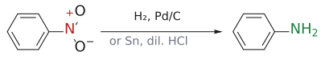
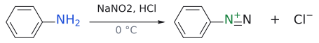
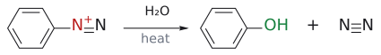
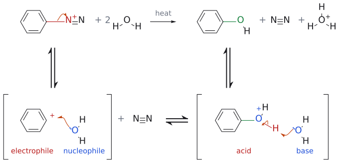
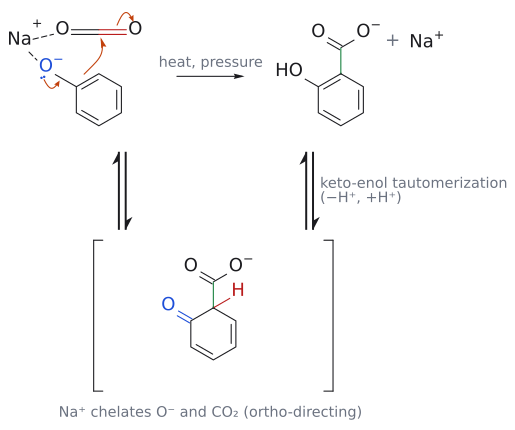

# L3. 친전자성 방향족 치환 반응 1부 (Electrophilic Aromatic Substitution, Part 1)

<!-- wiki-links:start -->

> **관련 위키 문서** ([위키 대문](../wiki/위키%20대문.md))
> - 반응: [aromatic halogenation](../wiki/반응/방향족%20할로젠화.md), [catalytic hydrogenation](../wiki/반응/촉매%20수소화.md), [Clemmensen reduction](../wiki/반응/클레멘센%20환원.md), [diazonium salt reactions](../wiki/반응/다이아조늄%20염%20반응.md), [electrophilic aromatic substitution](../wiki/반응/친전자성%20방향족%20치환.md), [Friedel–Crafts acylation](../wiki/반응/프리델-크래프츠%20아실화.md), [Friedel–Crafts alkylation](../wiki/반응/프리델-크래프츠%20알킬화.md), [Kolbe–Schmitt reaction](../wiki/반응/콜베-슈미트%20반응.md), [nitration](../wiki/반응/나이트로화.md), [sulfonation](../wiki/반응/설폰화.md)
> - 시약: [Lewis acid catalyst](../wiki/시약/루이스%20산%20촉매.md), [mixed acid](../wiki/시약/혼산.md), [Pd/C](../wiki/시약/Pd-C.md)
> - 개념: [acylium ion](../wiki/개념/아실륨%20이온.md), [arenium ion](../wiki/개념/아레늄%20이온.md), [aromaticity](../wiki/개념/방향족성.md), [carbocation](../wiki/개념/탄소%20양이온.md), [carbocation rearrangement](../wiki/개념/탄소%20양이온%20자리옮김.md), [electrophile and nucleophile](../wiki/개념/친전자체와%20친핵체.md), [Markovnikov's rule](../wiki/개념/마르코프니코프%20규칙.md), [nitronium ion](../wiki/개념/나이트로늄%20이온.md), [substituent effect](../wiki/개념/치환기%20효과.md)

<!-- wiki-links:end -->

## 0. 복습: electrophile의 $\delta^{+}$와 alkene의 HOMO

> 개념 문서: [electrophile and nucleophile](../wiki/개념/친전자체와%20친핵체.md), [Markovnikov's rule](../wiki/개념/마르코프니코프%20규칙.md)

> 강의 첫 장에는 Ben Bradshaw(바르셀로나 대학)의 "Synthetic Map"이 실려 있다. 작용기들 사이의 변환 관계를 지하철 노선도처럼 그린 그림이다. 이 과목에서 배우는 반응들이 그 지도 위의 "노선"이라고 생각하면 큰 그림을 잡는 데 도움이 된다.[1] (출처: L3 p.1)

강의는 L1–L2의 반응 표를 다시 보여주면서 각 시약의 **$\delta^{+}$ 부분**(HX의 H, H₂O의 H, X₂/H₂O의 X, BH₃의 B)을 강조한다. 이 $\delta^{+}$ 부분이 electrophile다. (출처: L3 p.4)

isobutene의 HOMO 그림을 보면 전자 밀도가 **CH₂ 말단**에 높다. 그래서 electrophile(H⁺ 등)가 CH₂ 쪽에 붙고, 양전하는 3차 탄소에 남는다. Markovnikov regioselectivity을 궤도함수 그림으로 다시 확인한 셈이다. 이 "HOMO의 전자 밀도가 큰 곳이 공격당한다"는 관점은 이 강의 7절의 phenol에서 다시 나온다. (출처: L3 p.5)

---

## 1. benzene은 왜 alkene처럼 반응하지 않는가

> 개념 문서: [aromaticity](../wiki/개념/방향족성.md), [electrophilic aromatic substitution](../wiki/반응/친전자성%20방향족%20치환.md), [aromatic halogenation](../wiki/반응/방향족%20할로젠화.md), [Lewis acid catalyst](../wiki/시약/루이스%20산%20촉매.md)

L1–L2에서 alkene의 이중결합은 bromine이나 과산 같은 electrophile을 만나자마자 반응했다. benzene도 겉보기에는 이중결합이 세 개나 있다. 그러면 benzene도 alkene처럼 반응할까? **그렇지 않다.** benzene은 mCPBA와도, 그냥 Br₂와도 반응하지 않는다.

benzene은 평면 정육각형이다. 탄소 여섯 개가 모두 sp² 혼성이고, 각 탄소에 붙은 H는 고리 평면 위에 놓인다. 모든 C-C 결합 길이는 **1.39 Å**으로 같다. 이 값은 단일결합(C-C 1.47 Å)과 이중결합(C=C 1.33 Å)의 중간이다.

benzene의 특별한 안정성(방향족성)은 탄소 여섯 개의 p 궤도함수가 겹쳐 만든 **분자 궤도함수 세 개에 $\pi$ 전자 여섯 개**가 들어 있는 데서 나온다. 즉 benzene의 $\pi$ 전자는 특정 C=C 결합에 묶여 있지 않고 고리 전체에 퍼져 있다. 그래서 "평범한 C=C 결합"이 아니다. (출처: L3 p.9)

- $\text{cyclohexene} \xrightarrow{\mathrm{RCO_3H}} \text{epoxide}(\text{cis 첨가})$

- $\text{cyclohexene} \xrightarrow{\mathrm{Br_2}} \text{*trans*-1,2-dibromide}(\text{trans 첨가})$

- $\text{benzene} \xrightarrow{\mathrm{RCO_3H}} \text{반응 없음}$**
- $\text{benzene} \xrightarrow{\mathrm{Br_2}} \text{반응 없음}$**

그림: alkene은 과산과 반응해 epoxide가 된다(cis 첨가). 예: mCPBA.

그림: alkene은 $Br_2$ 와 anti 첨가한다.

(출처: L3 p.9)

### 1.1 Lewis acid을 넣으면 반응한다

이 강의의 출발 질문은 "benzene은 왜 alkene과 다르게 행동하는가, 그리고 어떻게 하면 반응시킬 수 있는가?"다. 답은 두 가지로 요약된다.
1. benzene과 반응시키려면 **훨씬 강력한 electrophile**을 만들어야 한다. Lewis acid, 진한 sulfuric acid 등이 그 역할을 한다.
2. 일단 반응하면 benzene은 **첨가가 아니라 치환**으로 끝난다. H 하나를 내주고 aromaticity을 되찾는 쪽을 택하기 때문이다.

그림: 1단계(속도 결정): benzene의 $\pi$ 결합(파랑)이 AlCl₃와 착물을 이룬 Br–Br⁺의 바깥쪽 Br(빨강)을 공격한다. 두 번째 화살표는 Br–Br 결합 전자가 AlCl₃ 쪽 Br로 넘어가는 것을 나타낸다(AlCl₃Br⁻가 된다). 새로 생긴 C–Br 결합은 초록색이다. 2단계(빠름): sp³ 탄소의 C–H 결합 전자가 고리 안으로 들어가 양전하를 지우고(−H⁺), 방향족성이 회복된다. 그림 속 cation은 공명 구조 셋 중 하나(양전하가 오르토 탄소에 있는 것)만 그렸다.

benzene도 **AlCl₃나 FeCl₃ 같은 Lewis acid 촉매**를 넣으면 bromine과 반응한다. 두 반응을 비교해 보자.

- **alkene**: $\pi$ 결합이 Br-Br을 공격해 bromonium 이온이 된다. Br⁻가 반대쪽에서 공격하면 *trans*-dibromide라는 **첨가** 생성물이 나온다.
- **benzene**: $\pi$ 결합이 Br-Br⁺-AlCl₃⁻ 착물의 Br을 공격해 cation intermediate가 된다. 그다음 **H⁺가 빠져나가** bromobenzene이 된다. 이것은 **치환** 생성물이다.

bromine 원자가 수소 원자 하나를 대신했으니 치환 반응이다. 시약은 친전자성 bromine이고 기질은 방향족이므로, 이 반응을 **electrophilic aromatic substitution**이라 부른다. (출처: L3 p.10)

---

## 2. SEAr의 메커니즘: cyclohexadienyl cation

> 개념 문서: [electrophilic aromatic substitution](../wiki/반응/친전자성%20방향족%20치환.md), [arenium ion](../wiki/개념/아레늄%20이온.md)

이 반응을 **electrophilic aromatic substitution(SEAr)** 이라 한다. 이 강의에서는 halogenation, nitration, sulfonation, Friedel–Crafts alkylation과 acylation, 그리고 phenol의 반응을 다룬다. 고리에 이미 붙어 있는 치환기가 반응 위치를 어떻게 정하는지(배향 효과)는 L4에서 본격적으로 다룬다. (출처: L3 p.7)

모든 SEAr은 같은 두 단계를 거친다.

1. **속도 결정 단계(rate-determining step)**: benzene의 $\pi$ 전자가 electrophile E⁺를 공격한다. 그 결과 E와 H가 함께 붙은 sp³ 탄소가 하나 생기고, 나머지 다섯 탄소에 걸쳐 양전하가 퍼진 **cyclohexadienyl cation(cyclohexadienyl cation)** 이 생긴다. 이 단계에서 방향족성이 깨지므로 느리다.
2. **빠른 단계**: sp³ 탄소의 H가 H⁺로 떨어져 나가고, 그 C-H 결합 전자가 고리로 돌아와 방향족성이 회복된다.

(출처: L3 p.11)

**양전하가 어디에 놓일 수 있는지가 핵심이다.** 공명 구조 세 개를 그려보면 양전하는 E가 붙은 탄소를 기준으로 **두 ortho 위치와 para 위치**에만 놓인다. meta 위치에는 양전하가 오지 않는다. 이 사실이 L4에서 배울 배향 효과의 근본 원인이다. (출처: L3 p.11)

보충: 그런데 반응 속도를 정하는 것은 intermediate가 아니라 transition state다. 왜 intermediate의 안정성만 따져도 되는가? cyclohexadienyl cation은 출발 물질보다 에너지가 훨씬 높아서, 그것이 생기는 transition state와 에너지가 가깝다. 에너지가 비슷하고 서로 바로 이어지는 구조는 생김새도 비슷하다는 **해먼드 Hammond postulate** 에 따라, intermediate를 첫 번째 transition state의 모형으로 쓸 수 있다. 그래서 "intermediate를 안정화하는 치환기는 transition state도 안정화해 반응을 빠르게 한다"는 L4의 논리가 성립한다. (보충 근거: Clayden p.478)

용어도 정리해 두자. 치환기가 붙은 탄소가 **ipso**, 그 바로 옆이 **ortho**, 한 칸 더 건너가 **meta**, 정반대편이 **para** 다. (출처: L3 p.11)

> 왜 2단계에서 alkene처럼 Br⁻가 cation을 공격해 첨가 생성물을 만들지 않을까? H⁺를 잃고 방향족 고리를 회복하는 것이 에너지 면에서 훨씬 유리하기 때문이다.[2]

---

그림: E(여기서는 Br)가 붙은 sp³ 탄소를 기준으로 양전하(빨강)는 두 ortho 위치와 para 위치에만 놓인다. 주황 화살표는 $\pi$ 전자쌍이 이웃한 양전하 쪽으로 옮겨 가 다음 공명 구조가 되는 과정이다. meta 위치에는 양전하가 오지 않는다. (출처: L3 p.11)

그림: 첫 단계(방향족성을 잃는 친전자체 공격)가 느리고, $\sigma$ complex에서 $H^+$ 를 잃으면 방향족성을 되찾아 낮은 에너지의 치환 생성물이 된다(초록). nucleophile이 첨가하면(빨간 점선) 방향족성이 없는 생성물이라 불리하다. 보충: 정성적 도표다.

## 3. nitration (nitration)

> 개념 문서: [nitration](../wiki/반응/나이트로화.md), [nitronium ion](../wiki/개념/나이트로늄%20이온.md), [mixed acid](../wiki/시약/혼산.md), [diazonium salt reactions](../wiki/반응/다이아조늄%20염%20반응.md), [Pd/C](../wiki/시약/Pd-C.md)

nitro group(NO₂)를 방향족 고리에 도입하면 방향족 질소 화합물로 가는 일반적인 길이 열린다. 이런 방법은 지방족 질소 화합물에는 쓸 수 없다. 방향족 nitration에는 매우 강력한 시약, 보통 **진한 nitric acid과 진한 sulfuric acid의 혼합물**이 필요하다. (출처: L3 p.12)

**1단계: nitronium 이온(NO₂⁺) 생성**
1. sulfuric acid이 nitric acid의 OH를 protonation한다. 두 강산의 상호작용이다.
2. 물(H₂O)이 leaving group으로 떨어져 나간다.
3. 그 결과 **nitronium 이온(nitronium ion, O=N⁺=O)** 이 생긴다. 이 이온은 가운데 질소가 sp 혼성인 **직선형** 구조다.

그림: 왼쪽: nitric acid OH 산소(파랑)의 비공유 전자쌍이 sulfuric acid의 H(빨강)를 가져오고, H–O 결합 전자는 sulfuric acid의 산소로 돌아간다(평형). 가운데: O⁻(파랑)의 비공유 전자쌍이 N–O 결합으로 들어가 새 N=O(초록)를 만들고, 동시에 N–OH₂⁺ 결합(빨강) 전자가 물과 함께 떠난다. 오른쪽: 직선형 nitronium 이온. 친전자성 질소를 빨간색으로 표시했다.

**2단계: benzene의 공격**
benzene이 양전하를 띤 질소를 공격한다. 이때 질소가 5가가 되는 것을 피하려면 **N=O 결합 하나가 동시에 끊어져야 한다**. 그다음 H⁺가 빠지면 nitrobenzene이 된다. (출처: L3 p.12)

그림: $\pi$ 결합(파랑)이 N⁺(빨강)를 공격하는 화살표와, N=O 결합 하나(빨강)의 $\pi$ 전자가 산소로 올라가는 화살표가 동시에 움직인다. 그래서 질소는 4개의 결합만 유지하고, 산소는 O⁻(파랑)가 된다. 새 C–N 결합은 초록색이다. 이어서 C–H 결합 전자가 고리로 들어가며 H⁺가 빠진다.

### 3.1 nitro group의 활용

- **환원해서 아미노기로**: $\text{nitrobenzene} \xrightarrow{\mathrm{H_2},\ \mathrm{Pd/C}\ \text{또는}\ \mathrm{Sn},\ \text{묽은}\ \mathrm{HCl}} \text{aniline}$
- **diazonium 화학**: $\begin{aligned} & \text{aniline} \\ & \xrightarrow[0\,{}^\circ\mathrm{C}]{\mathrm{NaNO_2},\ \mathrm{HCl}} \text{아릴 diazonium}\ \text{염}(\mathrm{ArN_2^+\,Cl^-}) \\ & \xrightarrow[\text{가열}]{\mathrm{H_2O}} \text{phenol} \end{aligned}$
  - 메커니즘: N₂는 매우 좋은 leaving group이다. 그래서 가열하면 N₂가 떠나며 **아릴 cation(aryl cation)** 이 남는다. 이 cation을 nucleophile(여기서는 물)가 붙잡아 phenol이 된다.

그림: nitro기(빨강)를 $H_2$, Pd/C 또는 Sn, 묽은 HCl로 환원하면 $NH_2$ (초록)가 된다.

그림: aniline의 $NH_2$ (파랑)가 0 °C에서 $NaNO_2$, HCl과 반응해 aryl diazonium 염( $ArN_2^+\,Cl^-$, 초록)이 된다.

그림: diazonium 염을 물에서 가열하면 $N_2$ (빨강 쪽이 떠나는 기)가 빠지고 OH(초록)가 들어간다.

그림: 위 반응식의 메커니즘이다(SN1형). 위 줄이 전체 반응( $ArN_2^+ + 2\,H_2O \rightarrow ArOH + N_2 + H_3O^+$ )이고, 아래 대괄호는 중간체다. 1단계: C–N 결합 전자가 N(빨강 N⁺)으로 옮겨 $N_2$ 가 떠나고 aryl cation(electrophile, 빨강)이 생긴다. 2단계: $H_2O$ (nucleophile, 파랑)의 비공유 전자쌍이 cation 탄소를 공격해 새 C–O 결합(초록)이 생기고 $ArOH_2^+$ (산, 빨강)가 된다. 3단계: 다른 $H_2O$ (염기, 파랑)가 O–H의 H(빨강)를 가져가 phenol과 $H_3O^+$ 가 된다. 보충: 3단계의 양성자 이동은 슬라이드가 말로 한 "물이 aryl cation을 붙잡는다"를 마저 그린 것이다. (보충 근거: Clayden p.520)

(출처: L3 p.13)

보충: nitro group을 아미노기로 환원하면 치환기의 성격이 정반대로 바뀐다는 점도 중요하다. NO₂는 비활성화·메타 배향기이고, NH₂는 강한 활성화·오르토/파라 배향기다(→ [L4](L04_Electrophilic_Aromatic_Substitution_Part2.md) 1절, 3.3절). 그래서 NO₂가 있는 동안 메타 위치에 다른 치환기를 넣은 뒤 환원하면, 아미노기에 대해 메타인 화합물처럼 직접 만들기 어려운 구조를 얻을 수 있다. (보충 근거: Clayden p.495)

> 이렇게 nitration → 환원 → diazonium화 순서를 밟으면, 직접 넣기 어려운 OH 같은 치환기를 원하는 위치에 넣을 수 있다. 합성 문제에서 자주 쓰이는 우회로다.

---

## 4. sulfonation (sulfonation)

> 개념 문서: [sulfonation](../wiki/반응/설폰화.md)

benzene은 sulfuric acid만으로도 천천히 반응해 **benzenesulfonic acid** 이 된다.
1. sulfuric acid 분자 하나가 다른 sulfuric acid 분자의 OH를 protonation한다.
2. 물이 빠지면서 반응성이 매우 큰 cation HSO₃⁺(HO-S⁺(=O)₂)가 생긴다. 이것이 electrophile다.
3. 이 cation이 bromination나 nitration과 같은 메커니즘으로 benzene과 결합한다. 공격 단계가 속도 결정 단계이고, 그다음 H⁺가 빠진다.

같은 cation intermediate는 **삼산화황(SO₃)의 protonation**로도 만들 수 있다. 그래서 sulfonation의 또 다른 방법은 진한 sulfuric acid에 SO₃를 녹인 **fuming sulfuric acid(oleum)** 을 쓰는 것이다. (출처: L3 p.14)

---

## 5. Friedel–Crafts alkylation (Friedel–Crafts alkylation)

> 개념 문서: [Friedel–Crafts alkylation](../wiki/반응/프리델-크래프츠%20알킬화.md), [carbocation rearrangement](../wiki/개념/탄소%20양이온%20자리옮김.md), [carbocation](../wiki/개념/탄소%20양이온.md)

### 5.1 기본 아이디어

SN1 반응에서 carbocation은 아무리 약한 nucleophile와도 반응한다. benzene 고리도 예외가 아니다. 탄소 electrophile을 넣으려면 반응성이 큰 탄소 electrophile이 필요하고, 그것이 바로 **carbocation**이다. (출처: L3 p.15)

Friedel–Crafts alkylation은 보통 benzene을 **3차 alkyl chloride와 Lewis acid AlCl₃**로 처리한다.
1. AlCl₃가 *t*-BuCl의 Cl을 끌어당겨 R-Cl⁺-AlCl₃⁻ 착물을 만든다.
2. *t*-Bu cation이 풀려난다.
3. benzene이 이 cation을 공격해 cyclohexadienyl cation이 된다.
4. Cl⁻(AlCl₄⁻에서 온 것)가 H⁺를 떼어가 HCl이 빠지고 *t*-butylbenzene이 된다.

alkylation 단계에서는 **alkyl group이 cation을 만들 수 있어야 한다**. 그렇지 않으면 반응이 잘 되지 않는다. (출처: L3 p.15)

### 5.2 문제 1: carbocation의 자리 옮김 (rearrangement)

carbocation의 안정성 순서는 CH₃⁺ < CH₃CH₂⁺ < (CH₃)₂CH⁺ < (CH₃)₃C⁺ 다. 그래서 cation은 더 안정한 cation이 될 수 있으면 쉽게 **자리를 옮긴다**.
- **1,2-수소화물 이동(1,2-hydride shift)**: 예를 들어 3-methyl-2-butanol + HCl에서는 물이 빠져 2차 cation이 생긴다. 이웃 탄소의 H가 전자쌍째 옮겨오면 3차 cation이 되고, 결국 2-클로로-2-methylbutane이 생긴다.
- **1,2-methyl 이동(1,2-methyl shift)**: 이웃 탄소에 H 대신 methyl이 있으면 methyl이 옮겨가 3차 cation이 된다.

(출처: L3 p.16)

이 때문에 **1-chloropropane + benzene + AlCl₃** 반응에서는 *n*-propylbenzene이 부생성물이고, **isopropylbenzene(cumene)이 주생성물**이다. 다중 치환 생성물(*p*-diisopropylbenzene 등)도 함께 생긴다.

1차 cation은 용액에서 존재하지 못한다. 그래서 alkyl halide-AlCl₃ 착물은 (a) 그대로 benzene과 반응해 *n*-propylbenzene이 되거나, (b) 1,2-수소화물 이동으로 더 안정한 2차 cation이 된 뒤 반응해 isopropylbenzene이 된다. 마찬가지로 2차 cation도 3차 cation으로 바뀔 수 있으면 자리 옮김이 일어난다. (출처: L3 p.17)

그림: 슬라이드의 "rearrangement route"다. 1차 cation은 따로 생기지 않으므로, 이웃 탄소의 C–H 결합(파랑)이 전자쌍째 C1(빨강)으로 옮겨가는 화살표와 C1–Cl⁺ 결합(빨강) 전자가 Cl로 떠나는 화살표를 한 단계로 그렸다. 그 결과 2차(isopropyl) cation이 생기고, 옮겨온 H(파랑)는 가운데 탄소에 붙어 있다. 오른쪽 화살표는 benzene의 $\pi$ 결합(파랑)이 cation 탄소를 공격하는 단계다. 이후 H⁺가 빠지면 isopropylbenzene(cumene)이 된다.

### 5.3 문제 2: 다중 치환

슬라이드에는 "생성물이 더 반응성이 the products are more reactive"라고 적혀 있다. alkyl group은 고리에 전자를 주는 기라서, alkylbenzene은 benzene보다 electrophile을 더 잘 공격한다. 그래서 한 번 alkylate된 생성물이 또 alkylate되는 **과잉 치환**이 일어난다(→ [L4](L04_Electrophilic_Aromatic_Substitution_Part2.md) 2절 alkylbenzene의 활성화 참고). (출처: L3 p.17)

보충: 다중 치환을 줄이는 실용적인 방법은 **benzene을 크게 과량**으로 쓰는 것이다. electrophile이 이미 alkylate된 생성물보다 benzene을 만날 확률이 훨씬 커지기 때문이다. 그래도 완전히 막을 수는 없어서, benzyl chloride로 diphenylmethane을 만드는 반응은 과량의 benzene을 써도 수율이 50% 정도에 그친다. (보충 근거: Clayden p.492–493; Wade p.781)

보충: 반대 방향의 한계도 있다. Friedel–Crafts 반응은 benzene, 활성화된 benzene, halobenzene에서만 잘 되고, nitrobenzene, benzenesulfonic acid, phenyl ketone처럼 **강하게 비활성화된 고리에서는 실패**한다(6.2절에서 nitrobenzene을 acylation 용매로 쓰는 것과 같은 이유다). 그래서 합성 순서가 중요하다. 예를 들어 *p*-nitro-*t*-butylbenzene은 *t*-butyl화를 먼저 하고 nitration을 나중에 해야 하며, 순서를 바꾸면 alkylation 단계가 진행되지 않는다. (보충 근거: Wade p.780)

---

## 6. Friedel–Crafts acylation (Friedel–Crafts acylation)

> 개념 문서: [Friedel–Crafts acylation](../wiki/반응/프리델-크래프츠%20아실화.md), [acylium ion](../wiki/개념/아실륨%20이온.md), [Clemmensen reduction](../wiki/반응/클레멘센%20환원.md)

### 6.1 메커니즘

Friedel–Crafts acylation은 보통 benzene을 **acid chloride(RCOCl)과 AlCl₃**로 처리한다.
1. AlCl₃가 acid chloride의 Cl과 착물을 만든다.
2. Cl이 AlCl₄⁻로 떠나면서 **acylium 이온(acylium ion, R-C≡O⁺)** 이 생긴다. 이 이온은 산소의 비공유 전자쌍이 양전하를 나눠 갖기 때문에 꽤 안정하다.
3. benzene이 acylium 이온의 탄소를 공격하고, H⁺(HCl)가 빠지면 아릴 ketone이 된다.

그림: R을 CH₃로 acetyl chloride. 왼쪽: carbonyl 산소(파랑)의 비공유 전자쌍이 C=O 쪽으로 밀려 들어가 C≡O⁺ 삼중 결합을 만들고, 동시에 C–Cl⁺ 결합(빨강) 전자가 Cl로 떠나 AlCl₄⁻가 된다. 오른쪽: acylium 이온의 친전자성 탄소(빨강)를 benzene의 $\pi$ 결합(파랑)이 공격한다. 이후 단계(H⁺ 이탈)는 bromination과 같다.

(출처: L3 p.18)

acid chloride 대신 **acid anhydride** 도 쓸 수 있다. 이 경우 AlCl₃가 무수물의 carbonyl 산소에 배위하고, 무수물이 쪼개지면서 acylium 이온과 carboxylate-AlCl₃⁻가 생긴다. (출처: L3 p.19)

### 6.2 acylation이 alkylation보다 나은 이유

alkylation의 두 가지 문제가 acylation에서는 생기지 않는다.
1. **다중 치환이 없다**: 생성물의 acyl group이 $\pi$ 계에서 전자를 끌어가 고리를 비활성화하므로 두 번째 치환이 어렵다. 고리가 처음부터 너무 비활성화되어 있으면 아예 반응하지 않는다. 예를 들어 nitrobenzene은 Friedel–Crafts acylation에 불활성이어서 **이 반응의 용매로 쓰이기도 한다**.
2. **자리 옮김이 없다**: electrophile인 acylium 이온이 이미 비교적 안정하기 때문이다.

또한 acylation은 acyl 염화물에 특별한 구조적 조건이 필요 없다. R이 거의 무엇이든 된다. (출처: L3 p.18, p.21)

### 6.3 acylation + 환원 = 깔끔한 alkylation

acylation이 훨씬 믿을 만하기 때문에, alkyl group을 넣는 흔한 방법은 **먼저 acylate하고 carbonyl을 methylene(-CH₂-)으로 환원**하는 것이다.
- **클레멘센 Clemmensen reduction**: 아연 아말감(Zn/Hg, 아연과 수은의 합금)과 HCl을 쓴다. 아릴-alkyl ketone을 환원하는 데 특히 효과적이다.
  - 예: $\text{프로피오페논}(\mathrm{PhCOCH_2CH_3}) \xrightarrow{\mathrm{Zn/Hg},\ \mathrm{HCl}} \mathit{n}\ \text{-propylbenzene}$. 이렇게 하면 직접 alkylation에서 생기는 자리 cumene 문제를 피할 수 있다.
- **chemoselectivity**: ketone만 환원되고 carboxylic acid은 반응하지 않는다.
  - 예: $\text{3-benzoylpropanoic acid} \xrightarrow{\mathrm{Zn/Hg},\ \mathrm{HCl}} \text{4-phenylbutanoic acid}$

그림: Clemmensen 환원. C=O(빨강)가 $CH_2$ (초록)로 바뀐다.

(출처: L3 p.20)

### 6.4 응용: 테트랄론 합성 (빈칸 메커니즘 문제)

1. $\begin{aligned} & \text{succinic acid 무수물} + \text{benzene} \\ & \xrightarrow{\mathrm{AlCl_3}\ 2.2\ \text{당량}} \text{3-benzoylpropanoic acid} \end{aligned}$

2. $\xrightarrow{\mathrm{Zn/Hg},\ \mathrm{HCl}} \text{4-phenylbutanoic acid}$

3. $\xrightarrow{\mathrm{H_3PO_4}} \alpha\ \text{-테트랄론}(\text{1-테트랄론},\ \text{3,4-dihydronaphthalene-1(2*H*)-온})$

그림: 보충: succinic anhydride와 benzene의 Friedel–Crafts acylation( $AlCl_3$ ) → Clemmensen 환원( $Zn(Hg)$, $HCl$ ) → 분자내 Friedel–Crafts acylation( $H_3PO_4$ )으로 $\alpha$-tetralone이 된다.

슬라이드 p.22는 메커니즘을 빈칸으로 두었고, 답은 L4 p.3에 있다.
- **1단계**: 무수물의 carbonyl 산소가 AlCl₃에 배위한다. 고리가 열리면서 한쪽 끝은 acylium 이온, 다른 쪽 끝은 carboxylate-AlCl₃⁻가 된다. benzene이 acylium 이온을 공격하고 H⁺가 빠진다. 수용액 후처리로 산이 된다.
- **2단계**: 클레멘센 환원으로 ketone만 CH₂가 된다.
- **3단계**: H₃PO₄가 carboxylic acid의 OH를 protonation한다. 물이 빠지면서 acylium 이온이 생기고, 같은 분자의 benzene 고리가 이를 공격한다(**분자내 Friedel–Crafts acylation**). 6원 고리가 닫히고 H⁺가 빠지면 테트랄론이 된다.

(출처: L3 p.19-22, L4 p.3)

> AlCl₃를 2.2 당량이나 쓰는 이유는 무엇일까? 슬라이드에는 설명이 없다. 보충하면, 생성물의 ketone과 carboxylic acid(염)이 각각 AlCl₃와 강하게 배위해 붙잡아 두기 때문에 촉매량으로는 부족하고 당량 이상이 필요하다.[3]

---

## 7. phenol의 친전자성 치환

> 개념 문서: [aromatic halogenation](../wiki/반응/방향족%20할로젠화.md), [substituent effect](../wiki/개념/치환기%20효과.md), [Kolbe–Schmitt reaction](../wiki/반응/콜베-슈미트%20반응.md)

### 7.1 phenol은 촉매 없이도 세 번 brominate된다

benzene은 Lewis acid 촉매 없이는 bromine과 반응하지 않는다. 그런데 phenol은 완전히 다르게 반응한다.
- **Lewis acid이 필요 없다.**
- 반응이 **매우 빠르다**.
- 생성물에는 **특정 위치에 bromine 원자 세 개**가 붙는다. $\text{phenol} \xrightarrow[\mathrm{EtOH/H_2O}]{\mathrm{Br_2}} \text{2,4,6-tribromophenol}$. 두 오르토 위치와 파라 위치다.

그림: OH(파랑)가 고리를 강하게 활성화해 두 ortho와 para 자리에 Br(초록) 세 개가 붙는다.

그림: 위 반응식의 메커니즘이다. 첫 번째 치환(para 위치)만 그렸고, 두 ortho 위치에서도 같은 두 단계가 되풀이되어 2,4,6-tribromophenol이 된다. 위 줄이 전체 반응이고 아래 대괄호는 중간체다. 1단계: 화살표 넷이 한꺼번에 움직인다. OH 산소의 비공유 전자쌍(파랑)이 C–O 결합으로 들어가 C=O⁺(초록)를 만들고, 고리의 $\pi$ 전자가 차례로 밀려 para 탄소의 $\pi$ 결합(파랑)이 $Br_2$ 의 Br(빨강)을 공격하며, Br–Br 결합 전자는 바깥쪽 Br로 가서 $Br^-$ 가 된다. 새 C–Br 결합은 초록색이다. 2단계: 중간체 oxonium cation(산, 빨강)의 sp³ 탄소에 붙은 H(빨강)를 $Br^-$ (염기, 파랑)가 가져가고, C–H 결합 전자가 고리로 돌아와 방향족성이 회복된다(−HBr). 보충: 2단계의 화살표는 슬라이드에 없는 보충이다. (보충 근거: Clayden p.474, p.479)

(출처: L3 p.23)

> 슬라이드에는 "Phenol reacts three times as rapidly"라고 적혀 있다. 그러나 문맥상 이는 "세 번이나, 빠르게(촉매 없이 실온에서) 반응한다"는 뜻으로 읽는 것이 자연스럽다. L4 p.21의 데이터를 보면 OMe 치환 benzene(아니솔)의 bromination이 benzene보다 **10⁹배** 빠르므로, "3배 빠르다"는 해석은 맞지 않는다.[4]

### 7.2 이유: HOMO가 바뀌었다

1. phenol에서 가장 에너지가 높은 전자는 더 이상 benzene 고리의 $\pi$ 전자가 아니다. **산소의 비공유 전자쌍**이다.
2. 이 비결합 전자가 만드는 HOMO는 방향족 고리의 낮은 에너지 결합 전자보다 **에너지가 훨씬 높다**. 그래서 친핵성이 훨씬 크다.

(출처: L3 p.23)

phenol의 HOMO 그림을 보면 전자 밀도가 **OH의 두 오르토 위치와 파라 위치**에 몰려 있다. 공명 구조로도 같은 결론이 나온다. O의 비공유 전자쌍이 고리로 밀려 들어가면 음전하(전자 밀도)가 오르토, 파라, 다른 쪽 오르토 위치에 차례로 놓이고, 그때 산소는 O⁺=C가 된다. (출처: L3 p.24)

### 7.3 메커니즘: 고리는 "전선"이다

(이 단계의 메커니즘 그림은 위 7.1절의 종합 그림에 합쳤다. 화살표 넷의 의미는 그 그림 설명을 본다.)

화살표는 **OH의 비공유 전자쌍에서 출발**해 고리를 통과한 뒤 Br-Br을 공격하도록 그린다. benzene 고리가 **conductor** 처럼 OH의 전자를 bromine 분자까지 흘려보내는 셈이다.
1. $\begin{aligned} & \text{파라 위치 공격} \\ & \longrightarrow \text{oxonium cation intermediate} \\ & \longrightarrow \mathrm{HBr}\text{이}\ \text{빠짐} \\ & \longrightarrow \mathit{p}\ \text{-bromophenol} \end{aligned}$
2. $\begin{aligned} & \text{같은 방식으로 오르토 위치 공격} \\ & \longrightarrow \text{2,4-dibromophenol} \\ & \longrightarrow \text{한 번 더} \\ & \longrightarrow \text{2,4,6-tribromophenol} \end{aligned}$

이처럼 OH기는 electrophile에 대해 **오르토, 파라 ortho, para-directing** 이라고 한다. (출처: L3 p.25)

### 7.4 응용

- **phenoxyacetic acid의 염소화**: 첫 번째 염소화는 입체 장애 때문에 파라 위치에서 일어나 4-chlorophenoxyacetic acid이 된다. 두 번째는 오르토 위치에서 일어나 제초제 **2,4-D(2,4-dichlorophenoxyacetic acid)** 가 된다. (출처: L3 p.26)
- **콜베-슈미트 Kolbe–Schmitt process**: $\begin{aligned} & \text{phenol}(\mathrm{pKa}\ 10) \\ & \xrightarrow{\mathrm{NaOH}} \text{나트륨 phenoxide} \\ & \xrightarrow{\mathrm{CO_2}} \text{나트륨 salicylate} \\ & \xrightarrow{\mathrm{H_3O^+}} \text{salicylic acid} \\ & \xrightarrow{\mathrm{Ac_2O}} \text{아스피린} \end{aligned}$**
  - phenoxide 이온은 phenol보다 더 반응성이 크다. 산소의 음전하가 고리로 더 강하게 밀려 들어가기 때문이다. 그래서 CO₂ 같은 **약한 electrophile**와도 반응한다.
  - 메커니즘 그림에서 Na⁺는 phenoxide O⁻와 CO₂의 O 사이에 걸쳐 있다. 이 배위 때문에 CO₂가 **오르토 위치**로 안내된다. 오르토 탄소가 CO₂의 탄소를 공격한 뒤 tautomerization(±H⁺)로 방향족성이 회복된다.[5]

그림: Kolbe–Schmitt 1: phenoxide(파랑 $O^-$ )의 ortho 탄소가 $CO_2$ 의 C(빨강)를 공격해 salicylate(초록 C–C)가 된다.

그림: 위 반응식의 메커니즘이다. 위 줄이 전체 반응(sodium phenoxide + $CO_2$ → sodium salicylate)이고 아래 대괄호는 중간체다. 1단계: $O^-$ (파랑)의 비공유 전자쌍이 C–O 결합으로 들어가 C=O를 만들고, 고리의 $\pi$ 결합(파랑)이 ortho 탄소에서 $CO_2$ 의 탄소(빨강)를 공격하며, $CO_2$ 의 C=O $\pi$ 전자는 산소로 올라가 $O^-$ 가 된다. 새 C–C 결합은 초록색이다. 점선은 $Na^+$ 가 $O^-$ 와 $CO_2$ 의 O에 걸쳐 있는 모습으로(슬라이드와 같다), 이 배위가 $CO_2$ 를 ortho 위치로 안내한다. 2단계: 중간체(cyclohexadienone)의 sp³ 탄소에서 H(빨강)가 빠지고 산소가 H⁺를 받는 keto–enol tautomerization으로 방향족성이 회복되어 salicylate가 된다. 슬라이드도 이 단계를 "tautomerization(±H⁺)"으로만 적어서 곡선 화살표는 그리지 않았다. (보충 근거: Clayden p.481)

그림: Kolbe–Schmitt 뒤: salicylic acid의 phenol OH(파랑)가 $Ac_2O$ 로 acetyl화되어 aspirin(초록 ester O)이 된다.

(출처: L3 p.26)

---

## 흔한 오해

- **"benzene도 이중결합이 있으니 Br₂와 첨가 반응한다"**: benzene의 $\pi$ 전자는 고리 전체에 퍼져 안정하다. Br₂만으로는 반응하지 않고, Lewis acid이 있을 때 **치환**한다.
- **"SEAr 2단계도 alkene처럼 anion이 cation을 공격한다"**: H⁺가 빠져 방향족성을 회복하는 것이 훨씬 유리하므로 치환으로 끝난다.
- **"Friedel–Crafts alkylation으로 *n*-propylbenzene을 깔끔하게 만들 수 있다"**: 1,2-수소화물 이동으로 cumene이 주생성물이 된다. *n*-propylbenzene은 **acylation + 클레멘센 환원**으로 만든다.
- **"acylation도 다중 치환이 문제다"**: acyl group이 고리를 비활성화하므로 한 번 치환된 뒤 멈춘다.
- **"phenol의 반응성은 고리 $\pi$ 전자 덕분이다"**: 산소 비공유 전자쌍이 HOMO의 에너지를 끌어올렸기 때문이다.

---

## 반응 정리표

> 개념 문서: [electrophilic aromatic substitution](../wiki/반응/친전자성%20방향족%20치환.md) (전체 반응 표)

| 반응 | 시약/조건 | electrophile | 생성물 | 비고 |
|---|---|---|---|---|
| [aromatic halogenation](../wiki/반응/방향족%20할로젠화.md) | X₂ + Lewis acid (AlX₃, FeX₃) | X-X⁺-AlX₃⁻ 착물 | ArX | benzene은 Lewis acid 없이 반응 안 함 |
| [nitration](../wiki/반응/나이트로화.md) | 진한 HNO₃ + 진한 H₂SO₄ | NO₂⁺ (직선형, sp N) | ArNO₂ | |
| [sulfonation](../wiki/반응/설폰화.md) | 진한 H₂SO₄ 또는 fuming sulfuric acid (H₂SO₄ + SO₃) | HSO₃⁺ (SO₃H⁺) | ArSO₃H | |
| [F-C alkylation](../wiki/반응/프리델-크래프츠%20알킬화.md) | RX + AlCl₃ | R⁺ | ArR | 자리 옮김, 다중 치환 문제 |
| [F-C acylation](../wiki/반응/프리델-크래프츠%20아실화.md) | RCOCl (또는 (RCO)₂O) + AlCl₃ | R-C≡O⁺ (acylium) | ArCOR | 한 번만 치환, 자리 옮김 없음 |
| [Clemmensen reduction](../wiki/반응/클레멘센%20환원.md) | Zn/Hg, HCl | (환원) | ArCH₂R | ketone만 환원 (산은 그대로) |
| 분자내 acylation | H₃PO₄ | acylium | 테트랄론 | 6원 고리 형성 |
| nitro 환원 | H₂, Pd/C 또는 Sn, 묽은 HCl | | ArNH₂ | |
| $\text{diazonium화} \longrightarrow \text{phenol}$ ([diazonium salt reactions](../wiki/반응/다이아조늄%20염%20반응.md)) | 1. NaNO₂, HCl, 0 °C 2. H₂O, 가열 | 아릴 cation | ArOH | N₂가 leaving group |
| phenol bromination | Br₂, EtOH/H₂O (촉매 없음) | Br₂ | 2,4,6-tribromophenol | o,p-배향, 매우 빠름 |
| [Kolbe–Schmitt reaction](../wiki/반응/콜베-슈미트%20반응.md) | 1. NaOH 2. CO₂ 3. H₃O⁺ | CO₂ | salicylic acid (오르토) | phenoxide는 매우 활성 |

---

## 연습 문제

> 문제와 해설 모음: [L3 연습 문제](../practice/L03_Exercises.md)

1. benzene의 C-C 결합 길이가 1.39 Å으로 모두 같다는 사실은 benzene의 구조에 대해 무엇을 알려주는가? 이것과 benzene이 Br₂와 바로 반응하지 않는 이유를 연결해 설명하시오.
2. SEAr 메커니즘에서 속도 결정 단계는 무엇이며, 그 이유는 무엇인가? cyclohexadienyl cation에서 양전하가 놓일 수 있는 위치를 E가 붙은 탄소 기준으로 쓰시오.
3. nitric acid과 sulfuric acid의 혼합물에서 nitronium 이온이 생기는 과정을 단계별로 쓰시오. nitronium 이온의 혼성과 모양도 쓰시오.
4. benzene + 1-chloropropane + AlCl₃ 반응의 주생성물과 부생성물을 쓰고, 그 이유를 설명하시오. *n*-propylbenzene을 주생성물로 얻으려면 어떻게 해야 하는가?
5. (슬라이드 p.22 빈칸) succinic acid 무수물 + benzene에서 출발해 $\alpha$-테트랄론을 만드는 3단계 합성의 각 단계 메커니즘을 설명하시오.
6. nitrobenzene이 Friedel–Crafts acylation의 용매로 쓰일 수 있는 이유는 무엇인가?
7. phenol이 Lewis acid 없이도 Br₂와 빠르게 반응해 2,4,6-tribromophenol을 주는 이유를 HOMO 관점과 공명 구조 관점에서 설명하시오.
8. benzene에서 출발해 phenol을 만드는 방법을 SEAr과 이 강의에서 배운 다른 반응들을 조합해 쓰시오.

## 정답 및 해설

1. 모든 결합 길이가 단일결합(1.47 Å)과 이중결합(1.33 Å)의 중간이라는 것은 $\pi$ 전자가 특정 결합에 고정되지 않고 고리 전체에 퍼져 있다는 뜻이다. 이렇게 비편재화된 $6\pi$ 전자계는 방향족 안정성을 갖는다. Br₂와 반응하면 이 안정성을 잃어야 하므로, 평범한 alkene과 달리 Br₂만으로는 반응하지 않는다. (L3 p.9)
2. 속도 결정 단계는 첫 단계, 즉 $\pi$ 전자가 E⁺를 공격해 cyclohexadienyl cation을 만드는 단계다. 이 단계에서 방향족성이 깨지기 때문에 느리다. 양전하는 E가 붙은 탄소를 기준으로 두 오르토 위치와 파라 위치에만 놓인다. (L3 p.11)
3. H₂SO₄가 HNO₃의 OH를 protonate해 -OH₂⁺를 만들고, H₂O가 떨어져 나가 NO₂⁺가 된다. NO₂⁺에서 N은 sp 혼성이고 분자는 직선형(O=N⁺=O)이다. (L3 p.12)
4. 주생성물은 isopropylbenzene(cumene), 부생성물은 *n*-propylbenzene이다. 다중 치환 생성물도 생긴다. 1차 cation은 용액에서 존재하지 못하므로 착물이 1,2-수소화물 이동으로 2차 cation이 된 뒤 반응한다. *n*-propylbenzene을 원한다면 propanoyl chloride(CH₃CH₂COCl)/AlCl₃로 acylation한 뒤 Zn/Hg, HCl로 클레멘센 환원한다. (L3 p.17, p.20)
5. (i) AlCl₃가 무수물 carbonyl O에 배위해 고리가 열리면서 acylium 이온이 생긴다. benzene이 이를 공격하고 H⁺가 빠지면 아릴 ketone(carboxylate-AlCl₃)이 되며, 후처리하면 3-benzoylpropanoic acid이 된다. (ii) Zn/Hg, HCl로 ketone만 CH₂로 환원해 4-phenylbutanoic acid을 얻는다. (iii) H₃PO₄가 COOH를 protonate하고 물이 빠져 acylium 이온이 생긴다. 같은 분자의 benzene 고리가 분자내 공격해 6원 고리가 닫히고, H⁺가 빠지면 $\alpha$-테트랄론이 된다. (L4 p.3)
6. nitro group이 고리를 강하게 비활성화해서 nitrobenzene 자체는 acylate되지 않는다. 그래서 반응에 참여하지 않는 용매로 쓸 수 있다. (L3 p.21)
7. phenol에서는 산소 비공유 전자쌍이 고리와 공액되어 HOMO 에너지가 크게 올라간다. 그래서 친핵성이 훨씬 커진다. 공명 구조를 그리면 O의 전자가 오르토와 파라 위치로 밀려 들어가 그 위치의 전자 밀도가 높아진다. 그래서 세 위치(2,4,6)에서 촉매 없이 빠르게 치환된다. (L3 p.23-25)
8. $\begin{aligned} & \text{benzene} \\ & \xrightarrow{\mathrm{HNO_3/H_2SO_4}} \text{nitrobenzene} \\ & \xrightarrow{\mathrm{H_2},\ \mathrm{Pd/C}\ \text{또는}\ \mathrm{Sn/HCl}} \text{aniline} \\ & \xrightarrow[0\,{}^\circ\mathrm{C}]{\mathrm{NaNO_2},\ \mathrm{HCl}} \text{diazonium 염} \\ & \xrightarrow[\text{가열}]{\mathrm{H_2O}} \text{phenol} \end{aligned}$. (L3 p.12-13)

그림: 1단계: nitration.

---

## 각주

[1] syntheticmap.com에서 볼 수 있다. 슬라이드에 "Copyright Dr. Ben Bradshaw (Universitat de Barcelona)"라고 명시되어 있다.

[2] 보충: cyclohexadienyl cation 단계는 방향족 안정화 에너지를 잃은 상태다. H⁺를 잃으면 그 에너지를 되찾지만, nucleophile이 첨가하면 비방향족 diene으로 남는다. Clayden 등 표준 교재의 설명이다. (보충 근거: Clayden p.475)

[3] 보충: Friedel–Crafts acylation의 생성물인 아릴 ketone은 루이스 염기로서 AlCl₃와 1:1 착물을 만든다. 그래서 AlCl₃는 촉매가 아니라 화학량론적 양이 필요하다는 것이 표준적인 설명이다. succinic acid 무수물의 경우 carboxylic acid(염) 부분까지 있으므로 2 당량 이상을 쓰는 것으로 이해할 수 있다. (보충 근거: Clayden p.494) 슬라이드에는 "2.2 equivalents"라는 수치만 있다.

[4] 슬라이드 원문은 "Phenol reacts three times as rapidly without catalyst at room temperature."이다. 이 문장은 "세 번 빠르게 반응한다"로도, "세 배 빠르게 반응한다"로도 읽힐 수 있다. 이 노트에서는 앞뒤 문맥(세 개의 Br 도입)과 L4 p.21의 속도 데이터에 맞춰 "세 번, 빠르게"로 해석했다. 원문이 모호하므로 강의 담당 교수님께 확인해 보는 것도 좋다.

[5] 보충: Na⁺ 배위가 오르토 선택성의 원인이라는 해석은 슬라이드 메커니즘 그림(Na가 O⁻와 CO₂의 O를 잇는 점선)에 근거한 것이다.
