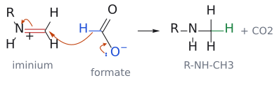
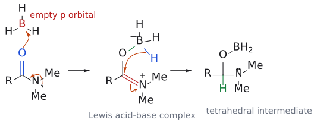
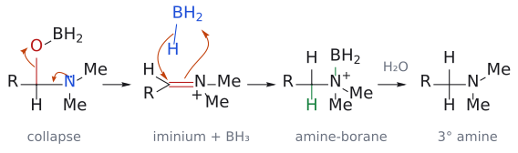
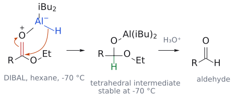

# L5. 환원 반응 (Reduction reactions)

<!-- wiki-links:start -->

> **관련 위키 문서** ([[위키 대문]])
> - 반응: [[SN2 반응]], [[로젠문트 환원]], [[수소화분해]], [[스타우딩거 환원]], [[아마이드 환원]], [[아자이드·나이트릴을 거친 아민 합성]], [[에슈바일러-클라크 반응]], [[에스터 부분 환원]], [[촉매 수소화]], [[환원성 아미노화]]
> - 시약: [[DIBAL-H]], [[LiAlH4]], [[LiBH4]], [[NaBH3CN]], [[NaBH4]], [[Pd-C|Pd/C]], [[PtO2]], [[벤질 에터 보호기]], [[보레인]], [[피롤리딘]]
> - 개념: [[금속 수소화물의 반응성]], [[사면체 중간체]], [[이미늄 이온]], [[이민]], [[친전자체와 친핵체]]

<!-- wiki-links:end -->

> CM3121 Advanced Organic Chemistry, Dr. Zhu Ye. 출처 표기의 p.는 PDF 페이지 번호다.

## 개요

이 강의는 "분자에 수소를 붙이는 법", 즉 환원(reduction)을 다룬다. 출발점은 아민이다. 세로토닌, 니코틴, 디아제팜처럼 몸과 약에서 중요한 분자 상당수가 질소를 품고 있는데, 정작 아민을 깔끔하게 만드는 일은 생각보다 까다롭다. 그래서 강의는 아민 합성 문제를 실마리 삼아 아자이드·나이트릴·아마이드·이민을 환원하는 방법으로 넘어가고, 거기서 NaBH4, LiBH4, LiAlH4, BH3, DIBAL-H라는 금속 수소화물(metal hydride) 시약 세트를 정리한 뒤, 마지막으로 H2와 금속 촉매를 쓰는 촉매 수소화(catalytic hydrogenation)로 마무리한다. 핵심 질문은 하나다. "분자 안에 환원될 수 있는 자리가 여러 개일 때, 원하는 곳만 환원하려면 어떤 시약을 골라야 하나?" L1에서 알켄의 수소붕소화(hydroboration)로 만났던 BH3가 여기서는 카보닐 환원제로 다시 등장하고, 이후 L7(엔올레이트), L10(엔아민/이미늄), L12(보호기)에서도 이 강의의 시약들이 계속 쓰인다.

## 1. 아민이란 무엇이고, 왜 만들기 어려운가

### 1-0. 일상 속 질소 화합물

왜 하필 아민부터 시작할까? 슬라이드는 세로토닌과 도파민 이야기로 답한다. 둘 다 신경전달물질(neurotransmitter)로, 한 신경에서 다음 신경으로 시냅스 간극을 건너 전기 신호를 전달한다. 세로토닌은 뇌와 중추신경계 전반에서 식욕, 수면 주기, 기분, 기억과 학습을 조절한다.[1] 그 밖에도 피리독신(비타민 B6), 티아민 염화물(비타민 B1), 니코틴, 니코틴산(나이아신, 비타민 B3), 불안·알코올 금단·발작 치료제인 디아제팜(Valium), 항히스타민제 클로르페니라민, 히스타민이 모두 질소 화합물이다. 생선 비린내의 원인 중 하나인 트라이메틸아민도 여기에 속한다. 즉 질소 화합물은 생화학적 성질의 폭이 매우 넓고, 그래서 아민을 만드는 법은 유기합성의 기본기가 된다.

(출처: L5 p.2-3)

### 1-0-1. 아민의 분류와 성질

아민은 N에 붙은 탄소 수에 따라 1차(RNH2), 2차(R2NH), 3차(R3N)로 나뉜다. N에 기가 네 개 붙을 수도 있는데, 이때는 N이 형식 양전하를 띠어야 하므로 4차 암모늄염(quaternary ammonium salt)이 된다. 또 알킬기가 붙은 알킬아민(alkylamine)과 아릴기가 붙은 아릴아민(arylamine)으로도 나누는데, 화학은 대체로 비슷하지만 차이도 상당하다.

아민의 화학을 한 줄로 요약하면 "N의 비공유 전자쌍"이다. 이 전자쌍 때문에 아민은 염기이자 친핵체가 된다. 그런데 같은 N을 가진 아마이드(RCONH2)는 사정이 다르다. 아마이드는 수용성 산에 양성자화되지 않을 만큼 염기성이 없고, 친핵성도 약하다.[2] 이 차이는 뒤에서 "아마이드를 환원하면 아민이 된다"는 사실과 맞물려 중요해진다.

고리형 아민도 이름을 익혀 두자. 7원 고리 아제판(azepane), 6원 고리 피페리딘(piperidine)·피페라진(piperazine)·모폴린(morpholine), 5원 고리 피롤리딘(pyrrolidine), 4원 고리 아제티딘(azetidine), 3원 고리 아지리딘(aziridine)이다.[3]

(출처: L5 p.4)

### 1-1. SN2로 아민 만들기: 왜 생각대로 안 되나

가장 단순한 발상은 NH3를 친핵체로 써서 할로젠화 알킬을 SN2로 치환하는 것이다.

`NH3 (대과량) + R-X --> [R-NH3+ X-] --> RNH2 + NH4+ X-`

메커니즘은 이렇다.
1. NH3(친핵체)의 N 비공유 전자쌍이 R-X의 탄소(친전자체)를 뒤에서 공격하고, C-X 결합이 끊어지면서 C-N 결합이 생긴다. 결과물은 알킬암모늄염 R-NH3+X-다.
2. 옆에 있던 NH3가 N-H 양성자를 떼어 가면 중성 RNH2와 NH4+X-가 남는다.

실제로 2-브로모프로판산 1 mol에 NH3를 무려 70 mol 넣으면 알라닌(암모늄염 형태)을 65-70%로 얻을 수 있다.

`CH3CH(Br)COOH (1 mol) + NH3 (70 mol) --> CH3CH(NH2)COO- NH4+ (알라닌, 65-70%)`

그런데 왜 NH3를 그렇게 많이 넣어야 할까? 1-브로모옥테인에 NH3를 2 eq만 넣어 보면 답이 나온다.

`CH3(CH2)6CH2Br + NH3 (2 eq) --> 옥틸아민 (45%) + 다이옥틸아민 (43%) + 트라이옥틸아민 (미량) + 테트라옥틸암모늄 브로마이드 (미량)`

원하는 1차 아민과 거의 같은 양의 2차 아민이 섞여 나온다. 이것이 과알킬화(over-alkylation)다. 원인은 생성물 자체에 있다. 새로 생긴 RNH2는 알킬기의 전자 공여 덕분에 NH3보다 오히려 더 좋은 친핵체라서, 남은 RX를 먼저 낚아채 버린다.[4] 즉 반응이 "한 번만 일어나고 멈추는" 장치가 없다. 그래서 아래의 방법들은 모두 "N을 한 번만 붙이고 나중에 환원으로 아민을 드러내는" 전략으로 이 문제를 피한다.

(출처: L5 p.5-6)

### 1-1a. 아자이드 이온 알킬화 후 환원

과알킬화를 막으려면 어떻게 해야 할까? 한 가지 답은 친핵체를 NH3 대신 아자이드 이온 N3-로 바꾸는 것이다. 아자이드 이온은 좋은 친핵체라 SN2가 잘 되지만, 생성물인 알킬 아자이드 R-N3는 더 이상 친핵성이 없다. 그래서 반응이 정확히 한 번에서 멈추고, 그다음 환원하면 1차 아민만 얻는다.

`R-X + N3- --[S_N2, -X-]--> R-N3 --[LiAlH4 또는 H2/Pd 또는 PPh3]--> RNH2`

예: `1-브로모-2-페닐에테인 PhCH2CH2Br --[NaN3, EtOH]--> 2-페닐에틸 아자이드 PhCH2CH2N3 --[1. LiAlH4, ether; 2. H2O]--> 2-페닐에틸아민 PhCH2CH2NH2 (89%)`

환원 시약으로 PPh3도 쓸 수 있다는 점이 흥미롭다.[5]

(출처: L5 p.7)

### 1-1b. 시아나이드 이온 알킬화 후 환원

비슷한 발상으로 시아나이드 이온을 쓸 수도 있다. 다만 이번에는 탄소 친핵체이므로, 결과적으로 탄소가 하나 늘어난 1차 아민이 된다는 점이 다르다. CN의 탄소가 그대로 CH2NH2의 CH2가 되기 때문이다.

`RCH2X --[NaCN]--> RCH2C≡N --[1. LiAlH4, ether; 2. H2O 또는 H2/Pd]--> RCH2CH2NH2 (1차 아민)`

(출처: L5 p.8)

### 1-2. 아마이드를 환원해 아민 만들기

앞의 두 방법은 1차 아민만 준다. 2차·3차 아민이 필요하면 어떻게 할까? 여기서 아마이드가 나선다. 아마이드는 LiAlH4 또는 BH3로 환원하면 C=O가 통째로 CH2가 되어 아민이 된다. 아마이드의 N에 무엇이 붙어 있느냐에 따라 1차, 2차, 3차 아민을 모두 만들 수 있다.

`RCOOH --[1. SOCl2; 2. NH3]--> RCONH2 --[1. LiAlH4, ether; 2. H2O (또는 BH3)]--> RCH2NH2`

예: `벤질아민 PhCH2NH2 --[CH3COCl, base]--> PhCH2NHCOCH3 --[(1) LiAlH4; (2) H2O]--> N-벤질에틸아민 PhCH2NHCH2CH3`

이 두 단계를 합쳐 보면 결국 벤질아민의 N에 에틸기를 하나 붙인 셈이다. 그런데 왜 에틸 브로마이드로 직접 알킬화하지 않을까? 직접 알킬화는 1-1에서 본 과알킬화가 일어나지만, 아실화는 생성물인 아마이드가 친핵성이 약하므로(1-0-1) 딱 한 번에서 멈춘다. 즉 "아실화 후 환원"은 깔끔한 N-알킬화의 우회로다.

(출처: L5 p.9)

### 1-3. 환원성 아미노화 (Reductive amination)

#### 무엇을 하는 반응인가

아민을 만드는 가장 강력하고 범용적인 방법이 환원성 아미노화다. 알데하이드나 케톤에 아민을 섞고 환원제를 넣으면, 카보닐 탄소에 N이 붙은 아민이 생긴다.

- `벤즈알데하이드 PhCHO --[NH3, H2, Ni]--> 벤질아민 PhCH2NH2 (89%)`
- `PhCHO --[(1) CH3CH2NH2; (2) LiBH3CN]--> N-벤질에탄아민 PhCH2NHCH2CH3 (89%)`
- `사이클로헥산온 --[(1) (CH3)2NH; (2) NaBH3CN]--> N,N-다이메틸사이클로헥산아민 (52-54%)`

(출처: L5 p.10)

#### 어떻게 일어나나

그렇다면 환원제는 정확히 무엇을 환원하는 걸까? 카보닐이 아니라 그 사이에 생기는 C=N이다.

1. 아민 N(친핵체)이 카보닐 탄소(친전자체)를 공격하고 C=O π 결합이 끊어져 O-가 된다. 양성자가 옮겨 가면(두 단계) 헤미아미날(hemiaminal) R(R')C(OH)NHR''이 생긴다.
2. OH가 양성자화되어 물로 떨어지고(-H2O), N의 비공유 전자쌍이 밀고 들어와 C=N을 만든다. 이것이 이민(imine) R(R')C=NR''이다. 여기까지는 모두 가역적이다.
3. 이민(또는 양성자화된 이미늄 이온)의 C=N 탄소에 수소화물 [H]가 붙어 2차 아민 R(R')CH-NHR''이 된다.

*그림: 왼쪽의 굽은 화살표 둘이 첫 단계다. (1) 아민 N의 비공유 전자쌍(파랑, 친핵체)이 카보닐 탄소(빨강, 친전자체)를 공격하고, (2) C=O π 전자가 산소로 올라간다. 양성자 이동 두 번(two steps)을 거치면 헤미아미날이 되고(새 C–N 결합은 초록), 물이 빠지면 이민이 된다. 마지막으로 [H]가 C=N 탄소에 붙어 2차 아민이 된다(초록 C–H). 슬라이드처럼 헤미아미날 ⇌ 이민은 가역 화살표로 그렸다.*

슬라이드 그림에서는 헤미아미날과 이민이 함께 [H]로 이어져 있지만, 실제로 수소화물을 받는 것은 C=N(이민/이미늄) 쪽이다.

아민의 종류에 따라 결과가 한 단계씩 올라간다. NH3를 쓰면 1차, 1차 아민을 쓰면 2차, 2차 아민을 쓰면 3차 아민이 된다. 그런데 2차 아민은 N에 H가 하나뿐이라 중성 이민을 만들 수 없다. 그 대신 이미늄 이온(R2C=N+R2)을 거쳐 환원된다.[6] (→ [L10](L10_Enol_and_Enamine.md) 엔올과 엔아민 문서의 이미늄 이온 참고)

(출처: L5 p.11)

#### NaBH3CN을 쓴 예

슬라이드는 NaBH3CN, pH 3-4, C2H5OH 조건[7]의 세 예를 1차·2차·3차 아민 순서로 보여 준다.

- `3-메틸뷰탄알 (CH3)2CHCH2CHO + NH3 --> 3-메틸뷰탄-1-아민 (CH3)2CHCH2CH2NH2 (1차)`
- `사이클로헥실메탄아민 C6H11CH2NH2 + 아세톤 --> N-(사이클로헥실메틸)프로판-2-아민 C6H11CH2NHCH(CH3)2 (2차)`
- `피롤리딘 + 2-메틸프로판알 (CH3)2CHCHO --> 1-아이소뷰틸피롤리딘 (3차)`

역합성할 때 쓸 만한 요령이 하나 있다. 생성물에서 새 C-N 결합의 탄소 쪽을 보면, 그 탄소가 카보닐에서 왔고 거기엔 반드시 H가 하나 이상 붙어 있다(환원 때 들어온 H). 이 H가 없는 탄소, 예컨대 3차 알킬기는 환원성 아미노화로 N에 붙일 수 없다.

(출처: L5 p.12)

슬라이드 p.13(PhCH2CH2NHCH3 합성)과 p.14(거미 독소 전구체의 다른 아민/알데하이드 조합)의 연습은 아래 연습 문제 1, 2번으로 옮겼다.

(출처: L5 p.13-14)

### 1-4. Eschweiler–Clarke 메틸화

N에 메틸기를 두 개 붙이고 싶다면 더 간단한 방법이 있다. 1차 아민을 포름알데하이드(HCHO)와 포름산(HCOOH)으로 처리하면 N,N-다이메틸 3차 아민이 된다.

`R-NH2 --[HCHO, HCOOH]--> R-N(CH3)2`

여기서 흥미로운 점은 금속 수소화물이 전혀 없다는 것이다. 그럼 수소화물은 어디서 올까? 슬라이드의 답은 "HCOOH가 수소화물 공급원"이다.

1. RNH2가 HCHO와 축합(-H2O)하여 이민 R-N=CH2가 된다.
2. HCOOH가 이민을 양성자화해 이미늄 R-NH+=CH2와 포름산 이온 HCOO-가 생긴다.
3. 포름산 이온의 C-H가 수소화물로 이미늄 탄소에 넘어가고, 남은 부분은 CO2로 빠져나간다. 결과는 R-NH-CH3.
4. 이 2차 아민이 다시 HCHO와 반응(+H+, -H2O)해 이미늄 R-N+(CH3)=CH2가 된다.
5. HCOO-가 한 번 더 수소화물을 주고 CO2가 빠지면 R-N(CH3)2가 된다.

*그림: 3번 단계(첫 번째 수소화물 전달)다. 포름산 이온의 H–C 결합(파랑)이 수소화물로서 이미늄 탄소(빨강)를 공격하고, O-의 비공유 전자쌍이 내려와 C=O를 하나 더 만들어 CO2가 떨어져 나간다. 이미늄의 C=N π 전자는 N으로 돌아가 양전하를 없앤다. 새로 생긴 C–H 결합은 초록이다. 5번 단계도 같은 방식이다. 보충: 슬라이드에는 앞의 두 화살표만 있고, C=N π → N 화살표는 전자 수를 맞추려고 덧붙였다.*

그럼 왜 4차 암모늄염까지 가지 않을까? 3차 아민은 N에 H가 없어 HCHO와 이미늄을 만들 수 없기 때문이다. 즉 이 반응은 구조적으로 3차 아민에서 멈춘다. 1-1의 직접 알킬화와 정반대의 장점이다. CO2 기체가 빠져나가는 것도 반응을 비가역적으로 밀어 준다.

(출처: L5 p.15)

### 1-5. 응용: 벤라팍신(Venlafaxine) 합성

지금까지의 도구가 실제 약 합성에서 어떻게 엮이는지 보자. 벤라팍신은 뇌의 세로토닌과 노르아드레날린 농도를 높이는 것으로 생각되는 항우울제다.

1. **C-C 결합 만들기** (슬라이드 표기: "enolate chemistry"): `4-메톡시페닐아세토나이트릴 --[LDA; 사이클로헥산온]--> 1-[사이아노(4-메톡시페닐)메틸]사이클로헥산올 (83%)`. LDA가 나이트릴 α-H를 떼고, 생긴 탄소 음이온이 케톤 C=O에 첨가한다.[8] (→ [L7](L07_Enolate_Alkylation.md) 엔올레이트 알킬화 문서의 LDA 참고)
2. **나이트릴 → 1차 아민** (1-1b의 환원): `--[H2, 5% Rh/Al2O3]--> 1-[2-아미노-1-(4-메톡시페닐)에틸]사이클로헥산올 (57%)`.
3. **N,N-다이메틸화** (1-4의 Eschweiler–Clarke): `--[HCHO, HCOOH, reflux]--> 벤라팍신 (80%, HCl 염)`.

그런데 2와 3을 한 번에 할 수는 없을까? 특허 경로[9]가 바로 그것이다. 사이아노 알코올을 `H2 (12 bar), Pd/C (5%), HCHO (2.2 eq)`로 처리하면 벤라팍신이 94%로 나온다. 나이트릴 수소화로 생긴 1차 아민이 같은 용기 안의 HCHO와 환원성 아미노화(H2/Pd가 환원제)를 두 번 연달아 겪는 것이다. HCHO가 2.2 eq인 이유도 메틸기 두 개를 붙여야 하기 때문이다. 슬라이드의 빈 상자 두 개는 연습 문제 3번으로 옮겼다.

(출처: L5 p.16)

## 2. 금속 수소화물에 의한 환원

### 2-0. 개요: 어떤 시약이 무엇을 환원하나

분자에 카보닐이 여럿 있으면 어느 것이 먼저 환원될까? 이 질문에 답하려면 두 가지 서열을 함께 봐야 한다. 하나는 시약의 세기, 다른 하나는 카보닐의 반응성이다.

시약의 세기는 LiAlH4 > LiBH4 > NaBH4 > NaBH3CN 순이고, 강할수록 선택성은 떨어진다. 카보닐 쪽은 알데하이드 > 케톤 > 에스터 > 아마이드 > 카복실레이트 순으로 반응성이 크다. 그래서 약한 시약일수록 왼쪽(반응성 큰 카보닐)만 건드리고, 강한 시약은 오른쪽까지 다 환원한다. 여기에 BH3와 DIBAL이라는 "특수 시약"이 이 단순한 서열을 벗어나는 독특한 선택성을 보인다.

(출처: L5 p.18)

슬라이드 p.17의 반응성 표를 정리하면 다음과 같다(O = 환원됨, 느림 = 느리게 환원, X = 보통 환원 안 됨).

| 시약 | 이민 | 알데하이드 | 케톤 | 에스터 | 아마이드 | 카복실산 |
|---|---|---|---|---|---|---|
| NaCNBH3 | O | 느림 | 느림 | X | X | X |
| NaBH4 | O | O | O | 느림 | X | X |
| LiBH4 | O | O | O | O | X | X |
| LiAlH4 | O | O | O | O | O | 느림 |
| BH3 | O | 느림 | 느림 | 느림 | O | O |

생성물은 이민 → RCH2NHR, 알데하이드 → RCH2OH, 케톤 → R2CHOH, 에스터 → RCH2OH, 아마이드 → RCH2NR2, 카복실산 → RCH2OH다. 알데하이드 단계에서 멈추고 싶다면 우회로가 필요하다. 에스터는 알코올을 거치거나(환원 후 산화) DIBAL을 쓰고, 아마이드는 LiAlH4를 0 °C에서 쓰며, 카복실산은 산 염화물을 거친다(3-2의 Rosenmund 환원).

표에서 눈여겨볼 줄은 NaCNBH3다. 이민은 환원하면서 알데하이드·케톤은 느리게만 건드린다. 게다가 pH > 3의 수용액에서도 안정하다. 그래서 환원성 아미노화에 흔히 쓰인다. 슬라이드는 "왜 NaBH4는 안 쓰나?"라고 묻는데, 이 질문은 연습 문제 4번으로 옮겼다.

한 가지 짚어 둘 점이 있다. 표에서 LiAlH4의 카복실산 칸은 "느림"인데, p.23에서는 LiAlH4가 카복실산을 92%로 잘 환원한다. 모순처럼 보이지만, 산의 O-H가 먼저 수소화물과 반응해 H2를 내고 카복실레이트가 되기 때문에 느려질 뿐이며 충분한 양을 쓰면 환원된다.[10]

(출처: L5 p.17)

### 2-1. NaBH4: 가장 흔한 온화한 환원제

#### 무엇을, 어떻게 환원하나

NaBH4는 아마 가장 많이 쓰이는 환원제일 것이다. 온화해서 알데하이드와 케톤만 알코올로 바꾸고, 보통 에탄올이나 메탄올에서 시약을 과량 써서 반응시킨다.

- `뷰탄알 CH3CH2CH2CHO --[NaBH4, MeOH]--> 1-뷰탄올 (85%)`
- `뷰탄온 CH3COCH2CH3 --[NaBH4, MeOH]--> 2-뷰탄올 (87%)`

메커니즘의 이름은 "hydride" 첨가다.
1. BH4-의 B-H 결합 전자쌍이 수소화물(친핵체)로서 카보닐 탄소(친전자체)를 공격한다. C-H 결합이 생기고 C=O π 결합이 끊어져 알콕사이드가 된다.
2. 알콕사이드 O가 용매 EtOH의 H를 받아 알코올이 되고, 남은 EtO-는 BH3에 붙어 EtOBH3-가 된다.
3. 그런데 EtOBH3-에는 아직 B-H가 남아 있으니 여전히 환원제다.

*그림: 왼쪽은 1번 단계다. BH4-의 B–H 결합(파랑, 친핵체)이 카보닐 탄소(빨강, 친전자체)를 공격하고 C=O π 전자는 산소로 간다. 가운데는 2번 단계다. 알콕사이드 O-(파랑)의 비공유 전자쌍이 EtOH의 H(빨강)를 가져가고, H–O 결합 전자는 O에 남아 EtO-가 된다. 새 C–H 결합은 초록이다. EtO-는 BH3와 만나 EtOBH3-가 된다.*

(출처: L5 p.19)

#### 한 분자가 몇 번 일하나, 그리고 왜 EtOH인가

3번 단계에서 짐작할 수 있듯, BH4- 하나는 수소화물 네 개를 모두 쓸 수 있다. 슬라이드의 화학량론(stoichiometry)이 이것을 보여 준다.

`4 R2CO + NaBH4 --> Na[B(OCHR2)4] --[4 H2O]--> NaB(OH)4 + 4 R2CHOH`

그렇다면 용매는 아무 알코올이나 써도 될까? 그렇지 않다. NaBH4는 물에 잘 녹고 물과는 느리게 반응해 H2를 내며, 알칼리를 넣으면 이 반응이 더 느려진다. 문제는 메탄올이다. 메탄올과는 빠르게 반응해서 60 °C에서 24분이면 H2가 100% 발생하지만, 같은 조건의 에탄올에서는 2%도 안 된다. 즉 메탄올은 환원제를 갉아먹는다. 그래서 슬라이드의 결론은 "**EtOH가 MeOH보다 좋은 용매**"다.[11]

실험 사진 예시는 `4-tert-뷰틸사이클로헥산온 --[NaBH4, ethanol]--> 4-tert-뷰틸사이클로헥산올`이며, TLC(S = 출발물, C = co-spot, R = 반응액)로 진행을 확인한다.[12]

(출처: L5 p.20)

#### 알데하이드와 케톤을 구별할 수 있을까

NaBH4는 알데하이드와 케톤을 둘 다 환원하지만, 속도는 크게 다르다. 아이소프로필 알코올에서 0 °C의 2차 속도상수는 벤즈알데하이드가 820 × 10-4, 아세토페논이 2.05 × 10-4 M-1s-1로, 약 400배 차이다. 그러니 케톤이 함께 있어도 알데하이드만 골라 환원할 수 있다.

용매를 바꾸면 이 차이가 더 극단적이 된다. 비양성자성 용매 다이글라임(diglyme, CH3OCH2CH2OCH2CH2OCH3)에서는 알데하이드는 환원되지만 케톤(아세톤)은 전혀 환원되지 않는다.

같은 페이지에서 두 가지가 더 나온다. 첫째, LiAlH4는 너무 반응성이 커서 쓸 수 있는 용매가 탄화수소, 에터, 3차 아민으로 제한되며, 보통 다이에틸 에터, THF, 다이글라임을 쓴다. 둘째, 양이온이 중요하다. NaBH4는 에틸 아세테이트나 에틸 벤조에이트 같은 에스터를 아주 느리게만 환원하지만, LiBH4는 쉽게 환원한다. 이 관찰이 다음 소절로 이어진다.

(출처: L5 p.21)

### 2-2. LiBH4: 에스터는 잡고 산은 놔두는 시약

Na+를 Li+로 바꾸기만 했는데 왜 에스터가 환원될까? 보통 Li+가 더 강한 Lewis 산으로서 카보닐 산소에 배위해 카보닐을 활성화하기 때문이라고 설명한다.[13] 그 결과 LiBH4는 NaBH4보다 강하고 LiAlH4보다는 온화한 중간 세기의 시약이 된다. 알데하이드와 케톤은 물론 환원하고, 특히 카복실산·아마이드·나이트릴이 있어도 **에스터와 락톤**만 골라 알코올로 바꾸는 데 쓰인다.

`MeO2C-CH2-CH(CH3)-CH2-CO2H --[LiBH4, EtOH]--> HO-CH2-CH2-CH(CH3)-CH2-CO2H`

에스터 쪽만 CH2OH가 되고 산은 그대로 남는다. 산이 살아남는 이유는 2-0의 서열에서 찾을 수 있다. 산은 수소화물 시약과 만나면 탈양성자화되어 카복실레이트가 되는데, 카복실레이트는 반응성 서열의 맨 끝이다.

(출처: L5 p.22)

### 2-3. LiAlH4: 거의 다 환원하는 강력한 시약

LiAlH4는 강한 환원제다. 카복실산, 에스터, 알데하이드는 1차 알코올로, 케톤은 2차 알코올로 환원하고, 1-2에서 봤듯 아마이드는 아민으로 바꾼다.

- `2,2-다이메틸프로판산 (CH3)3CCO2H --[(1) LiAlH4, Et2O; (2) H2O/H2SO4]--> 네오펜틸 알코올 (CH3)3CCH2OH (92%)`
- `RCO2R' --[(1) LiAlH4, Et2O; (2) H2O/H2SO4]--> RCH2OH + R'OH`

에스터를 환원하면 알코올이 두 개 나온다는 점에 주의하자. 아실 쪽은 RCH2OH가 되고 알콕시 쪽은 R'OH로 떨어져 나온다. 슬라이드는 LiAlH4를 "pyrophoric chemical"로 경고하는데, 물과 격렬히 반응하므로 다룰 때 조심해야 한다.[14]

(출처: L5 p.23)

#### 할로젠도 떼어 낸다

LiAlH4는 카보닐뿐 아니라 할로젠화 알킬도 환원해 할로젠을 H로 바꾼다.

- `2-브로모펜테인 --[(1) LiAlH4, ether; (2) H2O/H2SO4]--> 펜테인`
- `(1-브로모에틸)벤젠 PhCH(Br)CH3 --[(1) LiAlD4, ether; (2) H2O/H2SO4]--> PhCHDCH3`

두 번째 예는 왜 굳이 LiAlD4를 썼을까? D가 정확히 Br이 있던 자리에 들어간 것을 보면, 수소화물이 C-Br 탄소를 직접 공격해 Br을 밀어낸다는 것을 알 수 있다.[15] 할로젠화 알킬을 환원하는 다른 방법으로는 (a) 제거 반응 후 수소화, (b) 알킬 라디칼을 거치는 방법이 있다.

(출처: L5 p.24)

슬라이드 p.25(스테로이드 케토-에스터의 NaBH4 vs LiBH4)와 p.26(락탐·엔온을 가진 화합물의 LiAlH4 환원)은 연습 문제 5, 6번으로 옮겼다.

(출처: L5 p.25-26)

### 2-4. Borane (BH3): 서열을 거스르는 시약

#### 왜 산은 빠르고 에스터는 느릴까

2-0의 서열대로라면 카복실산은 가장 환원하기 어려운 축이다. 그런데 BH3는 정반대로 **카복실산을 1차 알코올로, 아마이드를 아민으로** 빠르게 환원하고, 에스터와 케톤은 훨씬 느리게 환원한다. 어떻게 이런 일이 가능할까?

비밀은 BH3의 성격에 있다. BH4-나 AlH4-는 음이온, 즉 친핵적인 수소화물 공여체라서 전자가 부족한(친전자적인) 카보닐을 좋아한다. 반면 BH3는 중성이고 B에 빈 p 오비탈이 있는 Lewis 산이다. 그래서 먼저 카보닐 산소의 전자쌍을 받아들여야 반응이 시작되고, 따라서 전자가 풍부한(Lewis 염기성이 큰) 카보닐을 선호한다. 아마이드와 카복실레이트는 Lewis 염기성이 크고, 에스터와 케톤은 작다. L1에서 BH3가 전자가 풍부한 알켄 π 결합과 반응했던 것과 같은 논리다. (→ [L1](L01_Electrophilic_Addition_to_Alkenes_Part1.md) 알켄 친전자성 첨가 문서의 수소붕소화 참고)

참고로 BH3는 기체라서 실제로는 BH3·Et2O나 BH3·Me2S 착물 형태로 쓴다.

- `사이클로뷰테인 위의 CO2H/CO2Me --[BH3]--> CH2OH/CO2Me` (산만 환원)
- `4-옥소-4-페닐뷰탄산 PhCOCH2CH2CO2H --[BH3]--> PhCOCH2CH2CH2OH` (케톤 유지)
- `N,N-다이메틸피발아마이드 (CH3)3CCONMe2 --[BH3, THF]--> (CH3)3CCH2NMe2 (79%)`
- `메틸 1-벤질-5-옥소피롤리딘-3-카복실레이트 --[BH3, THF]--> 메틸 1-벤질피롤리딘-3-카복실레이트` (락탐 C=O → CH2, 에스터 유지)

같은 기질 MeO2C-CH2CH(CH3)CH2-CO2H에 LiBH4를 쓰면 에스터가 환원되고(2-2), BH3를 쓰면 산이 환원된다. 즉 두 시약은 서로 거울처럼 상보적인 화학선택성을 가진다.

(출처: L5 p.27)

#### 아마이드 환원 메커니즘

N,N-다이메틸피발아마이드(79%)를 예로 단계를 따라가 보자.

1. 아마이드 카보닐 O의 비공유 전자쌍이 BH3의 빈 p 오비탈로 들어가 Lewis 산-염기 착물을 만든다. 이때 N의 비공유 전자쌍이 공명으로 밀어 주어 C=N+ 성격이 생긴다.
2. 붙어 있는 B-H의 수소화물이 분자 내에서 카보닐 탄소로 옮겨 간다. 그 결과 같은 탄소에 O-BH2와 NMe2가 붙은 사면체 중간체가 생긴다.
3. 사면체 중간체가 무너진다. N의 비공유 전자쌍이 C=N+를 만들며 O-BH2를 밀어내 이미늄 이온이 된다.
4. 또 다른 BH3의 수소화물이 이미늄 탄소에 붙어 아민-보레인 착물(N-B 결합)이 된다.
5. H2O로 퀜치하면 유리 3차 아민 RCH2NMe2가 나온다.

*그림: 1-2번 단계. 왼쪽에서 카보닐 O의 비공유 전자쌍(파랑)이 BH3의 빈 p 오비탈(빨강 B)로 들어가고, N의 비공유 전자쌍이 C–N 쪽으로 밀어 C=N+ 성격을 만든다(새 O–B 결합은 초록). 가운데 착물에서는 B–H 결합(파랑)의 수소화물이 C=N+ 탄소(빨강)로 옮겨 가고, C=N π 전자는 N으로 돌아간다. 그 결과 오른쪽 사면체 중간체(새 C–H는 초록)가 생긴다.*

*그림: 3-5번 단계. 왼쪽에서 N의 비공유 전자쌍(파랑)이 C–N 결합 쪽으로 내려와 C=N+를 만들고, 빨간 C–O 결합의 전자는 O로 가서 O–BH2가 떨어져 나간다. 가운데에서는 또 하나의 BH3의 B–H(파랑)가 이미늄 탄소(빨강)에 수소화물을 주고, C=N π 전자는 N을 거쳐 B와 결합해 아민-보레인 착물(초록 N–B)이 된다. 슬라이드는 이 과정을 N 근처에서 고리 모양으로 도는 화살표로 그렸고, 여기서는 C=N 결합에서 B로 가는 화살표 하나로 줄였다. 마지막으로 H2O 퀜치로 3차 아민이 나온다.*

3번 단계가 핵심이다. 에스터라면 사면체 중간체에서 OR이 떨어져 나가지만, 아마이드는 O(붕소에 붙어 좋은 이탈기가 된)가 떨어지고 N이 남는다. 그래서 알코올이 아니라 아민이 된다.[16]

(출처: L5 p.28)

### 2-5. DIBAL-H: 에스터를 알데하이드에서 멈추기

에스터를 LiAlH4로 환원하면 중간에 알데하이드가 생기지만, 알데하이드는 에스터보다 반응성이 크니 곧바로 알코올까지 가 버린다. 그럼 알데하이드에서 멈추게 할 방법은 없을까? DIBAL-H(다이아이소뷰틸알루미늄 하이드라이드, i-Bu2AlH)가 답이다. DIBAL은 알레인(alane)이며, Al-H-Al 다리 결합을 가진 이량체(bridged dimer)로 존재한다.

`RCO2Et --[DIBAL, hexane, -70 °C; H3O+]--> RCHO (88%, R = n-C11H23)`

1. Lewis 산성 Al이 에스터 카보닐 O에 배위하고, Al-H의 수소화물이 카보닐 탄소로 전달된다.
2. 사면체 중간체 R-CH(OEt)-O-Al(i-Bu)2가 생긴다. 이 중간체는 -70 °C에서 안정해서 무너지지 않는다. 무너지지 않으니 알데하이드가 생기지 않고, 따라서 두 번째 수소화물을 받을 대상도 없다.
3. 반응이 끝난 뒤 H3O+로 처리하면 중간체가 가수분해되어 그제야 알데하이드가 풀려난다.

*그림: 왼쪽은 Al이 카보닐 O에 배위한 착물이다(O+–Al-). Al–H 결합(파랑)의 수소화물이 카보닐 탄소(빨강)로 옮겨 가고, C=O π 전자는 O로 간다. 가운데 사면체 중간체(새 C–H는 초록)는 −70 °C에서 무너지지 않는다. H3O+ 처리 후에야 알데하이드가 나온다.*

즉 알데하이드를 "수소화물이 다 사라진 뒤에야 꺼내는" 전략이다. 저온이 필수인 이유도 여기에 있다. 슬라이드의 질문 "에스터를 알데하이드로 바꾸는 다른 방법은?"은 연습 문제 7번으로 옮겼다.

(출처: L5 p.29)

## 3. 촉매 수소화 (Catalytic hydrogenation, H2/Metal)

### 3-1. 알켄의 수소화

#### 무극성 H2가 어떻게 이중결합을 환원하나

금속 수소화물은 극성인 C=O, C=N에는 잘 듣지만 무극성 C=C에는 거의 반응하지 않는다. 그럼 알켄은 어떻게 환원할까? H2와 금속 촉매를 쓴다. H2는 그 자체로는 무극성이라 반응성이 없지만, 금속 촉매와 함께라면 C=C, C=N, 삼중결합 등을 환원한다.

`4-(4-하이드록시페닐)뷰트-3-엔-2-온 --[H2, Pd/C]--> 4-(4-하이드록시페닐)뷰탄-2-온`

이 예에서 C=C만 환원되고 케톤은 남는다는 점을 보자.[17] 금속 수소화물과는 정반대의 선택성이다.

자주 쓰는 촉매는 둘이다. 하나는 Pd/C(팔라듐-탄소, 보통 질량비 5% 또는 10%)로, 녹지 않으므로 여과로 회수해 재사용할 수 있다. 다른 하나는 PtO2(Adams 촉매)인데, 실제로 일하는 것은 산화백금이 아니라 수소화 중에 생기는 Pt 금속이다.

(출처: L5 p.30)

#### 왜 syn 첨가인가

수소화는 금속 표면에서 일어난다. 그 모습을 그려 보면 입체화학이 저절로 따라 나온다.

1. H2가 촉매 표면에 흡착된다.
2. 알켄이 한쪽 면을 표면에 대고 촉매에 배위한다.
3. 표면의 H 두 개가 같은 면에서 차례로 탄소에 옮겨 가고, 알케인이 표면에서 떨어져 나간다.

H가 모두 표면 쪽, 즉 같은 면에서 오니 **syn 첨가**다. 그래서 1,2-다이메틸사이클로헥센을 수소화하면 cis 생성물이 우세하다.

`1,2-다이메틸사이클로헥센 --[H2, PtO2, AcOH]--> cis-1,2-다이메틸사이클로헥산 (82%) + trans (18%)`

그런데 syn 첨가라면서 왜 trans가 18%나 나올까? 촉매 표면에서 이중결합이 자리를 옮기는(이성질화) 일이 일어나고, 옮겨진 알켄이 수소화되면 trans가 생길 수 있기 때문이라고 설명한다.[18]

방향족 고리도 수소화될 수 있지만, 고리의 안정성 때문에 조건이 세다.
- `에틸 벤조에이트 PhCO2Et --[H2, Ni, 50 °C, 100 atm]--> 에틸 사이클로헥산카복실레이트`
- `페닐아세트산 PhCH2CO2H --[H2, PtO2, AcOH, 25 °C]--> 사이클로헥실아세트산`

(출처: L5 p.31)

### 3-1a. 응용: BASF (-)-멘톨 공정

촉매 수소화가 산업에서 어떻게 쓰이는지 보여 주는 예다.

- `제라니알 (E) --[H2, CO, Rh(CO)2acac, (S,S)-Chiraphos]--> (+)-시트로넬랄`
- `네랄 (Z) --[H2, CO, Rh(CO)2acac, (R,R)-Chiraphos]--> (+)-시트로넬랄`
- `(+)-시트로넬랄 --[Al cat.]--> (-)-아이소풀레골 --[H2, Ni cat.]--> (-)-멘톨`

첫 단계는 비대칭 수소화(asymmetric hydrogenation)로, 분자에 있는 세 곳(공액 C=C, 고립된 C=C, CHO) 중 알데하이드와 공액된 C=C만 환원하면서 새 입체중심을 한쪽 거울상으로 만든다. 여기서 재미있는 점은 E 이성질체(제라니알)와 Z 이성질체(네랄)가 같은 (+)-시트로넬랄을 주려면 서로 반대 거울상의 키랄 리간드를 써야 한다는 것이다. 이중결합의 기하가 뒤집혀 있으니 같은 생성물을 얻으려면 촉매의 손잡이도 뒤집어야 하는 셈이다. 마지막 단계는 아이소프로펜일기의 C=C를 수소화하는 평범한 수소화다.[19]

(출처: L5 p.32)

### 3-2. 다른 작용기의 수소화

#### 무엇이 먼저 수소화되나

여러 작용기가 있을 때 어느 것이 먼저 수소화될까? 슬라이드는 쉬운 것부터 어려운 것까지 이렇게 줄 세운다.

1. RCOCl → RCHO
2. ArNO2 → ArNH2
3. RC≡CR → cis-RCH=CHR
4. R2C=NR → R2CH-NHR
5. RCH=CHR → RCH2CH2R
6. RX-CH2Ph → RXH + PhCH3 (X = O, NH; 벤질기 제거)
7. RCN → RCH2NH2
8. 벤젠 고리 → 사이클로헥세인 고리

6번은 벤질 보호기를 떼는 반응으로, 보호기 전략에서 아주 중요하다. (→ [L12](L12_Protecting_Groups.md) 보호기 문서의 Bn, Cbz 참고)

#### 산 염화물: Rosenmund 환원

산 염화물이 가장 쉽다는 점을 이용하면, 카복실산 → 산 염화물 → 알데하이드라는 경로가 생긴다.

`2-나프토일 클로라이드 --[H2, Pd/BaSO4, quinoline]--> 2-나프트알데하이드 (74-81%)`

여기서는 C-Cl 결합만 환원되고, 생긴 알데하이드와 나프탈렌 고리는 환원되지 않는다. BaSO4는 촉매 담체이고, 퀴놀린은 첨가제다.[20]

#### 나이트로기와 이민

- `ArNO2 --[H2, Pt 또는 Pd, EtOH (+HOAc)]--> ArNH2` (보통 ~100%)
- 이민의 수소화는 곧 환원성 아미노화다. `1-(4-메톡시페닐)프로판-2-온 + 메틸 5-(2-아미노-1-하이드록시에틸)-2-하이드록시벤조에이트 --[H+ (이민 형성)]--> 이민 --[H2, Pd/C]--> 2차 아민`. 1-3에서 NaBH3CN이 하던 역할을 H2/Pd-C가 맡은 것이다.

(출처: L5 p.33)

### 요약

슬라이드의 요약은 네 줄이다. (1) 아민의 합성, (2) 환원성 아미노화, (3) 금속 수소화물 환원(일반 시약과 특수 시약 Borane, DIBAL-H), (4) 촉매 수소화.

(출처: L5 p.34)

## 흔한 오해

- **"NH3를 RX와 반응시키면 1차 아민이 생긴다"고 생각하기 쉽지만 사실은** 생성 아민이 더 좋은 친핵체라 2차·3차 아민과 4차 염이 섞인다. NH3 2 eq에서는 1차와 2차가 거의 반반이다(p.6). 깔끔한 1차 아민은 아자이드, 나이트릴, 아마이드 환원, 환원성 아미노화로 만든다.
- **"아마이드를 LiAlH4로 환원하면 알코올이 된다"고 생각하기 쉽지만 사실은** C=O가 CH2가 되어 **아민**이 된다. 알코올 두 개가 나오는 것은 에스터다.
- **"나이트릴 환원은 원래 탄소 수의 아민을 준다"고 생각하기 쉽지만 사실은** RX에 CN을 붙이는 순간 탄소가 하나 늘어나므로 RCH2X에서 RCH2CH2NH2가 된다.
- **"NaBH4로도 환원성 아미노화가 된다"고 생각하기 쉽지만 사실은** NaBH4는 이민이 생기기 전에 카보닐을 알코올로 먼저 환원해 버린다. NaBH3CN은 카보닐에 느리고 이미늄에 빠르며 약산성에서 안정하다.
- **"Eschweiler–Clarke로 N-메틸 아민(모노메틸)을 만든다"고 생각하기 쉽지만 사실은** 1차 아민이 N,N-**다이**메틸까지 간다. 대신 4차 염으로는 가지 않는다.
- **"BH3도 LiBH4처럼 에스터를 환원한다"고 생각하기 쉽지만 사실은** 정반대다. LiBH4는 에스터를(산 유지), BH3는 산과 아마이드를(에스터 유지) 환원한다. BH3는 Lewis 산이라 Lewis 염기성이 큰 카보닐을 좋아한다.
- **"NaBH4의 용매로는 MeOH가 표준"이라고 생각하기 쉽지만 사실은** MeOH가 NaBH4와 빠르게 반응해 H2로 날아가므로, 슬라이드는 EtOH를 더 좋은 용매로 꼽는다.
- **"DIBAL-H는 언제나 에스터를 알데하이드로 멈춘다"고 생각하기 쉽지만 사실은** 저온(-70 °C)에서 사면체 중간체가 안정할 때만 그렇다. 온도가 오르면 중간체가 무너져 알데하이드가 생기고, 그것이 다시 환원되어 알코올이 될 수 있다.
- **"syn 첨가니까 cis만 100% 나온다"고 생각하기 쉽지만 사실은** 1,2-다이메틸사이클로헥센에서 trans가 18% 나온다(p.31).
- **"Adams 촉매의 활성종은 PtO2"라고 생각하기 쉽지만 사실은** 수소화 중에 생기는 Pt 금속이 실제 촉매다.
- **"H2/Pd-C는 알켄만 환원하니 안전하다"고 생각하기 쉽지만 사실은** 벤질 에터·벤질 아민·Cbz 같은 벤질기가 함께 끊어질 수 있다(p.33).

## 반응 정리표

| 반응 | 시약/조건 | 생성물 | 위치선택성 | 입체화학 | 비고 |
|---|---|---|---|---|---|
| 아민 직접 알킬화 | NH3(대과량) + RX | RNH2 (+ 과알킬화 생성물) | X가 붙은 탄소에 N | SN2 (반전) | NH3 2 eq이면 1차/2차 혼합 (p.6) |
| 아자이드 경로 | 1) NaN3, EtOH 2) LiAlH4; H2O (또는 H2/Pd, PPh3) | RNH2 | X 탄소 | SN2 (반전) | 1차 아민만 |
| 나이트릴 경로 | 1) NaCN 2) LiAlH4; H2O (또는 H2/Pd) | RCH2CH2NH2 | - | SN2 (반전) | 탄소 1개 증가 |
| 아마이드 환원 | LiAlH4 또는 BH3; H2O | RCH2NR'2 | C=O → CH2 | - | 1차/2차/3차 아민 모두 |
| 환원성 아미노화 | 아민 + R2C=O, NaBH3CN (pH 3-4, EtOH) 또는 H2/Ni, H2/Pd-C | 한 단계 더 치환된 아민 | 카보닐 탄소에 N | 슬라이드에 지정 없음 | 이민/이미늄 경유 |
| Eschweiler–Clarke | HCHO, HCOOH | RN(CH3)2 | - | - | HCOOH = 수소화물원, -CO2; 4차 염 없음 |
| NaBH4 환원 | NaBH4, EtOH/MeOH | 알데하이드 → 1차, 케톤 → 2차 알코올 | 알데하이드 > 케톤 (약 400배) | 4-t-Bu-사이클로헥산온 → 주로 trans (각주 12) | 다이글라임에선 알데하이드만 |
| LiBH4 환원 | LiBH4, EtOH | 에스터/락톤 → 알코올 | 산, 아마이드, 나이트릴 유지 | - | NaBH4보다 강함 |
| LiAlH4 환원 | 1) LiAlH4, Et2O/THF 2) H2O/H2SO4 | 산/에스터/알데하이드 → 1차, 케톤 → 2차 알코올; 아마이드 → 아민 | 거의 비선택적 | - | 물과 격렬 반응 |
| 할로젠화 알킬 환원 | LiAlH4 (또는 LiAlD4), ether | R-H (R-D) | 할로젠 자리 | - | D 표지로 위치 확인 |
| 보레인 환원 | BH3·THF/Et2O/Me2S | 산 → 1차 알코올, 아마이드 → 아민 | 에스터, 케톤 유지 | - | LiBH4와 상보적 |
| DIBAL-H | DIBAL, hexane, -70 °C; H3O+ | 에스터 → 알데하이드 | - | - | 저온에서 사면체 중간체 안정 |
| 알켄 수소화 | H2, Pd/C 또는 PtO2 | 알케인 | - | syn 첨가 (cis 우세) | 케톤 유지 |
| 방향족 수소화 | H2, Ni (50 °C, 100 atm) 또는 PtO2/AcOH | 사이클로헥세인 고리 | - | - | 가장 어려운 수소화 |
| 비대칭 수소화 | H2, CO, Rh(CO)2acac, Chiraphos | (+)-시트로넬랄 | 공액 C=C만 | E는 (S,S), Z는 (R,R) 리간드 | BASF 멘톨 공정 |
| Rosenmund 환원 | H2, Pd/BaSO4, quinoline | RCHO | C-Cl만 | - | 알데하이드, 방향족 유지 |
| 나이트로 환원 | H2, Pt 또는 Pd, EtOH (+HOAc) | ArNH2 | - | - | ~100% |
| 벤질 제거 | H2, Pd/C | ROH/RNH2 + PhCH3 | 벤질 C-X 결합 | - | 보호기 제거 |

## 연습 문제

1. (p.13) N-메틸-2-페닐에탄아민 PhCH2CH2NHCH3를 어떻게 합성하겠는가? 두 가지 이상의 경로를 제시하라.
2. (p.14) 거미 독소 전구체 합성에서 fragment 1의 알데하이드(...CH2CHO)와 fragment 2의 1차 아민(H2N-CH2...)을 NaCNBH3(20 °C, 2 h)로 연결하여 2차 아민(48%)을 얻었다. 같은 생성물을 주는 다른 아민/알데하이드 조합을 제안하라. 또 이 연결에 H2, Pd/C를 쓰기 어려운 이유는?
3. (p.16) 벤라팍신 합성에서 1-[사이아노(4-메톡시페닐)메틸]사이클로헥산올을 H2, 5% Rh/Al2O3로 처리한 생성물(빈 상자 1)과, 이를 HCHO/HCOOH, reflux로 처리한 최종 생성물(빈 상자 2)을 쓰라. H2/Pd-C/HCHO 한 단계 경로에서는 어떤 반응들이 연속으로 일어나는가?
4. (p.17) 환원성 아미노화에 NaBH4 대신 NaBH3CN을 쓰는 이유는?
5. (p.25) 3β-아세톡시-스테로이드-20-온(C3에 아세테이트 에스터, C17 측쇄에 메틸 케톤 C(=O)CH3)을 (a) NaBH4, (b) LiBH4로 처리한 생성물은?
6. (p.26) 메톡시 아릴기, 고리형 에터, 고리형 엔온(C=C-C=O), N-메틸 락탐을 가진 다고리 화합물을 LiAlH4, THF(70%)로 처리할 때 각 작용기는 어떻게 되는가?
7. (p.29) 에틸 2-(퓨란-2-일)프로파노에이트를 2-(퓨란-2-일)프로판알(항생제 모넨신 합성 중간체)로 바꾸는 방법을 DIBAL 외에 제시하라.
8. (p.22, p.27) MeO2C-CH2CH(CH3)CH2-CO2H를 (a) LiBH4/EtOH, (b) BH3·THF로 각각 처리한 생성물과 그 이유는?

## 정답 및 해설

1. **경로 A (아마이드 환원, p.9)**: `PhCH2COOH --[1. SOCl2; 2. CH3NH2]--> PhCH2CONHCH3 --[1. LiAlH4; 2. H2O]--> PhCH2CH2NHCH3`. 아마이드 C=O가 CH2가 된다.
   **경로 B (환원성 아미노화, p.10-12)**: `PhCH2CHO + CH3NH2 --[NaBH3CN, 약산성]--> PhCH2CH2NHCH3`. 새 C-N 결합의 탄소 쪽(CH2)이 알데하이드에서 온다.
   **경로 C**: 2-페닐에틸아민(p.7의 아자이드 경로)을 포밀화(예: HCOOEt)해 N-포밀 아마이드 PhCH2CH2NHCHO로 만든 뒤 LiAlH4로 환원하면 NHCH3가 된다.
   함정: PhCH2CH2Br + CH3NH2 직접 알킬화는 과알킬화 위험(p.6)이 있고, Eschweiler–Clarke는 N,N-다이메틸까지 가므로 모노메틸 합성에 맞지 않는다(p.15).

2. 생성물의 2차 아민 N 양쪽이 모두 CH2이므로, 어느 쪽 C-N 결합이든 환원성 아미노화로 만들 수 있다. 대안은 **fragment 1 쪽을 1차 아민**(원래 CHO 탄소가 CH2NH2가 된 ...CH2CH2NH2)으로, **fragment 2 쪽을 알데하이드**(원래 H2N-CH2-가 OHC-로 바뀐 OHC-CH2CH2-N(Cbz)...)로 바꾸어 NaCNBH3로 연결하는 것이다. 전체 탄소 수는 그대로다.
   H2/Pd-C가 어려운 이유: 분자에 OBn(벤질 에터)과 Cbz(벤질옥시카보닐)가 많아 수소화 조건에서 벤질기가 떨어져 나갈 수 있다(p.33 "deprotection of benzyl group"). NaCNBH3는 이들을 건드리지 않는다.

3. 빈 상자 1: 나이트릴이 1차 아민으로 수소화된 **1-[2-아미노-1-(4-메톡시페닐)에틸]사이클로헥산올** (4-MeOC6H4-CH(CH2NH2)-C(OH)(사이클로헥세인 고리)), 57%.
   빈 상자 2: Eschweiler–Clarke로 NH2가 N(CH3)2가 된 **벤라팍신** 1-[2-(다이메틸아미노)-1-(4-메톡시페닐)에틸]사이클로헥산올 (HCl 염, 80%).
   한 단계 경로: (i) C≡N 수소화로 CH2NH2, (ii) HCHO와 이민 형성 후 H2/Pd 환원으로 NHCH3, (iii) 다시 HCHO와 이미늄 형성 후 환원으로 N(CH3)2. HCHO 2.2 eq는 메틸기 두 개분이다. (출처: L5 p.15-16)

4. NaBH4는 알데하이드/케톤을 빠르게 환원하므로(p.17 표) 이민이 생기기 전에 카보닐을 알코올로 바꿔 버린다. 또 이민 형성에 필요한 산성 조건에서 분해되어 H2를 낸다. NaBH3CN은 알데하이드/케톤을 느리게만 환원하고(p.17 표의 "느림") 이민은 환원하며, pH > 3 수용액에서도 안정하다(p.17). 그래서 카보닐, 아민, 환원제를 한 용기에 넣어도 된다. 보충: 전자를 끄는 CN기 때문에 B-H의 수소화물 공여력이 약해지고, 더 친전자적인 양성자화 이미늄만 빠르게 환원된다. (보충 근거: Clayden p.234)

5. (a) NaBH4: 케톤만 환원된다. C20이 2차 알코올 CH(OH)CH3가 되고 **3β-아세테이트는 남는다**. NaBH4는 에스터를 매우 느리게만 환원한다(p.17, p.21).
   (b) LiBH4: 케톤과 에스터가 모두 환원된다(p.22). C20 알코올과 함께 아세테이트가 환원되어 **C3의 3β-OH가 드러난 다이올**이 되고, 아세틸 부분은 에탄올로 떨어져 나간다. 끊어지는 것은 아실 C-O 결합이므로 C3의 β 배향은 유지된다. C20에 새 입체중심이 생기지만 슬라이드에 배향이 지정되어 있지 않다.

6. LiAlH4는 강한 환원제다(p.17). **락탐(고리형 아마이드)의 C=O는 CH2가 되어** N-메틸 고리형 3차 아민이 된다. **엔온의 C=O는 2차 알코올**(알릴 알코올)이 된다. 보충: LiAlH4는 엔온을 주로 1,2-환원하므로 C=C는 남는다(1,4-첨가와의 비교는 → L11 짝지음 첨가 문서 참고). 아릴 메틸 에터와 고리형 에터는 변하지 않는다. 보충: 3-메톡시, 4,5-에폭시 고리, N-메틸, 6-OH, 7,8-이중결합의 조합은 모르핀 계열(morphinan, 코데인 유사) 골격에 해당한다. 새 C-OH 입체중심의 배향은 슬라이드에 제시되지 않았다.

7. **알코올 경유(p.17 "via alcohol")**: `에스터 --[1. LiAlH4 (또는 LiBH4); 2. H2O]--> 2-(퓨란-2-일)프로판-1-올 --[온화한 산화: Swern, PCC, Dess–Martin 등]--> 2-(퓨란-2-일)프로판알`. 1차 알코올을 카복실산까지 과산화하지 않는 산화제를 골라야 한다(→ [L6](L06_Oxidation_and_Alkene_Synthesis.md) 산화 문서 참고).
   **산 염화물 경유(p.17, p.33)**: 에스터 가수분해 → 카복실산 → SOCl2 → 산 염화물 → H2, Pd/BaSO4, 퀴놀린(Rosenmund) → 알데하이드.

8. (a) LiBH4: 에스터만 환원되어 **HOCH2CH2CH(CH3)CH2CO2H** (5-하이드록시-3-메틸펜탄산). LiBH4는 산 존재하에 에스터를 선택 환원한다(p.22). 산은 탈양성자화되어 반응성 최하위인 카복실레이트(p.18)가 된다.
   (b) BH3: 산만 환원되어 **MeO2CCH2CH(CH3)CH2CH2OH** (메틸 5-하이드록시-3-메틸펜타노에이트). BH3는 Lewis 산이라 전자가 풍부한 카복실산/아마이드를 선택 환원하고, Lewis 염기성이 약한 에스터는 느리다(p.27-28).

## 각주

[1] 슬라이드는 May, *Molecules That Amaze Us*(CRC Press)를 인용해 "세로토닌이 도파민과 함께 인류 진화와 과학·예술·문화 발전의 원동력이었다고까지 주장할 수 있다"는 다소 과감한 문장을 소개한다. 경쟁심과 남보다 앞서려는 욕구에도 관여할 수 있다고 한다. (출처: L5 p.2)

[2] 아마이드 N의 비공유 전자쌍은 C=O와 공명하며 비편재화되어 있어서, 양성자나 친전자체에 내줄 여유가 적다. 아마이드가 양성자화될 때도 N이 아니라 O에서 일어난다.

[3] 슬라이드에는 아제티딘이 "Azeditine"으로, 모폴린이 "Morph oline"으로 표기되어 있는데 오타다. 바른 이름은 azetidine, morpholine이다. (출처: L5 p.4)

[4] 알킬기의 유발 효과(전자 공여)로 N이 더 전자가 풍부해지기 때문이다. 2차 아민부터는 입체 장애도 커지므로 3차, 4차로 갈수록 생성량이 줄어 p.6처럼 "미량"이 된다.

[5] PPh3를 쓰는 환원은 Staudinger 환원이라 부른다. 아자이드와 PPh3가 N2를 내놓고 이미노포스포레인(R-N=PPh3)을 만든 뒤, 물로 가수분해해야 RNH2와 Ph3P=O가 된다. 슬라이드에는 이 가수분해 단계가 생략되어 있다.

[6] 이미늄에 α-H가 있으면 H를 잃고 엔아민이 될 수도 있다. 환원성 아미노화 조건에서는 환원제가 이미늄을 바로 잡아챈다.

[7] 슬라이드는 NaBH3CN 반응 조건을 pH 3-4로 적고 있다. 다만 흔히 인용되는 Borch 조건은 pH 6-7 부근이며, pH 3-4처럼 더 산성이면 NaBH3CN이 알데하이드·케톤도 상당히 환원하기 시작한다고 알려져 있다. 시험에서는 슬라이드 값을 따르되, "약산성에서 이미늄을 선택적으로 환원한다"는 원리를 기억하는 것이 핵심이다.

[8] 슬라이드는 "enolate chemistry"라고 적지만, 엄밀히는 나이트릴 α-H를 뗀 나이트릴 안정화 탄소 음이온(엔올레이트 유사체)이다. 음이온 전하가 C≡N 쪽으로 비편재화되어 안정해지는 원리는 엔올레이트와 같다.

[9] Burgos et al. 2008 (US Patent). (출처: L5 p.16)

[10] 이 때문에 LiAlH4로 카복실산을 환원할 때는 첫 수소화물 1당량이 H2 발생에 소모된다는 점을 감안해 시약을 넉넉히 쓴다.

[11] p.20-21의 교재 발췌는 H. C. Brown 연구진의 논문들을 인용한다. Brown은 붕소 화합물(보레인 등)을 유기합성에 도입한 공로로 1979년 노벨 화학상을 받았다.

[12] 슬라이드에는 생성물의 입체화학이 그려져 있지 않다. 표준 교재에 따르면 작은 수소화물이 주로 축 방향(axial)에서 공격하므로 OH가 에쿼토리얼인 trans-4-tert-뷰틸사이클로헥산올이 주생성물이다.

[13] 이 설명은 슬라이드가 아닌 일반 교재 수준의 보충이다. (보충 근거: Clayden p.530–531) 슬라이드 p.21은 "양이온에 따라 반응성 차이가 크다"는 관찰만 제시한다.

[14] 엄밀히 LiAlH4는 공기 중에서 저절로 불붙는 전형적인 pyrophoric 물질이라기보다는 물과 반응해 가연성 H2를 내는 수반응성(water-reactive) 물질로 분류되는 경우가 많다. 슬라이드의 불꽃 표지는 인화성 위험을 뜻한다. 어느 쪽이든 물·습기를 철저히 피해야 한다.

[15] 1차·2차 할라이드의 LiAlH4 환원은 주로 SN2형 수소화물 치환으로 설명된다. 슬라이드가 말한 "알킬 라디칼 경유" 방법의 대표 시약은 Bu3SnH/AIBN이다.

[16] 카복실산의 경우에는 먼저 산의 O-H가 BH3와 반응해 H2를 내고 아실옥시보레인(RCO2BR2)이 되며, 이것이 환원되어 최종적으로 1차 알코올이 된다.

[17] 생성물 4-(4-하이드록시페닐)뷰탄-2-온은 라즈베리 향의 주성분으로 알려진 "라즈베리 케톤"이다.

[18] 이 이성질화 설명은 표준 교재의 보충 내용이다. (보충 근거: Clayden p.536) 슬라이드는 82:18이라는 결과와 "cis가 우세하다"는 점만 제시한다.

[19] (+)-시트로넬랄은 (R)-시트로넬랄이다. Al 촉매 단계는 분자 내 카보닐-엔(carbonyl-ene) 고리화로, 알데하이드와 삼치환 알켄이 반응해 고리를 닫는다.

[20] 보충: 퀴놀린은 Pd 촉매를 일부러 부분 피독시켜(활성을 낮춰) 생성된 알데하이드가 더 환원되지 않게 하는 역할을 한다. (보충 근거: Clayden p.537–538)
