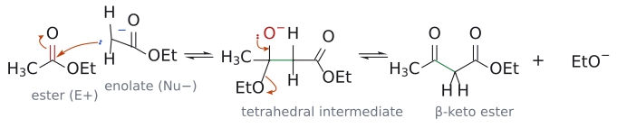
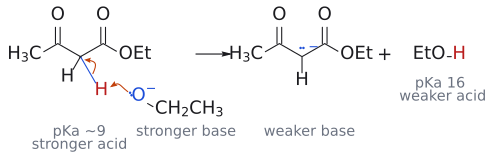
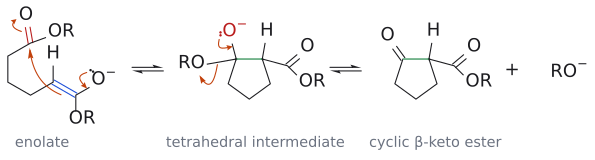

# L9. 클라이젠 축합 (Claisen Condensations)

<!-- wiki-links:start -->

> **관련 위키 문서** ([[위키 대문]])
> - 반응: [[교차 클라이젠 축합]], [[디크만 축합]], [[말론산 에스터 합성]], [[아세토아세트산 에스터 합성]], [[역알돌 반응]], [[친핵성 아실 치환]], [[클라이젠 축합]]
> - 시약: [[알콕사이드 염기]]
> - 개념: [[α-수소의 산도]], [[사면체 중간체]], [[엔올과 엔올레이트]]

<!-- wiki-links:end -->

## 개요

클라이젠 축합(Claisen condensation)은 에스터의 엔올레이트(enolate)가 다른 에스터(또는 카보닐 화합물)의 카보닐을 공격해 새 C–C 결합을 만드는 반응이다. 결과물은 β-케토에스터(β-keto ester)나 β-다이케톤(β-diketone) 같은 1,3-다이카보닐 화합물인데, 이들은 이후 알킬화·탈카복실화 등으로 온갖 골격을 만드는 출발물이 되므로 합성에서 매우 쓸모가 많다. 앞서 배운 엔올레이트의 α-알킬화와 알돌 반응에 이어, 이번에는 "엔올레이트 + 에스터"라는 세 번째 조합을 다룬다(→ [L7](L07_Enolate_Alkylation.md) 엔올레이트 알킬화·알돌 반응 문서 참고). 이 강의의 핵심은 단 하나로 요약된다. 클라이젠 축합은 C–C 결합이 생겨서 진행되는 것이 아니라, 생성물이 염기에 의해 탈양성자화되기 때문에 진행된다는 것이다. 이 원리 하나로 염기 1당량이 필요한 이유, 교차 클라이젠과 Dieckmann 축합이 잘 되는 이유가 모두 설명된다.[1]

(출처: L9 p.1, p.2, p.15)

## 본문

### 1. 엔올레이트가 할 수 있는 네 가지 일

엔올레이트는 탄소 친핵체다. 그렇다면 이 친핵체를 무엇과 만나게 하느냐에 따라 어떤 반응이 생길까? 슬라이드는 네 가지 상대를 정리한다.

첫째, 할로젠화 알킬(Br–CH2R')을 만나면 S_N2로 α-알킬화가 일어나 R–CO–CH2–CH2R'이 된다. 둘째, 알데하이드나 케톤(R'COR'')을 만나면 알돌 반응으로 β-하이드록시 카보닐 화합물이 되고, 이것이 탈수되면 α,β-불포화 카보닐 화합물이 된다. 셋째가 이번 강의의 주인공으로, 에스터(R'–CO–OEt)를 만나면 1,3-다이카보닐 화합물 R–CO–CH2–CO–R'이 생긴다. 넷째, α,β-불포화 카보닐 화합물을 만나면 공액 첨가(마이클 첨가, Michael addition)로 1,5-다이카보닐 화합물이 생긴다(→ [L11](L11_Conjugate_Addition.md) 슬라이드에 L5로 표기된 공액 첨가 문서 참고).[2]

주목할 점은 슬라이드가 알돌·클라이젠·마이클에는 모두 평형 화살표(⇌)를 썼다는 것이다. 즉 클라이젠의 C–C 결합 형성 자체는 가역이다. 그런데 가역이라면 반응은 대체 어떻게 끝까지 가는가? 이 질문이 이 강의 전체를 관통한다. 참고로 p.2의 빈 박스 정답은 p.14에서 R–CO–CH2–CO–R'로 공개되며, 케톤 엔올레이트(R–C(O⁻)=CH2)가 공격했으므로 이 경우는 β-다이케톤이다.

(출처: L9 p.2, p.14)

### 2. 클라이젠 반응은 결국 친핵성 아실 치환이다

알돌과 클라이젠은 둘 다 "엔올레이트가 C=O를 공격"하는데, 왜 생성물이 다를까? 답은 공격당하는 쪽에 이탈기가 있느냐에 있다.

친핵성 아실 치환(nucleophilic acyl substitution)의 일반 메커니즘은 이렇다. 친핵체 Nu⁻가 평면 삼각형(trigonal planar) 카보닐 탄소를 공격하면 C=O의 π 전자가 산소로 밀려나 사면체 중간체(tetrahedral intermediate)가 생긴다. 그런데 이 탄소에 이탈기 X가 붙어 있으면, 산소 음이온이 다시 C=O를 만들면서 X⁻를 밀어낸다. 그래서 최종 생성물은 다시 평면 삼각형인 Nu–CO–R이다.

클라이젠은 여기서 Nu⁻ = 엔올레이트, X = OEt인 경우에 불과하다. 알데하이드나 케톤에는 쫓아낼 이탈기가 없으니 알콕사이드가 양성자를 받아 OH로 남지만(알돌), 에스터에는 EtO⁻라는 이탈기가 있으니 C=O가 되살아나 새 케톤이 생긴다. 즉 알돌은 "첨가", 클라이젠은 "첨가 후 제거 = 치환"이다. Task 1(R–C(O⁻)=CH2 + R–CO–OEt)의 답도 이 논리로 바로 나온다(연습 문제 1).

(출처: L9 p.3)

### 3. 자기 축합: 에스터 두 분자가 하나로

#### 3.1 무엇이 생기나

에틸 아세테이트에 소듐 에톡사이드를 넣으면 무엇이 생길까(Task 2)? 에스터 한 분자가 엔올레이트가 되어 다른 한 분자를 공격하므로, 한쪽은 아실기를, 다른 쪽은 α-탄소를 내놓는다.

2 CH3CO2Et --[NaOEt]--> 소듐 아세토아세테이트 [CH3CO–CH⁻–CO2Et] Na⁺ + EtOH --[HCl]--> 에틸 아세토아세테이트(ethyl acetoacetate, acetoacetic ester) CH3COCH2CO2Et, 76%

여기서 눈여겨볼 것이 두 가지다. 하나는 반응 직후 플라스크에 있는 것이 중성 β-케토에스터가 아니라 그 소듐염이라는 점이고, 다른 하나는 EtOH를 증류로 빼내 평형을 오른쪽으로 민다는 점이다. 중성 생성물은 HCl로 산 처리한 뒤에야 얻는다.

곁가지가 있는 경우도 똑같다. 에틸 펜타노에이트(ethyl pentanoate) 두 분자를 NaOEt로 처리하고 CH3CO2H로 후처리하면 에틸 3-옥소-2-프로필헵타노에이트(ethyl 3-oxo-2-propylheptanoate), 즉 CH3(CH2)3–CO–CH(CH2CH2CH3)–CO2Et가 77%로 생긴다. 한 분자는 펜타노일기(C4H9CO–)가 되고, 다른 분자의 α-탄소는 프로필기를 단 채 CH로 남는다. 일반화하면 R–CH2–CO2Et 두 분자가 R–CH2–CO–CH(R)–CO2Et가 된다.

(출처: L9 p.4, p.5, p.7)

#### 3.2 메커니즘: 왜 끝까지 가는가

이제 강의의 핵심 질문으로 돌아가자. 메커니즘을 단계별로 보면 답이 보인다.

1. 엔올레이트 형성. EtO⁻가 에스터 α-H를 떼어 낸다. 그런데 에스터 α-H는 EtOH보다 훨씬 약한 산이라[3] 이 평형은 왼쪽에 치우쳐 있고, 엔올레이트는 아주 조금만 생긴다.
2. 친핵성 첨가. 그 소량의 엔올레이트 α-탄소(친핵체)가 다른 에스터의 카보닐 탄소(친전자체)를 공격해 새 C–C 결합과 사면체 알콕사이드 중간체를 만든다. 가역이다.
3. 제거. 알콕사이드가 C=O를 되살리며 EtO⁻를 내보내 중성 β-케토에스터가 된다. 이것도 가역이다.
4. 생성물의 탈양성자화. 여기서 판이 뒤집힌다. 새로 생긴 β-케토에스터는 두 카보닐 사이에 낀 C–H를 갖는데, 이 수소는 슬라이드 표기로 pKa ~9(더 강한 산)다.[4] 반면 EtOH는 pKa 16(더 약한 산)이다. 그러니 EtO⁻(더 강한 염기)는 이 수소를 거의 완전히 떼어 내 비편재화된 β-케토에스터 음이온(더 약한 염기)을 만든다. 이 산-염기 평형이 오른쪽으로 크게 치우쳐 있기 때문에, 앞의 불리한 평형 1~3이 모두 생성물 쪽으로 끌려간다.
5. 후처리. H3O⁺를 넣으면 음이온이 빠르게 양성자화되어 케토형 β-케토에스터가 되고, 이는 엔올형과 호변이성 평형(keto ⇌ enol)을 이룬다.

*그림: 2–3단계(첨가와 제거). 에틸 아세테이트(R = H인 경우, p.5의 예)로 그렸다. 파란색은 친핵체인 엔올레이트 α-탄소(탄소 음이온 표기), 빨간색은 친전자체인 에스터 카보닐이다. 왼쪽 그림의 화살표 둘은 (1) α-탄소의 비공유 전자쌍이 카보닐 탄소를 공격하고 (2) C=O의 π 전자가 산소로 올라가 사면체 중간체가 되는 과정이다. 가운데 그림의 화살표 둘은 (3) O⁻의 전자쌍이 내려와 C=O를 되살리고 (4) C–OEt 결합 전자가 산소로 가서 EtO⁻가 떨어지는 과정이다. 초록색은 새로 생긴 C–C 결합이며, 두 단계 모두 가역(⇌)이다.*

*그림: 4단계, 반응의 원동력. EtO⁻의 산소(파랑)가 두 카보닐 사이의 산성 H(빨강)를 떼어 가고, C–H 결합 전자(파란 결합)는 탄소에 남아 두 카보닐로 비편재화된 음이온이 된다. 더 강한 산(pKa ~9)과 더 강한 염기에서 더 약한 염기와 더 약한 산(EtOH, pKa 16)이 생기므로 평형이 오른쪽으로 크게 치우친다. 그래서 슬라이드도 이 단계를 반응을 끌고 가는 단계로 강조한다.*

슬라이드의 한 줄 요약이 바로 이것이다. "Deprotonation of the product drives the reaction (1 equiv base is needed)." 그래서 염기는 촉매가 아니라 시약이다. 생성물 한 분자가 생길 때마다 EtO⁻ 한 분자가 음이온 생성에 묶여 버리므로 1당량이 필요하고, 마지막에 반드시 산 처리를 해야 한다.

이 원리에서 따라 나오는 결론이 하나 더 있다. 만약 생성물의 두 카보닐 사이 탄소에 H가 하나도 없다면 어떨까? 그러면 4단계의 원동력이 사라져 반응이 잘 진행되지 않는다. 즉 NaOEt로 자기 축합을 하려면 에스터에 α-H가 2개 이상 있어야 한다.[5]

염기는 왜 하필 NaOEt일까? 에틸 에스터에 같은 알콕사이드를 쓰면, 혹시 EtO⁻가 카보닐을 공격하더라도 EtO⁻가 다시 나갈 뿐 아무것도 변하지 않는다. 3단계에서 떨어지는 이탈기도 EtO⁻이니 깔끔하다. 다른 알콕사이드나 수산화물을 쓰면 문제가 생긴다.[6]

(출처: L9 p.5, p.6)

#### 3.3 같은 음이온, 다른 역할: 클라이젠 vs 아세토아세트산 에스터 알킬화

슬라이드는 두 반응을 나란히 놓는다. 클라이젠 자기 축합 R–CH2–CO2Et --[EtO⁻, EtOH]--> R–CH2–CO–CH(R)–CO2Et, 그리고 에틸 아세토아세테이트 --[EtO⁻, EtOH]--> 엔올레이트 CH3–C(O⁻)=CH–CO2Et --[RBr]--> CH3–CO–CH(R)–CO2Et. 왜 이 둘을 비교할까?

두 반응 모두 α-치환 β-케토에스터를 만들고, 무엇보다 같은 종류의 음이온, 즉 두 카보닐 사이의 비편재화된 β-케토에스터 엔올레이트가 EtO⁻/EtOH 조건에서 쉽게 생긴다는 공통점이 있다. 다만 역할이 정반대다. 클라이젠에서 이 음이온은 반응이 흘러 들어가 멈추는 "종착점(원동력)"이고, 알킬화에서는 RBr을 공격하는 "출발점(친핵체)"이다. 또 클라이젠은 아실 부분(R–CH2–CO–)이 출발 에스터에서 정해지는 반면, 알킬화는 아세틸기를 고정한 채 α-위치에 원하는 R을 골라 넣을 수 있다. 그리고 아세토아세테이트는 산성이 충분히 커서 EtO⁻만으로도 완전히 엔올레이트가 되므로, 단순 케톤 알킬화처럼 LDA 같은 강염기가 필요 없다(→ [L7](L07_Enolate_Alkylation.md) 엔올레이트 알킬화 문서 참고).

(출처: L9 p.7)

### 4. 교차 클라이젠 축합: 짝을 골라 섞기

#### 4.1 왜 아무 에스터나 섞으면 안 되나

서로 다른 두 에스터를 섞으면 어떻게 될까? 둘 다 엔올화될 수 있다면 각자 친핵체도 되고 친전자체도 되므로 자기 축합 2가지, 교차 축합 2가지, 최대 4가지 생성물이 뒤섞인다.[7] 그래서 교차 클라이젠의 요령은 한쪽을 α-H가 없는(엔올화할 수 없는) 에스터로 골라, 그것이 친전자체 역할만 하도록 만드는 것이다.

슬라이드는 이런 에스터를 친전자체 반응성 순서로 줄 세운다.

다이에틸 옥살레이트(diethyl oxalate, EtO2C–CO2Et) > 에틸 포메이트(ethyl formate, HCO2Et) > 다이에틸 카보네이트(diethyl carbonate, (EtO)2C=O) > 에틸 벤조에이트(ethyl benzoate, PhCO2Et)

그리고 에틸 아세테이트(CH3CO2Et)를 주황색 화살표로 다이에틸 카보네이트와 에틸 벤조에이트 사이에 표시해 두었다. 즉 일반적인 에스터인 에틸 아세테이트와 비교하는 기준선 역할로 읽힌다.[8] 이 순서는 왜 이렇게 될까? 옥살레이트는 바로 옆의 에스터기가 전자를 끌어 카보닐을 더 친전자적으로 만들고, 포메이트는 입체 장애도 알킬기의 전자 공여도 없다. 반대로 카보네이트는 두 OEt의 공명 전자 공여, 벤조에이트는 페닐 고리와의 공액 때문에 카보닐이 덜 친전자적이다.[9]

(출처: L9 p.8)

#### 4.2 에스터 + 에스터(또는 카보네이트)

이 원리를 실제로 쓰면 어떻게 될까? 에틸 페닐아세테이트와 다이에틸 카보네이트를 NaOEt/EtOH로 반응시키면, 엔올화할 수 있는 쪽은 페닐아세테이트뿐이다. 그 엔올레이트가 카보네이트 C=O를 공격하고 EtO⁻가 떨어져 다이에틸 페닐말로네이트 Ph–CH(CO2Et)2가 86%로 생긴다. 물론 이번에도 생성물의 CH(두 에스터 사이)가 탈양성자화되며 반응이 완결된다.

옥살레이트를 쓰면 더 반응성이 좋다. 에틸 헵타노에이트 CH3(CH2)5–CO2Et와 다이에틸 옥살레이트를 EtONa/EtOH로 반응시키면 헵타노에이트의 α-탄소가 옥살레이트의 한쪽 C=O를 공격해 EtO2C–CO–CH(CO2Et)–(CH2)4CH3가 83%로 생긴다. α-위치에 옥살릴기(–CO–CO2Et)가 들어간 셈이다.

(출처: L9 p.9)

#### 4.3 케톤 + 에스터(또는 카보네이트)

이번엔 엔올레이트를 에스터가 아니라 케톤에서 만들어 보자. 사이클로헥산온을 NaOEt로 처리해 소듐 엔올레이트를 만들고 (1) 다이에틸 옥살레이트, (2) H3O⁺를 차례로 가하면 사이클로헥산온 C2에 –CO–CO2Et가 붙은 생성물이 67%로 얻어진다.

그런데 왜 에스터가 아니라 케톤이 엔올레이트가 될까? 케톤 α-H(pKa 약 20)가 에스터 α-H(약 25)보다 산성이 크기 때문이다.[3] 게다가 여기서 쓴 에스터는 애초에 α-H가 없다. 그래서 역할 분담이 자연스럽게 정해진다.

슬라이드는 사이클로헥산온 + 에틸 포메이트로 메커니즘을 자세히 보여 준다.

1. EtO⁻가 사이클로헥산온의 α-H를 떼어 엔올레이트를 만든다(가역).
2. 엔올레이트 α-탄소가 HCO2Et의 카보닐 탄소를 공격해 사면체 중간체가 된다(가역).
3. EtO⁻가 떨어지며 2-포밀사이클로헥산온(2-formylcyclohexanone), 즉 β-케토알데하이드가 생긴다(가역).
4. EtO⁻가 두 카보닐 사이의 C–H를 떼어 낸다. 생긴 음이온은 두 산소에 전하가 퍼진 "비편재화된 안정한 엔올레이트(delocalized stable enolate)"로, 반응 조건에서 형성되며 바로 이것이 원동력이다. 그래서 여기서도 염기 1당량이 필요하다.
5. HCl/H2O로 후처리하면 생성물은 "CHO" 형태가 아니라, =CH–OH의 OH가 케톤 C=O와 분자 내 수소 결합을 이룬 엔올형, 2-(하이드록시메틸렌)사이클로헥산온으로 분리된다.

결국 케톤끼리의 알돌은 되돌아갈 수 있지만 클라이젠 생성물은 탈양성자화되어 "갇히므로", 계 전체가 클라이젠 생성물 쪽으로 모인다.

(출처: L9 p.10)

#### 4.4 연습: 알돌이 아니라 클라이젠인 이유

슬라이드는 에틸 벤조에이트 + 아세토페논(PhCOCH3)을 1. NaOCH2CH3, 2. H3O⁺로 처리하면 아세토페논의 알돌 생성물이 아니라 PhCO–CH2–COPh(1,3-다이페닐프로판-1,3-다이온)가 생기는 이유를 묻는다. 앞 절의 논리를 그대로 적용하면 되며, 자세한 해설은 연습 문제 5번에 있다.

(출처: L9 p.11)

### 5. 분자 내 클라이젠: Dieckmann 축합

한 분자 안에 에스터가 두 개 있으면 어떻게 될까? 엔올레이트가 자기 분자의 다른 쪽 에스터를 공격해 고리가 생긴다. 이것이 Dieckmann 축합(Dieckmann condensation)이다.

RO2C–(CH2)4–CO2R (아디프산 다이에스터) --[1. base; 2. H⁺]--> 2-(알콕시카보닐)사이클로펜탄온 + ROH

메커니즘은 자기 축합과 완전히 같고, 다만 "다른 분자" 대신 "같은 분자의 반대쪽 끝"을 공격할 뿐이다.

1. RO⁻가 한쪽 에스터의 α-H를 떼어 엔올레이트를 만든다(가역).
2. 엔올레이트 α-탄소가 같은 분자의 다른 에스터 카보닐을 공격해 5원 고리 사면체 중간체가 된다(가역).
3. RO⁻가 떨어져 고리형 β-케토에스터가 된다(가역).
4. RO⁻가 케톤과 에스터 사이의 고리 C–H를 떼어 안정한 엔올레이트를 만든다. 슬라이드에서 이 단계에만 단방향 화살표가 쓰인 것도 이것이 원동력이기 때문이다.
5. H⁺ 처리로 중성 β-케토에스터를 얻는다.

*그림: 2–3단계. 왼쪽은 아디프산 다이에스터의 엔올레이트다(슬라이드처럼 C=C–O⁻ 형태). 화살표 셋은 (1) O⁻의 전자쌍이 C–O 결합 쪽으로 밀어 주고 (2) 파란 C=C가 같은 분자의 반대쪽 에스터 카보닐 탄소(빨강)를 공격하며 (3) 그 C=O의 π 전자가 산소로 올라가는 과정이다. 가운데 고리형 사면체 중간체에서는 O⁻의 전자쌍이 C=O를 되살리고 C–OR 결합 전자가 RO⁻로 떨어진다. 초록색이 고리를 닫는 새 C–C 결합이다. 뒤이은 4단계(고리 C–H의 탈양성자화)는 앞의 탈양성자화 그림과 같은 원리다.*

고리 크기는 어떻게 정해질까? 새 결합은 한쪽 에스터의 카보닐 탄소와 다른 쪽 에스터의 α-탄소 사이에 생기므로, 고리 크기는 "두 에스터 카보닐 사이 CH2 개수 + 1"이다. 아디프산 에스터(CH2 4개)는 5원 고리, 피멜산 에스터(CH2 5개)는 6원 고리가 된다. 5원과 6원 고리가 특히 잘 생긴다.[10] 염기는 여기서도 에스터의 OR과 같은 알콕사이드를 쓴다.

(출처: L9 p.12)

### 6. 연습: 클라이젠으로 합성 설계하기

슬라이드는 두 표적을 주고 클라이젠 반응으로 만들어 보라고 한다. (a) Ph–C(CH3)(OH)–CO–CH2–CO–CO2Et, (b) 에틸 2-옥소사이클로옥테인카복실레이트(사이클로옥탄온 C2에 CO2Et). 역합성의 요령은 1,3-다이카보닐 사이의 C–C 결합을 끊어 "엔올레이트 조각 + 에스터 조각"으로 나누는 것이다. 해설은 연습 문제 6, 7번.

(출처: L9 p.13)

### 7. 정리

결국 클라이젠 축합이란 강염기 존재하에 에스터 한 분자와 카보닐 화합물 한 분자 사이에서 C–C 결합이 생기는 반응이고, 생성물은 β-케토에스터 또는 β-다이케톤이다. 유형은 세 가지다. 에스터의 자기 축합, "활성화된"(엔올화할 수 없고 반응성이 큰) 에스터와 다른 카보닐 화합물의 교차 축합, 그리고 분자 내 반응인 Dieckmann 축합이다. 세 경우 모두 반응을 끝까지 밀어붙이는 힘은 생성물의 탈양성자화라는 한 가지 원리에서 나온다.

(출처: L9 p.14, p.15)

## 흔한 오해

- 클라이젠 축합은 안정한 C–C 결합이 생기니까 자발적으로 진행된다고 생각하기 쉽지만, 사실은 C–C 결합 형성 단계들은 모두 가역이고 불리하다. 반응을 끌고 가는 것은 생성물 β-다이카보닐 화합물의 탈양성자화(pKa ~9–11 vs EtOH 16)다. (p.6, p.10)
- 염기는 촉매량이면 된다고 생각하기 쉽지만, 사실은 생성물 음이온에 염기가 묶이므로 1당량이 필요하고, 마지막에 산 처리를 해야 중성 생성물이 나온다. (p.5, p.6)
- 클라이젠 생성물에도 알돌처럼 OH가 남는다고 생각하기 쉽지만, 사실은 EtO⁻가 이탈해 C=O가 되살아나므로 생성물에는 OH가 없고 새 케톤이 생긴다. (p.3)
- α-H가 하나라도 있으면 자기 축합이 된다고 생각하기 쉽지만, 사실은 α-H가 1개뿐인 에스터는 생성물의 두 카보닐 사이에 H가 남지 않아 NaOEt 조건에서 잘 진행되지 않는다.[5]
- 강한 염기라면 아무거나 써도 된다고 생각하기 쉽지만, 사실은 에스터의 알콕시기와 같은 알콕사이드(에틸 에스터 ↔ NaOEt)를 써야 한다.[6] (p.5, p.9)
- 케톤 + 에스터 교차 클라이젠에서 에스터가 엔올레이트가 된다고 생각하기 쉽지만, 사실은 더 산성인 케톤 α-H가 떨어지고, 비엔올화 에스터는 친전자체로만 쓰인다. (p.10, p.11)
- 에틸 포메이트와의 생성물을 그냥 "2-포밀케톤(CHO)"으로 쓰기 쉽지만, 사실은 산 처리 후 분자 내 수소 결합을 가진 하이드록시메틸렌(엔올)형으로 분리된다. (p.10)
- Dieckmann 고리 크기를 다이에스터 전체 탄소 수로 세기 쉽지만, 사실은 "카보닐 사이 CH2 수 + 1"이다. 1,6-다이에스터 → 5원, 1,7-다이에스터 → 6원. (p.12)
- 자기 축합 생성물을 그릴 때 두 분자를 그냥 이어 붙이기 쉽지만, 사실은 한 분자에서 OEt를, 다른 분자의 α-C에서 H를 떼고 그 둘을 연결해야 한다(펜타노에이트 → 2-프로필-3-옥소헵타노에이트). (p.5)

## 반응 정리표

| 반응 | 시약/조건 | 생성물 | 위치선택성 | 입체화학 | 비고 |
|---|---|---|---|---|---|
| 자기 축합: 에틸 아세테이트 | 2 CH3CO2Et, NaOEt; HCl | 에틸 아세토아세테이트 CH3COCH2CO2Et (76%) | 해당 없음(대칭) | 해당 없음 | EtOH 증류 제거; 1당량 염기 (p.5) |
| 자기 축합: 에틸 펜타노에이트 | NaOEt; CH3CO2H | 에틸 3-옥소-2-프로필헵타노에이트 (77%) | 한 분자의 C=O와 다른 분자의 α-C 연결 | C2 입체중심, 라세미(보충: 엔올화로 쉽게 에피머화) | (p.5) |
| 교차: 에스터 + 카보네이트 | PhCH2CO2Et + (EtO)2CO, NaOEt, EtOH | PhCH(CO2Et)2 (86%) | 카보네이트는 친전자체로만 작용 | 해당 없음 | 말론산 에스터 합성 (p.9) |
| 교차: 에스터 + 옥살레이트 | CH3(CH2)5CO2Et + (CO2Et)2, EtONa, EtOH | EtO2C–CO–CH(CO2Et)–C5H11 (83%) | 옥살레이트가 친전자체 | α-C 입체중심 라세미 | 옥살레이트가 가장 반응성 큼 (p.9) |
| 교차: 케톤 + 옥살레이트 | 사이클로헥산온, NaOEt; (CO2Et)2; H3O⁺ | 2-(EtO2C–CO–)사이클로헥산온 (67%) | 케톤이 엔올레이트(더 산성) | 라세미 | (p.10) |
| 교차: 케톤 + 포메이트 | 사이클로헥산온, HCO2Et, EtO⁻; HCl/H2O | 2-포밀사이클로헥산온 → 분리형은 2-(하이드록시메틸렌)사이클로헥산온 | 케톤 α-C에 CHO 도입 | 엔올형(분자 내 H-결합) | 1당량 염기 (p.10) |
| 교차: 케톤 + 벤조에이트 | PhCO2Et + PhCOCH3, NaOEt; H3O⁺ | PhCOCH2COPh | 아세토페논 CH3가 친핵체 | 해당 없음 | 알돌보다 클라이젠 우세 (p.11) |
| Dieckmann 축합 | RO2C(CH2)4CO2R, 1. RO⁻; 2. H⁺ | 2-(RO2C)사이클로펜탄온 + ROH | 분자 내, 5원 고리 | C2 라세미 | 6원 고리는 1,7-다이에스터에서 (p.12) |

## 연습 문제

1. (p.2, p.3 빈 칸) 케톤 엔올레이트 R–C(O⁻)=CH2와 에스터 R'–CO–OEt의 클라이젠 반응 생성물을 쓰고, 친핵성 아실 치환 관점에서 메커니즘을 설명하라.
2. (p.4, Task 2) 에틸 아세테이트를 소듐 에톡사이드로 처리할 때 클라이젠 자기 축합 생성물은? 후처리 전 실제로 플라스크에 존재하는 화학종은?
3. (p.6) 클라이젠 자기 축합에 염기가 촉매량이 아닌 1당량 필요한 이유를 pKa를 들어 설명하라.
4. (p.8, p.9) 에틸 페닐아세테이트와 다이에틸 카보네이트를 NaOEt/EtOH로 반응시킨 생성물을 쓰고, 다이에틸 카보네이트가 자기 축합하지 않는 이유를 쓰라.
5. (p.11) 에틸 벤조에이트 + 아세토페논을 1. NaOCH2CH3, 2. H3O⁺로 처리하면 아세토페논의 알돌 생성물이 아니라 교차 클라이젠 생성물(PhCOCH2COPh)이 얻어지는 이유를 설명하라.
6. (p.13 a) Ph–C(CH3)(OH)–CO–CH2–CO–CO2Et를 클라이젠 반응으로 합성하는 방법을 제안하라.
7. (p.13 b) 에틸 2-옥소사이클로옥테인카복실레이트를 클라이젠형 반응으로 합성하는 방법을 제안하라.
8. (p.12 응용) 다이에틸 헵테인다이오에이트(EtO2C(CH2)5CO2Et)를 1. NaOEt, 2. H3O⁺로 처리한 생성물은?

## 정답 및 해설

1. 생성물은 R–CO–CH2–CO–R' (β-다이케톤) + EtO⁻다(p.14에서 확인). 엔올레이트의 α-탄소(친핵체)가 에스터 카보닐 탄소(친전자체)를 공격해 C=O π 전자가 산소로 밀려나며 사면체 알콕사이드 중간체가 생기고, 이 O⁻가 C=O를 되살리면서 EtO⁻를 내보낸다. 실제 조건에서는 생성물의 CH2(두 카보닐 사이)가 EtO⁻에 탈양성자화되고, 산 처리로 중성 생성물을 얻는다. (p.3, p.6, p.14)

2. 에틸 아세토아세테이트 CH3COCH2CO2Et (76%)다. 후처리 전에는 소듐 아세토아세테이트 [CH3CO–CH–CO2Et]⁻ Na⁺와 EtOH로 존재하며, EtOH는 증류로 제거된다. HCl 처리 후 중성 β-케토에스터가 얻어진다. (p.5)

3. 엔올레이트 형성(에스터 α-H pKa 약 25를 EtO⁻로 떼는 단계)과 첨가·제거 단계는 모두 가역이고 평형이 불리하다. 그러나 생성물 β-케토에스터의 활성 메틸렌 C–H(슬라이드 pKa ~9)는 EtOH(16)보다 약 10⁷배 강한 산이므로 EtO⁻에 의해 거의 완전히 탈양성자화된다. 이 비편재화 음이온 형성이 앞의 평형을 모두 생성물 쪽으로 끌어당기며, 생성물 한 분자당 염기 한 분자가 소모되므로 1당량이 필요하다. (p.6)

4. Ph–CH(CO2Et)2 (다이에틸 페닐말로네이트, 86%). 다이에틸 카보네이트는 α-H가 없어 엔올레이트를 만들 수 없으므로 친전자체로만 작용한다. 페닐아세테이트 엔올레이트가 카보네이트 C=O를 공격하고 EtO⁻가 떨어지며, 생성된 말론산 에스터의 산성 CH가 탈양성자화되어 반응이 완결된다. (p.8, p.9)

5. 에틸 벤조에이트는 α-H가 없어 친전자체로만 작용하고, 엔올레이트가 될 수 있는 것은 아세토페논의 CH3뿐이다. 아세토페논 엔올레이트가 다른 아세토페논에 첨가하는 알돌은 가역이며, 첨가물(3차 알콕사이드)은 입체 장애가 크고 아릴 케톤의 공액 안정화를 잃으므로 평형이 출발물 쪽(역알돌, retro-aldol)으로 치우친다(보충). 반면 에틸 벤조에이트에 첨가한 사면체 중간체는 EtO⁻를 내보내 PhCOCH2COPh를 주고, 이 1,3-다이케톤의 매우 산성인 CH2가 EtO⁻에 탈양성자화되어 안정한 비편재화 엔올레이트로 갇힌다. 이 사실상 비가역적인 산-염기 단계가 원동력이므로 모든 가역 평형이 클라이젠 생성물 쪽으로 흘러가고, H3O⁺ 처리로 중성 다이케톤을 얻는다. (p.6, p.10, p.11)

6. –CO–CH2–CO–CO2Et 부분은 "메틸 케톤 + 다이에틸 옥살레이트" 교차 클라이젠의 전형적 생성물이다(p.9, p.10과 같은 결합 형성). CH2–CO(CO2Et) 결합을 끊으면 메틸 케톤 Ph–C(CH3)(OH)–CO–CH3 (3-하이드록시-3-페닐뷰탄-2-온)과 친전자체 EtO2C–CO2Et가 나온다. 조건은 NaOEt/EtOH, 이후 H3O⁺. 케톤의 반대쪽 α-탄소는 H가 없는 4차 탄소이므로 CH3만 엔올화되고, 옥살레이트는 엔올화되지 않으므로 선택성이 깔끔하다. 보충: 자유 OH도 염기에 의해 일부 탈양성자화될 수 있으므로 염기를 1당량보다 넉넉히 쓰는 것이 안전하다(슬라이드에 없는 추론).

7. 두 경로가 가능하다. (i) 교차 클라이젠(권장): 사이클로옥탄온 + 다이에틸 카보네이트 --[NaOEt(보충: 또는 NaH), 이후 H3O⁺]--> 에틸 2-옥소사이클로옥테인카복실레이트. p.9의 카보네이트 친전자체와 p.10의 케톤 + 에스터를 합친 것으로, 카보네이트는 엔올화되지 않고 생성물 β-케토에스터의 탈양성자화가 원동력이다. (ii) Dieckmann 축합: EtO2C–(CH2)7–CO2Et (다이에틸 노네인다이오에이트) --[1. NaOEt; 2. H⁺]--> 8원 고리 β-케토에스터(CH2 7개 + 1 = 8). 다만 8원 고리 형성은 불리하므로[10] 실용적으로는 (i)이 낫다.

8. 1,7-다이에스터의 Dieckmann 축합으로 6원 고리인 에틸 2-옥소사이클로헥산카복실레이트(사이클로헥산온 C2에 CO2Et) + EtOH가 생긴다(CH2 5개 + 1 = 6). 메커니즘은 p.12와 같다. (p.12 원리 응용, 보충)

## 각주

[1] 이 강의 PDF는 15쪽이며 슬라이드 하단 번호는 9~22번이다(PDF p.2 = 슬라이드 9). 본 문서의 "p."는 모두 PDF 페이지 번호다. 표지 다음 슬라이드 2~8번은 PDF에 없다. 참고 교재는 Solomons 13판 19장, Clayden 2판 26장. (출처: L9 p.1)

[2] p.14 슬라이드에서 마이클 첨가 줄 오른쪽에 "L5"라고만 적혀 있어 정확한 의미(다른 강의 번호로 추정)는 명시되어 있지 않다. 또 p.2의 α-알킬화 생성물은 R–CO–CH2CH2–R로 그려져 있으나 p.14에서는 R'로 바로잡혀 있고(R'이 맞다), 알돌 생성물의 R'/R'' 표기도 일부 뒤섞여 있다. p.14 클라이젠 일반식도 반응물 에스터는 R–CO–OEt인데 생성물은 R–CO–CH2–CO–R'로 적혀 기호가 맞지 않는다. 에스터의 아실기가 생성물의 R'–CO– 부분이 된다고 읽으면 된다. (출처: L9 p.2, p.14)

[3] 보충: 대략적인 pKa 값은 에스터 α-H 약 25, 케톤 α-H 약 20, EtOH 약 16이다(표준 교재 값). 그래서 EtO⁻로는 단순 에스터 엔올레이트가 소량만 생긴다.

[4] p.6의 pKa ~9는 Solomons 그림의 값이다. Clayden 등에서는 에틸 아세토아세테이트의 pKa를 약 11로 제시한다. 어느 쪽이든 EtOH(16)보다 충분히 강한 산이라는 결론은 같다. (출처: L9 p.6)

[5] 보충: 예를 들어 에틸 2-메틸프로파노에이트((CH3)2CHCO2Et)처럼 α-H가 1개뿐인 에스터는 축합 생성물의 두 카보닐 사이 탄소가 4차가 되어 탈양성자화될 H가 없다. 이 경우 NaOEt 조건에서는 역반응(retro-Claisen)이 유리하여 축합이 잘 되지 않는다.

[6] 보충: NaOMe처럼 다른 알콕사이드를 쓰면 에스터 교환(transesterification)이 일어나 메틸·에틸 에스터가 섞이고, NaOH를 쓰면 에스터가 가수분해(비누화)되어 카복실산염이 되어 버린다.

[7] 보충: 이 "4가지 혼합물" 문제와 그 해결책(한쪽을 엔올화 불가능하게)은 교차 알돌에서의 논리와 같다(→ [L8](L08_Aldol_Reactions.md) 알돌 반응 문서 참고).

[8] 슬라이드에는 이 화살표의 의미가 설명되어 있지 않다. 일부 교재에서는 다이에틸 카보네이트를 일반 에스터보다 덜 반응적인 쪽으로 분류하기도 하므로, 화살표의 정확한 위치는 강의에서 확인하는 것이 좋다. (출처: L9 p.8)

[9] 보충: 반응성이 낮은 비엔올화 에스터(카보네이트, 벤조에이트)를 쓸 때는 그것을 과량 사용하거나, 엔올화 가능한 성분을 천천히 가해 자기 축합을 억제하는 것이 일반적인 실험 요령이다.

[10] 보충: 5원·6원 고리는 고리 변형이 작고 고리화가 엔트로피적으로도 유리해 잘 생긴다. 반면 8원 고리 같은 중간 크기 고리(medium ring)는 고리 내 변형과 엔트로피 손실 때문에 형성이 훨씬 불리하여 수율이 낮고 고희석 조건 등이 필요하다.
