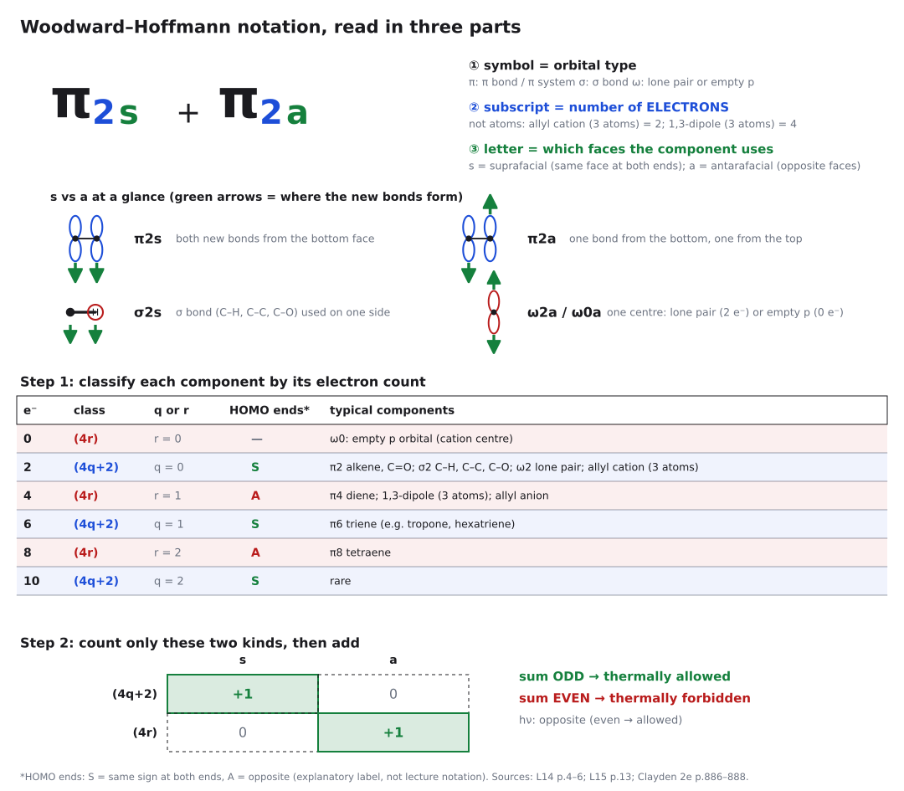
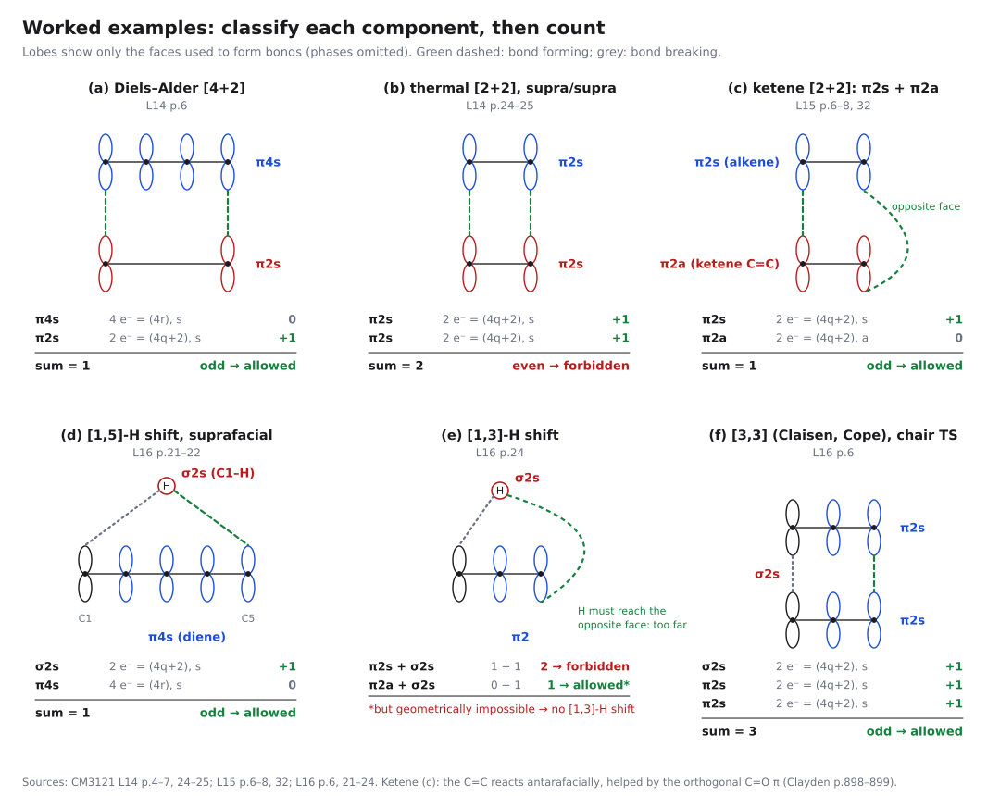
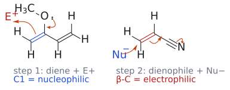
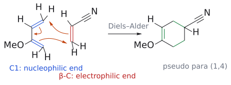
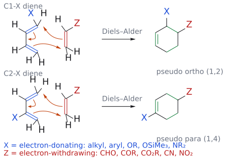
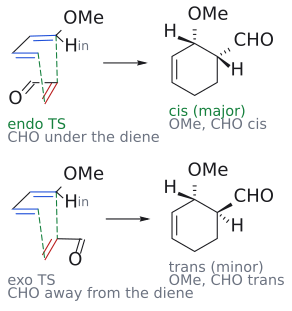
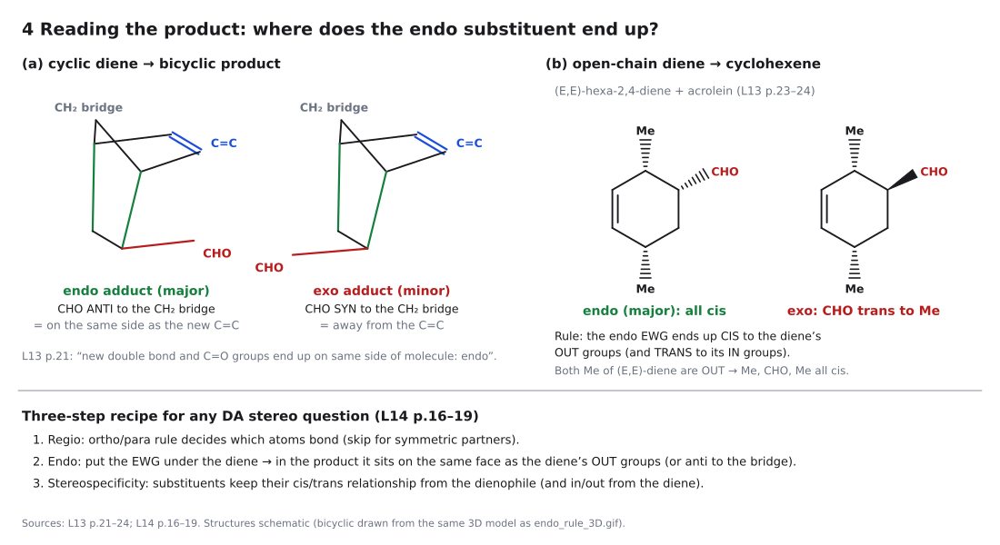
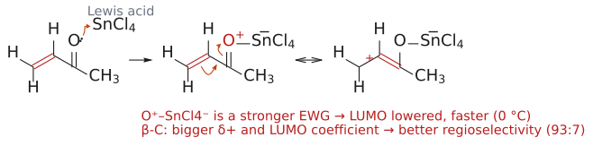

# L14. Cycloaddition 2부

<!-- wiki-links:start -->

> **관련 위키 문서** ([위키 대문](../wiki/위키%20대문.md))
> - 반응: [\[4+3\] cycloaddition](../wiki/반응/4+3%20고리화%20첨가.md), [\[6+4\] cycloaddition](../wiki/반응/6+4%20고리화%20첨가.md), [Diels–Alder reaction](../wiki/반응/딜스-알더%20반응.md), [inverse electron demand Diels–Alder](../wiki/반응/역전자%20요구%20딜스-알더%20반응.md), [photochemical \[2+2\] cycloaddition](../wiki/반응/광화학%202+2%20고리화%20첨가.md)
> - 시약: [Lewis acid catalyst](../wiki/시약/루이스%20산%20촉매.md), [NBS](../wiki/시약/NBS.md)
> - 개념: [allyl cation](../wiki/개념/알릴%20양이온.md), [aromaticity](../wiki/개념/방향족성.md), [cubane](../wiki/개념/큐베인.md), [Diels–Alder regioselectivity](../wiki/개념/딜스-알더%20위치선택성.md), [endo rule](../wiki/개념/endo%20규칙.md), [frontier molecular orbital](../wiki/개념/프런티어%20분자%20오비탈.md), [pericyclic reaction](../wiki/개념/페리고리%20반응.md), [stereospecificity and stereoselectivity](../wiki/개념/입체특이성과%20입체선택성.md), [substituent effect](../wiki/개념/치환기%20효과.md), [suprafacial and antarafacial](../wiki/개념/초면과%20대면.md), [Test 2 reaction checklist](../wiki/개념/Test%202%20반응%20판정과%20답안%20검산.md), [Woodward–Hoffmann rules](../wiki/개념/우드워드-호프만%20규칙.md)

<!-- wiki-links:end -->

> [Test 2 반응 판정·검산 순서](../wiki/개념/Test%202%20반응%20판정과%20답안%20검산.md)로 각 단원의 질문을 연결할 수 있다.

## 1. DA 반응의 최전선 orbital 다시 보기

> 개념 문서: [frontier molecular orbital](../wiki/개념/프런티어%20분자%20오비탈.md)

L13(cycloaddition 1부)에서 Diels–Alder reaction(DA reaction)이 concerted이고 stereospecific이며 endo 생성물을 선호한다는 것을 봤다. 그런데 몇 가지 질문이 남는다. 이 강의는 그 질문들을 Woodward–Hoffmann 규칙과 frontier molecular orbital(FMO) 이론 두 가지로 답한다. 이 강의의 핵심 질문은 결국 "반응이 *허용되는가*, 얼마나 *빠른가*, 그리고 *어느 방향으로* 일어나는가"이다. (→ [L13](L13_Cycloaddition_Part1.md) cycloaddition 1부 문서 참고) (출처: L14 p.1–2)

electron-rich diene과 electron-deficient dienophile을 섞으면 반응이 더 빠르다. 왜 그런가?

DA 반응에서 새 결합은 한 성분의 HOMO에 있는 전자가 다른 성분의 LUMO로 흘러 들어가면서 생긴다. 이때 가능한 조합은 두 가지다. 하나는 HOMO(diene)–LUMO(dienophile) 조합이고, 다른 하나는 HOMO(dienophile)–LUMO(diene) 조합이다. 슬라이드의 예는 butadiene과 maleic anhydride이다. anhydride은 carbonyl 두 개 때문에 $\pi^{\ast}$ (LUMO)가 아주 낮다. 그래서 diene HOMO( $\psi_{2}$ )와 anhydride LUMO( $\pi^{\ast}$ )의 에너지 차이는 작고 겹침이 좋다. 반대로 anhydride HOMO( $\pi$ )와 diene LUMO( $\psi_{3}$ )는 에너지 차이가 크고 겹침이 나쁘다. 즉 반응은 주로 **HOMO(diene)–LUMO(dienophile)** 상호작용으로 일어나고, 이 간격이 좁을수록 빠르다.

대칭도 확인해 둘 필요가 있다. diene $\psi_{2}$ 의 두 말단 lobe는 위상이 서로 반대이고, dienophile $\pi^{\ast}$ 의 두 lobe도 위상이 서로 반대다. 그래서 두 성분이 같은 면끼리 마주 보면 양 끝 모두에서 위상이 맞는(결합성) 겹침이 생긴다. 슬라이드에서 동그라미로 강조한 부분이 바로 이 말단 겹침이다.

(출처: L14 p.3)

---

## 2. Woodward–Hoffmann 규칙 (Woodward–Hoffmann rules)

> 개념 문서: [Woodward–Hoffmann rules](../wiki/개념/우드워드-호프만%20규칙.md), [suprafacial and antarafacial](../wiki/개념/초면과%20대면.md)

이 절을 읽고 답할 질문: 왜 어떤 [4+2]는 잘 되는데 [4+4]나 열적 [2+2]는 안 되는가?

FMO 그림을 매번 그리지 않고도 "이 반응은 열적으로 허용되는가?"를 판단할 수 없을까? 그 도구가 Woodward–Hoffmann 규칙이다[1].

> **thermal 고리형 협동 반응(pericyclic reaction)에서는 (4q+2)s 성분의 수와 (4r)a 성분의 수를 합한 값이 홀수여야 한다.** (q, r은 0 이상의 정수)

말로 풀면 다음과 같다.

- 전자 2, 6, 10개를 가진 **suprafacial, s** 성분의 개수
- \+ 전자 0, 4, 8개를 가진 **antarafacial, a** 성분의 개수
- \= **홀수이면** 열적으로 allowed

그렇다면 s와 a는 무엇인가? **suprafacial** 성분은 양 끝에서 *같은 면*으로 새 결합을 만든다. 예를 들어 위에서 위로 결합하는 경우다. **antarafacial** 성분은 양 끝에서 *반대 면*으로 결합한다. 한쪽 끝은 위, 다른 쪽 끝은 아래다. antarafacial 성분은 $\pi$ 계가 비틀려야 하므로, 짧은 $\pi$ 계에서는 기하학적으로 거의 불가능하다.

여기서 주의할 점이 있다. 슬라이드가 강조하듯 **Allowed는 지정한 thermal/photochemical 조건과 supra/antara 방식에서 orbital-symmetry-allowed라는 뜻이다.** 허용된 반응이라도 activation energy, steric hindrance, 반응물의 형태 때문에 실제로는 일어나지 않을 수 있다.

보충: 교재는 규칙을 적용하는 순서를 다음처럼 정리한다. 연습 문제를 풀 때 이 순서를 그대로 따라가면 실수가 줄어든다.
1. 굽은 화살표로 메커니즘을 그린다.
2. 성분을 고른다. 메커니즘에 참여하는 결합은 모두 넣고, 참여하지 않는 결합은 넣지 않는다. 한 성분 안에 $\pi$ 전자와 $\sigma$ 전자를 섞지 않는다.
3. 성분들이 다가오는 모습을 입체로 그리고, 각 성분의 **양 끝에만** p orbital을 그린다. 이 orbital은 색칠(위상 표시)하지 않은 그냥 p orbital이며 HOMO나 LUMO가 아니다.
4. 새 결합이 생길 곳을 점선으로 잇는다.
5. 각 성분에 s(양 끝에서 같은 면) 또는 a(반대 면)를 붙인다.
6. (4q+2)s와 (4r)a 성분의 **개수를** 센다. (4q+2)a와 (4r)s는 몇 개가 있어도 세지 않는다. 합이 홀수면 열적으로 허용이다.
(보충 근거: Clayden p.892–893)

(출처: L14 p.4–5)

그림: π2s 같은 표기를 세 부분으로 읽는다. 기호는 오비탈 종류(π, σ, ω), 아래 숫자는 원자 수가 아닌 전자 수, 글자는 쓰는 면(s, a)이다. 아래 표는 전자 수별 (4q+2)/(4r) 분류와 흔한 성분, 그리고 (4q+2)s와 (4r)a만 +1로 세는 2×2 표다. 보충: HOMO ends 열의 S/A는 설명용 표기다. (출처: L14 p.4–6; L15 p.13; 보충 근거: Clayden p.886–888)

### 2.1 DA 반응에 적용하기

DA 반응은 diene( $\pi4\mathrm{s}$ )과 alkene( $\pi2\mathrm{s}$ )이 suprafacial–suprafacial로 접근하는 반응이다. 성분을 세어 보면 다음과 같다.

- (4q+2)s 성분: alkene $\pi2\mathrm{s}$ **1개** (2 = 4×0+2)
- (4r)a 성분: **0개** . diene은 $\pi4$ 성분이지만 s로 쓰이므로 세지 않는다.
- 합계 = 1, 홀수이므로 **열적으로 허용된다.**

(출처: L14 p.6)

### 2.2 그럼 [4+4]는?

butadiene 두 분자를 가열하면 [4+2] 생성물인 4-vinylcyclohexene(4-vinylcyclohexene)은 생기지만 [4+4] 생성물인 cycloocta-1,5-diene은 생기지 않는다. 왜인가? 이것은 연습 문제 1에서 직접 풀어 본다. 짧게 말하면, $\pi4\mathrm{s}$ + $\pi4\mathrm{s}$ 에는 세어 줄 성분이 하나도 없어서 합이 0(짝수)이 된다. 그래서 열적으로 forbidden된다.

보충: 금지는 "열적으로"라는 조건에서만이다. [4+4]도 광화학 조건에서는 허용되고(10.2절과 같은 원리), Ni(0) 같은 전이 금속 촉매를 쓰면 cycloocta-1,5-diene을 만들 수 있다. 또 Woodward–Hoffmann 규칙은 허용 여부만 알려 줄 뿐 endo 선택성이나 regioselectivity는 설명하지 못한다. 그 둘은 4–7절의 FMO(orbital 에너지와 계수)로 따진다. (보충 근거: Clayden p.887, 893; Wade p.695)

(출처: L14 p.7)

---

그림: 여섯 예의 성분 접근 그림(로브는 결합을 만드는 면만 표시, 위상 생략)과 장부. (a) DA는 합 1로 허용, (b) 열적 supra/supra [2+2]는 합 2로 금지, (c) ketene π2s + π2a는 합 1로 허용, (d) [1,5]-H σ2s + π4s는 합 1로 허용, (e) [1,3]-H는 π2s + σ2s면 2로 금지이고 π2a + σ2s면 1로 허용이지만 기하학적으로 불가능, (f) [3,3] chair TS σ2s + π2s + π2s는 합 3으로 허용. (출처: L14 p.4–7, 24–25; L15 p.6–8, 32; L16 p.6, 21–24)

## 3. 치환기의 분류: C, Z, X형 (Substituent classifications)

> 개념 문서: [frontier molecular orbital](../wiki/개념/프런티어%20분자%20오비탈.md), [substituent effect](../wiki/개념/치환기%20효과.md)

"electron-rich diene"이나 "electron-deficient dienophile"를 좀 더 체계적으로 말할 방법은 없을까? 슬라이드는 치환기를 세 종류로 나눈다.

| 기호 | 예 | 성격 |
|---|---|---|
| **C** | vinyl(–CH=CH2), phenyl(–Ph) 등 | $\pi$ 주개 또는 $\pi$ 받개, $\sigma$ 중성. 즉 conjugation을 늘리는 기 |
| **Z** | –COR, –CO2Me, –C≡N, –NO2 등 | $\pi$ 받개 + $\sigma$ 받개 |
| **Z** | 금속, 예: –SiMe3, –BR2 | $\pi$ 받개이지만 $\sigma$ 주개 |
| **X** | –OMe, –NMe2 등 | $\pi$ 주개이지만 $\sigma$ 받개 |
| **X** | –CH3 등 | $\pi$ 주개, $\sigma$ 중성 |

그러면 이 치환기들은 orbital 에너지를 어떻게 바꾸는가?

- **C형(conjugation 확장)** : HOMO는 *올리고* LUMO는 *내린다*. $\pi$ 계가 길어지면 HOMO–LUMO 간격이 좁아지는 것과 같은 원리다.
- **Z형(electron-withdrawing group, EWG)** : HOMO는 *약간* 내리고, **LUMO는 크게 내린다.**
- **X형(electron-donating group, EDG)** : **HOMO는 크게 올리고** , LUMO는 *약간* 올린다.

(출처: L14 p.8–9)

---

## 4. 반응 속도: 왜 X-diene + Z-dienophile이 빠른가

> 개념 문서: [frontier molecular orbital](../wiki/개념/프런티어%20분자%20오비탈.md), [inverse-electron-demand Diels–Alder reaction](../wiki/반응/역전자%20요구%20딜스-알더%20반응.md)

이제 1절의 질문에 정량적으로 답할 수 있다. 슬라이드는 FO(frontier orbital) 상호작용을 세 단계로 비교한다.

1. **(a) butadiene + 치환기 없는 ethylene** : 두 HOMO–LUMO 조합의 간격이 모두 크다. 그래서 반응이 느리다. 실제로 ethylene은 아주 나쁜 dienophile이다.
2. **(b) butadiene + Z-dienophile** : Z가 dienophile LUMO를 크게 내린다. 그래서 HOMO(diene)–LUMO(dienophile) 간격이 좁아진다(굵은 화살표).
3. **(c) X-diene + Z-dienophile** : 여기에 더해 X가 diene HOMO를 올린다. 그래서 간격이 가장 좁고 반응이 가장 빠르다.

정리하면 **LUMO(dienophile)–HOMO(diene) 간격이 작을수록 반응이 빠르다.** 이렇게 diene이 전자를 주고 dienophile이 전자를 받는 일반적인 경우를 "normal-electron-demand" DA라고 부른다[2].

(출처: L14 p.10)

---

## 5. DA 반응의 regioselectivity (Regioselectivity in Diels–Alder reactions)

> 개념 문서: [Diels–Alder regioselectivity](../wiki/개념/딜스-알더%20위치선택성.md)

이 절을 읽고 답할 질문: 비대칭 diene과 dienophile이 만나면 두 가지 위치 이성질체 중 어느 쪽이 나오는가?

2-methoxybuta-1,3-diene(CH2=C(OMe)–CH=CH2)과 acrylonitrile(CH2=CH–CN)이 반응하면 두 생성물이 가능하다. 하나는 4-methoxycyclohex-3-ene-1-carbonitrile("1,4")이고, 다른 하나는 3-methoxycyclohex-3-ene-1-carbonitrile("1,3")이다. 어느 쪽이 나오는가?

슬라이드의 답은 이렇다. **$\pi$ 전자의 polarization이 regioselectivity를 결정한다.** 구체적으로는 **dienophile의 "electrophilic" 위치가 diene의 "nucleophilic" 위치와 결합한다.** DA 반응은 협동 반응이므로 진짜 이온 intermediate는 없다. 그래도 각 성분이 극성 반응에서 어디가 반응할지를 상상하면 답을 맞힐 수 있다.

보충: 이 "극성 반응 상상"이 왜 FMO 계수와 같은 답을 주는가? dienophile 쪽은 L11의 Michael 받개 그 자체다. carbonyl과의 짝지음은 C=C의 LUMO( $\pi^{\ast}$ )를 낮출 뿐 아니라 $\beta$-탄소의 계수가 $\alpha$-탄소보다 커지도록 일그러뜨리고, 그래서 nucleophile은 늘 $\beta$-탄소를 공격한다. diene 쪽은 electrophile(예: H⁺)가 어느 말단에 붙어야 더 안정한 allyl cation이 생기는지를 보면 된다. 더 안정한 cation을 주는 말단이 곧 HOMO 계수가 큰 말단이다. 실험 결과로 계수를 거꾸로 추론하는 것처럼 보이지만, 계산으로 구한 HOMO 계수도 같은 결론을 준다. (보충 근거: Clayden p.889–890) (→ [L11](L11_Conjugate_Addition.md) conjugate addition 문서 참고)

(출처: L14 p.11)

### 5.1 C2-치환 diene → "pseudo para"

슬라이드는 이 과정을 세 단계 사고 실험으로 보여준다.

1. **diene이 electrophile(E+)와 반응한다고 상상한다.** OMe의 산소 비공유 전자쌍이 C2=C1 $\pi$ 결합 쪽으로 밀려 들어간다. 그러면 C1(CH2 말단)이 E+를 공격하고, 그 결과 산소에 의해 안정화된 oxocarbenium ion이 생긴다. 즉 OMe에 인접한 말단 **C1이 diene의 nucleophilic 위치** 다.
2. **dienophile이 nucleophile(Nu−)와 반응한다고 상상한다.** acrylonitrile에서는 Nu−가 **$\beta$-탄소(CH2 말단)를** 공격하고 전자는 C≡N의 질소로 밀려난다(Michael형 첨가). 즉 $\beta$-탄소가 electrophilic 위치다.
3. **nucleophilic C1과 electrophilic $\beta$-탄소를 연결한다.** 그러면 OMe가 붙은 탄소와 CN이 붙은 탄소가 고리에서 1,4 관계가 된다. 생성물은 enol ether를 가진 **4-methoxycyclohex-3-ene-1-carbonitrile이고**, 이를 **"pseudo para"** 생성물이라 부른다.

그림: 슬라이드 Step 1·2의 상상 반응이다. 왼쪽: OMe 산소의 비공유 전자쌍이 C–O 결합 쪽으로 밀려 들어가고(작은 화살표), C1=C2 $\pi$ 결합(파랑)이 E⁺를 공격한다. 그래서 OMe 옆 말단 C1이 nucleophilic 위치다. 오른쪽: Nu⁻가 acrylonitrile의 $\beta$-탄소를 공격하면 C=C $\pi$ 전자(빨강)는 C–CN 쪽으로, C≡N $\pi$ 전자는 질소로 밀려난다(Michael형). 그래서 $\beta$-탄소가 electrophilic 위치다. 실제 DA 반응에서는 이 두 탄소가 결합해 OMe와 CN이 1,4 관계인 "pseudo para" 생성물이 된다. 이온 intermediate가 실제로 생긴다는 뜻이 아니라, 어느 말단끼리 결합할지 정하는 사고 실험이다.

[원본 자료에서 세부 구조·입체배치 확인: L14_cycloaddition part 2.pdf p.12](../figures/L14/source/L14_p12.png)

그림: 슬라이드 Step 3이다. 파란색은 2-methoxybutadiene의 $\pi$ 결합(HOMO 쪽), 빨간색은 acrylonitrile의 C=C(LUMO 쪽), 초록색은 생성물에서 새로 생기거나 자리를 옮긴 결합이다. 주황색 화살표 셋은 모두 같은 방향으로 돈다. OMe 옆 말단 C1(nucleophilic end, 파란 설명)이 CN의 $\beta$-탄소(electrophilic end, 빨간 설명)와 결합하고, 나머지 diene 말단은 CN이 붙은 $\alpha$-탄소와 결합한다. 그 결과 OMe와 CN이 1,4 관계인 4-methoxycyclohex-3-ene-1-carbonitrile("pseudo para")이 된다. 수소는 모두 그렸다.

(출처: L14 p.12)

### 5.2 C1-치환 diene → "pseudo ortho"

C1에 주개가 있으면 어떻게 될까? 슬라이드의 예는 4-methylpenta-1,3-diene(Me2C=CH–CH=CH2)과 methyl acrylate(CH2=CH–CO2Me)이다. 이 경우 diene에서 계수가 가장 큰 탄소는 치환기에서 *먼 쪽* 말단(CH2)이고, dienophile에서는 $\beta$-탄소(CH2)다. 이 두 탄소가 먼저 결합한다.

여기서 중요한 점은 이 반응이 **concerted 경로의 asynchronous transition state를** 거친다는 것이다. 강의의 표현은 “Concerted, but unsymmetrical transition state”다. 여기서는 두 결합의 형성 정도가 서로 다르다는 점을 asynchronous라는 말로 구분한다. 큰 계수끼리의 결합은 transition state에서 더 많이 형성되어 있다. 반면 반대편, 즉 CMe2와 CH(CO2Me) 사이 결합은 아직 거의 형성되지 않았고, 그 자리에 부분 양전하(+)와 부분 음전하(−)가 생긴다. 결과물은 CMe2와 CH(CO2Me)가 이웃한 **methyl 2,2-dimethylcyclohex-3-ene-1-carboxylate** , 즉 **"pseudo ortho"** 생성물이다.

보충: 왜 치환기에서 *먼* CH2 말단의 계수가 큰가? 이 diene에 HBr을 첨가한다고 상상하면 된다. H⁺가 CH2 말단에 붙으면 양전하가 2차 탄소와 3차 CMe2에 걸친 allyl cation이 되고, CMe2 쪽 말단에 붙으면 2차와 1차 탄소에 걸친 덜 안정한 allyl cation이 된다. 더 안정한 cation을 주는 CH2 말단이 nucleophilic 말단, 즉 HOMO 계수가 큰 말단이다. 교재도 정확히 이 1,1-dimethylbutadiene + methyl acrylate 예로 같은 결론(ortho, 비대칭 TS)을 낸다. (보충 근거: Clayden p.889–890)

그림: 파란색은 diene의 $\pi$ 결합(HOMO 쪽), 빨간색은 dienophile methyl acrylate의 C=C(LUMO 쪽), 초록색은 생성물에서 새로 생긴 결합이다. 주황색 화살표 셋은 모두 같은 방향(반시계)으로 돈다. (1) 아래쪽 diene $\pi$ 전자가 계수가 큰 두 $CH_2$ 말단 사이의 새 $\sigma$ 결합이 되고, (2) dienophile $\pi$ 전자가 $CMe_2$ 쪽 새 $\sigma$ 결합이 되며, (3) 위쪽 diene $\pi$ 전자가 가운데로 옮겨 새 C=C를 만든다. 그 결과 $CMe_2$ 와 $CH(CO_2Me)$ 가 이웃한 pseudo ortho 생성물이 된다. 화살표는 동시에 일어나는 전자 재배치를 나타낼 뿐이며, 실제 transition state에서는 $CH_2\text{–}CH_2$ 결합의 형성 정도가 더 크다(asynchronous concerted TS). 별개의 첫 단계에서 한 결합이 완성된 뒤 다음 결합이 생긴다는 뜻은 아니다.

(출처: L14 p.13)

### 5.3 일반화: ortho/para 규칙

| diene | 생성물 | 기억법 |
|---|---|---|
| C1에 X (1-치환) | X와 Z가 1,2 관계 | **pseudo ortho** |
| C2에 X (2-치환) | X와 Z가 1,4 관계 | **pseudo para** |

- X(전자 주개): alkyl, aryl, RO, Me3SiO, R2N
- Z(electron-withdrawing group 또는 conjugation 기): CHO, COR, CO2H, CO2R, CN, NO2, 할로젠, alkene일, aryl

"meta"(1,3) 생성물은 *부생성물*일 뿐이다. 그래서 "ortho/para 규칙"이라는 이름이 붙었다[3].

보충: 교재의 기억법은 "DA는 aromatic transition state를 거치는, ortho·para 지향성 cycloaddition"다. 여기서 "aromaticity"은 고리 모양 TS에 전자 6개가 있다는 뜻일 뿐이다. 단, 분자 내 DA에서 diene과 dienophile을 잇는 사슬이 아주 짧으면(탄소 3개 정도) 다른 배향을 취할 수 없어서 "meta" 생성물이 그대로 나오기도 한다. 규칙은 분자 간 반응에 대한 것이다. (보충 근거: Clayden p.891)

그림: 슬라이드의 일반화 도식이다. 위 줄은 C1-치환 diene, 아래 줄은 C2-치환 diene이고, X(파랑)는 전자 주개, Z(빨강)는 electron-withdrawing group이다. 파란색은 diene의 $\pi$ 결합, 빨간색은 dienophile C=C, 초록색은 생성물에서 새로 생긴 결합과 새 C=C이며, 주황색 화살표 셋은 한 방향으로 돈다. 두 경우 모두 X에서 "먼" 쪽 말단(C1-X diene에서는 C4, C2-X diene에서는 C1)이 Z의 $\beta$-탄소와 결합하므로, X와 Z는 각각 1,2("pseudo ortho")와 1,4("pseudo para") 관계가 된다. 아래 두 줄은 슬라이드의 X·Z 예 목록이다(Z 목록에서 CO2H, 할로젠, alkenyl, aryl은 지면 관계로 생략했다).

(출처: L14 p.14)

### 5.4 실제 선택성은 얼마나 되나

선택성이 100%는 아니다. 슬라이드의 실험값은 다음과 같다.

**C1-치환 diene** : (E)-penta-1,3-diene(CH3–CH=CH–CH=CH2) + CH2=CH–W

| W | 조건 | "ortho"(1,2) : "meta"(1,3) |
|---|---|---|
| CN | 100 °C | 9 : 1 |
| COOR | 200 °C | 6.8 : 1 |

**C2-치환 diene** : CH2=C(X)–CH=CH2 + methyl acrylate

| X | "para"(1,4) : "meta"(1,3) |
|---|---|
| Me (isoprene) | 6 : 1 |
| OMe | 10 : 1 |

X가 강한 주개(OMe)일수록 편극이 커져서 선택성도 높아지는 경향이 보인다.

(출처: L14 p.15)

---

## 6. regioselectivity와 stereoselectivity의 결합 (Combination of regio- and stereoselectivity)

> 개념 문서: [Diels–Alder regioselectivity](../wiki/개념/딜스-알더%20위치선택성.md), [endo rule](../wiki/개념/endo%20규칙.md)

문제를 풀 때 diene을 고정하고 dienophile의 두 방향을 먼저 비교한다. 유리한 결합 연결을 고른 뒤 그 연결을 고정해 endo/exo와 출발 E/Z를 적용한다. regio와 stereo를 동시에 뒤집으며 비교하면 어떤 효과가 답을 정했는지 알 수 없다. 강의 p.16–19가 이 두 단계 절차를 명시한다. (출처: L14 p.11–19)

(E)-1-methoxybuta-1,3-diene(MeO–CH=CH–CH=CH2)과 acrolein(CH2=CH–CHO)의 생성물 stereochemistry는 어떻게 예측하는가? 슬라이드의 전략은 두 단계다.

**1단계 – regioselectivity.** C1-치환 diene이므로 "ortho" 생성물인 2-methoxycyclohex-3-ene-1-carbaldehyde가 나온다. "meta" 생성물(3-methoxy…)은 주생성물이 아니다. 그런데 이 단계만으로는 OMe와 CHO가 cis인지 trans인지 알 수 없다.

**2단계 – stereoselectivity(endo).** endo transition state에서는 dienophile의 EWG(CHO)가 diene *아래*에 놓인다. (→ [L13](L13_Cycloaddition_Part1.md) endo 규칙과 이차 orbital 상호작용 문서 참고) 이제 diene C1의 두 치환기를 구분해야 한다. (E)-diene이 s-cis 형태를 취하면 C1의 H는 diene "안쪽"을 향하고( **"in" 치환기** ), OMe는 "바깥쪽"을 향한다("out" 치환기).

- **endo TS** : "in" 치환기(H)와 EWG(CHO)가 **trans가** 된다. 그러므로 **OMe와 CHO는 cis** 다.
- **exo TS** : "in" 치환기와 EWG가 **cis가** 된다. 그러므로 OMe와 CHO는 trans다.

결국 주생성물은 **cis-2-methoxycyclohex-3-ene-1-carbaldehyde** (racemic)다. 슬라이드 하단의 "Recall" 예시도 같은 이야기를 한다. (E,E)-hexa-2,4-diene과 acrolein에서도 endo 생성물과 exo 생성물은 CHO가 두 methyl에 대해 어느 쪽을 향하는지로 구분된다.

그림: 위는 endo TS, 아래는 exo TS다. 파란색은 diene의 $\pi$ 결합, 빨간색은 acrolein의 C=C, 초록 점선은 생기고 있는 두 $\sigma$ 결합이다(OMe가 붙은 C1이 CHO가 붙은 탄소와 결합하는 "ortho" 배향). endo TS에서는 CHO가 diene 아래(C2–C3 쪽)로 들어가고, exo TS에서는 바깥을 향한다. endo TS에서는 C1의 "in" 치환기 H가 CHO와 trans가 되므로 "out" 치환기 OMe는 CHO와 cis가 된다(오른쪽 위, 주생성물). exo TS에서는 반대로 OMe와 CHO가 trans다(오른쪽 아래). 생성물은 racemic이며 한 거울상만 그렸다. TS에서는 결합 형성에 관여하는 $CH_2$ 말단의 수소를 생략했다.

[원본 자료에서 세부 구조·입체배치 확인: L14_cycloaddition part 2.pdf p.17](../figures/L14/source/L14_p17.png)

(출처: L14 p.16–17)

### 6.1 세 단계로 늘리기: stereospecificity까지

슬라이드의 빈칸 연습 문제는 (E)-1-acetoxybuta-1,3-diene(AcO–CH=CH–CH=CH2)과 (E)-crotonaldehyde(trans-CH3–CH=CH–CHO)의 반응이다. 여기에 stereospecificity라는 3단계가 추가된다. dienophile의 trans CHO/Me가 생성물에 그대로 남기 때문이다. 풀이는 연습 문제 3에서 한다.

(출처: L14 p.18–19)

C1-substituted diene의 pseudo-ortho와 C2-substituted diene의 pseudo-para는 외운 생성물 이름보다 polarization으로 읽는 편이 낫다. donor가 둘이면 각각 어느 말단을 강화하는지 표시한다. Tutorial 4 Q1의 공식 답안은 Danishefsky diene의 연결 방향, endo에서 오는 OMe/CO2Me syn, ring fusion의 stereospecificity를 나눠 보여 준다. (출처: L14 p.11–17; Tutorial 4_answers p.1)

더 읽기: [Tutorial 4 공식 풀이](../practice/Tutorial_4.md).

---

그림: endo 치환기는 (a) 이환 생성물에서 CH₂ 다리의 반대편, 즉 새 C=C 쪽에 놓이고, (b) 열린 사슬 diene((E,E)-hexa-2,4-diene + acrolein)에서는 diene의 out 치환기와 cis가 되어 Me, CHO, Me가 모두 cis다. 아래는 regioselectivity → endo → stereospecificity 순으로 생성물을 정하는 3단계다. (출처: L13 p.21, 23–24; L14 p.16–19)

## 7. DA 반응의 Lewis acid 촉매 (Lewis acid catalysis)

> 개념 문서: [Diels–Alder regioselectivity](../wiki/개념/딜스-알더%20위치선택성.md), [Lewis acid catalyst](../wiki/시약/루이스%20산%20촉매.md)

Lewis acid을 넣으면 DA 반응은 무엇이 달라지는가? 슬라이드는 두 가지를 짚는다.

- **반응성(LUMO 에너지)** : Lewis acid이 carbonyl 산소에 배위하면 C=O가 사실상 양전하를 띤 형태(O+–SnCl4−)가 된다. 이것은 "더 강력한 electron-withdrawing group"이므로 dienophile LUMO가 더 내려간다. 그래서 반응이 빨라지고 훨씬 낮은 온도에서도 진행된다.
- **regioselectivity( $\pi$ 결합의 편극)** : 같은 이유로 C=C의 편극도 커진다. $\beta$-탄소의 LUMO 계수가 더 커지는 것이다. 그래서 regioselectivity가 향상된다.

슬라이드 예: isoprene + methyl vinyl ketone(CH2=CH–COCH3)

| 조건 | "para" : "meta" |
|---|---|
| toluene, 120 °C, 밀봉관 | 71 : 29 |
| SnCl4·5H2O, 0 °C | 93 : 7 |

주생성물은 1-(4-methylcyclohex-3-ene-1-일)ethanone("para")이다. 온도는 120 °C에서 0 °C로 크게 내려갔는데도 선택성은 오히려 높아졌다[4].

그림: $SnCl_4$ 가 carbonyl 산소에 배위해 $O^+\text{–}SnCl_4^-$ 가 되면(빨간 O) dienophile의 LUMO가 낮아지고 $\beta$-탄소( $CH_2$ )가 더 강하게 $\delta^{+}$ 가 된다. 파란색은 isoprene의 $\pi$ 결합, 빨간색은 dienophile C=C, 초록색은 새로 생긴 결합이다. 세 화살표는 모두 반시계 방향으로 돈다. methyl이 붙은 탄소 옆 $CH_2$ 말단(아래)이 dienophile의 $\beta$ - $CH_2$ 와 결합하므로, methyl과 acetyl이 1,4 관계인 "para" 생성물이 된다. 생성물은 $SnCl_4$ 가 떨어진 ketone으로 그렸다. 보충: 슬라이드는 굽은 화살표를 촉매 없는 반응물에 그리고 $SnCl_4$ 착물을 옆에 따로 그렸는데, 그림은 두 가지를 합쳐 착물에 화살표를 그렸다.

그림: 슬라이드 오른쪽 끝의 $O^+\text{–}SnCl_4^-$ 착물을 단계로 풀었다. 왼쪽: carbonyl 산소의 비공유 전자쌍(점 두 개)이 Lewis acid $SnCl_4$ 로 가는 주황색 화살표. 가운데: 산소가 양전하를 띤 착물이다. 빨간색은 dienophile의 C=C와 O⁺이며, 주황색 화살표 두 개는 C=C의 $\pi$ 전자가 C–C 쪽으로, C=O의 $\pi$ 전자가 산소로 옮겨 가는 공명을 나타낸다. 오른쪽: 그 결과 $\beta$-탄소( $CH_2$ 말단)에 양전하가 놓인 공명 기여체다. 설명 줄처럼 더 강한 electron-withdrawing group이 되어 LUMO가 낮아지고(반응성), $\beta$-탄소의 계수가 커진다(regioselectivity). 보충: 슬라이드는 착물 구조와 "more powerfully electron-withdrawing"이라는 말만 적었고, 공명 기여체와 화살표는 강의 설명(polarization of $\pi$ bond)을 그림으로 옮긴 것이다.

(출처: L14 p.20)

---

## 8. 6원환을 넘어서: [6+4] cycloaddition

> 개념 문서: [6+4 cycloaddition](../wiki/반응/6+4%20고리화%20첨가.md)

같은 논리를 6원환 밖으로 넓혀 [6+4], [4+3], 광화학 [2+2] cycloaddition을 다루고, 마지막에는 [4+2]와 [2+2]를 모두 써서 cubane이라는 정육면체 분자를 만드는 합성으로 마무리한다.

Woodward–Hoffmann 규칙이 [4+2]만을 위한 규칙은 아니다. 그렇다면 $6\pi$ 성분과 $4\pi$ 성분이 만나는 [6+4]는 허용되는가?

슬라이드는 suprafacial–suprafacial 조건에서의 규칙을 이렇게 다시 쓴다. *한 성분이 (4q+2)s이고 다른 성분이 (4r)s이면 허용된다.* $6\pi$ 는 4×1+2이고 $4\pi$ 는 4×1이므로 조건에 맞는다. 즉 **[6+4]는 열적으로 허용된다.** 슬라이드는 이것을 더 간단하게 요약한다. **suprafacial–suprafacial 열적 cycloaddition은 관여하는 전자의 총수가 4n+2일 때 허용된다.** [4+2]는 6개, [6+4]는 10개로 둘 다 4n+2이고, [4+4]와 [2+2]는 각각 8개와 4개로 4n이다.

**예 1 – tropone + cyclopentadiene.** tropone(cyclohepta-2,4,6-trienone)의 triene $6\pi$ 부분이 cyclopentadiene의 diene $4\pi$ 부분과 [6+4]로 반응한다. 그 결과 CH2 다리와 C=O 다리를 가진 다리걸친 bicyclic 생성물이 생긴다. 슬라이드는 이 생성물의 stereochemistry를 "endo"로 표시해 두었다[5].

![tropone(6π)과 cyclopentadiene(4π)의 \[6+4\] cycloaddition: 화살표 다섯 개가 한 방향으로 돌아 다리걸친 생성물이 된다](../figures/L14/tropone_cp_64.svg)

그림: 파란색은 tropone의 triene $\pi$ 결합 세 개( $6\pi$ 성분), 빨간색은 cyclopentadiene의 diene $\pi$ 결합 두 개( $4\pi$ 성분)이다. 주황색 화살표 다섯 개(전자 10개, 4n+2)가 모두 같은 방향으로 돌아 tropone의 두 말단 탄소와 cyclopentadiene의 C1·C4 사이에 새 $\sigma$ 결합 두 개가 생긴다. 초록색은 생성물에서 새로 생기거나 자리를 옮긴 결합이다. 생성물은 C=O를 가진 7원환과 $CH_2$ 다리를 가진 bicyclic 골격이 융합된 평면 도식이며, 슬라이드가 "endo"로 표시한 입체배치(각주 5)는 평면 그림에서 나타내지 않았다. 슬라이드처럼 수소는 생략했다.

**예 2 – fulvene + 1-diethylaminodiene → azulene 골격.** 6,6-dimethylfulvene(6,6-dimethylfulvene)은 resonance contributor로 쓰면 고리 쪽이 "aromatic" cyclopentadienyl anion이 되고, 고리 밖 CMe2는 양전하를 띤다. 따라서 고리 밖 탄소가 electrophilic 말단이다. 한편 1-(diethylamino)buta-1,3-diene은 X형 C1-치환 diene이므로 NEt2에서 먼 말단(C4)이 nucleophilic하다. 그래서 반응이 **regioselective이다**. CMe2는 diene의 C4와 결합하고, NEt2가 붙은 C1은 fulvene 고리 탄소와 결합한다. 생성된 [6+4] 부가물(5–7 융합 고리)에서 HNEt2가 제거되면(−HNEt2) conjugation이 확장된 dimethyl azulene형(bicyclo[5.3.0]) 골격이 얻어진다.

![6,6-dimethylfulvene과 1-(diethylamino)buta-1,3-diene의 regioselective \[6+4\] cycloaddition](../figures/L14/fulvene_64.svg)

그림: 6,6-dimethylfulvene(왼쪽, $6\pi$ 성분)과 1-(diethylamino)buta-1,3-diene(가운데, $4\pi$ 성분)의 [6+4] cycloaddition이다. 빨간색은 electrophilic한 고리 밖 $C=CMe_2$ , 파란색은 전자를 내주는 $\pi$ 결합, 초록색은 생성물에서 새로 생기거나 자리를 옮긴 결합이다. 주황색 화살표 다섯 개(전자 10개, 4n+2)가 한 방향으로 돈다. diene에서 $NEt_2$ 와 먼 말단(C4)이 $CMe_2$ 와 결합하고, $NEt_2$ 가 붙은 C1은 fulvene 고리 탄소와 결합한다. 생성물은 5–7 융합 고리이고, 고리 접합 H와 $NEt_2$ 가 $HNEt_2$ 로 빠지면 azulene형 골격이 된다(제거 단계는 그리지 않았다).

(출처: L14 p.21)

---

## 9. [4+3] cycloaddition

> 개념 문서: [4+3 cycloaddition](../wiki/반응/4+3%20고리화%20첨가.md), [allyl cation](../wiki/개념/알릴%20양이온.md)

3원자 성분으로도 cycloaddition이 가능할까? 가능하다. 핵심은 **allyl cation이다**.

**allyl cation 만들기 (1,3-dibromoacetone + Zn)**

1. Zn이 C–Br 결합에 끼어들어 전자를 넣는다. 그러면 Br−가 떨어져 나가고 아연 enolate BrZn–O–C(=CH2)–CH2Br가 생긴다.
2. 남은 C–Br에서 Br−가 이탈한다. 그 결과 **2-(BrZnO)-allyl cation** (oxyallyl cation 계열)이 만들어진다.

보충: 왜 1단계 전에는 Br−가 그냥 떨어지지 않다가 1단계 뒤에야 떨어지는가? 처음에는 C–Br 탄소가 electron-withdrawing carbonyl 바로 옆이라, 그 자리에 cation이 생기면 오히려 불안정해진다. 아연 enolate가 된 뒤에는 같은 탄소가 electron-rich enolate C=C 옆이 되어, 생기는 cation이 짝지음(allyl 공명)과 산소로 안정화된다. 이 반응은 oxyallyl cation이라는 불안정한 intermediate가 실제로 존재한다는 증거로도 쓰인다. (보충 근거: Clayden p.894)

슬라이드가 강조하듯 **이 allyl cation은 원자는 3개이지만 $\pi$ 전자는 2개뿐이다.** 보충: [4+3], [4+2] 같은 괄호 안의 숫자는 고리에 들어가는 **원자 수이고**, Woodward–Hoffmann의 (4q+2), (4r)는 **전자 수** 다. 그래서 [4+3]도 규칙 언어로는 $\pi4\mathrm{s}$ + $\pi2\mathrm{s}$ 이고, DA와 똑같이 허용된다. (보충 근거: Clayden p.894)

**cycloaddition**

3. allyl cation의 두 말단 탄소가 diene의 C1과 C4에 동시에 결합한다. 이것이 [4+3] cycloaddition이고, 그 결과 7원환 cation이 생긴다. 이 cation은 O–ZnBr에 인접해 있어서 산소가 안정화해 준다.
4. O–ZnBr의 전자쌍이 C=O를 다시 만들면서 ZnBr이 떨어진다. 최종 생성물은 **cyclohept-4-en-1-one이다**.

그럼 이 반응은 허용되는가? 슬라이드의 질문인 "FMO를 그려라, 허용되는가?"의 답은 연습 문제 4에 정리했다. 요약하면 allyl cation LUMO( $\psi_{2}$ )와 diene HOMO( $\psi_{2}$ )의 말단 위상이 맞고, 전자는 총 6개(4n+2)다. 그러므로 **열적으로 허용된다.**

![2-(BrZnO)allyl cation과 diene의 [4+3] cycloaddition과 이어지는 ZnBr 이탈](../figures/L14/cyclo43_oxyallyl.svg)

그림: 빨간 +는 allyl cation의 양전하( $\pi$ 전자 2개 성분), 파란색은 allyl cation의 C=C와 diene의 $\pi$ 결합( $4\pi$ 성분)이다. 첫 단계의 화살표 셋은 모두 반시계 방향으로 돈다. (1) diene의 오른쪽 $\pi$ 전자가 cation 탄소와 새 $\sigma$ 결합을 만들고, (2) diene의 왼쪽 $\pi$ 전자가 가운데로 옮겨 새 C=C가 되며, (3) allyl cation의 C=C 전자가 diene 왼쪽 말단과 새 $\sigma$ 결합을 만든다. 그러면 양전하는 O–ZnBr이 붙은 탄소에 남는다(초록 결합이 새 $\sigma$ 결합). 둘째 단계에서는 O–Zn 결합 전자(파랑)가 C=O를 만들며 ZnBr⁺이 떨어져 cyclohept-4-enone이 된다.

(출처: L14 p.22–23)

---

## 10. 광화학 [2+2] cycloaddition (Photochemical [2+2] cycloadditions)

> 개념 문서: [photochemical \[2+2\] cycloaddition](../wiki/반응/광화학%202+2%20고리화%20첨가.md)

광화학 [2+2]는 열적 alkene [2+2]와 점유 상태가 다르다. 각 alkene 안의 기하는 보존되지만 어느 면에서 만나는지와 어떤 말단이 연결되는지는 따로 고른다. nitrone의 exo 선호까지 무조건 DA endo 규칙으로 해결하려 해서는 안 된다. (출처: L14 p.24–28; L15 p.16)

### 10.1 왜 열적으로는 안 되나

ethylene과 maleic anhydride을 가열하면 [2+2] 반응이 일어나지 않는다. 그런데 UV를 쪼이면 잘 일어나서 cyclobutane이 융합된 anhydride(cyclobutane-1,2-dicarboxylic acid anhydride)이 생긴다. 왜 이런 차이가 생기는가?

**FMO 관점.** alkene HOMO( $\pi$ )의 두 lobe는 위상이 같고, anhydride LUMO( $\pi^{\ast}$ )의 두 lobe는 위상이 반대다. suprafacial–suprafacial로 겹치면 한쪽 끝은 결합성이지만 다른 쪽 끝은 **반결합성이** 된다. 즉 HOMO/LUMO 상호작용의 위상이 맞지 않으므로 금지다.

![열적 \[2+2\]: alkene HOMO(π)와 anhydride LUMO(π*)를 포개면 한쪽 끝은 결합성, 다른 쪽 끝은 반결합성이다](../figures/L14/thermal22_lobes.svg)

그림: 슬라이드 왼쪽의 orbital 그림이다. 위는 alkene HOMO( $\pi$ , 파랑)로 두 lobe의 위상이 같고, 아래는 maleic anhydride의 LUMO( $\pi^{\ast}$ , 빨강)로 두 lobe의 위상이 반대다. 채운 lobe가 + 위상, 빈 lobe가 − 위상이다. suprafacial–suprafacial로 포개면 오른쪽 끝(초록 점선)은 위상이 맞아 결합성이지만 왼쪽 끝(빨간 점선, ×)은 위상이 어긋나 반결합성이다. 그래서 열적 [2+2]는 금지다. anhydride의 나머지 고리는 생략했다.

**Woodward–Hoffmann 관점.** $\pi2\mathrm{s}$ + $\pi2\mathrm{s}$ 에서 (4q+2)s 성분은 2개, (4r)a 성분은 0개다. 합이 2(짝수)이므로 **열적 금지** 다. $\pi2\mathrm{s}$ + $\pi2\mathrm{a}$ 라면 합이 1이 되어 형식상 허용이다. 하지만 짧은 alkene이 비틀려 antarafacial로 결합하기는 기하학적으로 매우 어렵다. 이것이 바로 "허용 ≠ 실제로 일어남"의 예다.

![ethylene과 maleic anhydride의 광화학 [2+2] cycloaddition](../figures/L14/photo22_anhydride.svg)

그림: 파란색은 ethylene의 $\pi$ 결합, 빨간색은 maleic anhydride의 C=C, 초록색은 새로 생긴 cyclobutane의 $\sigma$ 결합이다. 두 화살표는 같은 방향(시계 방향)으로 돈다. 위쪽 화살표는 ethylene $\pi$ 전자가 anhydride 탄소 쪽으로, 아래쪽 화살표는 anhydride $\pi$ 전자가 ethylene 탄소 쪽으로 가서 두 $\sigma$ 결합을 동시에 만드는 것을 나타낸다. 가열( $\Delta$ )로는 일어나지 않고 UV( $h\nu$ )를 쪼일 때만 suprafacial–suprafacial로 진행한다. suprafacial이므로 anhydride의 두 고리 접합 H는 cis로 남는다.

(출처: L14 p.24–25)

### 10.2 빛은 무엇을 바꾸나

UV를 흡수하면 alkene 하나의 $\pi$ 전자 1개가 $\pi^{\ast}$ 로 올라간다(excited state). 이제 excited-state alkene과 ground state alkene 사이의 상호작용은 두 가지다.

- **HOMO/HOMO 상호작용 ( $\pi$ / $\pi$ )** : 전자 3개가 들어간다. 2개는 낮아진 결합성 조합에, 1개는 올라간 반결합성 조합에 들어가므로 알짜로는 안정화다.
- **LUMO/LUMO 상호작용 ( $\pi^{\ast}$ / $\pi^{\ast}$ )** : 전자 1개가 낮아진 조합에 들어가므로 역시 안정화다.

이렇게 두 상호작용 모두 알짜 결합성이 되므로 **광화학 [2+2]는 suprafacial–suprafacial로 허용된다** [6].

![광화학 \[2+2\]: 들뜬 alkene과 바닥 상태 alkene의 LUMO/LUMO 겹침과 HOMO/HOMO 겹침은 양 끝 모두 결합성이다](../figures/L14/photo22_lumo_lumo.svg)

그림: 슬라이드 아래쪽 도식을 lobe 그림으로 옮겼다. 각 패널에서 위(파랑)는 UV로 들뜬 alkene, 아래(빨강)는 바닥 상태 alkene이다. 왼쪽 패널은 LUMO/LUMO 상호작용( $\pi^{\ast}$ / $\pi^{\ast}$ )이고, 오른쪽 패널은 HOMO/HOMO 상호작용( $\pi$ / $\pi$ )이다. 채운 lobe가 + 위상, 빈 lobe가 − 위상이며, 같은 orbital끼리 포개므로 두 경우 모두 양 끝(초록 점선)에서 위상이 맞는다. 들뜬 alkene은 $\pi$ 와 $\pi^{\ast}$ 에 전자가 하나씩 있으므로 두 상호작용 모두 알짜 안정화이고, 광화학 [2+2]는 suprafacial–suprafacial로 허용된다. 에너지 준위 도표는 그리지 않았다.

보충: 두 가지 "왜?"가 더 남는다. 첫째, 서로 다른 두 alkene 가운데 누가 들뜨는가? 짝지음이 있는 쪽(enone, maleic anhydride)만 보통의 UV를 흡수하므로 그 성분이 들뜨고, 단순 alkene은 ground state로 남는다. 그래서 서로 다른 alkene끼리의 [2+2]가 선택적으로 일어난다. 둘째, 변형이 큰 cyclobutane이 왜 다시 두 alkene으로 돌아가지 않는가? 역반응도 같은 선택 규칙을 따르므로 빛을 흡수해야 하는데, 생성물은 $\pi$ 결합을 잃어서 빛을 흡수할 낮은 빈 orbital이 없다. 그래서 생성물은 변형이 커도 쌓이는 kinetic 생성물이 된다. (보충 근거: Clayden p.897–898, 907)

(출처: L14 p.26)

![FMO: thermal [4+2] vs thermal and photochemical [2+2]](../figures/Test2_figures/02_cycloaddition_L13-L15/CY_02_FMO_allowed_vs_forbidden.svg)

그림: 채운 로브는 +, 빈 로브는 −다. 새 σ 결합 두 곳이 모두 같은 위상으로 겹쳐야(초록) 반응이 허용된다. 열적 [2+2]는 한쪽 끝이 어긋나고(빨강 ×), 빛을 받으면 HOMO가 π*로 바뀌어 다시 맞는다. (출처: L13 p.27–30; L14 p.24–26)

### 10.3 stereochemistry

- **각 성분 안에서는 stereospecific이다**. suprafacial 결합이므로 각 alkene의 cis/trans 관계가 고리에 그대로 남는다.
- **stereoselectivity는 steric hindrance가 가장 적은 transition state를 따른다.** DA와 달리 **endo 선택성이 없다.**

슬라이드 예는 1,2-cyclobutenedicarboxylic acid dimethyl과 3-methylcyclohex-2-enone의 $h\nu$ 반응이다. 이 반응으로 4-4-6 tricyclic 화합물이 생긴다. cyclobutene의 두 CO2Me는 서로 cis로 남는다. enone 쪽의 융합 H와 Me도 서로 cis인데, 원래 같은 C=C에 붙어 있던 기들이기 때문이다. 그리고 두 바깥 고리(원래의 cyclobutane과 cyclohexanone)는 가운데 cyclobutane을 기준으로 서로 anti에 놓인다. steric hindrance가 가장 적은 배열이다.

![dimethyl cyclobutene-1,2-dicarboxylate와 3-methylcyclohex-2-enone의 광화학 \[2+2\]: 각 성분 안에서 stereospecific이고 바깥 두 고리는 anti다](../figures/L14/photo22_stereo.svg)

그림: 슬라이드의 예다. 파란색은 cyclobutene의 C=C, 빨간색은 enone의 C=C, 초록색은 새로 생긴 cyclobutane의 $\sigma$ 결합 두 개다. 주황색 화살표 두 개는 슬라이드처럼 두 $\sigma$ 결합이 동시에 생기는 것을 형식적으로 나타낸다. 생성물(4-4-6 tricyclic)에서 cyclobutene에서 온 두 $CO_2Me$ 는 cis(둘 다 쐐기), enone에서 온 고리 접합 H와 Me도 cis(둘 다 점선)로 남는다(각 성분 안에서 stereospecific). 그리고 $CO_2Me$ 쪽(쐐기)과 H/Me 쪽(점선)이 가운데 cyclobutane의 반대 면에 있으므로 바깥 두 고리는 서로 anti다. 이는 endo 규칙이 아니라 steric hindrance가 가장 적은 transition state의 결과다. 반응물의 고리 수소는 슬라이드처럼 생략했다.

(출처: L14 p.27)

### 10.4 regioselectivity

isobutylene(CH2=CMe2)과 cyclohex-2-enone을 $h\nu$ 로 반응시키면 실제로 관찰되는 생성물은 **7,7-dimethylbicyclo[4.2.0]옥탄-2-one이다**. 즉 CMe2가 enone의 $\beta$-탄소와 결합한다. (슬라이드는 융합 H 두 개를 cis로 그렸다[7].)

![isobutylene과 cyclohex-2-enone의 광화학 \[2+2\]: CMe2가 enone의 $\beta$-탄소와 결합한다](../figures/L14/photo22_regio.svg)

그림: isobutylene(파란 C=C)과 cyclohex-2-enone(빨간 C=C)의 광화학 [2+2]이다. 슬라이드처럼 두 화살표로 두 $\sigma$ 결합이 동시에 생기는 것을 형식적으로 나타냈다. $CH_2$ 말단은 enone의 $\alpha$-탄소와, $CMe_2$ 는 $\beta$-탄소와 결합한다(초록색: 새 $\sigma$ 결합). 이 배향은 HOMO/LUMO가 아니라 LUMO/LUMO의 큰 계수(isobutylene의 $CMe_2$ , enone의 $\beta$-탄소)끼리 겹친다는 것으로 설명된다. 생성물의 두 융합 H는 슬라이드대로 cis(둘 다 굵은 쐐기)로 그렸다.

그림: 보충 비교 예: isobutylene과 cyclohexenone의 광[2+2]다. 원본의 fused-ring 예와 기질이 다르므로 원본 생성물을 그대로 옮긴 답안으로 사용하지 않는다. 두 경우 모두 참여 alkene의 상대배치를 따로 추적한다. (원본 대조: L14_cycloaddition part 2.pdf p.27)

[원본 자료에서 세부 구조·입체배치 확인: L14_cycloaddition part 2.pdf p.27](../figures/L14/source/L14_p27.png)

왜 이쪽인가? 슬라이드는 광화학 조건에서 HOMO/HOMO와 LUMO/LUMO 상호작용을 따진다. isobutylene의 LUMO는 치환된 CMe2 쪽 계수가 크고, enone LUMO는 $\beta$-탄소 계수가 크다. **큰 계수끼리 겹치므로** $\mathrm{CMe_2}{-}C_{\beta}$ 결합이 생긴다.

보충: 이것은 열적 반응의 직관과 정반대다. alkene HOMO와 enone LUMO가 반응한다면(열적 사고방식) nucleophilic CH2 말단이 electrophilic $\beta$-탄소와 결합해 반대 위치 이성질체가 나와야 한다. 그런데 excited-state enone은 원래 LUMO에 전자 하나가 들어가 있고, alkene LUMO의 계수 크기는 HOMO와 반대(치환된 탄소 쪽이 큼)다. 그래서 LUMO/LUMO 겹침이 결정하는 광화학 생성물은 "보통의 굽은 화살표로 예상하는 생성물의 반대"라고 기억하면 빠르다. (보충 근거: Clayden p.898)

(출처: L14 p.28)

---

## 11. cubane (Cubanes)

> 개념 문서: [cubane](../wiki/개념/큐베인.md)

**cubane(C8H8)은** 탄소 8개가 정육면체의 꼭짓점에 놓인 분자다. 모든 C–C–C 결합각이 90°라서 결합이 극도로 **strained** 되어 있다. 1964년 Philip Eaton과 Thomas Cole이 처음 합성했다. 모든 H를 NO2로 바꾼 **octanitrocubane(C8(NO2)8)은** 1999년 Eaton과 Mao-Xi Zhang이 합성했다. 분해되면 CO2와 N2만 생기며, 슬라이드는 이 화합물을 "가장 빠르고 효과적인 화학 폭약이면서 충격에 둔감하다"고 소개한다[8].

(출처: L14 p.29)

### 11.1 cubane 합성 (Eaton & Cole, 1964)

그렇다면 이런 정육면체는 어떻게 만드는가? 이 합성의 핵심은 **[4+2]로 뼈대를 세우고, 광화학 [2+2]로 상자를 닫는 것이다**. 단계는 다음과 같다(슬라이드 표기 그대로).

1. 반응식

$$
\begin{aligned} & \text{cyclopent-2-enone} \cr  & \xrightarrow{\mathrm{NBS}} \text{4-bromocyclopent-2-enone}\ (\text{allyl bromination}) \end{aligned}
$$

2. $\xrightarrow{\mathrm{Br_2}} \text{2,3,4-tribromocyclopentanone}\ (\text{alkene에}\ \mathrm{Br_2}\ \text{첨가})$

3. $\xrightarrow{\mathrm{HNEt_2}} \text{2-bromocyclopentadienone}\ (\text{탈할로젠화수소})$ . 반응성이 매우 커서 분리하지 않음)
4. **자발적 Diels–Alder [4+2] 이량화.** 한 분자가 diene, 다른 분자가 dienophile로 작용하여 endo 이량체가 생긴다. 슬라이드에서 상자로 강조한 부분이다.
5. $\xrightarrow{\mathrm{(CH_2OH)_2},\ \mathrm{TsOH}} \text{두 ketone을 모두 ketal로 보호}$

6. $\xrightarrow{\mathrm{HCl},\ \mathrm{H_2O}} \text{enone 쪽 ketal만 다시 ketone으로 되돌림}$

7. 빛을 쬐면 분자 내 **[2+2] cycloaddition으로** cage 구조가 완성된다. endo 이량체에서는 두 C=C가 서로 가까이 마주 보고 있어서 이 반응이 가능하다[9].
8. KOH로 Favorskii 고리 축소를 일으켜 carboxylic acid를 만든다.

9. $\xrightarrow{1.\ \mathrm{SOCl_2},\ 2.\ \mathrm{tBuOOH},\ \text{pyridine}} \text{tert-butyl perester}$

10. $\xrightarrow[152\,{}^\circ\mathrm{C}]{\Delta,\ \text{cumene}} \text{decarboxylation}\ (\mathrm{CO_2H}\ \text{자리를 H로 교체})$

11. H₂SO₄로 남은 ketal을 ketone으로 되돌린 뒤, KOH로 두 번째 Favorskii 고리 축소를 일으켜 cubanecarboxylic acid를 만든다.

12. SOCl₂, tBuOOH, pyridine을 순서대로 사용해 perester를 만든 뒤, diisopropylbenzene에서 150 °C로 가열하여 cubane을 얻는다.

그림: cubane 합성 1단계: allyl 자리(빨강) bromination.

그림: 2단계: C=C(파랑)에 $Br_2$ 첨가.

그림: 3단계: HBr 두 번 제거.

(출처: L14 p.30)

---

## 12. 요약

> 개념 문서: [Diels–Alder reaction](../wiki/반응/딜스-알더%20반응.md), [pericyclic reaction](../wiki/개념/페리고리%20반응.md)

**Diels–Alder reaction**

- electron-rich diene + electron-deficient dienophile은 반응이 빠르다. HOMO(diene)–LUMO(dienophile) 간격이 좁기 때문이다.
- **stereospecific** : 1,4-이치환 diene이나 1,2-이치환 dienophile의 기하가 생성물에 보존된다.
- **stereoselective** : 치환된 diene과 치환된 dienophile의 조합에서 endo TS가 선호된다.
- **regioselective** : electron-rich diene + electron-deficient dienophile에서 "para"/"ortho" 생성물이 선호된다.

**다양한 cycloaddition**

- 열적 [6+4], [4+3] cycloaddition
- 광화학 [2+2] cycloaddition
- (열적 [2+2]: 누적 이중 결합(cumulated double bond) 화합물 — 슬라이드에서 회색 처리, 이 강의에서는 다루지 않음)

(출처: L14 p.31)

---

## 흔한 오해

- **"Woodward–Hoffmann에서 diene도 세야 한다"고 생각하기 쉽지만 사실은** DA에서 diene은 $\pi4\mathrm{s}$ , 즉 (4r)*s* 성분이다. 규칙이 세는 것은 (4q+2)s와 (4r) **a** 뿐이므로 diene은 세지 않는다. 합 1은 alkene( $\pi2\mathrm{s}$ ) 하나에서 나온다.
- **"허용된 반응이면 반드시 일어난다"고 생각하기 쉽지만 사실은** "허용"은 지정한 조건과 supra/antara 방식에서 orbital-symmetry-allowed라는 뜻이다. 열적 $\pi2\mathrm{s}$ + $\pi2\mathrm{a}$ [2+2]는 형식상 허용이지만 일반 alkene에서는 기하학적으로 거의 불가능하다.
- **"[2+2]는 무조건 안 된다"고 생각하기 쉽지만 사실은** *열적* suprafacial–suprafacial [2+2]가 금지일 뿐이다. 광화학 [2+2]는 허용이고 실제로 잘 일어난다(cyclobutane 합성, cubane 합성).
- **"광화학 [2+2]도 DA처럼 endo 선택적이다"라고 생각하기 쉽지만 사실은** endo 선택성이 없다. steric hindrance가 가장 적은 TS를 따른다.
- **"ortho/para는 benzene 고리 이야기"라고 생각하기 쉽지만 사실은** cyclohexene 생성물에서 두 치환기가 1,2(pseudo ortho) 또는 1,4(pseudo para) 관계라는 것을 빌려 쓴 *기억법*이다.
- **"1-치환 diene이면 치환기 붙은 탄소가 nucleophilic"이라고 생각하기 쉽지만 사실은** C1에 X가 있으면 HOMO 계수가 가장 큰 곳은 *반대편 말단 C4*다. 이 C4가 dienophile의 $\beta$-탄소와 결합하므로 결과적으로 X와 Z가 이웃한 ortho 생성물이 된다.
- **"endo = 치환기끼리 cis"라고 외우기 쉽지만 사실은** endo TS에서 cis가 되는 것은 diene의 **"out" 치환기와** EWG다. "in" 치환기는 EWG와 trans가 된다. (E)-1-치환 diene에서는 치환기가 "out"이므로 endo 생성물에서 치환기와 EWG가 cis다.
- **“Lewis acid는 속도만 높인다”는 오해:** Lewis acid는 $\pi$ 결합의 분극을 키워 regioselectivity도 높인다. 강의 예에서는 생성물 비가 71:29에서 93:7로 바뀐다.
- **"Woodward–Hoffmann 규칙에서 홀수여야 하는 것은 전자 수"라고 생각하기 쉽지만 사실은** (4q+2)s와 (4r)a에 해당하는 **성분의 개수가** 홀수여야 한다. [4+2]는 전자 6개(짝수)지만 세는 성분이 1개라 허용이다. (보충 근거: Clayden p.892)
- **"Woodward–Hoffmann 규칙으로 endo·regioselectivity도 예측할 수 있다"고 생각하기 쉽지만 사실은** 규칙은 허용/금지만 알려 준다. endo 선택성과 regioselectivity는 FMO(이차 orbital 겹침, 계수 크기)로 따진다. (보충 근거: Clayden p.893)
- **"광화학 [2+2]도 HOMO(alkene)–LUMO(enone)로 위치를 정한다"고 생각하기 쉽지만 사실은** excited state에서는 LUMO/LUMO 겹침이 결정하므로 열적 직관과 반대 위치 이성질체가 나온다. (보충 근거: Clayden p.898)
- **"allyl cation은 3원자니까 전자도 3개짜리 성분"이라고 생각하기 쉽지만 사실은** allyl cation의 $\pi$ 전자는 2개다. 그래서 [4+3]의 전자 수는 4+2=6(4n+2)이고 열적으로 허용된다.

---

## 반응 정리표

<!-- Wide source table reformatted as entries for reading; all cells retained. -->

### butadiene 이량화 [4+2]

- 시약/조건: 가열
- 생성물: 4-vinylcyclohexene
- regioselectivity: –
- stereochemistry: –
- 비고: $\pi4\mathrm{s}$ + $\pi2\mathrm{s}$ , 허용 (p.7)

### butadiene [4+4]

- 시약/조건: 가열
- 생성물: (cycloocta-1,5-diene 생성 안 됨)
- regioselectivity: –
- stereochemistry: –
- 비고: $\pi4\mathrm{s}$ + $\pi4\mathrm{s}$ , 열적 금지 (p.7) → [Woodward–Hoffmann rules](../wiki/개념/우드워드-호프만%20규칙.md)

### 2-methoxybutadiene + acrylonitrile

- 시약/조건: DA
- 생성물: 4-methoxycyclohex-3-ene-1-carbonitrile
- regioselectivity: pseudo para
- stereochemistry: –
- 비고: OMe 옆 C1이 nucleophilic (p.11–12)

### 4-methylpenta-1,3-diene + methyl acrylate

- 시약/조건: DA
- 생성물: methyl 2,2-dimethylcyclohex-3-ene-1-carboxylate
- regioselectivity: pseudo ortho
- stereochemistry: –
- 비고: asynchronous concerted TS (p.13)

### (E)-penta-1,3-diene + CH2=CHW

- 시약/조건: W=CN 100 °C / W=COOR 200 °C
- 생성물: 1,2-이치환 cyclohexene
- regioselectivity: ortho:meta = 9:1 / 6.8:1
- stereochemistry: –
- 비고: p.15

### 2-X-butadiene + methyl acrylate

- 시약/조건: –
- 생성물: 1,4-이치환 cyclohexene
- regioselectivity: para:meta = 6:1 (Me), 10:1 (OMe)
- stereochemistry: –
- 비고: p.15

### (E)-1-methoxybutadiene + acrolein

- 시약/조건: DA
- 생성물: cis-2-methoxycyclohex-3-ene-1-carbaldehyde
- regioselectivity: ortho
- stereochemistry: endo → OMe/CHO cis
- 비고: racemic (p.16–17) → [endo rule](../wiki/개념/endo%20규칙.md)

### (E)-1-acetoxybutadiene + (E)-crotonaldehyde

- 시약/조건: DA
- 생성물: 6-폼일-5-methylcyclohex-2-ene-1-일 acetate
- regioselectivity: ortho (OAc/CHO)
- stereochemistry: OAc/CHO cis (endo), CHO/Me trans (입체특이)
- 비고: racemic (p.18–19)

### isoprene + methyl vinyl ketone

- 시약/조건: toluene 120 °C, 밀봉관 / SnCl4·5H2O, 0 °C
- 생성물: 1-(4-methylcyclohex-3-ene-1-일)ethanone
- regioselectivity: para:meta = 71:29 / 93:7
- stereochemistry: –
- 비고: Lewis acid이 LUMO를 낮추고 편극 증가 (p.20) → [Lewis acid catalyst](../wiki/시약/루이스%20산%20촉매.md)

### tropone + cyclopentadiene

- 시약/조건: [6+4], 열적
- 생성물: 다리걸친 bicyclic ketone (CH2, C=O 다리)
- regioselectivity: –
- stereochemistry: 슬라이드 표기 "endo" (각주 [5])
- 비고: $10\pi$ = 4n+2 (p.21) → [6+4 cycloaddition](../wiki/반응/6+4%20고리화%20첨가.md)

### 6,6-dimethylfulvene + 1-NEt2-butadiene

- 시약/조건: [6+4] 후 −HNEt2
- 생성물: dimethyl azulene형 골격
- regioselectivity: regioselective (CMe2–C4)
- stereochemistry: –
- 비고: fulvene의 dipole 공명 (p.21)

### 1,3-dibromoacetone + Zn + diene

- 시약/조건: Zn
- 생성물: cyclohept-4-ene-1-one
- regioselectivity: –
- stereochemistry: –
- 비고: oxyallyl cation ( $2\pi$ ) + diene ( $4\pi$ ), [4+3] (p.22–23) → [4+3 cycloaddition](../wiki/반응/4+3%20고리화%20첨가.md)

### ethylene + maleic anhydride

- 시약/조건: 가열 ✗ / $h\nu$ ✓
- 생성물: cyclobutane-1,2-dicarboxylic acid anhydride
- regioselectivity: –
- stereochemistry: suprafacial–suprafacial
- 비고: 열적 금지, 광화학 허용 (p.24) → [photochemical \[2+2\] cycloaddition](../wiki/반응/광화학%202+2%20고리화%20첨가.md)

### 1,2-cyclobutenedicarboxylic acid dimethyl + 3-methylcyclohex-2-enone

- 시약/조건: $h\nu$
- 생성물: 4-4-6 tricyclic diester ketone
- regioselectivity: –
- stereochemistry: 각 성분 입체특이, anti (endo 선택성 없음)
- 비고: p.27

### isobutylene + cyclohex-2-enone

- 시약/조건: $h\nu$
- 생성물: 7,7-dimethylbicyclo[4.2.0]옥탄-2-one
- regioselectivity: $\mathrm{CMe_2}{-}C_{\beta}$
- stereochemistry: 슬라이드는 cis 융합으로 그림
- 비고: LUMO/LUMO 큰 계수 일치 (p.28)

### cubane 합성 핵심 단계

- 시약/조건: HNEt2 → 자발적 DA; $h\nu$
- 생성물: $\text{endo 이량체} \longrightarrow \text{새장 diketone}$
- regioselectivity: –
- stereochemistry: endo 이량체
- 비고: [4+2] + 분자 내 [2+2] (p.30) → [cubane](../wiki/개념/큐베인.md)

---

## 연습 문제

→ [L14 연습 문제](../practice/L14_Exercises.md)

**문제 1.** (p.7) suprafacial–suprafacial 접근을 가정하고 Woodward–Hoffmann 규칙으로 설명하라. 1,3-butadiene은 열적 [4+2] 반응은 하지만 열적 [4+4] 반응은 하지 않는다. 각 반응의 생성물 이름도 쓰라.

**문제 2.** (p.3, p.10) maleic anhydride이 butadiene과 빠르게 반응하는 이유를 FMO로 설명하라. diene C1에 OMe를 추가하면 반응 속도는 어떻게 되는가?

**문제 3.** (p.18–19 빈칸) (E)-1-acetoxybuta-1,3-diene과 (E)-crotonaldehyde의 반응에서 regioselectivity, stereoselectivity, stereospecificity를 차례로 적용해 주생성물의 구조와 상대 stereochemistry를 예측하라.

**문제 4.** (p.22–23) 1,3-dibromoacetone/Zn에서 생긴 allyl cation과 butadiene의 [4+3] cycloaddition에 대해 FMO를 그리고, 이 반응이 열적으로 허용되는지 판단하라. Woodward–Hoffmann 규칙으로도 확인하라.

**문제 5.** (p.25) [2+2] 반응은 Woodward–Hoffmann 규칙에 따라 허용되는가? suprafacial–suprafacial과 suprafacial–antarafacial 두 경우를 모두 따지고, 광화학 조건에서는 왜 진행되는지 설명하라.

**문제 6.** (p.11–12, p.15) 2-methoxybuta-1,3-diene과 acrylonitrile의 DA 주생성물은 무엇인가? 반대로 (E)-1-methoxybuta-1,3-diene을 쓰면 주생성물의 치환 패턴은 어떻게 되는가?

**문제 7.** (p.20) isoprene + methyl vinyl ketone 반응에 SnCl4를 넣으면 0 °C에서도 반응이 진행되고 para 선택성이 71:29에서 93:7로 높아진다. 두 효과를 각각 설명하라.

**문제 8.** (p.21, p.30) (a) tropone + cyclopentadiene [6+4]의 전자 수를 세고 열적 허용 여부를 판단하라. (b) cubane 합성에서 [4+2]와 [2+2]가 각각 어느 단계에 쓰였는지 쓰고, [2+2] 단계가 광화학 조건이어야 하는 이유를 쓰라.

---

## 정답 및 해설

**정답 1.**
- [4+2]: $\pi4\mathrm{s}$ + $\pi2\mathrm{s}$ 이다. (4q+2)s 성분은 alkene $\pi2\mathrm{s}$ 1개, (4r)a 성분은 0개이므로 합이 1(홀수)이다. 따라서 **열적으로 허용** 된다. 생성물은 **4-vinylcyclohexene이다**. 한 분자는 diene으로, 다른 분자는 C=C 하나만 dienophile로 쓰기 때문에 남은 vinyl기가 치환기로 붙는다.
- [4+4]: $\pi4\mathrm{s}$ + $\pi4\mathrm{s}$ 이다. 4전자 성분은 s이므로 세지 않는다. (4q+2)s도 0개, (4r)a도 0개라서 합이 0(짝수)이다. 따라서 **열적으로 금지** 된다. cycloocta-1,5-diene은 생기지 않는다. FMO로 보면 diene HOMO( $\psi_{2}$ )와 다른 diene LUMO( $\psi_{3}$ )의 말단 위상이 한쪽 끝에서만 맞는다. 전자 수로 보면 총 8개, 즉 4n이다.
(출처: L14 p.6–7, p.21)

**정답 2.** 반응을 지배하는 것은 HOMO(diene)–LUMO(dienophile) 상호작용이다. maleic anhydride은 Z형 carbonyl 두 개 때문에 LUMO( $\pi^{\ast}$ )가 크게 낮아져 있다. 그래서 diene $\psi_{2}$ 와의 간격이 작고 겹침이 좋아 반응이 빠르다. 여기에 OMe(X형)를 더하면 diene HOMO가 크게 올라간다. 간격이 더 좁아지므로 반응이 **더 빨라진다** . 슬라이드 그림 (c)의 상황이다.
(출처: L14 p.3, p.9–10)

**정답 3.**
- 1단계(위치): C1-OAc diene은 OAc에서 먼 C4가 nucleophilic하다. crotonaldehyde에서는 CHO의 $\beta$-탄소(CHMe)가 electrophilic하다. CHO(Z)가 Me(약한 X)보다 지배적이기 때문이다. 그래서 $\mathrm{C4}{-}C_{\beta}$ 가 결합하고, 그 결과 OAc 탄소와 CHO 탄소가 ortho. 고리 번호로는 C1(OAc), C2=C3, C4(H2), C5(Me), C6(CHO)가 된다.
- 2단계(endo): (E)-diene의 OAc는 "out" 치환기다. endo TS에서는 "in" H와 CHO가 trans가 되므로 **OAc와 CHO는 cis** 다.
- 3단계(stereospecificity): dienophile의 CHO와 Me는 trans였으므로 생성물에서도 **CHO와 Me는 trans** 다.
- 답: **6-폼일-5-methylcyclohex-2-ene-1-일 acetate** . 상대 stereochemistry는 C1-OAc/C6-CHO cis, C6-CHO/C5-Me trans이다. 슬라이드 그림에서는 OAc와 CHO가 쐐기, Me가 점선으로 그려져 있다. racemic이므로 "or its enantiomer"이다.
(출처: L14 p.17–19)

**정답 4.** allyl cation의 $\pi$ MO는 세 개다. $\psi_{1}$ (HOMO, 전자 2개)은 세 lobe의 위상이 모두 같다. $\psi_{2}$ (LUMO)는 가운데 탄소에 node가 있고 두 말단의 위상이 반대다. $\psi_{3}$ 는 계수가 0.50, 0.71, 0.50이고 위상이 교대한다.
- allyl cation LUMO( $\psi_{2}$ , 말단 위상 반대)와 diene HOMO( $\psi_{2}$ , 말단 위상 반대)는 양 끝 모두에서 결합성 겹침을 이룬다.
- 반대 조합인 allyl HOMO( $\psi_{1}$ , 말단 위상 같음)와 diene LUMO( $\psi_{3}$ , 말단 위상 같음)도 양 끝에서 위상이 맞는다.
- Woodward–Hoffmann 규칙으로 보면 allyl cation은 2전자이므로 (4q+2)s 성분 1개, diene $\pi4\mathrm{s}$ 는 세지 않는다. 합이 1(홀수)이므로 **열적으로 허용** 된다. 전자 총수 6 = 4n+2와도 일치한다.
(출처: L14 p.22–23)

**정답 5.**
- $\pi2\mathrm{s}$ + $\pi2\mathrm{s}$ : (4q+2)s 성분이 2개이므로 합이 2(짝수)다. **열적 금지.** FMO로 보면 alkene HOMO와 다른 alkene LUMO가 한쪽 끝에서 반결합성으로 겹친다.
- $\pi2\mathrm{s}$ + $\pi2\mathrm{a}$ : 합이 1(홀수)이므로 형식상 **열적 허용이다**. 하지만 짧은 alkene이 비틀려 한 성분이 antarafacial로 결합하기는 기하학적으로 매우 어려워서 일반 alkene에서는 일어나지 않는다. 슬라이드의 "Allowed doesn't mean that it will happen"이 이 뜻이다.
- 광화학: excited-state alkene은 $\pi$ 와 $\pi^{\ast}$ 에 전자가 하나씩 있다. ground state alkene과의 $\pi$ / $\pi$ 상호작용에는 전자 3개가 들어가 알짜 안정화가 되고, $\pi^{\ast}$ / $\pi^{\ast}$ 상호작용에는 전자 1개가 낮은 조합에 들어가 역시 안정화가 된다. 그래서 suprafacial–suprafacial로 진행된다.
(출처: L14 p.24–26)

**정답 6.**
- 2-methoxybutadiene은 C2-치환 diene이다. OMe 옆 C1이 nucleophilic하고 acrylonitrile의 $\beta$-탄소가 electrophilic하다. 이 둘이 결합하여 **4-methoxycyclohex-3-ene-1-carbonitrile** (pseudo para, 1,4)이 생긴다.
- (E)-1-methoxybutadiene은 C1-치환 diene이므로 OMe와 CN이 이웃한 **1,2(pseudo ortho)** 생성물이 주로 생긴다. endo 규칙까지 고려하면 OMe와 CN은 cis다.
(출처: L14 p.12–14, p.16–17)

**정답 7.**
- 반응성: SnCl4가 carbonyl O에 배위하면 C=O–SnCl4 착물이 생긴다. 이 착물은 훨씬 강한 electron-withdrawing group이므로 dienophile LUMO가 더 낮아진다. HOMO(diene)–LUMO 간격이 줄어들어 0 °C에서도 빠르게 반응한다.
- regioselectivity: 같은 효과로 C=C의 편극이 커져 $\beta$-탄소의 계수가 더 커진다. 그래서 isoprene의 nucleophilic C1(Me 옆 말단)과 $\beta$-탄소의 결합이 더 강하게 선호되고, para 생성물인 1-(4-methylcyclohex-3-ene-1-일)ethanone의 비율이 93:7로 올라간다.
(출처: L14 p.20)

**정답 8.**
- (a) tropone은 $6\pi$ , cyclopentadiene은 $4\pi$ 이므로 합이 10 = 4×2+2이다. suprafacial–suprafacial 열적 반응으로 **허용** 된다. Woodward–Hoffmann 규칙으로 보면 $\pi6\mathrm{s}$ 가 (4q+2)s 성분 1개이고 $\pi4\mathrm{s}$ 는 세지 않으므로 합이 1이다.
- (b) [4+2]: HNEt2로 생성된 2-bromocyclopentadienone이 자발적으로 DA 이량화하는 단계다. endo 이량체가 생긴다. [2+2]: ketal 하나를 푼 뒤 $h\nu$ 로 분자 내 [2+2] cycloaddition을 일으켜 새장을 닫는 단계다. suprafacial–suprafacial [2+2]는 열적으로 금지(합 2, 짝수)이고 광화학적으로 허용되기 때문에 빛이 필요하다.
(출처: L14 p.21, p.25, p.30)

---

## 각주

[1] 슬라이드에는 1981년 노벨 화학상 수상자 후쿠이 Kenichi Fukui와 로알드 Roald Hoffmann의 사진이 함께 나온다. 수상 사유는 "화학 반응의 경로에 관해 독립적으로 발전시킨 이론"이다. 후쿠이는 FMO 이론, 호프만은 R. B. Woodward와 함께 만든 orbital 대칭 보존 규칙으로 수상했다. Woodward는 1979년에 세상을 떠나 이 상을 함께 받지 못했다. (출처: L14 p.4)

[2] 보충: diene이 electron-deficient하고 dienophile이 electron-rich해서 HOMO(dienophile)–LUMO(diene) 간격이 더 작은 경우도 있다. 이를 "inverse-electron-demand" DA라고 한다. 이 강의 슬라이드에서는 다루지 않는다. (보충 근거: Clayden p.887)

[3] "ortho/para"라는 이름은 benzene의 이치환 패턴에서 빌려 온 것이다. 그래서 슬라이드는 "pseudo ortho", "pseudo para"처럼 따옴표나 "pseudo"를 붙여 쓴다.

[4] 보충: Lewis acid 촉매는 일반적으로 endo 선택성도 높이는 것으로 알려져 있다. 다만 Clayden은 Lewis acid이 dienophile LUMO를 더 낮춰 반응을 빠르게 하고 LUMO 계수 차이를 키워 regioselectivity를 높인다는 점만 설명하며(보충 근거: Clayden p.891), endo 선택성 향상은 이 교재에서 확인되지 않는다. 이 슬라이드의 예도 regioselectivity만 보여준다.

[5] 확인 필요: tropone + cyclopentadiene의 [6+4] 반응은 문헌(Cookson 등, 1966; Houk의 이론 연구)에서 **exo(exo)** 부가물을 주는 대표적인 예로 알려져 있다. Woodward–Hoffmann도 [6+4]에서는 이차 orbital 상호작용 때문에 exo가 선호될 것이라고 예측했다. 그런데 슬라이드는 이 생성물을 "endo"로 표시하고 있다. 시험 답안은 강의 기준을 따르되, 이 점은 담당 교수에게 확인하는 것이 좋다. 보충: Clayden은 같은 반응(tropone + cyclopentadiene, 수율 100%)을 "carbonyl기와 diene의 뒤쪽이 endo 관계"라고 서술한다. 즉 교재마다 무엇을 기준으로 endo/exo를 부르는지가 다르므로, 이 이름표만으로 슬라이드가 틀렸다고 단정할 수는 없다. 시험에서는 강의 표기를 따른다. (보충 근거: Clayden p.894)

[6] 보충: 표준 교재에서는 이를 "광화학 반응에서는 Woodward–Hoffmann 선택 규칙이 뒤집힌다"고 표현한다. 즉 열적으로 허용되는 성분 합(홀수)은 광화학적으로 금지되고, 짝수는 광화학적으로 허용된다. (보충 근거: Clayden p.896–897)

[7] 보충: cyclohexenone의 광화학 [2+2]에서는 변형이 큰 trans-융합 bicyclo[4.2.0]octanone도 상당량 생기는 것으로 보고되어 있다(Corey 등, 1964). 이 강의에서는 regioselectivity만 묻는 예로 보면 된다.

[8] octanitrocubane이 매우 강력한 폭약이라는 평가는 주로 높은 밀도와 큰 strain energy를 근거로 한 *예측*에 기반한다. 슬라이드의 문구를 그대로 옮겼다.

[9] 보충: endo DA 이량체에서는 두 C=C가 고리 골격의 같은 쪽에 가까이 놓인다. 이 근접성 덕분에 분자 내 광화학 [2+2]가 가능해진다. endo 규칙이 합성에서 결정적인 역할을 한 예다.
