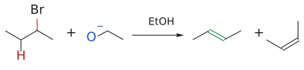
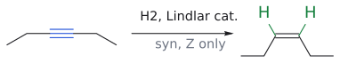
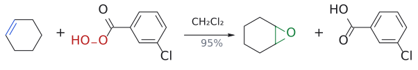
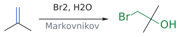
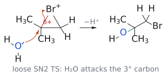

# L1. 알켄의 친전자성 첨가 반응 1부 (Electrophilic Addition to Alkenes, Part 1)

> **통독본**: 2026-10-12 재구성 직전의 강의별 전체 노트(교과서 보강 포함)를 그대로 보존한 사본이다. 강의 흐름대로 한 번에 읽을 때 쓴다. 이후의 수정과 보충은 개념 문서에만 반영되므로, **최신 내용은 개념 문서**가 기준이다. 뼈대 노트: [L1 뼈대](../L01_Electrophilic_Addition_to_Alkenes_Part1.md) · [위키 대문](../../wiki/위키%20대문.md)

> **관련 위키 문서** ([위키 대문](../../wiki/위키%20대문.md))
> - 반응: [SN2 reaction](../../wiki/반응/SN2%20반응.md), [diene의 electrophilic addition](../../wiki/반응/다이엔의%20친전자성%20첨가.md), [Lindlar reduction](../../wiki/반응/린들라%20환원.md), [epoxidation](../../wiki/반응/에폭시화.md), [catalytic hydrogenation](../../wiki/반응/촉매%20수소화.md), [halogen addition](../../wiki/반응/할로젠%20첨가.md), [hydrohalogenation](../../wiki/반응/할로젠화수소%20첨가.md), [halohydrin formation](../../wiki/반응/할로하이드린%20형성.md)
> - 시약: [mCPBA](../../wiki/시약/mCPBA.md), [Lindlar catalyst](../../wiki/시약/린들라%20촉매.md)
> - 개념: [loose SN2 transition state](../../wiki/개념/느슨한%20SN2%20전이%20상태.md), [Markovnikov's rule](../../wiki/개념/마르코프니코프%20규칙.md), [bromonium ion](../../wiki/개념/브로모늄%20이온.md), [kinetic vs thermodynamic control](../../wiki/개념/속도론적%20지배와%20열역학적%20지배.md), [allyl cation](../../wiki/개념/알릴%20양이온.md), [stereospecificity and stereoselectivity](../../wiki/개념/입체특이성과%20입체선택성.md), [electrophile and nucleophile](../../wiki/개념/친전자체와%20친핵체.md), [carbocation](../../wiki/개념/탄소%20양이온.md)

## 개요

alkene의 C=C 이중결합은 유기화학에서 가장 쓸모 있는 "출발점" 중 하나다. 이중결합 하나에 무엇을 더하느냐에 따라 alkyl halide, epoxide, alcohol, ether가 만들어진다. 이 강의는 그 변환들이 모두 **하나의 원리**, 즉 "전자가 풍부한 $\pi$ 결합이 전자를 원하는 electrophile, electrophile을 공격한다"는 원리로 설명된다는 것을 보여준다.

강의의 질문은 크게 세 가지다.
1. alkene은 왜, 어떻게 electrophile과 반응하는가? (메커니즘)
2. 비대칭 alkene이라면 어느 쪽 탄소에 무엇이 붙는가? (regioselectivity, regioselectivity)
3. 이 반응들로 무엇을 만들 수 있는가? (합성 응용)

이 강의에서 처음 나오는 **bromonium bromonium ion** 과 **carbocation** 이라는 두 intermediate는 L2, L3, L4까지 계속 다시 등장하니, 여기서 확실히 잡아두는 것이 좋다. (출처: L1 p.4)

---

## 1. 출발점: 첨가와 제거는 서로 거울 관계

> 개념 문서: [개관](../../wiki/개념/알켄의%20친전자성%20첨가%20개관.md), [Lindlar reduction](../../wiki/반응/린들라%20환원.md), [Lindlar catalyst](../../wiki/시약/린들라%20촉매.md)

포화 화합물(saturated)에서 무언가를 떼어내면 이중결합이 생기고(제거 반응, elimination), 이중결합에 무언가를 붙이면 다시 포화된다(첨가 반응, addition).

- 제거의 예: 2-bromobutane --[NaOEt]--> 2-butene. 이때 *E*-alkene이 주생성물, *Z*-alkene이 부생성물이다.
- 첨가의 예: alkyne --[H₂, 린들라 촉매(Lindlar's catalyst = Pd, CaCO₃, Pb(OAc)₂)]--> *Z*-alkene. 슬라이드 예시에서는 수율 79%, 전부 *Z*였다.

그림: 보충: 2-bromobutane의 제거 반응( $NaOEt$, $EtOH$ ). 염기 $EtO^-$ (파랑)가 $\beta$ -H(빨강)를 떼어 내고, 동시에 C–Br 결합(빨강)이 끊어지며 C=C(초록)가 생긴다. 왼쪽의 *E*-2-butene이 주생성물, 오른쪽의 *Z*-2-butene이 부생성물이다.

그림: alkyne에 $H_2$ /Lindlar 촉매. 두 H(초록)가 같은 면에서 들어와(syn) Z-alkene만 생긴다. 구조는 예시(hex-3-yne)다. 파랑 = 반응하는 C≡C.

린들라 환원이 왜 *Z*만 주는가? 두 수소 원자가 금속 촉매 **표면의 같은 쪽**에서 alkyne에 동시에 올라타기 때문이다(syn 첨가). 같은 면에서 들어오니 두 H가 같은 쪽에 놓이고, 결과적으로 R¹과 R²도 같은 쪽에 남는 *Z*-alkene이 된다. (출처: L1 p.5)

> 여담으로, 강의는 PVC(폴리염화비닐)를 예로 든다. PVC의 단량체인 vinyl chloride은 (a) acetyl렌에 HCl을 첨가하거나, (b) ethylene에 Cl₂를 첨가해 1,2-dichloroethane을 만든 뒤 HCl을 제거해서 얻는다. 첨가와 제거가 실제 산업에서 짝을 이뤄 쓰이는 사례다.[1] (출처: L1 p.6)

---

## 2. electrophilic addition 반응 한눈에 보기

> 개념 문서: [개관](../../wiki/개념/알켄의%20친전자성%20첨가%20개관.md)

강의 p.8의 표는 이후 두 강의 전체의 "목차" 역할을 한다. R-CH=CH₂를 기준으로:

| 반응                                     | 시약                 | 결과                          |
| -------------------------------------- | ------------------ | --------------------------- |
| 수소화 (hydrogenation)                    | H₂, Pd             | 두 탄소에 H 하나씩                 |
| hydrogen halide 첨가 (hydrohalogenation) | HX (X = Cl, Br, I) | X는 치환기가 많은 탄소에, H는 CH₂ 쪽에   |
| 수화 (hydration)                         | H₂O, $\mathrm{H}^+$            | OH는 치환기가 많은 탄소에             |
| halogenation (halogenation)            | X₂                 | 두 탄소에 X 하나씩                 |
| halohydrin 형성 (halohydrin formation)   | X₂, H₂O            | OH는 치환기가 많은 탄소에, X는 CH₂ 쪽에  |
| 수소붕소화 (hydroboration)                  | BH₃                | B는 CH₂ 쪽에 (이후 산화로 이어짐 → L2) |
| dihydroxylation (dihydroxylation)      | OsO₄               | 두 탄소에 OH 하나씩                |
| 에폭시화 (epoxidation)                     | mCPBA              | 3원 고리 epoxide               |

(출처: L1 p.7)

---

## 3. alkene과 bromine: bromonium 이온의 등장

### 3.1 관찰: bromine water가 탈색된다

> 개념 문서: [halogen addition](../../wiki/반응/할로젠%20첨가.md)

주황색 bromine water에 cyclohexane(알케인)을 넣고 흔들면 색이 그대로 남는다. cyclohexene(alkene)을 넣으면 색이 사라진다. 이것이 고전적인 **alkene 검출법**이다. ethylene(ethene)은 Br₂와 실온에서 반응해 무색의 1,2-dibromoethane이 된다. (출처: L1 p.8)

> 슬라이드에는 "물속에서 반응하면 Br-CH₂-CH₂-OH가 생기지 않을까?"라는 물음표가 붙어 있다. 정답은 "생길 수 있다"이다. 이 물음은 5절의 halohydrin 이야기로 이어진다.

### 3.2 왜 반응하는가: 궤도함수로 보기

> 개념 문서: [electrophile and nucleophile](../../wiki/개념/친전자체와%20친핵체.md)

Br-Br 결합은 약하다. 그래서 nucleophile($\mathrm{Nu}^-$)가 한쪽 Br을 공격하면 다른 쪽 Br이 $\mathrm{Br}^-$ 으로 떨어져 나간다.

그런데 alkene에는 음전하가 없다. 무엇이 nucleophile 역할을 할까? 답은 **alkene의 HOMO, 즉 채워진 C=C $\pi$ 궤도함수**다. 이 전자쌍이 Br₂의 **LUMO, 즉 비어 있는 Br-Br $\sigma^*$ 궤도함수**로 흘러 들어간다. $\sigma^*$에 전자가 차면 Br-Br 결합이 끊어진다. (출처: L1 p.9)

### 3.3 1단계: bromonium 이온 형성

> 개념 문서: [bromonium ion](../../wiki/개념/브로모늄%20이온.md)

그림: Br₂가 $\pi$ 결합의 가운데로 end-on 다가온다. 파란색은 nucleophile 쪽( $\pi$ 결합, HOMO), 빨간색은 electrophile 쪽(Br–Br $\sigma^*$, LUMO), 주황색 굽은 화살표는 전자쌍의 이동이다. 화살표 셋은 (1) $\pi$ 전자가 가까운 Br로, (2) Br–Br 결합 전자가 먼 Br로($\mathrm{Br}^-$ 로 이탈), (3) 가까운 Br의 비공유 전자쌍이 반대쪽 탄소로 가서 3원 고리를 닫는 과정을 나타낸다.

$\pi$ 궤도함수의 전자 밀도는 두 탄소의 **정중앙**에서 가장 높다. 그리고 $\pi$ HOMO가 $\sigma^*$ LUMO와 결합성으로 겹치려면 Br₂가 **end-on** 다가와야 한다.

그 결과 Br 원자 하나가 두 탄소에 동시에 걸쳐 앉은 **3원 고리 cation, bromonium 이온**이 생기고 $\mathrm{Br}^-$ 하나가 떨어져 나간다. 이 단계 덕분에 이 반응을 "이중결합에 대한 electrophilic addition"라 부르며, 여기서 electrophile은 bromine이다. (출처: L1 p.10)

> bromonium 이온은 보통 금방 반응해 사라지는 불안정한 intermediate다. 그런데 바이(아다만틸리덴)(bi(adamantylidene))에서 만든 bromonium 이온은 양쪽의 거대한 아다만틸기가 뒤쪽 공격을 막아서 **분리할 수 있을 만큼 안정**하다. 이 화합물은 bromonium 이온이 실제로 존재한다는 구조적 증거가 되었다.[2] (출처: L1 p.11)

### 3.4 2단계: Br⁻의 SN2 공격

> 개념 문서: [bromonium ion](../../wiki/개념/브로모늄%20이온.md), [SN2 reaction](../../wiki/반응/SN2%20반응.md)

그림: $\mathrm{Br}^-$ (파랑, nucleophile)가 C–Br⁺ 결합(빨강)의 정반대편에서 탄소를 backside attack. C–Br 결합 전자는 Br로 돌아가고, 새로 생긴 C–Br 결합(초록)은 원래 Br의 반대편에 놓이므로 두 Br이 anti가 된다.

bromonium 이온은 양전하를 띤 electrophile이고, 1단계에서 떨어져 나간 $\mathrm{Br}^-$ 은 nucleophile다. 이 둘의 반응은 **평범한 SN2 치환**이다.

SN2이므로 nucleophile은 C-Br $\sigma^*$ 궤도함수와 최대로 겹치기 위해 **leaving group의 정반대편에서** 일직선으로 들어온다. 그래서 공격받는 탄소의 입체배치가 **inversion** 된다. 결과적으로 두 Br은 서로 반대 면(anti)에 붙는다. 이 "anti 첨가"는 L2에서 cyclohexene bromination의 입체화학으로 다시 다룬다. (출처: L1 p.12)

보충: $\mathrm{Br}^-$ 가 탄소가 아니라 양전하를 띤 Br을 공격할 수도 있을까? 실제로 그럴 수 있지만, 그 결과는 Br₂와 alkene이 다시 생기는 것뿐이다. 즉 1단계(bromonium 이온 형성)는 **가역적**이고, 생성물로 이어지는 길은 탄소를 공격하는 SN2뿐이다. 또 bromonium 이온은 "carbocation 옆의 Br이 비공유 전자쌍을 내주어 양전하를 달래 준 구조"로 볼 수도 있다. Br은 주기율표 아래쪽 원소라 비공유 전자쌍이 넓게 퍼져 있어서, 3원 고리의 각 긴장을 감수하고도 이런 안정화가 가능하다. 이 관점은 7.2절의 느슨한 SN2 transition state를 이해하는 다리가 된다. (보충 근거: Clayden p.429)

---

그림: ethylene에서 생긴 bromonium ion의 3D 구조(GFN2-xTB). $Br^+$ 가 두 탄소 위에 다리를 놓아 3원 고리를 만들고(C–Br 1.98 Å), 한쪽 면이 $Br^+$ 로 막힌다. 파란 화살표는 $Br^-$ 가 들어오는 방향으로, $Br^+$ 의 정반대편(anti)이다. 보충: 슬라이드 밖의 3D 모델 그림이다.

## 4. alkene의 산화: epoxide

> 개념 문서: [epoxidation](../../wiki/반응/에폭시화.md), [mCPBA](../../wiki/시약/mCPBA.md), [stereospecificity and stereoselectivity](../../wiki/개념/입체특이성과%20입체선택성.md)

### 4.1 epoxide는 "산소판 bromonium 이온"

epoxide는 bromonium 이온의 $\mathrm{Br}^+$ 자리에 O가 들어간 3원 고리라고 볼 수 있다. 차이점은 epoxide는 **중성이고 꽤 안정**해서 분리하여 보관할 수 있다는 것이다.

에폭시화에는 주로 **peroxy-carboxylic acid, peracid** 을 쓴다. 과산은 carboxylic acid의 C(=O)와 산성 H 사이에 **산소가 하나 더 끼어 있는** 구조(R-C(=O)-O-O-H)다. (출처: L1 p.13)

과산은 왜 산소 쪽이 친전자성일까? nucleophile이 말단 OH의 산소를 공격하면 약한 O-O 결합이 끊어지면서 **carboxylate(좋은 leaving group)** 가 떨어져 나가기 때문이다. 즉 "산소 원자에서 일어나는 SN2"다. (출처: L1 p.13)

### 4.2 mCPBA

그림: 네 개의 화살표가 한 번에 움직인다. (1) $\pi$ 결합이 친전자성 산소(빨강)를 공격하고, (2) 약한 O–O 결합이 끊어지며 그 전자가 새 C=O를 만들고, (3) 원래의 C=O가 H를 받아 가며, (4) O–H 결합 전자가 두 번째 C–O 결합이 된다. 그림에서는 과산의 R을 CH₃로 단순화했다(mCPBA는 R = *m*-ClC₆H₄). 두 methyl이 같은 쪽에 있던 alkene은 두 methyl이 같은 쪽에 있는 epoxide가 stereospecificity.

가장 흔히 쓰는 과산은 **mCPBA(*meta*-chloroperoxybenzoic acid)** 다. 결정성 고체라서 비교적 안전하게 다룰 수 있다. 예를 들어 cyclohexene --[mCPBA]--> cyclohexene oxide의 수율은 95%이고, 부산물로 *m*-chlorobenzoic acid이 나온다. (출처: L1 p.14)

그림: cyclohexene의 C=C(파랑)가 mCPBA의 O–O(빨강)에서 O를 받아 epoxide(초록)가 되고, m-chlorobenzoic acid가 남는다(95%).

메커니즘은 한 번에 일어나는 concerted 과정이다.
1. alkene의 $\pi$ 전자가 과산의 말단(친전자성) 산소를 공격한다.
2. 동시에 약한 O-O 결합이 끊어진다.
3. 원래 O-H의 수소는 carbonyl 산소로 옮겨가 carboxylic acid 부산물이 된다.
4. 그 산소의 비공유 전자쌍이 alkene의 다른 탄소와 결합해 3원 고리가 닫힌다.

transition state는 고리 모양으로 그려진다. (출처: L1 p.14)

그림: ethylene + performic acid(mCPBA의 단순 모델)의 butterfly TS. 옮겨 가는 O가 C=C 가운데 위에 있고(초록 점선 C···O 2.10 Å, 끊어지는 O···O 1.75 Å), 과산 평면은 alkene 평면과 거의 직각이라 나비 날개처럼 보인다. 회색 점선은 O–H···O=C 수소결합이고, 이 H가 carbonyl O로 옮겨 가 carboxylic acid가 된다. 보충: xTB 구조는 GFN2-xTB로 계산한 모델이고, TS는 형성·절단 결합 길이를 고정해 최적화한 근사 구조다(진짜 안장점이 아니다).

### 4.3 stereospecificity과 반응 속도

두 개의 새 C-O 결합이 $\pi$ 결합의 **같은 면**에서 동시에 생기므로, alkene의 기하 구조가 epoxide에 그대로 옮겨진다. *trans*-스틸벤은 *trans*-스틸벤 oxide가 되고, *cis*-스틸벤은 *cis* epoxide가 된다. 출발 물질의 입체화학이 생성물의 입체화학을 결정하므로 이 반응은 **stereospecific** 이다. (출처: L1 p.15)

치환기가 많은 alkene일수록 더 빨리 반응한다. mCPBA에 대한 상대 속도는 다음과 같다.

| alkene | 상대 속도 |
|---|---|
| H₂C=CH₂ | 1 |
| 프로펜 | 24 |
| *cis*-2-butene | 500 |
| 2-methyl프로펜 | 500 |
| 2-methyl-2-butene (삼치환) | 6500 |
| 2,3-dimethyl-2-butene (사치환) | >6500 |

이유는 **alkyl group이 전자를 주는 기(electron-donating)** 이기 때문이다. alkyl group이 많을수록 $\pi$ 결합이 더 친핵성이 된다. (출처: L1 p.15)

보충: 궤도함수로 말하면, 이중결합 옆의 C–H나 C–C $\sigma$ 결합(채워진 궤도함수)이 $\pi$ 궤도함수와 상호작용할 때마다 $\pi$ HOMO의 에너지가 조금씩 올라간다. HOMO가 높을수록 electrophile의 LUMO와 에너지 차이가 줄어 반응이 빨라진다. 이 차이는 합성에 쓸모가 있다. 이중결합이 둘 있는 분자에 mCPBA를 **1 당량만** 넣으면 더 많이 치환된(더 전자가 풍부한) 이중결합만 에폭시화된다. 또 하나가 에폭시화되면 새로 붙은 산소가 전자를 끌어당겨 남은 이중결합의 친핵성을 낮추므로, diene에서 monoepoxide를 얻을 수 있다. (보충 근거: Clayden p.431)

---

## 5. HBr addition: carbocation과 Markovnikov 규칙

> 개념 문서: [hydrohalogenation](../../wiki/반응/할로젠화수소%20첨가.md), [Markovnikov's rule](../../wiki/개념/마르코프니코프%20규칙.md), [carbocation](../../wiki/개념/탄소%20양이온.md)

### 5.1 메커니즘

hydrogen halide 첨가는 형식상 **제거 반응의 역반응**이다. cyclohexene + HBr 반응은 두 단계로 진행된다.
1. $\pi$ 결합이 H-Br의 H를 공격한다(친전자성 공격). 그 결과 $\mathrm{Br}^-$ 가 떨어지고 carbocation이 생긴다.
2. $\mathrm{Br}^-$ 가 carbocation을 공격해 bromocyclohexane이 된다.

(출처: L1 p.16)

보충: 왜 Br₂와 달리 HBr에서는 3원 고리 intermediate가 아니라 열린 carbocation이 생길까? bromonium 이온의 고리는 Br의 **비공유 전자쌍**이 반대쪽 탄소와 결합해야 닫힌다. 그런데 H에는 내줄 비공유 전자쌍이 없으므로 고리를 만들 수 없고, 양성자가 붙은 결과는 carbocation으로 그리는 것이 맞다. 그래서 HBr 첨가에는 bromination 같은 anti stereospecificity이 없고, regioselectivity은 오직 cation의 안정성으로 정해진다. 덧붙여 alkene의 protonation은 가역적이어서, 생긴 cation이 다른 $\beta$-H를 잃으면 더 안정한 alkene으로 이성질화될 수 있다(산 촉매 alkene 이성질화). (보충 근거: Clayden p.433–434)

### 5.2 비대칭 alkene이면 어디에 붙는가?

스타이렌(styrene, Ph-CH=CH₂)에 HBr을 첨가하면 Br이 붙을 수 있는 자리는 두 곳이다. Ph가 붙은 탄소(1-bromo-1-phenyl에테인)일 수도 있고, 끝 탄소(2-bromo-1-phenyl에테인)일 수도 있다. 실제로는 **앞의 것만** 생긴다.

이유는 1단계에서 H가 어디에 붙느냐에 있다.
- H가 끝 CH₂에 붙으면 Ph 옆에 **benzyl carbocation**이 생긴다. 이 cation은 공명으로 안정화된다.
- H가 Ph 쪽 탄소에 붙으면 **1차 carbocation**이 생긴다. 이 cation은 불안정해서 사실상 생기지 않는다.

정리하면, bromine은 **치환기가 더 많은 탄소**에 붙는다. (출처: L1 p.17)

### 5.3 Markovnikov 규칙

그림: 1단계: $\pi$ 결합(파랑)이 H–Br의 H(빨강)를 공격한다. H는 CH₂ 쪽 탄소에 붙고(빨간 H), 양전하는 methyl 두 개가 안정화하는 3차 탄소에 남는다. 2단계: $\mathrm{Br}^-$ 가 3차 carbocation을 공격해 *t*-BuBr이 된다(초록 결합).

2-methyl프로펜 + HBr 반응도 같은 원리다. H가 CH₂에 붙어 **3차 carbocation**이 생기므로 생성물은 *tert*-butyl bromide다.

이 경험칙을 **Markovnikov Markovnikov's rule** 이라 한다. "수소는 원래 수소를 더 많이 가진 이중결합 탄소에 붙는다." 그러나 그 밑바탕에는 **더 안정한 carbocation을 거치는 경로가 이긴다**는 원리가 있다. 규칙을 외우기보다 이 원리를 기억하는 편이 훨씬 응용 범위가 넓다. (출처: L1 p.18)

---

그림: 정성적 에너지 도표. 속도 결정 단계는 protonation이고, 더 안정한 3차 carbocation으로 가는 TS가 더 낮으므로(Hammond postulate) 초록 경로(Markovnikov)로 반응한다. 회색 점선은 1차 cation 경로다. 보충: 슬라이드의 intermediate 안정성 논리를 에너지 도표로 옮긴 것이다(수치 없음).

## 6. diene의 electrophilic addition (1,4-첨가)

> 개념 문서: [diene의 electrophilic addition](../../wiki/반응/다이엔의%20친전자성%20첨가.md), [allyl cation](../../wiki/개념/알릴%20양이온.md), [kinetic vs thermodynamic control](../../wiki/개념/속도론적%20지배와%20열역학적%20지배.md)

### 6.1 isoprene + HBr

isoprene, 2-methyl-1,3-butadiene에 $\mathrm{H}^+$ 가 붙는 경우를 보자.
- **methyl이 붙은 쪽 이중결합**의 말단에 $\mathrm{H}^+$ 가 붙으면 **allyl cation(allylic cation)** 이 생긴다. 양전하가 공명으로 퍼지며, 그중 한 공명 구조에서는 양전하가 methyl이 붙은 3차 탄소에 놓여 추가로 안정화된다.
- **다른 쪽 이중결합**에 $\mathrm{H}^+$ 가 붙어도 allyl cation이 생기지만, 양전하가 methyl이 붙은 탄소까지 퍼지지 않는다. 그래서 methyl의 안정화 효과를 받지 못한다.

따라서 앞의 경로가 선택된다.

이렇게 생긴 allyl cation을 $\mathrm{Br}^-$ 가 공격하는데, 공격은 **덜 붐비는 말단**에서 일어난다. 생성물은 **프레닐 bromide(prenyl bromide)** 이다. 결과적으로 H와 Br이 **diene 계의 양 끝(1,4 위치)** 에 붙는다. (출처: L1 p.19)

### 6.2 1,3-butadiene + Br₂ (1 당량)

슬라이드 p.20은 빈칸으로 남겨져 있고, 답은 L2 p.6에 나온다.
- **0 °C**에서는 3,4-dibromo-1-butene(1,2-첨가)이 생긴다. 이것이 **kinetic 생성물(kinetic product)** 이다.
- **가열**하면 1,4-dibromo-2-butene(1,4-첨가, *E*)이 생긴다. 이것이 **thermodynamic 생성물(thermodynamic product)** 이다.

bromonium 이온이 생긴 뒤 $\mathrm{Br}^-$ 가 가까운 탄소를 바로 공격하면 1,2-생성물이 된다. 반면 이웃한 이중결합을 통해 고리가 열리면서 먼 끝(4번 탄소)이 공격받으면 1,4-생성물이 된다. 두 생성물은 가역적으로 서로 바뀔 수 있다(⇌). 그래서 온도를 높이면 더 안정한 1,4-생성물, 즉 이치환 내부 alkene 쪽으로 쏠린다.[3] (출처: L1 p.20, L2 p.6)

---

## 7. 비대칭 bromonium 이온의 regioselectivity

> 개념 문서: [halohydrin formation](../../wiki/반응/할로하이드린%20형성.md), [loose SN2 transition state](../../wiki/개념/느슨한%20SN2%20전이%20상태.md), [halogen addition](../../wiki/반응/할로젠%20첨가.md)

### 7.1 용매가 nucleophile이 될 때

bromination을 물이나 methanol 같은 **친핵성 용매** 속에서 하면 어떻게 될까? 용매 분자가 $\mathrm{Br}^-$ 와 경쟁해 bromonium 이온을 연다. 용매는 $\mathrm{Br}^-$ 보다 압도적으로 농도가 높아서 대부분 용매가 먼저 반응한다.

- 2-methyl프로펜 --[Br₂, H₂O]--> bromohydrin. OH는 3차 탄소에, Br은 CH₂에 붙는다.
- 이 bromohydrin을 염기($\mathrm{HO}^-$)로 처리하면 alkoxide($\mathrm{O}^-$)가 생긴다. 이 alkoxide가 분자 안에서 SN2로 옆 탄소의 Br을 밀어내면 **epoxide**가 된다. 즉 bromohydrin은 epoxide의 전구체다.

그림: 2-methylpropene + $Br_2$, $H_2O$. OH(초록)는 3차 탄소에, Br(초록)은 $CH_2$ 에 붙는다. 파랑 = 반응하는 C=C.

그림: 물의 산소(파랑) 비공유 전자쌍이 bromonium 이온의 3차 탄소(빨강, δ+)를 $\mathrm{Br}^+$ 의 반대쪽에서 공격하고, 주황 화살표대로 C–Br 결합 전자는 Br로 간다. 3차 탄소가 부분 양전하를 더 잘 견디므로 OH가 Markovnikov 위치에 붙고, 양성자를 잃으면(−$\mathrm{H}^+$) bromohydrin이 된다.

(출처: L1 p.21)

### 7.2 왜 "더 치환된" 쪽이 공격받는가?

그림: isobutene에서 생긴 bromonium 이온에서 C–Br 결합이 늘어나면 부분 양전하( $\delta^{+}$ )가 3차 탄소에 쌓인다. 그래서 MeOH의 산소(파랑)가 그 3차 탄소를 뒤쪽에서 공격한다. 이어서 양성자를 잃으면(−$\mathrm{H}^+$) ether가 된다.

대칭 bromonium 이온(ethylene에서 생긴 것)이라면 어느 탄소를 공격하든 결과가 같다. 그런데 2-methyl프로펜 --[Br₂, MeOH]--> 반응에서는 methanol이 **더 치환된 쪽(3차 탄소)** 을 공격해 ether를 만든다. (출처: L1 p.22)

SN2라면 보통 덜 붐비는 쪽을 공격하지 않나? 여기가 바로 이 강의의 핵심 포인트다.

답은 **"느슨한 SN2 transition state(loose SN2 transition state)"** 다. bromonium 이온이 열릴 때는 nucleophile이 들어오기 전에 C-Br 결합이 먼저 상당히 늘어난다. 그러면 탄소 위에 **부분 양전하**가 쌓인다. 이때 3차 탄소 쪽은 alkyl기들이 이 양전하를 안정화해 주므로 Br이 더 많이 떨어져 나간 상태에 도달할 수 있다. 그래서 **입체 효과가 아닌 전자 효과가 regioselectivity을 결정**한다. (출처: L1 p.23)

치환기가 많을수록 반응 속도도 급격히 빨라진다(Br₂/MeOH 기준 상대 속도).

| alkene | 상대 속도 |
|---|---|
| H₂C=CH₂ | 1 |
| 1-hexene (*n*-Bu) | 100 |
| 3,3-dimethyl-1-butene (*t*-Bu) | 27 |
| *cis*-2-butene | 2700 |
| *trans*-2-butene | 1750 |
| 2-methyl프로펜 | 5700 |
| 2-methyl-2-butene | 13000 |
| 2,3-dimethyl-2-butene | 1900000 |

(출처: L1 p.23)

> *t*-Bu 치환체가 *n*-Bu 치환체보다 느린 점(27 대 100)에 주목하자. 전자 효과는 비슷하지만 부피가 큰 *t*-Bu가 Br₂의 접근을 방해하는 입체 효과로 해석할 수 있다. 이는 슬라이드 데이터를 바탕으로 한 해석이다. 보충: 교과서도 같은 해석을 한다. bromonium 이온은 반응성이 큰 intermediate라 **속도 결정 단계는 Br₂가 alkene을 공격하는 1단계**이고, 그래서 이중결합의 치환기 수가 속도를 크게 좌우한다. 반면 치환기의 가지 정도(Me, *n*-Bu, *t*-Bu)나 *E*/*Z* 차이는 훨씬 작은, 아마도 입체적인 영향만 준다. (보충 근거: Clayden p.437)

---

## 흔한 오해

- **"Br₂ 첨가에서 $\mathrm{Br}^-$ 는 덜 붐비는 탄소를 공격한다"**: 대칭 bromonium 이온에서는 상관이 없다. 비대칭 bromonium 이온에서는 오히려 **더 치환된 탄소**가 공격받는다. 느슨한 SN2 transition state에서 양전하가 그쪽에 더 잘 쌓이기 때문이다.
- **"Markovnikov 규칙은 외워야 하는 규칙이다"**: 이 규칙은 "더 안정한 cation을 거친다"는 원리를 경험적으로 요약한 것일 뿐이다. L2에서 배울 "$\delta^-$ 원자는 더 치환된 탄소로 간다"도 같은 원리를 다르게 표현한 것이다.
- **"에폭시화는 bromination처럼 2단계로 일어난다"**: 에폭시화는 고리형 transition state를 거치는 **한 단계 협동 반응**이다. 그래서 alkene의 *cis*/*trans* 정보가 그대로 보존된다.
- **"HBr 첨가도 Br₂처럼 고리형 intermediate를 거쳐 anti로 일어난다"**: H에는 비공유 전자쌍이 없어 3원 고리를 닫을 수 없다. HBr 첨가의 intermediate는 열린 carbocation이다. (보충 근거: Clayden p.433)
- **"치환기가 많으면 입체 장애 때문에 느릴 것이다"**: mCPBA나 Br₂ 첨가에서는 반대다. alkyl group의 전자 공여로 $\pi$ 결합이 더 친핵성이 되어 **빨라진다**.

---

## 반응 정리표

| 반응 | 시약/조건 | 생성물 | regioselectivity | 입체화학 | 비고 |
|---|---|---|---|---|---|
| halogenation | Br₂ (또는 Cl₂) | 1,2-dihalide | 해당 없음 (대칭) | anti 첨가 | bromonium 이온 → SN2 |
| halohydrin | Br₂, H₂O | $\beta$-bromoalcohol | OH는 더 치환된 C에 | anti | 느슨한 SN2 |
| haloether | Br₂, MeOH | $\beta$-bromoether | OMe는 더 치환된 C에 | anti | 용매가 $\mathrm{Br}^-$ 를 이김 |
| 에폭시화 | mCPBA (과산) | epoxide | 해당 없음 | syn, 입체특이적 | 협동, 고리 TS |
| bromohydrin → epoxide | 염기 ($\mathrm{HO}^-$) | epoxide | 해당 없음 | 분자내 SN2 | |
| HBr addition | HBr | alkyl bromide | Markovnikov | (이번 강의 범위 아님) | carbocation intermediate |
| diene + HBr | HBr | 1,4-첨가 생성물 | H와 Br은 diene 양 끝에 | | allyl cation |
| diene + Br₂ | Br₂ 1 당량 | 0 °C: 1,2-첨가 / 가열: 1,4-첨가 | | 1,4 생성물은 *E* | kinetic/thermodynamic 지배 |
| 린들라 환원 | H₂, Pd/CaCO₃/Pb(OAc)₂ | *Z*-alkene | | syn | 촉매 표면 |

---

## 연습 문제

1. cyclohexane과 cyclohexene을 각각 bromine water에 넣고 흔들었다. 각각 어떤 변화가 관찰되는지 쓰고, 그 이유를 설명하시오.
2. alkene + Br₂ 반응에서 alkene의 HOMO와 Br₂의 LUMO는 각각 무엇인가? Br₂가 "끝부분부터(end-on)" 접근해야 하는 이유도 설명하시오.
3. *cis*-2-butene과 *trans*-2-butene을 각각 mCPBA로 처리했을 때의 생성물을 입체화학까지 포함해 쓰시오.
4. 스타이렌(Ph-CH=CH₂)에 HBr을 반응시킬 때의 주생성물을 쓰고, 다른 위치 이성질체가 생기지 않는 이유를 intermediate 안정성으로 설명하시오.
5. 1,3-butadiene에 Br₂ 1 당량을 0 °C에서 반응시킨 경우와 가열한 경우의 주생성물을 각각 쓰고, 어느 쪽이 kinetic/thermodynamic 생성물인지 밝히시오. (슬라이드 p.20의 빈칸 문제)
6. 2-methyl프로펜을 Br₂/MeOH로 처리한 생성물을 쓰시오. methanol이 3차 탄소를 공격하는 이유도 설명하시오.
7. 2-methyl프로펜에서 출발해 2,2-dimethyl옥시레인(epoxide)을 만드는 두 가지 방법을 제시하시오.
8. 다음 alkene들을 mCPBA와의 반응 속도가 빠른 순서로 나열하시오: ethylene, 2-methyl-2-butene, 프로펜, 2,3-dimethyl-2-butene.

## 정답 및 해설

1. cyclohexane은 변화가 없다(주황색 유지). cyclohexene은 bromine water가 탈색된다. 알케인에는 친핵성 $\pi$ 결합이 없어 Br₂와 반응하지 못하지만, alkene은 Br₂와 electrophilic addition을 일으켜 Br₂가 소모되기 때문이다. (L1 p.8)
2. HOMO는 채워진 C=C $\pi$ 궤도함수, LUMO는 비어 있는 Br-Br $\sigma^*$ 궤도함수다. $\pi$ 전자 밀도는 두 탄소의 중앙에서 가장 높다. 그리고 $\sigma^*$는 Br-Br 결합축 방향으로 뻗어 있으므로, 결합성 겹침이 일어나려면 Br₂가 결합축을 따라 끝부분부터 다가와야 한다. (L1 p.9-10)
3. *cis*-2-butene에서는 *cis*-2,3-dimethyl옥시레인(메소 화합물)이, *trans*-2-butene에서는 *trans*-2,3-dimethyl옥시레인(라세미체)이 생긴다. 두 C-O 결합이 같은 면에서 동시에 생기므로 입체특이적이다. 메소/라세미 판정은 보충 설명이며, 원리는 L1 p.15의 스틸벤 예와 같다. (보충 근거: Clayden p.854)
4. 주생성물은 1-bromo-1-phenyl에테인(PhCHBrCH₃)이다. $\mathrm{H}^+$ 가 말단 CH₂에 붙으면 공명 안정화된 benzyl cation이 생긴다. 반대로 붙으면 불안정한 1차 cation이 생기므로 그 경로는 일어나지 않는다. (L1 p.17)
5. 0 °C에서는 3,4-dibromo-1-butene(1,2-첨가, kinetic 생성물)이, 가열하면 (*E*)-1,4-dibromo-2-butene(1,4-첨가, thermodynamic 생성물)이 주생성물이다. 1,4-생성물은 이치환 내부 alkene이라 더 안정하고, 가열하면 두 생성물 사이의 평형이 thermodynamic 생성물 쪽으로 이동한다. (L2 p.6)
6. 생성물은 1-bromo-2-methoxy-2-methylpropane((CH₃)₂C(OMe)CH₂Br)이다. bromonium 이온이 열리는 느슨한 SN2 transition state에서 C-Br 결합이 먼저 늘어나며 부분 양전하가 생긴다. 이 양전하는 alkyl group 두 개가 안정화하는 3차 탄소 쪽에 더 잘 쌓이므로 methanol이 그쪽을 공격한다. 이는 전자 효과에 의한 선택성이다. (L1 p.22-23)
7. (a) mCPBA로 직접 에폭시화한다. (b) Br₂/H₂O로 bromohydrin((CH₃)₂C(OH)CH₂Br)을 만든 뒤, 염기로 alkoxide를 만들어 분자내 SN2로 고리를 닫는다. (L1 p.14, p.21)
8. 2,3-dimethyl-2-butene > 2-methyl-2-butene > 프로펜 > ethylene 순이다(>6500 > 6500 > 24 > 1). alkyl group이 많을수록 $\pi$ 결합이 전자가 풍부해져 친핵성이 커진다. (L1 p.15)

---

## 각주

[1] 강의 슬라이드에서는 PVC가 radical 연쇄 radical chain polymerization으로 만들어지며 파이프나 키보드 자판 등에 쓰인다고 소개한다. radical 반응은 이 과목의 Radical chemistry에서 다룬다.

[2] 슬라이드 p.11에는 cyclopentene에서 만든 bromonium 이온의 3D 모형과 바이(아다만틸리덴) bromonium cation이 "stable"이라는 설명과 함께 나온다.

[3] 보충: 1,2-생성물이 낮은 온도에서 빨리 생기는 이유는 $\mathrm{Br}^-$ 가 bromonium 이온의 가까운 탄소를 공격하는 경로의 활성화 에너지가 더 낮기 때문으로 설명한다. 1,4-생성물이 더 안정한 이유는 이중결합이 더 많이 치환되어 있고 *E* 배치이기 때문이다. Clayden 등 표준 교재의 kinetic/thermodynamic 지배 설명과 같은 내용이다. (보충 근거: Clayden p.435–436)
