# L2. 알켄의 친전자성 첨가 반응 2부 (Electrophilic Addition to Alkenes, Part 2)

> **통독본**: 2026-10-12 재구성 직전의 강의별 전체 노트(교과서 보강 포함)를 그대로 보존한 사본이다. 강의 흐름대로 한 번에 읽을 때 쓴다. 이후의 수정과 보충은 개념 문서에만 반영되므로, **최신 내용은 개념 문서**가 기준이다. 뼈대 노트: [L2 뼈대](../L02_Electrophilic_Addition_to_Alkenes_Part2.md) · [위키 대문](../../wiki/위키%20대문.md)

> **관련 위키 문서** ([위키 대문](../../wiki/위키%20대문.md))
> - 반응: [SN2 reaction](../../wiki/반응/SN2%20반응.md), [periodate cleavage](../../wiki/반응/과아이오딘산%20절단.md), [diene의 electrophilic addition](../../wiki/반응/다이엔의%20친전자성%20첨가.md), [dihydroxylation](../../wiki/반응/다이하이드록실화.md), [acid-catalyzed hydration](../../wiki/반응/산%20촉매%20수화.md), [hydroboration-oxidation](../../wiki/반응/수소붕소화-산화.md), [epoxide ring opening](../../wiki/반응/에폭사이드%20고리%20열기.md), [epoxidation](../../wiki/반응/에폭시화.md), [ozonolysis](../../wiki/반응/오존%20분해.md), [halogen addition](../../wiki/반응/할로젠%20첨가.md), [hydrohalogenation](../../wiki/반응/할로젠화수소%20첨가.md), [halohydrin formation](../../wiki/반응/할로하이드린%20형성.md)
> - 시약: [9-BBN](../../wiki/시약/9-BBN.md), [NBS](../../wiki/시약/NBS.md), [NMO](../../wiki/시약/NMO.md), [NaBH4](../../wiki/시약/NaBH4.md), [NaIO4](../../wiki/시약/NaIO4.md), [OsO4](../../wiki/시약/OsO4.md), [TFA](../../wiki/시약/TFA.md), [mCPBA](../../wiki/시약/mCPBA.md), [borane](../../wiki/시약/보레인.md), [ozone](../../wiki/시약/오존.md)
> - 개념: [1,2-addition vs 1,4-addition](../../wiki/개념/1,2-첨가와%201,4-첨가.md), [loose SN2 transition state](../../wiki/개념/느슨한%20SN2%20전이%20상태.md), [Markovnikov's rule](../../wiki/개념/마르코프니코프%20규칙.md), [bromonium ion](../../wiki/개념/브로모늄%20이온.md), [kinetic vs thermodynamic control](../../wiki/개념/속도론적%20지배와%20열역학적%20지배.md), [allyl cation](../../wiki/개념/알릴%20양이온.md), [stereospecificity and stereoselectivity](../../wiki/개념/입체특이성과%20입체선택성.md), [carbocation](../../wiki/개념/탄소%20양이온.md)

## 개요

L1에서는 "alkene의 π 전자가 electrophile을 공격한다"는 기본 원리와 함께 bromonium 이온과 carbocation이라는 두 intermediate를 배웠다. L2는 그 원리를 **stereochemistry** 과 **실제 합성 도구**로 확장한다.

L2는 다음 질문들에 답한다.
- regioselectivity을 한 줄로 예측하는 요령이 있을까? (δ⁺/δ⁻ 규칙)
- epoxide를 열 때 산성 조건과 염기성 조건에서 결과가 왜 정반대가 될까?
- 1,2-diol을 *trans*로도, *cis*로도 만들 수 있을까?
- 이중결합을 완전히 끊어 carbonyl 두 개로 쪼갤 수 있을까?
- Markovnikov 규칙과 "반대로" OH를 붙이는 방법은 무엇일까?

강의 끝의 요약 지도(p.28)는 *trans*-2-butene 하나에서 출발해 열 가지가 넘는 생성물로 가는 길을 보여준다. 이 문서를 다 읽은 뒤 그 지도를 보면서 각 화살표의 시약과 메커니즘을 말로 설명할 수 있다면 L1과 L2를 정복한 것이다. (출처: L2 p.28)

---

## 1. regioselectivity을 예측하는 한 줄 요령: δ⁺와 δ⁻

> 개념 문서: [Markovnikov's rule](../../wiki/개념/마르코프니코프%20규칙.md)

L1에서 본 반응들의 regioselectivity을 다시 보자.
- HBr addition: H(δ⁺)는 덜 치환된 탄소로, Br(δ⁻)은 더 치환된 탄소로 간다. intermediate는 carbocation이다.
- Br₂/MeOH: bromonium 이온의 Br(δ⁺)은 덜 치환된 탄소에 남고, MeOH(nucleophile, δ⁻)는 더 치환된 탄소로 간다.

두 반응은 메커니즘이 다르지만 결과는 같은 패턴을 따른다.

> **시약에서 "δ⁻"로 표시되는 원자(친핵성 부분)는 더 치환된 탄소로, "δ⁺"로 표시되는 원자(친전자성 부분)는 덜 치환된 탄소로 간다.**

이 요령이 통하는 이유는 두 경우 모두 반응 도중 **양전하가 더 치환된 탄소에 쌓이고**, nucleophile이 그 자리로 가기 때문이다. 이 규칙은 뒤에 나오는 수화, TFA addition, 수소붕소화에도 그대로 적용된다. 특히 수소붕소화에서는 B-H 결합의 극성이 뒤집혀 결과가 "반마르코프니코프"가 된다. (출처: L2 p.2-4, L3 p.4)

### 1.1 diene에서의 두 가지 regioselectivity

> 개념 문서: [diene의 electrophilic addition](../../wiki/반응/다이엔의%20친전자성%20첨가.md), [allyl cation](../../wiki/개념/알릴%20양이온.md)

isoprene + HBr 반응에서는 regioselectivity 문제가 **두 번** 나온다(L1 p.19 복습).
1. H⁺가 어느 이중결합에 붙는가? methyl의 안정화를 받는 allyl cation을 만드는 쪽에 붙는다.
2. Br⁻가 allyl cation의 어느 끝을 공격하는가? 덜 붐비는 끝을 공격해 프레닐 bromide가 된다.

두 번째 선택은 **allyl cation과 bromide 사이의 regioselectivity**이라고 따로 구분해 둔다. (출처: L2 p.5)

### 1.2 1,3-butadiene + Br₂

> 개념 문서: [diene의 electrophilic addition](../../wiki/반응/다이엔의%20친전자성%20첨가.md), [kinetic vs thermodynamic control](../../wiki/개념/속도론적%20지배와%20열역학적%20지배.md)

- 0 °C에서는 3,4-dibromo-1-butene(1,2-첨가)이 생긴다. 이것이 "kinetic 생성물(kinetic product)"이다.
- 가열하면 (*E*)-1,4-dibromo-2-butene(1,4-첨가)이 생긴다. 이것이 "thermodynamic 생성물(thermodynamic product)"이다.

두 경로 모두 bromonium 이온에서 출발한다. Br⁻가 고리 탄소를 바로 공격하면 1,2-생성물이, 이웃 이중결합의 끝(4번 탄소)을 공격하면 1,4-생성물이 된다. 슬라이드에서 두 반응은 가역 화살표(⇌)로 그려져 있다. 그래서 충분한 에너지를 주면 더 안정한 생성물로 모인다. 결국 diene 계의 **양 끝에 Br 두 개**가 붙는다. (출처: L2 p.6)

---

## 2. epoxide 고리 열기: 조건이 위치를 결정한다

> 개념 문서: [epoxide ring opening](../../wiki/반응/에폭사이드%20고리%20열기.md), [loose SN2 transition state](../../wiki/개념/느슨한%20SN2%20전이%20상태.md)

epoxide도 bromonium 이온처럼 고리 ring strain이 큰 3원 고리다. 그런데 epoxide는 중성이라 그대로는 잘 열리지 않는다. 고리를 열려면 **산 촉매** 또는 **강한 nucleophile**이 필요하다. 어느 쪽을 쓰느냐에 따라 regioselectivity이 **정반대**가 된다. 이것이 L2에서 가장 중요한 비교 중 하나다. (출처: L2 p.8)

### 2.1 산 촉매 조건 (MeOH, H⁺)

1. epoxide 산소가 protonate되어 양전하를 띤 intermediate가 된다.
2. 이제 C-O 결합이 약해지고 늘어나면서 탄소에 부분 양전하가 생긴다. alkyl group 두 개가 붙은 **3차 탄소**가 이 양전하를 더 잘 견딘다.
3. MeOH는 바로 그 **더 치환된 탄소**를 공격한다. transition state는 L1에서 본 "느슨한 SN2"다.
4. deprotonation이 일어나 2-methoxy-2-methyl-1-propanol((CH₃)₂C(OMe)CH₂OH)이 된다.

이 경우 regioselectivity은 **전자 효과**가 결정하며, bromonium 이온이 열리는 경우와 똑같다. (출처: L2 p.8)

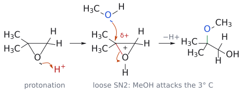

*그림: 왼쪽: epoxide 산소의 비공유 전자쌍이 H⁺(빨강)를 protonation. 가운데: protonate된 산소 쪽 C–O 결합(빨강)이 늘어나며 3차 탄소에 부분 양전하(δ+)가 쌓이고, MeOH의 산소(파랑)가 그 3차 탄소를 공격한다(위 화살표). 동시에 C–O 결합 전자는 산소로 돌아간다(아래 화살표). 오른쪽: H⁺를 잃으면 OMe가 3차 탄소에 붙은 생성물이 된다(초록은 새 C–O 결합).*

### 2.2 염기성 조건 (MeO⁻)

1. protonation이 일어나지 않으므로 양전하도 쌓이지 않는다.
2. protonate되지 않은 epoxide 산소는 **나쁜 leaving group**라서, 강한 nucleophile이 밀어줄 때만 떠난다. 그래서 반응은 **순수한 SN2**가 된다.
3. 순수한 SN2에서는 **입체 장애**가 관건이므로, methoxide는 **1차 탄소(덜 치환된 쪽)** 만 공격한다.
4. 생긴 alkoxide가 MeOH에서 양성자를 받아 1-methoxy-2-methyl-2-propanol((CH₃)₂C(OH)CH₂OMe)이 된다.

이 경우 regioselectivity은 **입체 효과**가 결정한다. (출처: L2 p.9)

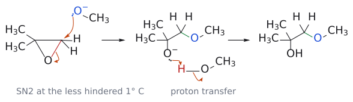

*그림: 왼쪽: methoxide(파랑, nucleophile)가 입체 장애가 적은 1차 탄소(빨강)를 C–O 결합의 반대편에서 공격하고, C–O 결합 전자가 산소로 옮겨가 고리가 열린다. 가운데: 생긴 alkoxide(O⁻)가 MeOH의 H(빨강)를 떼어 오고, H–O 결합 전자는 MeO⁻로 남는다. 오른쪽: OMe가 1차 탄소에, OH가 3차 탄소에 붙는다(산성 조건 그림과 정반대).*

> 같은 epoxide라도 산성 조건에서는 OMe가 3차 탄소에, 염기성 조건에서는 1차 탄소에 붙는다. 시험에 자주 나오는 대비다.

보충: epoxide가 반응성이 큰 이유는 오로지 **고리 긴장** 때문이다. alkoxide는 보통의 SN2에서는 결코 leaving group이 되지 못하는데, 3원 고리가 풀리는 이득이 그 불리함을 메워 준다. 또 "산성이면 더 치환된 쪽"이라는 규칙은 슬라이드처럼 한쪽이 **3차 탄소**여서 양전하를 확실히 안정화할 때 깔끔하게 맞는다. 한쪽 끝이 치환되지 않은 일치환 epoxide에서는 산 촉매 조건이라도 1차 탄소의 SN2가 워낙 빨라서, 덜 치환된 쪽 공격이 여전히 주경로가 될 수 있다(교과서의 HBr 예에서는 76 대 24). 그래서 regioselectivity을 높게 얻고 싶다면 보통 염기성 조건에서 강한 nucleophile로 덜 치환된 쪽을 여는 편이 확실하다. (보충 근거: Clayden p.438)

---

## 3. stereoselectivity: anti 첨가와 반전

> 개념 문서: [epoxide ring opening](../../wiki/반응/에폭사이드%20고리%20열기.md), [halogen addition](../../wiki/반응/할로젠%20첨가.md)

epoxide 고리 열기는 SN2이므로 공격받는 탄소에서 **inversion** 이 일어난다. 따라서 **입체특이적**이다.

- cyclopentene oxide --[Me₂NH]--> *trans*-2-(dimethyl아미노)cyclopentanol(라세미, ±).
- cyclohexene --[Br₂]--> *trans*-1,2-dibromocyclohexane(±). **이 부분입체이성질체 하나만** 생긴다.
  - 1단계에서 Br⁺가 한쪽 면에 bromonium 이온을 만든다.
  - 2단계에서 Br⁻가 **반대쪽 면**에서 SN2로 공격한다(반전).
  - 처음 생기는 형태는 두 Br이 모두 **축 diaxial** 에 있는 의자 형태다. 이것이 빠르게 고리 ring inversion을 거쳐 **이중 적도 diequatorial** 형태로 바뀐다.

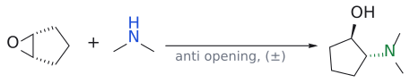

*그림: $Me_2NH$의 N(파랑)이 epoxide 탄소(빨강)를 뒤쪽에서 공격해 고리가 열린다. N과 OH가 trans(anti)가 되고 생성물은 라세미(±)다.*

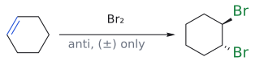

*그림: anti 첨가라서 trans-1,2-dibromocyclohexane(±)만 생긴다. 파랑 = 반응하는 $\pi$ 결합 또는 친핵체 쪽, 빨강 = 친전자체 쪽(끊어지는 결합, 떠나는 기), 초록 = 새로 생긴 결합과 들어온 기.*

(출처: L2 p.10)

보충: cyclohexene은 고리 안의 이중결합이 *Z*일 수밖에 없어서 "출발 alkene의 기하가 생성물을 결정한다"는 stereospecificity을 직접 보여 주지 못한다. 이것은 2-butene으로 확인한다. *Z*-2-butene에 Br₂를 첨가하면 (2*R*,3*R*)/(2*S*,3*S*)-2,3-dibromobutane **라세미체**만, *E*-2-butene에서는 **메소**-2,3-dibromobutane만 생긴다. 두 경우 모두 anti 첨가이며, 기하 이성질체마다 서로 다른 부분입체이성질체가 하나씩 나온다는 사실 자체가 bromonium 이온 intermediate의 증거다. OsO₄(syn 첨가)와 결과가 정반대라는 점(연습 문제 4번)과 비교해 두면 좋다. (보충 근거: Clayden p.439–440)

> 왜 diaxial로 먼저 생길까? SN2의 nucleophile과 leaving group은 일직선(180°)이어야 한다. 그래서 고리 위에서 새로 생기는 C-Br 결합과 남아 있는 C-Br 결합이 서로 반대 방향인 축 방향 배치가 되는 것이다.[1]

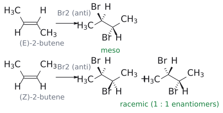

*그림: 두 Br이 alkene의 반대쪽 면에서 붙는다(anti). zigzag 사슬에서 쐐기(wedge)는 앞, 점선 쐐기(hash)는 뒤다. (E)-2-butene에서는 두 Br이 쐐기/점선으로 갈려 대칭 중심이 있는 meso가 되고, (Z)-2-butene에서는 두 Br이 같은 표시인 거울상 한 쌍이 1:1로 생겨 racemic이다. 보충: 슬라이드의 stereospecificity 설명을 그림으로 다시 그린 것이다.*

### 3.1 NBS: 다루기 쉬운 bromine 공급원

> 개념 문서: [NBS](../../wiki/시약/NBS.md), [halohydrin formation](../../wiki/반응/할로하이드린%20형성.md)

Br₂ 대신 **N-bromosuccinimide(NBS)** 를 써도 bromonium 이온을 만들 수 있다. NBS가 Br₂를 조금씩 내놓는 방식은 다음과 같다.
1. H⁺가 NBS의 carbonyl 산소를 protonation한다.
2. Br⁻가 N-Br의 Br을 공격해 Br₂와 succinimide가 생긴다.
3. 생긴 Br₂가 alkene과 반응하면 HBr이 다시 만들어진다.
4. 그 HBr이 또 NBS에서 Br₂를 풀어낸다.

그래서 **처음에 아주 소량의 HBr만 있으면** 반응이 계속 굴러간다. (출처: L2 p.11)

- 예: *trans*-스틸벤 --[NBS, HBr(촉매), H₂O/DMSO]--> bromohydrin(±, anti). 물이 bromonium 이온의 반대쪽에서 공격하므로 **stereoselective** 이다. (출처: L2 p.11)

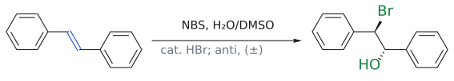

*그림: trans-stilbene의 bromohydrin 형성. 물이 bromonium 이온의 반대쪽에서 공격해 Br과 OH(초록)가 anti로 붙는다(±). 파랑 = 반응하는 C=C.*

### 3.2 NBS + alcohol: 위치·입체 선택성의 결합

> 개념 문서: [halohydrin formation](../../wiki/반응/할로하이드린%20형성.md)

- cyclohexene --[1. NBS, HBr; 2. propargyl alcohol(HC≡CCH₂OH)]--> *trans*-1-bromo-2-(propargyloxy)cyclohexane(±).
- 1-methylcyclohexene --[1. NBS, HBr; 2. alcohol]--> Br은 2차 탄소(CH)에, OR은 **methyl이 붙은 3차 탄소**에 anti로 붙는다. **입체선택적이면서 위치선택적**이다.

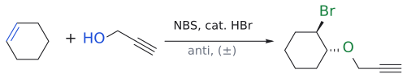

*그림: alcohol(파랑 O)이 bromonium 이온을 열어 Br과 OR(초록)이 trans로 붙는다(±).*

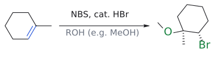

*그림: 1-methylcyclohexene. Br은 2차 탄소(CH)에, OR은 methyl이 붙은 3차 탄소에 anti로 붙는다. 그림의 OR은 예시로 OMe를 그렸다.*

여기서 alcohol이 **더 붐비는 쪽**을 공격하는 이유는 L1과 같다. 느슨한 SN2 transition state에서 그쪽이 부분 양전하를 가장 잘 안정화하기 때문이다. (출처: L2 p.12)

---

## 4. 1,2-diol 만들기: *trans*와 *cis*를 골라서

> 개념 문서: [dihydroxylation](../../wiki/반응/다이하이드록실화.md), [OsO4](../../wiki/시약/OsO4.md), [NMO](../../wiki/시약/NMO.md), [mCPBA](../../wiki/시약/mCPBA.md)

이중결합 양 끝에 OH를 하나씩 붙이면 1,2-diol(1,2-diol)이 된다. 두 OH의 상대 배치는 방법에 따라 고를 수 있다.

### 4.1 *anti* (*trans*) diol: 에폭시화 → 산성 가수분해

cyclohexene --[mCPBA]--> epoxide --[H₂O, HClO₄]--> *trans*-1,2-cyclohexanediol(anti diol).
- 산이 epoxide 산소를 protonation한다.
- 물이 반대쪽 면에서 SN2로 공격한다(반전).
- 그래서 두 OH가 서로 반대 면에 놓인다.

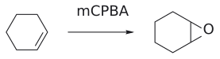

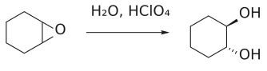

*그림: 보충: mCPBA로 만든 epoxide를 산에서 물이 뒤쪽(backside)으로 열기 때문에 두 OH는 trans(anti)가 된다. 생성물은 라세미(±)이며, 그림은 한 거울상만 그렸다.*

(출처: L2 p.13)

### 4.2 *syn* (*cis*) diol: OsO₄ dihydroxylation

사산화오스뮴(osmium tetroxide, OsO₄)은 alkene의 두 탄소에 **동시에** O를 하나씩 전달한다.
1. OsO₄(Os(VIII))와 alkene이 고리형으로 반응해 5원 고리 **오스메이트 ester(osmate ester, Os(VI))** 가 된다.
2. 물로 가수분해하면 *cis*-diol과 Os(VI)가 나온다.

두 O가 같은 면에서 동시에 들어오므로 **syn diol**이 된다. (출처: L2 p.14)

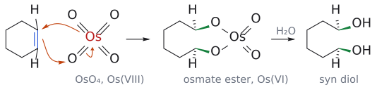

*그림: 화살표 셋이 한 번에 움직인다(슬라이드 p.14와 같은 배치). (1) 위쪽 Os=O의 π 전자가 위쪽 alkene 탄소와 새 C–O 결합을 만들고, (2) C=C π 전자(파랑)가 아래쪽 산소로 가서 두 번째 C–O 결합을 만들며, (3) 아래쪽 Os=O의 π 전자가 Os로 돌아간다. 그 결과 Os는 전자 두 개를 얻어 Os(VIII)에서 Os(VI)로 환원된다. 두 C–O 결합(초록 쐐기)이 같은 면에 생기므로, 가수분해(H₂O) 뒤에도 두 OH는 같은 쪽(syn)에 있다. 점선 쐐기의 H는 반대쪽 면을 향한다.*

OsO₄는 비싸고 독성이 강하다. 그래서 실제로는 **촉매량의 OsO₄**와 **NMO(N-methylmorpholine-N-oxide)** 를 함께 쓴다. NMO가 반응 후 생긴 Os(VI)를 다시 Os(VIII)로 산화해 촉매를 재생한다. 예: R-CH₂-CH=C(CH₃)₂ --[cat. OsO₄, NMO, H₂O/*t*-BuOH]--> R-CH₂-CH(OH)-C(OH)(CH₃)₂. (출처: L2 p.14)

### 4.3 *E*-alkene과 *Z*-alkene (빈칸 문제)

OsO₄는 syn 첨가이므로 생성물의 입체화학은 출발 alkene의 기하 구조에 따라 정해진다. 즉 **입체특이적**이다. 슬라이드 p.15는 빈칸으로 남겨져 있다(연습 문제 4번에서 다룬다). (출처: L2 p.15)

---

## 5. 이중결합 완전히 끊기

### 5.1 OsO₄ → NaIO₄ (periodic acid염 절단)

> 개념 문서: [periodate cleavage](../../wiki/반응/과아이오딘산%20절단.md), [NaIO4](../../wiki/시약/NaIO4.md)

1. OsO₄로 1,2-diol을 만든다. 이 단계에서 π 결합이 산화된다.
2. periodic acid 나트륨(sodium periodate, NaIO₄)이 diol의 두 OH와 고리형 **periodic acid ester(periodate ester)** 를 만든다.
3. 고리형 메커니즘으로 **C-C σ 결합이 끊어지며** carbonyl 화합물 두 개가 생긴다.

결국 π 결합과 σ 결합을 차례로 산화하는 두 번의 산화다. (출처: L2 p.16)

### 5.2 ozone 분해 (ozonolysis)

> 개념 문서: [ozonolysis](../../wiki/반응/오존%20분해.md), [ozone](../../wiki/시약/오존.md)

ozone(O₃)은 불안정해서 **사용 직전에** ozone ozonizer로 O₂에서 만들어 반응액에 불어넣는다.
1. O₃가 alkene에 고리형 메커니즘으로 첨가된다. 이것은 1,3-쌍극자 cycloaddition(1,3-dipolar cycloaddition)로, 이후 강의(L13–L15)에서 다룬다.
2. 산소 세 개가 든 5원 고리는 약한 O-O 결합과 C-C σ 결합이 끊어지며 무너진다. 대신 강한 C=O 결합 두 개를 얻는다. 이때 carbonyl 하나와 **carbonyl oxide** 가 생긴다.
3. dimethyl sulfide(Me₂S)나 triphenylphosphine(Ph₃P) 같은 **약한 환원제**가 남는 산소 하나를 떼어간다. 이 과정에서 Me₂SO나 Ph₃PO가 생긴다.

(출처: L2 p.17)

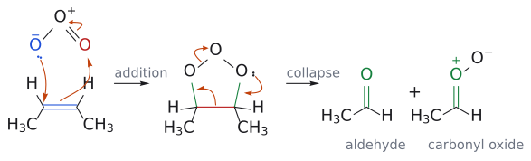

*그림: 슬라이드의 R을 CH₃로 둔 2-butene으로 그렸다. addition: ozone 끝 산소의 음전하 전자쌍(파랑)이 한쪽 탄소를, C=C π 전자(파랑)가 반대쪽 끝 산소(빨강)를 공격하고, O=O⁺의 π 전자는 가운데 산소로 돌아간다. collapse: 오른쪽 고리 산소의 비공유 전자쌍이 C=O를 만들고, C–C σ 결합(빨강) 전자가 왼쪽 C–O 쪽으로 가서 또 하나의 C=O를 만들며, 약한 O–O 결합 전자는 꼭대기 산소로 간다. 결과는 aldehyde와 carbonyl oxide다(초록은 새로 생긴 C–O/C=O 결합). 이후 Me₂S나 Ph₃P가 남는 산소를 떼어 간다.*

두 번째 단계(후처리)에 무엇을 쓰느냐에 따라 생성물이 달라진다.

| 2단계 시약 | 성격 | 생성물 |
|---|---|---|
| Me₂S | 약한 환원제 | aldehyde |
| H₂O₂ | 산화제 | carboxylic acid |
| NaBH₄ | 강한 환원제 | alcohol |

(출처: L2 p.18)

---

## 6. OH 하나 붙이기: 물을 이중결합에 더하는 법

> 개념 문서: [acid-catalyzed hydration](../../wiki/반응/산%20촉매%20수화.md), [TFA](../../wiki/시약/TFA.md), [carbocation](../../wiki/개념/탄소%20양이온.md)

### 6.1 산 촉매 수화

alcohol --[산]--> alkene은 E1 제거(탈수, dehydration)다. 그 역반응이 hydration이다. 하지만 수화는 **alkene이 protonate되어 안정한 3차 cation을 만들 수 있을 때만** 잘 된다. 그 cation을 물(용매)이 붙잡는다.

- methylylenecyclohexane --[H₂O, H⁺]--> 1-methylcyclohexanol. Markovnikov regioselectivity을 따른다. δ⁺인 H가 CH₂에, δ⁻인 OH가 3차 탄소에 붙는다.
- 이 반응은 **평형**이다. 같은 조건에서 *t*-BuOH --[H₂SO₄]--> isobutene(E1)의 역반응도 일어난다. 이때 HSO₄⁻가 염기로 작용해 β-H를 떼어낸다.

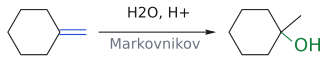

*그림: Markovnikov 수화. H는 $CH_2$에, OH(초록)는 3차 탄소에 붙는다. 파랑 = 반응하는 C=C.*

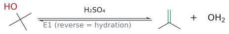

*그림: 같은 조건에서 일어나는 역반응(E1 탈수). 떠나는 OH(빨강, protonate된 뒤 물로 떠난다)와 새 C=C(초록).*

(출처: L2 p.19)

### 6.2 TFA를 이용한 단계적 수화

평형 문제를 피하는 방법으로 **trifluoroacetic acid(TFA, CF₃CO₂H)** 을 쓴다.
1. cyclohexene + TFA → cyclohexyl trifluoroacetate. TFA는 강산이라 alkene을 protonate하고(δ⁺인 H), 그 짝염기가 cation을 붙잡는다(δ⁻인 O).
2. ester --[염기, H₂O]--> cyclohexanol + trifluoroacetate anion.

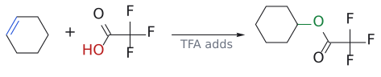

*그림: 1단계: TFA의 H(빨강 OH 쪽)가 C=C(파랑)를 protonate하고, 짝염기 $CF_3CO_2^-$의 O가 cation을 붙잡아 ester(초록)가 된다.*

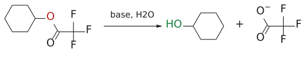

*그림: 2단계: ester를 염기로 가수분해하면 cyclohexanol(초록 OH)과 trifluoroacetate anion이 생긴다.*

(출처: L2 p.20)

> 슬라이드 p.21은 실제 의약품 합성 사례를 보여준다. 카바졸 골격의 alkene(isopropenyl group) **12**를 TFA/DCM으로 처리하면 3차 TFA ester **13**이 생긴다. 이것을 NH₄OH/MeOH로 가수분해하면 3차 alcohol **5**를 얻는다(85% 수율, >99.5% ee). 학교에서 배운 반응이 공정 화학에 그대로 쓰인다는 예다.[2] (출처: L2 p.21)

---

## 7. 수소붕소화: "반마르코프니코프" alcohol

### 7.1 보레인의 정체

> 개념 문서: [borane](../../wiki/시약/보레인.md)

보레인(BH₃)은 그대로는 이량체인 **다이보레인(B₂H₆)** 으로 존재한다. 다이보레인에서 가운데 B-H-B 다리는 **3중심 2전자 결합(three-center two-electron bond)** 이다. 즉 전자 한 쌍이 B, H, B 세 원자를 묶고 있는 특이한 결합이다. (출처: L2 p.22)

H. C. Brown은 순수한 olefin과 다이보레인의 반응이 매우 느리다는 사실을 관찰했다. 그런데 **ether 같은 약한 염기가 미량만 있어도** 반응이 측정할 수 없을 만큼 빨라졌다. 그래서 실제로는 BH₃·Et₂O, BH₃·THF, BH₃·SMe₂ 같은 **착물** 형태로 쓴다.[3] (출처: L2 p.22-23)

### 7.2 메커니즘과 regioselectivity

> 개념 문서: [hydroboration-oxidation](../../wiki/반응/수소붕소화-산화.md), [Markovnikov's rule](../../wiki/개념/마르코프니코프%20규칙.md)

- 보레인은 alkene에 **새 C-H 결합과 새 C-B 결합을 동시에** 만든다. 이것이 **협동적 syn concerted syn addition** 다.
- 출발점은 보론의 **빈 p 궤도함수**다. π 전자가 이 빈 궤도함수로 들어가면서 동시에 H가 탄소로 옮겨간다.
- 비대칭 alkene에서는 **보론이 덜 치환된 탄소**에 붙는다.
- 반응은 여러 번 일어날 수 있다. BH₃ + 1-butene 3당량 → trialkylborane.

(출처: L2 p.24)

왜 보론이 덜 치환된 쪽으로 갈까? 전기음성도가 **H(2.2) > B(2.04)** 이므로 B-H 결합에서는 **H가 δ⁻, B가 δ⁺** 다. 1절의 요령을 그대로 적용하면 δ⁺인 B는 덜 치환된 탄소로, δ⁻인 H는 더 치환된 탄소로 간다. 결과는 겉보기에 "반마르코프니코프"지만 **원리는 똑같다**. 슬라이드도 이를 "seemingly anti-Markovnikov"라고 표현한다. (출처: L2 p.24)

보충: 교과서는 같은 결과를 두 가지 요인으로 설명한다. 하나는 전자 효과로, π 전자가 보론의 빈 p 궤도함수로 흘러 들어가면서 양전하가 반대쪽, 즉 **더 치환된 탄소**에 쌓이고 그 자리로 H가 옮겨 간다(위의 δ⁺/δ⁻ 설명과 같은 내용). 다른 하나는 입체 효과로, BR₂ 쪽이 H보다 커서 덜 붐비는 탄소로 간다. BH₃만으로도 선택성이 94%이고 부피 큰 9-BBN에서 99.9%로 오르는 7.4절의 데이터가 두 요인이 함께 작용한다는 것을 보여 준다. (보충 근거: Clayden p.446)

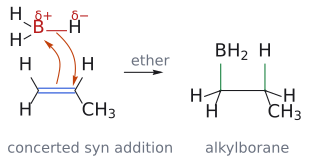

*그림: 슬라이드의 cyclopentene 대신 비대칭 alkene인 프로펜으로 그려 regioselectivity을 함께 보였다. 화살표 둘이 동시에 움직인다. (1) C=C π 전자(파랑)가 보론(빨강, δ+)의 빈 p 궤도함수로 들어가 C–B 결합을 만들고, (2) B–H 결합(빨강) 전자가 H(δ−)를 데리고 더 치환된 탄소로 옮겨 간다. 두 결합(초록)이 alkene의 같은 면에 생기므로 syn 첨가다.*

### 7.3 산화: C-B를 C-OH로

> 개념 문서: [hydroboration-oxidation](../../wiki/반응/수소붕소화-산화.md)

유기보레인을 **NaOH와 H₂O₂**로 처리하면 C-B 결합이 C-O 결합으로 바뀐다.
1. hydroperoxide anion(HOO⁻)이 보론의 빈 p 궤도함수에 결합해 음전하를 띤 보론 "ate" 착물이 된다.
2. 약한 O-O 결합이 끊어져 HO⁻가 떨어지는 동시에, 보론에 붙어 있던 **alkyl group이 B에서 O로 이동**한다.
3. HO⁻가 B를 공격해 붕소 ester를 가수분해한다. 이어서 protonation이 일어나 alcohol이 된다.

예: Ph-C(CH₃)=CH₂ --[1. HBR₂; 2. H₂O₂, NaOH]--> Ph-CH(CH₃)-CH₂OH. OH가 **덜 치환된 탄소**에 붙는다. (출처: L2 p.25)

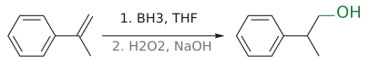

*그림: hydroboration–oxidation. OH(초록)가 덜 치환된 탄소($CH_2$, 파랑)에 붙는다(anti-Markovnikov).*

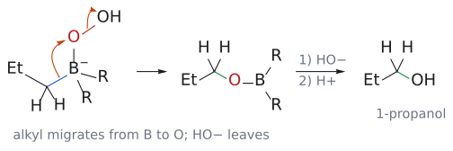

*그림: 2단계(alkyl group 이동)를 그렸다. HOO⁻가 보론에 붙어 생긴 음전하 ate 착물에서, C–B 결합(파랑) 전자가 alkyl group을 데리고 이웃 산소(빨강)로 옮겨 가고, 동시에 약한 O–O 결합(빨강) 전자가 HO⁻로 떨어져 나간다. 생긴 붕소 ester(C–O–BR₂, 초록은 새 C–O 결합)를 HO⁻가 공격해 B를 떼어 내고 protonate하면 alcohol이 된다. 앞의 수소붕소화 그림에서 이어지도록 alkyl group을 propyl group(Et–CH₂)로, 보론의 나머지 두 치환기를 R로 간단히 했다.*

> 보충: alkyl group이 이동할 때 탄소의 입체배치는 **retention** 된다. 그래서 수소붕소화-산화는 전체적으로 H와 OH의 syn 첨가가 된다. 슬라이드에 명시된 내용은 아니지만 표준 교재(Clayden 등)의 내용이다. (보충 근거: Wade p.347)

### 7.4 부피 큰 보레인: 9-BBN

> 개념 문서: [9-BBN](../../wiki/시약/9-BBN.md)

**9-BBN(9-borabicyclo[3.3.1]nonane)** 은 1,5-cyclooctadiene에 BH₃·SMe₂를 두 번 수소붕소화시켜 만든다. 9-BBN도 B-H-B 다리를 가진 이량체로 존재한다. (출처: L2 p.26)

9-BBN은 부피가 크기 때문에 **입체 효과까지 더해져** regioselectivity이 더 높아진다.
- R-CH=CH₂ --[1. BH₃, THF; 2. H₂O₂, NaOH]--> 1차 alcohol 94%. 전자 효과에 의한 선택성이다.
- R-CH=CH₂ --[1. 9-BBN, THF; 2. H₂O₂, NaOH]--> 1차 alcohol 99.9%. 전자 효과와 입체 효과가 함께 작용한다.
- 내부 alkene(4-ethyl-2-hexene)에서도 9-BBN은 덜 붐비는 쪽 탄소에 99%의 선택성으로 붙는다.

(출처: L2 p.26-27)

보충: 9-BBN의 보론에는 고리 쪽 C–B 결합이 둘 더 있다. 그런데도 산화 단계에서 엉뚱한 alcohol(cyclooctane diol)이 섞이지 않을까? 교과서에 따르면 9-BBN에서는 수소붕소화로 새로 붙은 **고리 밖 alkyl group만** B에서 O로 이동하므로 원하는 alcohol이 선택적으로 나온다. BH₃를 쓰면 trialkylborane의 세 alkyl group이 모두 같은 것이라 이 문제가 처음부터 없다. (보충 근거: Clayden p.446)

---

## 흔한 오해

- **"epoxide는 언제나 덜 붐비는 쪽이 열린다"**: 염기성(강한 nucleophile) 조건에서만 그렇다. 산성 조건에서는 **더 치환된 쪽**이 열린다. 다만 반대로 "산성이면 무조건 더 치환된 쪽"도 아니다. 한쪽이 3차 탄소처럼 양전하를 잘 안정화할 때 그렇고, 한쪽 끝이 CH₂인 일치환 epoxide는 산성에서도 1차 탄소 공격이 우세할 수 있다. (보충 근거: Clayden p.438)
- **"수소붕소화는 Markovnikov 규칙을 어기는 예외 반응이다"**: B-H에서 δ⁺는 B이고 δ⁻는 H다. "δ⁺는 덜 치환된 쪽으로"라는 원리는 그대로 지켜진다. 결과만 반대로 보일 뿐이다.
- **"OsO₄는 *trans* diol을 준다"**: OsO₄는 **syn(*cis*)** diol을 준다. *trans*(anti) diol은 에폭시화 후 산성 가수분해로 만든다.
- **"ozone 분해 생성물은 항상 aldehyde다"**: 후처리 시약에 따라 달라진다. Me₂S는 aldehyde, H₂O₂는 carboxylic acid, NaBH₄는 alcohol을 준다.
- **"NBS는 bromine과 전혀 다른 메커니즘으로 반응한다"**: 이 강의에서 NBS는 **Br₂를 조금씩 공급하는 공급원**이다. 반응 자체는 bromonium 이온을 거친다.

---

## 반응 정리표

| 반응 | 시약/조건 | 생성물 | regioselectivity | 입체화학 | 비고 |
|---|---|---|---|---|---|
| epoxide 열기 (산) | ROH, H⁺ | β-알콕시 alcohol | Nu는 더 치환된 C에 | 반전 (anti) | 느슨한 SN2, 전자 효과 |
| epoxide 열기 (염기) | RO⁻ (강한 Nu) | β-알콕시 alcohol | Nu는 덜 치환된 C에 | 반전 (anti) | 순수 SN2, 입체 효과 |
| epoxide + amine | R₂NH | β-아미노 alcohol | (대칭 기질) | 반전, *trans* | |
| cyclohexene bromination | Br₂ | *trans*-1,2-dibromide | | anti; diaxial → diequatorial | 부분입체이성질체 하나만 |
| bromohydrin | NBS, cat. HBr, H₂O/DMSO | β-bromoalcohol | OH는 더 치환된 C에 | anti | NBS = Br₂ 공급원 |
| bromoether | NBS, HBr, 그다음 ROH | β-bromoether | OR은 더 치환된 C에 | anti | |
| anti diol | 1. mCPBA 2. H₂O, HClO₄ | *trans*-1,2-diol | | anti | |
| syn diol | OsO₄ (또는 cat. OsO₄, NMO) | *cis*-1,2-diol | | syn, 입체특이적 | 오스메이트 ester |
| diol 절단 | NaIO₄ | carbonyl 2개 | | | 고리형 periodic acid ester |
| ozone 분해 | 1. O₃ 2. Me₂S / H₂O₂ / NaBH₄ | aldehyde / carboxylic acid / alcohol | | | 1,3-쌍극자 cycloaddition |
| 산 촉매 수화 | H₂O, H⁺ | alcohol | Markovnikov | | 평형, 3차 cation 필요 |
| TFA 경유 수화 | 1. TFA 2. 염기, H₂O | alcohol | Markovnikov | | ester 경유 |
| 수소붕소화-산화 | 1. BH₃·THF (또는 9-BBN) 2. H₂O₂, NaOH | alcohol | "반마르코프니코프" (B는 덜 치환된 C에) | syn | 9-BBN이 더 선택적 |

---

## 연습 문제

1. 2,2-dimethyl옥시레인을 (a) MeOH/H⁺, (b) NaOMe/MeOH로 처리했을 때의 생성물을 각각 쓰고, regioselectivity을 결정하는 요인을 설명하시오.
2. cyclohexene + Br₂의 생성물을 입체화학까지 포함해 쓰시오. 처음 생기는 의자 형태와 최종적으로 안정한 의자 형태도 설명하시오.
3. 1-methylcyclohexene을 NBS(촉매량 HBr), H₂O로 처리한 생성물을 쓰시오. (regioselectivity과 입체화학 포함)
4. (슬라이드 p.15 빈칸) *E*-RCH=CHR과 *Z*-RCH=CHR을 각각 OsO₄로 처리한 생성물의 상대 입체화학을 쓰시오. R이 같은 경우 각각 메소인지 라세미인지 밝히시오.
5. cyclohexene에서 출발해 (a) *cis*-1,2-cyclohexanediol과 (b) *trans*-1,2-cyclohexanediol을 만드는 방법을 쓰시오.
6. 1-methylcyclohexene을 1. O₃, 2. Me₂S로 처리한 생성물을 쓰시오. 2단계를 H₂O₂로 바꾸면 생성물이 어떻게 달라지는가?
7. 2-methyl-1-butene에서 (a) 2-methyl-2-butanol과 (b) 2-methyl-1-butanol을 각각 선택적으로 만드는 방법을 쓰시오.
8. 수소붕소화에서 보론이 덜 치환된 탄소에 붙는 이유를 전기음성도와 δ⁺/δ⁻ 규칙으로 설명하고, 9-BBN이 BH₃보다 선택성이 높은 이유를 쓰시오.

## 정답 및 해설

1. (a) (CH₃)₂C(OMe)CH₂OH. 산이 epoxide를 protonate하면 느슨한 SN2 transition state에서 3차 탄소에 부분 양전하가 쌓이므로 MeOH가 3차 탄소를 공격한다(전자 효과). (b) (CH₃)₂C(OH)CH₂OMe. protonation이 없으면 순수 SN2이므로 MeO⁻가 덜 붐비는 1차 탄소를 공격한다(입체 효과). (L2 p.8-9)
2. *trans*-1,2-dibromocyclohexane(±)이 생긴다. Br⁻가 bromonium 이온의 반대쪽에서 SN2로 공격하므로 처음에는 두 Br이 모두 축 방향인 diaxial 형태로 생긴다. 이것이 고리 뒤집기를 거쳐 두 Br이 적도 방향인 diequatorial 형태로 바뀐다. (L2 p.10)
3. *trans*-2-bromo-1-methylcyclohexanol(±)이 생긴다. OH는 methyl이 붙은 3차 탄소에, Br은 2차 탄소에 서로 anti로 붙는다. 근거는 L2 p.12의 alcohol 예와 같은 원리(느슨한 SN2, 3차 탄소가 양전하 안정화)다.
4. syn 첨가이므로 *E*-alkene에서는 두 OH와 R이 지그재그 사슬에서 서로 반대쪽에 놓인 diol이 생긴다. 피셔 투영식으로는 *threo*형이며, R이 같으면 **라세미체**다. *Z*-alkene에서는 *erythro*형이 생기며, R이 같으면 **메소 화합물**이다. 예를 들어 *trans*-2-butene은 (2*R*,3*R*)/(2*S*,3*S*)-2,3-butanediol 라세미체를, *cis*-2-butene은 *meso*-2,3-butanediol을 준다. (원리: L2 p.14-15. 메소/라세미 판정은 표준 입체화학에 따른 보충 설명.) (보충 근거: Wade p.365)
5. (a) OsO₄를 쓰거나(촉매량 OsO₄ + NMO도 가능) 물로 처리한다. syn 첨가가 일어난다. (b) mCPBA로 에폭시화한 뒤 H₂O/HClO₄로 처리한다. SN2 반전으로 anti 생성물이 된다. (L2 p.13-14)
6. 6-oxoheptanal(OHC-(CH₂)₄-C(=O)CH₃, keto aldehyde)이 생긴다. 고리 alkene이 끊어지므로 사슬 하나의 양 끝에 carbonyl이 생긴다. 2단계를 H₂O₂로 바꾸면 aldehyde 쪽이 carboxylic acid으로 산화되어 6-oxoheptanoic acid이 된다. ketone은 그대로 남는다. ketone이 산화되지 않는다는 점은 표준 교재 내용에 따른 보충 설명이다. (보충 근거: Clayden p.443) (L2 p.17-18)
7. (a) H₂O/H⁺로 산 촉매 수화하거나, TFA를 첨가한 뒤 가수분해한다. 3차 cation을 거치는 Markovnikov 수화다. (b) 1. BH₃·THF(또는 9-BBN), 2. H₂O₂/NaOH로 수소붕소화-산화를 한다. (L2 p.19-20, p.24-27)
8. H(2.2)가 B(2.04)보다 전기음성도가 커서 B-H 결합에서 B가 δ⁺, H가 δ⁻다. δ⁺(친전자성) 원자는 덜 치환된 탄소로, δ⁻ 원자는 더 치환된 탄소로 간다는 규칙에 따라 B가 덜 치환된 탄소에 붙는다. 9-BBN은 부피가 커서, 이 전자 효과에 더해 덜 붐비는 탄소를 선호하는 입체 효과까지 작용한다(94% 대 99.9%). (L2 p.24, p.27)

---

## 각주

[1] 보충: 이 설명은 SN2의 180° 배치 요구 조건과 cyclohexane 형태 분석의 표준 내용(Clayden 등)을 따른 것이다. 슬라이드에는 "diaxial product formed → rapid ring inversion to diequatorial conformation"이라는 그림만 있다. (보충 근거: Clayden p.838)

[2] 슬라이드 p.21의 반응식에는 Rh catalyst 비대칭 conjugate addition(isopropenyl BPin, (S)-DTBM-SEGPHOS), 피셔 인돌 합성(ZnCl₂), CDI/NH₄OH amide화 등이 함께 나온다. 이 강의의 핵심은 **12 → 13 → 5** 구간(TFA addition 후 가수분해)이다.

[3] Herbert C. Brown(1912–2004)은 유기보레인 화학으로 1979년 노벨 화학상을 받았다. 그의 지도를 받은 Ei-ichi Negishi와 Akira Suzuki는 2010년 노벨 화학상(교차 짝지음 반응)을 받았다. 교차 짝지음 반응은 이 과목 후반부에서 다룬다. 슬라이드 p.23은 Brown의 저서 *Boranes in Organic Chemistry*에서 ether 용매의 촉매 효과를 발견한 일화를 인용한다.
