# L4. 친전자성 방향족 치환 반응 2부 (Electrophilic Aromatic Substitution, Part 2)

> **통독본**: 2026-10-12 재구성 직전의 강의별 전체 노트(교과서 보강 포함)를 그대로 보존한 사본이다. 강의 흐름대로 한 번에 읽을 때 쓴다. 이후의 수정과 보충은 개념 문서에만 반영되므로, **최신 내용은 개념 문서**가 기준이다. 뼈대 노트: [L4 뼈대](../L04_Electrophilic_Aromatic_Substitution_Part2.md) · [위키 대문](../../wiki/위키%20대문.md)

> **관련 위키 문서** ([위키 대문](../../wiki/위키%20대문.md))
> - 반응: [nitration](../../wiki/반응/나이트로화.md), [aromatic halogenation](../../wiki/반응/방향족%20할로젠화.md), [sulfonation](../../wiki/반응/설폰화.md), [electrophilic aromatic substitution](../../wiki/반응/친전자성%20방향족%20치환.md), [Clemmensen reduction](../../wiki/반응/클레멘센%20환원.md), [Friedel–Crafts acylation](../../wiki/반응/프리델-크래프츠%20아실화.md), [Friedel–Crafts alkylation](../../wiki/반응/프리델-크래프츠%20알킬화.md)
> - 시약: [Lewis acid catalyst](../../wiki/시약/루이스%20산%20촉매.md), [mixed acid](../../wiki/시약/혼산.md)
> - 개념: [aromaticity](../../wiki/개념/방향족성.md), [arenium ion](../../wiki/개념/아레늄%20이온.md), [acylium ion](../../wiki/개념/아실륨%20이온.md), [substituent effect](../../wiki/개념/치환기%20효과.md), [carbocation](../../wiki/개념/탄소%20양이온.md)

## 0. 복습: 테트랄론 합성 메커니즘

> 개념 문서: [Friedel–Crafts acylation](../../wiki/반응/프리델-크래프츠%20아실화.md), [Clemmensen reduction](../../wiki/반응/클레멘센%20환원.md), [acylium ion](../../wiki/개념/아실륨%20이온.md)

$\begin{aligned} & \mathrm{L_3}\ \text{p.22의 빈칸}\ \text{문제}(\text{succinic acid 무수물}) \\ & \longrightarrow \text{3-benzoylpropanoic acid} \\ & \longrightarrow \text{4-phenylbutanoic acid} \\ & \longrightarrow \alpha\ \text{-테트랄론)의 메커니즘이 p.3에 정리되어 있다} \end{aligned}$. 핵심은 세 가지다.
1. AlCl₃가 무수물의 carbonyl 산소에 배위해 고리가 열리면서 acylium 이온이 생기고, Friedel–Crafts acylation이 일어난다.
2. 클레멘센 Zn/Hg, HCl으로 ketone만 CH₂로 바뀐다.
3. $H_3PO_4$가 carboxylic acid을 acylium 이온으로 만들고, 분자내 Friedel–Crafts acylation으로 6원 고리가 닫힌다.

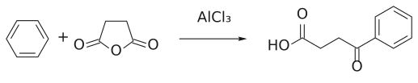

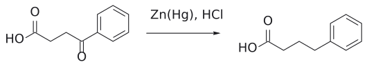

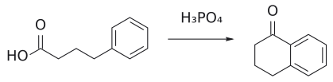

그림: 보충: L3 6.4절의 세 단계를 구조로 다시 그린 것이다.

자세한 내용은 L3 문서 6.4절에 있다(→ [L3](L03_Electrophilic_Aromatic_Substitution_Part1.md) Friedel–Crafts acylation 문서 참고). (출처: L4 p.3)

---

## 1. aniline: 질소 비공유 전자쌍은 고리를 훨씬 더 강하게 활성화한다

> 개념 문서: [substituent effect](../../wiki/개념/치환기%20효과.md), [aromatic halogenation](../../wiki/반응/방향족%20할로젠화.md), [protecting group](../../wiki/개념/보호기.md)

L3에서는 benzene 자체가 어떻게 electrophile과 반응하는지 배웠다. 그런데 실제 합성에서 다루는 방향족 고리에는 대부분 **이미 치환기가 붙어 있다**. 그러면 두 가지 질문이 생긴다.

1. **반응성**: 이 치환기는 고리를 benzene보다 빠르게 반응하게 만드는가(활성화, activating), 느리게 만드는가(비활성화, deactivating)?
2. **배향**: 새 electrophile은 ortho, 메타, para 중 어디로 들어가는가?

이 강의는 aniline, alkylbenzene, 전자 끄는 기, 할로젠을 차례로 보고, 치환기가 여러 개일 때의 경쟁과 NMR 데이터로 예측을 확인하는 방법까지 다룬다. (출처: L4 p.2, p.24)

### 1.1 phenol보다 더 반응성이 크다

aniline(phenylamine)은 phenol, phenyl ether, 심지어 phenoxide 이온보다도 electrophile에 대한 반응성이 크다. 이유는 **질소가 산소보다 전기음성도가 작기 때문**이다. 질소는 자기 비공유 전자쌍을 산소보다 덜 붙잡고 있어서 고리 쪽으로 더 쉽게 내어준다. (출처: L4 p.4)

- $\text{aniline} \xrightarrow[\mathrm{HOAc}]{\mathrm{Br_2}} \text{2,4,6-tribromoaniline}$.
- 메커니즘은 phenol과 같다. N의 비공유 전자쌍에서 출발한 화살표가 고리를 통과해 Br-Br을 공격한다. intermediate는 iminium(C=N⁺H₂) 구조이고, HBr이 빠지면 방향족성이 회복된다. NH₂는 **ortho, para 배향**이다.

그림: $NH_2$ (파랑)가 고리를 강하게 활성화해 두 ortho와 para 자리 모두에 Br(초록)이 붙는다.

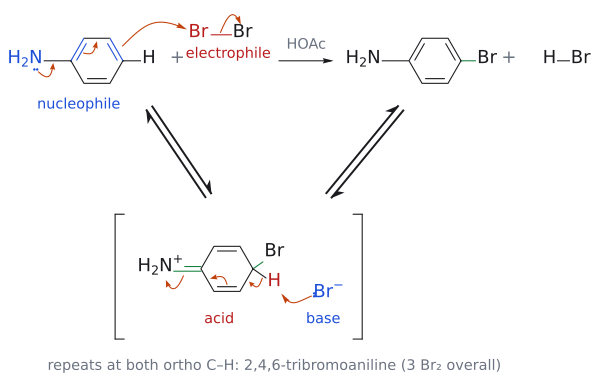

그림: 위 반응식의 메커니즘이다. 첫 번째 치환(para 위치)만 그렸고, 두 ortho 위치에서도 같은 두 단계가 되풀이되어 2,4,6-tribromoaniline이 된다. 위 줄이 전체 반응이고 아래 대괄호는 중간체다. 1단계: 화살표 넷이 한꺼번에 움직인다. N의 비공유 전자쌍(파랑)이 C–N 결합으로 들어가 C=N⁺(초록)를 만들고, 고리의 $\pi$ 전자가 차례로 밀려 para 탄소의 $\pi$ 결합(파랑, nucleophile)이 $\mathrm{Br}_2$ 의 Br(빨강, electrophile)을 공격하며, Br–Br 결합 전자는 바깥쪽 Br로 가서 $\mathrm{Br}^-$ 가 된다. 새 C–Br 결합은 초록색이다. 2단계: 중간체 iminium cation(산, 빨강)의 sp³ 탄소에 붙은 H(빨강)를 $\mathrm{Br}^-$ (염기, 파랑)가 가져가고, C–H 결합 전자가 고리로 돌아와 방향족성이 회복된다(−HBr). 보충: 2단계의 곡선 화살표는 슬라이드의 화살표 네 개에 이어서 보충으로 그렸다. (보충 근거: Clayden p.475)

(출처: L4 p.4)

(이 단계의 메커니즘 그림은 위 반응식 바로 아래의 종합 그림에 합쳤다. 화살표 넷의 의미는 그 그림 설명을 본다.)

### 1.2 Br 하나만 넣고 싶다면?

- **phenol**: 이황화탄소(CS₂) 용액에 Br₂를 천천히 넣고 온도를 5 °C 아래로 유지하면 주생성물이 ***p*-bromophenol**이다.
- **aniline**: 같은 조건(CS₂, <5 °C)에서도 **2,4,6-tribromoaniline**이 생긴다. aniline은 너무 활성화되어 있어서 조건만으로는 멈추게 할 수 없다.

(출처: L4 p.4)

### 1.3 해결책: acetylation으로 질소의 힘을 줄이기

amide의 N은 일반 amine보다 염기성이 훨씬 약하다. N의 비공유 전자쌍이 carbonyl기와 공액되어 있기 때문이다. 이 성질을 이용한다.
1. $\text{aniline} \xrightarrow{\mathrm{Ac_2O}} \text{acetanilide}(\mathrm{PhNHCOCH_3})$

2. $\xrightarrow[\mathrm{HOAc}]{\mathrm{Br_2},\ \text{실온}} \mathit{p}\ \text{-bromoacetanilide}$

3. $\xrightarrow[\mathrm{EtOH/H_2O},\ \text{가열 환류}]{\mathrm{HCl}} \mathit{p}\ \text{-bromoaniline}$

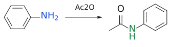

그림: 1단계: aniline의 N(파랑)을 acetyl화해 활성을 낮춘다(새 N–C(O) 결합, 초록).

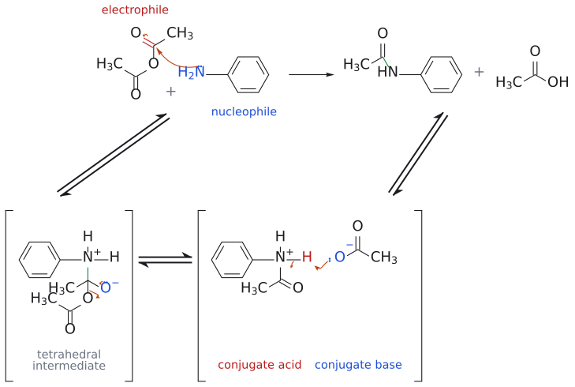

그림: 위 반응식의 메커니즘이다(nucleophilic acyl substitution). 위 줄이 전체 반응(aniline + $\mathrm{Ac}_2\mathrm{O}$ → acetanilide + $\mathrm{AcOH}$)이고, 아래 줄은 단계별 풀이다(대괄호는 중간체, ⇌는 평형). 1단계: N의 비공유 전자쌍(파랑, nucleophile)이 $\mathrm{Ac}_2\mathrm{O}$ 의 carbonyl 탄소(빨강, electrophile)를 공격해 새 N–C 결합(초록)을 만들고, C=O의 $\pi$ 전자는 산소로 올라가 $\mathrm{O}^-$ 가 되어 tetrahedral intermediate(zwitterion)가 된다. 2단계: $\mathrm{O}^-$ 의 비공유 전자쌍이 C=O를 다시 만들고 C–OAc 결합 전자는 떠나는 O로 가서 acetate가 이탈한다. 그 결과 protonated amide(conjugate acid, 빨강)와 $\mathrm{AcO}^-$ (conjugate base, 파랑)가 생긴다. 3단계: $\mathrm{AcO}^-$ 가 $\mathrm{N}^+$–H의 H를 가져가고 N–H 결합 전자가 N의 비공유 전자쌍이 되어 amide와 $\mathrm{AcOH}$ 가 된다. 보충: 곡선 화살표는 표준 addition–elimination 메커니즘을 그린 것이다. acetate는 conjugate acid의 $\mathrm{p}K_\mathrm{a}$ 가 약 5라서 좋은 leaving group이다. (보충 근거: Clayden p.177, p.202)

그림: 2단계: 부피 큰 NHAc 때문에 para 자리(파랑)에 Br(초록) 하나만 붙는다.

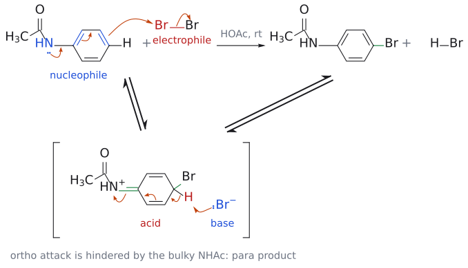

그림: 위 반응식의 메커니즘이다. aniline의 경우와 같은 두 단계이고, N에 acetyl group이 붙어 있다는 점만 다르다. 위 줄이 전체 반응이고 아래 대괄호는 중간체다. 1단계: N의 비공유 전자쌍(파랑)이 C–N 결합으로 들어가 C=N⁺(초록)를 만들고, 고리의 $\pi$ 전자가 밀려 para 탄소의 $\pi$ 결합(파랑, nucleophile)이 $\mathrm{Br}_2$ 의 Br(빨강, electrophile)을 공격한다. Br–Br 결합 전자는 바깥쪽 Br로 가서 $\mathrm{Br}^-$ 가 되고, 새 C–Br 결합은 초록색이다. 2단계: 중간체(산, 빨강)의 sp³ 탄소에서 $\mathrm{Br}^-$ (염기, 파랑)가 H(빨강)를 가져가 방향족성이 회복된다. 그림에는 para 공격만 그렸다. ortho 위치는 부피 큰 NHAc 때문에 불리하고, N의 전자쌍이 C=O와도 공액되어 있어 고리로 내주는 몫이 aniline보다 적으므로 Br이 한 번만 들어간다. 보충: 이 화살표들은 aniline 그림과 같은 규칙으로 그린 보충이다. (보충 근거: Clayden p.475)

그림: 3단계: amide를 가수분해해 보호기(빨강 C=O 쪽)를 떼면 p-bromoaniline이 된다.

amide N의 비공유 전자쌍은 C=O와 공액되어 있으면서도, amine보다는 약하게 benzene 고리로도 비편재화된다. 그래서 반응은 여전히 **ortho, para 위치**에서 일어나지만(주로 para) **한 번만** 일어난다.

일반적으로 첫 번째 친전자성 치환은 입체 장애 때문에 para 위치에서 일어난다. (출처: L4 p.5)

그림: 파란색 N의 비공유 전자쌍이 N-C 결합으로 들어가 C=N을 만들고(첫 번째 화살표), C=O의 $\pi$ 전자(빨강)는 산소로 올라가 O⁻가 된다(두 번째 화살표). 오른쪽 공명 구조처럼 N의 전자쌍 일부가 carbonyl 쪽에 묶이므로 고리로 내줄 수 있는 몫이 amine보다 줄어든다. 그래서 acetanilide는 여전히 ortho/para 배향이지만 한 번만 brominate된다.

> 이 "보호 → 반응 → 탈보호" 흐름은 L12 protecting group 문서에서 다시 일반화된다(→ [L12](L12_Protecting_Groups.md) protecting group 문서 참고).

### 1.4 ortho- 대 para- : 입체 효과가 결정한다

phenol과 aniline이 ortho/para 위치에서 반응하는 것은 **전자적 이유** 때문이다. 그런데 ortho와 para 중 어느 쪽이냐는 **입체 효과**까지 고려해야 한다.
- 순전히 통계적으로만 보면, ortho 위치가 두 개이므로 ortho 생성물이 para의 **2배** 생겨야 한다.
- 하지만 ortho 치환은 새 치환기가 기존 치환기 바로 옆에 앉아야 하므로 입체 장애가 더 크다.
- amide처럼 **큰 치환기**에서는 입체 장애가 커서 para 생성물이 더 많이 생긴다. acetanilide의 C-N 결합은 빠르게 회전하므로 어느 쪽 ortho든 acetyl group의 방해를 받는다. 반면 para 위치는 방해를 받지 않는다.

(출처: L4 p.6)

보충: ortho를 줄이는 요인이 하나 더 있다. O와 N은 비공유 전자쌍으로 $\pi$ 계에 전자를 주지만, 동시에 C–O, C–N $\sigma$ 결합은 전기음성 원자 쪽으로 분극되어 있다(유발 효과에 의한 흡인). 이 흡인은 가까운 원자일수록 크므로 **ortho 위치의 반응성을 가장 많이 깎는다**. 4절에서 F가 ortho 생성물을 가장 적게 주는 것도 같은 원리다. (보충 근거: Clayden p.483)

---

## 2. alkylbenzene: $\sigma$ 전자를 주는 치환기

> 개념 문서: [substituent effect](../../wiki/개념/치환기%20효과.md), [sulfonation](../../wiki/반응/설폰화.md), [nitration](../../wiki/반응/나이트로화.md)

### 2.1 methyl도 ortho/para 배향이다

$$
\text{toluene} \xrightarrow{\mathrm{Br_2},\ \text{Lewis acid 촉매}} \text{ortho 약}\ 60\%,\ \text{para 약}\ 35\%,\ \text{메타 약}\ 5\%
$$
.
- methyl은 고리의 **반응성을 높이고**(활성화)
- **ortho, para 배향**이다.

그림: methyl은 ortho/para 지향기다. 생성물은 ortho 약 60%, para 약 35%(초록 = 새로 붙은 Br).

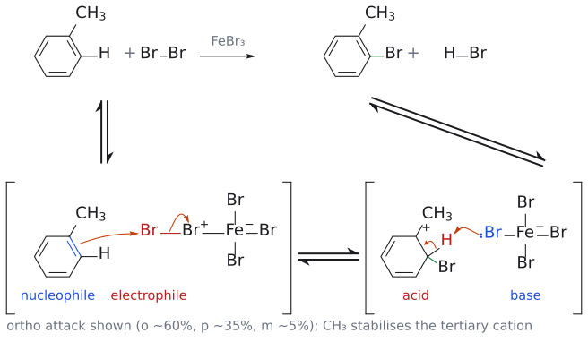

그림: 위 반응식의 메커니즘이다. ortho 공격을 그렸고(생성물의 약 60%), para 공격도 같은 두 단계다. 위 줄이 전체 반응이고 아래 줄은 단계별 풀이다(대괄호는 중간체, ⇌는 평형). 1단계: Lewis acid $\mathrm{FeBr}_3$ 가 $\mathrm{Br}_2$ 에 붙어 Br–$\mathrm{Br}^+$–$\mathrm{FeBr}_3^-$ 복합체를 만든다. 고리의 $\pi$ 결합(파랑, nucleophile)이 바깥쪽 Br(빨강, electrophile)을 공격해 새 C–Br 결합(초록)을 만들고, Br–Br 결합 전자는 안쪽 Br로 가서 $\mathrm{FeBr}_4^-$ 가 된다. 이때 양전하(빨간 +)가 CH₃가 붙은 탄소에 놓이는 3차 carbocation이 생기므로 이 intermediate가 안정하다. 2단계: $\mathrm{FeBr}_4^-$ (염기, 파랑)의 Br 전자쌍이 sp³ 탄소의 H(빨강)를 가져가고, C–H 결합 전자가 고리로 돌아와 방향족성이 회복되며 HBr과 $\mathrm{FeBr}_3$ 가 나온다. 보충: Lewis acid가 $\mathrm{Br}_2$ 를 활성화하는 복합체와 2단계의 화살표는 슬라이드에 없는 보충이다. (보충 근거: Clayden p.475, p.478)

methyl group은 OR기를 약하게 만든 버전처럼, 고리 $\pi$ 계의 전자 밀도를 특히 ortho와 para 위치에서 높인다. 메커니즘은 **$\sigma$ $\sigma$ conjugation** 이다. methyl의 C-H $\sigma$ 결합 하나가 고리의 $\pi$ 계와 겹쳐 전자를 약하게 내준다. 그래서 alkyl group은 전자 주는 기처럼 행동한다. (출처: L4 p.7)

### 2.2 intermediate로 이유 보기

- **ortho(또는 para) 공격**: 공명 구조 중 하나에서 양전하가 **methyl이 붙은 탄소**에 놓인다. 그 탄소는 3차 탄소이므로 그 cation이 더 안정하다.
- **메타 공격**: 양전하가 놓이는 세 탄소(공격 위치의 ortho, ortho, para) 중 어느 것도 methyl이 붙은 탄소가 아니다. 그래서 methyl이 cation을 안정화하지 못한다.

(출처: L4 p.8)

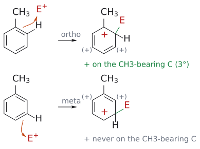

그림: E⁺는 일반 electrophile(빨강)이고, 주황색 화살표는 고리의 $\pi$ 전자가 E를 공격하는 것을 나타낸다. 초록색은 새로 생긴 C-E 결합이다. 각 cation에서 빨간 +는 그려진 공명 구조의 양전하 위치, 회색 (+)는 다른 두 공명 구조에서 양전하가 놓이는 위치다. 위(ortho 공격): 양전하 위치 하나가 CH₃가 붙은 탄소라서 3차 carbocation 공명 구조가 생긴다. 아래(메타 공격): 세 위치 모두 CH₃가 붙은 탄소를 비켜 간다. para 공격도 ortho처럼 CH₃가 붙은 탄소에 양전하가 오는 구조가 있다(p.9).

toluene의 nitration 데이터도 같은 경향을 보인다. ortho 63%, 메타 3%, para 34%다. ortho와 para 공격에서는 "가장 안정한" 3차 cation 공명 구조가 하나씩 있지만 메타 공격에는 없다. ortho 위치는 2개(2×H), para는 1개(1×H)라서 통계 효과로 ortho가 para보다 많이 나온다. (출처: L4 p.9)

### 2.3 toluene의 sulfonation과 응용

- $\begin{aligned} & \text{toluene} \\ & \xrightarrow{\text{진한}\ \mathrm{H_2SO_4}} \mathit{o}\ \text{-toluenesulfonic acid} + \mathit{p}\ \text{-toluenesulfonic acid 혼합물} \end{aligned}$. 여기에 NaCl을 넣으면 para 생성물이 나트륨염으로 약 40% 분리된다. *p*-toluenesulfonic acid이 바로 유기합성에서 자주 쓰는 산인 **TsOH**다.
- 메커니즘 그림에서는 SO₃가 electrophile로 공격하고, 생긴 sulfonate가 protonate되어 SO₂OH가 된다.

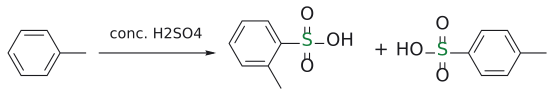

그림: ortho와 para 이성질체 혼합물이 생긴다. para 쪽이 TsOH다(초록 = $SO_3H$ ).

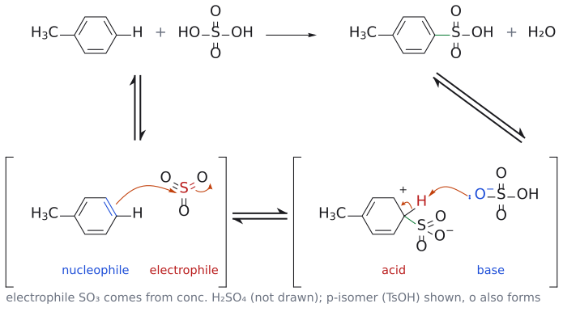

그림: 위 반응식의 메커니즘이다. para 공격을 그렸고(TsOH), ortho 공격도 같은 두 단계다. 위 줄이 전체 반응이고 아래 줄은 단계별 풀이다(대괄호는 중간체, ⇌는 평형). electrophile $\mathrm{SO}_3$ 는 진한 $\mathrm{H}_2\mathrm{SO}_4$ 에서 만들어지며, 그 과정은 그리지 않았다. 1단계: 고리의 $\pi$ 결합(파랑, nucleophile)이 $\mathrm{SO}_3$ 의 S(빨강, electrophile)를 공격해 새 C–S 결합(초록)을 만들고, S=O의 $\pi$ 전자는 산소로 올라가 $\mathrm{O}^-$ 가 된다. 그림의 빨간 +는 한 공명 구조이고, 다른 공명 구조에서는 CH₃가 붙은 탄소에 양전하가 놓여 3차 cation이 된다. 2단계: $\mathrm{HSO}_4^-$ (염기, 파랑)가 sp³ 탄소의 H(빨강)를 가져가 방향족성이 회복되고, 생긴 $\mathrm{SO}_3^-$ 가 H⁺를 받으면(그리지 않음) $\mathrm{SO}_3\mathrm{H}$ , 즉 TsOH가 된다. 보충: $\mathrm{SO}_3$ 가 생기는 단계, 2단계의 화살표, 마지막 protonation은 슬라이드에 없는 보충이다. (보충 근거: Clayden p.476–477)

(출처: L4 p.10)

**사카린 합성**
1. $\begin{aligned} & \text{toluene} \\ & \xrightarrow{\text{chlorosulfonic}\ \text{acid}(\mathrm{ClSO_2OH})} \\ & \mathit{o}\ \text{-toluenesulfonyl}\ \text{chloride}(\text{약}\ 40\%,\ \text{증류로 분리}) + \mathit{p}\  \\ & \text{-이성질체}(\text{약}\ 15\%,\ \text{결정화로 분리}) \end{aligned}$.
   - electrophile: chlorosulfonic acid 두 분자 사이의 양성자 이동으로 H₂O⁺-SO₂Cl이 생긴다. 여기서 물이 빠지면 ⁺SO₂Cl이 된다.
2. *
    $$
\text{o*-toluenesulfonyl chloride} \xrightarrow{\mathrm{(NH_4)_2CO_3}} \text{sulfonamide(89\%)}
$$

3. $\xrightarrow{\mathrm{KMnO_4}} \text{methyl이 carboxylic acid으로}\ \text{산화된다}(\text{분리하지 않음})$.
4. $\xrightarrow{\mathrm{HCl}} \text{고리화해 saccharin 이 된다(58\%)}$.

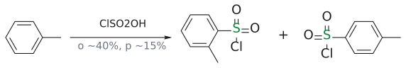

그림: saccharin 합성 1단계: chlorosulfonation(초록 = $SO_2Cl$ ).

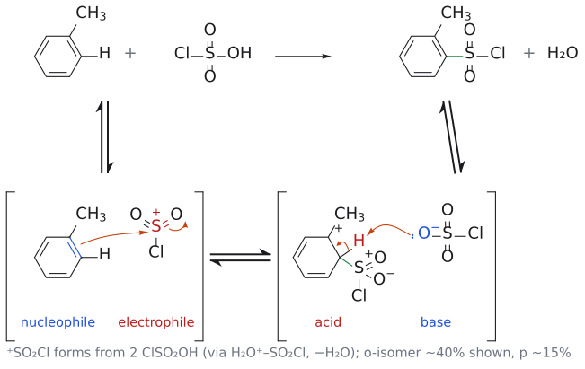

그림: 위 반응식의 메커니즘이다. 사카린 합성에 쓰이는 ortho 이성질체(약 40%)를 그렸다. 위 줄이 전체 반응이고 아래 줄은 단계별 풀이다(대괄호는 중간체, ⇌는 평형). electrophile $\mathrm{{}^{+}SO_2Cl}$ 은 $\mathrm{ClSO_2OH}$ 두 분자 사이의 양성자 이동으로 $\mathrm{H_2O^+}$–$\mathrm{SO_2Cl}$ 이 생기고 물이 떠나 만들어지며, 이 과정은 그리지 않았다. 1단계: 고리의 $\pi$ 결합(파랑, nucleophile)이 S(빨강, electrophile)를 공격해 새 C–S 결합(초록)을 만들고, S=O의 $\pi$ 전자는 산소로 올라가 $\mathrm{O}^-$ 가 된다. 양전하(빨간 +)는 CH₃가 붙은 탄소에 놓여 3차 cation이 된다. 2단계: $\mathrm{ClSO_3^-}$ (염기, 파랑)가 sp³ 탄소의 H(빨강)를 가져가고 방향족성이 회복되어 sulfonyl chloride와 $\mathrm{ClSO_2OH}$ 가 된다. 부산물인 물은 electrophile이 만들어질 때 나온다. 보충: 곡선 화살표와 $\mathrm{ClSO_3^-}$ 는 슬라이드에 없는 보충이다. (보충 근거: Clayden p.476, p.486)

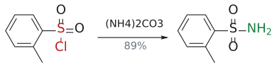

그림: 2단계: S–Cl(빨강)이 $NH_2$ (초록)로 치환된다.

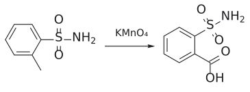

그림: 3단계: methyl(빨강)이 $CO_2H$ (초록)로 산화된다.

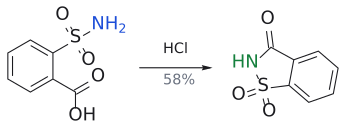

그림: 4단계: N(파랑)이 $CO_2H$ 와 고리를 닫아 saccharin(초록 C–N)이 된다.

(출처: L4 p.11)

보충: 같은 toluene인데 sulfonation에서는 TsOH가, chlorosulfonation에서는 ortho가 주로 분리된다는 차이에 주목할 만하다. 교재는 이것을 **sulfonation이 가역적**이라는 첫 단서로 본다. 가역 반응이라면 생성물이 처음 생긴 자리에 머무르지 않고, 입체적으로 덜 붐비는 para 쪽으로 쏠릴 수 있기 때문이다. 자세한 논의는 교재 24장에 있다. 어쨌든 chlorosulfonation에서 ortho 이성질체가 주생성물이라는 점이 사카린 합성에는 다행이다. (보충 근거: Clayden p.486)

---

## 3. 전자를 끄는 치환기는 메타 생성물을 준다

> 개념 문서: [substituent effect](../../wiki/개념/치환기%20효과.md), [nitration](../../wiki/반응/나이트로화.md)

### 3.1 유발 효과로 전자를 끄는 기

- **Ar-N⁺R₃, Ar-P⁺R₃**: 결합이 양전하를 띤 헤테로원자 쪽으로 분극되어 있다. N은 사면체 구조이고 내줄 비공유 전자쌍이 없다.
- **Ar-CF₃**: 전기음성도가 큰 F 세 개가 C-F 결합을 강하게 분극한다. 그 결과 Ar-C 결합까지 CF₃ 쪽으로 분극된다.

(출처: L4 p.12)

CF₃ 치환 benzene을 공격하는 경우를 비교해 보자.
- **메타 공격**: 공명 구조 세 개 모두에서 양전하가 CF₃가 붙은 탄소에 놓이지 않는다.
- **ortho 공격**: 공명 구조 중 하나에서 양전하가 CF₃가 붙은 탄소(C1) 바로 위에 놓인다. 전자를 끄는 기 바로 옆의 양전하는 매우 불리하므로, 그 구조는 "아주 작은 기여 very minor resonance contributor"가 된다.

그래서 전자 끄는 치환기는 electrophile을 **메타 위치로 보내고 반응성을 낮춘다**. 즉 **비활성화, 메타 배향**이다. (출처: L4 p.12)

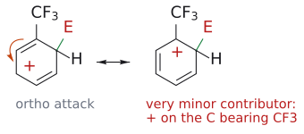

그림: ortho 위치(C2)에 E가 붙은 cation intermediate의 두 공명 구조다. 초록색은 새 C-E 결합, 빨간 +는 양전하 위치다. 주황색 화살표는 C6=C1 $\pi$ 전자가 C5 쪽으로 옮겨 가 양전하가 C5에서 C1로 이동하는 것을 나타낸다. 오른쪽 구조에서는 양전하가 전자를 끄는 CF₃ 바로 옆 탄소에 놓이므로 매우 불리하다. 슬라이드는 이것을 "very minor resonance contributor"로 표시한다. 메타 공격에서는 이런 구조가 없다.

> 주의: EWG가 메타 위치를 "활성화"하는 것은 아니다. 모든 위치가 benzene보다 느려지지만, 메타가 **가장 덜 나빠질** 뿐이다.

### 3.2 응용 예

- $\mathrm{PhN^+Me_3} \xrightarrow{\text{진한}\ \mathrm{HNO_3},\ \text{진한}\ \mathrm{H_2SO_4}} \text{메타}\ 90\%,\ \text{para}\ 10\%$

- $\begin{aligned} & \mathrm{PhCF_3} \\ & \xrightarrow{\text{진한}\ \mathrm{HNO_3},\ \text{진한}\ \mathrm{H_2SO_4}} \mathit{m}\ \text{-nitro-(trifluoromethyl)benzene}\ 96\% \end{aligned}$

- para 공격의 intermediate에서는 양전하 하나가 CF₃가 붙은 탄소에 놓인다. 슬라이드는 이것을 "trifluoromethyl 치환기 때문에 불안정해진 cation"이라고 표시한다.

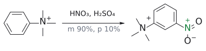

그림: $NMe_3^+$ 는 강한 meta 지향기다(초록 = 새 $NO_2$, 주생성물만 그림).

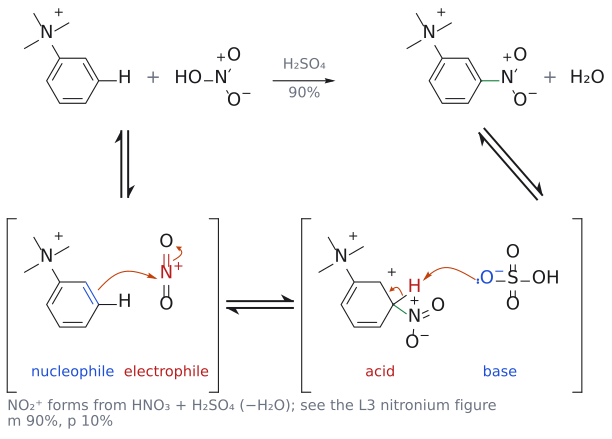

그림: 위 반응식의 메커니즘이다. $\mathrm{NMe}_3^+$ 는 유발 효과로 전자를 끄는 비활성화·meta 지향기이며, meta 90%, para 10%가 생긴다(주생성물인 meta만 그렸다). 단계는 benzene 나이트로화와 같다. 1단계: 고리의 $\pi$ 결합(파랑, nucleophile)이 $\mathrm{NO}_2^+$ 의 N(빨강, electrophile)을 공격해 새 C–N 결합(초록)을 만들고 N=O 하나의 $\pi$ 전자는 산소로 올라가 $\mathrm{O}^-$ 가 된다. 2단계: $\mathrm{HSO}_4^-$ (염기, 파랑)가 sp³ 탄소의 H(빨강)를 가져가 방향족성이 회복된다(전체 반응에서 $\mathrm{NO}_2^+$ 는 L3의 nitronium 그림처럼 $\mathrm{HNO}_3$ 와 $\mathrm{H}_2\mathrm{SO}_4$ 에서 만들어진다). meta 공격에서는 양전하가 공격 탄소의 ortho, para 위치에만 놓이므로 어느 구조에서도 $\mathrm{N}^+$ 가 붙은 탄소에는 오지 않는다. 보충: 2단계의 곡선 화살표와 $\mathrm{HSO}_4^-$ 는 슬라이드에 없는 보충이다. (보충 근거: Clayden p.476)

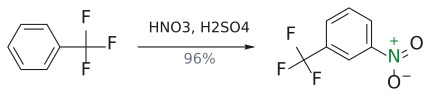

그림: $CF_3$ 도 meta 지향기다(96%).

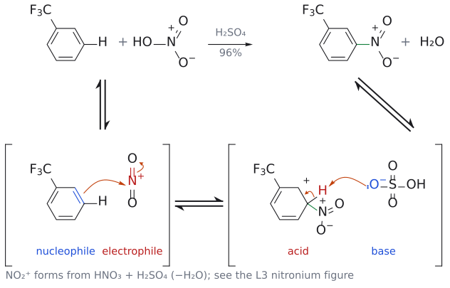

그림: 위 반응식의 메커니즘이다. $\mathrm{CF}_3$ 는 유발 효과로 전자를 끄는 비활성화·meta 지향기이며, meta 생성물이 96%다. 단계는 benzene 나이트로화와 같다. 1단계: 고리의 $\pi$ 결합(파랑, nucleophile)이 $\mathrm{NO}_2^+$ 의 N(빨강, electrophile)을 공격해 새 C–N 결합(초록)을 만들고 N=O 하나의 $\pi$ 전자는 산소로 올라가 $\mathrm{O}^-$ 가 된다. 2단계: $\mathrm{HSO}_4^-$ (염기, 파랑)가 sp³ 탄소의 H(빨강)를 가져가 방향족성이 회복된다(전체 반응에서 $\mathrm{NO}_2^+$ 는 L3의 nitronium 그림처럼 $\mathrm{HNO}_3$ 와 $\mathrm{H}_2\mathrm{SO}_4$ 에서 만들어진다). meta 공격에서는 양전하가 공격 탄소의 ortho, para 위치에만 놓이므로(빨간 +는 그중 하나) 어느 구조에서도 $\mathrm{CF}_3$ 가 붙은 탄소에는 오지 않는다. ortho 공격이었다면 그 탄소에 양전하가 놓이는 매우 불리한 구조가 생긴다. 보충: 2단계의 곡선 화살표와 $\mathrm{HSO}_4^-$ 는 슬라이드에 없는 보충이다. (보충 근거: Clayden p.476)

(출처: L4 p.13)

### 3.3 공액으로 전자를 끄는 기: NO₂

- $\text{benzene} \xrightarrow{\mathrm{HNO_3},\ \mathrm{H_2SO_4}} \text{nitrobenzene}$

- $\begin{aligned} & \text{benzene} \\ & \xrightarrow[\text{100°C에서 30분 가열 환류}]{\text{발연}\ \mathrm{HNO_3\,/}\ \text{진한}\ \mathrm{H_2SO_4}} \text{*m*-dinitrobenzene(75\%)} \end{aligned}$

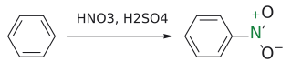

그림: nitration. 새 C–N 결합(초록).

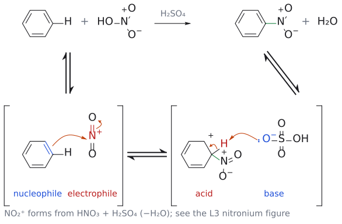

그림: 위 반응식의 메커니즘이다. 위 줄이 전체 반응이고 아래 줄은 단계별 풀이다(대괄호는 중간체, ⇌는 평형). electrophile $\mathrm{NO}_2^+$ 는 $\mathrm{HNO}_3$ 가 $\mathrm{H}_2\mathrm{SO}_4$ 에게 양성자를 받고 물이 떠나 생기며, 이 과정은 L3의 nitronium 그림에서 다루었으므로 여기서는 $\mathrm{NO}_2^+$ 에서 출발한다. 1단계: 고리의 $\pi$ 결합(파랑, nucleophile)이 $\mathrm{NO}_2^+$ 의 N(빨강, electrophile)을 공격해 새 C–N 결합(초록)을 만들고, N=O 하나의 $\pi$ 전자는 산소로 올라가 $\mathrm{O}^-$ 가 된다(N은 결합 네 개를 유지한다). 2단계: 중간체 cyclohexadienyl cation(산, 빨강)의 sp³ 탄소에서 $\mathrm{HSO}_4^-$ (염기, 파랑)가 H(빨강)를 가져가고, C–H 결합 전자가 고리로 돌아와 방향족성이 회복되며 $\mathrm{H}_2\mathrm{SO}_4$ 가 재생된다. 빨간 +는 그려진 공명 구조의 양전하 위치다. 보충: 2단계의 곡선 화살표와 $\mathrm{HSO}_4^-$ 는 슬라이드에 없는 보충이다. (보충 근거: Clayden p.476)

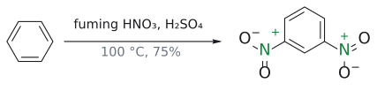

그림: 가혹한 조건에서는 두 번째 $NO_2$ 가 meta로 들어간다(75%).

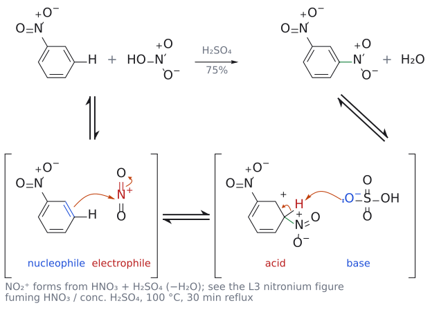

그림: 위 반응식의 메커니즘이다. 이미 붙은 $\mathrm{NO}_2$ 때문에 가혹한 조건(발연 $\mathrm{HNO}_3$ , 진한 $\mathrm{H}_2\mathrm{SO}_4$ , 100 °C)이 필요하고, 새 $\mathrm{NO}_2$ 는 meta 위치(75%)로 들어간다. 단계는 benzene 나이트로화와 같다. 1단계: 고리의 $\pi$ 결합(파랑, nucleophile)이 $\mathrm{NO}_2^+$ 의 N(빨강, electrophile)을 공격해 새 C–N 결합(초록)을 만들고 N=O 하나의 $\pi$ 전자는 산소로 올라가 $\mathrm{O}^-$ 가 된다. 2단계: $\mathrm{HSO}_4^-$ (염기, 파랑)가 sp³ 탄소의 H(빨강)를 가져가 방향족성이 회복된다(전체 반응에서 $\mathrm{NO}_2^+$ 는 L3의 nitronium 그림처럼 $\mathrm{HNO}_3$ 와 $\mathrm{H}_2\mathrm{SO}_4$ 에서 만들어진다). 빨간 +는 한 공명 구조이고, 양전하는 공격 탄소의 ortho, para 위치에만 놓이므로 어느 구조에서도 $\mathrm{NO}_2$ 가 붙은 탄소에는 오지 않는다. 보충: 2단계의 곡선 화살표와 $\mathrm{HSO}_4^-$ 는 슬라이드에 없는 보충이다. (보충 근거: Clayden p.476)

두 번째 nitro group은 **첫 번째의 메타 위치**로 들어간다. 즉 nitro group은 비활성화, 메타 배향이다. (출처: L4 p.14)

NO₂는 benzene 고리의 $\pi$ 계와 공액되어 전자를 강하게 끌어간다. 공명 구조를 그려 보면 고리의 $\pi$ 전자가 N=O 쪽으로 밀려가면서 **ortho와 para 위치에 양전하**가 생긴다. 그래서 고리 전체가 electrophile에 덜 반응하게 되고, 그중 **가장 덜 전자 부족한 자리가 메타 위치**다. (출처: L4 p.14)

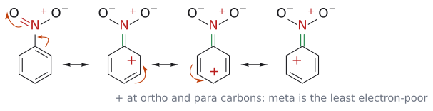

그림: 첫 구조에서 주황색 화살표 둘은 (1) 고리의 C1=C2 $\pi$ 전자가 C-N 결합으로 들어가 C=N(초록)을 만들고, (2) N=O의 $\pi$ 전자(빨강)가 산소로 올라가 O⁻가 되는 것을 나타낸다. 그 결과 ortho 탄소(C2)에 양전하(빨간 +)가 생긴다. 이어지는 화살표는 고리 안의 $\pi$ 전자를 한 칸씩 옮겨 양전하를 para(C4), 다른 쪽 ortho(C6)로 옮긴다. 메타 탄소에는 양전하가 한 번도 오지 않는다. N⁺는 모든 구조에서 그대로다.

---

## 4. 할로젠: 전자를 끌면서 동시에 주는 기

> 개념 문서: [substituent effect](../../wiki/개념/치환기%20효과.md)

halobenzene의 nitration(진한 HNO₃/H₂SO₄, 25 °C) 데이터는 다음과 같다.

| 화합물 | ortho (%) | 메타 (%) | para (%) | 상대 속도 (benzene = 1) |
|---|---|---|---|---|
| PhF | 13 | 0.6 | 86 | 0.18 |
| PhCl | 35 | 0.9 | 64 | 0.064 |
| PhBr | 43 | 0.9 | 56 | 0.060 |
| PhI | 45 | 1.3 | 54 | 0.12 |

(출처: L4 p.15)

이 표에서 읽어낼 수 있는 것은 네 가지다.
1. **모든 halobenzene이 benzene보다 느리다.** 전기음성도가 큰 할로젠이 전자를 끌어가 고리를 비활성화하기 때문이다.
2. **그런데도 ortho, para 배향이다.** 두 효과가 맞서기 때문이다. 공액에 의한 전자 공여는 배향을 정하고, 유발 효과에 의한 전자 흡인은 반응성을 정한다.
3. **공액이 phenol이나 aniline만큼 강하지 않다.** Cl, Br, I는 탄소보다 커서, 탄소의 2p 궤도함수와 할로젠의 큰 p 궤도함수가 잘 겹치지 않는다. F는 크기는 맞지만 전기음성도가 너무 크다.
4. **F → I로 갈수록 ortho 생성물이 늘어난다.** 전기음성도가 큰 원자일수록 유발 효과가 크고, 그 효과는 가까운 **ortho 위치에서 가장 크게** 전자를 끌어간다. 그래서 F는 ortho 반응성을 많이 깎아 para 생성물이 많아진다.

(출처: L4 p.15)

보충: 상대 속도 열도 다시 보자. F(0.18)와 I(0.12)가 빠르고 Cl(0.064)과 Br(0.060)이 그 절반쯤인 **U자형** 순서다. F는 전기음성도가 크지만 2p–2p 겹침이 좋아 공액 공여가 꽤 되고, I는 겹침은 나쁘지만 전기음성도가 작아 유발 흡인이 약하다. Cl과 Br은 전기음성도도 꽤 크고 겹침도 나빠서 두 면에서 모두 손해를 본다. 크기 때문에 ortho가 줄 것이라는 예상과 달리 F → I로 ortho가 늘어나는 것(4번 항목)도 입체 효과가 아니라 유발 효과로 설명된다는 점을 기억하자. (보충 근거: Clayden p.490)

---

## 5. 전자 효과 요약

> 개념 문서: [substituent effect](../../wiki/개념/치환기%20효과.md), [aromatic halogenation](../../wiki/반응/방향족%20할로젠화.md)

L4의 답은 하나의 원리로 정리된다. **cyclohexadienyl cation intermediate를 더 안정하게 만드는 경로가 이긴다.** L3에서 본 것처럼 그 cation의 양전하는 공격 위치를 기준으로 ortho, para 탄소에만 놓인다. 그래서 원래 치환기가 전자를 주는 기(EDG)라면 양전하가 치환기 바로 옆 ipso에 놓이는 ortho/para 공격이 유리하다. 전자를 끄는 기(EWG)라면 그런 배치를 피할 수 있는 메타 공격이 상대적으로 유리하다.

| 전자 효과 | 예 | 활성화 | 배향 |
|---|---|---|---|
| 공액에 의한 공여 | -NR₂, -OR | 매우 활성화 | ortho, para만 |
| 유발 효과에 의한 공여 | alkyl | 활성화 | 주로 ortho, para (메타 일부) |
| 공액에 의한 공여 + 유발 효과에 의한 흡인 | F, Cl, Br, I | 비활성화 | ortho와 (주로) para |
| 유발 효과에 의한 흡인 | -CF₃, -NR₃⁺ | 비활성화 | 메타만 |
| 공액에 의한 흡인 | -NO₂, -CN, -COR, -SO₃R | 매우 비활성화 | 메타만 |

(출처: L4 p.16)

nitration, sulfonation, Friedel–Crafts acylation은 **매우 비활성화하는 치환기**를 붙인다. 그래서 조건이 가혹하지 않으면 한 번 치환된 뒤 깔끔하게 멈춘다. 반대로 가혹한 조건에서는 더 반응한다. 예를 들어 $\begin{aligned} & \text{nitrobenzene} \\ & \xrightarrow[135\text{–}145\,{}^\circ\mathrm{C}]{\mathrm{Br_2},\ \mathrm{Fe}\ \text{가루}} \mathit{m}\ \text{-bromonitrobenzene(74\%)이다} \end{aligned}$. (출처: L4 p.16)

그림: 비활성화된 고리라 가열이 필요하고, Br(초록)은 meta로 들어간다.

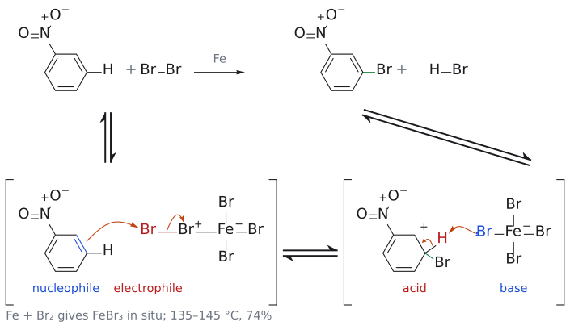

그림: 위 반응식의 메커니즘이다. 위 줄이 전체 반응이고 아래 줄은 단계별 풀이다(대괄호는 중간체, ⇌는 평형). $\mathrm{NO}_2$ 가 고리를 강하게 비활성화하므로 $\mathrm{Br}_2$/Fe 가루와 135–145 °C 가열이 필요하다. 1단계: $\mathrm{FeBr}_3$ 와 $\mathrm{Br}_2$ 의 복합체(Br–$\mathrm{Br}^+$–$\mathrm{FeBr}_3^-$)를 고리의 $\pi$ 결합(파랑, nucleophile)이 meta 위치에서 공격해 새 C–Br 결합(초록)을 만들고, Br–Br 결합 전자는 안쪽 Br로 가서 $\mathrm{FeBr}_4^-$ 가 된다. 빨간 +는 한 공명 구조일 뿐이고, 양전하는 공격 탄소의 ortho, para 위치(세 탄소)에만 놓이므로 어느 구조에서도 $\mathrm{NO}_2$ 가 붙은 탄소에는 오지 않는다. 2단계: $\mathrm{FeBr}_4^-$ (염기, 파랑)가 sp³ 탄소의 H(빨강)를 가져가 방향족성이 회복되며 HBr과 $\mathrm{FeBr}_3$ 가 나온다. 보충: Fe 가루에서 $\mathrm{FeBr}_3$ 가 생긴다는 점, 복합체 단계, 2단계의 화살표는 슬라이드에 없는 보충이다. (보충 근거: Clayden p.475, p.478)

강의 마지막 장(p.24)의 도표는 치환기를 반응성 순서로 정리한다.
- **강한 활성화**(o,p): -NH₂, -NHR, -NR₂, -OH, -OR
- **중간 활성화**(o,p): -NHCOR, -NHCOPh, -OCOR, -OCOPh
- **약한 활성화**(o,p): -R, -Ph
- **약한 비활성화**(o,p): -F, -Cl, -Br, -I
- **중간 비활성화**(m): -CHO, -COR, -COOH, -COOR, -CONH₂, -SO₃H, -CN
- **강한 비활성화**(m): -NO₂, -NH₃⁺, -CF₃, -CCl₃

(출처: L4 p.24)

---

## 6. 치환기가 둘 이상이면: 협력과 경쟁

> 개념 문서: [substituent effect](../../wiki/개념/치환기%20효과.md), [Friedel–Crafts alkylation](../../wiki/반응/프리델-크래프츠%20알킬화.md)

### 6.1 협력하는 경우

- **4-hydroxybenzaldehyde + X₂**: aldehyde는 메타로, OH는 ortho로 안내한다. 둘이 **같은 위치**를 가리키므로 3,5-다이할로-4-hydroxybenzaldehyde가 생긴다.
- ***$\text{p*-nitrotoluene} \xrightarrow{\mathrm{HNO_3},\ \mathrm{H_2SO_4}} \text{2,4-dinitrotoluene}$. methyl은 자기 ortho(2번)로, nitro는 자기 메타(2번)로 안내한다. 결과가 **additive**.

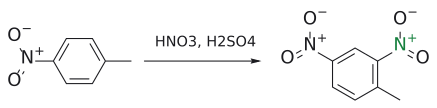

그림: methyl의 ortho이자 nitro의 meta인 자리로 새 $NO_2$ (초록)가 들어간다(효과가 더해짐).

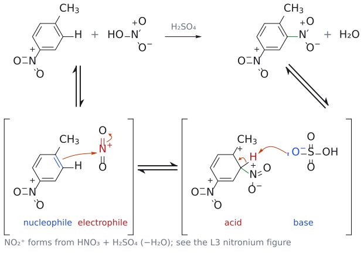

그림: 위 반응식의 메커니즘이다. 새 $\mathrm{NO}_2$ 는 CH₃의 ortho이면서 기존 $\mathrm{NO}_2$ 의 meta인 자리를 공격하므로 두 치환기의 효과가 같은 자리를 가리킨다(효과가 더해짐). 단계는 benzene 나이트로화와 같다. 1단계: 고리의 $\pi$ 결합(파랑, nucleophile)이 $\mathrm{NO}_2^+$ 의 N(빨강, electrophile)을 공격해 새 C–N 결합(초록)을 만들고 N=O 하나의 $\pi$ 전자는 산소로 올라가 $\mathrm{O}^-$ 가 된다. 2단계: $\mathrm{HSO}_4^-$ (염기, 파랑)가 sp³ 탄소의 H(빨강)를 가져가 방향족성이 회복된다(전체 반응에서 $\mathrm{NO}_2^+$ 는 L3의 nitronium 그림처럼 $\mathrm{HNO}_3$ 와 $\mathrm{H}_2\mathrm{SO}_4$ 에서 만들어진다). 빨간 +는 CH₃가 붙은 탄소에 놓이는 3차 cation 구조이고, 기존 $\mathrm{NO}_2$ 가 붙은 탄소에는 양전하가 오지 않는다. 보충: 2단계의 곡선 화살표와 $\mathrm{HSO}_4^-$ 는 슬라이드에 없는 보충이다. (보충 근거: Clayden p.476)

(출처: L4 p.17-18)

### 6.2 경쟁하는 경우: 더 강한 활성화기가 이긴다

**BHT(butylated hydroxytoluene) 합성**: *p*-크레솔 + isobutene + H₂SO₄
1. isobutene이 protonate되어 *t*-butyl cation이 생긴다.
2. OH와 Me 모두 ortho, para 배향이지만 서로 다른 위치를 가리킨다(경쟁).
3. **OH가 훨씬 강하게 배향한다.** 여분의 비공유 전자쌍을 제공하기 때문이다. 그래서 *t*-butyl cation은 OH의 ortho로 들어간다.
4. 같은 과정이 한 번 더 일어나 2,6-다이-*tert*-butyl-4-methylphenol(BHT)이 된다.

(출처: L4 p.17)

### 6.3 빈칸 문제: 4-methylacetanilide + Br₂

슬라이드 p.19는 빈칸으로 남겨져 있다(연습 문제 5번에서 다룬다). (출처: L4 p.19)

보충: Clayden에도 같은 기질의 bromination이 실려 있고, Br은 **NHCOMe의 ortho(methyl의 메타)** 로 들어간다. "물을 탄" 활성화기인 amide라도 전자쌍을 하나 더 내줄 수 있으므로 alkyl group을 이긴다는 설명이다. 연습 문제 5번의 예측과 일치한다. (보충 근거: Clayden p.491–492)

보충: 치환기가 여럿일 때 교재가 권하는 순서는 **전자 효과를 먼저, 입체 효과를 나중에** 보는 것이다. 전자 효과에서는 대체로 활성화기가 비활성화기보다 우선한다. 그다음 남은 후보 중에서 **두 치환기 사이에 끼는 자리**처럼 치환기 셋이 연달아 붙게 되는 위치는 피한다. 예를 들어 3,4-dimethoxybenzaldehyde의 nitration에서는 두 OMe가 정하는 후보 C2, C5, C6 중 붐비지 않는 **C6**에서 반응한다. aldehyde가 C6의 전자를 끌어가는데도 그렇다. (보충 근거: Clayden p.492)

---

## 7. NMR로 예측하기

> 개념 문서: [arenium ion](../../wiki/개념/아레늄%20이온.md), [substituent effect](../../wiki/개념/치환기%20효과.md)

### 7.1 cyclohexadienyl cation을 직접 관찰하다

benzene을 superacid(SbF₅/FSO₃H, SO₂FCl 용매, -120 °C)으로 처리하면 **protonate된 benzene(cyclohexadienyl cation)** 이 SbF₆⁻ 염으로 관찰된다. NMR 데이터는 다음과 같다.

| 위치 | $\delta_{\mathrm{H}}$ | $\delta_{\mathrm{C}}$ |
|---|---|---|
| 1 (sp³, CH₂) | 5.6 | 52.2 |
| 2, 6 (ortho) | 9.7 | 186.6 |
| 3, 5 (메타) | 8.6 | 136.9 |
| 4 (para) | 9.3 | 178.1 |
| benzene (비교) | 7.33 | 129.7 |

**ortho(2,6)와 para(4)** 위치가 크게 downfield되어 있다. 계산된 전하 분포는 ortho 0.26+, 메타 0.09+, para 0.30+다. 양전하가 ortho와 para에 놓인다는 공명 그림이 실험으로 확인된 것이다. (출처: L4 p.20)

### 7.2 치환 benzene의 ¹H NMR과 반응성

전자 밀도가 높은 위치일수록 수소가 더 shielded 화학적 이동($\delta$)이 작아진다.
- benzene 7.26
- toluene: ortho 7.06, 메타 7.14, para 7.04 (약간 차폐)
- phenol: ortho 6.70, 메타 7.14, para 6.81
- aniline: ortho 6.51, 메타 7.01, para 6.61 (가장 강하게 차폐)

**ortho/para 위치만** 크게 차폐된다. 이는 그 위치의 전자 밀도가 높다는 뜻이고, electrophile이 그 위치를 공격하는 이유와 일치한다. (출처: L4 p.21)

bromination 상대 속도도 이 경향과 맞는다. benzene 1, 아니솔(OMe) 10⁹, N,N-dimethylaniline(NMe₂) 10¹⁴. (출처: L4 p.21)

전자 끄는 기가 붙은 benzene에서는 반대로 **ortho/para 수소가 deshielding**된다.
- nitrobenzene: ortho 8.21, 메타 7.52, para 7.64
- benzaldehyde: ortho 7.82, 메타 7.48, para 7.55
- methyl benzoate: ortho 7.97, 메타 7.37, para 7.47
- methyl benzenesulfonate: ortho 7.86, 메타 7.52, para 7.59
- benzonitrile: ortho 7.62, 메타 7.44, para 7.54

어느 경우에나 **메타 수소가 가장 덜 deshielding**된다. 메타가 가장 덜 전자 부족한 위치라는 뜻이다. (출처: L4 p.22)

---

## 흔한 오해

- **"전자 끄는 기는 메타 위치를 활성화한다"**: 모든 위치가 benzene보다 느려진다. 다만 메타가 가장 덜 느려질 뿐이다.
- **"할로젠은 비활성화기이므로 메타 배향이다"**: 할로젠은 **비활성화이면서 ortho/para 배향**인 예외적인 기다. 반응성은 유발 효과가, 배향은 공액이 정한다.
- **"alkyl group은 공액($\pi$)으로 전자를 준다"**: alkyl group은 비공유 전자쌍이 없다. 이 강의에서는 **C-H $\sigma$ 결합과 $\pi$ 계의 겹침($\sigma$ 공액)** 으로 설명한다.
- **"ortho 위치가 두 개이므로 항상 ortho 생성물이 더 많다"**: 통계적으로는 그렇지만, 큰 치환기에서는 입체 장애 때문에 para가 우세하다(예: acetanilide).
- **"aniline도 저온에서 Br₂를 천천히 넣으면 한 번만 brominate된다"**: phenol은 그렇지만 aniline은 CS₂, <5 °C에서도 2,4,6-tribromo 생성물을 준다. acetylation으로 활성을 낮춰야 한다.

---

## 반응 정리표

| 기질 (치환기) | 시약/조건 | 주생성물 | 배향 | 비고 |
|---|---|---|---|---|
| aniline (NH₂) | Br₂, HOAc | 2,4,6-tribromoaniline | o,p | 저온에서도 3치환 |
| phenol (OH) | Br₂, CS₂, <5 °C | *p*-bromophenol | p | 조건으로 단일 치환 가능 |
| acetanilide (NHAc) | Br₂, HOAc, 실온 | *p*-bromoacetanilide | 주로 p | 한 번만, 이후 HCl로 탈보호 |
| toluene (Me) | Br₂, Lewis acid | o 60 / p 35 / m 5 | o,p | $\sigma$ 공액 |
| toluene | HNO₃, H₂SO₄ | o 63 / p 34 / m 3 | o,p | |
| toluene | 진한 H₂SO₄ | o-/p-TsOH | o,p | NaCl로 p-염 분리 |
| toluene | ClSO₂OH | o-/p-sulfonyl chloride | o,p | 사카린 합성 |
| PhNMe₃⁺ | HNO₃, H₂SO₄ | m 90 / p 10 | m | 유발 흡인 |
| PhCF₃ | HNO₃, H₂SO₄ | m-nitro (96%) | m | 유발 흡인 |
| PhNO₂ | 발연 HNO₃/H₂SO₄, 100 °C | m-dinitrobenzene | m | 공액 흡인 |
| PhNO₂ | Br₂, Fe, 135–145 °C | m-bromonitrobenzene | m | 가혹한 조건 필요 |
| PhX (할로젠) | HNO₃, H₂SO₄ | 주로 p (+o) | o,p | 비활성화 |
| p-크레솔 | isobutene, H₂SO₄ | BHT | OH의 o | OH가 Me를 이김 |
| p-nitrotoluene | HNO₃, H₂SO₄ | 2,4-dinitrotoluene | 협력 | |

---

## 연습 문제

1. aniline이 phenol보다 electrophile에 더 반응성이 큰 이유를 설명하시오.
2. aniline에서 *p*-bromoaniline만 선택적으로 얻는 3단계 합성을 쓰고, 각 단계의 역할을 설명하시오.
3. toluene의 nitration에서 메타 생성물이 3%밖에 생기지 않는 이유를 intermediate 공명 구조로 설명하시오. ortho가 para보다 많은 이유도 쓰시오.
4. chlorobenzene은 benzene보다 느리게 반응하는데도 ortho/para 배향이다. 이 모순처럼 보이는 사실을 설명하시오.
5. (슬라이드 p.19 빈칸) 4-methylacetanilide(*p*-CH₃-C₆H₄-NHCOCH₃)를 Br₂로 처리했을 때의 주생성물을 예측하고 이유를 쓰시오.
6. 다음을 친전자성 bromination 반응성이 큰 순서로 나열하시오: benzene, nitrobenzene, 아니솔, chlorobenzene, toluene, N,N-dimethylaniline.
7. benzene에서 출발해 *m*-bromonitrobenzene과 *p*-bromonitrobenzene을 각각 만드는 방법을 쓰시오. (반응 순서에 주의)
8. superacid에서 관찰한 cyclohexadienyl cation의 ¹³C NMR에서 C2/C6과 C4가 각각 186.6, 178.1 ppm으로 나타나는 것은 무엇을 의미하는가?

## 정답 및 해설

1. 질소는 산소보다 전기음성도가 작아서 비공유 전자쌍을 덜 붙잡는다. 그래서 고리로 더 잘 내준다(공액 공여가 더 강함). 그 결과 HOMO 에너지가 더 높고, ortho/para 위치의 전자 밀도가 더 크다. (L4 p.4)
2. (i) Ac₂O로 acetanilide를 만든다. N의 전자쌍이 C=O와 공액되어 활성이 줄어든다. (ii) Br₂/HOAc, 실온에서 bromination한다. 한 번만, 그리고 입체 장애 때문에 주로 para에 들어간다. (iii) HCl, EtOH/H₂O, 가열 환류로 amide를 가수분해해 *p*-bromoaniline을 얻는다. (L4 p.5)
3. ortho/para 공격에서는 공명 구조 중 하나에서 양전하가 methyl이 붙은 3차 탄소에 놓여 $\sigma$ 공액으로 안정화된다. 메타 공격에서는 양전하가 methyl이 붙은 탄소에 오지 않으므로 그런 안정화가 없다. ortho 위치는 두 개, para는 하나라서 통계적으로 ortho가 많다(63% 대 34%). (L4 p.8-9)
4. Cl은 전기음성도가 커서 유발 효과로 고리 전체의 전자를 끌어가므로 반응성이 낮아진다. 하지만 비공유 전자쌍이 공액으로 ortho/para 위치의 cation intermediate를 안정화하므로, 반응이 일어날 때는 ortho/para로 간다. 반응성은 유발 효과가, 배향은 공액이 결정한다. (L4 p.15)
5. 2-bromo-4-methylacetanilide(N-(2-bromo-4-methylphenyl)acetamide)가 주생성물이다. para 위치는 methyl이 이미 차지하고 있다. NHAc(중간 활성화)는 Me(약한 활성화)보다 강한 배향기이므로 NHAc의 ortho 위치로 들어간다. Me의 ortho 위치도 가능하지만 더 약한 배향기의 선택이 진다. 근거는 L4 p.17의 BHT 원리(강한 활성화기가 이김)와 p.24의 반응성 순서이며, 슬라이드에 답은 없다.
6. N,N-dimethylaniline > 아니솔 > toluene > benzene > chlorobenzene > nitrobenzene. 강한 활성화(NMe₂ 10¹⁴, OMe 10⁹) > 약한 활성화(Me) > 기준 > 약한 비활성화(Cl) > 강한 비활성화(NO₂) 순이다. (L4 p.21, p.24)
7. *m*-bromonitrobenzene: 먼저 nitration(HNO₃/H₂SO₄)하고 그다음 bromination(Br₂, Fe, 가열)한다. NO₂가 메타 배향이기 때문이다. *p*-bromonitrobenzene: 먼저 bromination(Br₂, FeBr₃)하고 그다음 nitration한다. Br이 o,p 배향이므로 para 생성물을 분리한다. (원리: L4 p.14-16)
8. C2/C6(ortho)과 C4(para)가 크게 deshielding되었다는 것은 이 위치들에 양전하가 많이 놓여 있다는 뜻이다(전하 0.26+, 0.30+). 공명 구조에서 예측한 대로 양전하가 ortho/para에 분포한다는 직접적인 실험 증거다. 메타(136.9 ppm)는 양전하가 적다. (L4 p.20)
