# L6. 알코올·알데하이드의 산화와 알켄의 입체선택적 합성 (Oxidation Reactions / Synthesis of Alkenes)

> **통독본**: 2026-10-12 재구성 직전의 강의별 전체 노트(교과서 보강 포함)를 그대로 보존한 사본이다. 강의 흐름대로 한 번에 읽을 때 쓴다. 이후의 수정과 보충은 개념 문서에만 반영되므로, **최신 내용은 개념 문서**가 기준이다. 뼈대 노트: [L6 뼈대](../L06_Oxidation_and_Alkene_Synthesis.md) · [위키 대문](../../wiki/위키%20대문.md)

> **관련 위키 문서** ([위키 대문](../../wiki/위키%20대문.md))
> - 반응: [HWE reaction](../../wiki/반응/HWE%20반응.md), [SN2 reaction](../../wiki/반응/SN2%20반응.md), [TEMPO oxidation](../../wiki/반응/TEMPO%20산화.md), [Lindlar reduction](../../wiki/반응/린들라%20환원.md), [Swern oxidation](../../wiki/반응/스원%20산화.md), [alcohol oxidation](../../wiki/반응/알코올%20산화.md), [partial reduction of esters](../../wiki/반응/에스터%20부분%20환원.md), [dissolving metal reduction](../../wiki/반응/용해%20금속%20환원.md), [Wittig reaction](../../wiki/반응/위티그%20반응.md), [Jones oxidation](../../wiki/반응/존스%20산화.md), [Pinnick oxidation](../../wiki/반응/피닉%20산화.md)
> - 시약: [DIBAL-H](../../wiki/시약/DIBAL-H.md), [DMP](../../wiki/시약/DMP.md), [KMnO4](../../wiki/시약/KMnO4.md), [MnO2](../../wiki/시약/MnO2.md), [NMO](../../wiki/시약/NMO.md), [NaClO2](../../wiki/시약/NaClO2.md), [SeO2](../../wiki/시약/SeO2.md), [TEMPO](../../wiki/시약/TEMPO.md), [TPAP](../../wiki/시약/TPAP.md), [Lindlar catalyst](../../wiki/시약/린들라%20촉매.md), [phosphorus ylide](../../wiki/시약/인%20일라이드.md), [Jones reagent](../../wiki/시약/존스%20시약.md)
> - 개념: [metal hydride reactivity](../../wiki/개념/금속%20수소화물의%20반응성.md), [allyl cation](../../wiki/개념/알릴%20양이온.md), [oxaphosphetane](../../wiki/개념/옥사포스페테인.md), [stereospecificity and stereoselectivity](../../wiki/개념/입체특이성과%20입체선택성.md)

> 근거 자료: 수정본 슬라이드(L6_CM3121_Oxidation_and_Alkene_synthesis_corrected, 38쪽). "L6c p.N"은 수정본 PDF의 페이지 번호다.[1]

## 개요

이 강의는 두 부분으로 되어 있다. 앞부분은 oxidation이다. alcohol을 aldehyde, ketone, carboxylic acid으로 바꾸는 시약들을 다루는데, 핵심은 "얼마나 세게 산화할 것인가"를 고르는 일이다. 1차 alcohol은 aldehyde에서 멈추게 할 수도 있고 carboxylic acid까지 보낼 수도 있다. 그래서 DMP, Swern, TPAP, MnO2, TEMPO처럼 aldehyde에서 멈추는 순한 산화제와, Jones 시약처럼 끝까지 밀어붙이는 강한 산화제를 구분해서 기억해야 한다. 뒷부분은 alkene의 합성이다. 같은 alkene이라도 E와 Z는 성질이 다른 별개의 화합물이므로, 한 가지 이성질체만 골라 만드는 법(Lindlar, Na/NH3, Wittig, HWE)을 배운다. 이전 강의에서 C=C를 산화해 끊거나(ozone분해) 작용기를 붙였다면(에폭시화, dihydroxylation), 이번에는 거꾸로 C=C를 원하는 기하로 만드는 쪽을 다룬다(→ [L6](L06_Oxidation_and_Alkene_Synthesis.md) 이전 강의의 C=C oxidation 문서 참고). 강의 도입부에는 이전 강의의 DIBAL-H 환원도 다시 나온다.

---

## 0. 도입: DIBAL-H는 왜 aldehyde에서 멈추나 (복습)

> 개념 문서: [partial reduction of esters](../../wiki/반응/에스터%20부분%20환원.md), [DIBAL-H](../../wiki/시약/DIBAL-H.md)

ester를 LiAlH4로 환원하면 alcohol까지 가 버린다. 그렇다면 aldehyde만 얻고 싶을 때는 어떻게 할까? 답은 DIBAL-H(diisobutylaluminium hydride, i-Bu2AlH)를 저온에서 쓰는 것이다. DIBAL은 alane이고, 용액에서는 Al–H–Al 다리 결합으로 이어진 bridged dimer로 존재한다.

$$
\mathrm{RCO_2Et} \xrightarrow[\text{hexane},\ -70\thinspace{}^\circ\mathrm{C}]{\ \mathrm{DIBAL},\ \text{그 다음}\ \mathrm{H_3O^+}\ \mathstrut} \mathrm{RCHO}
$$

(R = n-C11H23, 88%)

반응은 다음 순서로 진행된다.

1. Lewis acid인 Al이 carbonyl O에 배위한다(O+–Al− 착물).
2. Al–H의 수소화물이 분자 내에서 carbonyl 탄소로 옮겨 간다. 그 결과 tetrahedral intermediate R–CH(OEt)–O–Al(i-Bu)2가 생긴다.
3. 이 intermediate가 −70 °C에서는 안정해서 EtO−를 내보내지 않는다. 그래서 반응 중에는 aldehyde가 생기지 않고, 당연히 두 번째 환원도 일어나지 않는다.
4. H3O+로 후처리할 때 비로소 intermediate가 무너지면서 aldehyde가 나온다.

슬라이드는 여기서 "ester를 aldehyde로 바꾸는 다른 방법은?"이라고 묻는다. 답은 우회로다. 일단 LiAlH4로 1차 alcohol까지 완전히 reduction한 뒤, 순한 산화제로 aldehyde까지만 oxidation 된다. 슬라이드의 예는 2-(2-furyl)propanoate ethyl ester → 2-(2-furyl)propan-1-ol → 2-(2-furyl)propanal이며, 마지막 aldehyde는 항생제 monensin 합성에 쓰인다. 그렇다면 "aldehyde에서 멈추는 산화제"에는 무엇이 있을까? 이 질문이 강의 전반부 전체의 주제다.

(출처: L6c p.2)

## 1. alcohol 산화의 큰 그림

> 개념 문서: [alcohol oxidation](../../wiki/반응/알코올%20산화.md), [catalytic hydrogenation](../../wiki/반응/촉매%20수소화.md)

### 1.1 왜 멘톨 이야기부터 하나

강의는 먼저 범위를 정한다. I부는 alcohol·aldehyde의 산화(alcohol → aldehyde/ketone, 산까지의 산화)이고, C=C oxidation(에폭시화, dihydroxylation, ozone분해)는 이전 강의에서 이미 다뤘다(L6c p.3). 그 다음 동기 부여로 향료 화학 이야기를 꺼낸다. geraniol은 장미향이 나는 모노테르펜 alcohol로, 유럽 데오도란트의 76%에 들어 있고 연간 1000 t 넘게 생산된다. 예전에는 박하에서 추출하던 (−)-멘톨((−)-menthol)도 지금은 대부분 다른 원료로 합성한다(L6c p.4).

슬라이드의 멘톨 합성 경로는 다음과 같다.

- $\text{geraniol} \xrightarrow{?} \text{geranial}$
- $\text{geranial} \xrightarrow[\text{(S,S)-Chiraphos}]{\ \mathrm{H_2},\ \mathrm{CO}\ \mathstrut} \text{(+)-citronellal}$ ($\mathrm{Rh(CO)_2acac}$ 촉매)
- $\text{neral} \xrightarrow[\text{(R,R)-Chiraphos}]{\ \mathrm{H_2},\ \mathrm{CO}\ \mathstrut} \text{(+)-citronellal}$ ($\mathrm{Rh(CO)_2acac}$ 촉매)
- $\begin{aligned} & \text{(+)-citronellal} \\ & \xrightarrow{\mathrm{Al}\ \text{cat.}} \text{(−)-isopulegol} \\ & \xrightarrow{\ \mathrm{H_2},\ \mathrm{Ni}\ \text{cat.}\ \mathstrut} \text{(−)-menthol} \end{aligned}$

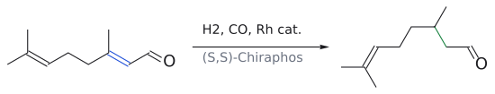

그림: 비대칭 수소화. 공액 C=C(파랑)만 환원된다.

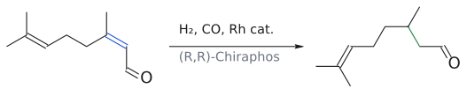

그림: Z 이성질체는 반대 리간드로 같은 거울상 생성물을 준다.

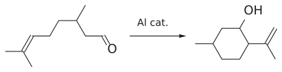

그림: Lewis acid 촉매 고리화(ene 반응). C=C(파랑)가 C=O(빨강)를 공격한다.

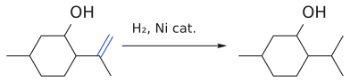

그림: C=C(파랑)를 수소화하면 menthol이 된다.

여기서 물음표로 남은 첫 단계, 즉 allyl 1차 alcohol을 $\alpha,\beta$-unsaturated aldehyde로 바꾸는 단계가 바로 이번 강의의 산화 반응이다. 이 단계에서 산화제가 너무 세면 carboxylic acid까지 가 버리고, 분자 안에 있는 C=C 두 개도 공격받을 수 있다. 그래서 순한 산화제가 필요하다.[2]

(출처: L6c p.3–5)

### 1.2 3차 alcohol은 왜 산화되지 않나

슬라이드의 표를 보면 1차 alcohol은 aldehyde를 거쳐 carboxylic acid이 되고, 2차 alcohol은 ketone이 되며, 3차 alcohol은 "No reaction"이다.

- $\begin{aligned} & \mathrm{RCH_2OH} \\ & \xrightarrow{\mathrm{O}} \mathrm{RCHO} \\ & \xrightarrow{\mathrm{O}} \mathrm{RCO_2H} \end{aligned}$
- $\mathrm{R_2CHOH} \xrightarrow{\mathrm{O}} \mathrm{R_2C{=}O}$
- $\mathrm{R_3COH} \xrightarrow{\mathrm{O}} \text{반응 없음}$

차이가 생기는 이유는 녹색 박스의 일반 메커니즘에 있다.

1. alcohol O(nucleophile)가 산화제 LG–A(electrophile)를 공격해 O–LG 결합을 만들고, HA가 빠진다.
2. 염기 B:가 카비놀 탄소의 $\alpha$-H를 떼어 낸다.
3. C–H 결합에 있던 전자쌍이 C=O $\pi$ 결합으로 옮겨 가고, 동시에 O–LG 결합이 끊어져 LG:가 떠난다. 생성물은 C=O + B–H + LG:다.

그림: 슬라이드 녹색 박스의 일반 메커니즘. 1단계: alcohol O(파랑, nucleophile)의 비공유 전자쌍이 산화제의 LG(빨강, electrophile)를 공격하고, LG–A 결합 전자는 A로 떠난다(HA가 빠짐). 2단계: 염기 B:(파랑)가 카비놀 탄소의 H를 떼어 내고, C–H 결합 전자(파란 결합)는 C–O 사이로 들어가 C=O $\pi$ 결합이 되며, O–LG 결합(빨강) 전자는 LG와 함께 떠난다. 세 화살표가 한 번에 움직이는 E2형 제거다. 초록 C=O가 새로 생긴 결합이다. 3차 alcohol에는 2단계의 C–H가 없으므로 이 과정이 일어날 수 없다.

즉 산화의 본질은 O–H의 H와 C–H의 H를 하나씩 떼어 내는 것이다. 3차 alcohol에는 2단계에서 떼어 낼 C–H가 없으니 C=O를 만들 길이 없다. 이 강의에 나오는 시약들은 결국 "LG를 무엇으로 붙이느냐"만 다르고, 이 뼈대는 모두 같다. 슬라이드도 각 시약을 "I–O", "S–Cl", "Ru–O"처럼 산화제의 핵심 결합으로 부른다.

(출처: L6c p.6)

$$
\mathrm{\#\#}\ 2.\ \text{alcohol} \longrightarrow \text{aldehyde/ketone: 순한 산화제들}
$$

> 개념 문서: [DMP](../../wiki/시약/DMP.md), [Swern oxidation](../../wiki/반응/스원%20산화.md), [TPAP](../../wiki/시약/TPAP.md), [NMO](../../wiki/시약/NMO.md), [MnO2](../../wiki/시약/MnO2.md), [TEMPO oxidation](../../wiki/반응/TEMPO%20산화.md), [TEMPO](../../wiki/시약/TEMPO.md), [alcohol oxidation](../../wiki/반응/알코올%20산화.md)

### 2.1 Dess–Martin periodinane (DMP): "I–O"가 산화제

geraniol의 물음표에 대한 가장 간단한 답이 DMP다. 1983년 D. B. Dess와 J. C. Martin이 보고했으며, 5배위 iodine(V)(pentacoordinate iodine(V)) 화합물이다. benziodoxolone 골격의 I에 acetate(OAc) 3개가 붙어 있는 구조다.

$$
\text{geraniol} \xrightarrow[\mathrm{CH_2Cl_2}]{\mathrm{DMP}} \text{geranial}
$$

(수율 84%)

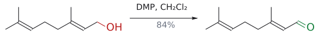

그림: 1차 allyl alcohol(빨강)이 aldehyde(초록)로 산화되고 C=C 배치는 그대로다.

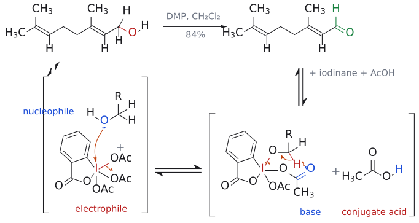

그림: 위 줄은 전체 반응이고, 아래 줄은 아래 본문의 메커니즘 1–3단계다(평형 화살표 ⇌로 연결). 아래 줄에서 R은 geraniol의 나머지 부분 $\mathrm{CH{=}C(CH_3)CH_2CH_2CH{=}C(CH_3)_2}$이다. 1단계(리간드 교환): alcohol의 O(파랑, nucleophile)가 I(빨강, electrophile)를 공격하고 OAc 하나가 떠나 alkoxy periodinane과 AcOH(conjugate acid)가 생긴다. 2–3단계: I에 붙은 다른 acetate의 carbonyl O(파랑, base)가 카비놀의 $\alpha$-H(빨강)를 떼고, 그 C–H 결합 전자는 C=O가 되며 O–I 결합 전자는 I로 돌아가 I(V)가 I(III)로 환원된다. 부산물은 iodinane과 AcOH다.

aldehyde에서 정확히 멈추고 C=C의 E 기하도 그대로 유지된다. 그렇다면 왜 DMP를 많이 쓸까? 슬라이드는 세 가지 장점을 든다. 첫째, 초원자가 iodine(hypervalent iodine) 시약은 독성이 낮고 안전하며 다루기 쉽고 환경 부담이 적다. 둘째, 온도와 pH가 온화하다(실온 근처, 중성). 셋째, 복잡한 기질의 민감한 작용기를 잘 tolerance of sensitive functional groups.

메커니즘은 1.2절의 뼈대를 그대로 따른다.

1. 리간드 교환: alcohol O가 I(V)를 공격해 OAc 하나를 밀어낸다. 그러면 알콕시 periodinane intermediate와 AcOH가 생긴다. 이 단계가 "O–LG 만들기"에 해당한다.
2. I에 붙은 또 다른 acetate의 carbonyl 산소가 염기 노릇을 하며 분자 내에서 $\alpha$-H를 떼어 낸다.
3. C=O가 생기면서 I–O 결합이 끊어지고, I(V)는 I(III)(iodinane, OAc 1개)로 환원된다.

전체 부산물은 iodinane과 AcOH 2분자다.

(출처: L6c p.7)

### 2.2 Swern oxidation (1976): "S–Cl"이 산화제

DMP는 좋은 시약이지만 비싸다. 대량으로 반응시킬 때는 어떻게 할까? 그래서 나온 것이 Swern 산화다. DMSO와 옥살릴 chloride (COCl)2를 DCM에서 −78 °C로 섞고, alcohol을 넣은 뒤 마지막에 NEt3를 넣으면서 온도를 −78 °C에서 rt까지 올린다.

- $\mathrm{PhCH_2OH} \xrightarrow[(2)\ \mathrm{Et_3N}]{\ (1)\ \mathrm{DMSO},\ \mathrm{(COCl)_2},\ \text{저온}\ \mathstrut} \mathrm{PhCHO}$

$$
(\text{1차}) \longrightarrow \text{aldehyde)}
$$
- $\text{cyclohexanol} \xrightarrow[(2)\ \mathrm{Et_3N}]{\ (1)\ \mathrm{DMSO},\ \mathrm{(COCl)_2},\ \text{저온}\ \mathstrut} \text{cyclohexanone}$

$$
(\text{2차}) \longrightarrow \text{ketone)}
$$

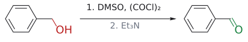

그림: $\text{1차 alcohol} \longrightarrow \text{aldehyde}$.

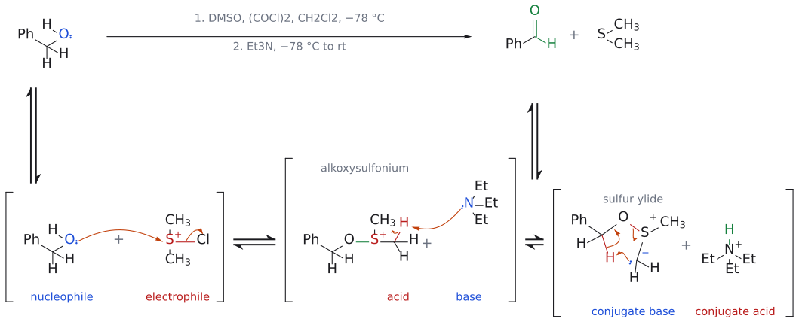

그림: 보충: 위 줄은 전체 반응(슬라이드의 조건)이고, 아래 줄은 활성종 $\mathrm{Me_2S^+Cl}$이 만들어진 뒤의 단계별 메커니즘이다(평형 화살표 ⇌로 연결). 1단계: alcohol의 O(파랑, nucleophile)가 S$^+$(빨강, electrophile)를 공격하고 Cl이 떠나 alkoxysulfonium 이온이 된다($\mathrm{Cl^-}$와 HCl은 그리지 않았고, HCl은 $\mathrm{Et_3N}$이 받는다). 2단계: $\mathrm{Et_3N}$(base)이 S–CH$_3$의 H(빨강)를 떼어 sulfur ylide(conjugate base)가 된다. 3단계: ylide의 $\mathrm{CH_2^-}$가 5원 고리 TS를 거쳐 카비놀 C–H의 H를 떼고, 그 C–H 결합 전자는 C=O $\pi$ 결합(초록)이 되며 O–S 결합 전자는 S로 돌아가 $\mathrm{Me_2S}$가 떨어진다.

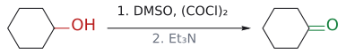

그림: $\text{2차 alcohol} \longrightarrow \text{ketone}$.

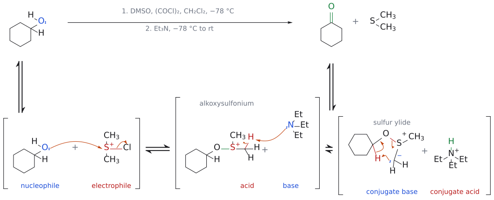

그림: 보충: 위의 PhCH$_2$OH 그림과 같은 메커니즘을 2차 alcohol에 적용한 것이다. 카비놀 탄소에 H가 하나 남아 있으므로(빨강) 마지막 단계에서 ketone이 된다. 색과 화살표의 의미는 위 그림과 같다.

시약이 흔하고 DMP보다 훨씬 싸다. 그 대가로 부산물이 Me2S(악취), CO, CO2, HCl로 꽤 지저분하다. 산화수로 보면 DMSO의 S(IV)가 Me2S의 S(II)로 환원되고, 그만큼 alcohol이 산화되는 것이다. 슬라이드의 합성 예는 (+)-asteltoxin 합성 intermediate다. `(COCl)2 5 equiv, DMSO 6 equiv; 그 다음 Et3N 10 equiv, −78 °C` 조건에서 1차 CH2OH가 CHO로 바뀌고(95%), 같은 분자 안의 3차 OH는 그대로 남는다. 1.2절에서 본 대로 3차 alcohol에는 떼어 낼 $\alpha$-H가 없기 때문이다.

그런데 "S–Cl"이라는 활성종은 어떻게 생길까? 슬라이드에는 메커니즘이 없으므로 교과서의 표준 설명으로 보충한다.[3]

1. DMSO의 O가 (COCl)2를 공격한다. 이어서 CO, CO2, Cl−가 떨어져 나가면 chlorodimethylsulfonium 이온 Me2S+–Cl이 생긴다. 이것이 "S–Cl" 활성종이다.
2. $\begin{aligned} & \text{alcohol O가 S+를 공격하고 Cl−가 떠난다} \\ & \longrightarrow \text{alkoxysulfonium 이온}\ \mathrm{R_2CH{-}O{-}S^+Me_2} \end{aligned}$.
3. Et3N이 S-methyl의 H를 떼어 내 sulfonium 일리드를 만든다.
4. 일리드의 CH2−가 5원 고리 transition state를 거쳐 분자 내에서 카비놀 $\alpha$-H를 떼어 낸다. 그러면 C=O와 Me2S가 생긴다.

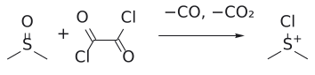

그림: 보충: 1단계. DMSO와 $(COCl)_2$ 가 chlorosulfonium ion( $Me_2S^+Cl$ )을 만들고( $CO$, $CO_2$, $Cl^-$ 방출) 이것이 활성종이 된다. 이 단계는 구조만 그렸고 화살표는 없다. 2–4단계는 위 합성 예 바로 아래의 종합 메커니즘 그림(PhCH$_2$OH, cyclohexanol)에 합쳤다.

−78 °C를 지켜야 하는 이유는 1단계의 활성종이 불안정하기 때문이다. HCl은 Et3N이 중화한다.

(출처: L6c p.8–9, p.17)

### 2.3 TPAP/NMO (Ley–Griffith oxidation): "Ru–O"가 산화제

루테늄 산화물은 원래 강한 산화제인데, 이것을 촉매로만 쓸 수는 없을까? TPAP(tetra-n-propylammonium perruthenate, Pr4N+ RuO4−, Ru(VII))가 그런 시약이다. TPAP는 촉매량만 넣고, 실제 산화 당량은 NMO(N-methylmorpholine N-oxide)가 최종 terminal oxidant로 댄다. alcohol을 산화하고 Ru(V)가 된 루테늄을 NMO가 다시 Ru(VII)로 되돌리고, 그 과정에서 NMO는 N-methylmorpholine이 된다.

$$
\alpha\text{-하이드록시}\ \text{에스터}(\text{2차 알코올}) \xrightarrow{\mathrm{TPAP}} \alpha\text{-케토 에스터}
$$

(수율 93%)

(출처: L6c p.10)

### 2.4 이산화망간 (MnO2): "Mn–O"가 산화제

MnO2는 매우 순한 산화제다.[4] 너무 순해서 아무 alcohol이나 산화하지는 못하고, allyl alcohol과 benzyl alcohol만 골라서 aldehyde나 ketone으로 바꾼다. 이 "편식"이 오히려 장점이 된다.

- $\text{retinol}(\text{비타민}\ \mathrm{A},\ \text{폴리엔 알릴 1차 알코올}) \xrightarrow{\ \mathrm{MnO_2}\ \mathstrut} \text{retinal}$ (수율 >95%)
- steroid형 diol: C=C 옆의 allyl 2차 OH만 산화되어 enone이 되고, allyl이 아닌 2차 OH는 그대로 남는다.

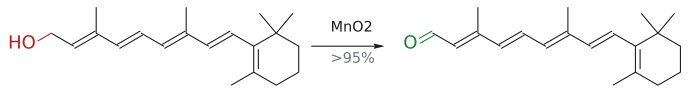

그림: $MnO_2$ 는 allyl alcohol(빨강)만 골라 aldehyde(초록)로 산화한다.

즉 한 분자 안에 OH가 여러 개 있을 때 allyl·benzyl OH만 골라 산화하고 싶다면 MnO2를 쓰면 된다. geraniol도 allyl 1차 alcohol이므로 MnO2로 산화할 수 있다.

(출처: L6c p.10)

### 2.5 TEMPO oxidation: "N–O"가 산화제

이번에는 값싼 NaOCl을 산화제로 쓸 수는 없을까? 표백제만으로는 선택성이 없지만, TEMPO라는 촉매를 끼우면 aldehyde에서 깔끔하게 멈춘다. TEMPO는 2,2,6,6-tetramethylpiperidine N-oxyl(슬라이드 표기 "tetramethylpiperidine N-oxide")로, 네 개의 methyl이 N–O• radical을 둘러싸 보호하고 있는 안정한 nitroxyl radical이다(m.p. 36–38 °C).

$$
\mathrm{RCH_2OH} + \mathrm{NaOCl} \xrightarrow[\mathrm{NaHCO_3},\ \mathrm{CH_2Cl_2{-}H_2O},\ 0\thinspace{}^\circ\mathrm{C}]{\mathrm{TEMPO},\ \mathrm{KBr}} \mathrm{RCHO}
$$

(KBr 0.1 mol equiv, TEMPO 0.01 mol equiv)

$\begin{aligned} & \text{슬라이드의 예는 1-heptanol} \\ & \longrightarrow \text{heptanal},\ \text{cinnamyl}\ \text{alcohol}(\mathrm{PhCH{=}CHCH_2OH}) \\ & \longrightarrow \text{cinnamaldehyde(PhCH=CHCHO)} \end{aligned}$이며, 두 번째 예에서 C=C는 그대로 남는다.

그런데 TEMPO가 1 mol%만 있어도 반응이 끝까지 가는 이유는 무엇일까? 답은 촉매 순환에 있다. 일종의 산화 릴레이로 보면 된다.

1. OCl−(최종 산화제)가 Br−(공촉매)를 OBr−로 산화하고, 자신은 Cl−가 된다.
2. OBr−가 TEMPO(또는 hydroxylamine)를 nitro소늄 cation(nitrosonium cation, N+=O)으로 산화한다.[5] alcohol을 실제로 산화하는 것은 이 cation이다.
3. 염기성 조건에서 생긴 alkoxide R1CH2O−가 N+를 공격해 intermediate 부가물(I), 즉 N(O−)–O–CH2R1이 생긴다.
4. N에 붙은 O−가 분자 내에서 $\alpha$-H를 떼어 내고, N–O(알콕시) 결합이 끊어진다. 그 결과 carbonyl R1CHO와 hydroxylamine(TEMPO-H, N–OH)이 생긴다.
5. hydroxylamine은 다시 TEMPO를 거쳐 nitro소늄으로 산화되어 순환이 닫힌다.

그림: 위 4단계(L6c p.12의 intermediate adduct (I)). N에 붙은 O⁻(파랑)의 비공유 전자쌍이 같은 분자 안의 $\alpha$-H(빨강)를 떼어 간다. 그 C–H 결합 전자(파란 결합)는 C–O 사이로 들어가 C=O가 되고, N⁺–O(알콕시) 결합(빨강) 전자는 N으로 돌아가 N⁺가 중성 N이 된다. 결과는 aldehyde(초록 C=O)와 hydroxylamine(N–OH)이다. 1.2절 일반 메커니즘에서 "LG = N⁺, 염기 = 분자 내 O⁻"인 경우로 보면 된다.

(출처: L6c p.11–12)

### 2.6 Cu(I)/TEMPO 호기성 산화 (Stahl oxidation)

표백제보다 더 싼 산화제는 공기다. 그렇다면 공기 중의 O2로 alcohol을 산화할 수 있을까? Stahl 산화는 TEMPO와 구리를 함께 촉매로 써서 이것을 해낸다.

$$
\mathrm{RCH_2OH} \xrightarrow[\mathrm{NMI},\ \mathrm{MeCN},\ \text{rt}]{\mathrm{(bpy)CuI},\ \mathrm{TEMPO}} \mathrm{RCHO}
$$

(산화제: air 또는 $\mathrm{O_2}$)
($\mathrm{(bpy)CuI}$ 5%, TEMPO 5%, NMI 10%)

(bpy = 2,2'-bipyridine, NMI = N-methylimidazole)

슬라이드의 촉매 순환은 두 반쪽으로 나뉜다.

1. 촉매 catalyst oxidation: (bpy)CuI–NMI + TEMPO-H + ½ O2 → (bpy)CuII(OH)–NMI + TEMPO•
2. 기질 substrate oxidation: $\mathrm{CuII{-}OH} + \mathrm{TEMPO•} + \mathrm{RCH_2OH} \longrightarrow \mathrm{RCHO} + \mathrm{H_2O} + \mathrm{CuI} + \mathrm{TEMPO{-}H}$

결국 O2가 물이 되면서 그만큼 alcohol이 산화된다. 화학선택성 예로는 내부 C=C(E)를 가진 1차 alcohol이 [(bpy)CuI(NMI)]X(X− = Br−, OTf−, BF4−, PF6−), TEMPO, MeCN, 공기, 22 °C 조건에서 aldehyde가 되고 C=C는 손대지 않는 반응이 나온다.[6]

(출처: L6c p.13)

### 2.7 여담: 몸 안의 alcohol 산화와 "Asian flush"

우리 몸도 alcohol을 같은 순서로 산화한다. 다만 시약 대신 효소와 NAD+를 쓴다.

$$
\begin{aligned}
& \text{ethanol} \xrightarrow{\mathrm{ADH},\ \mathrm{NAD^+}\ \to\ \mathrm{NADH}\ +\ \mathrm{H^+}} \text{acetaldehyde} \\
& \qquad \xrightarrow[\mathrm{NAD^+}\ \to\ \mathrm{NADH}\ +\ \mathrm{H^+}]{\ \mathrm{ALDH_2}\ \mathstrut} \text{acetate}
\end{aligned}
$$

그림: 몸속 1단계: alcohol dehydrogenase.

그림: 몸속 2단계: aldehyde dehydrogenase.

동아시아인의 약 30–50%는 ALDH2 유전자 변이(ALDH2*2)를 가지고 있다. 그래서 두 번째 단계가 느리고, 독성이 강한 acetaldehyde가 몸에 쌓여 술을 마시면 얼굴이 Asian glow. 화학적으로 말하면 "1차 alcohol → aldehyde → carboxylic acid"의 두 번째 산화가 병목이 되는 상황이다.

(출처: L6c p.14)

## 3. carboxylic acid까지 가는 산화

> 개념 문서: [Pinnick oxidation](../../wiki/반응/피닉%20산화.md), [NaClO2](../../wiki/시약/NaClO2.md), [Jones oxidation](../../wiki/반응/존스%20산화.md), [Jones reagent](../../wiki/시약/존스%20시약.md), [alcohol oxidation](../../wiki/반응/알코올%20산화.md)

$$
\mathrm{\#\#\#}\ 3.1\ \text{aldehyde} \longrightarrow \text{carboxylic acid: Pinnick oxidation}\ (1981)
$$

aldehyde를 이미 손에 넣었다면 산으로 가는 마지막 한 걸음은 무엇으로 할까? 슬라이드의 답은 Pinnick 산화다. NaClO2(sodium chlorite)와 약산성 완충제 NaH2PO4를 쓰며, 순하고 싸고 선택적이다.

$$
\begin{aligned}
& \mathrm{TMS}\ \text{치환 thienothiophene 알데하이드} \xrightarrow[\mathrm{NaH_2PO_4}]{\ \mathrm{NaClO_2}\ \mathstrut} \text{카복실산} \\
& \qquad \xrightarrow[\text{IPA/water}]{\mathrm{KOH},\ \text{그 다음}\ \mathrm{HCl}} \mathrm{PF{-}07208254}
\end{aligned}
$$

(용매 $\mathrm{2{-}MeTHF/DMSO/H_2O}$, $\mathrm{NaHSO_3}$ quench)

공정 규모 반응이라 발열은 투입량과 희석으로 제어하고, 두 번째 단계에서 TMS를 떼어 desilylation.

그런데 Pinnick 산화에는 늘 2-methyl-2-butene 같은 alkene을 함께 넣는다. 왜일까? 반응 부산물로 HOCl이 생기고, 이것이 기질이나 생성물과 부반응을 일으키기 때문이다. 그래서 HOCl을 먼저 잡아먹을 "희생양" alkene(scavenger)을 넣는다. DMSO를 대신 써도 된다.

$$
\mathrm{(CH_3)_2C{=}CHCH_3} + \mathrm{HOCl} \longrightarrow \mathrm{(CH_3)_2C(OH){-}CH(Cl)CH_3}
$$

(3-chloro-2-methylbutan-2-ol)

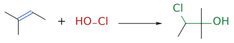

그림: OH(초록)는 더 치환된 탄소에, Cl은 덜 치환된 탄소에 붙는다.

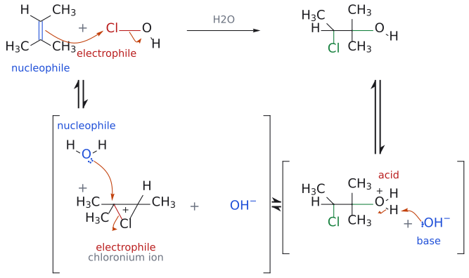

그림: 위 줄은 전체 반응, 아래 줄은 단계별 메커니즘이다(단계는 평형 화살표 ⇌로 연결). 1단계(위 줄의 화살표): alkene의 $\pi$ 결합(파랑, nucleophile)이 HOCl의 Cl(빨강, electrophile)을 공격하고 O–Cl 결합 전자가 O로 떠나 chloronium ion과 $\mathrm{HO^-}$가 생긴다. 2단계: $\mathrm{H_2O}$(nucleophile)가 양전하를 더 잘 안정화하는 3차 탄소를 공격해 고리가 열린다. 3단계: $\mathrm{HO^-}$(base)가 oxonium의 O–H를 떼어 chlorohydrin이 되고 $\mathrm{H_2O}$가 다시 나온다. 새로 생긴 C–O와 C–Cl 결합은 초록이다.

슬라이드는 이 반응 옆에 "regio-selectivity"라고 적어 두었다. OH는 3차 탄소에, Cl은 2차 탄소에 붙는다. 이유는 HOCl에서 electrophile로 C=C에 먼저 붙는 쪽이 Cl이기 때문이다. Cl이 붙어 생긴 chloronium 이온은 양전하를 더 잘 안정화하는 3차 탄소 쪽이 물에 공격받는다(Markovnikov형).[7]

(출처: L6c p.15)

$$
\mathrm{\#\#\#}\ 3.2\ \text{1차 alcohol} \longrightarrow \text{carboxylic acid: Jones 산화와}\ \mathrm{"3}\ =\ 1 + \mathrm{2"}
$$

1차 alcohol을 한 번에 carboxylic acid까지 보내려면 강한 산화제가 필요하다. 대표가 Jones oxidation(1946)다. 크롬산 H2CrO4를 쓰는데, CrO3나 다이크로뮴산염(Cr2O7^2−)을 acetic acid이나 묽은 sulfuric acid에 녹여 만든다. 즉 강산성 조건이다.

$$
\begin{aligned}
& \mathrm{N{-}Cbz}\ \text{피롤리딘-}\mathrm{CH_2OH} \\
& \qquad \xrightarrow{\ \mathrm{CrO_3},\ \mathrm{H_2SO_4}\ \mathstrut} \mathrm{N{-}Cbz}\ \text{피롤리딘-}\mathrm{CO_2H}
\end{aligned}
$$

(수율 >86%)

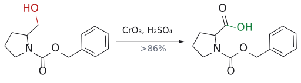

그림: 1차 alcohol(빨강)이 carboxylic acid(초록)까지 산화된다.

문제는 이 강산성이다. amine 같은 여러 작용기와 맞지 않아 보호가 필요하고, 산에 민감하거나 섬세한 기질에는 적합하지 않다.

그렇다면 섬세한 기질은 어떻게 할까? 슬라이드의 답은 "두 번에 나눠서 순하게"다. 먼저 순한 산화제로 aldehyde까지 산화하고, 그 다음 Pinnick으로 산까지 보낸다. Boger의 vancomycin 계열 합성(JACS 1999)이 예다.

$$
\begin{aligned}
& \mathrm{R}\ =\ \mathrm{CH_2OH} \\
& \xrightarrow{\text{Dess–Martin}} \mathrm{R}\ =\ \mathrm{CHO} \\
& \xrightarrow{\ \mathrm{NaClO_2}\ \mathstrut} \mathrm{R}\ =\ \mathrm{CO_2H}
\end{aligned}
$$

(2단계 합 77%)

요약 슬라이드는 이것을 "3 = 1 + 2"라고 적는다. $\begin{aligned} & \text{즉}\ (\text{1차 alcohol}) \\ & \longrightarrow \text{산)}\ =\ (\text{alcohol}) \\ & \longrightarrow \text{aldehyde)}\ +\ (\text{aldehyde}) \\ & \longrightarrow \text{산)이다.[8]} \end{aligned}$

(출처: L6c p.16–17)

### 3.3 한눈에 정리 (요약 슬라이드)

1. $\text{순한}\ \text{산화}(\text{alcohol}) \longrightarrow \text{aldehyde/ketone):}\ \mathrm{a}$. DMP, b. Swern(대량 규모), c. TPAP/NMO, d. MnO2(allyl/benzyl alcohol), e. TEMPO, f. Cu(I)–TEMPO 호기성 산화
2. $\text{aldehyde} \longrightarrow \text{carboxylic acid:}\ \mathrm{g}$. Pinnick(NaClO2) + 2-methyl-2-butene(또는 DMSO)
3. $\text{1차 alcohol} \longrightarrow \text{carboxylic acid: h}$. Jones(CrO3/H3O+), i. 3 = 1 + 2

(출처: L6c p.17)

## 4. benzyl·allyl C–H 결합의 산화

> 개념 문서: [KMnO4](../../wiki/시약/KMnO4.md), [SeO2](../../wiki/시약/SeO2.md)

지금까지는 이미 산소가 붙은 탄소를 더 산화했다. 그렇다면 산소가 없는 C–H도 산화할 수 있을까? benzyl 위치와 allyl 위치는 radical이나 cation이 생겼을 때 공명으로 안정화되는 특별한 자리라서 가능하다.

먼저 KMnO4는 매우 강한 산화제로, benzyl methyl group(toluene 유도체 Ar–CH3)를 carboxylic acid Ar–CO2H까지 산화한다. 슬라이드는 이것을 사카린 합성으로 보여 준다.

$$
\begin{aligned}
& \text{toluene} \xrightarrow{\ \mathrm{ClSO_2OH}\ \mathstrut} \text{o-toluenesulfonyl chloride} \\
& \qquad \xrightarrow{\ \mathrm{(NH_4)_2CO_3}\ \mathstrut} \text{o-toluenesulfonamide} \\
& \qquad \xrightarrow{\ \mathrm{KMnO_4}\ \mathstrut} \text{2-sulfamoylbenzoic acid}\ (\text{분리 안 함}) \\
& \qquad \xrightarrow{\mathrm{HCl}} \text{saccharin}
\end{aligned}
$$

(수율 o-toluenesulfonamide 89%, saccharin 58%)

그림: saccharin 합성 1단계: chlorosulfonation(초록 = $SO_2Cl$ ).

그림: 2단계: S–Cl(빨강)이 $NH_2$ (초록)로 치환된다.

그림: 3단계: methyl(빨강)이 $CO_2H$ (초록)로 산화된다.

그림: 4단계: N(파랑)이 $CO_2H$ 와 고리를 닫아 saccharin(초록 C–N)이 된다.

마지막 HCl 단계에서 CO2H와 SO2NH2가 분자 내에서 고리를 닫아 imide가 된다.

반면 SeO2는 allyl methyl group을 산화해 enal을 만든다. benzyl methyl group에는 듣지 않는다.

$$
\mathrm{RCH{=}C(CH_3)_2} \xrightarrow{\ \mathrm{SeO_2}\ \mathstrut} \mathrm{RCH{=}C(CH_3)CHO}
$$

슬라이드 그림에서는 R과 trans 위치에 있는 methyl이 CHO가 된다. 천연물 sirenin 합성에서는 `1. SeO2; 2. LiAlH4, AlCl3` 순서로, 말단 isopropyl리덴의 allyl methyl을 CHO로 바꾼 뒤 CHO와 CO2Me를 둘 다 CH2OH로 환원해 diol을 얻는다. SeO2 산화의 메커니즘은 페리고리 반응 단원에서 다룬다(→ 페리고리 반응 문서 참고).

(출처: L6c p.18)

---

## 5. alkene의 합성: 왜 "한 가지 이성질체"가 중요한가

> 개념 문서: [stereoselective alkene synthesis](../../wiki/개념/알켄의%20입체선택적%20합성.md), [stereospecificity and stereoselectivity](../../wiki/개념/입체특이성과%20입체선택성.md)

alkene은 산업적으로는 석유에서 대량으로 얻는다. 탄화수소를 cracking하면 작은 알케인과 alkene(예: 프로펜)이 생기고, butane을 촉매 dehydrogenation하면 1-butene, (E)-2-butene, (Z)-2-butene, 1,3-butadiene이 한꺼번에 나온다. ethylene은 중합해 polyethylene이 된다(L6c p.20). 그런데 이 방법들은 모두 혼합물을 준다. 혼합물이면 무엇이 문제일까?

슬라이드의 답은 이렇다. 기하이성질체는 물리·화학·생물학적 성질이 다른 별개의 화합물이다. 그런데 서로 비슷해서 크로마토그래피나 증류로 분리하기가 어렵다. 그러니 처음부터 하나만 만드는 것이 중요하다.

익숙한 E2 반응도 이 점에서는 불만족스럽다.

$$
\begin{aligned}
& \text{2-bromopentane} \xrightarrow{\mathrm{NaOEt}} (\mathit{E})\text{-pent-2-ene} + (\mathit{Z})\text{-pent-2-ene} \\
& \qquad + \text{pent-1-ene}
\end{aligned}
$$

((E)-pent-2-ene 51%; (Z)-pent-2-ene 18%; pent-1-ene 31%)

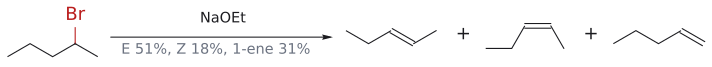

그림: E2. 왼쪽부터 (E)-pent-2-ene 51%, (Z) 18%, pent-1-ene 31%.

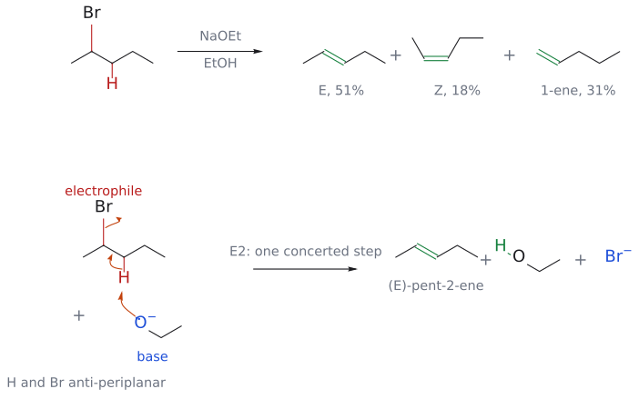

그림: 위 줄은 슬라이드의 전체 반응이고, 아래 줄은 (E)-pent-2-ene을 주는 E2 메커니즘이다. E2는 중간체가 없는 한 단계 협동 반응이라 괄호와 ⇌ 없이 한 번에 그렸다. $\mathrm{EtO^-}$(base, 파랑)의 비공유 전자쌍이 $\beta$-H(빨강)를 떼고, C–H 결합 전자는 C=C $\pi$ 결합(초록)이 되며, 동시에 C–Br 결합(빨강) 전자는 $\mathrm{Br^-}$로 떠난다. H와 Br이 anti-periplanar여야 한다. (Z)-alkene은 Et와 Me가 gauche인 형태에서, pent-1-ene은 CH$_3$의 H를 떼는 같은 메커니즘이다.

E2가 일어나려면 H와 Br이 anti-periplanar로 놓여야 한다. E-alkene으로 가는 형태 (i)에서는 Et와 Me가 서로 떨어져 있지만, Z-alkene으로 가는 형태 (ii)에서는 둘이 gauche로 붙어 있어 입체 장애 때문에 불리하다. 그래서 E가 더 많이 생기지만 Z와 말단 alkene도 상당량 섞인다. 즉 E2는 "선호"는 있어도 "통제"는 못 한다. 그래서 이 강의는 두 가지 통제 수단을 소개한다. I. alkyne을 입체선택적으로 환원하는 방법, II. Wittig 반응이다. 고리 닫힘 복분해와 교차 복분해는 이후 강의에서 다룬다(→ olefin 복분해 문서 참고).[9]

(출처: L6c p.19–22)

## 6. alkyne에서 alkene 만들기

> 개념 문서: [Lindlar reduction](../../wiki/반응/린들라%20환원.md), [Lindlar catalyst](../../wiki/시약/린들라%20촉매.md), [dissolving metal reduction](../../wiki/반응/용해%20금속%20환원.md)

### 6.1 Z-alkene: H2 + Lindlar catalyst

alkyne에 H2를 두 번 붙이면 알케인이 되는데, 한 번만 붙이고 멈출 수는 없을까? Lindlar 촉매가 그 답이다. Pd를 CaCO3 지지체에 올리고 Pb(OAc)2로 "피독(poisoning)"해 활성을 일부러 낮춘 촉매다. alkyne을 이 촉매에서 H2와 반응시키면 cis(Z)-alkene에서 멈춘다.[10]

$$
\begin{aligned}
& \mathrm{R{-}C{\equiv}C{-}}\text{(}\gamma\text{-lactone)} \\
& \qquad \xrightarrow{\ \mathrm{H_2},\ \text{Lindlar}\ \mathstrut} \text{Japanese beetle pheromone}\ (\mathrm{Z}\ \text{이성질체만})
\end{aligned}
$$

(수율 80–90%)

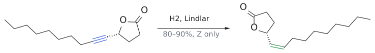

그림: C≡C(파랑)가 Z-alkene(초록)으로만 환원된다.

Z가 되는 이유는 H2가 금속 표면에 흡착된 상태에서 두 H가 alkyne의 같은 면으로 들어가기 때문이다(syn 첨가). 그리고 피독된 촉매는 생긴 alkene을 알케인까지 더 환원하지 못한다.

보충: 피독이 왜 꼭 필요할까? 보통의 Pd 촉매에서는 alkene이 alkyne 못지않게 빨리 수소화되므로, alkyne이 alkene이 되자마자 곧바로 알케인까지 가 버린다. 납이 촉매 활성을 낮춰 두 번째 단계를 느리게 만들어야 alkene에서 멈출 수 있다. 퀴놀린을 더 넣으면 선택성이 좋아지지만, 그래도 실제로는 과잉 환원이 일어나지 않는지 반응을 지켜봐야 한다. 또 슬라이드의 일본 풍뎅이 페로몬은 *Z* 이성질체만 활성이 있는데, 같은 *Z*-alkene을 비안정화 Wittig(7.4절)로 만들면 *E*가 10–15% 섞인다. Lindlar가 "순수한 *Z*"에서는 더 확실하다는 비교다. (보충 근거: Clayden p.537, p.682)

(출처: L6c p.23)

### 6.2 E-alkene: Na, NH3(l), t-BuOH

그렇다면 반대로 E-alkene은 어떻게 만들까? 이번에는 H2 대신 전자와 양성자를 하나씩 따로 넣는다. 액체 암모니아에 녹인 나트륨이 전자 공급원이고, t-BuOH가 양성자 공급원이다.

$$
\text{내부 알카인} \xrightarrow{\ \mathrm{Na},\ \mathrm{NH_3(l)},\ \mathrm{\mathit{t}\text{-}BuOH}\ \mathstrut} \text{E-알켄}\ (\text{모두}\ \mathrm{E})
$$

(수율 80–90%)

메커니즘은 단일전자 single electron transfer, SET이고, radical이 intermediate로 나온다.

1. $\text{Na가 전자 1개를 alkyne에 준다} \longrightarrow \text{radical anion}$.
2. t-BuOH가 음전하를 띤 탄소를 protonation한다 → 비닐 vinyl radical.
3. $\text{Na가 두 번째 전자를 준다} \longrightarrow \text{비닐}\ \text{anion}(\text{vinyl anion})$. 이때 anion은 R1과 R2가 서로 멀어지는 trans 배치를 취한다.
4. $\mathit{t}\text{-}\ \mathrm{BuOH}\text{가}\ \text{다시 protonation한다} \longrightarrow \text{E-alkene}$.

핵심은 3단계다. 두 H가 한꺼번에 들어오는 Lindlar와 달리, 여기서는 intermediate가 스스로 덜 붐비는 trans 모양을 고를 시간이 있다.

보충: 비닐 anion이 어떻게 모양을 "고를" 수 있을까? 음전하는 $\pi$ 오비탈이 아니라 sp2 오비탈에 들어 있는데, 비닐 anion은 기하학적으로 불안정해서 cis와 trans 사이를 쉽게 오간다. 그래서 양성자를 받기 전에 R1과 R2가 멀어지는 더 안정한 trans 배치로 모이고, 마지막 protonation이 그 기하를 고정한다. Na를 액체 NH3에 녹이면 용매화된 전자 때문에 짙은 파란색 용액이 되며, 이 전자가 alkyne의 $\pi^{*}$ 오비탈(LUMO)로 들어가는 것이 1단계다. (보충 근거: Clayden p.542–543, p.682)

검토 의견: 슬라이드는 양성자 공급원을 *t*-BuOH로 적는다. Clayden은 비닐 anion이 NH3에서도 양성자를 떼어 올 만큼 염기성이 커서 alkyne 환원에는 별도의 양성자 공급원이 꼭 필요하지는 않으며, *t*-BuOH는 흔히 덧붙이는 것이라고 설명한다. 시험에서는 슬라이드대로 *t*-BuOH를 쓰면 되지만, "NH3는 단지 용매일 뿐 절대 양성자를 주지 않는다"고 단정할 필요는 없다. (보충 근거: Clayden p.543, p.682)

(출처: L6c p.23–24)

### 6.3 예: Lindlar의 선택성 (Org. Lett. 2001)

$$
11 \xrightarrow[\mathrm{MeOH:CH_2Cl_2}]{\ \mathrm{H_2},\ \text{Lindlar cat}\ \mathstrut} 12
$$

(수율 100%)

생성물 12는 HO–CH(Me)–CH=CH(Z)–CH=CH(E)–(N-Boc-6-methylpiperidin-2-yl)이다. 이어서 12의 OH를 cinnamic acid로 ester화하면 5가 된다(83%, 축합 조건은 슬라이드에 없다). 출발물 11은 빈칸으로 남아 있는데, "Lindlar가 무엇을 바꾸고 무엇을 그대로 두는가"를 생각하면 거꾸로 추론할 수 있다(연습 문제 3).

(출처: L6c p.25)

## 7. Wittig reaction

> 개념 문서: [phosphorus ylide](../../wiki/시약/인%20일라이드.md), [SN2 reaction](../../wiki/반응/SN2%20반응.md), [Wittig reaction](../../wiki/반응/위티그%20반응.md), [oxaphosphetane](../../wiki/개념/옥사포스페테인.md), [HWE reaction](../../wiki/반응/HWE%20반응.md), [stereoselective alkene synthesis](../../wiki/개념/알켄의%20입체선택적%20합성.md)

### 7.1 일리드란 무엇이고 어떻게 만드나

Wittig 반응의 주인공은 인 phosphorus ylide다. 일리드는 이웃한 두 원자에 각각 +와 − 전하가 있는 1,2-쌍극자 화합물(1,2-dipolar compound)이다. Ph3P=CH2로 그리기도 하고, Ph3P+–CH2−로 그리기도 한다.

만드는 법은 두 단계다.

1. SN2: PPh3(nucleophile)가 1차 또는 2차 halide을 공격해 phosphonium염이 된다. 예:

   $$
\mathrm{PPh_3} + \mathrm{CH_3Br} \xrightarrow{\ \mathrm{S_{\mathrm{N}}2}\ \mathstrut} \mathrm{Ph_3P^+CH_3\thinspace Br^-}
$$

   (methyltriphenylphosphonium bromide)
2. deprotonation: P+ 옆의 C–H는 P+ 때문에 산성이 커져 있으므로 염기로 뗄 수 있다. 예:

   $$
\mathrm{Ph_3P^+CH_3\thinspace Br^-} \xrightarrow[\mathrm{THF}]{\mathrm{BuLi}} \mathrm{Ph_3P{=}CH_2}
$$

   (methylenetriphenylphosphorane)

그림: 1단계(SN2). $PPh_3$ 의 P(파랑, nucleophile) 비공유 전자쌍이 $CH_3\text{–}Br$ 의 탄소(빨강, electrophile)를 Br 반대편에서 공격하고, C–Br 결합(빨강) 전자는 Br⁻로 떠난다. 새로 생긴 P–C 결합은 초록이다. 이어서 BuLi가 P⁺ 옆 C–H를 떼어 내면 일리드 $Ph_3P=CH_2$ 가 된다(2단계는 그림 아래 문구로만 적었다).

일반화하면 $\begin{aligned} & \mathrm{PPh_3} + \mathrm{X{-}CH_2R} \\ & \longrightarrow \mathrm{Ph_3P^+{-}CH_2R} \\ & \xrightarrow[\mathrm{\mathit{t}\text{-}BuOK}]{\mathrm{PhLi},\ \mathrm{\mathit{n}\text{-}BuLi}} \mathrm{Ph_3P{=}CHR} \end{aligned}$이다. X는 I, Br, Cl, OTs이고, R은 alkyl뿐 아니라 Ar, vinyl, –C(=O)R1, –C(=O)OR1, –SO2R1, –CN일 수도 있다.

(출처: L6c p.26)

### 7.2 Wittig reaction: C=O를 C=C로 바꾼다

Wittig 반응은 carbonyl 화합물(aldehyde 또는 ketone)과 인 phosphorane이 만나 C=C가 생기는 반응이다. 쉽게 말해 carbonyl의 =O 자리에 일리드의 =CHR이 들어가고, 산소는 Ph3P=O로 빠져나간다.

$$
\begin{aligned}
& \text{cyclohexanone} + \mathrm{Ph_3P{=}CH_2} \longrightarrow \text{methylenecyclohexane} \\
& \qquad + \mathrm{Ph_3P{=}O}
\end{aligned}
$$

(수율 86%)

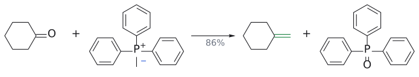

그림: ylide 탄소(파랑)와 C=O 탄소(빨강)가 새 C=C(초록)가 된다.

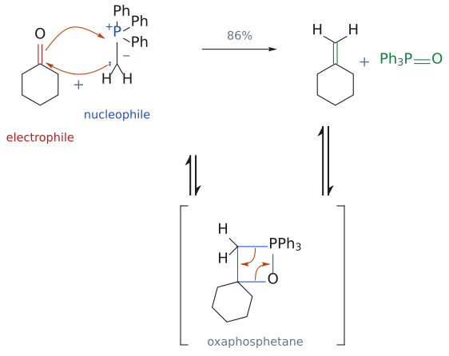

그림: 위 줄은 전체 반응, 아래 줄은 단계별 메커니즘이다(평형 화살표 ⇌로 연결). 1단계(위 줄의 화살표): ylide의 음전하 탄소(파랑, nucleophile)의 비공유 전자쌍이 C=O 탄소(빨강, electrophile)를 공격하고, C=O $\pi$ 결합 전자는 O로 가서 O가 $\mathrm{P^+}$와 결합해 4원 고리 oxaphosphetane이 생긴다. 2단계: C–P 결합 전자는 C–C 사이로 들어가 C=C $\pi$ 결합(초록)이 되고, C–O 결합 전자는 O–P 사이로 들어가 $\mathrm{P{=}O}$가 되어 methylenecyclohexane과 $\mathrm{Ph_3P{=}O}$가 떨어진다.

일리드는 미리 만들어서 넣어도 되고 반응계 in situ 만들어도 된다.[11]

산업적 예로는 BASF의 비타민 A 합성이 있다.

$$
\begin{aligned}
& \mathrm{C_{15}}\ \text{폴리엔 알릴}\ \text{포스포늄염}(\mathrm{{-}CH_2P^+Ph_3}) \\
& \qquad + \mathrm{OHC{-}C(CH_3){=}CH{-}CH_2OAc} \\
& \qquad \xrightarrow[\mathrm{MeOH}]{\mathrm{NaOMe}} \text{vitamin}\ \mathrm{A}\ \text{acetate}
\end{aligned}
$$

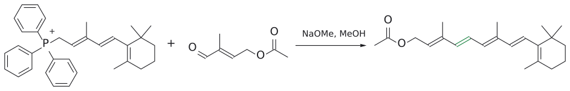

그림: Wittig으로 새 C=C(초록)를 만들어 vitamin A acetate를 얻는다.

새로 생긴 C=C는 그림에서 E로 그려져 있다. BuLi가 아니라 NaOMe로도 충분한 이유는, 이 phosphonium염이 폴리엔에 공액된 allyl 위치라 C–H의 산성도가 높기 때문이다.[12]

(출처: L6c p.27–28)

### 7.3 안정화 일리드와 비안정화 일리드

그런데 왜 어떤 일리드는 Na2CO3로도 만들어지고, 어떤 일리드는 BuLi가 필요할까? 음전하 옆에 무엇이 있느냐에 따라 일리드가 두 종류로 나뉘기 때문이다.

안정화 stabilized ylide는 음전하 옆에 C=O 같은 공액·anion 안정화 치환기가 있다. 음전하가 enolate처럼 산소로 퍼질 수 있으므로(R = H, OR, alkyl인 Ph3P=CH–C(O)R), 만들기 쉽다.

$$
\begin{aligned}
& \mathrm{BrCH_2CO_2R} \xrightarrow{\ \mathrm{PPh_3}\ \mathstrut} \mathrm{Ph_3P^+CH_2CO_2R} \\
& \qquad \xrightarrow{\ \mathrm{Na_2CO_3}\ \mathstrut} \mathrm{Ph_3P{=}CHCO_2R}
\end{aligned}
$$

그림: $PPh_3$ (파랑)가 C–Br(빨강)을 SN2로 치환한다.

그림: C=O가 음전하를 안정화하므로 약염기로도 ylide(초록)가 생긴다.

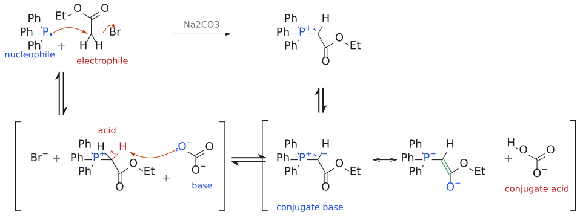

그림: 위 두 그림(SN2와 탈양성자화)을 하나로 합친 종합 메커니즘이다. 위 줄은 전체 반응이고, 아래 줄은 단계별 과정이다(평형 화살표 ⇌로 연결). 1단계(위 줄의 화살표): $\mathrm{PPh_3}$의 P(파랑, nucleophile)가 C–Br의 탄소(빨강, electrophile)를 Br 반대편에서 공격하고 $\mathrm{Br^-}$가 떠난다. 2단계: $\mathrm{CO_3^{2-}}$(base)가 P$^+$ 옆 C–H의 H(빨강, acid)를 떼고 C–H 결합 전자가 탄소의 비공유 전자쌍이 되어 ylide(conjugate base)와 $\mathrm{HCO_3^-}$(conjugate acid)가 된다. 음전하는 C=O 쪽으로 퍼질 수 있어(공명 ⟷) ylide가 안정화된다.

비안정화 unstabilized ylide는 그런 치환기가 없다(R = alkyl). 음전하가 탄소에 그대로 몰려 있으므로 강염기가 필요하다.

$$
\begin{aligned}
& \text{cyclopentyl bromide} + \mathrm{PPh_3} \\
& \qquad \xrightarrow{\ \mathrm{S_{\mathrm{N}}2}\ \mathstrut} \text{cyclopentyltriphenylphosphonium bromide} \\
& \qquad \xrightarrow{\mathrm{BuLi}} \text{cyclopentylidene–}\mathrm{PPh_3}
\end{aligned}
$$

그림: SN2로 phosphonium 염이 된다.

그림: 불안정화 ylide라서 BuLi 같은 강염기가 필요하다.

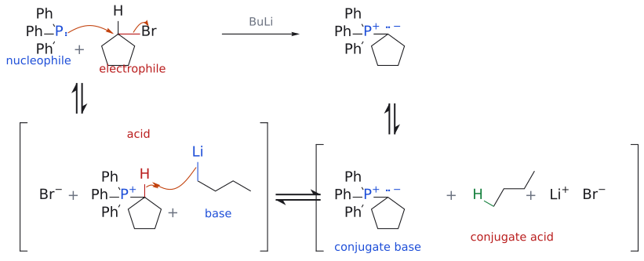

그림: 위 두 그림을 하나로 합친 종합 메커니즘이다. 1단계(위 줄의 화살표): $\mathrm{PPh_3}$(파랑, nucleophile)가 C–Br의 탄소(빨강, electrophile)를 공격해 SN2로 phosphonium bromide가 된다. 2단계: BuLi(base)의 C–Li 결합 전자가 P$^+$ 옆 C–H의 H(빨강, acid)를 떼어 butane(conjugate acid)이 되고, C–H 결합 전자는 탄소의 비공유 전자쌍이 되어 ylide(conjugate base)가 된다. 이 ylide는 음전하가 탄소에 그대로 몰려 있다. PPh$_3$ + bromomethane의 SN2(위의 첫 그림)도 같은 메커니즘이다.

슬라이드가 덧붙이듯 "ylid"와 "phosphorane"은 같은 화학종을 다르게 그린 것일 뿐이다. 이 구분이 중요한 이유는 다음 절에서 나온다. 두 일리드는 반대 기하의 alkene을 준다.

(출처: L6c p.29)

### 7.4 stereoselectivity: 안정화는 E, 비안정화는 Z

슬라이드가 주는 일반 규칙은 두 줄이다.

- 안정화 일리드 → E-선택적
  - $\begin{aligned} & \mathrm{Ph_3P{=}CHCO_2Et} + \mathrm{OHC{-}CH{=}CH{-}}\text{(acetonide)} \\ & \longrightarrow \mathrm{EtO_2C{-}CH{=}CH{-}CH{=}CH{-}}\text{(acetonide)}\ (\text{모두}\ \mathrm{E}) \end{aligned}$ (수율 96%)
  - 빈칸 예:

    $$
[?] + \mathrm{OHC{-}}\text{(epoxide)}\mathrm{{-}THF}\ \text{유도체} \longrightarrow \mathrm{OHC{-}CH{=}CH{-}}\text{(epoxide)}\ldots\ (\text{E-선택적})
$$

    (연습 문제 4)
- 비안정화 일리드 → Z-선택적
  - $\begin{aligned} & \mathrm{(CH_3)_2CH(CH_2)_4{-}CH{=}PPh_3}\ \text{계열 알킬 일리드} + \mathrm{\mathit{n}\text{-}C_{13}H_{27}CHO} \\ & \longrightarrow \text{Z-알켄}\ (\text{모두}\ \mathrm{Z}) \end{aligned}$ (수율 91%)
  - $\begin{aligned} & \text{dihydropyran}\ \mathrm{CH_2{-}}\text{일리드} \\ &  + \text{acetonide로 보호된 당 aldehyde} \\ & \longrightarrow \text{Z만 생긴다} \end{aligned}$.

(출처: L6c p.30–31)

### 7.5 메커니즘: 4원 고리를 거쳐 P=O로

일리드는 nucleophile다. 그래서 반응은 다음과 같이 진행된다.

1. 일리드 nucleophile이 aldehyde의 carbonyl electrophile을 공격하고, carbonyl O는 P+와 결합한다.
2. 그 결과 4원 고리 oxaphosphetane intermediate가 생긴다.
3. oxaphosphetane이 제거 반응으로 분해되면서 C–P와 C–O 결합이 끊어지고, C=C와 P=O가 생긴다.

$$
\begin{aligned}
& \text{cyclopentylidene–}\mathrm{PPh_3} + \mathrm{PhCHO} \\
& \qquad \longrightarrow \text{benzylidenecyclopentane} + \mathrm{Ph_3P{=}O}
\end{aligned}
$$

(수율 65%)

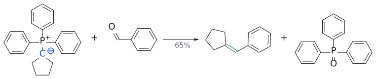

그림: 새 C=C(초록).

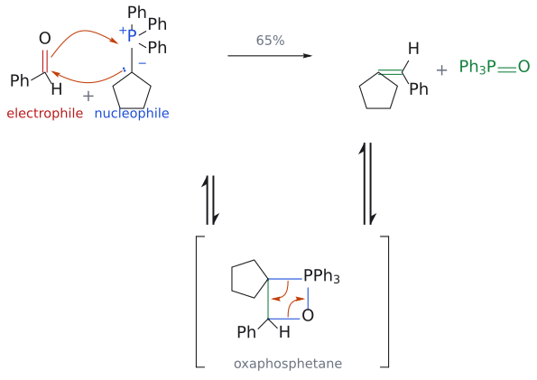

그림: 위 단계 1–3을 하나로 합친 종합 메커니즘이다(기존 wittig_step1·step2 그림을 이 그림에 합쳤다). 위 줄은 전체 반응이고, 아래 줄은 단계별 과정이다(평형 화살표 ⇌로 연결). 1–2단계: 일리드의 음전하 탄소(파랑, nucleophile) 전자쌍이 PhCHO의 carbonyl 탄소(빨강, electrophile)를 공격하고, C=O $\pi$ 결합 전자는 O로 가서 O가 $\mathrm{P^+}$와 결합한다. 그 결과 새 C–C와 P–O 결합(초록)을 가진 4원 고리 oxaphosphetane이 생긴다. 3단계: C–P 결합 전자는 C–C 사이로 들어가 C=C $\pi$ 결합이 되고, C–O 결합 전자는 O–P 사이로 들어가 P=O가 된다. 생기는 강한 P=O 결합(초록)이 반응의 구동력이며, 생성물은 benzylidenecyclopentane(65%)과 $\mathrm{Ph_3P{=}O}$다.

그렇다면 이 반응은 왜 이렇게 잘 진행될까? P=O 결합이 매우 강해서 이것이 생기는 것 자체가 반응을 앞으로 밀어 주는 구동력이 되기 때문이다.

(출처: L6c p.33)

### 7.6 비안정화 일리드는 왜 Z를 주나

슬라이드 스스로 "완전히 밝혀지지는 않았지만 가능한 설명"이라고 단서를 단다. 설명의 흐름은 이렇다.

1. 비안정화 일리드와 RCHO가 서로 수직으로 접근한다.
2. 큰 치환기들(일리드의 R, aldehyde의 Ph/R2)이 서로, 그리고 PPh3와 멀어지는 방향을 택한다.
3. 고리가 평면으로 닫히면 두 치환기가 같은 쪽(syn)에 놓인다. 즉 syn oxaphosphetane이 입체선택적으로 생긴다.
4. oxaphosphetane 분해는 입체특이적(syn 제거)이므로 syn oxaphosphetane은 Z-alkene이 된다.

즉 Z를 결정하는 것은 3단계의 "어느 oxaphosphetane이 먼저 생기느냐"이고, 4단계는 그 정보를 그대로 alkene에 옮길 뿐이다.[13]

보충: 두 종류의 일리드를 한 합성 안에서 차례로 써서 기하를 따로따로 통제할 수도 있다. 누에나방 페로몬 봄비콜(bombykol, *E*,*Z*-diene)의 합성이 교과서 예다. 먼저 안정화 일리드(Ph3P=CHCHO)로 *E*-C=C를 만들고(96:4 *E*:*Z*), 생긴 aldehyde에 alkyl 일리드를 붙여 *Z*-C=C를 만든 뒤, ester를 LiAlH4로 환원해 끝낸다. "안정화 → *E*, 비안정화 → *Z*" 규칙을 한 분자에서 확인할 수 있는 좋은 연습이다. (보충 근거: Clayden p.692)

(출처: L6c p.34–35)

### 7.7 Horner–Wadsworth–Emmons (HWE) 반응

안정화 일리드로 E-alkene을 만들 수 있다면, 더 좋은 방법이 따로 필요할까? 슬라이드의 답은 HWE 반응이다. 1953년 Wittig이 phosphonium 일리드로 olefin 합성을 보고했고, 1958년 Horner가 phosphonium 대신 phosphonate로 안정화된 phosphonate-stabilized carbanion을 쓰는 변형을 발표했다. 이후 Wadsworth와 Emmons가 적용 범위를 넓혔다.[14]

$$
\begin{aligned}
& \mathrm{(EtO)_2P(O)CH_2C(O)R} \\
& \qquad \xrightarrow{\text{염기:}\ \mathrm{EtO^-}\ \text{또는}\ \mathrm{NaH}} \text{포스포네이트 카바니온}
\end{aligned}
$$

(P=C, 탄소 anion, enolate로 쓰는 공명 구조)

생성물은 이치환 alkene에서 E-선택성이 높다. ketone과도 잘 반응한다.[15]

보충: 그럼 안정화 Wittig 일리드는 왜 부족할까? 이름 그대로 너무 안정하기 때문이다. Ph3P=CHCHO 같은 일리드는 물에서 재결정할 수 있을 정도이고, 원료 phosphonium염보다도 안정하다. 안정한 만큼 반응성이 낮아 ketone처럼 덜 친전자적인 상대와는 잘 반응하지 않는다. 그래서 같은 E-선택적 olefination을 하되, 더 반응성 있는 phosphonate carbanion으로 바꾼 것이 HWE다. (보충 근거: Clayden p.692)

$$
\begin{aligned}
& \text{2,2-dimethylcyclopentanone} + \mathrm{(EtO)_2P(O)CH_2CO_2Et} \\
& \qquad \xrightarrow{\mathrm{NaH}} \text{ethyl (2,2-dimethylcyclopentylidene)acetate}
\end{aligned}
$$

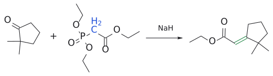

그림: phosphonate anion(파랑)이 C=O(빨강)와 새 C=C(초록)를 만든다.

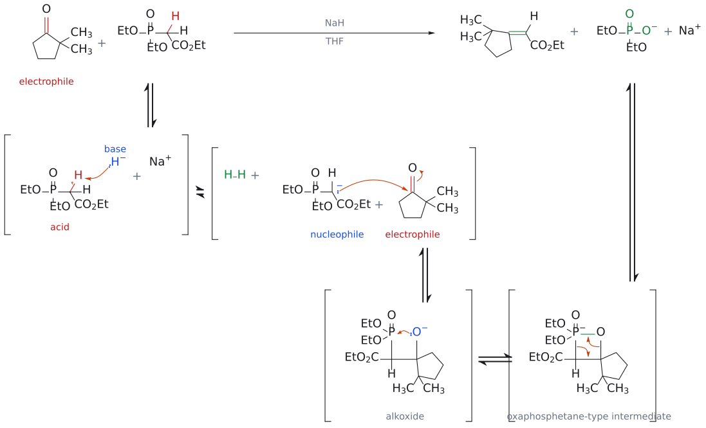

그림: 보충: 위 줄은 전체 반응이고, 아래 두 줄은 단계별 메커니즘이다(평형 화살표 ⇌로 연결, 단계 구성은 wiki의 HWE 문서가 인용한 L8 슬라이드의 메커니즘을 따랐다). 1단계: $\mathrm{NaH}$의 $\mathrm{H^-}$(base)가 P와 C=O 사이 CH$_2$의 H(빨강, acid)를 떼어 phosphonate carbanion과 $\mathrm{H_2}$가 된다. 2단계: carbanion(파랑, nucleophile)이 ketone의 C=O 탄소(빨강, electrophile)를 공격해 alkoxide가 된다. 3단계: alkoxide의 O$^-$가 P를 공격해 4원 고리 oxaphosphetane형 intermediate가 된다. 4단계: C–P와 C–O 결합이 끊어지며 C=C(초록)와 $(\mathrm{EtO})_2\mathrm{PO_2^-}$가 생긴다. 4단계의 화살표는 그림 맨 아래 줄 오른쪽 intermediate에 그렸고, 맨 위 줄의 생성물 옆 $\mathrm{Na^+}$는 반대 이온이다.

그림에서 CO2Et는 gem-dimethyl 반대쪽으로 그려져 있다. 실험실에서 HWE를 좋아하는 이유 하나는 부산물인 diethyl phosphate 염이 물에 녹아, 분리가 까다로운 Ph3P=O보다 훨씬 쉽게 씻겨 나간다는 점이다. 슬라이드에는 빈칸이 있는 HWE 예가 두 개 더 있다. 하나는 KHMDS를 쓴 분자 간 반응이고, 다른 하나는 NaH/THF를 쓴 분자 내 반응이다(연습 문제 6).

(출처: L6c p.36–37)

### 7.8 요약

- $\text{alkyne} \longrightarrow \text{alkene: Z는}\ \mathrm{H_2} + \text{Lindlar catalyst},\ \text{E는}\ \mathrm{Na/NH_3}$.
- Wittig: Z는 비안정화 일리드, E는 안정화 일리드 또는 HWE reaction.

(출처: L6c p.38)

---

## 흔한 오해

- "MnO2는 환원제"라고 생각하기 쉽지만(원본 슬라이드 p.10의 오타), 사실은 매우 순한 산화제다. 그것도 allyl·benzyl alcohol만 산화한다. 수정본은 "oxidizing reagent"로 고쳐 놓았다.
- "산화제가 세면 3차 alcohol도 결국 산화된다"고 생각하기 쉽지만, 사실 이 강의의 메커니즘에서는 카비놀 탄소의 $\alpha$-H를 떼어야 C=O가 생긴다. 3차 alcohol은 그 H가 없어서 반응하지 않는다.
- "TEMPO radical이 alcohol을 직접 산화한다"고 생각하기 쉽지만, 사실 실제 산화제는 TEMPO가 산화되어 생긴 nitro소늄(oxoammonium) cation N+=O다. TEMPO는 촉매이고, NaOCl(또는 Stahl 계의 O2)이 최종 산화제다.
- "Pinnick의 2-methyl-2-butene은 반응물"이라고 생각하기 쉽지만, 사실 부산물 HOCl을 잡는 제거제다. HOCl이 붙을 때 OH는 3차 탄소, Cl은 2차 탄소로 간다. 방향을 반대로 쓰기 쉬우니 주의한다.
- "Swern은 Cl2가 산화한다"고 생각하기 쉽지만, 사실 활성종은 DMSO와 (COCl)2에서 생긴 chlorosulfonium(Me2S+–Cl)이다. 산소는 결국 Me2S가 되어 빠져나간다.
- "Jones도 aldehyde에서 멈춘다"고 생각하기 쉽지만, 사실 1차 alcohol은 carboxylic acid까지 간다. aldehyde가 목표라면 DMP, Swern, TPAP, MnO2, TEMPO, Stahl을 써야 한다.
- "KMnO4와 SeO2는 둘 다 benzyl/allyl methyl을 산화한다"고 생각하기 쉽지만, 사실 KMnO4는 benzyl methyl을 CO2H로, SeO2는 allyl methyl을 CHO(엔알)로 바꾸며, SeO2는 benzyl methyl에는 듣지 않는다.
- "Lindlar 촉매는 alkene을 환원한다"고 생각하기 쉽지만(원본 p.23의 "Alkenes"는 오타), 사실 alkyne을 Z-alkene까지만 환원하고 거기서 멈추게 하는 촉매다.
- "Wittig은 항상 Z를 준다"고 생각하기 쉽지만, 사실 alkyl 일리드만 Z-선택적이다. 안정화(C=O 공액) 일리드와 HWE는 E-선택적이다.
- "Wittig 역합성은 아무 쪽이나 일리드로 잡으면 된다"고 생각하기 쉽지만, 사실 일리드 쪽은 SN2가 잘 되는 1차 halide에서 오는 편이 유리하다.

---

## 반응 정리표

| 반응 | 시약/조건 | 생성물 | regioselectivity | 입체화학 | 비고 |
|---|---|---|---|---|---|
| ester 부분 환원 | DIBAL-H, hexane, −70 °C; H3O+ | aldehyde | – | – | tetrahedral intermediate가 저온에서 안정함 (p.2) |
| DMP oxidation | Dess–Martin periodinane, CH2Cl2 | $\begin{aligned} & \mathrm{1^\circ } \\ & \longrightarrow \mathrm{RCHO},\ \mathrm{2^\circ } \\ & \longrightarrow \text{ketone} \end{aligned}$ | – | C=C 기하 유지 | I(V)→I(III), 중성·온화 (p.7) |
| Swern oxidation | (COCl)2, DMSO, DCM, −78 °C; NEt3 | $\begin{aligned} & \mathrm{1^\circ } \\ & \longrightarrow \mathrm{RCHO},\ \mathrm{2^\circ } \\ & \longrightarrow \text{ketone} \end{aligned}$ | 3° OH 영향 없음 | – | 부산물 Me2S, CO, CO2, HCl (p.8–9) |
| Ley–Griffith | TPAP(촉매), NMO(최종 산화제) | aldehyde/ketone | – | – | Ru(VII)/Ru(V) 순환 (p.10) |
| MnO2 산화 | MnO2 | allyl/benzyl C=O | allyl·benzyl OH만 산화 | C=C 유지 | 일반 2° OH는 남음 (p.10) |
| TEMPO oxidation | TEMPO (0.01 equiv), NaOCl, KBr (0.1 equiv), NaHCO3, CH2Cl2–H2O, 0 °C | RCHO | 1° alcohol | – | 활성종은 nitro소늄 (p.11–12) |
| Stahl oxidation | (bpy)CuI 5%, TEMPO 5%, NMI 10%, air/O2, MeCN, rt | RCHO | 1° alcohol, C=C 무관 | – | O2가 최종 산화제 (p.13) |
| Pinnick oxidation | NaClO2, NaH2PO4, 2-methyl-2-butene(또는 DMSO) | RCO2H | – | – | HOCl 제거제 (p.15) |
| HOCl 제거 | 2-methyl-2-butene + HOCl | 3-chloro-2-methylbutan-2-ol | OH는 3차 C, Cl은 2차 C | – | Markovnikov형 (p.15) |
| Jones oxidation | CrO3, H2SO4 (H2CrO4) | 1°→RCO2H | – | – | 강산성, 민감한 기질에 부적합 (p.16) |
| 2단계 산화 | DMP → NaClO2 | RCO2H | – | – | "3 = 1 + 2" (p.16–17) |
| benzyl 산화 | KMnO4 | ArCO2H | benzyl CH3 | – | 사카린 합성 (p.18) |
| allyl 산화 | SeO2 | R–CH=C(CH3)–CHO | allyl CH3 | 그림상 R과 trans인 CH3가 산화됨 | benzyl CH3에는 안 됨 (p.18) |
| Lindlar 수소화 | H2, Pd/CaCO3/Pb(OAc)2 | Z-alkene | – | syn 첨가 → Z | 과잉 환원 없음 (p.23) |
| 용해 금속 환원 | Na, NH3(l), t-BuOH | E-alkene | – | trans 비닐 anion → E | SET (p.23–24) |
| 일리드 생성 | PPh3 + RCH2X (SN2); BuLi/PhLi/t-BuOK (안정화형은 Na2CO3) | Ph3P=CHR | 1°/2° halide | – | (p.26, 29) |
| Wittig (비안정화) | Ph3P=CHR (R = alkyl) + R'CHO | R–CH=CH–R' | C=O 자리에 C=C | Z-선택적 | syn oxaphosphetane (p.31, 34) |
| Wittig (안정화) | Ph3P=CHCO2Et, Ph3P=CHCHO 등 + RCHO | $\alpha,\beta$-unsaturated carbonyl | C=O 자리에 C=C | E-선택적 | (p.30) |
| HWE | (EtO)2P(O)CH2EWG, NaH/EtO−/KHMDS + aldehyde·ketone | alkene | C=O 자리에 C=C | E-선택적(이치환) | 수용성 phosphate 부산물 (p.36–37) |

(쪽 번호는 모두 L6c 기준)

---

## 연습 문제

1. (L6c p.2) RCO2Et를 RCHO로 바꾸는 두 가지 방법을 쓰고, 각 방법에서 과잉 환원이나 과잉 산화를 피하는 요점을 설명하라.
2. (L6c p.5, p.7, p.10) 멘톨 합성 경로의 "geraniol → geranial" 단계에 쓸 수 있는 시약 두 가지를 쓰고, Jones 시약이 부적합한 이유를 말하라.
3. (L6c p.25) H2/Lindlar 촉매로 12(HO–CH(Me)–CH=CH(Z)–CH=CH(E)–piperidine)를 100% 수율로 준 출발물 11의 구조를 제시하라.
4. (L6c p.30) 빈칸:

   $$
[?] + \mathrm{OHC{-}}\text{(epoxide)}\ldots \longrightarrow \mathrm{OHC{-}CH{=}CH{-}}\text{(epoxide)}\ldots(\text{E-선택적})
$$

   빈칸 시약은 무엇이며 왜 E가 생기는가?
5. (L6c p.32) 다음 표적 분자를 Wittig 반응으로 만들 때 필요한 기질(carbonyl + 일리드)을 제안하라. (a) (CH3)2C=CH–CH2CH3 (2-methylpent-2-ene) (b) 3-methylenecyclohexene
6. (L6c p.37) 빈칸을 채워라. ${\small \begin{aligned} & \mathrm{(a)\,CH_3C({=}O)CH_2CH_2CH(OTBS)CH(OTBS)CH_2OTBS} + \mathrm{[?]} \\ & \xrightarrow{\mathrm{KHMDS}} \mathrm{CH_3CH{=}C(CH_3){-}CH{=}CH{-}CH{=}C(CH_3){-}CH_2CH_2\ldots }(\text{새}\ \mathrm{C{=}C}\text{는}\ \text{ketone 탄소 자리}) \end{aligned}}$. $\begin{aligned} & \mathrm{(b)}\ \beta\ \text{-락탐}\ \mathrm{N{-}CH(P(O)(OEt)_2)CO_2t{-}Bu}\text{와}\ \text{측쇄}\  \\ & \mathrm{CH_2CH_2C({=}O)CH_2OR}\text{을}\ \text{가진 기질} \\ & \xrightarrow[\mathrm{THF}]{\mathrm{NaH},\ 85\%} \mathrm{[?]} \end{aligned}$
7. (L6c p.15) Pinnick 산화에 2-methyl-2-butene을 넣는 이유와, 이것이 HOCl과 반응해 생기는 생성물(regioselectivity 포함)을 쓰라.
8. (L6c p.23–24) 다음 두 반응의 생성물 입체화학을 쓰고, 두 번째 반응의 메커니즘을 4단계로 서술하라. (a) R1–C≡C–R2 + H2/Lindlar (b) R1–C≡C–R2 + Na, NH3(l), t-BuOH

---

## 정답 및 해설

1. (i) DIBAL-H, hexane, −70 °C 후 H3O+. 수소화물이 전달되어 생긴 tetrahedral intermediate가 저온에서 안정해, 후처리 전까지 aldehyde가 생기지 않으므로 두 번 환원되지 않는다. 온도 유지가 핵심이다. (ii) LiAlH4로 1차 alcohol까지 완전히 환원한 뒤, 순한 산화제(DMP, Swern, TEMPO 등)로 aldehyde에서 멈춘다. Jones처럼 산까지 가는 시약은 쓰지 않는다. (L6c p.2, p.17)

2. DMP(CH2Cl2; 슬라이드 예 84%)가 대표적이다. geraniol은 allyl 1차 alcohol이므로 MnO2도 맞는 답이다. 그밖에 Swern, TEMPO/NaOCl, Cu/TEMPO도 가능하다. Jones(CrO3/H2SO4)는 1차 alcohol을 carboxylic acid까지 산화하고 강산성이라, geranial에서 멈추지 않으며 민감한 기질에도 부적합하다. (L6c p.7, p.10, p.16)

3. 11은 Z로 바뀔 자리가 삼중결합인 enyne이다: HO–CH(Me)–C≡C–CH=CH(E)–(N-Boc-6-methylpiperidin-2-yl), 입체중심은 12와 같다. Lindlar 촉매는 C≡C만 syn으로 환원해 Z-C=C를 만들고, 이미 있는 E-C=C는 건드리지 않는다. 그래서 (Z,E)-diene 12가 생긴다. (L6c p.23, p.25)

4. 빈칸은 Ph3P=CH–CHO(formylmethylene triphenylphosphorane), 즉 aldehyde로 안정화된 일리드다. 일리드 탄소가 기질 aldehyde와 Wittig 반응을 해 OHC–CH=CH–R을 만든다. C=O에 공액된 안정화 일리드이므로 E-선택적이다(각주 [13]의 통상적 설명 참고). (L6c p.29–30)

5. (a) C2=C3를 끊는다. 가장 좋은 조합은 acetone (CH3)2C=O + Ph3P=CH–CH2CH3(propylidene 일리드: 1-bromopropane + PPh3로 SN2한 뒤 BuLi로 deprotonation)이다. 대안은 propanal CH3CH2CHO + Ph3P=C(CH3)2인데, 이 일리드는 2-bromopropane(2차 halide)에서 와야 해서 SN2가 더 느리다. C2에 같은 CH3가 두 개 있으므로 E/Z 문제는 없다. (b) 엑소 C=CH2를 끊는다: cyclohex-2-en-1-one + Ph3P=CH2(CH3Br + PPh3, 그 다음 BuLi). 고리 안의 C=C는 그대로 둔다. 반대 조합(고리 일리드 + HCHO)은 비현실적이다. (L6c p.26–27, p.32)

6. (a) 빈칸은 다이에닐 phosphonate (EtO)2P(O)–CH2–CH=CH–C(CH3)=CH–CH3((2E,4E)-4-methylhexa-2,4-dien-1-yl diethyl phosphonate)다. KHMDS가 P 옆 CH2를 deprotonate하고, 생긴 carbanion이 methyl ketone과 HWE 반응을 해 새 삼치환 C=C(그림의 빨간 결합)를 만든다. 슬라이드의 "dr = 7:1"은 새 C=C의 기하이성질체 비로 해석된다. (b) 분자 내 HWE다. P와 CO2t-Bu 사이의 C–H를 NaH가 떼어 carbanion을 만들고, 이것이 같은 분자의 ketone을 공격한다. 고리 원자는 N, $\beta$-락탐 C4, CH2, CH2, ketone C, carbanion C이므로 6원 고리가 닫힌다. 생성물은 1-카바세펨(1-carbacephem) 골격이다: tert-butyl 7-phthalimido-3-(ROCH2)-8-oxo-1-azabicyclo[4.2.0]oct-2-ene-2-carboxylate. C2=C3 이중결합에서 C2에는 CO2t-Bu, C3에는 CH2OR이 붙고, $\beta$-락탐 입체화학은 유지된다. 부산물은 (EtO)2PO2− Na+다. (L6c p.36–37)

7. NaClO2가 aldehyde를 산화하면 HOCl이 부산물로 생기는데, 이것이 부반응을 일으키므로 제거해야 한다. 제거 반응은 $\mathrm{(CH_3)_2C{=}CHCH_3} + \mathrm{HOCl} \longrightarrow \mathrm{(CH_3)_2C(OH){-}CHCl{-}CH_3}$이다. Cl이 electrophile로 C=C에 붙고, 물(OH)이 더 치환된 3차 탄소를 공격한다(Markovnikov형). 대신 DMSO를 써도 된다. (L6c p.15)

8. (a) Z(cis)-alkene. 촉매 표면에서 일어나는 syn 첨가 때문이다. (b) E(trans)-alkene. 메커니즘: ① Na가 전자 1개를 줌 → radical anion. ② t-BuOH가 protonation → 비닐 radical. ③ Na가 두 번째 전자를 줌 → 비닐 anion, R1/R2가 trans 배치를 취함. ④ t-BuOH가 protonation → E-alkene. (L6c p.23–24)

---

## 각주

[1] 수정본에서는 원본 p.34(Stereochemistry 슬라이드)가 p.34와 p.35에 똑같이 두 번 들어가 있다. 그래서 원본 p.35 이후 슬라이드는 수정본에서 번호가 하나씩 밀린다(원본 p.35 = L6c p.36).

[2] geranial과 neral은 각각 citral의 E-, Z-이성질체다. 두 이성질체에 서로 거울상인 Chiraphos 리간드를 쓰면 둘 다 같은 (+)-citronellal로 수렴한다는 점이 슬라이드의 포인트다. Al catalyst 단계는 Lewis acid이 촉매하는 분자 내 고리화(carbonyl-엔 반응)로 6원 고리를 만들고, 마지막 Ni/H2 단계는 isopropenyl group의 C=C를 수소화한다(표준 교재 수준의 보충). (보충 근거: Clayden p.896)

[3] Swern 메커니즘은 슬라이드에 없으며, Clayden 등 표준 교재의 설명에 따라 보충한 것이다. (보충 근거: Clayden p.667–668)

[4] 원본 슬라이드 p.10에는 "very mild reducing reagent"라고 잘못 적혀 있었고, 수정본에서 "oxidizing reagent"로 고쳐졌다.

[5] 슬라이드는 "nitrosonium cation"이라고 부르지만, 정식으로는 oxoammonium 이온이라고 부르는 경우가 많다. 슬라이드의 TEMPO 이름 "tetramethylpiperidine N-oxide"도 정확히는 2,2,6,6-tetramethylpiperidin-1-oxyl(nitroxyl radical)이다.

[6] 보충: Stahl 계는 1차 alcohol을 2차 alcohol보다 훨씬 빠르게 산화하는 것으로 알려져 있다.
[7] 보충: Pinnick의 표준 메커니즘에서는 아염소산 HClO2가 aldehyde C=O에 첨가한 뒤, 고리형 transition state로 분해되면서 RCO2H와 HOCl이 생긴다. 슬라이드에는 HOCl이 부산물이라는 사실만 나온다.

[8] 보충: Jones 조건은 수용성 산성이라 aldehyde가 gem-diol이 되어 다시 산화되므로 산까지 간다. 2차 alcohol은 ketone에서 멈춘다. Cr(VI)는 독성이 있다. (보충 근거: Clayden p.545)

[9] 슬라이드의 읽을거리: Clayden 2판 27장(p. 677–693, alkene의 입체선택적 합성), McMurry 10판 19.11(Wittig)과 17.6(alcohol의 반응).

[10] 원본 슬라이드 p.23에는 "Alkenes react with H2…"라고 적혀 있었고, 수정본에서 "Alkynes"로 고쳐졌다.

[11] Georg Wittig(1897–1987)는 독일의 화학자로, 1979년 H. C. Brown과 노벨 화학상을 공동 수상했다. 슬라이드 p.27은 Wittig 반응의 발견을 "1950년"이라고 적었지만, p.36은 "1953년 Wittig이 보고"라고 적어 슬라이드 안에서 연도가 서로 다르다.

[12] 보충 설명이다. 공액된 allyl phosphonium염은 단순 alkyl phosphonium염보다 산성이 크다.

[13] 보충(교재 수준의 통상적 설명): 안정화 일리드의 E-선택성은 oxaphosphetane 형성이 가역적이어서, 더 안정한 anti oxaphosphetane(→ E)으로 평형이 이동하기 때문이라고 설명해 왔다. 그러나 Clayden은 이것을 예전 설명으로 소개하고, anti oxaphosphetane도 kinetic 지배 아래 선택적으로 생긴다는 해석이 유력하다고 적는다(보충 근거: Clayden p.692). 다만 슬라이드 자체가 Wittig의 입체화학을 "완전히 밝혀지지 않았다"고 하므로, 시험에서는 슬라이드의 Z 설명(수직 접근 → syn oxaphosphetane)을 우선해서 쓴다.

[14] 보충: Wadsworth와 Emmons의 논문은 1961년에 나왔다.

[15] 보충: phosphonate carbanion은 안정화 phosphonium 일리드보다 친핵성이 커서 ketone과도 잘 반응한다(Clayden 27장). (보충 근거: Clayden p.628, p.692)
