# L7. 엔올레이트와 α-알킬화 반응 (Enolates and α-alkylation reactions)

> **통독본**: 2026-10-12 재구성 직전의 강의별 전체 노트(교과서 보강 포함)를 그대로 보존한 사본이다. 강의 흐름대로 한 번에 읽을 때 쓴다. 이후의 수정과 보충은 개념 문서에만 반영되므로, **최신 내용은 개념 문서**가 기준이다. 뼈대 노트: [L7 뼈대](../L07_Enolate_Alkylation.md) · [위키 대문](../../wiki/위키%20대문.md)

> **관련 위키 문서** ([위키 대문](../../wiki/위키%20대문.md))
> - 반응: [SN2 reaction](../../wiki/반응/SN2%20반응.md), [malonic ester synthesis](../../wiki/반응/말론산%20에스터%20합성.md), [acetoacetic ester synthesis](../../wiki/반응/아세토아세트산%20에스터%20합성.md), [ester hydrolysis](../../wiki/반응/에스터%20가수분해.md), [enolate alkylation](../../wiki/반응/엔올레이트%20알킬화.md), [keto-enol tautomerization](../../wiki/반응/케토-엔올%20토토머화.md), [decarboxylation](../../wiki/반응/탈카복실화.md)
> - 시약: [LDA](../../wiki/시약/LDA.md), [LiBH4](../../wiki/시약/LiBH4.md), [alkoxide base](../../wiki/시약/알콕사이드%20염기.md), [Evans oxazolidinone](../../wiki/시약/에반스%20옥사졸리디논.md), [phosphorus ylide](../../wiki/시약/인%20일라이드.md)
> - 개념: [alpha-hydrogen acidity](../../wiki/개념/α-수소의%20산도.md), [kinetic vs thermodynamic enolate](../../wiki/개념/속도론적%20엔올레이트와%20열역학적%20엔올레이트.md), [kinetic vs thermodynamic control](../../wiki/개념/속도론적%20지배와%20열역학적%20지배.md), [enol and enolate](../../wiki/개념/엔올과%20엔올레이트.md), [imine](../../wiki/개념/이민.md), [electrophile and nucleophile](../../wiki/개념/친전자체와%20친핵체.md), [chiral auxiliary](../../wiki/개념/키랄%20보조기.md), [hard and soft acids and bases (HSAB)](../../wiki/개념/하드-소프트%20산염기.md)

> CM3121 Advanced Organic Chemistry, Dr. Zhu Ye. 참고 교재: Clayden 2판 25장, McMurry 10판 22장.
> 출처 표기의 p.는 PDF 페이지 번호다. 슬라이드 우측 하단에 인쇄된 번호는 PDF 페이지 번호보다 1 크다(예: PDF p.10 = 슬라이드 번호 11).

## 개요

지금까지 carbonyl 화합물은 주로 nucleophile에게 공격당하는 쪽, 즉 electrophile였다. 그런데 carbonyl 옆 탄소(α-탄소)의 수소를 염기로 떼어 내면 이야기가 뒤집힌다. 이렇게 생긴 enolate는 전자가 풍부한 탄소를 가진 훌륭한 nucleophile이 되어, alkyl halide과 SN2 반응을 하며 새 C-C 결합을 만든다. 이것이 α-alkylation(α-alkylation)이고, 탄소 골격을 늘리는 가장 기본적인 도구 중 하나다. 이 강의는 어떤 염기로 어느 쪽 enolate를 kinetic vs thermodynamic, 1,3-dicarbonyl 화합물을 쓰는 고전적 합성법(acetoacetic ester·malonic ester 합성), enolate가 C와 O 중 어디로 반응하는지, 그리고 키랄 보조기로 한쪽 거울상만 골라 만드는 비대칭 alkylation까지 다룬다. 앞 강의의 Wittig/HWE 반응에서 본 안정화 ylide도 사실은 enolate의 친척이라는 점에서 출발한다.

## 0. 복습: 안정화 ylide는 왜 약염기로도 만들어지나?

> 개념 문서: [이미 만나 본 enolate](../../wiki/개념/엔올과%20엔올레이트.md), [phosphorus ylide](../../wiki/시약/인%20일라이드.md), [HWE reaction](../../wiki/반응/HWE%20반응.md)

앞 강의(→ [L6](L06_Oxidation_and_Alkene_Synthesis.md) Wittig/HWE reaction 문서 참고)에서 ylide는 보통 BuLi 같은 강염기로 만들었다. 그런데 bromoacetic acid ester에서 출발한 phosphonium 염은 Na2CO3 같은 약염기로도 ylide가 된다. 왜 그럴까?

답은 음전하 옆에 붙은 C=O에 있다. `BrCH2CO2R --[PPh3]--> Ph3P+-CH2CO2R --[Na2CO3]--> Ph3P+-CH−-CO2R` 에서 생긴 음전하는 carbonyl 산소까지 퍼져 나가, enolate와 똑같은 모양의 공명 구조(O−가 있는 C=C)를 갖는다. 즉 anion이 안정해진 만큼 C-H가 산성이 되어 약한 염기로도 충분하다. 이렇게 콘쥬게이션하거나 anion을 안정화하는 치환기(R = H, OR, alkyl인 C(=O)R)를 가진 것을 안정화 ylide(stabilized ylide)라 한다.

그림: $PPh_3$(파랑)가 C–Br(빨강)을 SN2로 치환한다.

그림: C=O가 음전하를 안정화하므로 약염기로도 ylide(초록)가 생긴다.

HWE(Horner–Wadsworth–Emmons) 반응의 phosphonate도 같다. `(EtO)2P(=O)CH2C(=O)R --[EtO− 또는 NaH]-->` 로 생긴 anion은 P=O 쪽과 C=O 쪽으로 동시에 비편재화된 세 공명 구조를 갖는다.[1] 결국 이번 강의의 주인공인 enolate는 이미 한 번 만나 본 셈이다.

(출처: L7 p.3)

## I. enolate 형성 (Enolate formation)

> 개념 문서: [alpha-hydrogen acidity](../../wiki/개념/α-수소의%20산도.md), [pKa로 평형 판단](../../wiki/개념/α-수소의%20산도.md), [enolate의 구조와 그림](../../wiki/개념/엔올과%20엔올레이트.md), [염기 고르기 두 전략](../../wiki/반응/엔올레이트%20알킬화.md), [LDA](../../wiki/시약/LDA.md), [kinetic vs thermodynamic enolate](../../wiki/개념/속도론적%20엔올레이트와%20열역학적%20엔올레이트.md), [kinetic vs thermodynamic control](../../wiki/개념/속도론적%20지배와%20열역학적%20지배.md)

### 1.1 α-수소는 얼마나 산성인가? (pKa 표)

enolate를 만들려면 먼저 "떼어 낼 수소가 얼마나 잘 떨어지는가"를 알아야 한다. 슬라이드의 기준은 단순 aldehyde/ketone의 α-H pKa가 약 19~20이라는 것이다(acetone 19.3). 비교하자면 에타인 25, ethylene 44, 에테인 50이니, 보통의 C-H보다 압도적으로 산성이다.

| 작용기 | 예 | pKa |
|---|---|---|
| carboxylic acid | CH3COOH | 5 |
| 1,3-diketone | CH3COCH2COCH3 | 9 |
| 3-keto ester | CH3COCH2CO2CH3 | 11 |
| 1,3-diester | CH3O2CCH2CO2CH3 | 13 |
| alcohol | CH3OH | 16 |
| acid chloride | CH3COCl | 16 |
| aldehyde | CH3CHO | 17 |
| ketone | CH3COCH3 | 19 |
| thioester | CH3COSCH3 | 21 |
| ester | CH3CO2CH3 | 25 |
| nitrile | CH3CN | 25 |
| N,N-dialkylamide | CH3CON(CH3)2 | 30 |
| dialkylamine | HN(i-Pr)2 | 36 |

그런데 carbonyl 화합물의 모든 C-H가 산성인 것은 아니다. 산성인 것은 carbonyl에 직접 붙은 α-탄소의 H뿐이고, β, γ, δ-H는 비산성이다. α-H가 떨어져야만 음전하가 C=O와 콘쥬게이션되어 공명 안정화를 받을 수 있기 때문이다.

(출처: L7 p.4)

### 1.2 그럼 아무 염기나 써도 되나?

carbonyl 화합물이 α-H를 잃어 생긴 anion이 enolate이고, 음전하가 α-C와 O에 나뉘어(공명, 전자 비편재화) 안정하다. 그런데 enolate가 "얼마나 많이" 생기는지는 염기 세기에 달려 있다.

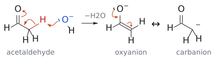

그림: 슬라이드 p.24의 acetaldehyde 예다. 왼쪽: HO⁻(파랑, 염기)의 비공유 전자쌍이 α-H(빨강)를 떼어 가고(화살표 1), 끊어진 C–H 결합 전자쌍이 C–C 사이로 들어가 C=C가 되며(화살표 2), 원래 C=O의 π 전자가 산소로 밀려나 O⁻가 된다(화살표 3). 오른쪽: 생긴 enolate는 음전하가 O에 있는 oxyanion과 α-C에 있는 carbanion의 공명 혼성체다. oxyanion 위의 두 화살표(O의 전자쌍이 C=O로, C=C의 π 전자가 α-C로)가 두 공명 구조를 잇는다. 염기를 LDA로 바꿔도 화살표의 흐름은 같다. (출처: L7 p.5, p.24)

예를 들어 acetone에 EtONa를 넣으면 `아세톤(pKa 19) + EtONa ⇌ 소듐 엔올레이트 + EtOH(pKa 16)` 의 평형이 된다. 오른쪽의 EtOH가 왼쪽의 acetone보다 더 강한 산이므로 평형은 왼쪽으로 치우치고, enolate는 아주 조금만 존재한다. 산-염기 평형은 늘 "약한 산·약한 염기 쪽"으로 기운다는 원칙 그대로다.

반면 LDA를 쓰면 `케톤(pKa 19) + LiN(i-Pr)2 → 리튬 엔올레이트 + HN(i-Pr)2(pKa 38)` 이 되어, 이번에는 생성되는 amine이 훨씬 약한 산이므로 사실상 완전히 오른쪽으로 간다.[2] 그래서 enolate를 정량적으로 만들고 싶을 때는 LDA가 표준이다.

보충: 교과서는 enolate alkylation의 염기 선택을 두 전략으로 정리한다. 하나는 conjugate acid의 pKa가 carbonyl 화합물보다 큰 강염기(LDA 등)로 출발물을 먼저 완전히 enolate로 바꾼 뒤, electrophile을 따로 넣는 2단계 방식이다. 다른 하나는 약한 염기를 electrophile과 함께 넣어 조금씩 생기는 enolate가 생기는 대로 반응하게 하는 방식이다. 후자는 간편하지만 염기와 electrophile이 서로 반응하지 않아야 하고, 남아 있는 carbonyl이 enolate와 자기 축합할 위험이 있다. 그래서 단순 ketone·ester에는 전자(LDA)를 쓰고, 산성이 큰 1,3-dicarbonyl은 alkoxide로도 완전히 deprotonate되며 K2CO3처럼 친핵성이 약한 염기라면 electrophile과 한꺼번에 넣기도 한다. (보충 근거: Clayden p.585, p.595)

(출처: L7 p.5, p.6)

### 1.3 LDA는 왜 "강하지만 친핵성이 없는" 염기인가?

LDA(lithium diisopropylamide)는 THF에서 n-BuLi와 diisopropylamine을 섞어 만든다: `n-BuLi + HN(i-Pr)2 --[THF]--> LiN(i-Pr)2 + pKa 50`. BuLi의 carbanion이 염기로서 N-H의 수소를 떼어 내고, 훨씬 약한 산인 butane이 기체로 빠져나가므로 되돌아가지 않는다.

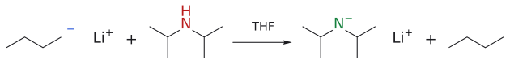

그림: BuLi의 carbanion(파랑)이 N–H(빨강)의 H를 떼어 LDA(초록 $N^-$)가 된다.

그렇다면 BuLi를 바로 쓰면 안 될까? BuLi는 친핵성도 강해서 carbonyl 탄소에 첨가해 버린다. LDA는 질소 양옆의 부피 큰 isopropyl group 두 개가 질소를 가려, 작은 양성자는 잘 떼어 내지만 carbonyl 탄소에는 다가가지 못한다. 즉 LDA는 강염기이면서 친핵성이 NOT nucleophilic 염기다. 같은 부류로 LiTMP(lithium 2,2,6,6-tetramethylpiperidide)와 LHMDS(LiN(SiMe3)2)가 있다.

슬라이드는 여기서 2-methylpropanoic acid methyl과 cyclopentanecarbaldehyde의 LDA enolate를 직접 그려 보라고 한다(→ 연습 문제 1).

(출처: L7 p.6, p.7)

### 1.4 α-탄소가 두 개라면 어느 쪽이 먼저 떨어지나?

2-heptanone CH3CO(CH2)4CH3처럼 양쪽 α-탄소가 다른 비대칭 ketone은 LDA로 두 가지 enolate를 만들 수 있다. 하나는 methyl 쪽 H가 떨어진 CH2=C(O−)(CH2)4CH3(덜 치환된 C=C), 다른 하나는 CH2 쪽 H가 떨어진 CH3C(O−)=CH(CH2)3CH3(더 치환된 C=C)다.

여기서 두 가지 "승자" 기준이 생긴다. thermodynamic enolate는 가능한 enolate 중 가장 안정한 것이고, kinetic enolate는 가장 빨리 생기는 것, 즉 염기가 C-H에 더 쉽게 접근할 수 있는 쪽이다. 어느 쪽이 우세한지는 반응 조건이 정하며, kinetic 조절은 보통 저온에서 이루어진다. 실제로 2-heptanone은 LDA, −78 °C에서 methyl(C1) 쪽만 100 : 0으로 deprotonate되고, 2-methoxycyclohexanone은 OMe 반대편 CH2(C6) 쪽이 85 : 15로 우세하다.[3]

(출처: L7 p.8)

### 1.5 에너지 도표로 보면?

2-methylcyclohexanone을 예로 들면 이해가 쉽다. C6(CH2) 쪽 수소는 주변이 한산해서 염기가 쉽게 다가간다. 그래서 transition state TS1이 낮고 빨리 생기는데, 그 결과물은 삼치환 C=C를 가진 덜 안정한 "kinetic" enolate다. 반대로 C2(CH3가 붙은 탄소)의 수소를 떼려면 염기가 CH3와 부딪히는 입체 steric interaction을 견뎌야 하므로 TS2가 높다. 하지만 일단 생기면 사치환 C=C라서 ΔE만큼 더 안정한 "thermodynamic" enolate가 된다.

그림: 가운데 2-methylcyclohexanone에서 떼어 낼 수 있는 두 종류의 α-H를 빨간색으로 표시했다. 왼쪽 화살표: 가려지지 않은 C6–H를 LDA가 −78 °C에서 빠르게 떼면 C1=C6 이중 결합을 가진 kinetic enolate가 된다(덜 치환된 C=C). 오른쪽 화살표: CH₃ 옆의 C2–H는 염기가 다가가기 어려워 느리게 떨어지지만, 생기면 C1=C2 이중 결합이 더 많이 치환되어 더 안정한 thermodynamic enolate가 된다. (출처: L7 p.11, p.12)

즉 kinetic enolate는 "언덕(활성화 에너지)이 낮은 길", thermodynamic enolate는 "골짜기(생성물 에너지)가 깊은 곳"이 이기는 경우다. 저온에서 LDA처럼 비가역적으로 deprotonate하면 먼저 도착한 쪽이 그대로 남으므로 kinetic 생성물이 얻어진다.

보충: thermodynamic enolate가 더 안정한 이유는 enolate도 결국 alkene이기 때문이다. alkene은 C=C에 alkyl group이 많이 붙을수록 안정하므로 사치환 C=C를 가진 쪽이 더 안정하다. 다만 이 더 안정한 enolate로 모이려면 두 enolate가 서로 바뀔 수 있어야 하고, 그 통로는 양성자 이동이다. 남아 있는 ketone 같은 양성자 공급원이 있으면 enolate가 그 양성자를 받아 ketone으로 돌아갔다가 다시 deprotonate되기를 되풀이해 평형 혼합물이 된다. 반대로 LDA로 −78 °C에서 빠르고 완전하게 deprotonate하면 양성자 공급원이 남지 않아, 처음 생긴 kinetic enolate가 그대로 갇힌다. (보충 근거: Clayden p.587, p.599)

(출처: L7 p.12)

그림: 가운데 ketone에서 왼쪽(파랑)은 덜 가린 C6–H를 떼는 낮은 TS를 거쳐 덜 안정한 kinetic enolate로, 오른쪽(빨강)은 더 높은 TS를 거쳐 더 치환된(더 안정한) thermodynamic enolate로 간다. LDA, −78 °C처럼 되돌릴 수 없는 조건은 왼쪽, 평형 조건은 오른쪽을 준다. 보충: 정성적 도표다.

## II. α-alkylation 반응 (α-Alkylation reactions)

> 개념 문서: [enolate alkylation](../../wiki/반응/엔올레이트%20알킬화.md), [SN2 reaction](../../wiki/반응/SN2%20반응.md)

### 2.1 enolate는 alkyl halide과 어떻게 반응하나?

carbonyl은 원래 electrophile였다. nucleophile은 C=O 탄소에 nucleophilic addition leaving group을 밀어낸다. 그런데 deprotonation으로 enolate가 되면, α-탄소가 전자가 풍부해져 electrophile(E+)와 잘 반응하는 nucleophile로 변신한다.

그래서 enolate와 alkyl halide을 만나게 하면 다음이 일어난다. (1) 염기가 α-H를 떼어 enolate를 만든다. (2) enolate의 α-탄소가 R-X의 탄소를 뒤쪽에서 공격하는 SN2가 일어나 C-C 결합이 생기고 C-X 결합이 끊어진다. (3) X−가 떠나며 α-치환 carbonyl 화합물이 남는다.

SN2인 만큼 제약도 SN2 그대로다. leaving group X는 염화·bromination·iodine화물 또는 tosylate가 쓰이고, R은 methyl이나 1차, 가능하면 allyl성(allylic)·benzyl성(benzylic)이 좋다. 2차 halide는 반응이 시원찮고, 3차 halide는 경쟁하는 제거 반응 때문에 아예 alkylate되지 않는다.

(출처: L7 p.9, p.10)

### 2.2 실제 ketone alkylation은 어떻게 되나?

2-methylcyclohexanone을 LDA(DME 용매)로 처리하면 앞에서 본 kinetic lithium enolate(C1=C6)가 생긴다. 여기에 CH3I를 넣으면 LiI가 빠지며 2,6-dimethylcyclohexanone(56%)이, benzyl bromide를 넣으면 2-benzyl-6-methylcyclohexanone(42–45%)이 생긴다.

그림: 파란색은 nucleophile인 enolate의 C=C π 결합, 빨간색은 electrophile인 CH₃I의 탄소와 C–I 결합이다. 화살표 셋은 (1) O⁻의 비공유 전자쌍이 내려와 C=O를 다시 만들고, (2) 그만큼 밀려난 C=C π 전자가 CH₃의 탄소를 I의 정반대편에서 공격하며(SN2 뒤쪽 공격), (3) C–I 결합 전자가 I로 떠나 I⁻(LiI)가 되는 과정이다. 초록색 결합이 새로 생긴 C–C 결합이다. 화살표 표기는 슬라이드 p.25의 C-alkylation 그림을 따랐다. (출처: L7 p.10, p.12, p.25)

그렇다고 선택성이 완벽한 것은 아니다. LDA/THF 후 CH3I 조건에서 kinetic enolate 경로의 2,6-dimethylcyclohexanone이 56%로 주생성물이지만, thermodynamic enolate 경로의 2,2-dimethylcyclohexanone도 6% 섞여 나온다. 결론적으로 LDA/저온 조건에서는 덜 치환된 α-탄소에 alkyl group이 들어간다고 기억하면 된다. 참고로 대칭인 cyclohexanone은 이런 고민 없이 LDA/THF로 enolate(O−Li+)와 diisopropylamine이 생긴다.

보충: alkylation에서 흔한 부반응이 하나 더 있다. monoalkylation 생성물에도 산성 α-H가 남아 있으면, 그것이 다시 deprotonate되어 두 번째 alkylation이 일어난다(다중 alkylation). 염기가 과량이면 이런 일이 쉬워지므로, 한 번만 alkylate하려면 electrophile을 1당량만 쓰는 것이 보통이다. 거꾸로 이 성질을 이용하면 염기와 halide를 차례로 두 번 넣어 같은 탄소에 alkyl group 두 개(서로 달라도 된다)를 넣을 수 있다. 연습 문제 4의 이중 alkylation이 그 예다. (보충 근거: Clayden p.586, p.598)

(출처: L7 p.10, p.11)

### 2.3 ester와 락톤도 될까?

된다. ester α-H(pKa ~25)는 ketone보다 덜 산성이지만 LDA로는 충분하다. butanoic acid methyl을 LDA/THF로 enolate화한 뒤 ethyl iodide를 넣으면 2-ethylbutanoic acid methyl이 96%로 얻어진다: `CH3CH2CH2CO2Me --[LDA, THF; CH3CH2I]--> (CH3CH2)2CHCO2Me`.[4]

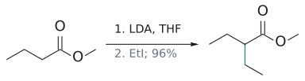

그림: LDA로 만든 enolate의 α-C가 EtI와 SN2로 새 C–C(초록)를 만든다(96%).

고리형 ester인 락톤도 마찬가지다. γ-뷰티로락톤을 LDA, 이어서 MeI로 처리하면 88% 수율의 생성물이 생긴다(빈 칸 문제 → 연습 문제 2). 슬라이드는 이어서 CH3CH(CH3)CH(CH2CH3)CO2CH3를 enolate α-치환으로 합성해 보라고 한다(→ 연습 문제 3).

(출처: L7 p.13, p.14)

## III. 1,3-dicarbonyl 화합물 (1,3-Dicarbonyl compounds)

> 개념 문서: [alpha-hydrogen acidity](../../wiki/개념/α-수소의%20산도.md), [alkoxide base](../../wiki/시약/알콕사이드%20염기.md), [acetoacetic ester synthesis](../../wiki/반응/아세토아세트산%20에스터%20합성.md), [decarboxylation](../../wiki/반응/탈카복실화.md), [ester hydrolysis](../../wiki/반응/에스터%20가수분해.md), [malonic ester synthesis](../../wiki/반응/말론산%20에스터%20합성.md)

### 3.0 두 carbonyl 사이의 수소는 왜 훨씬 산성인가?

두 carbonyl 사이에 낀 β-dicarbonyl, β-ketoester는 pKa가 9~11로, 단일 carbonyl의 α-H(18~20)보다 훨씬 산성이다. 떨어진 뒤의 음전하가 양쪽 C=O 두 곳으로 퍼질 수 있기 때문이다. 그래서 LDA까지 갈 필요 없이 훨씬 약한 염기인 alkoxide(RO−)로도 enolate를 만들 수 있다.[5]

이 성질 덕분에 합성에서 특히 널리 쓰이는 두 화합물이 있다. acetoacetic ethyl(ethyl acetoacetate, ethyl 3-oxobutanoate, CH3COCH2CO2Et)과 malonic diethyl(diethyl malonate, CH2(CO2Et)2)이다.[6]

(출처: L7 p.15)

### 3.1 acetoacetic ester 합성: methyl ketone을 어떻게 만드나?

acetoacetic ethyl은 소듐 ethoxide로 쉽게 enolate(소듐 염)가 되고, 이 enolate가 R-X와 SN2를 하면 monoalkylation acetoacetic ethyl CH3COCH(R)CO2Et가 생긴다. 그런데 여기서 끝나면 쓸모가 제한적이다. 이 화합물의 진가는 ester 부분을 "지울" 수 있다는 데 있다.

먼저 aq. NaOH로 가열해 ester를 염기성 가수분해하면 carboxylate CH3COCH(R)CO2− Na+가 되고, H3O+로 산성화하면 β-keto acid CH3COCH(R)CO2H가 된다. 이 β-keto acid을 가열하면 decarboxylation이 일어난다. carboxyl group의 O-H 수소가 ketone 산소로 옮겨 가는 6원자 고리형 transition state를 거치며 C-CO2 결합이 끊어지고 CO2가 빠져나가, enol이 생긴다.[7] 최종 생성물은 methyl ketone CH3COCH2R이다.

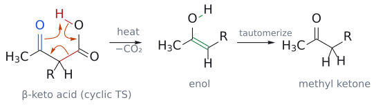

그림: β-keto acid을 ketone O와 carboxyl O–H가 마주 보는 고리 모양으로 그렸다. 세 화살표가 한 번에 움직인다. (1) ketone C=O의 전자(파랑)가 carboxyl group의 H(빨강)를 잡아 오고, (2) O–H 결합 전자가 C–O 사이로 들어가 CO₂의 C=O가 되며, (3) 끊어지는 Cα–COOH 결합(빨강)의 전자가 Cα와 ketone 탄소 사이로 들어가 C=C가 된다. 그 결과 enol과 CO₂가 생기고(초록 결합이 새로 생긴 O–H와 C=C), enol은 tautomerize해 methyl ketone이 된다. 슬라이드는 첫 화살표를 ketone O에서 H로 그렸는데, 여기서는 C=O 결합에서 출발하게 그려 ketone 탄소의 결합 수가 맞도록 했다. (출처: L7 p.16)

보충: 왜 β-keto acid만 이렇게 쉽게 CO2를 잃을까? 고리형 transition state에서 끊어지는 Cα–COOH 결합의 전자쌍은 Cα와 β 위치 carbonyl 탄소 사이로 들어가 enol을 만들어야 한다. 그래서 carboxyl group의 β 위치에 두 번째 carbonyl이 있어야만 이 경로가 열리고, 단순 carboxylic acid은 가열해도 이렇게 decarboxylate하지 않는다. 또 한 분자에서 두 분자(생성물과 CO2 기체)가 생기므로, 가열하면 엔트로피 항(−TΔS)의 기여가 커져 반응이 더 잘 진행된다. malonic 쪽도 같은 이유로, 두 ester가 모두 가수분해되어도 CO2는 하나만 빠진다. (보충 근거: Clayden p.597)

즉 acetoacetic ethyl을 쓰면 R-X에 -CH2COCH3를 붙인 것과 같은 결과를 얻는다. 실제 예로, acetoacetic ethyl을 (1) NaOEt/EtOH, (2) 1-bromobutane으로 처리하면 2-butylacetoacetic ethyl(69–72%)이 되고, (1) aq. NaOH, (2) H3O+ 후 가열(−CO2)하면 2-heptanone이 acetoacetic ethyl 기준 전체 52–61%로 얻어진다.

(출처: L7 p.16, p.17, p.29)

### 3.2 거꾸로 생각하기: 2-pentanone의 역합성

그럼 목표 분자가 주어졌을 때 어떻게 거꾸로 짚어 갈까? 2-pentanone CH3COCH2CH2CH3를 보자. methyl ketone CH3CO-CH2-R에서 C=O 옆 CH2와 R 사이를 끊는다고 생각하면, CH3COCH2- 부분은 acetoacetic ester가, R(여기서는 ethyl)은 alkyl halide이 공급한다. 즉 `2-펜타논 + CO2 ⇒ 2-에틸-3-옥소뷰탄산 ⇒ 2-에틸아세토아세트산 에틸 ⇒ 아세토아세트산 에틸` 순으로 거슬러 올라간다.

실제 합성은 그 반대 순서다: `아세토아세트산 에틸 --[(1) NaOEt; (2) CH3CH2Br]--> 2-에틸아세토아세트산 에틸 --[(1) dil. NaOH, heat; (2) H3O+]--> 2-에틸-3-옥소뷰탄산 --[heat]--> 2-펜타논 + CO2`.

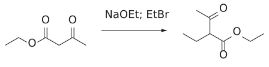

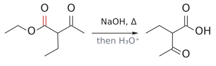

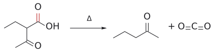

그림: 보충: ethyl acetoacetate의 두 carbonyl 사이 C–H를 NaOEt로 떼어 EtBr로 alkylation하고, ester를 가수분해한 β-keto acid를 가열하면 $CO_2$가 빠져 2-pentanone이 된다.

(출처: L7 p.18)

### 3.3 malonic ester 합성: carboxylic acid은?

malonic diethyl도 같은 논리로 움직인다. NaOEt로 enolate를 만들고 1-bromobutane으로 alkylate하면 butylmalonic diethyl(80–90%)이 된다. 이를 50% KOH로 환류해 두 ester를 모두 가수분해하고, dil. H2SO4로 환류하면 산성화와 동시에 decarboxylation이 일어나 hexanoic acid CH3(CH2)4COOH가 75%로 얻어진다.

이번 decarboxylation의 주인공은 치환 malonic HO2C-CH(R)-CO2H다. 한쪽 carboxyl group의 수소가 다른 쪽 C=O 산소로 넘어가는 6원자 고리형 transition state를 거쳐 CO2가 빠지고, 생긴 enol이 carboxylic acid RCH2COOH로 정리된다. 그래서 malonic diethyl은 R-X에 -CH2COOH를 붙이는 도구라고 요약된다.

슬라이드는 여기서 acetoacetic ethyl로 3-butyl-2-heptanone을 만들어 보라는 문제를 낸다(→ 연습 문제 4).

(출처: L7 p.19, p.20, p.29)

## IV. 여러 작용기의 enolate (Enolate from various functional groups)

> 개념 문서: [enol and enolate](../../wiki/개념/엔올과%20엔올레이트.md), [imine](../../wiki/개념/이민.md), [Henry reaction](../../wiki/반응/헨리%20반응.md), [alpha-hydrogen acidity](../../wiki/개념/α-수소의%20산도.md), [ketene](../../wiki/개념/케텐.md)

### 4.1 ketone·aldehyde·ester: 누가 enolization될 수 있나?

조건은 단순하다. α-H가 있으면 된다. cyclohexanone은 enol 및 enolate로 바뀔 수 있고, α-탄소가 두 개인 2-뷰타논은 위치 이성질 enol 두 개와 위치 이성질 enolate 두 개(CH3CH=C(O−)CH3, CH2=C(O−)CH2CH3)를 갖는다. aldehyde도 cyclopentanecarbaldehyde처럼 α-H가 있으면 enol/enolate(cyclopentyl리덴 C=CH-O−)가 된다.

반대로 α-H가 하나도 없으면 enolization이 non-enolizable. Ph2CO, benzaldehyde(PhCHO), 2,2-dimethylpropanal(pivaldehyde, (CH3)3CCHO), formaldehyde(HCHO)가 그렇다. ester는 methoxide 같은 alkoxide와 가역 평형을 이루며 enolate를 소량 만든다(`에스터 + MeO− ⇌ 에스터 엔올레이트 + MeOH`).

(출처: L7 p.21)

### 4.2 carbonyl이 아니어도 enolate 같은 것이 생기나?

생긴다. 질소를 포함한 작용기들이 그 예다. nitrile은 `PhCH2C≡N --[base]--> [PhCH=C=N− ↔ PhCH−-C≡N]` 처럼 음전하를 질소로 넘길 수 있다. imine(C=N)은 `(CH3)2CH-CH=NPh --[base]--> (CH3)2C=CH-N−Ph` 로 아자-enolate(aza-enolate)를 만든다. nitro 화합물(N=O)은 특히 산성이라 nitro메테인은 Et3N 같은 약한 amine으로도 nitro메테인 anion(CH2=N+(O−)O−)이 된다.

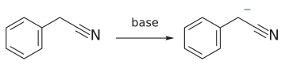

그림: 음전하(초록)는 C≡N의 N까지 비편재화된다.

이들의 공통점을 슬라이드는 한 문장으로 정리한다. π 결합 하나를 가진 전자 끄는 작용기가, 수소를 하나 이상 가진 포화(sp3) 탄소에 붙어 있으면 된다.

(출처: L7 p.22)

### 4.3 그런데 왜 acid chloride, carboxylic acid, amide는 안 되나?

표만 보면 acid chloride(pKa 16)은 꽤 산성인데, 왜 enolate 화학에 쓰지 않을까? dichloroacetyl chloride Cl2CHCOCl를 Et3N으로 처리하면 enolate Cl2C=C(O−)Cl이 생기긴 하지만, 이 enolate는 불안정해서 곧바로 Cl−를 내보내고 dichloroketene Cl2C=C=O가 되어 버린다.

carboxylic acid은 이유가 다르다. MeO−가 다가가면 C-H보다 훨씬 산성인 O-H(pKa 5)를 먼저 떼어 가므로, 안정한 carboxylate anion만 남는다. N-H가 있는 amide도 마찬가지로 N-H가 먼저 deprotonate되어 amidate anion(O− ↔ N− 공명)이 되고, α-C-H는 손대지 않는다. 즉 "더 산성인 수소가 따로 있으면 그쪽이 먼저 떨어진다".

(출처: L7 p.23)

## V. enolate 반응성: C 대 O (Enolate reactivity: C vs O)

> 개념 문서: [hard and soft acids and bases (HSAB)](../../wiki/개념/하드-소프트%20산염기.md), [enol and enolate](../../wiki/개념/엔올과%20엔올레이트.md)

### 5.1 음전하는 O에 많은데 왜 보통 C에서 반응하나?

enolate는 O, C, C 세 원자에 π 전자 4개가 퍼진 3원자 4전자(3-atom, 4-electron) 계로, allyl anion과 같은 구조다. acetaldehyde에 HO−를 작용시켜 만든 enolate는 oxyanion(CH2=CH-O−)과 carbanion(−CH2-CH=O)의 공명으로 표현된다.

분자 오비탈로 보면 답이 나온다. allyl anion의 반응성 HOMO(ψ2)는 양 말단 탄소에 같은 크기의 오비탈을 갖는데, enolate의 HOMO(ψ2)는 말단 탄소 쪽 오비탈이 더 크다. 그래서 오비탈 겹침이 중요한 반응은 탄소에서 일어난다. 반면 전체 음전하는 전기음성도가 큰 산소에 더 많이 모여 있어서, 정전기적 끌림이 중요한 반응은 산소에서 일어날 수 있다.[8]

(출처: L7 p.24)

### 5.2 무엇이 C냐 O냐를 가르나?

첫째는 electrophile의 성질이다. soft electrophile은 C에서, hard electrophile은 O에서 반응한다. Me-X에서 X가 I, Br, Cl이면 soft라서 C-methylation(`R-C(O−)=CH2 + MeI → RCOCH2Me`)가, X가 OMs, OSO2OMe(dimethyl 설페이트), +OMe2(trimethyloxonium)이면 hard라서 O-methylation(`→ R-C(OMe)=CH2`, enol ether)가 일어난다.

그림: 위: hard electrophile(X = OMs, OSO₂OMe, ⁺OMe₂)는 음전하가 많이 모인 O⁻(파랑)의 비공유 전자쌍이 CH₃(빨강)를 직접 공격하고, C–X 결합 전자가 X로 떠나 enol ether가 된다(초록: 새 O–C 결합). 아래: soft electrophile(X = I, Br, Cl)는 O⁻의 전자쌍이 C=O를 다시 만들면서 밀려난 C=C π 전자(파랑)가 CH₃를 공격해 ketone이 된다(초록: 새 C–C 결합). 두 경로 모두 마지막 화살표는 C–X 결합이 끊어지는 것이다. (출처: L7 p.25)

둘째는 금속 cation이다. 큰 알칼리 금속(Cs > K > Na > Li)일수록 enolate와 이온쌍이 더 분리되어 있어 O에서 반응하는 경향이 커진다.[9]

보충: 셋째로 용매도 영향을 준다. DMSO, DMF 같은 극성 비양성자성 용매는 enolate를 금속 cation과 떼어 놓아 산소의 전하가 더 드러나게 하므로 O-alkylation을 돕고, THF·DME 같은 에테르 용매는 C-alkylation을 돕는다. 강의의 LDA alkylation이 THF나 DME에서 진행되는 것과 맞아떨어진다. (보충 근거: Clayden p.590)

(출처: L7 p.25)

## VI. 비대칭 alkylation 반응 (Asymmetric alkylation reaction)

> 개념 문서: [chiral auxiliary](../../wiki/개념/키랄%20보조기.md), [Evans oxazolidinone](../../wiki/시약/에반스%20옥사졸리디논.md), [LiBH4](../../wiki/시약/LiBH4.md), [enolate chemistry (overview)](../../wiki/개념/엔올레이트%20화학%20개관.md)

### 6.1 보통의 alkylation은 왜 라세미체를 주나?

enolate는 평면이라 electrophile이 위에서 오든 아래에서 오든 확률이 같다. 그래서 R1COCH2R2를 염기와 BrCH2R3로 alkylate해 새 입체 중심이 생기면, 두 거울상 이성질체가 1:1인 라세미 혼합물이 된다.

그런데 반응 중심 가까이에 키랄한 기(Aux)가 붙어 있다면? 그 기가 한쪽 면을 더 가리게 되어 입체 이성질체 분포가 한쪽으로 치우친다(주생성물/부생성물, 서로 부분입체 이성질체). 이런 기를 키랄 chiral auxiliary라 하며, 당연히 키랄 중심을 포함해야 한다.[10]

(출처: L7 p.26)

### 6.2 Evans oxazolidinone: 어떻게 한쪽 면만 열어 두나?

대표적인 키랄 보조기가 Evans oxazolidinone(oxazolidinone)이다.[11] (S)-4-isopropyl-3-뷰타노일-oxazolidine-2-one을 LDA로 처리하면 acyl group의 α-CH2에서 수소가 떨어지는데, 이때 Li+가 enolate 산소와 oxazolidinone C=O 산소 사이를 chelate로 붙잡아 enolate 모양이 Z-enolate로 고정된다. 고정된 enolate의 한쪽 면은 C4의 isopropyl group이 막고 있으므로, BnBr은 반대편 면에서만 SN2 공격을 할 수 있다. 결과는 −78 °C에서 92% 수율, 99:1 dr이다.

그럼 반대쪽 입체 이성질체가 필요하면? 반대 방향의 면을 가리는 보조기를 쓰면 된다. 4-methyl-5-phenyl oxazolidinone의 N-뷰타노일 유도체를 LDA, BnBr로 처리하면 반대 배열의 α-benzyl 생성물이 78%, 99:1 dr로 얻어진다.[12]

(출처: L7 p.27)

### 6.3 보조기는 어떻게 떼어 내나?

보조기는 목적을 다하면 떼어 내야 한다. alkylate된 N-acyl oxazolidinone을 LiBH4로 환원하면 키랄 1차 alcohol인 2-benzylbutane-1-올(HOCH2CH(Bn)CH2CH3)이, LiOH/H2O2로 가수분해하면 키랄 carboxylic acid인 2-benzylbutanoic acid(HO2CCH(Bn)CH2CH3)이 얻어진다. 어느 경우든 α-입체 중심은 그대로 유지된다.[13]

다만 이 방법은 만능이 아니다. Evans 비대칭 alkylation은 우수한 SN2 electrophile(allyl, benzyl, methyl, X-CH2OR 등)에서 가장 잘 된다.

(출처: L7 p.28)

### 정리 (요약 슬라이드)

강의는 다섯 줄로 마무리된다. 강염기로 ketone·ester의 α-enolate를 만들고, 부피 큰 염기로 덜 치환된 C=C의 "kinetic" enolate를 만들며, 이를 친핵성 치환으로 alkylation한다. 1,3-dicarbonyl 화합물 중 acetoacetic ethyl은 가수분해·decarboxylation 후 -CH2(C=O)CH3를, malonic diethyl은 -CH2COOH를 붙이는 효과를 낸다. 마지막으로 carbonyl 외의 작용기에서도 enolate(류)가 생긴다.

(출처: L7 p.29)

## 흔한 오해

- kinetic enolate가 더 안정하다고 생각하기 쉽지만, 사실은 반대다. kinetic enolate는 덜 치환된 C=C라 덜 안정하고, 단지 빨리 생길 뿐이다. 더 안정한 것은 더 치환된 thermodynamic enolate다. (출처: L7 p.8, p.12)
- LDA/−78 °C로 2-methylcyclohexanone을 methylation하면 이미 methyl이 있는 C2에 하나 더 붙는다고 생각하기 쉽지만, 사실은 C6에 붙어 2,6-dimethylcyclohexanone이 주생성물(56%)이고 2,2-이치환체는 6%뿐이다. (출처: L7 p.11)
- 강염기면 다 된다고 생각해 BuLi를 바로 쓰기 쉽지만, 사실 BuLi는 친핵성이 강해 carbonyl에 첨가한다. 그래서 BuLi로 비친핵성인 LDA를 먼저 만든 뒤 쓴다. (출처: L7 p.6)
- NaOEt로도 ketone enolate를 충분히 만들 수 있다고 생각하기 쉽지만, 사실은 EtOH(pKa 16)가 ketone(19)보다 강한 산이라 enolate는 소량뿐이다. alkoxide로 충분한 것은 β-dicarbonyl(pKa 9~13) 쪽이다. (출처: L7 p.5, p.15)
- alkyl halide이면 무엇이든 alkylate된다고 생각하기 쉽지만, 사실은 SN2 규칙을 따른다. methyl·1차(allyl·benzyl 최고)는 좋고, 2차는 불량, 3차는 제거만 일어난다. 역합성에서 1차 halide가 들어가도록 끊어야 하는 이유다. (출처: L7 p.10)
- acetoacetic ester 합성과 malonic ester 합성의 생성물을 섞어 기억하기 쉽지만, 사실은 acetoacetic ethyl → methyl ketone(RCH2COCH3), malonic diethyl → carboxylic acid(RCH2COOH)이다. (출처: L7 p.29)
- acid chloride은 pKa 16으로 산성이니 좋은 enolate원이라고 생각하기 쉽지만, 사실은 생긴 enolate가 Cl−를 잃고 ketene이 된다. carboxylic acid과 N-H amide는 O-H/N-H가 먼저 떨어져 α-enolate가 생기지 않는다. (출처: L7 p.23)
- pivaldehyde는 methyl이 아홉 개나 있으니 enolization될 것 같지만, 사실은 carbonyl 옆 α-탄소가 4차 탄소라 α-H가 없다. (출처: L7 p.21)
- 음전하가 산소에 많으니 enolate는 늘 산소에서 반응한다고 생각하기 쉽지만, 사실은 HOMO가 탄소에 크게 걸려 있어 MeI 같은 soft electrophile은 탄소에서 반응한다. O-반응은 hard electrophile(Me2SO4, MeOMs, Me3O+)나 큰 cation(K+, Cs+)일 때 두드러진다. (출처: L7 p.24, p.25)
- Evans 보조기가 electrophile을 "끌어당겨" 선택성을 준다고 생각하기 쉽지만, 사실은 Li chelate로 고정된 Z-enolate의 한 면을 보조기 치환기가 가려서, electrophile이 반대 면으로만 접근하게 만드는 것이다. (출처: L7 p.27)

## 반응 정리표

| 반응 | 시약/조건 | 생성물 | regioselectivity | 입체화학 | 비고 |
|---|---|---|---|---|---|
| LDA 제조 | n-BuLi + HN(i-Pr)2, THF | LiN(i-Pr)2 + butane | – | – | pKa 50이 빠져 비가역 (p.6) |
| enolate 형성 (정량) | LDA, THF, −78 °C | lithium enolate | 덜 치환된 α-C (kinetic) | – | amine(pKa 36~38)이 훨씬 약한 산 (p.5–8) |
| enolate 형성 (소량, 평형) | NaOEt, EtOH | 소듐 enolate 소량 | – | – | EtOH(16)가 ketone(19)보다 강한 산 (p.5) |
| kinetic vs thermodynamic enolate | LDA, −78 °C (kinetic) | 2-methylcyclohexanone → C1=C6 enolate | 덜 가려진 C6 | – | thermodynamic enolate는 C1=C2, 더 안정 (p.11–12) |
| ketone α-alkylation | 1. LDA, DME/THF 2. CH3I (또는 BnBr) | 2,6-dimethylcyclohexanone 56% (2,2-이치환체 6%) | 덜 치환된 α-C | 새 입체중심은 라세미 | SN2: methyl·1차·allyl·benzyl 좋음, 3차는 제거 (p.10–11) |
| ester α-alkylation | 1. LDA, THF 2. EtI | 2-ethylbutanoic acid methyl 96% | α-C | – | ester α-H pKa ~25 (p.13) |
| 락톤 α-alkylation | 1. LDA 2. MeI | α-methyl-γ-뷰티로락톤 88% | α-C | – | (p.14) |
| acetoacetic ester 합성 | 1. NaOEt 2. R–X 3. aq. NaOH, 가열 4. H3O⁺, 가열(−CO2) | methyl ketone CH3COCH2R | 두 C=O 사이 CH2 | – | R–X에 −CH2COCH3를 붙이는 효과 (p.16–18) |
| malonic ester 합성 | 1. NaOEt 2. R–X 3. KOH 환류 4. H2SO4 환류(−CO2) | carboxylic acid RCH2COOH | 두 C=O 사이 CH2 | – | R–X에 −CH2COOH를 붙이는 효과 (p.19–20) |
| β-keto acid decarboxylation | 가열 | enol → ketone + CO2 | – | – | 6원자 고리형 transition state (p.16) |
| acid chloride + Et3N | Cl2CHCOCl, Et3N | dichloroketene Cl2C=C=O | – | – | enolate가 Cl⁻을 잃음 (p.23) |
| C-alkylation vs O-alkylation | soft: MeI, MeBr / hard: MeOMs, Me2SO4, Me3O⁺ | soft → ketone (C), hard → enol ether (O) | C 또는 O | – | 큰 cation(Cs⁺, K⁺)은 O reaction 경향 (p.24–25) |
| Evans 비대칭 alkylation | N-acyl oxazolidinone, LDA, −78 °C; BnBr | α-benzyl 생성물 92% | α-C | 99:1 dr | Li chelate Z-enolate, 보조기가 한 면을 가림 (p.27) |
| 보조기 제거 | LiBH4 / LiOH, H2O2 | 키랄 1차 alcohol / 키랄 carboxylic acid | – | α-입체중심 유지 | (p.28) |

## 연습 문제

1. (p.7) 다음 화합물을 LDA로 처리했을 때 생기는 enolate 구조를 그려라.
   (a) 2-methylpropanoic acid methyl (CH3)2CHCO2CH3
   (b) cyclopentanecarbaldehyde (C5H9-CHO)

2. (p.13) 빈 칸을 채워라: `γ-뷰티로락톤 --[LDA]--> [ A ] --[MeI]--> [ B ] (88%)`

3. (p.14) CH3CH(CH3)CH(CH2CH3)CO2CH3 (2-ethyl-3-methylbutanoic acid methyl)를 enolate α-치환 반응으로 합성하라. 두 가지 가능한 끊기 중 어느 것이 더 좋은지 이유와 함께 답하라.

4. (p.20) acetoacetic ethyl로부터 3-butyl-2-heptanone CH3COCH(CH2CH2CH2CH3)2를 합성하라.

5. (p.8, p.11, p.12) 2-methylcyclohexanone을 (1) LDA, THF, −78 °C, (2) CH3I로 처리하였다. 주생성물과 부생성물을 쓰고, 에너지 도표의 관점에서 주생성물이 우세한 이유를 설명하라.

6. (p.19 응용) malonic diethyl로부터 3-phenylpropanoic acid PhCH2CH2COOH를 합성하는 시약과 단계를 써라.

7. (p.21, p.23) 다음 중 methoxide(MeO−) 또는 일반 염기 조건에서 α-탄소 enolate를 만들 수 없는 것을 모두 고르고 이유를 써라.
   (a) cyclohexanone (b) benzaldehyde (c) acetic acid (d) acetamide CH3CONH2 (e) pivaldehyde (f) acetic acid methyl

8. (p.25, p.28) (a) acetone의 칼륨 enolate를 dimethyl Me2SO4와 반응시킬 때와, lithium enolate를 MeI와 반응시킬 때 각각 주로 생기는 생성물은? (b) Evans alkylation 생성물(α-benzyl N-뷰타노일 oxazolidinone)을 LiBH4로, 또는 LiOH/H2O2로 처리했을 때 생성물은?

---

## 정답 및 해설

1. (a) (CH3)2C=C(OCH3)-O− Li+. α-H가 하나(C2-H)뿐이므로 enolate도 하나. C=C의 한쪽 탄소에 두 CH3가 같으므로 E/Z 이성질 없음. ester α-H(pKa ~25)는 LDA(conjugate acid pKa 36~38)로 정량적으로 제거됨.
   (b) cyclopentyl리덴 enolate: 고리 탄소(C1)=CH-O− Li+ (고리 C1과 엑소 고리 C=C). 고리 C1의 유일한 α-H가 제거됨. 보충: aldehyde enolate는 남은 aldehyde와 aldol 반응을 하기 쉬움(이 문제는 구조만 묻는 것). (보충 근거: Clayden p.590) (출처: L7 p.7, p.21)

2. A = 뷰티로락톤의 lithium enolate(carbonyl α-CH2에서 H 제거, 고리 내 C=C(O−)-O). B = α-methyl-γ-뷰티로락톤(3-methyldihydrofuran-2(3H)-온). 락톤은 고리형 ester이므로 ester와 동일하게 LDA → enolate → MeI SN2로 α-methylation. 새 입체 중심은 라세미. (출처: L7 p.13)

3. 두 가지 끊기:
   - (i) α-C와 ethyl 사이: `3-methyl뷰탄산 메틸 (CH3)2CHCH2CO2CH3 --[(1) LDA, THF, −78 °C; (2) CH3CH2I (또는 EtBr)]--> 목표물`
   - (ii) α-C와 isopropyl 사이: butanoic acid methyl + LDA, 그다음 2-iodopropane(2차 halide).
   - 정답은 (i). (ii)는 2차 halide라 SN2가 느리고 E2 제거와 경쟁하여 수율이 나쁨. 1차 halide(EtI)를 쓰는 (i)가 좋음(슬라이드의 butanoic acid methyl + EtI 96% 예와 같은 유형). (출처: L7 p.10, p.13, p.14)

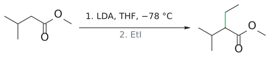

그림: enolate α-C와 ethyl 사이에 새 C–C(초록).

4. 순서:
   1. `아세토아세트산 에틸 --[NaOEt, EtOH; CH3(CH2)3Br]--> 2-뷰틸아세토아세트산 에틸`
   2. `--[NaOEt; CH3(CH2)3Br]--> 2,2-다이뷰틸아세토아세트산 에틸 CH3COC(Bu)2CO2Et` (monoalkyl 생성물에 남은 하나의 활성 α-H를 다시 제거 후 alkylation)
   3. `--[(1) aq. NaOH, heat; (2) H3O+]--> CH3COC(Bu)2CO2H` (β-keto acid)
   4. `--[heat, −CO2]--> CH3COCH(Bu)2 = 3-뷰틸-2-헵타논`
   - 해설: acetoacetic ester 합성은 R-X마다 활성 탄소에 R을 하나씩 붙이고, 마지막에 CO2Et가 H로 바뀜. 목표물의 C3에 Bu가 두 개(C4~C7 사슬도 butyl) 있으므로 이중 alkylation. 보충: 1-butyl bromide는 1차라 SN2에 적합. (보충 근거: Clayden p.587) (출처: L7 p.16, p.17, p.20)

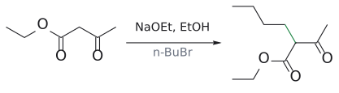

그림: 1단계: 활성 α-C(파랑)를 butyl화(초록).

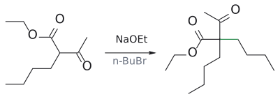

그림: 2단계: 남은 α-H를 떼고 한 번 더 butyl화.

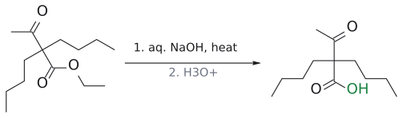

그림: 3단계: ester(빨강)를 가수분해해 β-keto acid(초록).

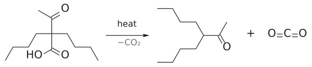

그림: 4단계: 탈카복실화로 $CO_2$가 빠진다.

5. 주생성물: 2,6-dimethylcyclohexanone(슬라이드 56%). 부생성물: 2,2-dimethylcyclohexanone(6%). 이유: LDA/저온에서는 비가역적 deprotonation라 kinetic 조절. C6의 CH2 수소는 입체 장애가 작아 TS1이 낮고 빠르게 제거됨 → 덜 kinetic enolate → C6 methylation. C2-H 제거는 염기와 CH3의 입체 상호작용으로 TS2가 높음. 생성된 enolate(사치환 C=C)가 더 안정하더라도 저온에서 평형이 일어나지 않으므로 소량만 생김. (출처: L7 p.8, p.10, p.11, p.12)

6. `CH2(CO2Et)2 --[(1) NaOEt; (2) PhCH2Br]--> 벤질말론산 다이에틸 PhCH2CH(CO2Et)2 --[(1) 50% KOH (또는 NaOH), reflux; (2) dil. H2SO4 (또는 H3O+), reflux, −CO2]--> PhCH2CH2COOH`. 해설: malonic ester 합성은 R-X → R-CH2COOH. 목표물에서 -CH2COOH를 떼면 R = benzyl → BnBr(benzyl성 1차 halide, SN2에 매우 좋음). (출처: L7 p.19, p.29)

그림: malonate anion(파랑)이 benzyl bromide(빨강)와 새 C–C(초록).

그림: 가수분해 뒤 탈카복실화.

7. 정답: (b), (c), (d), (e).
   - (b) benzaldehyde, (e) pivaldehyde: α-H가 없음(benzaldehyde의 α-C는 방향족 고리 탄소, pivaldehyde의 α-C는 4차) → enolization 불가능.
   - (c) acetic acid: MeO−가 O-H(pKa 5)를 먼저 제거해 안정한 carboxylate를 만들고 C-H는 건드리지 않음.
   - (d) acetamide: N-H가 먼저 deprotonate되어 amidate anion 형성.
   - (a) cyclohexanone, (f) acetic acid methyl은 enolate 형성 가능(MeO−와는 가역 평형, LDA로는 정량적). (출처: L7 p.21, p.23)

8. (a) K+ enolate + Me2SO4(hard electrophile, 느슨한 이온쌍): O-methylation → 2-methoxypropene CH2=C(OCH3)CH3(enol ether). Li+ enolate + MeI(soft electrophile): C-methylation → 2-뷰타논 CH3COCH2CH3. 근거: hard electrophile은 전하 밀도가 큰 O, soft electrophile은 HOMO 계수가 큰 C와 반응. 큰 cation일수록 O-반응 증가.
   (b) LiBH4 → 2-benzylbutane-1-ol HOCH2CH(CH2Ph)CH2CH3; LiOH/H2O2 → 2-benzylbutanoic acid HO2CCH(CH2Ph)CH2CH3. 두 경우 모두 α-입체 중심의 배열은 alkylation 생성물에서 그대로 유지되고 oxazolidinone 보조기는 떨어져 나감. (출처: L7 p.24, p.25, p.28)

## 각주

[1] 슬라이드는 HWE anion도 "stabilized ylide"라고 부르지만, 엄밀히 말하면 인 원자에 양전하가 없으므로 ylide라기보다 phosphonate 안정화 carbanion(phosphonate carbanion)이다. (출처: L7 p.3)

[2] diisopropylamine의 pKa가 p.4의 표에서는 36, p.6의 반응식에서는 38로 서로 다르게 적혀 있다. 둘 다 문헌에서 쓰이는 값(측정 조건에 따라 다름)이며, 어느 값이든 ketone(19)과의 차이가 커서 결론은 같다. 평형 상수는 대략 10^(ΔpKa)로 어림한다. (출처: L7 p.4, p.6)

[3] 슬라이드에 thermodynamic enolate를 얻는 조건은 나오지 않는다. 교과서적으로는 enolate끼리 양성자를 주고받을 수 있는 평형 조건(약간 과량의 ketone, 양성자성 용매나 약한 염기, 더 높은 온도)을 쓰면 더 안정한 쪽으로 모인다(보충 근거: Clayden p.599). 슬라이드의 "C-H is more accessibly"는 "more accessible"의 오타로 보인다. (출처: L7 p.8)

[4] ester에 alkoxide를 쓰면 enolate가 조금만 생기고 남은 ester와 Claisen condensation 같은 부반응이 일어나기 쉽다. 그래서 LDA로 먼저 완전히 enolate화한 다음 halide를 넣는 것이 정석이다. (보충 근거: Clayden p.589) (출처: L7 p.13 관련 보충)

[5] p.15는 β-dicarbonyl을 "pKa 9–11"로 묶지만, 같은 강의 p.4 표에서 1,3-diester(malonic ester)는 13이다. 그래도 EtOH(16)보다는 산성이므로 NaOEt로 충분히 deprotonate된다. ethyl ester에 굳이 NaOEt를 쓰는 이유는, ester transesterification이 일어나더라도 같은 ethyl ester로 돌아오기 때문이다. (출처: L7 p.4, p.15)

[6] 슬라이드는 malonic diethyl 옆에 "(diethyl 1,3-propanedicarboxylic acid)"라는 이름을 붙였는데, 이는 부정확하다. malonic은 propanedioic acid이므로 체계명은 diethyl propanedioate이고, "1,3-propanedicarboxylic acid"는 탄소 5개짜리 glutaric acid(pentanedioic acid)을 가리키는 이름이다. (출처: L7 p.15)

[7] 슬라이드는 decarboxylation 다음에 바로 ketone을 그렸지만, 고리형 transition state에서 직접 생기는 것은 enol이고, 이것이 tautomerize하여 ketone이 된다. (출처: L7 p.16)

[8] 이것이 hard/soft 구분의 근거다. 전하 밀도가 큰 O는 전하 charge-controlled 반응을 하는 hard electrophile과, HOMO 계수가 큰 C는 오비탈 orbital-controlled 반응을 하는 soft electrophile과 잘 맞는다. (보충 근거: Clayden p.453) (출처: L7 p.24, p.25 관련 보충)

[9] 반대로 작은 Li+는 산소에 단단히 배위해 산소를 가려 주므로, lithium enolate는 C-반응에 유리하다. 강의에서 alkylation에 LDA(lithium enolate)와 alkyl halide을 쓰는 것과 맞아떨어진다. (보충 근거: Clayden p.590, p.648) (출처: L7 p.25 관련 보충)

[10] p.26의 첫 반응식 화살표에는 "base, catalyst"라고 적혀 있는데, 일반 alkylation에서 "catalyst"가 무엇을 뜻하는지는 슬라이드에 설명이 없다. 요점은 키랄 요소가 없으면 라세미체가 된다는 것이다. 또한 슬라이드에서는 이 비대칭 alkylation 절이 "V."로 번호 매겨져 있어 앞의 "V. Enolate reactivity"와 번호가 겹치고, 개요(p.2)의 목차에는 C vs O 반응성 절이 없다. 이 문서에서는 VI로 구분했다. (출처: L7 p.2, p.24, p.26)

[11] 문헌: D. A. Evans 외, J. Am. Chem. Soc. 1982, 104, 1737–1739. 첫 번째 보조기는 amino acid 발린에서 유래한 아미노 alcohol로 만든다. (출처: L7 p.27)

[12] 두 번째 보조기(4-methyl-5-phenyl oxazolidinone)는 노르에페드린에서 유래한다. 치환기가 첫 번째 보조기와 반대 면에 있으므로 반대 배열의 생성물을 준다. (보충 근거: Clayden p.1109) (출처: L7 p.27 관련 보충)

[13] 보조기를 떼고 나면 부분입체 이성질체 비(dr)가 그대로 거울상 이성질체 비(er)로 바뀐다(예: 94 : 6이면 88% ee). 떨어져 나온 oxazolidinone은 회수해서 다시 쓸 수 있다. (보충 근거: Clayden p.1109–1110) (출처: L7 p.28 관련 보충)
