# L8. 알돌 반응 (Aldol Reactions)

> **통독본**: 2026-10-12 재구성 직전의 강의별 전체 노트(교과서 보강 포함)를 그대로 보존한 사본이다. 강의 흐름대로 한 번에 읽을 때 쓴다. 이후의 수정과 보충은 개념 문서에만 반영되므로, **최신 내용은 개념 문서**가 기준이다. 뼈대 노트: [L8 뼈대](../L08_Aldol_Reactions.md) · [위키 대문](../../wiki/위키%20대문.md)

> **관련 위키 문서** ([위키 대문](../../wiki/위키%20대문.md))
> - 반응: [교차 aldol reaction](../../wiki/반응/교차%20알돌%20반응.md), [Mukaiyama aldol reaction](../../wiki/반응/무카이야마%20알돌%20반응.md), [intramolecular aldol reaction](../../wiki/반응/분자내%20알돌%20반응.md), [aldol reaction](../../wiki/반응/알돌%20반응.md), [retro-aldol reaction](../../wiki/반응/역알돌%20반응.md), [Knoevenagel condensation](../../wiki/반응/크뇌베나겔%20축합.md), [Henry reaction](../../wiki/반응/헨리%20반응.md)
> - 시약: [LDA](../../wiki/시약/LDA.md), [TiCl4](../../wiki/시약/TiCl4.md), [silyl enol ether](../../wiki/시약/실릴%20엔올%20에터.md), [alkoxide base](../../wiki/시약/알콕사이드%20염기.md)
> - 개념: [E1cB elimination](../../wiki/개념/E1cB%20제거.md), [alpha-hydrogen acidity](../../wiki/개념/α-수소의%20산도.md), [kinetic vs thermodynamic enolate](../../wiki/개념/속도론적%20엔올레이트와%20열역학적%20엔올레이트.md), [kinetic vs thermodynamic control](../../wiki/개념/속도론적%20지배와%20열역학적%20지배.md), [enol and enolate](../../wiki/개념/엔올과%20엔올레이트.md), [oxaphosphetane](../../wiki/개념/옥사포스페테인.md), [carbocation](../../wiki/개념/탄소%20양이온.md)

## 개요

aldol reaction은 enolate 또는 enol이 aldehyde나 ketone의 carbonyl 탄소를 공격해 β-hydroxy carbonyl(β-hydroxy carbonyl) 화합물을 만드는 반응이다. 앞 강의에서 enolate를 alkyl halide과 만나게 했다면(→ [L7](L07_Enolate_Alkylation.md) enolate alkylation 문서 참고), 이번에는 그 상대를 carbonyl 화합물로 바꾼 셈이다. 생성물을 탈수하면 α,β-unsaturated carbonyl(α,β-unsaturated carbonyl) 화합물이 되므로, aldol 하나로 "C–C 결합 + 산소 작용기 + (필요하면) alkene"을 한꺼번에 얻을 수 있다. 에리트로마이신 같은 polyketide 천연물에 1,3-산소 패턴이 반복되는 것도 이 반응이 합성에서 중요한 이유다. 다만 아무 carbonyl 두 개를 염기와 섞으면 생성물이 뒤죽박죽이 되기 때문에, 강의의 절반은 "원하는 교차 aldol 생성물 하나만 얻는 법"에 할애된다.[1]

(출처: L8 p.1, p.2, p.7, p.34)

## 본문

### 0. 도입: 천연물, polyketide, 그리고 HWE 복습

> 개념 문서: [천연물과 polyketide, HWE와의 관계](../../wiki/반응/알돌%20반응.md), [HWE reaction](../../wiki/반응/HWE%20반응.md), [oxaphosphetane](../../wiki/개념/옥사포스페테인.md)

왜 aldol을 배우기 전에 천연물부터 보여 줄까? 슬라이드가 고른 분자들이 모두 aldol로 만들기 좋은 구조를 갖고 있기 때문이다. erythromycin은 여러 세균 감염 치료에 쓰는 항생제이고, (+)-discodermolide((+)-discodermolide)는 여러 다제내성(MDR) 암세포주에서 종양세포 성장을 강하게 억제한다. roflamycoin은 1981년 *Streptomyces roseoflavus*에서 분리된 항진균제로, 폴리엔 macrolide 항생제 가운데 유일하게 잘 정의된 이온 채널을 형성하는 oxopolyene macrolide다. 세 분자 모두 탄소 사슬에 OH와 methyl이 하나 걸러 하나씩 붙은 패턴을 보인다.

그렇다면 자연은 이 패턴을 어떻게 만들까? 로플라마이신의 제안된 생합성 경로를 보면, 효소(polyketide 합성효소)에 매달린 말로닐 단위가 CO2를 잃으며 enolate 등가체가 되고, 이것이 KS(ketosynthase)에 결합된 acyl thioester를 공격해 사슬을 두 탄소씩 늘린다. 이어 KR(ketoreductase)이 ketone을 OH로, DH(dehydratase)가 탈수로 alkene을, ER(enoyl reductase)이 alkene을 CH2로 바꾸는데, 어떤 효소가 작동하느냐에 따라 각 위치의 작용기가 결정된다.[2] 즉 자연은 "enolate + carbonyl"을 반복해서 사슬을 짓는다. 실험실에서 이 일을 맡는 것이 aldol 반응이다.

여기에 슬라이드는 앞 강의의 Wittig/HWE를 다시 꺼낸다(→ [L6](L06_Oxidation_and_Alkene_Synthesis.md) alkene 합성: Wittig reaction 문서 참고). 왜일까? HWE 메커니즘의 두 번째 단계가 바로 "안정화된 carbanion이 aldehyde를 공격해 alkoxide를 만드는" 단계, 즉 aldol 첨가와 똑같은 모양이기 때문이다.

- 안정화 ylide: BrCH2CO2R --[PPh3]--> Ph3P⁺CH2CO2R --[Na2CO3]--> Ph3P⁺–CH⁻–CO2R. 음전하가 C=O와 공명해 enolate처럼 퍼지므로 Na2CO3 같은 약염기로도 만들 수 있다 (R = H, OR, alkyl).
- HWE: (EtO)2P(O)CH2COR --[EtO⁻ 또는 NaH]--> phosphonate 안정화 enolate.

그림: $PPh_3$ (파랑)가 $C–Br$ (빨강)을 $S_N2$ 로 치환한다.

그림: C=O가 음전하를 안정화하므로 약염기로도 ylide(초록)가 생긴다.

HWE 메커니즘(예: (EtO)2P(O)CH2CO2Et + PhCHO)은 다음과 같다.

1. EtO⁻가 P와 C=O 사이의 산성 CH2 양성자를 떼어 enolate를 만든다.
2. enolate의 α-탄소(nucleophile)가 PhCHO의 carbonyl electrophile을 공격해 alkoxide가 생긴다. 슬라이드에서 박스로 강조된 이 단계가 aldol 첨가와 같은 형태다.
3. alkoxide O⁻가 인을 공격해 4원 고리 intermediate(oxaphosphetane형)를 만든다.
4. C–P, O–P 결합이 재배열되며 (EtO)2PO2⁻가 떨어지고 C=C가 생겨 (E)-EtO2C–CH=CH–Ph가 된다.

일반식은 R1COR2 + R3O2C–CH(R4)–P(O)(OR5)2 --[Base]--> R3O2C–C(R4)=CR1R2 이다. HWE에서는 alkoxide가 인에 붙잡혀 alkene으로 가지만, aldol에서는 alkoxide가 그냥 양성자를 받아 OH로 남는다. 이 차이를 기억해 두면 두 반응이 헷갈리지 않는다.

(출처: L8 p.2, p.3, p.4, p.5, p.6)

### 1. aldol 반응이란: 정의와 강의의 지도

> 개념 문서: [aldol reaction](../../wiki/반응/알돌%20반응.md)

aldol 반응은 한 문장으로 "enolate(또는 enol)와 carbonyl 화합물(aldehyde 또는 ketone) 사이의 반응"이다.

RC(O⁻)=CH2 + R'COR'' ⇌ RCOCH2C(OH)R'R'' (aldol addition) --> RCOCH=CR'R'' + H2O (탈수)

첫 단계에 평형 화살표가 붙어 있다는 점을 눈여겨봐야 한다. aldol 첨가는 가역이고, 이 사실이 뒤에서 retro-aldol 반응과 intramolecular aldol의 선택성을 설명하는 열쇠가 된다. 강의는 I. 기본 aldol(염기성/산성), II. 교차 aldol(lithium enolate, silyl enol ether, 약염기), III. intramolecular aldol, IV. enolate와 여러 electrophile 순서로 진행된다.

(출처: L8 p.7)

### 2. 염기성 조건의 aldol reaction

> 개념 문서: [aldol reaction](../../wiki/반응/알돌%20반응.md), [enol and enolate](../../wiki/개념/엔올과%20엔올레이트.md), [E1cB elimination](../../wiki/개념/E1cB%20제거.md)

#### 2.1 "aldol"이라는 이름은 어디서 왔나

acetaldehyde에 NaOEt나 NaOH를 촉매량 넣으면 무슨 일이 생길까? 빠르고 가역적으로 3-hydroxy부탄알(3-hydroxybutanal)이 생긴다. 이 분자는 aldehyde이면서 alcohol이라 관용명이 "aldol"이고, 반응 전체의 이름이 여기서 나왔다. 같은 분자 두 개가 합쳐지므로 자기 aldol(self-aldol) 또는 dimerization라 부른다.

2 CH3CHO --[10% NaOH, H2O, 5 °C]--> CH3CH(OH)CH2CHO (3-hydroxybutanal, 50%)

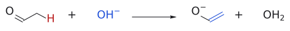

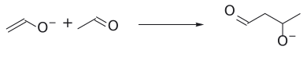

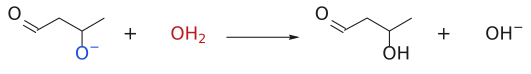

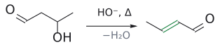

그림: 보충: $HO^-$ 가 α-H를 떼어 enolate를 만들고, enolate가 두 번째 acetaldehyde의 carbonyl을 공격해 alkoxide가 된다. 물이 양성자를 주면 3-hydroxybutanal(aldol)이고, 가열하면 E1cB로 물이 빠져 (E)-but-2-enal이 된다.

(출처: L8 p.8)

#### 2.2 메커니즘: 같은 분자가 nucleophile도 되고 electrophile도 된다

그림: 2단계(C–C 결합 형성)를 그린 것이다. 파란색은 nucleophile 쪽(enolate의 C=C와 O⁻), 빨간색은 electrophile 쪽(두 번째 acetaldehyde의 carbonyl 탄소와 C=O), 주황색 굽은 화살표는 전자쌍의 이동이다. 화살표 셋은 (1) O⁻의 비공유 전자쌍이 내려와 C=O를 다시 만들고, (2) enolate의 C=C π 전자가 상대 carbonyl 탄소를 공격하며, (3) 상대의 C=O π 전자가 산소로 올라가 alkoxide(빨간 O⁻)가 되는 과정이다. 초록 결합이 새로 생긴 C–C 결합이다. 이어서 alkoxide가 물에서 양성자를 받으면 aldol과 HO⁻가 된다(3단계).

어떻게 같은 acetaldehyde가 공격하는 쪽과 공격당하는 쪽을 동시에 맡을 수 있을까? 답은 염기가 일부 분자만 enolate로 바꾸기 때문이다.

1. enolate 형성. 수산화 이온이 한 acetaldehyde의 α-탄소 H를 떼어 낸다. 생긴 anion은 CH2=CH–O⁻ ↔ ⁻CH2–CHO로 공명 안정화된 enolate다.
2. C–C 결합 형성. enolate의 α-탄소(nucleophile)가 아직 enolate가 되지 않은 두 번째 acetaldehyde의 carbonyl electrophile을 공격한다. C=O π 결합이 끊어지고 새 C–C σ 결합이 생기면서 alkoxide anion이 된다.
3. 양성자 전달. alkoxide(더 강한 염기)가 물에서 양성자를 받아 aldol 생성물이 되고, HO⁻(더 약한 염기)가 다시 나온다. 그래서 염기는 촉매로 충분하다.

정리하면 새 C–C 결합은 "enolate의 α-탄소"와 "상대 분자의 carbonyl 탄소" 사이에 생긴다. 그래서 aldol 생성물에서 C=O는 enolate 쪽에, OH는 electrophile 쪽에 남는다.

(출처: L8 p.9)

#### 2.3 탈수: E1cB

그림: 왼쪽 단계에서 HO⁻(파랑)가 산성 α-H(빨강)를 떼고, C–H 결합 전자가 C–C 쪽으로 옮겨 가며, C=O π 전자가 산소로 올라가 enolate(짝염기, cB)가 된다. 가운데 단계에서는 O⁻의 전자쌍이 C=O를 다시 만들고, enolate의 C=C(파랑) 전자가 Cα–Cβ 사이로 내려와 새 이중결합을 만들며, C–OH 결합(빨강) 전자가 산소로 가서 HO⁻가 떨어진다. 초록 결합이 C=O와 공액된 새 C=C다. 첫 단계는 평형이고, 둘째 단계는 공액 안정화 덕분에 앞으로 진행된다.

aldol 생성물에 염기를 더 오래, 더 세게 작용시키면 물이 빠진다. 그런데 HO⁻는 원래 나쁜 leaving group인데 어떻게 떨어질까? 비결은 이탈 전에 먼저 anion(짝염기)을 만드는 데 있다. 이를 E1cB(cB = conjugate base)라 한다.

1. aldol의 α-H는 여전히 carbonyl 옆에 있으므로 산성이다. HO⁻가 이 H를 떼어 enolate를 만든다. 이때 β-탄소의 OH는 그대로 붙어 있다.
2. enolate의 전자쌍이 내려오며 Cα=Cβ 이중결합을 만들고, β-탄소의 HO⁻를 밀어낸다.

CH3CH(OH)CH2CHO → CH3CH=CHCHO (2-butenal, 엔알 enal) + H2O (HO⁻ 재생)

이 반응이 앞으로 가는 원동력은 생성물의 conjugation이다. alkene과 carbonyl이 이어져 전자가 넓게 퍼지므로 α,β-unsaturated carbonyl 화합물이 안정하다.

(출처: L8 p.10)

#### 2.4 aldol에서 멈출까, 축합까지 갈까

같은 염기 촉매 aldol인데 어떤 때는 aldol이, 어떤 때는 제거 생성물이 나온다. 무엇이 갈림길일까? 슬라이드의 답은 조건의 격렬함이다. 더 강한 염기, 더 높은 온도, 더 긴 반응 시간일수록 제거 생성물이 나오기 쉽다. 위 예에서 5 °C 조건은 3-hydroxybutanal에서 멈추지만, 계속 밀면 CH3CH=CHCHO + H2O가 된다.

보충: 그래서 aldol 자체를 얻으려면 염기 농도를 낮게 유지한다. acetaldehyde에는 묽은 NaOH를 한 방울 정도만 넣고, acetone(→ 4-hydroxy-4-methylpentan-2-one)에는 물에 잘 녹지 않는 Ba(OH)2를 쓴다. 애초에 HO⁻(conjugate acid H2O pKa 15.7)는 aldehyde(α-H pKa 약 20)를 완전히 enolate로 바꾸지 못하므로, 소량의 enolate가 enolization되지 않은 많은 aldehyde 분자에 둘러싸이게 된다. 같은 분자가 nucleophile과 electrophile을 동시에 맡을 수 있는 것도 이 때문이다. (보충 근거: Clayden p.615)

이렇게 두 분자가 결합하면서 물이나 methanol 같은 작은 분자를 잃는 반응을 condensation이라 한다. aldol 축합과 Claisen condensation(→ [L9](L09_Claisen_Condensation.md) Claisen condensation 문서 참고)이 대표적이다.

(출처: L8 p.11)

### 3. 산성 조건의 aldol reaction

> 개념 문서: [aldol reaction](../../wiki/반응/알돌%20반응.md), [keto-enol tautomerization](../../wiki/반응/케토-엔올%20토토머화.md), [carbocation](../../wiki/개념/탄소%20양이온.md)

#### 3.1 산에서는 거의 항상 축합까지 간다

aldol은 산 촉매로도 일어난다. 그런데 염기성 조건과 달리 산성 조건에서는 대부분 탈수 생성물까지 가 버린다.

- 2 (CH3)2C=O --[HCl (cat.)]--> (CH3)2C=CH–CO–CH3 (4-methylpent-3-en-2-one) + H2O
- 2 cyclopentanone --[H⁺]--> 2-cyclopentylidenecyclopentan-1-one (경유: 2-(1-hydroxycyclopentyl)cyclopentan-1-one)

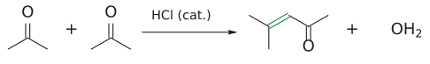

그림: 한 분자의 enol α-C(파랑)가 다른 분자의 C=O(빨강)에 첨가한 뒤 탈수해 C=C(초록).

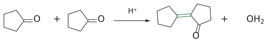

그림: aldol 첨가 뒤 탈수.

(출처: L8 p.12)

#### 3.2 메커니즘: enolate 대신 enol

산성 용액에는 enolate가 존재할 수 없다. 그러면 nucleophile은 무엇일까? 답은 enol이다. enol은 enolate보다 약한 nucleophile지만, 대신 산이 상대 carbonyl을 protonate해 훨씬 강한 electrophile로 만들어 주므로 반응이 일어난다(→ [L10](L10_Enol_and_Enamine.md) enol과 enamine 문서의 산 조건 aldol 참고).

1. 산 촉매 enolization. cyclopentanone의 carbonyl O가 protonate되어 oxonium 이온(C=OH⁺)이 되고, α-H가 떨어지며 C=C가 생겨 enol(1-hydroxycyclopentene)이 된다.
2. 산 촉매 aldol addition. enol의 C=C(nucleophile, OH의 비공유 전자쌍이 밀어 줌)가 protonate된 두 번째 cyclopentanone의 carbonyl 탄소를 공격한다. 새 C–C 결합이 생기고, 한쪽은 protonate된 ketone, 다른 쪽은 3차 alcohol이 된다.
3. 탈양성자. H⁺가 떨어지며 aldol 생성물 2-(1-hydroxycyclopentyl)cyclopentanone이 된다.
4. 산 촉매 탈수(슬라이드 표기: E1). 3차 OH가 protonate되어 –OH2⁺가 되고, 물이 떨어져 3차 carbocation이 생긴다. 이웃한 C–H(ketone의 α-탄소)가 H⁺로 떨어지며 C=C가 생겨 C=O와 공액된 2-cyclopentylidenecyclopentanone이 된다.

그림: 위 2단계(산 촉매 aldol addition)를 그린 것이다. 파란색은 nucleophile인 enol(C=C와 OH의 산소), 빨간색은 protonate되어 친전자성이 커진 cyclopentanone의 C=O⁺H다. 화살표 셋은 (1) enol 산소의 비공유 전자쌍이 밀어 주어 C=O⁺H가 생기고, (2) enol의 C=C π 전자가 protonate된 carbonyl 탄소를 공격하며, (3) C=O⁺ π 전자가 산소로 가서 중성 OH가 되는 과정이다. 초록 결합이 새 C–C 결합이며, 이어서 H⁺가 떨어지면 aldol이 된다(3단계).

슬라이드는 이 탈수가 "빠르고, 산성 조건에서는 피하기 어렵다"고 강조한다. 산성 aldol의 생성물을 물으면 일단 enone/엔알을 떠올리는 것이 안전하다.

(출처: L8 p.13)

#### 3.3 손으로 풀어 보기

슬라이드 p.14에는 phenylacetaldehyde + NaOH(aldol), cyclohexanone + NaOH(aldol), benzaldehyde + acetaldehyde + NaOH(탈수 생성물)의 빈 칸이 있다. 연습 문제 1~3으로 옮겼다.

(출처: L8 p.14)

### 4. aldol은 거꾸로도 간다: retro-aldol reaction

> 개념 문서: [retro-aldol reaction](../../wiki/반응/역알돌%20반응.md)

aldol 첨가가 가역이라면, aldol 생성물을 다시 두 carbonyl로 쪼갤 수도 있지 않을까? 실제로 산업에서 이걸 쓴다.

benzaldehyde는 바닐린 다음으로 중요한 향료(아몬드 향)다. 슬라이드에 따르면 2010년 기준 합성품이 연간 7000 t, 천연품이 100 t 수준이고, 일부는 살구·복숭아·자두 씨와 쓴 아몬드에서 분리한다. 그런데 "천연 아몬드 오일"의 80%는 cassia oil에서 대량으로 얻는 천연 cinnamaldehyde를 화학적으로 쪼개서 만든다.[3] 이 쪼개는 반응이 retro-aldol이다.

(E)-PhCH=CHCHO (cinnamaldehyde) --[K2CO3, reflux]--> PhCHO + CH3CHO

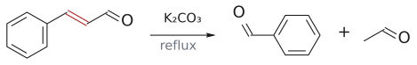

그림: 물이 β-C에 첨가한 뒤 C–C(빨강)가 끊어진다.

cinnamaldehyde는 aldol "축합" 생성물이라 OH가 없다. 그러면 어떻게 거꾸로 갈까? 먼저 탈수를 되돌린 다음 aldol 첨가를 되돌린다.

1. conjugate addition. HO⁻가 cinnamaldehyde의 β-탄소를 공격한다(1,4-첨가). 결과는 β-탄소에 OH가 붙은 enolate다.
2. 양성자 전달. enolate의 α-탄소가 양성자를 받아 aldehyde로 돌아가고, β-OH는 양성자를 잃어 alkoxide PhCH(O⁻)CH2CHO가 된다.
3. C–C 결합 개열. alkoxide O⁻가 다시 C=O를 만들면서 Cα–Cβ 결합을 끊는다. PhCHO와 acetaldehyde enolate(CH2=CH–O⁻)가 생긴다. aldol addition 단계를 정확히 거꾸로 돌린 것이다.
4. enolate가 물에서 양성자를 받아 CH3CHO가 된다.

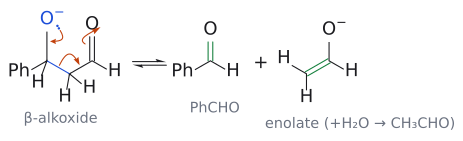

그림: 위 3단계(C–C 결합 개열)를 그린 것으로, 2.2의 그림을 거꾸로 돌린 모양이다. 파란색은 전자를 내주는 쪽(alkoxide O⁻와 끊어지는 Cα–Cβ 결합), 빨간색은 전자를 받는 aldehyde carbonyl 탄소다. 화살표 셋은 (1) O⁻의 비공유 전자쌍이 내려와 C=O를 만들고, (2) Cα–Cβ 결합 전자가 Cα와 carbonyl 탄소 사이로 옮겨 C=C(enolate)를 만들며, (3) 원래의 C=O π 전자가 산소로 가서 O⁻가 되는 과정이다. 초록 결합이 새로 생긴 C=O와 C=C다. enolate는 물에서 양성자를 받아 CH3CHO가 된다(4단계).

(출처: L8 p.15, p.16)

### 5. 교차 aldol reaction: 문제와 세 가지 해법

> 개념 문서: [교차 aldol reaction](../../wiki/반응/교차%20알돌%20반응.md), [directed aldol](../../wiki/반응/교차%20알돌%20반응.md), [LDA](../../wiki/시약/LDA.md), [kinetic vs thermodynamic enolate](../../wiki/개념/속도론적%20엔올레이트와%20열역학적%20엔올레이트.md), [silyl enol ether](../../wiki/시약/실릴%20엔올%20에터.md), [Mukaiyama aldol reaction](../../wiki/반응/무카이야마%20알돌%20반응.md), [TiCl4](../../wiki/시약/TiCl4.md), [Knoevenagel condensation](../../wiki/반응/크뇌베나겔%20축합.md), [Henry reaction](../../wiki/반응/헨리%20반응.md), [alpha-hydrogen acidity](../../wiki/개념/α-수소의%20산도.md)

#### 5.1 무엇이 문제인가

서로 다른 두 carbonyl 화합물 사이의 aldol 축합을 교차 aldol(crossed aldol)이라 한다. ethanal과 propanal을 HO⁻/H2O로 섞으면 무엇이 생길까? 두 분자 모두 enolate가 될 수 있고, 두 분자 모두 공격받을 수 있다. 그래서 2 × 2 = 4가지 생성물이 섞여 나온다.

- 3-hydroxybutanal: ethanal enolate + ethanal
- 3-hydroxy-2-methylpentanal: propanal enolate + propanal
- 3-hydroxy-2-methylbutanal: propanal enolate + ethanal
- 3-hydroxypentanal: ethanal enolate + propanal

그렇다면 교차 생성물 하나만 선택적으로 얻으려면? 핵심은 "누가 nucleophile이고 누가 electrophile인지"를 강제로 정해 주는 것이다. 슬라이드는 세 가지 길을 제시한다. (1) lithium enolate를 미리 만든다, (2) silyl enol ether를 쓴다, (3) 약염기를 써서 산성도·친전자성 차이를 thermodynamic deprotonation.

(출처: L8 p.17)

#### 5.2 해법 1: lithium enolate를 미리 만든다 (directed aldol)

아이디어는 단순하다. 한쪽 짝을 먼저 완전히 enolate로 바꿔 놓으면, 나중에 넣는 짝은 공격받는 역할밖에 할 수 없다. 이를 위해 LDA를 쓴다(→ [L7](L07_Enolate_Alkylation.md) enolate alkylation 문서의 LDA 항목 참고). 슬라이드는 enolate 쪽으로 주로 ketone이나 ester를 쓰고, aldehyde는 잘 안 된다고 명시한다.[4]

1. ketone을 LDA(Li⁺ ⁻N(i-Pr)2, 강염기)에 THF, −78 °C에서 가하면 α-H가 떨어져 lithium enolate가 생긴다.
2. aldehyde를 넣으면 enolate α-탄소가 aldehyde의 carbonyl 탄소를 공격해 lithium alkoxide가 된다.
3. 마지막에 물을 넣으면 산-염기 반응으로 lithium alkoxide가 protonate되어 aldol이 된다.

예를 들면 다음과 같다.

- CH3COCH3 --[(1) LDA, THF, −78 °C; (2) CH3CH2CHO; (3) H2O]--> CH3CH2CH(OH)CH2COCH3 (4-hydroxyhexan-2-one)
- CH3COCH2CH3 --[LDA, THF, −78 °C]--> CH2=C(OLi)CH2CH3 --[CH3CHO]--> --[H2O]--> CH3CH2COCH2CH(OH)CH3 (5-hydroxyhexan-3-one, 75%). 슬라이드 표현대로 "단일 교차 aldol 생성물"이다.

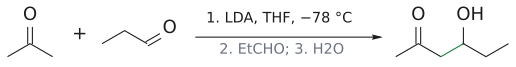

그림: lithium enolate(파랑)가 aldehyde C(빨강)와 새 C–C(초록).

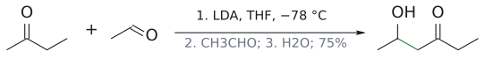

그림: LDA는 덜 치환된 $CH_3$ (파랑)에서 kinetic enolate를 만든다.

두 번째 예에서 왜 ethyl 쪽이 아니라 methyl 쪽이 반응했을까? LDA/−78 °C는 덜 붐비는 CH3의 H를 더 빨리 떼어 내므로 덜 치환된 enolate, 즉 kinetic enolate가 생기기 때문이다.

(출처: L8 p.18)

**예시 모음.** 슬라이드 p.19는 같은 전략의 예를 더 보여 준다.

- PhCOCH2CH3 --[LDA, −78 °C, THF]--> PhC(OLi)=CHCH3 --[CH3CH2CHO]--> PhCO–CH(CH3)–CH(OH)CH2CH3 (94%). enolate는 OLi와 CH3가 같은 쪽인 (Z)형으로 그려져 있다.
- (CH3)2CH–CO–CH(CH3)2 --[LDA, −78 °C, THF]--> (CH3)2CH–C(OLi)=C(CH3)2 --[CH2=CHCHO]--> (CH3)2CH–CO–C(CH3)2–CH(OH)–CH=CH2 (82%). acrolein은 α,β-unsaturated aldehyde지만, 여기서는 carbonyl 탄소에 직접 붙은(1,2-첨가) aldol로 그려져 있다.
- ester (CH3)2CHCO2Et + LDA, 이어서 (CH3)2C=CHCHO의 빈 칸은 연습 문제 4로 옮겼다.

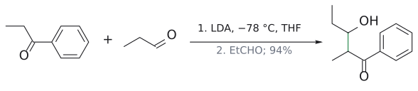

그림: (Z)-enolate를 거친 교차 aldol. 새 C–C(초록).

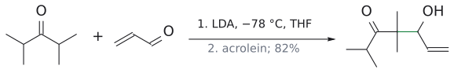

그림: enolate가 acrolein의 C=O 탄소(빨강)에 직접 첨가한다.

보충: lithium enolate aldol은 왜 이렇게 깔끔할까? 교과서의 설명은 두 가지다. 첫째, LDA에 의한 enolate 형성은 Li–O 배위가 먼저 일어나고 곧바로 양성자가 떨어질 만큼 빨라서, 반쯤 만들어진 enolate가 아직 enolization되지 않은 ketone과 반응할 틈이 거의 없다(aldehyde는 예외라 자기 축합이 더 빠르다). 둘째, 나중에 넣은 aldehyde가 enolate와 같은 Li⁺에 배위한 뒤, Li를 포함한 6원 고리 transition state에서 분자 내 반응처럼 C–C 결합이 생긴다. 이 고리형 경로 때문에 lithium enolate는 보통 conjugate addition을 하지 않으며, 위 acrolein 예가 1,2-첨가(aldol)로 그려진 이유도 여기에 있다. (보충 근거: Clayden p.625, p.626)

(출처: L8 p.19)

**거꾸로 생각하기: 역합성.** aldol 생성물을 보고 출발물을 찾으려면 어디를 끊어야 할까? 답은 carbonyl의 α-탄소와 OH가 달린 탄소 사이(Cα–Cβ)다. 끊으면 C=O 쪽 조각은 enolate, OH 쪽 조각은 aldehyde/ketone이 된다.

- 목표물: (E)-CH3CH2CH=CH–CO–CH2–CH(OH)–C6H5
- 역합성: ⇒ CH3CH2CH=CH–C(OLi)=CH2 + C6H5CHO
- 합성: CH3CH2CH=CH–CO–CH3 --[(1) LDA; (2) C6H5CHO; (3) H2O]--> 목표물

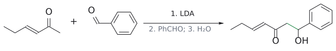

그림: kinetic enolate의 $CH_3$ 쪽(파랑)이 PhCHO와 새 C–C(초록).

이 ketone의 반대쪽 α-탄소는 alkene의 sp2 탄소라서 enolate를 만드는 데 쓰이지 않는다. 그래서 CH3 쪽만 반응한다. 슬라이드 p.21의 두 연습 구조(2-[hydroxy(phenyl)methyl]cyclohexanone, (CH3)2CHCOCH2CH(OH)CH2CH3)는 연습 문제 5, 6으로 옮겼다.

(출처: L8 p.20, p.21)

#### 5.3 해법 2: silyl enol ether와 Mukaiyama aldol

**silyl enol ether는 무엇이 다른가.** lithium enolate는 반응성이 너무 좋아 보관이 안 된다. 그렇다면 enolate를 "병에 담아 둘 수 있는" 형태로 만들 수는 없을까? silyl enol ether(TMS-enolate)가 그 답이다. Si는 Li보다 덜 전기양성적이라 O–Si 결합이 더 공유결합적이고, 그 결과 silyl enol ether는 lithium enolate보다 안정하고 반응성이 낮다. 그래서 정제하고 특성 분석까지 할 수 있다.

그런데 enolate는 C와 O 양쪽으로 반응할 수 있는데, silyl group은 왜 O에 붙을까? 결합 에너지가 답한다. Si–O는 452 kJ/mol, Si–C는 318 kJ/mol로 Si–O가 훨씬 강하다. 보충: 규소 electrophile이 hard하다는 점도 같은 방향으로 작용한다. hard electrophile은 전하가 많이 모인 enolate의 O와 반응한다(→ [L7](L07_Enolate_Alkylation.md) C 대 O 반응성 참고). (보충 근거: Clayden p.466)

(출처: L8 p.22)

**만드는 법 1: carbonyl + TMSCl, Et3N.**

1. carbonyl O의 비공유 전자쌍이 Me3Si–Cl의 Si를 공격하고 Cl⁻가 떨어진다. O-silyl oxocarbenium 이온(R–C=O⁺–SiMe3)이 된다.
2. Et3N(약염기)이 α-H를 떼어 C=C를 만들면 silyl enol ether RC(OSiMe3)=CH2가 된다.

비대칭 ketone에서는 어느 쪽 H가 떨어질까? 이 조건에서는 더 치환된 enol ether, 즉 thermodynamic TMS-enolate가 생긴다. 예를 들어 2-methylcyclohexanone --[TMSCl, Et3N]--> 2-methyl-1-(trimethylsilyloxy)cyclohex-1-ene이다. 슬라이드의 설명은 이렇다. H가 떨어지는 transition state는 산소 쪽에 양전하가 남아 있는 cation성 상태인데, methyl이 붙은 쪽에서 H가 떨어지면 그 methyl이 이 cation성 transition state를 더 잘 안정화한다.

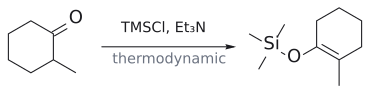

그림: 열역학 조건이라 더 치환된 C=C(초록)가 생긴다.

(출처: L8 p.22, p.23)

**만드는 법 2: lithium enolate + TMSCl.** 반대로 덜 치환된 silyl enol ether가 필요하면? LDA로 kinetic lithium enolate를 먼저 만들고, 그 O로 TMSCl의 Si를 공격하게 하면 된다(Cl⁻ 이탈). 이것이 kinetic TMS-enolate다.

2-methylcyclohexanone으로 비교하면 차이가 극적이다.

| 조건 | thermodynamic (더 치환된 C=C) | kinetic (덜 치환된 C=C) |
|---|---|---|
| i. LDA, −78 °C; ii. Me3SiCl | 1% | 99% |
| Me3SiCl/Et3N, DMF, 130 °C, 66 h | 88% | 12% |

(출처: L8 p.24)

**Mukaiyama aldol.** silyl enol ether는 얌전한 대신 혼자서는 aldehyde를 잘 공격하지 못한다. 그래서 루이스산 촉매, 흔히 Ti(IV)(TiCl4)로 상대 carbonyl을 활성화해 준다.

RC(OSiMe3)=CH2 --[PhCHO, TiCl4]--> RCOCH2CH(OSiMe3)Ph (aldol의 silyl ether) --[H2O 후처리]--> RCOCH2CH(OH)Ph

슬라이드가 제시한 가능한 메커니즘은 다음과 같다.

1. TiCl4가 PhCHO의 carbonyl O에 배위해 carbonyl 탄소를 더 친전자적으로 만든다.
2. aldol addition. silyl enol ether의 C=C(nucleophile, O의 전자쌍이 밀어 줌)가 활성화된 carbonyl 탄소를 공격한다. 새 C–C 결합이 생기고, 한쪽은 silyl oxocarbenium(Me3Si–O⁺=C), 다른 쪽은 티타늄 alkoxide(–O–TiCl3)가 된다.
3. Cl⁻가 Si를 공격해 Me3Si 기를 떼어 Me3SiCl. ketone이 드러난다.
4. 티타늄 alkoxide가 Me3Si 기를 다시 붙잡아 aldol의 silyl ether가 되고, TiCl4가 재생된다.
5. 물로 후처리하면 Si–O가 끊어져 aldol이 된다.

그림: 위 2단계(aldol addition)를 그린 것이다. 슬라이드처럼 TiCl4가 배위한 aldehyde를 O⁺–TiCl3로 나타냈다. 파란색은 nucleophile인 silyl enol ether(C=C와 O), 빨간색은 활성화된 carbonyl(C=O⁺)이다. 화살표 셋은 (1) enol ether 산소의 비공유 전자쌍이 밀어 주어 silyl oxocarbenium(C=O⁺–SiMe3)이 생기고, (2) C=C π 전자가 carbonyl 탄소를 공격하며, (3) C=O⁺ π 전자가 산소로 가서 티타늄 alkoxide(O–TiCl3)가 되는 과정이다. 초록 결합이 새 C–C 결합이다. 이후 Cl⁻가 Me3Si를 떼어 내고 티타늄 alkoxide가 다시 받아 오는 과정(3, 4단계)은 그리지 않았다.

(출처: L8 p.25)

**Mukaiyama aldol의 예.** LDA 방법에서는 aldehyde enolate가 곤란했다. 그런데 silyl enol ether로는 aldehyde끼리의 교차 aldol도 깔끔하게 된다.

- aldehyde + aldehyde: (CH3)2CHCHO --[Me3SiCl, Et3N]--> (CH3)2C=CH–OSiMe3 (안정한 silyl enol ether) --[PhCH2CH2CHO, TiCl4]--> PhCH2CH2–CH(OH)–C(CH3)2–CHO (95% 분리).
- ketone + aldehyde, 이어서 탈수: CH3CH2COCH2CH3 --[Me3SiCl, Et3N]--> CH3CH=C(OSiMe3)CH2CH3 --[CH3CH2CH(CH3)CHO, TiCl4]--> CH3CH2CH(CH3)–CH(OH)–CH(CH3)–COCH2CH3 (92%) --[TsOH]--> CH3CH2CH(CH3)–CH=C(CH3)–COCH2CH3 (manicone, 4,6-dimethyloct-4-en-3-one, 83%; E-alkene으로 그려짐). 마지막 탈수는 산(TsOH) 촉매다.
- ketone의 thermodynamic enol ether: PhCH2COCH3 (1-phenylpropan-2-one) --[Me3SiCl, Et3N]--> CH3C(OSiMe3)=CHPh. C=C가 phenyl과 공액되는 더 치환된 쪽에 생긴다. 이것을 PhCOCHO, TiCl4와 반응시키는 빈 칸은 연습 문제 7로 옮겼다.

그림: aldehyde의 silyl enol ether(초록 C=C).

그림: TiCl4가 C=O를 활성화해 enol ether(파랑)가 공격한다.

그림: silyl enol ether 형성.

그림: 새 C–C(초록).

그림: OH(빨강)가 빠지며 공액 C=C(초록).

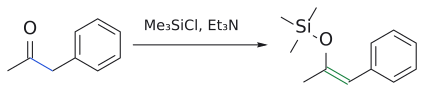

그림: C=C(초록)가 phenyl과 공액되는 쪽에 생긴다.

(출처: L8 p.26, p.27)

#### 5.4 해법 3: "약한" 염기로 차이를 이용한다

LDA나 TiCl4 없이 평범한 염기로도 교차 aldol을 선택적으로 할 수 있을까? 두 짝 사이에 뚜렷한 차이가 있으면 가능하다. 슬라이드는 두 경우로 나눈다.

**Case 1: 한 짝이 훨씬 더 산성이다 (thermodynamic deprotonation).** 약염기는 가장 산성인 H만 떼어 낸다. 그러니 한 짝만 유난히 산성이면 그 짝만 nucleophile이 된다.

- 1,3-dicarbonyl 화합물(monocarbonyl보다 산성): CH2(CO2Et)2 + (CH3)2CHCHO --[R2NH, HOAc]--> (CH3)2CH–CH=C(CO2Et)2 (92%). 탈수까지 진행된다.[5]
- nitro 화합물(monocarbonyl보다 산성, nitro메테인의 수용액 pKa 약 10.2):
  - PhCHO + CH3NO2 --[NaOH, MeOH]--> (E)-PhCH=CH–NO2 (85%, 탈수 생성물)
  - cyclohexanone + CH3NO2 --[NaOH, MeOH]--> 1-(nitromethyl)cyclohexan-1-ol (70%, 첨가 생성물)
  - 비교: cyclohexanone --[NaOH, MeOH]--> 2-cyclohexylidenecyclohexan-1-one

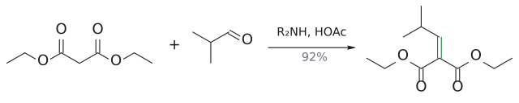

그림: 1,3-dicarbonyl의 α-C(파랑)와 aldehyde C(빨강)가 탈수까지 가서 C=C(초록).

그림: Henry 반응 후 탈수.

그림: ketone에서는 첨가 생성물에서 멈춘다.

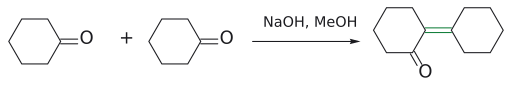

그림: 자기 축합.

마지막 두 줄을 나란히 놓은 이유가 있다. nitro메테인이 없으면 cyclohexanone은 스스로 축합한다. 그런데 nitro메테인이 있으면 NaOH는 훨씬 산성인 CH3NO2를 먼저 deprotonate하고, 생긴 nitro네이트가 nucleophile이 된다. ketone은 electrophile 역할만 하게 되므로 교차 생성물이 선택적으로 생긴다.[6]

(출처: L8 p.28)

**Case 2: 한 짝은 enolate를 못 만들지만 더 좋은 electrophile다.** α-H가 없는 aldehyde가 대표적이다. 이런 짝은 nucleophile이 될 수 없으니 역할 배분이 저절로 정해진다.

- 비타민 A의 상업적 합성: geranial ((E)-3,7-dimethylocta-2,6-dienal) + CH3COCH3 --[EtONa, EtOH, −5 °C]--> pseudoionone (49%; (CH3)2C=CHCH2CH2C(CH3)=CH–CH=CH–COCH3). acetone이 enolate가 되어 제라니알의 CHO를 공격한다.[7]
- PhCHO + PhCOCH3 --[HO⁻, 20 °C]--> (E)-PhCH=CH–CO–Ph (1,3-diphenylprop-2-en-1-one, benzalacetophenone, 85%). benzaldehyde는 α-H가 없어 electrophile로만 쓰이고, acetophenone이 enolate를 낸다. aldol 뒤 E1cB 탈수까지 진행된다.

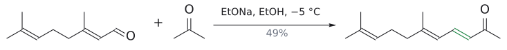

그림: acetone enolate(파랑)가 geranial C=O(빨강)에 첨가하고 탈수한다.

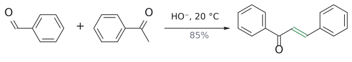

그림: α-H 없는 benzaldehyde가 electrophile(빨강), acetophenone이 enolate(파랑).

여기에 한 가지가 더 작용한다. ketone은 aldehyde보다 친전자성이 낮아서, ketone enolate는 다른 ketone보다 aldehyde를 공격하는 쪽을 택한다.[8]

보충: 교과서는 이 방식의 교차 aldol이 성공할 조건을 두 가지로 정리한다. (1) 한 짝만 enolization될 수 있어야 하고, (2) enolization되지 않는 짝이 enolization되는 짝보다 더 친전자적이어야 한다. 첫째는 누구나 기억하지만 둘째를 잊기 쉽다. 예를 들어 acetaldehyde와 benzophenone(Ph2C=O)을 염기로 섞으면, enolization될 수 있는 것은 acetaldehyde뿐이지만 benzophenone은 입체 장애가 크고 두 phenyl과 공액되어 친전자성이 낮다. 그래서 enolate는 benzophenone 대신 남은 acetaldehyde를 공격해 자기 aldol만 생기고, benzophenone은 구경꾼으로 남는다. 위의 benzaldehyde + acetophenone은 두 조건을 모두 만족하므로 잘 된다. (보충 근거: Clayden p.619)

(출처: L8 p.29)

### 6. intramolecular aldol reaction: 고리 만들기

> 개념 문서: [lilial](../../wiki/반응/교차%20알돌%20반응.md), [intramolecular aldol reaction](../../wiki/반응/분자내%20알돌%20반응.md)

한 분자 안에 carbonyl이 두 개 있으면 어떻게 될까? enolate가 같은 분자의 다른 carbonyl을 공격해 고리가 생긴다. 슬라이드는 이것이 5원 또는 6원 고리(때로는 더 큰 고리)를 만드는 편리한 방법이라 소개한다. 출발물은 dialdehyde, ketoaldehyde, diketone이다.

- CH3CO(CH2)4CHO (6-oxoheptanal) --[HO⁻]--> 1-acetylcyclopentene (1-(cyclopent-1-en-1-yl)ethan-1-one, 73%). 슬라이드 메모: "aldehyde가 더 좋은 electrophile."
- cyclodecane-1,6-dione --[산 또는 염기]--> enolization → intramolecular aldol로 5원/7원 융합 고리의 3차 alcohol → −H2O → 고리 접합부에 사치환 C=C를 가진 공액 enone(bicyclo[5.3.0]decenone 골격). 산이든 염기든 거의 100% 수율이다.
- CH3CO(CH2)5COCH3 (nonane-2,8-dione) --[H2SO4]--> 1-(2-methylcyclohex-1-en-1-yl)ethan-1-one (85%, 6원 고리).

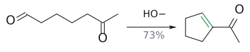

그림: ketone 쪽 enolate(파랑)가 더 좋은 electrophile인 aldehyde(빨강)를 공격.

![cyclodecane-1,6-dione → bicyclo[5.3.0] enone](../../figures/L08/intramolecular_cyclodecanedione.svg)

그림: 5원/7원 융합 고리, 접합부 C=C(초록).

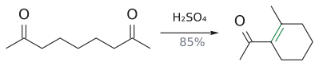

그림: 6원 고리가 생기는 쪽으로 닫힌다.

(출처: L8 p.30)

**메커니즘: 6-oxoheptanal.** 이 분자는 α-탄소가 셋(C2, C5, C7)이고 carbonyl이 둘(C1 aldehyde, C6 ketone)이다. 그런데 왜 하필 1-acetylcyclopentene 하나만 나올까?

1. HO⁻가 여러 α-H를 떼어 여러 enolate를 만든다. 슬라이드는 이 가운데 ketone 옆 CH2(C5)의 enolate가 주 생성물로 이어진다고 표시하고, 나머지는 "다른 enolate anion"으로 평형에 남겨 둔다.
2. C5 enolate(nucleophile)가 같은 분자의 aldehyde 탄소 C1(electrophile)을 공격한다. C1–C5가 이어지며 5원 고리가 생기고 alkoxide가 된다.
3. alkoxide가 물에서 양성자를 받아 2-acetylcyclopentan-1-ol(β-hydroxy ketone)이 된다.
4. 염기에 의한 E1cB. acetyl 옆 고리 탄소의 H가 떨어져 enolate가 되고, HO⁻가 떨어지며 C=O와 공액된 이중결합이 생긴다.

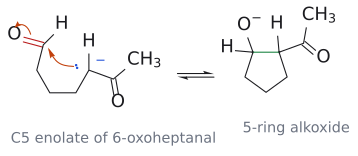

그림: 위 2단계를 그린 것이다. 왼쪽은 ketone 옆 CH(C5)가 deprotonate된 enolate로, 슬라이드처럼 탄소 anion 형태로 그렸다(파란 전자쌍과 −). 빨간색은 electrophile인 aldehyde C1과 C=O다. 화살표 둘은 (1) C5의 전자쌍이 같은 분자의 C1을 공격하고, (2) C=O π 전자가 산소로 올라가 alkoxide가 되는 과정이다. 초록 결합이 고리를 닫는 새 C1–C5 결합이며, 생성물은 acetyl group이 붙은 5원 고리 alkoxide다. 이어서 양성자 전달과 E1cB 탈수를 거쳐 1-acetylcyclopentene이 된다(3, 4단계).

다른 조합과 비교하면 이유가 보인다. C2 enolate(aldehyde α)가 C6 ketone을 공격해도 5원 고리가 되지만, 덜 친전자적인 ketone을 공격해야 하므로 불리하다. C7(CH3) enolate가 C1을 공격하면 7원 고리가 되어 역시 불리하다. 그리고 aldol 첨가는 가역이므로, 결국 가장 좋은 조합(5원 고리 + aldehyde electrophile + 공액 생성물)으로 수렴한다.[9]

(출처: L8 p.31)

**응용: 릴리 aldehyde.** 슬라이드 p.32는 은방울꽃 향료인 릴리 aldehyde(lily aldehyde, lilial)의 합성을 빈 칸으로 낸다. 흐름은 [?] --[oxidation]--> [?] --[alkyl aldehyde, ⁻OH (cat)]--> 4-tBu-C6H4–CH=C(R)–CHO --[H2/Pd]--> [lilial]이다. (R)-이성질체는 cyclamen/은방울꽃(lily of the valley)을 떠올리게 하는 강한 꽃향기를 내지만, (S)-이성질체는 강한 냄새가 없다. 빈 칸은 연습 문제 8로 옮겼다.[10]

(출처: L8 p.32)

### 7. enolate가 만나는 세 electrophile

> 개념 문서: [enolate chemistry (overview)](../../wiki/개념/엔올레이트%20화학%20개관.md), [Claisen condensation](../../wiki/반응/클라이젠%20축합.md), [Michael reaction](../../wiki/반응/마이클%20반응.md)

마지막으로 슬라이드는 enolate의 상대를 세 가지로 정리한다. 상대가 무엇이냐에 따라 생성물의 산소 배치가 달라진다는 것이 요점이다.

1. aldol reaction: enolate + aldehyde/ketone ⇌ β-hydroxy carbonyl ⇌ α,β-unsaturated carbonyl
2. Claisen reaction: enolate + ester(R'CO2Et) ⇌ 1,3-dicarbonyl RCOCH2COR' (→ [L9](L09_Claisen_Condensation.md) Claisen condensation 문서 참고)
3. conjugate addition(Michael addition): enolate + α,β-unsaturated carbonyl(CH2=CHCOR') ⇌ 1,5-dicarbonyl RCOCH2CH2CH2COR'[11]

(출처: L8 p.33)

### 8. 정리

> 개념 문서: [enolate chemistry (overview)](../../wiki/개념/엔올레이트%20화학%20개관.md)

aldol 반응은 두 carbonyl 화합물을 이어 β-hydroxy carbonyl을 만들며, 염기성과 산성 조건 모두에서 일어난다. 교차 aldol은 lithium enolate, silyl enol ether, 약염기로 제어하고, intramolecular aldol로는 고리를 만든다. enolate는 aldehyde/ketone 외에 ester, α,β-unsaturated carbonyl과도 반응한다.

(출처: L8 p.34)

## 흔한 오해

- aldol 반응은 늘 탈수 생성물까지 간다고 생각하기 쉽지만, 사실은 염기성 저온·짧은 시간(예: 10% NaOH, 5 °C)에서는 β-hydroxy carbonyl에서 멈출 수 있다. 다만 산성 조건에서는 탈수가 빨라 피하기 어렵다. (p.8, p.11, p.13)
- 염기성 탈수를 E2나 E1이라고 쓰기 쉽지만, 사실은 enolate(짝염기)를 먼저 만든 뒤 HO⁻가 떨어지는 E1cB다. 산성 탈수는 슬라이드에서 E1(carbocation 경유)로 표기한다. (p.10, p.13)
- 산성 aldol에서도 enolate가 공격한다고 생각하기 쉽지만, 사실은 nucleophile은 중성 enol이고, electrophile은 protonate된 carbonyl이다. (p.13)
- OH가 enolate 쪽 탄소에 붙는다고 착각하기 쉽지만, 사실은 OH는 공격받은 carbonyl(electrophile) 쪽 탄소에 생기고 C=O는 enolate 쪽에 남는다. 역합성은 Cα–Cβ 결합을 끊는다. (p.9, p.20)
- 서로 다른 두 aldehyde를 NaOH로 섞으면 교차 생성물이 주로 나온다고 생각하기 쉽지만, 사실은 둘 다 enolization될 수 있으면 4가지 혼합물이 된다. (p.17)
- enolization되지 않는 짝만 고르면 약염기 교차 aldol이 된다고 생각하기 쉽지만, 사실은 그 짝이 enolization되는 짝보다 더 친전자적이어야 한다. benzophenone + acetaldehyde는 acetaldehyde의 자기 aldol만 준다. (보충 근거: Clayden p.619)
- LDA 방법이면 무엇이든 enolate로 쓸 수 있다고 생각하기 쉽지만, 사실은 슬라이드가 주로 ketone/ester용이라 하고 aldehyde는 잘 안 된다고 명시한다. aldehyde끼리의 교차 aldol에는 silyl enol ether + TiCl4(Mukaiyama)가 쓰인다. (p.18, p.26)
- TMSCl/Et3N과 LDA 후 TMSCl이 같은 silyl enol ether를 준다고 생각하기 쉽지만, 사실은 전자는 thermodynamic(더 치환된, 88:12), 후자는 kinetic(덜 치환된, 1:99) 이성질체를 준다. (p.23, p.24)
- silyl group이 enolate의 탄소에 붙을 수 있다고 생각하기 쉽지만, 사실은 Si–O(452 kJ/mol)가 Si–C(318 kJ/mol)보다 훨씬 강해 O에 붙는다. (p.22)
- silyl enol ether는 lithium enolate처럼 그냥 aldehyde와 반응한다고 생각하기 쉽지만, 사실은 반응성이 낮아 TiCl4 같은 루이스산이 필요하다. 생성물도 일단 aldol의 silyl ether이고, 물 후처리로 aldol이 된다. (p.22, p.25)
- cinnamaldehyde에는 OH가 없으니 retro-aldol이 불가능하다고 생각하기 쉽지만, 사실은 HO⁻가 먼저 β-탄소에 conjugate addition(탈수의 역)한 뒤 C–C가 끊어진다. (p.16)
- intramolecular aldol에서는 고리 크기만 보면 된다고 생각하기 쉽지만, 사실은 6-oxoheptanal처럼 5원 고리 경로가 둘 있으면 더 친전자적인 carbonyl(aldehyde)을 공격하는 쪽이 이긴다. (p.30, p.31)

## 반응 정리표

| 반응 | 시약/조건 | 생성물 | regioselectivity | 입체화학 | 비고 |
|---|---|---|---|---|---|
| 자기 aldol (CH3CHO) | 10% NaOH, H2O, 5 °C | 3-hydroxybutanal (50%) | 단일 α-탄소 | 새 입체중심 1개, 라세미 | 가역 (p.8–9) |
| 염기성 탈수 | NaOH, 더 격렬한 조건 | (E)-2-butenal | α-H 제거, β-OH 이탈 | E-alkene으로 그림 | E1cB (p.10–11) |
| 산성 aldol condensation (acetone) | HCl (cat.) | 4-methylpent-3-en-2-one | — | — | 탈수까지 진행 (p.12) |
| 산성 aldol condensation (cyclopentanone) | H⁺ | 2-cyclopentylidenecyclopentanone | — | — | enol 경유, 탈수 E1 (p.12–13) |
| retro-aldol | K2CO3, reflux | cinnamaldehyde → PhCHO + CH3CHO | conjugate addition 후 Cα–Cβ 개열 | — | 천연 benzaldehyde (p.16) |
| Directed aldol (LDA) | (1) LDA, THF, −78 °C; (2) RCHO; (3) H2O | β-hydroxy ketone (예: 5-hydroxyhexan-3-one, 75%) | 덜 치환된 α-탄소 (kinetic) | 슬라이드는 상대 입체 미표기 | ketone/ester enolate, aldehyde 부적합 (p.18–20) |
| thermodynamic silyl enol ether | TMSCl, Et3N (DMF, 130 °C, 66 h) | 더 치환된 TMS enol ether (88:12) | 더 치환된 쪽 | — | cation성 TS (p.22–24) |
| kinetic silyl enol ether | (i) LDA, −78 °C; (ii) TMSCl | 덜 치환된 TMS enol ether (99:1) | 덜 치환된 쪽 | — | O-silyl화 (p.24) |
| Mukaiyama aldol | silyl enol ether + RCHO, TiCl4; H2O | β-hydroxy carbonyl (silyl ether 경유) | enol ether C=C 위치로 결정 | — | 루이스산 필수, aldehyde enol 등가체도 가능 (p.25–27) |
| 1,3-dicarbonyl 축합 | R2NH, HOAc | (CH3)2CHCH=C(CO2Et)2 (92%) | 산성 CH2만 탈양성자 | — | 각주 [5] (p.28) |
| nitro aldol | CH3NO2, NaOH, MeOH | (E)-PhCH=CHNO2 (85%) / 1-(nitromethyl)cyclohexanol (70%) | CH3NO2만 탈양성자 (pKa 10.2) | E-alkene으로 그림 | 각주 [6] (p.28) |
| α-H 없는 aldehyde와 교차 | PhCHO + PhCOCH3, HO⁻, 20 °C | (E)-chalcone (85%) | ketone이 nucleophile | E | 탈수까지 (p.29) |
| 제라니알 + acetone | EtONa, EtOH, −5 °C | pseudoionone (49%) | acetone enolate → CHO | E | 비타민 A 합성 (p.29) |
| intramolecular aldol | HO⁻ 또는 H2SO4 | 1-acetylcyclopentene (73%), 1-(2-methylcyclohex-1-enyl)ethanone (85%) | 5/6원 고리, aldehyde 우선 | — | 탈수 동반 (p.30–31) |

## 연습 문제

1. (p.14) phenylacetaldehyde(PhCH2CHO)를 NaOH로 처리했을 때 aldol 생성물의 구조와 이름은?
2. (p.14) cyclohexanone을 NaOH로 처리했을 때 aldol 생성물은? 탈수가 일어난다면 무엇이 되는가?
3. (p.14) benzaldehyde + acetaldehyde + NaOH의 탈수 생성물은? 왜 이 교차 반응이 비교적 선택적으로 진행될 수 있는가?
4. (p.19) (CH3)2CHCO2Et --[LDA, −78 °C, THF]--> A --[(CH3)2C=CHCHO]--> B 에서 A와 B는?
5. (p.21) 2-[hydroxy(phenyl)methyl]cyclohexan-1-one을 LDA aldol로 합성하는 경로를 쓰시오.
6. (p.21) (CH3)2CH–CO–CH2–CH(OH)–CH2CH3 (5-hydroxy-2-methylheptan-3-one)을 합성하시오. 조건 kinetic vs thermodynamic의 이유도 설명하시오.
7. (p.27) PhCH2COCH3 --[Me3SiCl, Et3N]--> CH3C(OSiMe3)=CHPh --[PhCOCHO, TiCl4]--> ? 생성물은? (후처리 포함)
8. (p.32) 릴리 aldehyde(lilial, 3-(4-tert-butylphenyl)-2-methylpropanal) 합성 경로의 빈 칸 세 곳을 채우시오. 마지막 H2/Pd 단계의 선택성과 생성물의 입체화학도 설명하시오.

## 정답 및 해설

1. **PhCH2–CH(OH)–CH(Ph)–CHO (3-hydroxy-2,4-diphenylbutanal).** HO⁻가 PhCH2CHO의 α-H(benzyl성 CH2)를 떼어 enolate PhCH=CH–O⁻를 만든다. 그 α-탄소(CHPh)가 두 번째 분자의 CHO 탄소를 공격하고, alkoxide가 protonate된다. enolate 쪽 탄소가 Ph와 CHO를 함께 가지므로 C2에 Ph가, OH 탄소(C3)에 PhCH2가 붙는다. 입체중심이 2개 생기므로 부분입체이성질체의 라세미 혼합물이다. (근거: L8 p.9, p.14)

2. **aldol: 2-(1-hydroxycyclohexyl)cyclohexan-1-one.** 한 분자의 enolate α-탄소가 다른 cyclohexanone의 C=O를 공격해 3차 alcohol이 생긴다. 탈수되면 **2-cyclohexylidenecyclohexan-1-one**이 되며, 이는 슬라이드 p.28에 NaOH/MeOH 조건의 자기 축합 생성물로 나온다(p.12의 cyclopentanone 예와 같은 유형). (근거: L8 p.12, p.14, p.28)

3. **(E)-PhCH=CH–CHO (cinnamaldehyde).** PhCHO는 α-H가 없어 electrophile로만 작용하고, acetaldehyde가 enolate(⁻CH2CHO)를 낸다. aldol PhCH(OH)CH2CHO는 E1cB로 탈수되어 Ph, C=C, C=O가 모두 공액된 안정한 생성물이 된다. p.16 retro-aldol의 정반대 방향이다. 보충: acetaldehyde의 자기 aldol이 경쟁할 수 있어서, 실제로는 acetaldehyde를 천천히 넣거나 benzaldehyde를 과량 쓰는 것이 일반적이다. (보충 근거: Wade p.1066) (근거: L8 p.14, p.16, p.29)

4. **A = ester lithium enolate (CH3)2C=C(OLi)OEt. B(후처리 후) = EtO2C–C(CH3)2–CH(OH)–CH=C(CH3)2 (ethyl 3-hydroxy-2,2,5-trimethylhex-4-enoate).** LDA가 ester의 유일한 α-H(3차 CH)를 뗀다. enolate α-탄소가 3-methylbut-2-enal의 CHO 탄소를 공격하고(1,2-첨가, p.19의 acrolein 예와 같은 방식), 후처리로 β-hydroxy ester가 된다. α-탄소가 4차라 H가 없으므로 E1cB 탈수는 불가능하고 aldol 단계에서 멈춘다. (근거: L8 p.18, p.19)

5. **cyclohexanone --[(1) LDA, THF, −78 °C; (2) PhCHO; (3) H2O]--> 2-[hydroxy(phenyl)methyl]cyclohexan-1-one.** 고리 C2와 CH(OH)Ph 사이(Cα–Cβ)를 끊으면 cyclohexanone lithium enolate + benzaldehyde가 나온다. cyclohexanone은 대칭이라 regioselectivity 문제가 없다. lithium enolate를 먼저 정량적으로 만든 뒤 PhCHO를 넣으면 cyclohexanone 자기 aldol이 억제된다. (근거: L8 p.18, p.20, p.21)

![cyclohexanone + PhCHO → 2-[hydroxy(phenyl)methyl]cyclohexanone](../../figures/L08/lda_cyclohexanone_benzaldehyde.svg)

그림: 새 C–C(초록).

6. **(CH3)2CH–CO–CH3 (3-methylbutan-2-one) --[(1) LDA, THF, −78 °C; (2) CH3CH2CHO; (3) H2O]--> (CH3)2CHCOCH2CH(OH)CH2CH3.** C=O 옆 CH2와 CH(OH) 사이를 끊으면 CH2=C(OLi)–CH(CH3)2 + propanal이 나온다. 필요한 enolate는 덜 치환된 CH3 쪽, 즉 kinetic enolate이므로 LDA/−78 °C가 맞다. 더 치환된 isopropyl CH 쪽이 deprotonate되면 다른 생성물이 된다. 또 propanal도 enolization될 수 있어 NaOH 같은 평형 조건에서는 교차 혼합물이 생기므로 enolate를 미리 만들어야 한다. (근거: L8 p.17, p.18, p.21, p.24)

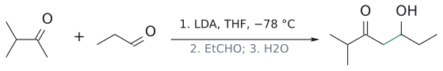

그림: kinetic enolate는 덜 치환된 $CH_3$ (파랑)에서 생긴다.

7. **PhCO–CH(OH)–CH(Ph)–COCH3 (2-hydroxy-1,3-diphenylpentane-1,4-dione).** thermodynamic silyl enol ether는 C=C가 CHPh 쪽에 있으므로 친핵성 탄소는 benzyl CHPh다. TiCl4가 활성화한 phenylglyoxal(PhCO–CHO)에서는 aldehyde 탄소가 ketone 탄소보다 친전자적이므로 CHO가 공격받는다. aldol의 silyl ether를 거쳐 물 후처리로 aldol이 된다. 새 C–C 결합은 CH(Ph)–CH(OH)이다. (근거: L8 p.25, p.27; aldehyde 우선성은 p.30의 원리)

8. **빈 칸: (1) 4-tert-butyltoluene (4-tBu-C6H4–CH3) --[oxidation]--> (2) 4-tert-butylbenzaldehyde (4-tBu-C6H4–CHO) --[alkyl aldehyde, ⁻OH (cat)]--> α,β-unsaturated aldehyde --[H2/Pd]--> (3) 4-tBu-C6H4–CH2–CH(R)–CHO.**
   - 4-tert-butylbenzaldehyde는 α-H가 없어 electrophile로만 작용하고(p.29 Case 2), alkyl aldehyde가 enolate를 낸다. aldol 후 E1cB 탈수로 Ar과 공액된 α-치환 cinnamaldehyde 유도체가 된다.
   - H2/Pd는 C=C만 환원하고 CHO는 남겨 포화 aldehyde를 준다. 보충: Pd catalyst 수소화는 공액 엔알에서 C=C를 C=O보다 우선 환원하는 것이 일반적이다. (보충 근거: Clayden p.536)
   - 입체화학: C2에 새 입체중심이 생기지만 비키랄 H2/Pd로는 라세미체가 된다. 슬라이드에 따르면 (R)-체가 꽃향기를 낸다.
   - **주의:** 슬라이드에는 aldehyde 짝이 부탄알(CH3CH2CH2CHO), intermediate가 α-ethyl(–C(CH2CH3)=)로 그려져 있다. 그대로 따르면 최종물은 2-[(4-tert-butylphenyl)methyl]butanal로, α-methyl인 실제 lilial과 다르다. 실제 lilial이 되려면 aldehyde 짝은 **propanal(CH3CH2CHO)**, intermediate는 4-tBu-C6H4–CH=C(CH3)–CHO여야 한다. 시험에서는 슬라이드의 의도(교차 aldol → 탈수 → C=C 선택적 수소화)를 따르되, lilial 구조를 물으면 α-methyl로 쓰는 것이 맞다. (근거: L8 p.29, p.32)

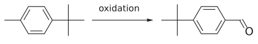

그림: lilial 1단계.

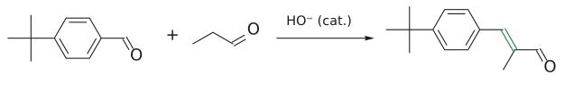

그림: lilial 2단계: 교차 aldol 축합.

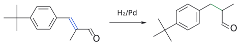

그림: lilial 3단계: C=C(파랑)만 수소화.

## 각주

[1] 이 강의 PDF는 34쪽이며 본 문서의 "p."는 PDF 페이지 번호다. 참고 교재는 Solomons 13판 19장, Clayden 2판 26장. 담당: Dr. Zhu Ye. (출처: L8 p.1)

[2] 로플라마이신 생합성 슬라이드의 효소 약어: AT acyl transferase, ACP acyl carrier protein, KS ketosynthase, DH dehydratase, KR ketoreductase, ER enoyl reductase, TE thioesterase. 보충: 엄밀히 말해 사슬을 늘리는 C–C 결합 형성은 enolate + thioester의 Claisen형 반응이다. 다만 그 결과로 생기는 β-hydroxy carbonyl/1,3-diol 패턴이 aldol 생성물과 같은 산화 패턴이라, 실험실 합성에서는 aldol로 접근한다. (보충 근거: Wade p.1075; Clayden p.1162) (출처: L8 p.4)

[3] 슬라이드 p.15에는 "천연품 100 t/년"과 "20 t은 살구·복숭아 등의 씨에서 분리"라는 두 숫자가 함께 적혀 있어 둘의 관계가 분명하지 않다. 또 "vallinin"은 vanillin의 오타로 보인다. (출처: L8 p.15)

[4] 보충: LDA는 강하고(conjugate acid diisopropylamine pKa 약 35) 입체 장애가 큰 비친핵성 염기라서 carbonyl을 공격하지 않고 deprotonation을 거의 완결·비가역적으로 수행한다. 그래서 두 번째 짝을 넣을 때는 출발 ketone이 남아 있지 않아 자기 aldol이 억제된다. aldehyde는 enolate가 만들어지는 동안 남은 aldehyde와 빠르게 자기 aldol을 일으키기 때문에 이 방법에 맞지 않는다. (보충 근거: Clayden p.398, p.588, p.625)

[5] 보충: 1,3-dicarbonyl 화합물과 aldehyde를 amine/acetic acid 촉매로 축합하는 이 반응은 Knoevenagel 축합으로 알려져 있다(슬라이드에는 이름이 없다). malonic diethyl의 pKa(약 13)는 일반 aldehyde/ketone(약 17–20)보다 훨씬 낮아, 약염기는 사실상 말로네이트만 deprotonation한다. (보충 근거: Clayden p.629)

[6] 보충: nitro알케인과 carbonyl의 aldol형 반응은 Henry reaction(nitro-aldol)이라고도 부른다(슬라이드에는 이름이 없다). (보충 근거: Clayden p.623)

[7] 슬라이드는 Case 2를 "α-H가 없는 aldehyde"로 설명하는데, 제라니알의 α-탄소(C2)에는 H가 하나 있지만 sp2 비닐 탄소의 H라서 일반 enolate를 만들지 않는다. "enolization될 수 있는 sp3 α-H가 없다"로 이해하면 된다. (출처: L8 p.29)

[8] 보충: ketone의 자기 aldol은 평형이 불리한 경우가 많아, ketone enolate는 주로 더 반응성 큰 aldehyde와 생성물을 만든다(표준 교재 내용). (보충 근거: Wade p.1062; Clayden p.619)

[9] 보충: 이 선택성 분석은 슬라이드의 "aldehyde가 더 좋은 electrophile"라는 메모와 "다른 enolate anion" 평형 표시를 바탕으로 정리한 것이다. 5원/6원 고리가 고리 변형이 적고 형성 속도도 유리하다는 점은 표준 교재 내용이다. (보충 근거: Clayden p.637) (출처: L8 p.30, p.31)

[10] 슬라이드 p.32의 aldehyde 짝은 부탄알로, intermediate는 α-ethyl로 그려져 있다. 실제 lilial(2-methyl)과 맞지 않으므로 연습 문제 8 해설의 주의 사항을 볼 것. (출처: L8 p.32)

[11] 슬라이드 p.33의 Michael 생성물은 양 끝이 모두 R로 적혀 있지만, 반응물이 CH2=CHCOR'이므로 한쪽은 R'이어야 맞다. (출처: L8 p.33)
