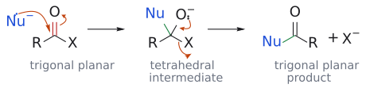
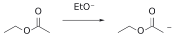
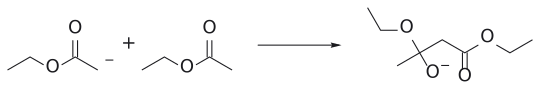
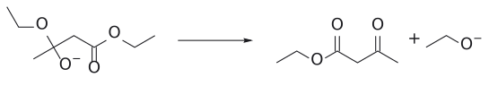
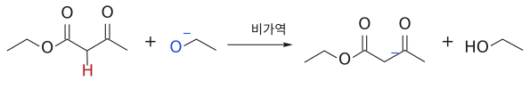
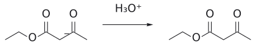
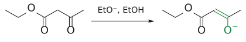
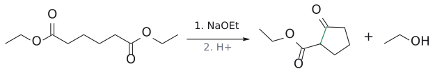

# L9. 클라이젠 축합 (Claisen Condensations)

> **통독본**: 2026-10-12 재구성 직전의 강의별 전체 노트(교과서 보강 포함)를 그대로 보존한 사본이다. 강의 흐름대로 한 번에 읽을 때 쓴다. 이후의 수정과 보충은 개념 문서에만 반영되므로, **최신 내용은 개념 문서**가 기준이다. 뼈대 노트: [L9 뼈대](../L09_Claisen_Condensation.md) · [위키 대문](../../wiki/위키%20대문.md)

> **관련 위키 문서** ([위키 대문](../../wiki/위키%20대문.md))
> - 반응: [교차 Claisen condensation](../../wiki/반응/교차%20클라이젠%20축합.md), [Dieckmann condensation](../../wiki/반응/디크만%20축합.md), [malonic ester synthesis](../../wiki/반응/말론산%20에스터%20합성.md), [acetoacetic ester synthesis](../../wiki/반응/아세토아세트산%20에스터%20합성.md), [ester hydrolysis](../../wiki/반응/에스터%20가수분해.md), [retro-aldol reaction](../../wiki/반응/역알돌%20반응.md), [nucleophilic acyl substitution](../../wiki/반응/친핵성%20아실%20치환.md), [Claisen condensation](../../wiki/반응/클라이젠%20축합.md)
> - 시약: [alkoxide base](../../wiki/시약/알콕사이드%20염기.md)
> - 개념: [alpha-hydrogen acidity](../../wiki/개념/α-수소의%20산도.md), [tetrahedral intermediate](../../wiki/개념/사면체%20중간체.md), [enol and enolate](../../wiki/개념/엔올과%20엔올레이트.md)

## 개요

Claisen condensation은 ester의 enolate가 다른 ester(또는 carbonyl 화합물)의 carbonyl을 공격해 새 C–C 결합을 만드는 반응이다. 결과물은 $\beta$-ketoester($\beta$-keto ester)나 $\beta$-diketone($\beta$-diketone) 같은 1,3-dicarbonyl 화합물인데, 이들은 이후 alkylation·decarboxylation 등으로 온갖 골격을 만드는 출발물이 되므로 합성에서 매우 쓸모가 많다. 앞서 배운 enolate의 $\alpha$-alkylation과 aldol 반응에 이어, 이번에는 "enolate + ester"라는 세 번째 조합을 다룬다(→ [L7](L07_Enolate_Alkylation.md) enolate alkylation·aldol reaction 문서 참고). 이 강의의 핵심은 단 하나로 요약된다. Claisen 축합은 C–C 결합이 생겨서 진행되는 것이 아니라, 생성물이 염기에 의해 deprotonate되기 때문에 진행된다는 것이다. 이 원리 하나로 염기 1당량이 필요한 이유, 교차 Claisen과 Dieckmann 축합이 잘 되는 이유가 모두 설명된다.[1]

(출처: L9 p.1, p.2, p.15)

## 본문

### 1. enolate가 할 수 있는 네 가지 일

> 개념 문서: [Claisen condensation](../../wiki/반응/클라이젠%20축합.md), [enolate alkylation](../../wiki/반응/엔올레이트%20알킬화.md), [aldol reaction](../../wiki/반응/알돌%20반응.md), [Michael reaction](../../wiki/반응/마이클%20반응.md)

enolate는 탄소 nucleophile다. 그렇다면 이 nucleophile을 무엇과 만나게 하느냐에 따라 어떤 반응이 생길까? 슬라이드는 네 가지 상대를 정리한다.

첫째, alkyl halide(Br–CH2R')을 만나면 S_N2로 $\alpha$-alkylation이 일어나 R–CO–CH2–CH2R'이 된다. 둘째, aldehyde나 ketone(R'COR'')을 만나면 aldol 반응으로 $\beta$-hydroxy carbonyl 화합물이 되고, 이것이 탈수되면 $\alpha,\beta$-unsaturated carbonyl 화합물이 된다. 셋째가 이번 강의의 주인공으로, ester(R'–CO–OEt)를 만나면 1,3-dicarbonyl 화합물 R–CO–CH2–CO–R'이 생긴다. 넷째, $\alpha,\beta$-unsaturated carbonyl 화합물을 만나면 conjugate addition(Michael addition)로 1,5-dicarbonyl 화합물이 생긴다(→ [L11](L11_Conjugate_Addition.md) 슬라이드에 L5로 표기된 conjugate addition 문서 참고).[2]

주목할 점은 슬라이드가 aldol·Claisen·Michael에는 모두 평형 화살표(⇌)를 썼다는 것이다. 즉 Claisen의 C–C 결합 형성 자체는 가역이다. 그런데 가역이라면 반응은 대체 어떻게 끝까지 가는가? 이 질문이 이 강의 전체를 관통한다. 참고로 p.2의 빈 박스 정답은 p.14에서 R–CO–CH2–CO–R'로 공개되며, ketone enolate(R–C(O⁻)=CH2)가 공격했으므로 이 경우는 $\beta$-diketone이다.

(출처: L9 p.2, p.14)

### 2. Claisen 반응은 결국 친핵성 acyl 치환이다

> 개념 문서: [nucleophilic acyl substitution](../../wiki/반응/친핵성%20아실%20치환.md), [tetrahedral intermediate](../../wiki/개념/사면체%20중간체.md), [Claisen condensation](../../wiki/반응/클라이젠%20축합.md)

aldol과 Claisen은 둘 다 "enolate가 C=O를 공격"하는데, 왜 생성물이 다를까? 답은 공격당하는 쪽에 leaving group이 있느냐에 있다.

친핵성 acyl nucleophilic acyl substitution의 일반 메커니즘은 이렇다. nucleophile Nu⁻가 평면 trigonal planar carbonyl 탄소를 공격하면 C=O의 $\pi$ 전자가 산소로 밀려나 tetrahedral intermediate가 생긴다. 그런데 이 탄소에 leaving group X가 붙어 있으면, 산소 anion이 다시 C=O를 만들면서 X⁻를 밀어낸다. 그래서 최종 생성물은 다시 평면 삼각형인 Nu–CO–R이다.

Claisen은 여기서 Nu⁻ = enolate, X = OEt인 경우에 불과하다. aldehyde나 ketone에는 쫓아낼 leaving group이 없으니 alkoxide가 양성자를 받아 OH로 aldol, ester에는 EtO⁻라는 leaving group이 있으니 C=O가 되살아나 새 ketone이 생긴다. 즉 aldol은 "첨가", Claisen은 "첨가 후 제거 = 치환"이다. Task 1(R–C(O⁻)=CH2 + R–CO–OEt)의 답도 이 논리로 바로 나온다(연습 문제 1).

그림: 슬라이드 p.3의 일반식이다. 파란색은 nucleophile Nu⁻, 빨간색은 electrophile인 carbonyl(C=O)이다. 왼쪽 화살표 둘은 (1) Nu⁻의 비공유 전자쌍이 trigonal planar carbonyl 탄소를 공격하고 (2) C=O의 $\pi$ 전자가 산소로 올라가는 첨가 단계다. 가운데 tetrahedral intermediate의 화살표 둘은 (3) O⁻의 전자쌍이 내려와 C=O를 되살리고 (4) C–X 결합 전자가 X로 가서 X⁻가 떨어지는 제거 단계다. 초록색이 새로 생긴 Nu–C 결합이며, 생성물은 다시 trigonal planar다.

보충: enolate는 O로도 반응할 수 있는데, acylation에서는 이것이 실제 문제가 된다. 반응성 큰 enolate와 반응성 큰 acylation제(예: lithium enolate + acid chloride)를 만나게 하면 O-acylation이 일어나 enol ester가 생기기 쉽다. 그래서 C-acylation을 원하면 반응성 큰 enolate에는 덜 반응적인 ester를 Claisen, acid chloride처럼 반응성 큰 acylation제에는 enamine·silyl enol ether처럼 덜 반응적인 enol 등가체를 짝짓는다. aldol에서 O-공격이 문제가 되지 않는 이유도 같은 틀로 설명된다. aldehyde가 enolate O에 첨가해도 그 intermediate에서 떨어질 수 있는 것은 enolate 자신뿐이라 그냥 출발물로 되돌아간다. (보충 근거: Clayden p.641, p.642)

(출처: L9 p.3)

### 3. 자기 축합: ester 두 분자가 하나로

> 개념 문서: [Claisen condensation](../../wiki/반응/클라이젠%20축합.md), [alkoxide base](../../wiki/시약/알콕사이드%20염기.md), [acetoacetic ester synthesis](../../wiki/반응/아세토아세트산%20에스터%20합성.md), [alpha-hydrogen acidity](../../wiki/개념/α-수소의%20산도.md)

#### 3.1 무엇이 생기나

ethyl acetate에 소듐 ethoxide를 넣으면 무엇이 Task 2? ester 한 분자가 enolate가 되어 다른 한 분자를 공격하므로, 한쪽은 acyl group을, 다른 쪽은 $\alpha$-탄소를 내놓는다.

2 CH3CO2Et --[NaOEt]--> 소듐 acetoacetate [CH3CO–CH⁻–CO2Et] Na⁺ + EtOH --[HCl]--> ethyl acetoacetate(acetoacetic ester) CH3COCH2CO2Et, 76%

그림: 보충: ester enolate가 두 번째 ester를 공격해 tetrahedral intermediate가 되고, $EtO^-$ 가 떨어져 ethyl acetoacetate가 된다. 앞 단계들은 가역이지만, 두 carbonyl 사이 C–H( $pK_a$ 약 11)를 $EtO^-$ 가 떼는 마지막 탈양성자화가 평형을 끌어당긴다. $H_3O^+$ 후처리로 중성 생성물을 얻는다.

여기서 눈여겨볼 것이 두 가지다. 하나는 반응 직후 플라스크에 있는 것이 중성 $\beta$-ketoester가 아니라 그 소듐염이라는 점이고, 다른 하나는 EtOH를 증류로 빼내 평형을 오른쪽으로 민다는 점이다. 중성 생성물은 HCl로 산 처리한 뒤에야 얻는다.

곁가지가 있는 경우도 똑같다. ethyl ethyl pentanoate 두 분자를 NaOEt로 처리하고 CH3CO2H로 후처리하면 ethyl 3-옥소-2-propylheptanoate(ethyl 3-oxo-2-propylheptanoate), 즉 CH3(CH2)3–CO–CH(CH2CH2CH3)–CO2Et가 77%로 생긴다. 한 분자는 pentanoyl group(C4H9CO–)가 되고, 다른 분자의 $\alpha$-탄소는 propyl group을 단 채 CH로 남는다. 일반화하면 R–CH2–CO2Et 두 분자가 R–CH2–CO–CH(R)–CO2Et가 된다.

(출처: L9 p.4, p.5, p.7)

#### 3.2 메커니즘: 왜 끝까지 가는가

이제 강의의 핵심 질문으로 돌아가자. 메커니즘을 단계별로 보면 답이 보인다.

1. enolate 형성. EtO⁻가 ester $\alpha$-H를 떼어 낸다. 그런데 ester $\alpha$-H는 EtOH보다 훨씬 약한 산이라[3] 이 평형은 왼쪽에 치우쳐 있고, enolate는 아주 조금만 생긴다.
2. 친핵성 첨가. 그 소량의 enolate $\alpha$-탄소(nucleophile)가 다른 ester의 carbonyl electrophile을 공격해 새 C–C 결합과 사면체 alkoxide intermediate를 만든다. 가역이다.
3. 제거. alkoxide가 C=O를 되살리며 EtO⁻를 내보내 중성 $\beta$-ketoester가 된다. 이것도 가역이다.
4. 생성물의 deprotonation. 여기서 판이 뒤집힌다. 새로 생긴 $\beta$-ketoester는 두 carbonyl 사이에 낀 C–H를 갖는데, 이 수소는 슬라이드 표기로 pKa ~9(더 강한 산)다.[4] 반면 EtOH는 pKa 16(더 약한 산)이다. 그러니 EtO⁻(더 강한 염기)는 이 수소를 거의 완전히 떼어 내 비편재화된 $\beta$-ketoester anion(더 약한 염기)을 만든다. 이 산-염기 평형이 오른쪽으로 크게 치우쳐 있기 때문에, 앞의 불리한 평형 1~3이 모두 생성물 쪽으로 끌려간다.
5. 후처리. H3O⁺를 넣으면 anion이 빠르게 protonate되어 keto형 $\beta$-ketoester가 되고, 이는 enol형과 호변이성 평형(keto ⇌ enol)을 이룬다.

그림: 2–3단계(첨가와 제거). ethyl acetate(R = H인 경우, p.5의 예)로 그렸다. 파란색은 nucleophile인 enolate $\alpha$-탄소(탄소 anion 표기), 빨간색은 electrophile인 ester carbonyl이다. 왼쪽 그림의 화살표 둘은 (1) $\alpha$-탄소의 비공유 전자쌍이 carbonyl 탄소를 공격하고 (2) C=O의 $\pi$ 전자가 산소로 올라가 tetrahedral intermediate가 되는 과정이다. 가운데 그림의 화살표 둘은 (3) O⁻의 전자쌍이 내려와 C=O를 되살리고 (4) C–OEt 결합 전자가 산소로 가서 EtO⁻가 떨어지는 과정이다. 초록색은 새로 생긴 C–C 결합이며, 두 단계 모두 가역(⇌)이다.

그림: 4단계, 반응의 원동력. EtO⁻의 산소(파랑)가 두 carbonyl 사이의 산성 H(빨강)를 떼어 가고, C–H 결합 전자(파란 결합)는 탄소에 남아 두 carbonyl로 비편재화된 anion이 된다. 더 강한 산(pKa ~9)과 더 강한 염기에서 더 약한 염기와 더 약한 산(EtOH, pKa 16)이 생기므로 평형이 오른쪽으로 크게 치우친다. 그래서 슬라이드도 이 단계를 반응을 끌고 가는 단계로 강조한다.

슬라이드의 한 줄 요약이 바로 이것이다. "Deprotonation of the product drives the reaction (1 equiv base is needed)." 그래서 염기는 촉매가 아니라 시약이다. 생성물 한 분자가 생길 때마다 EtO⁻ 한 분자가 anion 생성에 묶여 버리므로 1당량이 필요하고, 마지막에 반드시 산 처리를 해야 한다.

이 원리에서 따라 나오는 결론이 하나 더 있다. 만약 생성물의 두 carbonyl 사이 탄소에 H가 하나도 없다면 어떨까? 그러면 4단계의 원동력이 사라져 반응이 잘 진행되지 않는다. 즉 NaOEt로 자기 축합을 하려면 ester에 $\alpha$-H가 2개 이상 있어야 한다.[5]

염기는 왜 하필 NaOEt일까? ethyl ester에 같은 alkoxide를 쓰면, 혹시 EtO⁻가 carbonyl을 공격하더라도 EtO⁻가 다시 나갈 뿐 아무것도 변하지 않는다. 3단계에서 떨어지는 leaving group도 EtO⁻이니 깔끔하다. 다른 alkoxide나 수산화물을 쓰면 문제가 생긴다.[6]

(출처: L9 p.5, p.6)

#### 3.3 같은 anion, 다른 역할: Claisen vs acetoacetic ester alkylation

슬라이드는 두 반응을 나란히 놓는다. Claisen 자기 축합 R–CH2–CO2Et --[EtO⁻, EtOH]--> R–CH2–CO–CH(R)–CO2Et, 그리고 ethyl acetoacetate --[EtO⁻, EtOH]--> enolate CH3–C(O⁻)=CH–CO2Et --[RBr]--> CH3–CO–CH(R)–CO2Et. 왜 이 둘을 비교할까?

그림: 두 C=O 사이 $\alpha$-H(빨강)가 떨어져 비편재화된 enolate(초록)가 된다. 이 단계가 Claisen 평형을 끌어간다.

두 반응 모두 $\alpha$-치환 $\beta$-ketoester를 만들고, 무엇보다 같은 종류의 anion, 즉 두 carbonyl 사이의 비편재화된 $\beta$-ketoester enolate가 EtO⁻/EtOH 조건에서 쉽게 생긴다는 공통점이 있다. 다만 역할이 정반대다. Claisen에서 이 anion은 반응이 흘러 들어가 멈추는 "종착점(원동력)"이고, alkylation에서는 RBr을 공격하는 "출발점(nucleophile)"이다. 또 Claisen은 acyl 부분(R–CH2–CO–)이 출발 ester에서 정해지는 반면, alkylation은 acetyl group을 고정한 채 $\alpha$-위치에 원하는 R을 골라 넣을 수 있다. 그리고 acetoacetate는 산성이 충분히 커서 EtO⁻만으로도 완전히 enolate가 되므로, 단순 ketone alkylation처럼 LDA 같은 강염기가 필요 없다(→ [L7](L07_Enolate_Alkylation.md) enolate alkylation 문서 참고).

(출처: L9 p.7)

### 4. 교차 Claisen condensation: 짝을 골라 섞기

> 개념 문서: [교차 Claisen condensation](../../wiki/반응/교차%20클라이젠%20축합.md), [malonic ester synthesis](../../wiki/반응/말론산%20에스터%20합성.md), [retro-aldol reaction](../../wiki/반응/역알돌%20반응.md)

#### 4.1 왜 아무 ester나 섞으면 안 되나

서로 다른 두 ester를 섞으면 어떻게 될까? 둘 다 enolization될 수 있다면 각자 nucleophile도 되고 electrophile도 되므로 자기 축합 2가지, 교차 축합 2가지, 최대 4가지 생성물이 뒤섞인다.[7] 그래서 교차 Claisen의 요령은 한쪽을 $\alpha$-H가 없는(enolization할 수 없는) ester로 골라, 그것이 electrophile 역할만 하도록 만드는 것이다.

슬라이드는 이런 ester를 electrophile 반응성 순서로 줄 세운다.

diethyl oxalate(EtO2C–CO2Et) > ethyl ethyl formate, HCO2Et > diethyl carbonate(diethyl carbonate, (EtO)2C=O) > ethyl ethyl benzoate, PhCO2Et

그리고 ethyl acetate(CH3CO2Et)를 주황색 화살표로 diethyl carbonate와 ethyl benzoate 사이에 표시해 두었다. 즉 일반적인 ester인 ethyl acetate와 비교하는 기준선 역할로 읽힌다.[8] 이 순서는 왜 이렇게 될까? oxalate는 바로 옆의 ester기가 전자를 끌어 carbonyl을 더 친전자적으로 만들고(두 C=O의 $\pi^{*}$가 섞여 LUMO가 더 낮아진다), 포메이트는 입체 장애도 alkyl group의 전자 공여도 없다. 반대로 benzoate는 phenyl 고리와의 공액 때문에 일반 ester보다도 덜 친전자적이다.[9]

보충: carbonate가 일반 ester보다 위에 오는 이유는 직관과 다르다. ester 산소는 비공유 전자쌍을 C=O에 내주어(공명) 친전자성을 낮추고, 전기음성도로 전자를 끌어(유발 효과) 친전자성을 높인다. 보통 ester에서는 앞의 효과가 조금 더 커서 ketone보다 약간 덜 친전자적이다. carbonate에서는 두 산소가 각각 유발 효과를 온전히 발휘하지만, 공명 전자 공여는 같은 $\pi^{*}$ 하나를 나눠 써야 하므로 합이 유발 효과 쪽으로 기운다. 그래서 diethyl carbonate는 일반 ester(ethyl acetate)보다 더 친전자적이고, 이는 슬라이드의 주황 화살표 위치와도 맞는다. (보충 근거: Clayden p.643, p.644)

(출처: L9 p.8)

#### 4.2 ester + ester(또는 carbonate)

이 원리를 실제로 쓰면 어떻게 될까? ethyl phenylacetate와 diethyl carbonate를 NaOEt/EtOH로 반응시키면, enolization할 수 있는 쪽은 phenylacetate뿐이다. 그 enolate가 carbonate C=O를 공격하고 EtO⁻가 떨어져 diethyl phenyl말로네이트 Ph–CH(CO2Et)2가 86%로 생긴다. 물론 이번에도 생성물의 CH(두 ester 사이)가 deprotonate되며 반응이 완결된다. 보충: diethyl phenyl말로네이트를 L7의 malonic ester alkylation(말로네이트 + PhBr)로는 만들 수 없다는 점도 이 반응의 쓸모다. bromobenzene 같은 아릴 halide는 SN2를 하지 않기 때문이다. (보충 근거: Clayden p.645)

oxalate를 쓰면 더 반응성이 좋다. ethyl heptanoate CH3(CH2)5–CO2Et와 diethyl oxalate를 EtONa/EtOH로 반응시키면 heptanoate의 $\alpha$-탄소가 oxalate의 한쪽 C=O를 공격해 EtO2C–CO–CH(CO2Et)–(CH2)4CH3가 83%로 생긴다. $\alpha$-위치에 옥살릴기(–CO–CO2Et)가 들어간 셈이다.

(출처: L9 p.9)

#### 4.3 ketone + ester(또는 carbonate)

이번엔 enolate를 ester가 아니라 ketone에서 만들어 보자. cyclohexanone을 NaOEt로 처리해 소듐 enolate를 만들고 (1) diethyl oxalate, (2) H3O⁺를 차례로 가하면 cyclohexanone C2에 –CO–CO2Et가 붙은 생성물이 67%로 얻어진다.

그런데 왜 ester가 아니라 ketone이 enolate가 될까? ketone $\alpha$-H(pKa 약 20)가 ester $\alpha$-H(약 25)보다 산성이 크기 때문이다.[3] 게다가 여기서 쓴 ester는 애초에 $\alpha$-H가 없다. 그래서 역할 분담이 자연스럽게 정해진다.

슬라이드는 cyclohexanone + ethyl 포메이트로 메커니즘을 자세히 보여 준다.

1. EtO⁻가 cyclohexanone의 $\alpha$-H를 떼어 enolate를 만든다(가역).
2. enolate $\alpha$-탄소가 HCO2Et의 carbonyl 탄소를 공격해 tetrahedral intermediate가 된다(가역).
3. EtO⁻가 떨어지며 2-formylcyclohexanone(2-formylcyclohexanone), 즉 $\beta$-ketoaldehyde가 생긴다(가역).

그림: 2–3단계(첨가와 제거). 왼쪽 화살표 셋은 (1) enolate O⁻의 전자쌍이 C–O 쪽으로 밀어 주고 (2) 파란 C=C가 ethyl formate의 carbonyl 탄소를 공격하며 (3) 빨간 C=O의 $\pi$ 전자가 산소로 올라가는 과정이다. 가운데 tetrahedral intermediate에서는 O⁻의 전자쌍이 C=O를 되살리고 C–OEt 결합 전자가 떨어져 EtO⁻가 나간다. 초록색이 새 C–C 결합이며, 두 단계 모두 가역(⇌)이다. 반응하는 C2의 H는 다음 단계에서 떨어질 수소라 명시했다.
4. EtO⁻가 두 carbonyl 사이의 C–H를 떼어 낸다. 생긴 anion은 두 산소에 전하가 퍼진 "비편재화된 안정한 enolate(delocalized stable enolate)"로, 반응 조건에서 형성되며 바로 이것이 원동력이다. 그래서 여기서도 염기 1당량이 필요하다.
5. HCl/H2O로 후처리하면 생성물은 "CHO" 형태가 아니라, =CH–OH의 OH가 ketone C=O와 분자 내 수소 결합을 이룬 enol형, 2-(hydroxymethylene)cyclohexanone으로 분리된다.

그림: 4–5단계. 왼쪽에서 EtO⁻(파랑)의 전자쌍이 두 carbonyl 사이의 산성 H(빨강)를 떼어 가고, C–H 결합 전자(파란 결합)는 C2–CHO 쪽으로 가서 C=C를 만들며, CHO의 C=O $\pi$ 전자는 산소로 올라간다. 가운데 두 구조는 같은 delocalized stable enolate의 공명 구조(↔)다. 화살표 셋은 (1) 바깥 O⁻의 전자쌍이 C=O를 만들고 (2) 바깥 C=C(파랑)의 $\pi$ 전자가 고리 C1–C2로 옮겨 가며 (3) 고리 C=O(빨강)의 $\pi$ 전자가 산소로 올라가 음전하가 고리 산소로 가는 과정이다. 이 anion 형성이 반응을 끌고 간다. 오른쪽은 HCl/H₂O 후처리로 분리되는 2-(hydroxymethylene)cyclohexanone이며, 점선이 O–H···O=C 분자 내 수소 결합이다.

결국 ketone끼리의 aldol은 되돌아갈 수 있지만 Claisen 생성물은 deprotonate되어 "갇히므로", 계 전체가 Claisen 생성물 쪽으로 모인다.

보충: 같은 원리가 비대칭 ketone의 regioselectivity도 정한다. 비대칭 ketone을 diethyl carbonate와 NaH로 처리하면 대개 덜 치환된 쪽(예: methyl 쪽)이 acylate된 생성물 하나만 얻어진다. 더 치환된 쪽에서 반응한 생성물은 두 carbonyl 사이 탄소에 H가 없으면 안정한 enolate로 갇히지 못해 평형 조건에서 되돌아가고, 둘 다 deprotonation될 수 있더라도 덜 치환된 dicarbonyl enolate 쪽이 사치환 C=C를 피할 수 있어 유리하다. 결과는 L7의 LDA kinetic enolate와 같은 쪽이지만, 이유는 "마지막 deprotonation이 비가역 단계"라는 thermodynamic 이유라는 점이 다르다. (보충 근거: Clayden p.645, p.646)

(출처: L9 p.10)

#### 4.4 연습: aldol이 아니라 Claisen인 이유

슬라이드는 ethyl benzoate + acetophenone(PhCOCH3)을 1. NaOCH2CH3, 2. H3O⁺로 처리하면 acetophenone의 aldol 생성물이 아니라 PhCO–CH2–COPh(1,3-diphenylpropane-1,3-dione)가 생기는 이유를 묻는다. 앞 절의 논리를 그대로 적용하면 되며, 자세한 해설은 연습 문제 5번에 있다.

(출처: L9 p.11)

### 5. 분자 내 Claisen: Dieckmann condensation

> 개념 문서: [Dieckmann condensation](../../wiki/반응/디크만%20축합.md)

한 분자 안에 ester가 두 개 있으면 어떻게 될까? enolate가 자기 분자의 다른 쪽 ester를 공격해 고리가 생긴다. 이것이 Dieckmann condensation이다.

RO2C–(CH2)4–CO2R (adipic acid diester) --[1. base; 2. H⁺]--> 2-(alkoxycarbonyl)cyclopentanone + ROH

그림: 분자내 Claisen(Dieckmann). 5원 고리, 새 C–C(초록).

메커니즘은 자기 축합과 완전히 같고, 다만 "다른 분자" 대신 "같은 분자의 반대쪽 끝"을 공격할 뿐이다.

1. RO⁻가 한쪽 ester의 $\alpha$-H를 떼어 enolate를 만든다(가역).
2. enolate $\alpha$-탄소가 같은 분자의 다른 ester carbonyl을 공격해 5원 고리 tetrahedral intermediate가 된다(가역).
3. RO⁻가 떨어져 고리형 $\beta$-ketoester가 된다(가역).
4. RO⁻가 ketone과 ester 사이의 고리 C–H를 떼어 안정한 enolate를 만든다. 슬라이드에서 이 단계에만 단방향 화살표가 쓰인 것도 이것이 원동력이기 때문이다.
5. H⁺ 처리로 중성 $\beta$-ketoester를 얻는다.

그림: 2–3단계. 왼쪽은 adipic acid diester의 enolate다(슬라이드처럼 C=C–O⁻ 형태). 화살표 셋은 (1) O⁻의 전자쌍이 C–O 결합 쪽으로 밀어 주고 (2) 파란 C=C가 같은 분자의 반대쪽 ester carbonyl 탄소(빨강)를 공격하며 (3) 그 C=O의 $\pi$ 전자가 산소로 올라가는 과정이다. 가운데 고리형 tetrahedral intermediate에서는 O⁻의 전자쌍이 C=O를 되살리고 C–OR 결합 전자가 RO⁻로 떨어진다. 초록색이 고리를 닫는 새 C–C 결합이다. 뒤이은 4단계(고리 C–H의 deprotonation)는 앞의 deprotonation 그림과 같은 원리다.

고리 크기는 어떻게 정해질까? 새 결합은 한쪽 ester의 carbonyl 탄소와 다른 쪽 ester의 $\alpha$-탄소 사이에 생기므로, 고리 크기는 "두 ester carbonyl 사이 CH2 개수 + 1"이다. adipic acid ester(CH2 4개)는 5원 고리, 피멜산 ester(CH2 5개)는 6원 고리가 된다. 5원과 6원 고리가 특히 잘 생긴다.[10] 염기는 여기서도 ester의 OR과 같은 alkoxide를 쓴다.

(출처: L9 p.12)

### 6. 연습: Claisen으로 합성 설계하기

> 개념 문서: [교차 Claisen condensation](../../wiki/반응/교차%20클라이젠%20축합.md), [Dieckmann condensation](../../wiki/반응/디크만%20축합.md)

슬라이드는 두 표적을 주고 Claisen 반응으로 만들어 보라고 한다. (a) Ph–C(CH3)(OH)–CO–CH2–CO–CO2Et, (b) ethyl 2-oxocyclooctanecarboxylate(cyclooctanone C2에 CO2Et). 역합성의 요령은 1,3-dicarbonyl 사이의 C–C 결합을 끊어 "enolate 조각 + ester 조각"으로 나누는 것이다. 해설은 연습 문제 6, 7번.

(출처: L9 p.13)

### 7. 정리

> 개념 문서: [Claisen condensation](../../wiki/반응/클라이젠%20축합.md)

결국 Claisen 축합이란 강염기 존재하에 ester 한 분자와 carbonyl 화합물 한 분자 사이에서 C–C 결합이 생기는 반응이고, 생성물은 $\beta$-ketoester 또는 $\beta$-diketone이다. 유형은 세 가지다. ester의 자기 축합, "활성화된"(enolization할 수 없고 반응성이 큰) ester와 다른 carbonyl 화합물의 교차 축합, 그리고 분자 내 반응인 Dieckmann 축합이다. 세 경우 모두 반응을 끝까지 밀어붙이는 힘은 생성물의 deprotonation이라는 한 가지 원리에서 나온다.

(출처: L9 p.14, p.15)

## 흔한 오해

- Claisen 축합은 안정한 C–C 결합이 생기니까 자발적으로 진행된다고 생각하기 쉽지만, 사실은 C–C 결합 형성 단계들은 모두 가역이고 불리하다. 반응을 끌고 가는 것은 생성물 $\beta$-dicarbonyl 화합물의 deprotonation(pKa ~9–11 vs EtOH 16)다. (p.6, p.10)
- 염기는 촉매량이면 된다고 생각하기 쉽지만, 사실은 생성물 anion에 염기가 묶이므로 1당량이 필요하고, 마지막에 산 처리를 해야 중성 생성물이 나온다. (p.5, p.6)
- Claisen 생성물에도 aldol처럼 OH가 남는다고 생각하기 쉽지만, 사실은 EtO⁻가 이탈해 C=O가 되살아나므로 생성물에는 OH가 없고 새 ketone이 생긴다. (p.3)
- $\alpha$-H가 하나라도 있으면 자기 축합이 된다고 생각하기 쉽지만, 사실은 $\alpha$-H가 1개뿐인 ester는 생성물의 두 carbonyl 사이에 H가 남지 않아 NaOEt 조건에서 잘 진행되지 않는다.[5]
- 강한 염기라면 아무거나 써도 된다고 생각하기 쉽지만, 사실은 ester의 알콕시기와 같은 alkoxide(ethyl ester ↔ NaOEt)를 써야 한다.[6] (p.5, p.9)
- ketone + ester 교차 Claisen에서 ester가 enolate가 된다고 생각하기 쉽지만, 사실은 더 산성인 ketone $\alpha$-H가 떨어지고, non-enolizable ester는 electrophile로만 쓰인다. (p.10, p.11)
- ethyl 포메이트와의 생성물을 그냥 "2-formyl ketone(CHO)"으로 쓰기 쉽지만, 사실은 산 처리 후 분자 내 수소 결합을 가진 hydroxymethylene(enol)형으로 분리된다. (p.10)
- Dieckmann 고리 크기를 diester 전체 탄소 수로 세기 쉽지만, 사실은 "carbonyl 사이 CH2 수 + 1"이다. 1,6-diester → 5원, 1,7-diester → 6원. (p.12)
- 자기 축합 생성물을 그릴 때 두 분자를 그냥 이어 붙이기 쉽지만, 사실은 한 분자에서 OEt를, 다른 분자의 $\alpha$-C에서 H를 떼고 그 둘을 연결해야 한다(pentanoate → 2-propyl-3-oxoheptanoate). (p.5)

## 반응 정리표

| 반응 | 시약/조건 | 생성물 | regioselectivity | 입체화학 | 비고 |
|---|---|---|---|---|---|
| 자기 축합: ethyl acetate | 2 CH3CO2Et, NaOEt; HCl | ethyl acetoacetate CH3COCH2CO2Et (76%) | 해당 없음(대칭) | 해당 없음 | EtOH 증류 제거; 1당량 염기 (p.5) |
| 자기 축합: ethyl pentanoate | NaOEt; CH3CO2H | ethyl 3-옥소-2-propylheptanoate (77%) | 한 분자의 C=O와 다른 분자의 $\alpha$-C 연결 | C2 입체중심, 라세미(보충: enolization으로 쉽게 에피머화, 보충 근거: Clayden p.459) | (p.5) |
| 교차: ester + carbonate | PhCH2CO2Et + (EtO)2CO, NaOEt, EtOH | PhCH(CO2Et)2 (86%) | carbonate는 electrophile로만 작용 | 해당 없음 | malonic ester 합성 (p.9) |
| 교차: ester + oxalate | CH3(CH2)5CO2Et + (CO2Et)2, EtONa, EtOH | EtO2C–CO–CH(CO2Et)–C5H11 (83%) | oxalate가 electrophile | $\alpha$-C 입체중심 라세미 | oxalate가 가장 반응성 큼 (p.9) |
| 교차: ketone + oxalate | cyclohexanone, NaOEt; (CO2Et)2; H3O⁺ | 2-(EtO2C–CO–)cyclohexanone (67%) | ketone이 enolate(더 산성) | 라세미 | (p.10) |
| 교차: ketone + 포메이트 | cyclohexanone, HCO2Et, EtO⁻; HCl/H2O | 2-formylcyclohexanone → 분리형은 2-(hydroxymethylene)cyclohexanone | ketone $\alpha$-C에 CHO 도입 | enol형(분자 내 H-결합) | 1당량 염기 (p.10) |
| 교차: ketone + benzoate | PhCO2Et + PhCOCH3, NaOEt; H3O⁺ | PhCOCH2COPh | acetophenone CH3가 nucleophile | 해당 없음 | aldol보다 Claisen 우세 (p.11) |
| Dieckmann condensation | RO2C(CH2)4CO2R, 1. RO⁻; 2. H⁺ | 2-(RO2C)cyclopentanone + ROH | 분자 내, 5원 고리 | C2 라세미 | 6원 고리는 1,7-diester에서 (p.12) |

## 연습 문제

1. (p.2, p.3 빈 칸) ketone enolate R–C(O⁻)=CH2와 ester R'–CO–OEt의 Claisen reaction 생성물을 쓰고, 친핵성 acyl 치환 관점에서 메커니즘을 설명하라.
2. (p.4, Task 2) ethyl acetate를 소듐 ethoxide로 처리할 때 Claisen 자기 축합 생성물은? 후처리 전 실제로 플라스크에 존재하는 화학종은?
3. (p.6) Claisen 자기 축합에 염기가 촉매량이 아닌 1당량 필요한 이유를 pKa를 들어 설명하라.
4. (p.8, p.9) ethyl phenylacetate와 diethyl carbonate를 NaOEt/EtOH로 반응시킨 생성물을 쓰고, diethyl carbonate가 자기 축합하지 않는 이유를 쓰라.
5. (p.11) ethyl benzoate + acetophenone을 1. NaOCH2CH3, 2. H3O⁺로 처리하면 acetophenone의 aldol 생성물이 아니라 교차 Claisen 생성물(PhCOCH2COPh)이 얻어지는 이유를 설명하라.
6. (p.13 a) Ph–C(CH3)(OH)–CO–CH2–CO–CO2Et를 Claisen 반응으로 합성하는 방법을 제안하라.
7. (p.13 b) ethyl 2-oxocyclooctanecarboxylate를 Claisen형 반응으로 합성하는 방법을 제안하라.
8. (p.12 응용) diethyl heptanedioate(EtO2C(CH2)5CO2Et)를 1. NaOEt, 2. H3O⁺로 처리한 생성물은?

## 정답 및 해설

1. 생성물은 R–CO–CH2–CO–R' ($\beta$-diketone) + EtO⁻다(p.14에서 확인). enolate의 $\alpha$-탄소(nucleophile)가 ester carbonyl electrophile을 공격해 C=O $\pi$ 전자가 산소로 밀려나며 사면체 alkoxide intermediate가 생기고, 이 O⁻가 C=O를 되살리면서 EtO⁻를 내보낸다. 실제 조건에서는 생성물의 CH2(두 carbonyl 사이)가 EtO⁻에 deprotonate되고, 산 처리로 중성 생성물을 얻는다. (p.3, p.6, p.14)

2. ethyl acetoacetate CH3COCH2CO2Et (76%)다. 후처리 전에는 소듐 acetoacetate [CH3CO–CH–CO2Et]⁻ Na⁺와 EtOH로 존재하며, EtOH는 증류로 제거된다. HCl 처리 후 중성 $\beta$-ketoester가 얻어진다. (p.5)

3. enolate 형성(ester $\alpha$-H pKa 약 25를 EtO⁻로 떼는 단계)과 첨가·제거 단계는 모두 가역이고 평형이 불리하다. 그러나 생성물 $\beta$-ketoester의 활성 methylene C–H(슬라이드 pKa ~9)는 EtOH(16)보다 약 10⁷배 강한 산이므로 EtO⁻에 의해 거의 완전히 deprotonate된다. 이 비편재화 anion 형성이 앞의 평형을 모두 생성물 쪽으로 끌어당기며, 생성물 한 분자당 염기 한 분자가 소모되므로 1당량이 필요하다. (p.6)

4. Ph–CH(CO2Et)2 (diethyl phenyl말로네이트, 86%). diethyl carbonate는 $\alpha$-H가 없어 enolate를 만들 수 없으므로 electrophile로만 작용한다. phenylacetate enolate가 carbonate C=O를 공격하고 EtO⁻가 떨어지며, 생성된 malonic ester의 산성 CH가 deprotonate되어 반응이 완결된다. (p.8, p.9)

5. ethyl benzoate는 $\alpha$-H가 없어 electrophile로만 작용하고, enolate가 될 수 있는 것은 acetophenone의 CH3뿐이다. acetophenone enolate가 다른 acetophenone에 첨가하는 aldol은 가역이며, 첨가물(3차 alkoxide)은 입체 장애가 크고 아릴 ketone의 공액 안정화를 잃으므로 평형이 출발물 쪽(retro-aldol, retro-aldol)으로 치우친다(보충; 보충 근거: Wade p.1062; Clayden p.619). 반면 ethyl benzoate에 첨가한 tetrahedral intermediate는 EtO⁻를 내보내 PhCOCH2COPh를 주고, 이 1,3-diketone의 매우 산성인 CH2가 EtO⁻에 deprotonate되어 안정한 비편재화 enolate로 갇힌다. 이 사실상 비가역적인 산-염기 단계가 원동력이므로 모든 가역 평형이 Claisen 생성물 쪽으로 흘러가고, H3O⁺ 처리로 중성 diketone을 얻는다. (p.6, p.10, p.11)

6. –CO–CH2–CO–CO2Et 부분은 "methyl ketone + diethyl oxalate" 교차 Claisen의 전형적 생성물이다(p.9, p.10과 같은 결합 형성). CH2–CO(CO2Et) 결합을 끊으면 methyl ketone Ph–C(CH3)(OH)–CO–CH3 (3-hydroxy-3-phenylbutane-2-one)과 electrophile EtO2C–CO2Et가 나온다. 조건은 NaOEt/EtOH, 이후 H3O⁺. ketone의 반대쪽 $\alpha$-탄소는 H가 없는 4차 탄소이므로 CH3만 enolization되고, oxalate는 enolization되지 않으므로 선택성이 깔끔하다. 보충: 자유 OH도 염기에 의해 일부 deprotonation될 수 있으므로 염기를 1당량보다 넉넉히 쓰는 것이 안전하다(슬라이드에 없는 추론; 보충 근거: Clayden p.646).

7. 두 경로가 가능하다. (i) 교차 Claisen(권장): cyclooctanone + diethyl carbonate --[NaOEt(보충: 또는 NaH, 보충 근거: Clayden p.645), 이후 H3O⁺]--> ethyl 2-oxocyclooctanecarboxylate. p.9의 carbonate electrophile과 p.10의 ketone + ester를 합친 것으로, carbonate는 enolization되지 않고 생성물 $\beta$-ketoester의 deprotonation이 원동력이다. (ii) Dieckmann condensation: EtO2C–(CH2)7–CO2Et (diethyl 노네인다이오에이트) --[1. NaOEt; 2. H⁺]--> 8원 고리 $\beta$-ketoester(CH2 7개 + 1 = 8). 다만 8원 고리 형성은 불리하므로[10] 실용적으로는 (i)이 낫다.

그림: ketone enolate(파랑)가 carbonate C(빨강)를 공격한다.

8. 1,7-diester의 Dieckmann 축합으로 6원 고리인 ethyl 2-oxocyclohexanecarboxylate(cyclohexanone C2에 CO2Et) + EtOH가 생긴다(CH2 5개 + 1 = 6). 메커니즘은 p.12와 같다. (p.12 원리 응용, 보충; 보충 근거: Wade p.1074)

## 각주

[1] 이 강의 PDF는 15쪽이며 슬라이드 하단 번호는 9~22번이다(PDF p.2 = 슬라이드 9). 본 문서의 "p."는 모두 PDF 페이지 번호다. 표지 다음 슬라이드 2~8번은 PDF에 없다. 참고 교재는 Solomons 13판 19장, Clayden 2판 26장. (출처: L9 p.1)

[2] p.14 슬라이드에서 Michael addition 줄 오른쪽에 "L5"라고만 적혀 있어 정확한 의미(다른 강의 번호로 추정)는 명시되어 있지 않다. 또 p.2의 $\alpha$-alkylation 생성물은 R–CO–CH2CH2–R로 그려져 있으나 p.14에서는 R'로 바로잡혀 있고(R'이 맞다), aldol 생성물의 R'/R'' 표기도 일부 뒤섞여 있다. p.14 Claisen 일반식도 반응물 ester는 R–CO–OEt인데 생성물은 R–CO–CH2–CO–R'로 적혀 기호가 맞지 않는다. ester의 acyl group이 생성물의 R'–CO– 부분이 된다고 읽으면 된다. (출처: L9 p.2, p.14)

[3] 보충: 대략적인 pKa 값은 ester $\alpha$-H 약 25, ketone $\alpha$-H 약 20, EtOH 약 16이다(표준 교재 값). 그래서 EtO⁻로는 단순 ester enolate가 소량만 생긴다. (보충 근거: Clayden p.641, p.623)

[4] p.6의 pKa ~9는 Solomons 그림의 값이다. Clayden 등에서는 ethyl acetoacetate의 pKa를 약 11로 제시한다. 어느 쪽이든 EtOH(16)보다 충분히 강한 산이라는 결론은 같다. (출처: L9 p.6)

[5] 보충: 예를 들어 ethyl 2-methylpropanoate((CH3)2CHCO2Et)처럼 $\alpha$-H가 1개뿐인 ester는 축합 생성물의 두 carbonyl 사이 탄소가 4차가 되어 deprotonation될 H가 없다. 이 경우 NaOEt 조건에서는 retro-Claisen이 유리하여 축합이 잘 되지 않는다. 반면 triphenylmethylsodium(Ph3C⁻Na⁺)처럼 ester를 완전히 enolate로 바꾸는 강염기를 쓰면 이런 ester도 축합된다. 교과서는 이 대비를 "생성물 deprotonation이 원동력"이라는 주장의 증거로 든다. (보충 근거: Clayden p.643)

[6] 보충: NaOMe처럼 다른 alkoxide를 쓰면 ester transesterification이 일어나 methyl·ethyl ester가 섞이고, NaOH를 쓰면 ester가 가수분해(비누화)되어 carboxylic acid염이 되어 버린다. (보충 근거: Clayden p.596, p.640)

[7] 보충: 이 "4가지 혼합물" 문제와 그 해결책(한쪽을 enolization 불가능하게)은 교차 aldol에서의 논리와 같다(→ [L8](L08_Aldol_Reactions.md) aldol reaction 문서 참고). (보충 근거: Clayden p.643)

[8] 슬라이드에는 이 화살표의 의미가 설명되어 있지 않다. 일부 교재에서는 diethyl carbonate를 일반 ester보다 덜 반응적인 쪽으로 분류하기도 하므로, 화살표의 정확한 위치는 강의에서 확인하는 것이 좋다. 보충: Clayden은 oxalate > 포메이트 > carbonate > benzoate 순으로 놓고 앞의 셋이 대부분의 ester보다 친전자적이라고 하므로, 일반 ester가 carbonate와 benzoate 사이에 온다는 슬라이드의 화살표와 일치한다(이유는 4.1의 보충 참고). (보충 근거: Clayden p.643, p.644) (출처: L9 p.8)

[9] 보충: 반응성이 낮은 non-enolizable ester(carbonate, benzoate)를 쓸 때는 그것을 과량 사용하거나, enolization 가능한 성분을 천천히 가해 자기 축합을 억제하는 것이 일반적인 실험 요령이다. (보충 근거: Wade p.1075)

[10] 보충: 5원·6원 고리는 고리 변형이 작고 고리화가 엔트로피적으로도 유리해 잘 생긴다. 반면 8원 고리 같은 중간 크기 고리(medium ring)는 고리 내 변형과 엔트로피 손실 때문에 형성이 훨씬 불리하여 수율이 낮고 고희석 조건 등이 필요하다. (보충 근거: Clayden p.637, p.807; Wade p.1074)
