# L10. 엔올과 엔아민 (Enols and Enamines)

> **통독본**: 2026-10-12 재구성 직전의 강의별 전체 노트(교과서 보강 포함)를 그대로 보존한 사본이다. 강의 흐름대로 한 번에 읽을 때 쓴다. 이후의 수정과 보충은 개념 문서에만 반영되므로, **최신 내용은 개념 문서**가 기준이다. 뼈대 노트: [L10 뼈대](../L10_Enol_and_Enamine.md) · [위키 대문](../../wiki/위키%20대문.md)

> **관련 위키 문서** ([위키 대문](../../wiki/위키%20대문.md))
> - 반응: [SN2 reaction](../../wiki/반응/SN2%20반응.md), [α-halogenation](../../wiki/반응/α-할로젠화.md), [Stork enamine reaction](../../wiki/반응/스토크%20엔아민%20반응.md), [aldol reaction](../../wiki/반응/알돌%20반응.md), [ester hydrolysis](../../wiki/반응/에스터%20가수분해.md), [enolate alkylation](../../wiki/반응/엔올레이트%20알킬화.md), [keto-enol tautomerization](../../wiki/반응/케토-엔올%20토토머화.md), [Claisen condensation](../../wiki/반응/클라이젠%20축합.md), [proline 촉매 aldol reaction](../../wiki/반응/프롤린%20촉매%20알돌%20반응.md), [haloform reaction](../../wiki/반응/할로폼%20반응.md), [reductive amination](../../wiki/반응/환원성%20아미노화.md)
> - 시약: [LDA](../../wiki/시약/LDA.md), [silyl enol ether](../../wiki/시약/실릴%20엔올%20에터.md), [pyrrolidine](../../wiki/시약/피롤리딘.md)
> - 개념: [enamine](../../wiki/개념/엔아민.md), [enol and enolate](../../wiki/개념/엔올과%20엔올레이트.md), [iminium ion](../../wiki/개념/이미늄%20이온.md), [imine](../../wiki/개념/이민.md), [electrophile and nucleophile](../../wiki/개념/친전자체와%20친핵체.md), [carbocation](../../wiki/개념/탄소%20양이온.md)

## 개요

carbonyl 화합물의 $\alpha$-탄소에서 새 결합을 만드는 방법은 앞에서 주로 염기로 만든 enolate를 통해 배웠다. 
이 강의는 그 이야기의 "중성 버전"을 다룬다. 
acidic condition에서는 enolate 대신 enol이, amine을 쓰면 enamine이 nucleophile이 된다. 

그런데 단순한 ketone의 enol은 평형에서 1 %도 안 될 만큼 적다. 
이렇게 적은 enol이 어떻게 반응을 이끌고, 어떤 화합물에서는 왜 enol이 오히려 주인공이 되는지가 앞부분의 주제다. 

뒷부분에서는 halogenation으로 enol의 반응성을 확인하고, enamine이 강염기 없이 aldehyde를 alkylate하는 방법과 2021년 노벨 화학상으로 이어진 proline 촉매 비대칭 aldol 반응까지 살펴본다.

## 본문

### 출발점: 염기 조건의 enolate 반응

> 개념 문서: [Claisen condensation](../../wiki/반응/클라이젠%20축합.md), [enolate alkylation](../../wiki/반응/엔올레이트%20알킬화.md), [aldol reaction](../../wiki/반응/알돌%20반응.md)

산 조건 이야기를 하기 전에, 염기 조건에서 이미 아는 세 반응을 다시 떠올려 보자. 공통점은 무엇일까? 세 반응 모두 enolate(R–C(O⁻)=CH₂)가 nucleophile이고, 새 C–C 결합이 carbonyl의 α-탄소에서 생긴다는 것이다. 슬라이드는 이 결합을 점선 박스로 강조한다. (→ [L7](L07_Enolate_Alkylation.md) enolate 반응 강의 문서 참고)

1. α-alkylation(α-alkylation):

   $\mathrm{R{-}C(O^-){=}CH_2} + \mathrm{Br{-}CH_2R'} \longrightarrow \mathrm{R{-}CO{-}CH_2{-}CH_2R'}$

   S_N2로 Br⁻가 떨어진다.
2. aldol reaction: enolate + aldehyde/ketone `R'–CO–R''` ⇌ β-hydroxy carbonyl `R–CO–CH₂–C(OH)R'R''` ⇌ (탈수) α,β-unsaturated carbonyl `R–CO–CH=CR'R''`. 각 단계가 가역으로 그려져 있다.
3. Claisen reaction: enolate + ester ⇌ 1,3-dicarbonyl `R–CO–CH₂–CO–R'` — EtO⁻가 떨어진다.[1]

(출처: L10 p.2)

### 산 조건의 aldol reaction: enol이 nucleophile이 되다

> 개념 문서: [keto-enol tautomerization](../../wiki/반응/케토-엔올%20토토머화.md), [aldol reaction](../../wiki/반응/알돌%20반응.md), [carbocation](../../wiki/개념/탄소%20양이온.md)

그렇다면 염기가 없을 때는 무엇이 nucleophile이 될까? 답은 enol이다. cyclopentanone을 산 촉매로 처리하는 예를 따라가 보면 이 반응은 세 막으로 나뉜다.

**첫째 막, enolization(acid-catalysed enolization).** 산은 먼저 carbonyl 산소를 protonate해 oxonium 이온을 만든다. 그러면 carbonyl이 더 강하게 전자를 끌어당기므로 α-C–H가 약해진다. 이어서 α-C–H 결합의 전자쌍이 C=C를 만들고, C=O⁺H의 π 전자는 산소로 올라가며 H⁺가 떨어진다. 그 결과 enol(cyclopent-1-en-1-ol)이 생기고 산은 다시 돌아온다.[2]

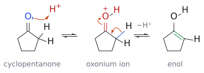

그림: 왼쪽에서 carbonyl 산소의 비공유 전자쌍(파랑)이 H⁺(빨강)를 잡아 oxonium 이온이 된다. 가운데에서 화살표 둘이 함께 움직인다. α-C–H 결합 전자(파란 결합)가 고리 C–C 쪽으로 가서 C=C를 만들고, C=O⁺의 π 전자는 산소로 올라간다. 이때 떨어진 H⁺(−H⁺)가 산 촉매로 돌아간다. 오른쪽 enol의 초록색이 새로 생긴 C=C다.

**둘째 막, aldol addition.** 이제 enol이 nucleophile, protonate된 두 번째 cyclopentanone(C=O⁺H)이 electrophile다. enol 산소의 비공유 전자쌍이 밀어주면 enol의 α-탄소가 protonate된 carbonyl 탄소를 공격해 새 C–C 결합이 생긴다. 이때 enol 쪽은 protonate된 ketone이 되고, H⁺를 내놓으면 aldol 생성물인 2-(1-hydroxycyclopentyl)cyclopentan-1-one이 된다.

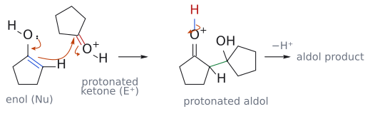

그림: 둘째 막(aldol addition). 파란색은 nucleophile인 enol의 C=C, 빨간색은 electrophile인 protonate된 carbonyl(C=O⁺H)이다. 왼쪽 화살표 셋은 (1) enol 산소의 비공유 전자쌍이 C–O 쪽으로 밀어 주고 (2) C=C의 π 전자가 protonate된 carbonyl 탄소를 공격하며 (3) C=O⁺의 π 전자가 산소로 올라가 OH가 되는 과정이다. 가운데는 새 C–C 결합(초록)이 생긴 protonate된 aldol이고, O–H 결합 전자(파란 결합)가 산소로 돌아가며 H⁺가 빠지면(−H⁺) aldol 생성물이 된다.

**셋째 막, E1 elimination.** 그런데 산 조건에서는 여기서 멈추기가 어렵다. 슬라이드도 탈수는 "산 조건에서 피하기 어렵다"고 적는다. 왜일까? aldol의 3차 OH가 protonate되어 –OH₂⁺라는 좋은 leaving group이 되고, 물이 떨어지면 안정한 3차 carbocation이 생긴다. 이어서 이웃한 α-C–H에서 H⁺가 빠지면 C=O와 공액된 C=C가 생긴다. 최종 생성물은 2-cyclopentylidenecyclopentan-1-one이다. 즉 산 촉매 aldol은 대개 enone까지 간다.

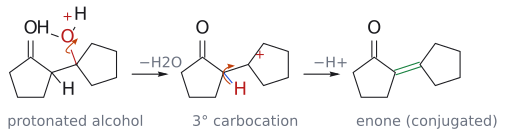

그림: 셋째 막(E1 탈수). 3차 OH가 이미 protonate된 상태(–OH₂⁺, 빨강)부터 그렸다. 왼쪽 화살표는 C–O 결합 전자가 산소로 가서 물이 떨어지는(−H₂O) 과정이고, 그 결과 3차 carbocation(빨간 +)이 생긴다. 가운데 화살표는 이웃한 α-C–H 결합 전자(파란 결합)가 C⁺ 쪽으로 가서 C=C를 만들며 H⁺가 빠지는(−H⁺) 과정이다. 오른쪽 초록 C=C가 C=O와 공액된 새 이중 결합이다(2-cyclopentylidenecyclopentan-1-one).

(출처: L10 p.3)

### keto-enol 호변이성체 (Keto and enol tautomers)

> 개념 문서: [keto-enol tautomerization](../../wiki/반응/케토-엔올%20토토머화.md), [enol and enolate](../../wiki/개념/엔올과%20엔올레이트.md)

keto형과 enol형은 서로 어떤 관계일까? 둘은 분자식이 같은 이성질체지만, 산이나 염기가 조금만 있어도 H가 옮겨 가며 쉽게 서로 바뀐다는 점이 특별하다. 이런 관계의 이성질체를 tautomer라 하고, 그 상호 전환을 tautomerization라 한다.

enolate를 보면 이 관계가 더 잘 보인다. enolate의 음전하는 산소와 α-탄소에 나뉘어 있다. 그래서 HB로부터 양성자를 받을 때 α-탄소에서 받으면 carbonyl 화합물(keto형)이 되고, 산소에서 받으면 enol(alkene alcohol)이 된다. 두 경로 모두 B:⁻를 내놓으며 가역이다.[3]

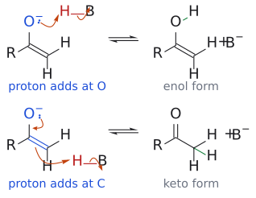

그림: 슬라이드 p.4의 "A proton can add here" 두 자리를 굽은 화살표로 나타냈다. 위: enolate 산소의 비공유 전자쌍(파랑)이 H–B의 H(빨강)를 잡고 H–B 결합 전자가 B로 가서 enol과 B⁻가 된다. 아래: 산소 전자쌍이 C–O 쪽으로 밀어 C=O를 만들고, C=C의 π 전자(파랑)가 H를 잡아 α-탄소에 새 C–H(초록)가 생기며 keto형이 된다. 두 경로 모두 가역(⇌)이고, 같은 enolate에서 양성자 자리만 다르다.

보충: 호변이성화는 눈에 보이는 결과를 낳는다. ketone을 산이나 염기가 조금 든 D2O에 두면 α-H만 차례로 D로 바뀌는데, 이것이 enol(enolate)을 거친다는 증거다. 또 α-탄소가 입체중심이면 평면인 enol을 거치면서 배열을 잃는다. 그래서 두 carbonyl 사이 탄소만 입체중심인 β-ketoester는 광학 활성 상태로 보관하기 어렵고, 교과서는 이부프로펜이 라세미체로 투여되어도 몸 안에서 enolization을 거쳐 활성 (S)체를 공급받는다고 소개한다. (보충 근거: Clayden p.451, p.459, p.460)

(출처: L10 p.4)

### 단순 carbonyl 화합물에서 enol이 이렇게 적은 이유

> 개념 문서: [keto-enol tautomerization](../../wiki/반응/케토-엔올%20토토머화.md)

그렇다면 평형에서 enol은 얼마나 있을까? 단순한 monocarbonyl 화합물에서는 매우 적다.

| 화합물 | keto형 | enol형 |
|---|---|---|
| acetaldehyde(CH₃CHO) | ~100 % | 극히 extremely small |
| acetone(CH₃COCH₃) | >99 % | 1.5 × 10⁻⁴ % |
| cyclohexanone | 98.8 % | 1.2 % |

이유는 결합의 세기에 있다. 슬라이드는 C=O π 결합을 364 kJ/mol, C=C π 결합을 250 kJ/mol로 제시한다. enol이 되려면 강한 C=O π를 포기하고 약한 C=C π를 얻어야 하니 손해다. 결합 에너지 표로 대략 계산해 보면 더 분명하다. keto형에서 enol형으로 갈 때 바뀌는 결합만 비교하면 다음과 같다.

- keto형: C=O (799) + C–C (346) + C–H (413) = 1558 kJ/mol
- enol형: C=C (602) + C–O (358) + O–H (463) = 1423 kJ/mol

즉 keto형이 약 135 kJ/mol 더 안정하다. 평균 결합 에너지로 낸 거친 추정이라 실제 값과 같지는 않지만, 방향은 맞다.[4]

(출처: L10 p.5)

### 1,3-dicarbonyl 화합물: enol이 주인공이 되는 경우

> 개념 문서: [keto-enol tautomerization](../../wiki/반응/케토-엔올%20토토머화.md)

그런데 carbonyl이 두 개, 그것도 1,3-위치에 있으면 이야기가 달라진다. pentane-2,4-dione은 keto형 24 %, enol형 76 %로 enol이 더 많다. 무엇이 enol을 이렇게 안정하게 만들까? enol형 CH₃–C(OH)=CH–CO–CH₃를 보면 답이 보인다. enol의 C=C가 남은 C=O와 공액되어 있고, enol O–H는 다른 C=O 산소와 분자 내 수소결합을 이뤄 6원 고리를 만든다.

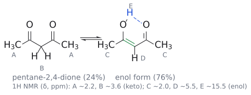

그림: 왼쪽 keto형(24 %)과 오른쪽 enol형(76 %)의 평형(⇌)이다. enol형의 초록 C=C는 남은 C=O와 공액되어 있고, 파란 점선은 enol O–H의 H가 다른 C=O 산소와 이루는 분자 내 수소 결합으로, O–C=C–C=O와 함께 6원 고리를 만든다. A–E는 슬라이드의 ¹H NMR 신호 귀속이며, E(δ ~15.5)가 극단적인 낮은 장에 있는 것이 이 강한 수소 결합 때문이다.

이것은 ¹H NMR로 직접 확인할 수 있다. 두 호변이성체의 신호가 따로 보이기 때문이다.[5]

| 신호 | δ (ppm) | 귀속 |
|---|---|---|
| A | ~2.2 | keto형 CH₃ |
| B | ~3.6 | keto형 CH₂ (두 C=O 사이) |
| C | ~2.0 | enol형 CH₃ (가장 큰 피크, enol이 주성분임을 보여 줌) |
| D | ~5.5 | enol형 비닐 C–H (=CH–) |
| E | ~15.5 (12배 확대한 넓은 피크) | enol O–H |

E 신호가 δ 15.5라는 극단적인 낮은 장(downfield)에 있는 것은 강한 분자 내 수소결합 때문이다.

이런 안정한 enol은 실제 약과 농약에도 있다. 1일 1회 복용하는 관절염 치료제 피록시캄(Piroxicam, Feldene®)은 enol OH가 이웃 amide C=O와 공액되어 있다. bottle-brush plant가 만드는 제초제 렙토스퍼몬(Leptospermone, Callisto®)은 더 흥미롭다. 고리 안 C=O 중 하나는 양옆 탄소가 모두 gem-dimethyl이라 α-H가 없으므로 enolization할 수 없다("can't enolize"). 그래서 고리 밖 acyl group 쪽이 enol로 존재한다.

(출처: L10 p.6)

### 치환기에 따라 K(enol/keto)는 어떻게 변할까

> 개념 문서: [keto-enol tautomerization](../../wiki/반응/케토-엔올%20토토머화.md)

슬라이드는 1,3-dicarbonyl 16종의 K(enol/keto) 값을 표로 준다.

| # | 구조 | K(e/k) | # | 구조 | K(e/k) |
|---|---|---|---|---|---|
| 1 | CH₃COCH₂COCH₃ | 5.5 | 9 | CH₃COCH₂COCF₃ | >10⁴ |
| 2 | EtCOCH₂COEt | 6.6 | 10 | PhCOCH₂COCH₃ | 11.2 |
| 3 | iPrCOCH₂CO-iPr | 12.7 | 11 | PhCOCH₂COPh | >10⁴ |
| 4 | tBuCOCH₂CO-tBu | 38.0 | 12 | CH₃COCH₂CO₂Me | 0.095 |
| 5 | CH₃COCH(CH₃)COCH₃ | 0.83 | 13 | EtCOCH₂CO₂Me | 0.047 |
| 6 | CH₃COCH(Et)COCH₃ | 0.29 | 14 | tBuCOCH₂CO₂Me | 0.19 |
| 7 | CH₃COCHClCOCH₃ | 22.3 | 15 | PhCOCH₂COCF₃ | >10⁴ |
| 8 | CH₃COCH(CN)COCH₃ | 거의 100 % enol | 16 | PhCOCH₂CO₂Et | 0.26 |

표를 읽으면 몇 가지 경향이 보인다. 양 끝 alkyl group이 커질수록(1 → 4) K가 커진다. 반대로 가운데 α-탄소에 alkyl group이 붙으면(5, 6) K가 1보다 작아진다. 가운데에 Cl(7)이나 CN(8)이 붙거나, 끝에 CF₃(9, 15)나 phenyl(10, 11)이 있으면 enol이 늘어난다. 그리고 β-ketoester(12–14, 16)는 diketone보다 K가 훨씬 작아 keto형이 우세하다.[6] 세부 원인은 슬라이드에서 설명하지 않으므로 경향 자체를 기억해 두면 된다.[7]

(출처: L10 p.7)

### 비타민 C: 우리 몸 속의 안정한 enol

> 개념 문서: [keto-enol tautomerization](../../wiki/반응/케토-엔올%20토토머화.md)

비타민 C(아스코르브산, ascorbic acid/ascorbate)는 감귤류 등 과일과 채소에 있는 수용성 비타민이다. 조직 복구, 콜라겐 형성, 일부 신경전달물질의 효소적 생산에 관여하고, 여러 효소의 기능과 면역계에 중요하며 항산화제로도 작용한다. 대부분의 동물은 스스로 합성하지만 인간은 음식으로 섭취해야 한다.

이 강의에 비타민 C가 등장하는 이유는 구조 때문이다. 5원 고리 락톤 안의 C=C에 OH가 두 개 붙은 enediol이 있고, 이 C=C가 락톤 C=O와 공액되어 있어 enol형이 안정하게 유지된다.[8]

보충: 안정한 enol의 극단적인 예는 phenol이다. keto형이 되면 방향족성을 잃으므로, C=O가 C=C보다 조금 유리한 정도의 이득은 상대가 되지 않아 전적으로 enol(phenol)형으로 존재한다. (보충 근거: Clayden p.459)

(출처: L10 p.8)

### 산 조건 halogenation: enol의 반응성을 확인하다

> 개념 문서: [α-halogenation](../../wiki/반응/α-할로젠화.md), [haloform reaction](../../wiki/반응/할로폼%20반응.md), [substituent effect](../../wiki/개념/치환기%20효과.md)

enol이 정말 nucleophile로 작용한다는 증거는 무엇일까? 가장 간단한 예가 halogenation이다.

$$
\text{아세톤} \xrightarrow[\mathrm{HOAc}]{\mathrm{Br_2}} \text{브로모아세톤}(\mathrm{CH_3COCH_2Br})
$$

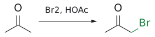

그림: 산 촉매 enol의 α-C(파랑)가 $Br_2$ 와 반응해 C–Br(초록).

메커니즘은 산 촉매 aldol의 첫 두 막과 거의 같다. 먼저 AcOH가 carbonyl 산소를 protonate하고 α-C–H가 끊기며 enol CH₃–C(OH)=CH₂가 생긴다. 이어서 enol 산소의 비공유 전자쌍이 밀어주면 enol의 C=C가 Br–Br의 Br을 공격하고, Br–Br 결합이 끊어지며 Br⁻가 떨어진다. 그러면 protonate된 carbonyl(C=O⁺–H)을 가진 α-bromoketone이 생기고, O–H의 H⁺가 빠지면서 bromoacetone이 된다. 즉 electrophile이 protonate된 carbonyl에서 Br₂로 바뀌었을 뿐이다.[9]

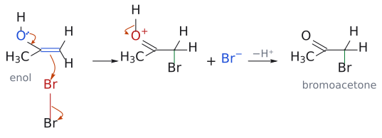

그림: acetone의 enol(파랑, nucleophile)과 Br₂(빨강, electrophile). 화살표 셋은 (1) enol 산소의 비공유 전자쌍이 C–O 쪽으로 밀어 주고 (2) C=C의 π 전자가 가까운 Br을 공격하며 (3) Br–Br 결합 전자가 먼 Br로 가서 Br⁻로 떨어지는 과정이다. 가운데의 protonate된 carbonyl(C=O⁺–H)에서는 O–H 결합 전자가 산소로 돌아가며 H⁺가 빠진다(−H⁺). 초록색이 새 C–Br 결합이다.

루이스산으로도 같은 일이 가능하다. 1-phenylpentane-1-온(PhCO(CH₂)₃CH₃)을 Br₂와 0.75 mol% AlCl₃(Et₂O)로 처리하면 2-bromo-1-phenylpentane-1-온(PhCO–CHBr–CH₂CH₂CH₃)이 100 % 수율로 생긴다. 그런데 Br₂와 AlCl₃라면 benzene 고리가 brominate되어야 하지 않을까? 슬라이드의 "Deactivated" 화살표가 그 답이다. acyl group은 전자끄는기라 benzene 고리를 electrophilic aromatic substitution(EAS)에 대해 불활성화한다. 그래서 고리는 건드려지지 않고 α-탄소만 brominate된다.[10]

(출처: L10 p.9)

### silyl enol ether를 경유한 halogenation: 원하는 쪽에 할로젠을 넣기

> 개념 문서: [α-halogenation](../../wiki/반응/α-할로젠화.md), [silyl enol ether](../../wiki/시약/실릴%20엔올%20에터.md), [LDA](../../wiki/시약/LDA.md)

비대칭 ketone에서 특정 α-탄소만 halogenate하고 싶다면 어떻게 해야 할까? 슬라이드의 해법은 enol을 silyl enol ether의 형태로 "고정"하는 것이다.

$$
\mathrm{R{-}CH_2{-}CO{-}CH_3} \xrightarrow{\mathrm{LDA}} \mathrm{R{-}CH_2{-}C(OLi){=}CH_2} \xrightarrow{\mathrm{Me_3SiCl}} \mathrm{R{-}CH_2{-}C(OSiMe_3){=}CH_2} \xrightarrow{\mathrm{Br_2}} \mathrm{R{-}CH_2{-}CO{-}CH_2Br}
$$

LDA(lithium diisopropylamide)는 부피가 큰 강염기라 가장 덜 least hindered α-H, 여기서는 CH₃의 H를 떼어낸다. 이렇게 생긴 덜 치환된 lithium enolate를 Me₃SiCl로 산소에서 silyl화하면, 위치가 정해진 중성 enol 등가체인 silyl enol ether가 된다. 이것을 Br₂와 반응시키면 덜 치환된 α-탄소(CH₃ 쪽)에 Br이 들어간다. (→ [L7](L07_Enolate_Alkylation.md) enolate 형성의 regioselectivity은 enolate 강의 문서 참고)

메커니즘을 보면 슬라이드가 silyl group을 "큰 large hydrogen"라고 부르는 이유를 알 수 있다. 산소의 비공유 전자쌍이 밀어주며 C=C가 X–X를 공격하고 X⁻가 떨어진다. 그러면 silyl화된 oxocarbenium(C=O⁺–SiMe₃)이 생기는데, 이것은 산 촉매 메커니즘의 protonate된 carbonyl(C=O⁺–H)과 꼭 닮았다. 마지막에 X⁻가 Si를 공격해 O–Si 결합을 끊으면 Me₃SiX가 떨어지며 α-haloketone이 된다. 즉 enol의 H가 하던 역할을 SiMe₃가 대신하는 것이다.[11]

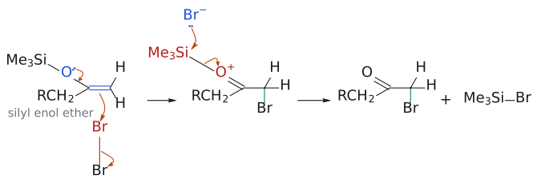

그림: 슬라이드 위쪽 반응식의 R–CH₂–C(OSiMe₃)=CH₂로 그렸다(슬라이드의 메커니즘 그림은 일반적인 고리 ketone, X₂로 그렸으나 과정은 같다). 왼쪽 화살표 셋은 enol bromination 그림과 같다. 산소 전자쌍이 밀어 주고, C=C(파랑)가 Br(빨강)을 공격하고, Br⁻가 떨어진다. 가운데 silyl oxocarbenium(C=O⁺–SiMe₃)은 앞 그림의 C=O⁺–H 자리에 SiMe₃가 들어간 모양이다. 이번에는 Br⁻(파랑)가 Si를 공격하고 O–Si 결합 전자가 산소로 돌아가 Me₃SiBr이 떨어진다. 초록색이 새 C–Br 결합이다.

(출처: L10 p.10)

### enamine: 질소가 밀어주는 enol

> 개념 문서: [enamine](../../wiki/개념/엔아민.md), [Stork enamine reaction](../../wiki/반응/스토크%20엔아민%20반응.md), [iminium ion](../../wiki/개념/이미늄%20이온.md), [imine](../../wiki/개념/이민.md), [pyrrolidine](../../wiki/시약/피롤리딘.md), [reductive amination](../../wiki/반응/환원성%20아미노화.md)

enol의 산소 대신 질소가 붙어 있으면 어떻게 될까? 그것이 enamine이다. enamine은 aldehyde나 ketone이 **2차 amine(secondary amine)**과 반응할 때 생긴다. 자주 쓰이는 2차 amine은 pyrrolidine, piperidine, morpholine이다.

대표적인 사용법은 Stork enamine alkylation이다.

$$
\text{사이클로헥사논} \xrightarrow{\text{피롤리딘},\ \text{cat.}\ \mathrm{H^+}} \text{1-(cyclohex-1-en-1-yl)pyrrolidine} \xrightarrow{1.\ \mathrm{R{-}X};\ 2.\ \mathrm{H_2O},\ \mathrm{H^+}} \text{2-알킬사이클로헥사논}
$$

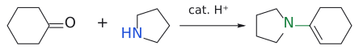

그림: 2차 amine N(파랑)이 C=O(빨강)와 축합해 enamine(초록)이 된다.

왜 2차 amine이어야 할까? amine이 carbonyl에 붙고 물이 빠지면 iminium 이온이 생기는데, 2차 amine에서 온 iminium은 질소에 H가 없어서 중성 imine이 될 수 없다. 그래서 대신 α-C–H에서 H⁺를 잃고 enamine이 된다.[12]

alkylation 단계는 enol bromination과 같은 그림이다. 질소의 비공유 전자쌍이 C=C로 밀고 들어가면 enamine의 α-탄소(원래 carbonyl 탄소의 이웃)가 R–X의 탄소를 S_N2로 공격하고 X⁻가 떨어진다. 그 결과 α-위치에 R이 붙은 iminium 이온(C=N⁺R₂)이 생긴다. 이 iminium은 다른 쪽 α-H를 잃고 다시 enamine으로 갈 수도 있는데, 슬라이드에는 R이 없는 쪽으로 C=C가 생긴 enamine이 그려져 있다. 마지막으로 H₂O, H⁺로 가수분해하면 2-alkylcyclohexanone과 pyrrolidine이 나온다. 슬라이드는 이 관계를 "imine과 enamine은 호변이성체"라고 요약한다.[13] enamine 형성과 가수분해(슬라이드의 녹색 단계)의 메커니즘은 교재 Chapter 11에 있다고 안내하며, 환원성 reductive amination도 함께 복습하라고 한다.

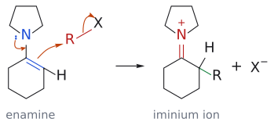

그림: cyclohexanone과 pyrrolidine으로 만든 enamine(파랑, nucleophile)과 R–X(빨강, electrophile). 화살표 셋은 (1) 질소의 비공유 전자쌍이 C–N 쪽으로 밀어 C=N⁺를 만들고 (2) C=C의 π 전자가 R의 탄소를 공격하며(S_N2) (3) R–X 결합 전자가 X로 가서 X⁻가 떨어지는 과정이다. 오른쪽 iminium 이온(빨간 C=N⁺)의 초록색이 새 C–R 결합이다. 이후 가수분해 단계는 슬라이드가 교재로 미루므로 그리지 않았다.

enol과 비교하면 enamine의 장점이 보인다. enamine은 중성이면서도 enol보다 친핵성이 크다. 질소가 산소보다 전자를 잘 내주기 때문이다. 또 alkylation 뒤 생기는 iminium은 양전하를 띠어 더 이상 nucleophile로 작용하지 않으므로 다중 alkylation이 억제된다.[14]

보충: 2차 amine 가운데 pyrrolidine·piperidine·모폴린 같은 고리형 amine을 즐겨 쓰는 이유는, alkyl group이 고리로 "묶여" 있어 질소 주변이 덜 붐비므로 amine과 enamine 모두 친핵성이 커지기 때문이다. 끓는점이 높아 가열하며 enamine을 만들기 쉬운 것도 장점이다. 또 비대칭 ketone에서는 덜 치환된 enamine이 주로 생기는데, 더 치환된 enol이 우세한 enol과는 반대다. enamine 형성은 가역이라 thermodynamic 지배를 받는데, 더 치환된 enamine에서는 질소의 치환기와 C=C의 치환기가 부딪혀, 질소 비공유 전자쌍이 C=C와 공액하는 데 필요한 평면성이 깨지기 때문이다. 그래서 Stork alkylation은 비대칭 ketone의 덜 치환된 α-탄소에서 일어난다. (보충 근거: Clayden p.592)

(출처: L10 p.11)

### enamine으로 aldehyde를 alkylate하기

> 개념 문서: [Stork enamine reaction](../../wiki/반응/스토크%20엔아민%20반응.md)

aldehyde를 α-alkylate하는 것은 왜 까다로울까? aldehyde는 친전자성이 커서, 강염기로 enolate를 만들면 남은 aldehyde와 바로 aldol 자기 self-condensation을 일으킨다. enamine은 바로 이 문제의 좋은 해법이다. 강염기 없이 α-alkylation이 일어나므로 자기 축합이 없다.

첫 번째 예는 pentane알이다.

$$
\mathrm{OHC{-}CH_2CH_2CH_2CH_3} \xrightarrow{\mathrm{(\mathit{i}\text{-}Bu)_2NH},\ \text{cat.}\ \mathrm{H^+}} \mathrm{(\mathit{i}\text{-}Bu)_2N{-}CH{=}CH{-}CH_2CH_2CH_3} \xrightarrow{1.\ \mathrm{BrCH_2CO_2Et},\ \text{reflux}\ \mathrm{MeCN};\ 2.\ \mathrm{H_2O}} \mathrm{OHC{-}CH(CH_2CH_2CH_3){-}CH_2CO_2Et}
$$

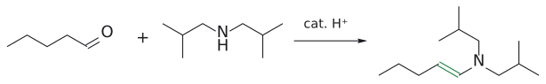

그림: aldehyde의 enamine(초록 C=C).

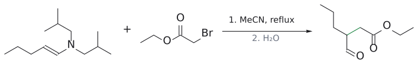

그림: enamine β-C(파랑)가 C–Br(빨강)을 SN2로 공격하고, 가수분해로 aldehyde가 돌아온다.

diisobutylamine으로 만든 enamine이 ethyl bromoacetate(α-haloester)를 공격해 α-탄소에 –CH₂CO₂Et가 붙고, 물로 가수분해하면 ethyl 3-formylhexanoate가 된다.

두 번째 예는 α-H가 하나뿐인 2-ethylhexanal이다.

$$
\mathrm{OHC{-}CH(Et)(\mathit{n}\text{-}Bu)} \xrightarrow{\text{피롤리딘},\ \text{cat.}\ \mathrm{H^+}} \text{피롤리딘–}\mathrm{CH{=}C(Et)(\mathit{n}\text{-}Bu)} \xrightarrow{1.\ \mathrm{CH_2{=}CH{-}CH_2Br},\ \text{reflux}\ \mathrm{MeCN};\ 2.\ \mathrm{H_2O}} \mathrm{OHC{-}C(Et)(\mathit{n}\text{-}Bu)(CH_2CH{=}CH_2)}
$$

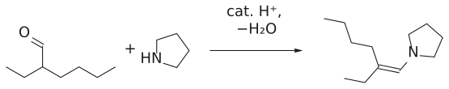

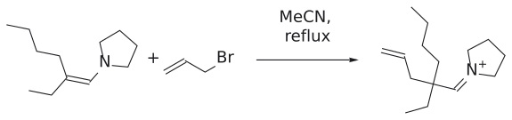

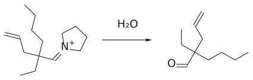

그림: 보충: α-가지 aldehyde와 pyrrolidine이 enamine을 만들고, enamine의 β-탄소가 allyl bromide를 $S_N2$ 로 공격해 iminium ion이 된다. 물로 가수분해하면 4차 α-탄소를 가진 aldehyde가 남는다.

생성물인 2-allyl-2-ethylhexanal(2-ethyl-2-(prop-2-en-1-yl)hexanal)에서는 α-탄소가 4차 quaternary carbon이 된다. 즉 enamine을 쓰면 가지 달린 aldehyde에도 치환기를 하나 더 넣을 수 있다.

(출처: L10 p.12)

### enamine과 aldol reaction: proline이라는 작은 촉매

> 개념 문서: [proline 촉매 aldol reaction](../../wiki/반응/프롤린%20촉매%20알돌%20반응.md)

enamine을 화학양론적으로 만들어 쓰지 않고, amine을 촉매로 돌려 쓸 수는 없을까? 2000년 List, Lerner, Barbas가 그 답을 보였다.[15] amino acid L-proline이 enamine을 거쳐 직접 비대칭 aldol 반응을 촉매한 것이다. 이 업적은 2021년 노벨 화학상으로 이어졌다.[16]

$$
\text{아세톤}(20\ \text{vol}\%) + \text{4-나이트로벤즈알데하이드} \xrightarrow[\mathrm{DMSO}]{\text{L-프롤린}\ 30\ \text{mol}\%} (\mathit{R})\text{-4-하이드록시-4-(4-나이트로페닐)뷰탄-2-온}
$$

68 % 수율, 76 % ee

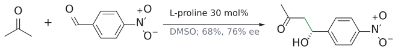

그림: enamine 촉매 비대칭 aldol.

acetone이 enamine(nucleophile)이 되고, aldehyde가 electrophile다. 생성물은 CH₃CO–CH₂–CH(OH)–Ar이다. 다른 aldehyde로 넓혀 본 결과는 아래와 같다.

| 생성물 | aldehyde의 R | 수율 | ee |
|---|---|---|---|
| 34a | 4-NO₂C₆H₄ | 68 % | 76 % |
| 34b | Ph | 62 % | 72 % |
| 34c | 4-BrC₆H₄ | 74 % | 65 % |
| 34d | 2-ClC₆H₄ | 94 % | 69 % |
| 34e | 2-naphthyl | 54 % | 77 % |
| 34f | i-Pr | 97 % | 96 % |
| 34g | cyclohexyl | 63 % | 84 % |
| 34h | tert-butyl | 81 % | >99 % |
| 34i | C(CH₃)₂CH₂CH=CH₂ | 85 % | >99 % |

방향족 aldehyde는 ee가 중간 정도(65–77 %)인 반면, α-가지 지방족 aldehyde, 특히 α-탄소가 4차인 34h와 34i는 ee가 >99 %에 이른다. 모든 생성물의 OH가 같은 방향 쐐기로 그려져 있다는 점에서, 같은 면 선택성이 일관되게 나타남을 알 수 있다.

(출처: L10 p.13)

### 비대칭 aldol의 촉매 순환

> 개념 문서: [proline 촉매 aldol reaction](../../wiki/반응/프롤린%20촉매%20알돌%20반응.md), [enamine](../../wiki/개념/엔아민.md)

proline은 어떻게 촉매로 돌아올까? 슬라이드의 촉매 순환을 한 바퀴 돌아 보자.

먼저 proline의 2차 amine이 ketone R¹–CO–CH₂R²를 공격해 carbinolamine **I**을 만든다. **I**에서 물이 빠지면 carboxylate와 짝을 이룬 iminium 이온 **II**가 되고, α-H를 잃으면 enamine **III**이 된다. 여기까지가 앞에서 본 enamine 형성과 같은 과정이다.

이제 핵심 단계다. enamine **III**에 RCHO가 다가오면 transition state **IV**에서 proline의 carboxylic acid H가 aldehyde 산소와 수소결합을 한다. 그래서 aldehyde는 활성화되는 동시에 특정 방향으로 붙잡힌다. 이 상태에서 enamine의 α-탄소가 aldehyde carbonyl 탄소를 공격해 새 C–C 결합과 입체중심이 생긴다. 즉 carboxylic acid은 electrophile을 활성화하면서 입체화학을 정하는 "손잡이" 역할을 한다.

공격 뒤에는 β-hydroxy iminium **V**가 생기고, 물이 더해져 carbinolamine **VI**이 된다. **VI**이 aldol 생성물 R–CH(OH)–CH(R²)–CO–R¹을 내놓으면 proline이 재생되어 다음 순환을 시작한다. 물은 I → II에서 빠졌다가 V → VI에서 다시 들어가므로 전체적으로는 소모되지 않는다. 슬라이드는 List 등이 처음 제안한 transition state **VII**도 함께 보여 준다.[17]

(출처: L10 p.14)

### 정리

슬라이드의 요약은 네 줄이다. keto와 enol은 호변이성체이고, 1,3-dicarbonyl 화합물은 안정한 enol을 만들며, enol은 halogenation 반응을 하고, enamine은 alkylation과 aldol형 반응의 nucleophile다.

(출처: L10 p.15. p.16은 빈 슬라이드)

## 흔한 오해

- keto형과 enol형을 공명 구조라고 생각하기 쉽지만 사실은 H의 위치가 다른 별개의 화합물(호변이성체)이다. 둘 사이는 평형(⇌)이고, 공명(↔)은 enolate의 두 구조처럼 전자만 움직인 경우다.
- enol이 1 %도 없으니 반응에 중요하지 않다고 생각하기 쉽지만 사실은 산 조건 aldol과 halogenation의 실제 nucleophile이 바로 그 소량의 enol이다.
- 1,3-dicarbonyl이면 무조건 enol이 많다고 생각하기 쉽지만 사실은 β-ketoester(K = 0.047–0.26)나 α-alkyl 치환 diketone(K = 0.29–0.83)은 keto형이 우세하다.
- 산 촉매 aldol이 β-hydroxy carbonyl에서 멈춘다고 생각하기 쉽지만 사실은 E1 탈수가 쉽게 일어나 enone까지 간다.
- 산 조건 halogenation도 염기 조건처럼 여러 번 halogenate된다고 생각하기 쉽지만 사실은 산 조건에서는 대개 모노할로젠화에서 멈춘다.[9]
- Br₂/AlCl₃이면 benzene 고리가 반드시 brominate된다고 생각하기 쉽지만 사실은 acyl group으로 불활성화된 고리는 반응하지 않고 α-bromination만 일어난다.
- silyl enol ether bromination에서 Br이 산소나 규소에 붙는다고 생각하기 쉽지만 사실은 C=C의 α-탄소에 붙고, 규소는 Br⁻에 공격받아 Me₃SiBr로 떨어진다.
- enamine의 친핵성 원자가 질소라고 생각하기 쉽지만 사실은 슬라이드의 반응에서 새 결합을 만드는 것은 α-탄소다. 질소는 전자를 밀어주는 역할이다.
- 1차 amine으로도 enamine을 쉽게 만든다고 생각하기 쉽지만 사실은 1차 amine은 주로 imine을 주고, enamine 합성에는 2차 amine을 쓴다.
- proline의 역할이 amine뿐이라고 생각하기 쉽지만 사실은 carboxylic acid도 aldehyde와 수소결합해 활성화와 입체 제어를 맡는다.

## 반응 정리표

| 반응 | 시약/조건 | 생성물 | regioselectivity | 입체화학 | 비고 |
|---|---|---|---|---|---|
| enolate α-alkylation | enolate + R'CH₂Br | R–CO–CH₂–CH₂R' | α-탄소 | 해당 없음 | S_N2, 염기 조건 (p.2) |
| enolate aldol | enolate + R'COR'' | β-hydroxy carbonyl → enone | α-C와 carbonyl C 사이 결합 | 슬라이드에서 다루지 않음 | 가역 (p.2) |
| Claisen | enolate + ester(–OEt) | 1,3-dicarbonyl | α-탄소 | 해당 없음 | EtO⁻ 이탈 (p.2) |
| 산 촉매 aldol(cyclopentanone) | H⁺ | 2-(1-hydroxycyclopentyl)cyclopentanone → 2-cyclopentylidenecyclopentanone | α-탄소 | 해당 없음 | enol이 nucleophile, E1 탈수 (p.3) |
| 산 촉매 α-bromination | Br₂, HOAc | bromoacetone | α-탄소(enol 경유) | 해당 없음 | monobromination (p.9) |
| 루이스산 α-bromination | Br₂, 0.75 mol% AlCl₃, Et₂O | 2-bromo-1-phenylpentane-1-one (100 %) | α-탄소, 고리 반응 없음 | 새 입체중심(슬라이드 언급 없음, 라세미) | acyl group으로 고리 불활성화 (p.9) |
| silyl enol ether 경유 bromination | 1. LDA 2. Me₃SiCl 3. Br₂ | R–CH₂–CO–CH₂Br | 덜 가려진 α-탄소 | 해당 없음 | silyl = "큰 수소", Me₃SiX 부생 (p.10) |
| enamine 형성 | 2차 amine(pyrrolidine 등), cat. H⁺ | enamine | — | — | (p.11) |
| Stork enamine alkylation | 1. R–X 2. H₂O, H⁺ | 2-alkylcyclohexanone | α-탄소 | 슬라이드에서 다루지 않음 | iminium intermediate (p.11) |
| aldehyde enamine alkylation 1 | pentane알, (i-Bu)₂NH/H⁺; BrCH₂CO₂Et, MeCN 환류; H₂O | ethyl 3-formylhexanoate | α-탄소 | 라세미 | 자기 축합 없음 (p.12) |
| aldehyde enamine alkylation 2 | 2-ethylhexanal, pyrrolidine/H⁺; allyl bromide, MeCN 환류; H₂O | 2-allyl-2-ethylhexanal | α-탄소(4차 탄소 형성) | 라세미 | (p.12) |
| proline 촉매 비대칭 aldol | acetone + ArCHO/RCHO, L-proline 30 mol%, DMSO | CH₃COCH₂CH(OH)R | acetone α-탄소 → aldehyde C | (R), 76 % ee (Ar = 4-NO₂C₆H₄); 지방족 최대 >99 % ee | enamine 촉매 순환 (p.13–14) |

## 연습 문제

1. cyclopentanone을 산 촉매 조건에 두었을 때의 최종 생성물을 쓰고, (a) enolization, (b) aldol addition, (c) 탈수 단계의 nucleophile·electrophile과 intermediate를 설명하라. 탈수는 E1과 E1cB 중 어느 경로인가?

2. 다음 화합물을 평형 enol 함량이 작은 것부터 큰 것 순으로 나열하라: acetone, cyclohexanone, methyl acetoacetate(CH₃COCH₂CO₂Me), pentane-2,4-dione, CH₃COCH₂COCF₃.

3. pentane-2,4-dione의 ¹H NMR 신호 δ 2.2, 3.6, 2.0, 5.5, 15.5 ppm을 귀속하고, δ 15.5 신호가 매우 낮은 장에 나타나는 이유를 설명하라.

4. 2-butanone(CH₃COCH₂CH₃)을 (1) LDA, (2) Me₃SiCl, (3) Br₂로 차례로 처리했다.
   (a) 주생성물을 쓰라.
   (b) 3단계에서 C–Br 결합이 생기는 과정과 silyl group이 떨어지는 과정을 설명하라.

5. 1-phenylpentane-1-one을 Br₂와 0.75 mol% AlCl₃(Et₂O)로 처리한 생성물을 쓰고, AlCl₃가 있는데도 benzene 고리가 brominate되지 않는 이유를 설명하라.

6. cyclohexanone을 (1) pyrrolidine, cat. H⁺, (2) allyl bromide, (3) H₂O, H⁺로 차례로 처리했다. 각 단계 생성물과 alkylation 메커니즘을 쓰고, 2차 amine을 쓰는 이유를 설명하라.

7. pentane알을 NaOH로 처리한 뒤 ethyl bromoacetate를 넣는 대신, (i-Bu)₂NH/cat. H⁺ → BrCH₂CO₂Et(MeCN 환류) → H₂O 경로를 쓰는 이유는 무엇인가? 생성물 구조를 쓰라.

8. L-proline(30 mol%, DMSO) 존재 하에 acetone과 isobutyraldehyde((CH₃)₂CHCHO)를 반응시켰다. (a) 생성물 구조와 슬라이드에 보고된 수율·ee를 쓰라. (b) 촉매 순환에서 enamine이 생기는 단계와 C–C 결합이 생기는 단계를 설명하고, carboxylic acid의 역할을 쓰라.

## 정답 및 해설

1. 최종 생성물은 2-cyclopentylidenecyclopentan-1-one이다.
   (a) H⁺가 carbonyl O를 protonate하고, α-C–H가 끊기며 enol(cyclopent-1-en-1-ol)이 생긴다.
   (b) nucleophile은 enol의 C=C(α-탄소, 산소 비공유 전자쌍이 밀어줌), electrophile은 protonate된 cyclopentanone의 carbonyl 탄소다. protonate된 ketone intermediate가 H⁺를 잃으면 aldol 2-(1-hydroxycyclopentyl)cyclopentan-1-one이 된다.
   (c) 3차 OH가 protonate되고 H₂O가 떨어져 3차 carbocation이 생긴 뒤, 이웃 α-H가 빠져 C=O와 공액된 C=C가 생긴다. 슬라이드에 명시된 대로 **E1**이다.
   (출처: L10 p.3)

2. acetone(1.5 × 10⁻⁴ %) < cyclohexanone(1.2 %) < methyl acetoacetate(K = 0.095, 약 9 %) < pentane-2,4-dione(K = 5.5, p.6 기준 76 %) < CH₃COCH₂COCF₃(K > 10⁴).
   단순 ketone은 C=O π가 C=C π보다 강해 keto형이 우세하다. 1,3-dicarbonyl은 공액과 분자 내 수소결합으로 enol이 안정해지지만, ester는 diketone보다 K가 작고 CF₃는 K를 크게 높인다.
   (출처: L10 p.5, p.6, p.7)

3. δ 2.2 = keto형 CH₃(A), δ 3.6 = keto형 CH₂(B), δ 2.0 = enol형 CH₃(C), δ 5.5 = enol형 =CH–(D), δ 15.5 = enol O–H(E).
   enol O–H가 다른 C=O 산소와 강한 분자 내 수소결합(6원 고리)을 이뤄 크게 탈차폐되므로 매우 낮은 장에 넓게 나타난다. enol형 CH₃ 피크(C)가 가장 커서 enol이 주성분임을 알 수 있다.
   (출처: L10 p.6)

4. (a) LDA가 덜 가려진 CH₃의 α-H를 떼어내 CH₃CH₂C(OLi)=CH₂가 되고, Me₃SiCl로 CH₃CH₂C(OSiMe₃)=CH₂가 된 뒤, Br₂와 반응해 **1-bromobutane-2-온(BrCH₂COCH₂CH₃)**이 된다.
   (b) 산소 비공유 전자쌍이 밀어주며 말단 CH₂(C=C)가 Br–Br을 공격해 C–Br이 생기고 Br⁻가 떨어진다. 이때 silyl화된 oxocarbenium(C=O⁺–SiMe₃)이 생긴다. 이어서 Br⁻가 Si를 공격해 O–Si 결합이 끊어지면 Me₃SiBr이 떨어지고 ketone C=O가 재생된다. silyl group이 enol의 H 자리를 대신하는 "큰 수소" 역할이다.
   참고: 같은 ketone을 Br₂/HOAc로 처리하면 주로 더 치환된 enol을 거쳐 3-bromobutane-2-one이 많이 생긴다.[11]
   (출처: L10 p.9, p.10)

5. 생성물은 2-bromo-1-phenylpentane-1-온(PhCO–CHBr–CH₂CH₂CH₃), 수율 100 %다. acyl group이 전자끄는기로 benzene 고리를 electrophilic aromatic substitution에 대해 불활성화하므로, 고리 대신 carbonyl α-탄소가 enol을 거쳐 brominate된다. 촉매량의 AlCl₃는 enolization을 돕는다.
   (출처: L10 p.9)

6. (1) 1-(cyclohex-1-en-1-yl)pyrrolidine(enamine), (2) 2-allylcyclohexanone의 iminium bromide, (3) 2-allylcyclohexanone(2-(prop-2-en-1-yl)cyclohexan-1-one) + pyrrolidine.
   alkylation: 질소 비공유 전자쌍이 C=C로 밀려 들어가고, enamine의 α-탄소가 allyl bromide의 CH₂Br 탄소를 S_N2로 공격해 C–C 결합이 생기며 Br⁻가 떨어져 iminium이 된다. 이후 H₂O/H⁺로 가수분해되어 ketone이 재생된다.
   2차 amine 유래 iminium은 N에 H가 없어 중성 imine이 될 수 없으므로 α-H를 잃고 enamine이 된다. 1차 amine은 주로 imine을 준다.
   (출처: L10 p.11)

7. aldehyde에 강염기를 쓰면 생긴 enolate가 남은 aldehyde와 aldol 자기 축합을 일으킨다. enamine 경로는 강염기가 필요 없어 자기 축합 없이 α-alkylation할 수 있다("no self-condensation").
   생성물은 OHC–CH(CH₂CH₂CH₃)–CH₂CO₂Et (ethyl 3-formylhexanoate)다. enamine (i-Bu)₂N–CH=CH–CH₂CH₂CH₃의 α-탄소가 BrCH₂CO₂Et를 S_N2로 공격해 iminium이 되고, H₂O로 가수분해된다.
   (출처: L10 p.12)

8. (a) 생성물 34f는 CH₃COCH₂CH(OH)CH(CH₃)₂ (4-hydroxy-5-methyl헥산-2-one)이며, 97 % 수율, 96 % ee다. 34a 등과 같은 방향의 쐐기로 그려져 있다.
   (b) proline N이 acetone carbonyl을 공격해 carbinolamine(I)이 되고, 물이 빠져 iminium(II), α-deprotonation으로 enamine(III)이 된다. enamine의 α-탄소가 aldehyde carbonyl 탄소를 공격하는 단계(transition state IV)에서 C–C 결합이 생기고, iminium(V) → 물 첨가(VI) → 생성물 방출과 proline 재생이 이어진다.
   carboxylic acid은 transition state에서 aldehyde 산소에 수소결합(양성자 공여)해 electrophile을 활성화하고, aldehyde가 enamine의 한쪽 면으로 접근하도록 배향해 거울상 선택성을 만든다.
   (출처: L10 p.13, p.14)

## 각주

[1] 슬라이드 그림에서 ester는 "R–CO–OEt", 생성물은 "R–CO–CH₂–CO–R'"로 표기되어 R/R'가 섞여 있다. aldol 생성물에서도 OH 탄소의 두 치환기가 모두 R'로 적혀 있다(R'와 R''이어야 함). ester의 acyl group이 생성물의 R'–CO– 부분이 된다고 이해하면 된다.

[2] p.3 enolization 그림에서는 protonate된 carbonyl 산소 위에 음전하 기호(⊖)가 그려져 있다. protonate된 carbonyl은 양전하(HO⁺=C)이어야 하므로 표기 오류로 보인다.

[3] 호변이성체는 원자 배치가 다른 별개의 화합물이므로, 전자만 이동한 공명 구조와 구별해야 한다.

[4] 같은 결합 에너지 표에서 π 결합 세기를 "이중결합 − 단일결합"으로 구하면 C=C π ≈ 602 − 346 = 256 kJ/mol로 슬라이드의 250과 맞지만, C=O π ≈ 799 − 358 = 441 kJ/mol이어서 슬라이드의 364와는 맞지 않는다. 어느 값을 쓰든 "C=O π > C=C π"라는 결론은 같다.

[5] keto-enol 상호 전환이 NMR 시간 척도보다 느리기 때문에 두 호변이성체가 각각의 신호를 보이고, 적분비로 비율을 구할 수 있다. (보충 근거: Clayden p.458)

[6] 교재에서는 ester C=O가 알콕시 산소와 이미 공명 안정화되어 있어 enolization으로 얻는 공액 안정화 이득이 작다고 설명한다.

[7] p.6은 pentane-2,4-dione을 76 % enol(K ≈ 3.2)로, p.7 표의 화합물 1은 K = 5.5(약 85 % enol)로 제시한다. enol 함량은 용매·농도·온도에 크게 의존하므로 측정 조건이 다른 데이터로 보인다.

[8] 아스코르브산은 carboxylic acid이 없는데도 산성(pKa 약 4.1)이다. 공액된 enol OH가 deprotonate되면 음전하가 C=O까지 비편재화되기 때문이다. (보충 근거: Clayden p.459)

[9] 산 조건에서 모노할로젠화에서 멈추기 쉬운 것은, 도입된 할로젠의 전자끄는 효과가 carbonyl 산소의 염기성을 낮춰 두 번째 enolization의 protonation 단계를 느리게 하기 때문이다. 반대로 염기 조건에서는 할로젠이 α-H의 산성도를 높여 다중 halogenation이 일어나며, methylketone에서는 할로폼 반응으로 이어진다. 보충: 산 조건에서도 Br2를 1당량보다 더 넣으면 두 번째 bromination이 일어나는데, 이때는 Br이 있는 탄소보다 반대편 α-탄소가 반응해 1,3-dibromoacetone 같은 생성물이 된다. 그래서 "산 조건 = 모노할로젠화"는 할로젠을 1당량 쓸 때의 이야기다. (보충 근거: Clayden p.463)

[10] 루이스산은 carbonyl 산소에 배위하여 브뢴스테드 산처럼 enolization을 촉진한다고 이해할 수 있다.

[11] 비대칭 ketone의 산 촉매 halogenation은 더 안정한(더 치환된) enol을 주로 거치므로 더 치환된 α-탄소가 주로 halogenate된다. LDA(저온, kinetic 조건) → TMSCl → Br₂ 경로는 반대로 덜 치환된 α-탄소를 halogenation한다. 두 방법을 고르면 원하는 쪽에 할로젠을 넣을 수 있다. 보충: 교과서의 설명은 transition state의 전하다. 산 조건의 enol 반응은 양전하를 띤 transition state를 거치므로 양전하를 안정화하는 alkyl group이 많은 쪽이 빠르고, 염기 조건의 enolate 반응은 음전하 transition state를 거치므로 덜 치환된 쪽(methyl)이 빠르다. (보충 근거: Clayden p.464)

[12] enamine 형성 메커니즘(표준 교재): 2차 amine N이 carbonyl 탄소를 공격하고 양성자가 이동해 carbinolamine이 된다. OH가 protonate되어 H₂O로 떨어지면 iminium 이온이 되고, α-C–H가 deprotonate되어 enamine이 된다. 전 과정이 가역이므로 물을 제거하면 enamine 쪽으로 진행한다.

[13] 슬라이드에 실제로 그려진 것은 "iminium ⇌ enamine"(양성자 이동에 의한 산-염기 평형)이다. 중성 "imine ⇌ enamine" 호변이성은 1차 amine 유래 화합물에 해당하므로 문구와 그림이 약간 어긋난다.

[14] enamine alkylation에는 allyl·benzyl halide, α-halocarbonyl 화합물처럼 반응성이 큰 electrophile이 잘 맞는다. 보충: MeI 같은 단순 alkyl halide은 질소 쪽 alkylation이 상당히 경쟁해(4차 암모늄염이 생겨 가수분해 후 출발물로 돌아간다) 수율이 낮다. (보충 근거: Clayden p.592)

[15] B. List, R. A. Lerner, C. F. Barbas III, "Proline-Catalyzed Direct Asymmetric Aldol Reactions", J. Am. Chem. Soc. 2000, 122, 2395–2396 (Scripps Research Institute).

[16] Benjamin List와 David MacMillan은 2000년에 각자 독립적으로 세 번째 유형의 촉매 작용인 비대칭 유기촉매 작용(asymmetric organocatalysis, 작은 유기 분자를 촉매로 쓰는 방법)을 개발한 공로로 2021년 노벨 화학상을 받았다. "세 번째"란 기존의 금속 촉매와 효소 촉매에 대비한 표현이다.

[17] 이 순환은 aldol라아제(class I aldolase) 효소가 라이신 amine으로 enamine을 만드는 방식과 닮았다고 알려져 있다. proline은 amine(enamine 형성)과 carboxylic acid(electrophile 활성화)을 함께 가진 이중 작용기 촉매로 볼 수 있다.
