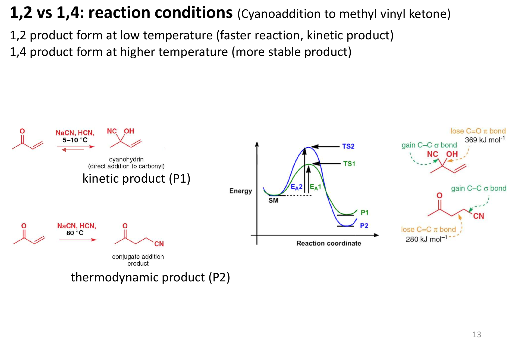
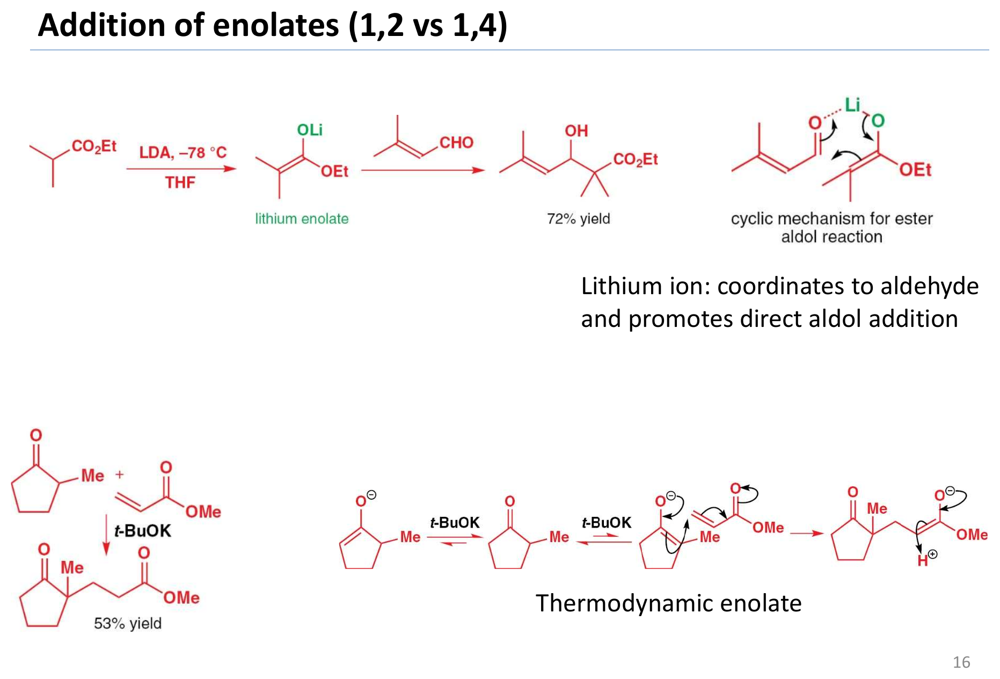
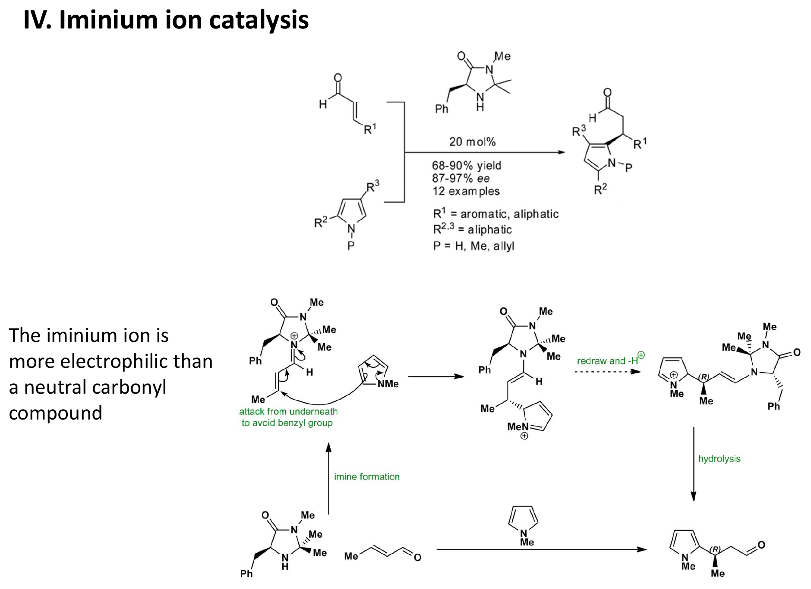
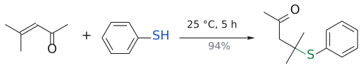
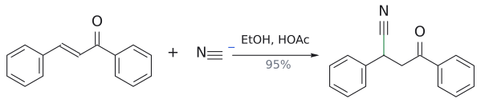
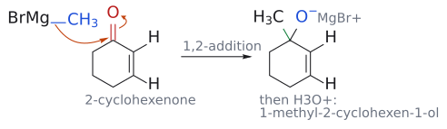
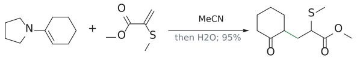
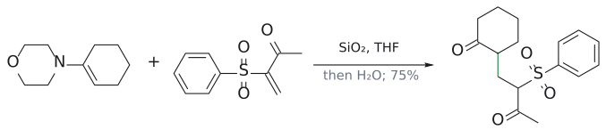

# L11. 짝지음 첨가 (Conjugate Addition)

> **통독본:** 기존 강의별 전체 설명을 바탕으로 2026-10-18에 공식 강의 확인·개념 보강·그림을 추가했다. 교재 보충은 출처를 구별하며 상세 개념은 연결된 위키에서 함께 읽는다. 뼈대 노트: [L11 뼈대](../L11_Conjugate_Addition.md) · [위키 대문](../../wiki/위키%20대문.md)

> **관련 위키 문서** ([위키 대문](../../wiki/위키%20대문.md))
> - 반응: [SN2 reaction](../../wiki/반응/SN2%20반응.md), [conjugate addition](../../wiki/반응/공액%20첨가.md), [Michael reaction](../../wiki/반응/마이클%20반응.md), [addition-elimination](../../wiki/반응/첨가-제거%20반응.md), [nucleophilic aromatic substitution](../../wiki/반응/친핵성%20방향족%20치환.md), [nucleophilic acyl substitution](../../wiki/반응/친핵성%20아실%20치환.md), [reductive amination](../../wiki/반응/환원성%20아미노화.md)
> - 시약: [LDA](../../wiki/시약/LDA.md), [LiAlH4](../../wiki/시약/LiAlH4.md), [NaBH4](../../wiki/시약/NaBH4.md), [Pd/C](../../wiki/시약/Pd-C.md), [Grignard reagent](../../wiki/시약/그리냐르%20시약.md), [alkoxide base](../../wiki/시약/알콕사이드%20염기.md), [organocuprate](../../wiki/시약/유기구리%20시약.md), [pyrrolidine](../../wiki/시약/피롤리딘.md)
> - 개념: [1,2-addition vs 1,4-addition](../../wiki/개념/1,2-첨가와%201,4-첨가.md), [E1cB elimination](../../wiki/개념/E1cB%20제거.md), [Meisenheimer complex](../../wiki/개념/마이젠하이머%20착물.md), [aromaticity](../../wiki/개념/방향족성.md), [kinetic vs thermodynamic enolate](../../wiki/개념/속도론적%20엔올레이트와%20열역학적%20엔올레이트.md), [kinetic vs thermodynamic control](../../wiki/개념/속도론적%20지배와%20열역학적%20지배.md), [enamine](../../wiki/개념/엔아민.md), [enol and enolate](../../wiki/개념/엔올과%20엔올레이트.md), [iminium ion](../../wiki/개념/이미늄%20이온.md), [imine](../../wiki/개념/이민.md), [electrophile and nucleophile](../../wiki/개념/친전자체와%20친핵체.md), [hard and soft acids and bases (HSAB)](../../wiki/개념/하드-소프트%20산염기.md)

> [Test 2 반응 판정·검산 순서](../../wiki/개념/Test%202%20반응%20판정과%20답안%20검산.md)로 각 단원의 질문을 연결할 수 있다.

## Conjugate addition: 반응 자리와 donor 선택 — 강의 확인·보강

alkene이 nucleophile이라는 앞 단원의 직관을 잠시 내려놓아야 한다. conjugated EWG가 있으면 $\beta$-탄소도 electrophile이 된다. 1,2와 1,4를 가르는 첫 단서는 nucleophile의 hard/soft 성격이지만, 받개 carbonyl의 종류·counterion·온도까지 읽어야 한다. 같은 MVK/CN 계의 저온 1,2와 높은 온도 1,4는 빠른 경로와 안정한 생성물을 구별하는 사례다. (출처: L11 p.3,9–13)

Michael product에서는 donor carbonyl–donor $\alpha$-C–acceptor $\beta$-C–acceptor $\alpha$-C–acceptor carbonyl 순서로 다섯 자리를 센다. 그래서 역합성에서 끊을 새 C–C 결합은 2–3 결합이다. enolate인지 enamine인지에 따라 hydrolysis까지의 intermediate는 다르지만, 최종 carbonyl을 회복해야 한다는 검산은 같다. (출처: L11 p.14–19)

iminium catalysis는 enamine donor 활성화와 역할이 반대다. 여기서는 acceptor가 iminium이 되어 electrophilicity가 커진다. 이어지는 SNAr는 같은 addition–elimination 생각을 aromatic 계로 확장한 것이다. EWG가 ortho/para에서 음전하를 받아 주고 aromaticity가 다시 회복되는 두 단계를 그린다. (출처: L11 p.21–23)

더 읽기: [1,2 vs 1,4](../../wiki/개념/1,2-첨가와%201,4-첨가.md), [Michael reaction](../../wiki/반응/마이클%20반응.md), [iminium catalysis](../../wiki/반응/이미늄%20촉매%20공액%20첨가.md), [SNAr](../../wiki/반응/친핵성%20방향족%20치환.md).

그림: 강의 원본 도식. 위의 설명과 함께 결합·전하·입체배치를 확인한다. (출처: L11 p.13)

그림: 강의 원본 도식. 위의 설명과 함께 결합·전하·입체배치를 확인한다. (출처: L11 p.16)

그림: 강의 원본 도식. 위의 설명과 함께 결합·전하·입체배치를 확인한다. (출처: L11 p.21)

## 개요

conjugate addition(1,4-첨가)는 $\alpha,\beta$-unsaturated carbonyl 화합물의 C=C 이중결합에 nucleophile이 붙는 반응이다. 
L1~L2에서 본 alkene은 전자가 풍부해서 electrophile(E+)을 받아들이는 쪽이었다.
<!-- comment: [완료 2026-10-17] 이미지 추가 바람 직후 내용에 알맞게 — enone_resonance.svg 삽입 -->
그런데 이중결합 옆에 carbonyl 같은 EWG가 짝지어 붙으면 성격이 뒤집혀, alkene이 오히려 nucleophile을 받는 **electrophile**이 된다.

그림: methyl vinyl ketone의 공명 구조. C=O와 C=C의 $\pi$ 전자가 이동하면 양전하가 carbonyl 탄소뿐 아니라 $\beta$-탄소에도 놓일 수 있다. 이 때문에 conjugated alkene의 $\beta$-탄소가 nucleophile의 공격을 받는다. (출처: L11 p.3)

이 강의는 이 "뒤집힌 alkene"이 amine, thiol, 시안화 이온, 유기구리 시약, enolate, enamine 같은 nucleophile과 어떻게 반응하는지 다루고, 
nucleophile이 carbonyl 탄소를 칠지(1,2) $\beta$-탄소를 칠지(1,4)를 무엇이 정하는지 정리한다. 
뒤쪽에서는 L7(enolate alkylation), L8(aldol), L10(enol과 enamine)에서 만든 nucleophile들을 다시 꺼내 1,5-다이카르보닐 화합물을 만들고, 
키랄 amine 촉매가 만드는 iminium 이온과 nucleophilic aromatic substitution(SNAr)까지 이어간다. SNAr는 conjugate addition 뒤에 $\beta$-leaving group이 떨어지는 반응으로 보면 이해가 쉽다.

---

## 1. 공액계(conjugated system)란 무엇이고, 왜 $\beta$-탄소가 양전하를 띠나?

> 개념 문서: [conjugate addition](../../wiki/반응/공액%20첨가.md)

$\alpha,\beta$-unsaturated carbonyl 화합물은 C=C가 C=O와 바로 붙어있는 분자다. 
carbonyl 탄소 옆이 $\alpha$-탄소, 그 다음이 $\beta$-탄소다. 슬라이드에 나온 대표 예시는 다음과 같다.

| 종류 | 체계명 | 관용명 | 구조 |
|---|---|---|---|
| $\alpha,\beta$-unsaturated aldehyde(enal) | propenal | acrolein | CH2=CH-CHO |
| $\alpha,\beta$-unsaturated ketone(enone) | but-3-en-2-one | methyl 비닐 ketone(MVK) | CH2=CH-CO-CH3 |
| $\alpha,\beta$-unsaturated 산 | propenoic acid | acrylic acid | CH2=CH-COOH |
| $\alpha,\beta$-unsaturated ester | ethyl propenoate | ethyl acrylate | CH2=CH-CO2Et |

이중결합이 carbonyl에서 한 칸 더 떨어진 $\beta,\gamma$-unsaturated ketone(예: CH3CO-CH2-CH=CH2)은 공액계가 아니라서 이 강의의 반응성을 보이지 않는다.

그렇다면 왜 $\beta$-탄소가 nucleophile을 끌어당길까? 공명 구조를 그려보면 답이 나온다. 
중성 구조(A)에서 C=O의 $\pi$전자를 산소로 밀면 carbonyl 탄소에 양전하가 생기고(B), 
이어서 C=C의 $\pi$전자를 옮기면 **$\beta$-탄소에 양전하**가 생긴다(C). 
즉 $\beta$-탄소와 carbonyl 탄소 둘 다 $\delta^{+}$를 띤다. 

그래서 일반 alkene은 E+를 공격하지만, 공액계 alkene은 Nu-에게 공격받는다.

그림: methyl 비닐 ketone으로 그린 공명 구조 A ↔ B ↔ C. A의 주황 화살표는 C=O의 $\pi$ 전자가 산소로 가는 것을, B의 화살표는 C=C의 $\pi$ 전자가 옆의 C–C 자리로 옮겨 가는 것을 나타낸다. 파란 O⁻는 음전하를 받은 산소, 빨간 +는 양전하가 놓이는 탄소다. B에서는 carbonyl 탄소, C에서는 $\beta$-탄소가 양전하를 띤다. 그래서 nucleophile이 노릴 수 있는 $\delta^{+}$ 자리가 두 곳이 된다.

이 분극은 분광학에서도 보인다.
- IR: 단순 ketone C=O는 1715 cm-1인데 짝지음 C=O는 1675 cm-1다. 공명으로 C=O가 단일결합 성격을 일부 띠어 결합이 약해졌다는 뜻이다(비교: C-O 단일결합 1050 cm-1).
- 13C NMR: $\beta$-탄소는 약 140 ppm에서 나타나 일반 C=C(약 120 ppm)보다 deshielded이다. $\beta$-탄소의 전자 밀도가 낮다는 증거다.

보충: IR에서는 C=C 흡수도 함께 변한다. 고립된 C=C는 약 1650 cm-1에서 약하게 흡수하지만, 짝지음 계에서는 약 1615 cm-1로 내려가고 세기가 커진다. 진동수가 내려간 것은 C=C도 약해졌다는 뜻이고, 세기가 커진 것은 C=O와 짝지으면서 C=C의 쌍극자 모멘트가 커졌다는 뜻이다. 또 13C NMR에서 $\alpha$-탄소는 약 120 ppm 근처에 머문다. 전자가 빠지는 자리는 $\alpha$가 아니라 $\beta$라는 점이 숫자로도 보인다. (보충 근거: Clayden p.501)

보충: 공명 구조는 "어디가 $\delta^{+}$인가"를 보여 줄 뿐이고, 실제 결합이 생기는 단계는 nucleophile의 HOMO에서 받개의 LUMO로 전자가 들어가는 과정이다. acrolein(propenal)의 LUMO는 $\beta$-탄소에서 계수가 가장 크고, carbonyl 탄소에서 두 번째로 크다. 그래서 $\beta$-탄소가 1순위 공격 자리이고, carbonyl 탄소도 경쟁 자리로 남는다. 3절의 1,2/1,4 경쟁은 이 "두 번째로 큰 계수"에서 나온다. (보충 근거: Clayden p.502)

(출처: L11 p.3)

## 2. conjugate addition(Michael addition)의 일반형

> 개념 문서: [conjugate addition](../../wiki/반응/공액%20첨가.md), [keto-enol tautomerization](../../wiki/반응/케토-엔올%20토토머화.md), [organocuprate](../../wiki/시약/유기구리%20시약.md), [Grignard reagent](../../wiki/시약/그리냐르%20시약.md)

conjugate addition은 **Michael addition**이라고도 부른다. 일반식은 다음과 같다.

$$
\begin{aligned}
& \mathrm{CH_2{=}CH{-}CO{-}R(OR)} \\
& \qquad \xrightarrow[(2)\ \mathrm{HA}]{(1)\ \mathrm{Nu^-}\ (\text{또는}\ \mathrm{H{-}Nu})} \mathrm{Nu{-}CH_2{-}CH_2{-}CO{-}R(OR)}
\end{aligned}
$$

결과적으로 Nu와 H가 C=C를 가로질러 붙는다. Nu는 $\beta$-탄소에, H는 $\alpha$-탄소에 붙는다. 이 반응에는 세 가지 조건이 있다.
- alkene이 electrophile로 작용한다.
- Nu와 H가 C=C에 첨가된다.
- alkene 옆에 짝지은 EWG(CHO, COR, COOR 등)가 반드시 있어야 한다.

슬라이드가 든 nucleophile은 CN-, RNH2, RSH, R2CuLi, enolate 등이다.

예시 두 개:
- $\text{메시틸}\ \text{oxide}(\text{mesityl oxide},\ \mathrm{(CH_3)_2C{=}CH{-}CO{-}CH_3})$ $\xrightarrow[25\thinspace{}^\circ\mathrm{C},\ 5\ \text{h}]{\mathrm{PhSH}} \text{4-methyl-4-(phenylthio)pentan-2-one},$ $\mathrm{(CH_3)_2C(SPh){-}CH_2{-}CO{-}CH_3}$ (수율 94%)

  thiol의 황은 $\beta$-탄소에 붙는다.
- $\text{칼콘}(\text{chalcone},\ \mathrm{Ph{-}CH{=}CH{-}CO{-}Ph})$ $\xrightarrow[\mathrm{EtOH},\ \mathrm{HOAc}]{\mathrm{CN^-}} \mathrm{Ph{-}CH(CN){-}CH_2{-}CO{-}Ph}$ (수율 95%)

  CN이 $\beta$-탄소(Ph가 붙은 탄소)에 붙는다.

그림: S(파랑)가 $\beta$-탄소(빨강)에 붙는다.

그림: CN(파랑)이 $\beta$-탄소(빨강)에 붙는다.

(출처: L11 p.4)

### 2.1 amine의 첨가: 질소 nucleophile은 어떻게 $\beta$-탄소에 붙나?

1차 또는 2차 amine은 $\alpha,\beta$-unsaturated carbonyl 화합물에 첨가해서 **$\beta$-아미노 carbonyl 화합물**을 준다.

$$
\begin{aligned}
& \mathrm{(CH_3)_2C{=}CH{-}CO{-}CH_3} \\
& \qquad \xrightarrow{\ \mathrm{MeNH_2},\ \mathrm{H_2O}\ \mathstrut} \mathrm{(CH_3)_2C(NHMe){-}CH_2{-}CO{-}CH_3}
\end{aligned}
$$

(수율 75%)

그림: 아래 1단계를 그린 것이다. 화살표는 셋이다. (1) $MeNH_2$ 질소(파랑, nucleophile)의 비공유 전자쌍이 $\delta^{+}$인 $\beta$-탄소(빨간 C=C 쪽)를 공격한다. (2) C=C의 $\pi$ 전자가 carbonyl 쪽 C–C 자리로 밀려 간다. (3) C=O의 $\pi$ 전자가 산소로 올라가 O⁻(파랑)가 된다. 초록 결합은 새로 생긴 C–N 결합이다. 생성물은 N⁺와 O⁻를 함께 가진 쌍극성 이온이며, 이어서 양성자 이동과 tautomerization이 일어난다(2–4단계).

메커니즘은 네 단계로 나뉜다.
1. **친핵성 공격**: MeNH2의 질소 비공유 nucleophile이 $\delta^{+}$인 $\beta$-탄소(electrophile)를 공격한다. 새 C-N 결합이 생기고, C=C의 $\pi$전자는 C=O 쪽으로 밀려 산소 anion이 된다. 이렇게 한 분자 안에 암모늄(+)과 enolate(-)가 같이 있는 쌍극성 zwitterion이 생긴다.
2. **양성자 이동**: 암모늄 N-H의 양성자가 산소로 옮겨간다. 중성 amine과 enol이 된다.
3. **tautomerization**: enol이 keto형으로 바뀐다. $\alpha$-탄소에 H가 붙고 C=O가 다시 생긴다.
4. 그 결과 $\beta$-아미노 ketone이 남는다.

슬라이드에는 각 단계가 가역(⇌)으로 그려져 있다.[^1]

보충: amine은 중성 nucleophile이므로 따로 산을 넣지 않아도 amine 자신(N–H)이 enolate에 줄 양성자를 공급한다. conjugate addition은 언제나 enolate(또는 enol)를 거치므로, 이 양성자를 공급할 곳이 필요하다. 그래서 conjugate addition은 보통 물이나 alcohol 같은 양성자성 용매에서 하고, alcohol을 nucleophile로 쓸 때는 촉매량의 염기만 있으면 된다(enolate가 물에서 양성자를 받으며 OH-를 다시 내놓는다). 또 1차 amine 생성물은 아직 N–H가 남아 친핵성을 띠므로, 받개가 충분하면 **두 번째 conjugate addition**이 일어날 수 있다(예: MeNH2 + acrylonitrile 2분자). (보충 근거: Clayden p.503, p.510)

(출처: L11 p.5)

### 2.2 유기구리 시약의 첨가: 왜 구리는 $\beta$-탄소를 고르나?

**lithium lithium cuprate** R2CuLi는 conjugate addition에 쓰는 대표적인 탄소 nucleophile다. 실제 구조는 tetramer 등으로 더 복잡하다. 그런데 같은 탄소 anion 시약인 Grignard 시약은 carbonyl을 직접 공격하는데, 구리 시약은 왜 $\beta$-탄소로 갈까?

답은 전기음성도에 있다. Cu(1.9)는 Mg(1.3)보다 훨씬 덜 전기양성적이다. 그래서 C-Cu 결합은 C-Mg 결합보다 덜 분극되어 있고, 탄소의 부분 음전하가 작다. 즉 유기구리 시약은 Grignard 시약보다 **soft** nucleophile다. 무른 nucleophile이 무른 친전자 자리($\beta$-탄소)를 고르는 경향은 4절에서 자세히 다룬다.

**만드는 법**:

$$
\mathrm{CuBr} + 2\ \mathrm{R{-}Li} \xrightarrow[-78\thinspace{}^\circ\mathrm{C}]{\ \mathrm{Et_2O}\ \mathstrut} \mathrm{R_2CuLi} + \mathrm{LiBr}
$$

이렇게 만든 cuprate는 불안정해서 만든 즉시 써야 한다.

**구리 촉매를 써서 반응계 in situ 만드는 법**:

$$
\begin{aligned}
& \text{isophorone (3,5,5-trimethylcyclohex-2-en-1-one)} \\
& \qquad \\
& \xrightarrow[\mathrm{CuCl}\ (0.01\ \text{eq}),\ \mathrm{Et_2O}]{\mathrm{MeMgBr}} \text{3,3,5,5-tetramethylcyclohexanone}
\end{aligned}
$$

(수율 83%)

그림: Cu 촉매로 methyl이 $\beta$-탄소(빨강)에 1,4-첨가한다.

이 반응의 메커니즘은 다음과 같다.
1. **금속 transmetallation**: MeMgBr + CuCl → "Me-Cu" + MgBrCl. methyl group이 마그네슘에서 구리로 넘어간다.
2. **conjugate addition**: "Me-Cu"의 methyl이 enone의 $\beta$-탄소(C3)를 공격한다. 마그네슘 enolate(O- MgBr+)가 생기고 CuCl이 다시 나온다.
3. **재순환**: 다시 나온 Cu(I)가 1단계로 돌아간다. 그래서 구리는 촉매량(0.01 eq)만 있으면 된다.
4. **H2O 처리**: enolate가 protonate되고 tautomerize해서 ketone이 된다. 새 methyl이 붙은 C3는 gem-dimethyl 탄소가 된다.

그림: 위 2단계(conjugate addition)를 그린 것이다. 금속 교환으로 생긴 "Me–Cu"의 C–Cu 결합(파랑, nucleophile)이 isophorone의 $\beta$-탄소(C3)를 공격하고, 빨간 C=C의 $\pi$ 전자는 C1–C2 자리로, C=O의 $\pi$ 전자는 산소로 간다. 그 결과 C1=C2 enolate(O⁻ MgBr⁺)가 생기고 CuCl이 다시 나온다. 초록 결합이 새로 붙은 methyl이며, C3는 gem-dimethyl 탄소가 된다.

CuCl이 **없으면** MeMgBr이 C=O에 직접 첨가(1,2-첨가)한다.

(출처: L11 p.6, p.7)

### 2.3 연습: 유기구리 시약으로 무엇을 만들 수 있나?

슬라이드 p.8은 분자 간(intermolecular) conjugate addition만 써서 네 화합물을 만드는 방법을 묻는다. 거꾸로 생각하는 요령은 이렇다. 생성물 ketone에서 **carbonyl로부터 $\beta$ 위치에 있는 치환기 하나**를 R2CuLi에서 온 R로 보고 떼어낸다. 그리고 $\alpha$-C와 $\beta$-C 사이에 C=C를 다시 넣으면 출발 enone이 나온다. 문제는 "연습 문제"에 옮겼다.

(출처: L11 p.8)

## 3. 1,2-첨가와 1,4-첨가: nucleophile은 어디를 칠까?

> 개념 문서: [1,2-addition vs 1,4-addition](../../wiki/개념/1,2-첨가와%201,4-첨가.md), [NaBH4](../../wiki/시약/NaBH4.md), [addition-elimination](../../wiki/반응/첨가-제거%20반응.md), [hard and soft acids and bases (HSAB)](../../wiki/개념/하드-소프트%20산염기.md), [Grignard reagent](../../wiki/시약/그리냐르%20시약.md), [organocuprate](../../wiki/시약/유기구리%20시약.md), [kinetic vs thermodynamic control](../../wiki/개념/속도론적%20지배와%20열역학적%20지배.md)

1절에서 봤듯이 $\delta^{+}$ 자리는 두 곳이다. 그래서 nucleophile은 carbonyl 탄소를 직접 공격(**단순 첨가, 1,2-첨가**)하거나 $\beta$-탄소를 공격(**conjugate addition, 1,4-첨가**)할 수 있다.
- 1,2-첨가: protonate하면 C=C가 남은 allyl alcohol 형태(C=C-C(OH)Nu)가 생긴다.
- 1,4-첨가: protonate하면 먼저 **enol형**(Nu-C-C=C-OH)이 생기고, 이것이 tautomerize해서 더 안정한 **keto형**(Nu-C-CH-C=O)이 된다. "1,4"라는 이름은 O=C-C=C의 O를 1번으로 셀 때 Nu와 H가 1번(O)과 4번($\beta$-C)에 붙은 것처럼 보이는 데서 왔다.

(출처: L11 p.9)

그러면 어느 쪽으로 갈지는 무엇이 정할까? 슬라이드는 세 가지를 꼽는다. (1) $\alpha,\beta$-unsaturated 계의 작용기, (2) nucleophile, (3) 반응 조건이다.

### 3.1 요인 1: $\alpha,\beta$-unsaturated 계의 작용기

carbonyl이 얼마나 반응성이 큰지에 따라 직접 첨가(C=O 공격) 비율이 달라진다. 직접 첨가 비율이 큰 것부터 나열하면 다음과 같다.

**$\alpha,\beta$-unsaturated acyl chloride > enal > enone > $\alpha,\beta$-unsaturated ester > $\alpha,\beta$-unsaturated amide**

즉 carbonyl이 친전자적일수록 1,2, carbonyl이 덜 친전자적일수록 1,4로 간다. 슬라이드의 예시는 다음과 같다.
- **1,2**: $\text{아크릴로일 chloride}\ \mathrm{CH_2{=}CH{-}COCl}$ $\xrightarrow{\ \mathrm{NH_3}\ \mathstrut} \text{acrylamide}\ \mathrm{CH_2{=}CH{-}CONH_2}$[^2]
- **1,4**:

  $\text{methyl acrylate}\ \mathrm{CH_2{=}CH{-}CO_2Me}$ $\xrightarrow{\ \mathrm{NH_3}\ \mathstrut} \mathrm{H_2N{-}CH_2CH_2{-}CO_2Me}$

  (methyl 3-aminopropanoate)
- **1,2**:

  $\text{cinnamaldehyde}\ \mathrm{Ph{-}CH{=}CH{-}CHO}$ $\xrightarrow[\mathrm{EtOH}]{\ \mathrm{NaBH_4}\ \mathstrut} \mathrm{Ph{-}CH{=}CH{-}CH_2OH}$

  (신나밀 alcohol, 97%). aldehyde라서 직접 환원된다.
- **1,4 후 1,2**:

  $\text{cyclopentenone} \xrightarrow[\mathrm{EtOH}]{\ \mathrm{NaBH_4}\ \mathstrut} \text{cyclopentanol}$ (수율 99%)

  먼저 수소화 이온이 1,4로 들어가 cyclopentanone이 되고, 그 ketone이 다시 1,2로 환원된다(→ [L5](L05_Reduction.md) 환원 문서 참고).

그림: acyl chloride는 C=O(빨강)에서 바로 치환된다.

그림: ester에서는 $\beta$-탄소(빨강)로 1,4-첨가한다.

그림: aldehyde는 C=O(빨강)가 직접 환원된다.

그림: 먼저 1,4로 C=C가, 그다음 C=O가 환원된다.

보충: 이 순서가 "왜" carbonyl의 반응성 순서인지는 L4~L5에서 본 carbonyl 반응성과 같다. ester의 OR, amide의 NR2는 비공유 전자쌍을 C=O로 밀어 넣어 carbonyl 탄소의 $\delta^{+}$를 줄인다. 그래서 nucleophile이 C=O로 직접 갈 이유가 약해지고 $\beta$-탄소가 상대적으로 유리해진다. 극단적으로 NaBH4는 ester·amide C=O를 아예 환원하지 못하므로, $\alpha,\beta$-unsaturated ester에는 짝지음 환원만 일어난다. 반대로 enone에서 C=O만 골라 환원하고 싶으면 NaBH4에 CeCl3을 넣는 Luche 환원을 쓴다. (보충 근거: Clayden p.506)

보충: 슬라이드의 세 요인 외에 Clayden은 **$\beta$-탄소의 입체 장애**도 요인으로 꼽는다. $\beta$-탄소가 붐비면 직접(1,2) 첨가 쪽으로, $\beta$-탄소가 드러나 있으면 conjugate addition 쪽으로 기운다. methyl 비닐 ketone이나 exo-methylene ketone처럼 $\beta$가 CH2인 받개가 가장 반응성 좋은 Michael 받개인 이유다. (보충 근거: Clayden p.510, p.609)

(출처: L11 p.10)

### 3.2 요인 2: nucleophile, Grignard vs 유기구리

같은 2-cyclohexenone에 같은 methyl group을 넣어도 시약에 따라 결과가 갈린다.
- $\text{2-cyclohexenone}$ $\xrightarrow[2.\ \mathrm{H_3O^+}]{\ 1.\ \mathrm{CH_3MgBr},\ \text{ether 또는}\ \mathrm{CH_3Li}\ \mathstrut} \text{1-methyl-2-cyclohexen-1-ol}$ (수율 95%)

  **1,2-첨가**
- $\begin{aligned} & \text{2-cyclohexenone} \\ & \xrightarrow[2.\ \mathrm{H_3O^+}]{\ 1.\ \mathrm{Li(CH_3)_2Cu},\ \text{ether}\ \mathstrut} \text{3-methylcyclohexanone} \end{aligned}$ (수율 97%)

  **1,4-첨가**

그림: 단단한 유기금속은 C=O(빨강)에 1,2-첨가한다.

(출처: L11 p.11)

그림: Grignard 시약의 1,2-addition. C–Mg 결합(파랑)의 전자쌍이 methyl과 함께 carbonyl 탄소로 가고, 빨간 C=O의 $\pi$ 전자는 산소로 간다. 생성물은 C=C가 그대로 남은 magnesium alkoxide(초록이 새 C–C 결합)이고, H₃O⁺ 후처리로 1-methyl-2-cyclohexen-1-ol이 된다. 같은 enone에 R₂CuLi를 쓰면 methyl이 $\beta$-탄소로 간다(→ [organocuprate](../../wiki/시약/유기구리%20시약.md)의 그림). 보충: 슬라이드는 반응식만 보여 주며, 화살표는 표준적인 carbonyl 첨가 메커니즘으로 그렸다. (출처: L11 p.11)

왜 이렇게 갈릴까? 단단함/무름(hard/soft) 개념으로 설명한다.
- **hard nucleophile**은 단단한 electrophile인 **carbonyl 탄소**와 반응하는 경향이 있다(1,2-첨가). 전하가 크고 작은 원자에 몰려 있어서 정전기적 인력이 큰 자리를 고른다고 보면 된다.
- **soft nucleophile**은 무른 electrophile인 **$\beta$-탄소**와 반응하는 경향이 있다(1,4-첨가).

| 단단한 nucleophile | borderline | 무른 nucleophile |
|---|---|---|
| F-, OH-, RO-, Cl- | N3-, CH-(원문 표기)[^3] | I-, RS-, RSe- |
| H2O, ROH, ROR, RCOR' | RNH2, RR'NH | RSH, RSR', R3P |
| RMgBr, RLi | Br- | alkene, 방향족 고리 |
| | | R2CuLi |

그래서 RMgBr/RLi는 1,2로, R2CuLi와 thiol(RS-, RSH)은 1,4로 간다고 기억하면 된다.

보충: "단단함/무름"은 결국 두 가지 인력 중 무엇이 지배하느냐의 문제다. 단단한 nucleophile(O, Cl처럼 작고 전기음성도 큰 원자, 또는 C–Mg처럼 분극이 큰 결합)는 **전하(정전기) 지배**를 받아 부분 양전하가 가장 큰 carbonyl 탄소로 간다. 무른 nucleophile(S, P, I, Se처럼 크고 분극되기 쉬운 원자)는 **오비탈 지배**를 받아 LUMO 계수가 가장 큰 $\beta$-탄소로 간다(1절 보충). 즉 $\beta$-탄소는 $\delta^{+}$는 작지만 LUMO 계수가 크기 때문에 "무른 친전자 자리"다. thiophenol이 산·염기 촉매 없이 25 °C에서 94%로 1,4-첨가하는 것(2절의 메시틸 oxide 예)이 이 원리의 대표 사례다. 표는 외우기보다, 원자의 크기·전하·분극으로 각 칸의 위치를 납득하는 편이 낫다. (보충 근거: Clayden p.507)

(출처: L11 p.12)

### 3.3 요인 3: 반응 조건, kinetic vs thermodynamic 생성물

methyl 비닐 ketone(MVK)에 시안화 이온을 첨가하는 반응은 온도만 바꿔도 생성물이 달라진다.
- $\mathrm{MVK}$ $\xrightarrow[5\text{–}10\thinspace{}^\circ\mathrm{C}]{\mathrm{NaCN},\ \mathrm{HCN}} \text{사이아노하이드린}\ \mathrm{(CH_2{=}CH{-}C(OH)(CN){-}CH_3)}$

  carbonyl에 직접 첨가한 **1,2 생성물**이다. 이 반응은 가역적이다. 이것이 **kinetic 생성물(kinetic product, P1)**이다.
- $\mathrm{MVK}$ $\xrightarrow[80\thinspace{}^\circ\mathrm{C}]{\mathrm{NaCN},\ \mathrm{HCN}} \mathrm{NC{-}CH_2CH_2{-}CO{-}CH_3}\ \text{(4-oxopentanenitrile)}$

  **1,4 생성물**. 이것이 **thermodynamic 생성물(thermodynamic product, P2)**이다.

그림: 보충: 저온에서는 빠른 1,2-첨가(cyanohydrin, kinetic product)가, 80 °C에서는 가역적인 1,2-첨가가 되돌아가고 더 안정한 1,4-첨가 생성물(4-oxopentanenitrile, thermodynamic product)이 쌓인다.

그림: 보충: 왼쪽: $CN^-$ (파랑)이 carbonyl C를 직접 공격하고 C=O $\pi$ 전자가 O로 간다(1,2-첨가, 빠르지만 가역). 오른쪽: $CN^-$ 이 $\beta$-탄소(빨강)를 공격하고 C=C $\pi$ 전자가 C–C로, C=O $\pi$ 전자가 O로 밀려 enolate가 된다(1,4-첨가, 더 안정한 생성물).

왜 그럴까? 에너지 도표로 보면 1,2-첨가의 활성화 에너지(EA1, TS1)가 1,4-첨가(EA2, TS2)보다 낮다. 그래서 저온에서는 빨리 생기는 P1이 쌓인다. 그런데 P2가 에너지상 더 낮다. 두 경로 모두 C-C $\sigma$ 결합 하나를 얻지만, 1,2-첨가는 C=O $\pi$ 결합(약 369 kJ/mol)을 잃고 1,4-첨가는 C=C $\pi$ 결합(약 280 kJ/mol)을 잃는다. 즉 1,4는 더 약한 결합을 희생하고 강한 C=O를 보존하니 더 안정하다. 고온에서는 가역적인 1,2-첨가가 풀렸다가 다시 일어나기를 반복하면서 결국 안정한 P2로 모인다.

보충: 그렇다면 1,2가 "왜" 더 빠를까? $\beta$-탄소도 $\delta^{+}$를 띠지만 carbonyl 탄소가 더 큰 양전하를 띠므로, 음전하를 띤 CN-는 정전기적으로 carbonyl 탄소에 더 빨리 끌린다. 그리고 결정적인 차이는 **가역성**이다. cyanohydrin 형성은 가역이라 평형 속에 늘 출발 enone이 조금 남아 있고, 이 enone이 가끔 1,4-첨가를 하면 그 생성물은 (사실상) 되돌아오지 않는다. 그 결과 1,4 생성물이 조금씩 쌓이고, enone–cyanohydrin 평형이 이를 보충하느라 cyanohydrin이 점점 소모된다. 실온에서도 원리상 일어나지만 매우 느리고, 80 °C에서는 몇 시간이면 끝난다. 같은 논리로 더 높은 온도(예: 160 °C)를 쓰는 예도 있다. (보충 근거: Clayden p.504–505)

(출처: L11 p.13)

## 4. enolate의 conjugate addition: 1,5-다이카르보닐을 만드는 길

> 개념 문서: [Michael reaction](../../wiki/반응/마이클%20반응.md), [enol and enolate](../../wiki/개념/엔올과%20엔올레이트.md), [aldol reaction](../../wiki/반응/알돌%20반응.md), [kinetic vs thermodynamic enolate](../../wiki/개념/속도론적%20엔올레이트와%20열역학적%20엔올레이트.md), [alkoxide base](../../wiki/시약/알콕사이드%20염기.md), [malonic ester synthesis](../../wiki/반응/말론산%20에스터%20합성.md), [alpha-hydrogen acidity](../../wiki/개념/α-수소의%20산도.md)

### 4.1 기본형

ketone에 염기를 넣어 만든 enolate(→ [L7](L07_Enolate_Alkylation.md) enolate alkylation 문서 참고)는 탄소 nucleophile로서 Michael Michael acceptor의 $\beta$-탄소를 공격한다.

$$
\begin{aligned}
& \mathrm{R_1{-}CO{-}CH_3} \xrightarrow{\text{base}} \text{엔올레이트} \\
& \qquad \xrightarrow{\ \mathrm{CH_2{=}CH{-}CO{-}R_2}\ \mathstrut} \mathrm{R_1{-}CO{-}CH_2{-}CH_2{-}CH_2{-}CO{-}R_2}
\end{aligned}
$$

1. 염기가 $\alpha$-H를 떼어 enolate를 만든다.
2. enolate의 $\alpha$-탄소(nucleophile)가 Michael 받개의 $\beta$-탄소(electrophile)를 공격해서 새 C-C 결합이 생긴다. 받개 쪽의 $\pi$전자는 산소로 밀려 **새 enolate**가 된다.
3. 이 enolate가 protonate되면 **1,5-다이카르보닐 화합물**이 된다.

그림: 2단계의 전자 이동만 그렸다(생성물은 연습 문제 4로 남겨 두었다). 화살표는 넷이다. (1) O⁻의 비공유 전자쌍이 내려와 C=O를 다시 만들고, (2) enolate의 C=C $\pi$ 전자(파랑, nucleophile)가 받개의 $\beta$-탄소(빨강, electrophile)와 새 C–C 결합을 만든다. (3) 받개의 C=C $\pi$ 전자는 carbonyl 쪽 C–C 자리로, (4) 받개의 C=O $\pi$ 전자는 산소로 간다.

슬라이드 p.14의 빈칸은 2단계 생성물을 묻는다(연습 문제 참고). 그 밖의 Michael 받개 예시로는 methyl 신나메이트(Ph-CH=CH-CO2Me), acrylonitrile(CH2=CH-CN), ethyl 비닐 ketone(CH2=CH-CO-CH2CH3)이 있다. nitrile도 EWG라서 받개가 된다.

보충: nitrile 받개가 특히 깔끔한 이유는, nitrile 탄소는 친전자 자리로서 반응성이 낮아 nucleophile이 C≡N에 직접 붙는 경쟁(carbonyl의 1,2-첨가에 해당)이 거의 없기 때문이다. 그러면서도 음전하는 carbonyl처럼 잘 안정화한다. 그래서 acrylonitrile은 enolate에 대해 가장 좋은 Michael 받개 중 하나다. (보충 근거: Clayden p.510)

보충: 역합성에서 거꾸로 쓰는 요령도 기억해 두자. Claisen 축합은 두 carbonyl 사이에 포화 탄소가 하나인 1,3-다이카르보닐을, Michael 첨가는 포화 탄소가 셋인 **1,5-다이카르보닐**을 준다. 표적에 1,5 관계가 보이면 한쪽 carbonyl 기준 $\beta,\gamma$ 결합을 끊어 보자. $\beta$ 쪽 조각은 $\alpha,\beta$-unsaturated 받개, 다른 조각은 enolate(필요하면 ester를 덧붙인 안정한 enolate) 공여체가 된다. (보충 근거: Wade p.1087–1088)

(출처: L11 p.14)

### 4.2 경쟁 반응: conjugate addition vs aldol

그런데 enolate는 carbonyl을 직접 칠 수도 있다. 그것이 바로 aldol reaction(→ [L8](L08_Aldol_Reactions.md) aldol reaction 문서 참고)이다. enolate와 enone을 섞으면 두 갈래가 생긴다.
- **conjugate addition(촉진해야 할 것)**: 1,5-다이카르보닐로 간다.
- **직접 첨가 = aldol(피해야 할 것)**: 3차 alkoxide를 거쳐 $\beta$-hydroxy carbonyl이 된다. 이 aldol 단계는 **가역적**이다.

aldol이 가역이라는 점이 중요하다. aldol이 되었다가 되돌아오면 결국 비가역적이고 thermodynamic으로 유리한 conjugate addition 쪽으로 흘러간다(3.3절의 논리와 같다).

보충: 따라서 conjugate addition을 돕는 전략은 모두 "aldol을 더 쉽게 되돌리는" 방향이다. (1) enolate를 더 안정하게 만들면(예: malonic ester처럼 EWG 두 개) aldol 생성물에서 그 안정한 anion이 다시 떨어져 나가기 쉬워지고, 덤으로 aldol 생성물이 더 붐벼서 불안정해진다. (2) 받개의 carbonyl을 덜 친전자적으로 ester, amide aldol 자체가 덜 일어나고 더 잘 되돌려진다. 4.3절과 4.4절의 예들은 모두 이 두 전략의 응용이다. (보충 근거: Clayden p.605–606)

받개의 carbonyl 치환기 R이 바뀌면 conjugate addition 경향은 다음 순서로 커진다.

**R = H < alkyl < OR < NR2**

이 순서는 3.1절의 표를 뒤집은 것과 같다. amide는 carbonyl이 가장 덜 친전자적이어서 conjugate addition을 가장 잘 받는다. 예:

$$
\begin{aligned}
& \text{cyclohexanone} \xrightarrow{\mathrm{LDA}} \text{리튬 엔올레이트} \\
& \xrightarrow{\ \mathrm{(\mathit{E})\text{-}CH_3CH{=}CH{-}CONMe_2}\ \mathstrut} \\
& \text{2-}(\mathrm{CH(CH_3)CH_2CONMe_2})\text{cyclohexanone}
\end{aligned}
$$

(수율 60%)

그림: enolate(파랑)가 $\beta$-탄소(빨강)에 1,4-첨가.

생성물은 cyclohexanone의 $\alpha$-탄소에 amide 받개의 $\beta$-탄소가 붙은 1,5-다이카르보닐이다.

(출처: L11 p.15)

### 4.3 counterion과 enolate 종류가 결과를 바꾼다

**Li+는 1,2(aldol)를 돕는다.**

$$
\begin{aligned}
& \text{ethyl isobutyrate}\ \mathrm{((CH_3)_2CH{-}CO_2Et)} \\
& \qquad \xrightarrow[-78\thinspace{}^\circ\mathrm{C},\ \mathrm{THF}]{\mathrm{LDA}} \text{리튬 엔올레이트} \\
& \qquad \\
& \xrightarrow[\mathrm{(CH_3)_2C{=}CH{-}CHO}]{\text{3-methylbut-2-enal}} \\
& \mathrm{(CH_3)_2C{=}CH{-}CH(OH){-}C(CH_3)_2{-}CO_2Et}
\end{aligned}
$$

(수율 72%)

그림: 입체 장애가 큰 $\beta$-탄소 대신 C=O에 1,2-첨가한다.

이번에는 엔알을 받개로 썼는데 conjugate addition이 아니라 **aldol(1,2) 생성물**이 나왔다. 왜일까? lithium 이온이 aldehyde 산소에 배위하면서 enolate 산소와 함께 고리형 transition state(cyclic mechanism)를 만든다. 그래서 enolate 탄소가 바로 옆의 carbonyl 탄소를 공격하게 된다. 게다가 aldehyde는 원래 직접 첨가 비율이 높은 받개다(3.1절).

**thermodynamic enolate로 4차 탄소 만들기.**

$$
\begin{aligned}
& \text{2-methylcyclopentanone} + \mathrm{CH_2{=}CH{-}CO_2Me} \\
& \qquad \xrightarrow{\mathrm{\mathit{t}\text{-}BuOK}} \text{2-methyl-2-}(\mathrm{CH_2CH_2CO_2Me})\text{cyclopentanone}
\end{aligned}
$$

(수율 53%)

그림: 더 치환된 enolate(파랑)가 $\beta$-탄소(빨강)를 공격.

1. t-BuOK는 2-methylcyclopentanone의 양쪽 $\alpha$-H를 가역적으로 떼어낸다. 그래서 두 enolate가 평형을 이룬다.
2. 평형에서는 더 치환된(C=C에 Me가 붙은) **thermodynamic enolate**가 우세하다(→ [L7](L07_Enolate_Alkylation.md) 문서의 kinetic/thermodynamic enolate 참고).
3. 이 enolate의 Me가 붙은 $\alpha$-탄소가 methyl acrylate의 $\beta$-탄소를 공격해서 4차 탄소가 생긴다. 생긴 ester enolate가 protonate되면 반응이 끝난다.

보충: 위의 두 예를 나란히 놓으면 counterion의 역할이 보인다. Li+는 산소에 강하게 결합해 aldol 생성물(lithium alkoxide)을 안정화하므로, lithium enolate는 열역학 지배가 필요한 conjugate addition에 불리하다. Na+나 K+ enolate는 더 해리되어 있어 aldol이 되돌아가기 쉽고, 그래서 conjugate addition이 유리하다. t-BuOK를 고른 데도 이유가 있다. 부피가 커서 methyl acrylate의 ester carbonyl을 공격하지 않으면서, ketone을 가역적으로 일부 deprotonation할 만큼은 염기성이 있다. 예외적으로 3차 amide 받개는 carbonyl이 워낙 둔해서 lithium enolate로도 conjugate addition이 된다(4.2절의 LDA 예). (보충 근거: Clayden p.607, p.610)

(출처: L11 p.16)

### 4.4 안정한 enolate: 1,3-다이카르보닐과 nitro알케인

양쪽에서 EWG가 안정화하는 "안정한 enolate(stable enolate)"는 무른 nucleophile라서 conjugate addition을 잘 한다.

**1,3-다이카르보닐 화합물**:

$$
\begin{aligned}
& \mathrm{CH_2(CO_2Et)_2} + \mathrm{CH_3CH{=}CH{-}CO_2Et} \\
& \qquad \xrightarrow[\mathrm{EtOH},\ \text{reflux}\ 1\ \text{h}]{\mathrm{NaOEt}} \mathrm{(EtO_2C)_2CH{-}CH(CH_3){-}CH_2{-}CO_2Et}
\end{aligned}
$$

malonic diethyl enolate가 크로톤산 ethyl의 $\beta$-탄소(CH3가 붙은 탄소)를 공격한다.

그림: malonate anion(파랑) → $\beta$-탄소(빨강).

**nitro알케인**: nitro group $\alpha$-H는 산성이 커서 약한 염기로도 nitro네이트 anion이 생긴다.
- $\begin{aligned} & \mathrm{PhCH_2NO_2} + \text{2-cyclohexenone} \\ & \xrightarrow[0\text{–}25\thinspace{}^\circ\mathrm{C},\ \text{neat}]{\ \mathrm{Al_2O_3}\ \mathstrut} \text{3-}(\mathrm{CH(Ph)NO_2})\text{cyclohexanone} \end{aligned}$ (수율 92%)
- $\mathrm{I{-}(CH_2)_4{-}CH{=}CH{-}CO_2Me} + \mathrm{CH_3NO_2}$ $\xrightarrow[\mathrm{DMF},\ 20\thinspace{}^\circ\mathrm{C}]{\ \mathrm{Cs_2CO_3}\ \mathstrut} \mathrm{[I{-}(CH_2)_4{-}CH(CH_2NO_2){-}CH_2CO_2Me]}$ $\longrightarrow \text{methyl 2-(2-nitrocyclohexyl)acetate}$ (수율 65%)
  1. nitro메테인의 anion이 enester의 $\beta$-탄소에 conjugate addition한다(분자 간).
  2. 생성물의 CH2NO2는 여전히 산성 $\alpha$-H를 갖는다. 그래서 다시 deprotonate된 nitro네이트 탄소가 같은 분자의 C-I를 SN2로 공격해 고리를 닫는다(분자 내 alkylation).
  3. 결과는 NO2와 CH2CO2Me가 이웃한 탄소에 붙은 cyclohexane이다. conjugate addition과 alkylation이 연달아 일어난 셈이다.

그림: nitronate(파랑)가 $\beta$-탄소(빨강)에 첨가.

그림: Michael 첨가 뒤 nitronate가 C–I를 SN2로 닫아 고리(초록).

보충: nitro group은 pKa 기준으로 carbonyl 두 개에 맞먹는 EWG다(nitro알케인 $\alpha$-H의 pKa 약 10). 그래서 Al2O3, K2CO3, amine 같은 아주 약한 염기로도 nitro네이트가 생기고, ketone·ester 쪽의 자기 축합 같은 부반응을 피할 수 있다. 또 반응은 **염기 촉매**로 돈다. 첨가 직후 생긴 enolate(conjugate acid pKa 약 20–25)가 nitro네이트보다 훨씬 강한 염기라서, 다음 nitro알케인 분자에서 양성자를 떼어 새 nucleophile을 만들어 주기 때문이다. 위 고리화 예에서 Cs2CO3를 쓴 것은 큰 Cs+가 완전히 이온성인 염을 만들어 carbonic acid 이온이 염기성을 온전히 발휘하게 하기 때문이다. (보충 근거: Clayden p.611–612)

(출처: L11 p.17)

## 5. enamine: 중성이면서 무른 nucleophile

> 개념 문서: [enamine](../../wiki/개념/엔아민.md), [Stork enamine reaction](../../wiki/반응/스토크%20엔아민%20반응.md), [iminium ion](../../wiki/개념/이미늄%20이온.md), [reductive amination](../../wiki/반응/환원성%20아미노화.md), [Michael reaction](../../wiki/반응/마이클%20반응.md)

### 5.1 enamine 복습

enamine은 aldehyde나 ketone이 **2차 amine**과 반응해서 생긴다(→ [L10](L10_Enol_and_Enamine.md) enol과 enamine 문서 참고). 자주 쓰는 2차 amine은 pyrrolidine, piperidine, morpholine이다.

$$
\begin{aligned}
& \text{cyclohexanone} + \text{pyrrolidine} \\
& \qquad \xrightarrow{\text{cat.}\ \mathrm{H^+}} \text{1-pyrrolidinylcyclohexene}\ (\text{엔아민})
\end{aligned}
$$

$$
\text{엔아민} \xrightarrow{\ 1.\ \mathrm{R{-}X};\ 2.\ \mathrm{H_2O},\ \mathrm{H^+}\ \mathstrut} \text{2-R-cyclohexanone}
$$

그림: 2차 amine N(파랑)이 C=O(빨강)와 축합해 enamine(초록)이 된다.

1. 질소의 비공유 전자쌍이 C=C 쪽으로 밀려서 enamine의 $\beta$-탄소(carbonyl이었던 탄소의 이웃)가 nucleophile이 된다. 이 탄소가 R-X를 SN2로 공격한다.
2. **iminium iminium**이 생긴다. iminium은 $\alpha$-H를 잃고 enamine과 평형을 이룰 수 있다.
3. 물과 산으로 가수분해하면 ketone이 다시 나오고, $\alpha$-위치에 R이 붙어 있다.

슬라이드는 "Imine and Enamine are tautomers"라고 정리하고[^4], 환원성 amine화(reductive amination)를 떠올려 보라고 한다.

(출처: L11 p.18)

### 5.2 enamine의 conjugate addition

enamine은 **전하가 없고 무른 nucleophile**다. 그래서 conjugate addition에 믿고 쓸 수 있다. 반응 뒤 H2O로 iminium/enamine을 가수분해하면 ketone이 돌아온다.
- $\text{피롤리딘}\ \text{엔아민}(\text{사이클로헥산온 유래})$ $+ \mathrm{CH_2{=}C(SMe){-}CO_2Me}$ $\xrightarrow[\mathrm{MeCN}]{\ \text{then}\ \mathrm{H_2O}\ \mathstrut} \text{2-}(\mathrm{CH_2{-}CH(SMe){-}CO_2Me})\text{cyclohexanone}$ (수율 95%)
- $\text{모폴린 엔아민} + \mathrm{CH_2{=}C(SO_2Ph){-}CO{-}CH_3}$ $\xrightarrow[\mathrm{THF},\ 2\ \text{h},\ 0\text{–}20\thinspace{}^\circ\mathrm{C}]{\ \mathrm{SiO_2},\ \text{then}\ \mathrm{H_2O}\ \mathstrut} \text{2-}(\mathrm{CH_2{-}CH(SO_2Ph){-}CO{-}CH_3})\text{cyclohexanone}$ (수율 75%)

그림: enamine $\beta$-C(파랑)가 acceptor $\beta$-탄소(빨강)에 첨가한 뒤 가수분해.

그림: 같은 enamine Michael.

두 경우 모두 enamine 탄소는 받개의 말단 CH2($\beta$-탄소)에 붙는다. 생성물은 1,5-다이카르보닐 관계다. 세 번째 예(모폴린 enamine + EtO2C-CH=CH-NO2)는 빈칸이라서 연습 문제로 옮겼다.

보충: enamine이 enol보다 나은 이유는 두 가지다. 질소가 산소보다 전자를 더 잘 밀어 주어 친핵성이 크고, 미리 정량적으로 만들어 둘 수 있다. 첨가 직후에는 enolate–iminium 쌍극성 이온이 생기는데, 빠른 양성자 이동으로 더 안정한 "carbonyl + enamine" tautomer가 된다. 이 enamine은 반응이 끝날 때까지 그대로 있다가 산성 수용액 후처리에서 iminium을 거쳐 가수분해되고, 2차 amine은 염산염으로 씻겨 나간다. 그래서 가수분해는 별도 단계라기보다 후처리의 일부다. (보충 근거: Clayden p.608)

(출처: L11 p.19)

그림: [enamine](../../wiki/개념/엔아민.md)의 conjugate addition(cyclohexanone의 pyrrolidine enamine + CH₂=C(SMe)CO₂Me). 질소의 비공유 전자쌍(파랑)이 N–C 결합 쪽으로 밀려 C=N⁺를 만들고, 파란 C=C의 $\pi$ 전자가 받개의 $\beta$-탄소(빨간 C=C의 말단 CH₂)를 공격한다. 받개 쪽에서는 C=C의 $\pi$ 전자가 C–C(O) 자리로, C=O의 $\pi$ 전자가 산소로 간다. 결과는 iminium과 ester enolate가 한 분자에 있는 쌍극성 이온이고(초록이 새 C–C 결합), H₂O 후처리로 1,5-dicarbonyl 화합물이 된다. 보충: 슬라이드는 반응식만 보여 주며, 쌍극성 이온 intermediate는 Clayden의 설명을 따랐다. (출처: L11 p.19) (보충 근거: Clayden p.608)

### 5.3 합성 응용: 도파민 길항제

conjugate addition은 의약품 합성에도 쓰인다. 슬라이드의 예는 도파민 dopamine antagonist인 1-propyl-3-(2,5-dimethoxyphenyl)piperidine의 합성이다.[^5]

$$
\begin{aligned}
& \text{ethyl 2-(2,5-dimethoxyphenyl)acetate} \\
& \qquad \\
& \xrightarrow[\text{Triton B}\ (\mathrm{PhCH_2NMe_3^+\thinspace OH^-})]{\ \mathrm{CH_2{=}CH{-}CN}\ \mathstrut} [\text{빈칸 1}] \\
& \xrightarrow{\ \mathrm{H_2/Pd/C}\ \mathstrut} [\text{빈칸 2}] \\
& \qquad \xrightarrow{\text{alkylation and reduction}} \text{생성물}
\end{aligned}
$$

Triton B는 수산화 benzyltrimethylammonium이고, ester $\alpha$-H를 떼는 염기 역할을 한다. 빈칸은 연습 문제로 옮겼다.

보충: Triton B 같은 4차 암모늄 수산화물을 쓰는 이유는, 유기 cation 덕분에 수산화 이온이 유기 용매에 녹기 때문이다. Clayden은 같은 경로를 "enolate의 acrylonitrile conjugate addition → nitrile의 1차 amine 환원 → (저절로 일어나는) 락탐 고리화 → alkylation과 amide 환원"으로 소개한다. 즉 H2/Pd/C 단계 뒤의 락탐 형성은 따로 시약이 필요 없는 자발적 반응이다. (보충 근거: Clayden p.612)

(출처: L11 p.20)

## 6. iminium 이온 촉매: 받개를 더 강한 electrophile로 바꾸기

> 개념 문서: [iminium-catalysed conjugate addition](../../wiki/반응/이미늄%20촉매%20공액%20첨가.md), [iminium ion](../../wiki/개념/이미늄%20이온.md)

지금까지는 nucleophile을 바꿔서 conjugate addition을 조절했다. 그러면 받개 쪽을 강화할 수는 없을까? 엔알을 2차 amine 촉매와 축합해 **iminium 이온**으로 바꾸면 된다. iminium 이온은 중성 carbonyl 화합물보다 더 친전자적이다. 양전하를 띤 C=N+가 C=O보다 전자를 더 세게 끌기 때문이다.

슬라이드의 반응: 엔알 H-CO-CH=CH-R1과 pyrrole 유도체(R2, R3 치환, N-P)에 키랄 imidazolidinone 촉매(5-benzyl-2,2,3-trimethylimidazolidin-4-one, 20 mol%)를 넣으면 $\beta$-위치에 pyrrole C2가 붙은 aldehyde가 생긴다. 수율 68–90%, 87–97% ee, 12개 예시. R1은 방향족/지방족, R2·R3는 지방족, P = H, Me, allyl이다.[^6]

crotonaldehyde(CH3CH=CH-CHO)와 N-methylpyrrole로 메커니즘을 보면 다음과 같다.
1. **iminium 형성**: 촉매의 2차 amine(N-H)이 crotonaldehyde와 축합해서 $\alpha,\beta$-unsaturated iminium 이온이 된다.
2. **입체선택적 conjugate addition**: N-methylpyrrole의 C2(nucleophile, 무른 방향족 $\pi$계)가 iminium의 $\beta$-탄소(electrophile)를 공격한다. 이때 촉매의 benzyl group이 한쪽 면을 가리고 있다. 그래서 pyrrole은 **benzyl group을 피해 반대쪽(아래쪽) 면**에서 접근한다. 생성물은 촉매 쪽 enamine과 pyrrole륨 cation(방향족성이 깨진 상태)이다.
3. **재방향족화**: pyrrole륨에서 H+가 빠지면서 pyrrole의 방향족성이 회복된다.
4. **가수분해**: iminium/enamine 부분이 가수분해되어 (R)-3-(1-methylpyrrol-2-yl)butanal이 나오고, 촉매가 재생된다.

즉 촉매가 받개를 활성화하고 동시에 면 선택성까지 정한다.

(출처: L11 p.21)

그림: 2단계(입체선택적 conjugate addition). 왼쪽 위는 촉매와 crotonaldehyde가 만든 iminium ion이다(빨간 C=N⁺와 C=C가 받개). 아래의 N-methylpyrrole(파랑)에서 질소 전자쌍이 고리로 밀려 들어가고, 고리 C=C 전자가 옮겨 가며, 파란 C2=C3의 $\pi$ 전자가 iminium의 $\beta$-탄소를 공격한다. 동시에 받개의 C=C 전자는 C–C(=N⁺) 자리로, C=N⁺의 $\pi$ 전자는 질소로 간다. 오른쪽 생성물은 촉매 쪽 enamine과 pyrrolium cation이며, 새 C–C 결합(초록 점선 쐐기)은 슬라이드처럼 benzyl group(굵은 쐐기)를 피한 아래쪽 면 공격의 결과다. 이후 H⁺가 빠져 재방향족화하고 가수분해되면 (R)-aldehyde가 나온다. (출처: L11 p.21)

## 7. $\beta$-leaving group이 있는 conjugate addition과 SNAr

> 개념 문서: [addition-elimination](../../wiki/반응/첨가-제거%20반응.md), [SNAr](../../wiki/반응/친핵성%20방향족%20치환.md), [Meisenheimer complex](../../wiki/개념/마이젠하이머%20착물.md)

### 7.1 첨가-제거 메커니즘

$\beta$-탄소에 leaving group(예: F)가 붙어 있으면 어떻게 될까? conjugate addition으로 생긴 enolate가 그냥 protonate되지 않는다. 대신 전자를 되밀어 leaving group을 내보낸다. 결과적으로 $\beta$-leaving group이 nucleophile로 **치환**된다.

$$
\begin{aligned}
& \text{1-(2-fluorocyclohex-1-enyl)ethanone} + \mathrm{R_2NH} \\
& \qquad \longrightarrow \text{1-(2-}\mathrm{NR_2}\text{-cyclohex-1-enyl)ethanone}
\end{aligned}
$$

1. **addition**: R2NH의 질소가 F가 붙은 $\beta$-탄소를 공격한다. C=C의 $\pi$전자는 산소로 가서 enolate가 된다. 이때 $\beta$-탄소는 sp3가 되고 N과 F가 함께 붙어 있다.[^7]
2. **elimination**: enolate 산소의 전자가 되돌아와 C=O를 다시 만든다. 동시에 $\alpha$=$\beta$ 이중결합이 재생되면서 F-가 떨어진다.
3. 결과는 $\beta$-아미노 enone이다. C=C가 다시 생겼다는 점이 단순 conjugate addition과 다르다.

그림: 왼쪽(첨가): $R_2NH$ 의 질소(파랑) 비공유 전자쌍이 F가 붙은 $\beta$-탄소를 공격하고, 빨간 C=C의 $\pi$ 전자는 C–C(O) 자리로, C=O의 $\pi$ 전자는 산소로 간다. 가운데 intermediate에서 $\beta$-탄소는 sp3이고 N과 F가 함께 붙어 있다(초록이 새 C–N 결합, 질소는 슬라이드처럼 양성자를 잃은 $R_2N$ 으로 그렸다[^7]). 오른쪽(제거): O⁻ 전자쌍이 C=O를 다시 만들고, enolate의 C=C 전자가 고리 안 C=C로 옮겨 가며, C–F 결합(빨강) 전자가 F⁻로 떨어진다.

(출처: L11 p.22)

### 7.2 nucleophilic aromatic substitution(SNAr)

같은 논리를 benzene 고리에 적용하면 **nucleophilic aromatic substitution(SNAr)**이 된다. L3~L4의 electrophilic aromatic substitution(SEAr)에서는 방향족 고리가 nucleophile였다. 그런데 강한 EWG가 붙으면 고리가 전자 부족해져 반대로 nucleophile의 공격을 받는다.

보충: 그렇다면 보통의 bromobenzene은 왜 HO-와 치환하지 않을까? SN2는 nucleophile이 C–Br 결합 뒤쪽에서 일직선으로 들어와야 하는데, sp2 탄소의 C–Br 결합은 고리 평면 안에 있어서 뒤쪽이 곧 고리 안쪽이다. nucleophile이 고리 속으로 들어가 탄소를 뒤집을 수는 없으므로 **sp2 탄소에서는 SN2가 일어나지 않는다**. SN1도 불리하다. 생길 아릴 cation의 빈 오비탈이 p가 아니라 고리 밖을 향한 sp2 오비탈이라 안정화를 받지 못하기 때문이다. 그래서 halobenzene의 치환에는 첨가-제거라는 별도의 경로가 필요하고, 그 경로는 첨가로 생긴 음전하를 받아 줄 EWG가 있을 때만 열린다. (보충 근거: Clayden p.514–515)

$$
\begin{aligned}
& \mathrm{Ar(EWG){-}X} + \mathrm{Nu^-} \\
& \longrightarrow [\sigma\ \text{complex}] \\
& \longrightarrow \mathrm{Ar(EWG){-}Nu} + \mathrm{X^-}
\end{aligned}
$$

1. **첨가**: Nu-가 X가 붙은 ipso 탄소를 공격한다. 그 탄소는 sp3가 되고, 음전하는 고리 전체(그리고 EWG)로 퍼진 anion성 **$\sigma$ $\sigma$ complex**에 놓인다.[^8]
2. **제거**: X-가 떨어지면서 방향족성이 회복된다.

**SNAr의 세 가지 규칙**은 다음과 같다.
1. **leaving group 순서는 F >> Cl ~ Br >> I다** (o-nitrohalobenzene 기준). 슬라이드는 "F가 가장 좋은 leaving group"라고 표현한다. SN2와 순서가 정반대인 점이 핵심이다.[^9]
2. **강한 EWG가 필요하다**. 상대 속도(k_rel)는 NO2 = 1, SO2Me = 1/18, CN = 1/32, COMe = 1/80이다. nitro group이 가장 강하다.
3. **leaving group은 EWG의 ortho 또는 para 위치에 있어야 한다**. 그래야 첨가 단계에서 생긴 음전하가 공명으로 EWG(C=O 산소나 NO2 산소)까지 퍼질 수 있다. 메타 위치에서는 음전하가 EWG가 붙은 탄소로 가지 못한다.

보충: 규칙 1의 크기를 숫자로 보면, 2-halonitrobenzene에서 F 화합물은 Cl·Br 화합물보다 약 10^2–10^3배 빠르고 I 화합물은 더 느리다. 규칙 3의 근거도 실험으로 확인된다. cyclohexadienyl anion(SNAr intermediate의 모형)의 13C NMR에서 공격 자리 기준 오쏘·파라 탄소는 benzene(약 130 ppm)보다 훨씬 고장(약 76–78 ppm)으로, 메타 탄소는 거의 그대로(약 132 ppm) 나타난다. 음전하가 사실상 오쏘·파라에만 놓인다는 뜻이다. 그래서 한 분자에 Cl이 둘 있어도 NO2의 오쏘에 있는 Cl만 치환되고 메타의 Cl은 남는다. 참고로 규칙 1의 F 효과는 공명이 아니라 **유발 효과**(C–F 결합의 분극)이고, NO2의 효과는 주로 **공명**이다. (보충 근거: Clayden p.517–518)

예시는 다음과 같다.
- $\begin{aligned} & \text{2-fluoroacetophenone} + \mathrm{R_2NH} \\ & \xrightarrow[\text{elimination}]{\text{addition}} \text{2-}(\mathrm{NR_2})\text{acetophenone} \end{aligned}$

  acetyl group의 오쏘 위치 F가 치환된다. 7.1절의 cyclohexene 예와 메커니즘이 같다. 음전하가 acetyl 산소로 가서 enolate가 된다.
- $\begin{aligned} & \text{4-chloronitrobenzene} + \mathrm{HO^-} \\ & \xrightarrow[\text{elimination}]{\text{addition}} \text{4-nitrophenol} \end{aligned}$

  파라 위치의 Cl이 치환되고, 음전하는 NO2 산소까지 퍼진다.[^10]

그림: para $NO_2$ 가 음전하를 받아 주므로 Cl(빨강)이 OH(초록)로 치환된다.

(출처: L11 p.22, p.23)

그림: SNAr의 addition 단계(4-chloronitrobenzene + HO⁻). HO⁻(파랑)의 비공유 전자쌍이 Cl이 붙은 ipso 탄소를 공격하고, 빨간 C=C의 $\pi$ 전자는 옆 C–C 자리로, 그다음 고리 C=C의 $\pi$ 전자는 C–N 자리로, N=O의 $\pi$ 전자는 산소로 차례로 밀려난다(주황 화살표 네 개). 오른쪽 $\sigma$ complex(Meisenheimer complex)에서 ipso 탄소는 sp³이고 HO와 Cl을 함께 가지며(초록이 새 C–O 결합), 음전하는 NO₂의 두 산소에 놓인 nitronate 형태다. (출처: L11 p.23)

그림: SNAr의 elimination 단계. NO₂의 O⁻(파랑) 전자쌍이 N=O를 다시 만들고, C=N의 $\pi$ 전자는 고리 C–C 자리로, 고리 아래쪽 C=C의 $\pi$ 전자는 ipso 탄소 쪽 C–C 자리로 옮겨 가며, C–Cl 결합(빨강)의 전자가 Cl⁻로 떨어진다. 결과는 aromaticity가 회복된 4-nitrophenol이다. 슬라이드는 이 단계의 화살표 중 O⁻ → N, 고리 안 하나, C–Cl → Cl만 그렸고, 그림은 같은 전자 흐름을 고리를 따라 끝까지 이어 그린 것이다. (출처: L11 p.23)

## 8. 요약

> 개념 문서: [conjugate addition](../../wiki/반응/공액%20첨가.md)

- 친핵성 conjugate addition: 1,4 vs 1,2 첨가
- 유기구리 시약의 첨가: RMgBr + CuCl(촉매량)
- enolate와 enamine의 첨가: 1,5-다이카르보닐 생성물
- iminium 이온 촉매
- $\beta$-leaving group이 있을 때의 conjugate addition → SNAr

공통 뼈대는 이렇다. Nu-가 $\beta$-탄소를 공격하면 enolate가 생긴다(공명으로 $\alpha$-탄소 anion과 같다). 이것이 H+를 받으면 enol이 되고, tautomerize하면 ketone이 된다.

(출처: L11 p.24)

---

## 흔한 오해

- **"Grignard 시약도 C=C에 붙는 탄소 nucleophile니까 enone에 1,4로 간다"고 생각하기 쉽지만, 사실은** RMgBr과 RLi는 단단한 nucleophile라서 주로 C=O에 1,2-첨가한다(2-cyclohexenone + MeMgBr → 1-methyl-2-cyclohexen-1-ol, 95%). 1,4로 보내려면 R2CuLi를 쓰거나 CuCl을 촉매량 넣어야 한다. (L11 p.7, p.11)
- **"CuCl을 당량만큼 넣어야 한다"고 생각하기 쉽지만, 사실은** Cu(I)가 conjugate addition 뒤에 재생되므로 0.01 eq면 충분하다. (L11 p.7)
- **"1,2 생성물은 덜 안정하니 아예 안 생긴다"고 생각하기 쉽지만, 사실은** 시안화 이온 첨가에서는 저온에서 1,2(cyanohydrin)가 더 빨리 생기는 kinetic 생성물이다. 고온에서 가역 반응이 평형에 이르러야 1,4 생성물이 주로 남는다. (L11 p.13)
- **"1,4-첨가는 Nu와 H가 1번과 4번 원자에 붙어 enol로 끝난다"고 생각하기 쉽지만, 사실은** enol은 intermediate일 뿐이고 곧 tautomerize해서 최종적으로는 C=C에 Nu와 H가 붙은 포화 ketone이 된다. (L11 p.9)
- **"NaBH4는 enone의 C=O만 환원한다"고 생각하기 쉽지만, 사실은** cyclopentenone은 NaBH4/EtOH로 1,4 후 1,2가 일어나 cyclopentanol까지 간다. 반면 cinnamaldehyde는 1,2만 일어나 allyl alcohol에서 멈춘다. (L11 p.10)
- **"lithium enolate + 엔알이면 Michael addition"라고 생각하기 쉽지만, 사실은** Li+가 aldehyde 산소에 배위해서 고리형 transition state를 만들기 때문에 aldol(1,2) 생성물이 나온다(72%). conjugate addition을 원하면 amide·ester처럼 덜 친전자적인 받개나 안정한 enolate, enamine을 쓴다. (L11 p.15, p.16)
- **"SNAr에서도 I가 가장 좋은 leaving group"라고 생각하기 쉽지만, 사실은** SNAr에서는 F >> Cl ~ Br >> I다. 속도를 결정하는 것은 C-X 결합이 끊기는 단계가 아니라 첨가 단계다. (L11 p.23)
- **"EWG만 있으면 위치에 상관없이 SNAr가 된다"고 생각하기 쉽지만, 사실은** leaving group이 EWG의 오쏘/파라에 있어야 음전하가 EWG로 비편재화된다. (L11 p.23)
- **"짝지음 alkene은 electrophile이 되었으니 Br2 같은 electrophile와는 반응하지 않는다"고 생각하기 쉽지만, 사실은** $\alpha,\beta$-unsaturated carbonyl 화합물도 Br2 첨가는 (더 느리게나마) 한다. EWG는 alkene의 친핵성을 줄일 뿐 없애지 않는다. alkene과 방향족 고리의 기본 성격은 여전히 nucleophile이고, 이 강의는 예외적으로 electrophile처럼 구는 경우를 다룬다. (보충 근거: Clayden p.499, p.526)
- **"lithium enolate도 염기 조건이니 Michael 첨가에 그냥 쓰면 된다"고 생각하기 쉽지만, 사실은** Li+가 alkoxide 산소를 강하게 붙잡아 aldol 생성물을 안정화하므로 열역학 지배가 필요한 conjugate addition에는 불리하다. Na/K enolate(예: t-BuOK), 안정한 enolate, enamine이 더 믿을 만하다. 예외는 3차 amide처럼 아주 둔한 받개다. (보충 근거: Clayden p.607, p.610)
- **"amine은 borderline nucleophile니까 1,4를 안 한다"고 생각하기 쉽지만, 사실은** 슬라이드 예시처럼 1차·2차 amine은 enone과 acrylate에 1,4로 첨가해서 $\beta$-아미노 carbonyl을 준다. (L11 p.5, p.10)

---

## 반응 정리표

<!-- Wide source table reformatted as entries for reading; all cells retained. -->

### thiol 첨가

- 시약/조건: 메시틸 oxide + PhSH, 25 °C, 5 h
- 생성물: (CH3)2C(SPh)CH2COCH3 (94%)
- regioselectivity: 1,4
- 입체화학: 해당 없음
- 비고: 무른 nucleophile (p.4)

### 시안화 첨가

- 시약/조건: 칼콘 + -CN, EtOH, HOAc
- 생성물: PhCH(CN)CH2COPh (95%)
- regioselectivity: 1,4
- 입체화학: 새 입체중심, 라세미(보충)
- 비고: (p.4)

### amine 첨가

- 시약/조건: 메시틸 oxide + MeNH2, H2O
- 생성물: (CH3)2C(NHMe)CH2COCH3 (75%)
- regioselectivity: 1,4
- 입체화학: 해당 없음
- 비고: $\begin{aligned} & \text{쌍극성 이온} \\ & \longrightarrow \text{enol} \\ & \longrightarrow \text{ketone}\ \mathrm{(p.5)} \end{aligned}$

### cuprate 제조

- 시약/조건: CuBr + 2 RLi, Et2O, -78 °C
- 생성물: R2CuLi + LiBr
- regioselectivity: –
- 입체화학: –
- 비고: 불안정, 즉시 사용 (p.6)

### Cu catalyst Grignard addition

- 시약/조건: isophorone + MeMgBr, CuCl 0.01 eq, Et2O
- 생성물: 3,3,5,5-tetramethylcyclohexanone (83%)
- regioselectivity: 1,4
- 입체화학: 해당 없음
- 비고: 금속 교환, Cu 재순환. CuCl 없으면 1,2 (p.6–7)

### Grignard/유기리튬

- 시약/조건: 2-cyclohexenone + CH3MgBr 또는 CH3Li; H3O+
- 생성물: 1-methyl-2-cyclohexene-1-ol (95%)
- regioselectivity: 1,2
- 입체화학: –
- 비고: 단단한 nucleophile (p.11)

### cuprate

- 시약/조건: 2-cyclohexenone + (CH3)2CuLi; H3O+
- 생성물: 3-methylcyclohexanone (97%)
- regioselectivity: 1,4
- 입체화학: –
- 비고: 무른 nucleophile (p.11)

### acyl chloride + NH3

- 시약/조건: CH2=CHCOCl + NH3
- 생성물: CH2=CHCONH2
- regioselectivity: 1,2(acyl 치환)
- 입체화학: –
- 비고: (p.10)

### acrylate + NH3

- 시약/조건: CH2=CHCO2Me + NH3
- 생성물: H2NCH2CH2CO2Me
- regioselectivity: 1,4
- 입체화학: –
- 비고: (p.10)

### 엔알 환원

- 시약/조건: cinnamaldehyde + NaBH4, EtOH
- 생성물: 신나밀 alcohol (97%)
- regioselectivity: 1,2
- 입체화학: –
- 비고: (p.10)

### 고리 enone 환원

- 시약/조건: cyclopentenone + NaBH4, EtOH
- 생성물: cyclopentanol (99%)
- regioselectivity: 1,4 후 1,2
- 입체화학: –
- 비고: (p.10)

### HCN addition(저온)

- 시약/조건: MVK + NaCN, HCN, 5–10 °C
- 생성물: cyanohydrin
- regioselectivity: 1,2
- 입체화학: –
- 비고: kinetic, 가역 (p.13)

### HCN addition(고온)

- 시약/조건: MVK + NaCN, HCN, 80 °C
- 생성물: NCCH2CH2COCH3
- regioselectivity: 1,4
- 입체화학: –
- 비고: thermodynamic (p.13)

### enolate Michael

- 시약/조건: cyclohexanone + LDA; (E)-CH3CH=CHCONMe2
- 생성물: 1,5-ketoamide (60%)
- regioselectivity: 1,4
- 입체화학: 표시 없음
- 비고: amide 받개 (p.15)

### lithium enolate + 엔알

- 시약/조건: ethyl isobutyrate + LDA, -78 °C, THF; (CH3)2C=CHCHO
- 생성물: $\beta$-hydroxy ester (72%)
- regioselectivity: 1,2(aldol)
- 입체화학: –
- 비고: Li+ 배위, 고리형 TS (p.16)

### thermodynamic enolate Michael

- 시약/조건: 2-methylcyclopentanone + methyl acrylate, t-BuOK
- 생성물: 2-Me-2-(CH2CH2CO2Me)cyclopentanone (53%)
- regioselectivity: 1,4
- 입체화학: 4차 탄소
- 비고: 더 치환된 쪽에서 반응 (p.16)

### malonic ester Michael

- 시약/조건: CH2(CO2Et)2 + 크로톤산 ethyl, NaOEt, EtOH, reflux
- 생성물: (EtO2C)2CHCH(CH3)CH2CO2Et
- regioselectivity: 1,4
- 입체화학: –
- 비고: 안정한 enolate (p.17)

### nitro알케인 Michael

- 시약/조건: PhCH2NO2 + 2-cyclohexenone, Al2O3, neat
- 생성물: 3-(CH(Ph)NO2)cyclohexanone (92%)
- regioselectivity: 1,4
- 입체화학: –
- 비고: (p.17)

### Michael-분자 내 alkylation

- 시약/조건: I(CH2)4CH=CHCO2Me + CH3NO2, Cs2CO3, DMF
- 생성물: methyl 2-(2-nitrocyclohexyl)acetate (65%)
- regioselectivity: 1,4 후 SN2 고리화
- 입체화학: 표시 없음
- 비고: (p.17)

### enamine alkylation

- 시약/조건: cyclohexanone + pyrrolidine(cat. H+); R-X; H2O, H+
- 생성물: 2-R-cyclohexanone
- regioselectivity: $\alpha$-alkylation
- 입체화학: –
- 비고: (p.18)

### enamine Michael

- 시약/조건: pyrrolidine enamine + CH2=C(SMe)CO2Me, MeCN; H2O
- 생성물: 1,5-다이카르보닐 (95%)
- regioselectivity: 1,4
- 입체화학: –
- 비고: (p.19)

### enamine Michael

- 시약/조건: 모폴린 enamine + CH2=C(SO2Ph)COCH3, SiO2, THF; H2O
- 생성물: 1,5-diketone (75%)
- regioselectivity: 1,4
- 입체화학: –
- 비고: (p.19)

### iminium 촉매

- 시약/조건: 엔알 + pyrrole, imidazolidinone 20 mol%
- 생성물: $\beta$-pyrrole릴 aldehyde (68–90%)
- regioselectivity: 1,4
- 입체화학: 87–97% ee, crotonaldehyde 예에서 (R)
- 비고: benzyl group 반대면 공격 (p.21)

### $\beta$-leaving group 치환

- 시약/조건: 2-F-cyclohexenyl methyl ketone + R2NH
- 생성물: $\beta$-아미노 enone
- regioselectivity: $\beta$-위치 치환
- 입체화학: –
- 비고: 첨가-제거 (p.22)

### SNAr

- 시약/조건: o-F-acetophenone + R2NH
- 생성물: o-NR2-acetophenone
- regioselectivity: ipso 치환
- 입체화학: –
- 비고: 오쏘 EWG (p.23)

### SNAr

- 시약/조건: p-Cl-nitrobenzene + HO-
- 생성물: p-nitrophenol
- regioselectivity: ipso 치환
- 입체화학: –
- 비고: 파라 EWG (p.23)

---

## 연습 문제

**문제 1** (p.8) 분자 간 유기구리 conjugate addition만 써서 다음 화합물을 만드는 방법(출발 enone + cuprate)을 제시하라.
(a) 2-heptanone CH3CH2CH2CH2CH2COCH3
(b) 3,3-dimethylcyclohexanone
(c) 3-ethyl-4-tert-butylcyclohexanone
(d) 4a-바이닐-octahydronaphthalene-2(1H)-온(고리 접합 탄소에 CH=CH2가 있고, 그 탄소가 C=O의 $\beta$ 위치인 데칼론)

**문제 2** (p.11) 2-cyclohexenone을 (i) CH3MgBr로 처리한 뒤 H3O+로, (ii) (CH3)2CuLi로 처리한 뒤 H3O+로 처리했을 때의 주생성물을 각각 쓰고, 차이를 단단함/무름으로 설명하라.

**문제 3** (p.13) methyl 비닐 ketone에 NaCN/HCN을 5–10 °C와 80 °C에서 반응시켰을 때의 생성물을 쓰고, 어느 쪽이 kinetic·thermodynamic 생성물인지 결합 에너지로 설명하라.

**문제 4** (p.14 빈칸) ketone R1COCH3의 enolate가 Michael 받개 CH2=CH-COR2에 첨가할 때, 빈칸에 들어갈 intermediate와 protonation 후 최종 생성물을 쓰라.

**문제 5** (p.16) 2-methylcyclopentanone과 methyl acrylate를 t-BuOK로 반응시키면 새 결합이 C2(methyl이 붙은 탄소)에 생긴다. 이유를 설명하라.

**문제 6** (p.19 빈칸) cyclohexanone의 모폴린 enamine과 ethyl (E)-3-nitroacrylate(EtO2C-CH=CH-NO2)를 반응시킨 뒤 H2O로 처리했을 때의 생성물을 예측하라.

**문제 7** (p.20 빈칸) ethyl 2-(2,5-dimethoxyphenyl)acetate에서 1-propyl-3-(2,5-dimethoxyphenyl)piperidine까지 가는 경로에서 (i) acrylonitrile/Triton B 처리 생성물, (ii) H2/Pd/C 처리 생성물(과 그 뒤 일어나는 일)을 쓰고, (iii) 마지막 "alkylation and reduction" 단계를 설명하라.

**문제 8** (p.23) 4-chloronitrobenzene은 HO-와 SNAr로 쉽게 반응하지만 3-chloronitrobenzene은 그렇지 않다. 이유를 설명하고, leaving group 반응성 순서가 SN2와 다른 이유도 쓰라.

---

## 정답 및 해설

**문제 1**
- (a) **methyl 비닐 ketone(CH2=CH-CO-CH3) + (CH3CH2CH2)2CuLi**. MVK의 $\beta$-탄소(말단 CH2)에 propyl이 붙으면 Pr-CH2-CH2-CO-CH3 = CH3(CH2)4COCH3가 된다. 거꾸로 CH3CH=CH-COCH3 + Et2CuLi로 하면 가지 달린 CH3CH(Et)CH2COCH3가 나오므로 틀린 답이다.
- (b) **3-methyl-2-cyclohexenone + (CH3)2CuLi**. 이미 Me가 있는 $\beta$-탄소(C3)에 Me가 하나 더 붙어 gem-dimethyl이 된다(isophorone → 3,3,5,5-tetramethylcyclohexanone 예시와 같은 원리, p.6–7).
- (c) **4-tert-butyl-2-cyclohexenone + (CH3CH2)2CuLi**. ethyl이 C3($\beta$)에 있으므로 ethyl이 nucleophile여야 한다. tBu는 C4($\gamma$)에 있으니 출발물에 이미 있어야 한다. 3-ethylcyclohexenone + tBu2CuLi로는 tBu가 C3에 붙으므로 안 된다. 보충: 일반적으로 cuprate는 tBu 반대면으로 주로 들어가서 trans 이성질체가 우세하지만, 슬라이드는 입체화학을 묻지 않는다.
- (d) **$\Delta^{1(8a)}$-옥탈론(4,4a,5,6,7,8-hexahydronaphthalen-2(3H)-one, 고리 접합 탄소가 $\beta$-탄소인 이고리 enone) + (CH2=CH)2CuLi**. 바이닐기가 고리 접합 $\beta$-탄소에 붙어 4차 탄소가 생긴다. 바이닐 cuprate도 R2CuLi의 일종이다.
(근거: L11 p.6–8, p.11)

**문제 2**
(i) 1-methyl-2-cyclohexene-1-올(1,2-첨가, 95%). (ii) 3-methylcyclohexanone(1,4-첨가, 97%). C-Mg 결합은 분극이 커서 탄소가 단단한 nucleophile이 되고, 단단한 친전자 자리인 carbonyl 탄소를 공격한다. Cu(1.9)는 Mg(1.3)보다 전기음성도가 커서 C-Cu 결합의 분극이 작다. 그래서 cuprate는 무른 nucleophile이 되어 무른 $\beta$-탄소를 공격한다. (근거: L11 p.6, p.11, p.12)

**문제 3**
5–10 °C에서는 cyanohydrin CH2=CH-C(OH)(CN)CH3(1,2, kinetic 생성물 P1, 가역)이 생긴다. 80 °C에서는 NC-CH2CH2-CO-CH3(1,4, thermodynamic 생성물 P2)이 생긴다. 1,2-첨가의 활성화 에너지가 더 낮아 저온에서 빨리 생긴다. 하지만 1,2는 C=O $\pi$(약 369 kJ/mol)를 잃고 1,4는 더 약한 C=C $\pi$(약 280 kJ/mol)를 잃으므로(둘 다 C-C $\sigma$를 얻음), 1,4 생성물이 더 안정하다. 고온에서는 1,2-첨가가 되돌려지므로 평형이 안정한 P2 쪽으로 이동한다. (근거: L11 p.13)

**문제 4**
enolate의 $\alpha$-탄소가 받개의 $\beta$-탄소를 공격하면 새 enolate intermediate R1-CO-CH2-CH2-CH=C(O-)-R2가 생긴다. 이것이 protonation(그리고 tautomerization)되면 **1,5-다이카르보닐 화합물 R1-CO-CH2CH2CH2-CO-R2**가 된다. (근거: L11 p.14, p.24 요약 "1,5-dicarbonyl products")

**문제 5**
t-BuOK 조건에서는 deprotonation이 가역적이라서 두 enolate가 평형을 이룬다. 평형에서는 C=C가 더 많이 치환된 thermodynamic enolate(C1=C2, C2에 Me)가 우세하다. 그래서 C2가 methyl acrylate의 $\beta$-탄소를 공격해 4차 탄소를 가진 methyl 3-(1-methyl-2-oxocyclopentyl)propanoate(53%)가 생긴다. (근거: L11 p.16)

**문제 6**
**ethyl 3-nitro-2-(2-oxocyclohexyl)propanoate**, 즉 (2-oxocyclohexyl)-CH(CO2Et)-CH2NO2다. 받개에는 EWG가 두 개 있다. nitro group이 ester보다 훨씬 강한 EWG이므로 nitro group을 기준으로 한 $\beta$-탄소, 즉 CO2Et가 붙은 탄소가 공격을 받는다. 그러면 음전하는 nitro네이트로 안정화된다. 그 뒤 H2O 처리로 iminium이 가수분해되어 ketone이 돌아온다. 보충: 슬라이드에는 이 칸의 답이 없다. 위 답은 "더 강한 EWG가 regioselectivity을 정한다"는 원리(Clayden 2판 25장)에 따른 예측이다(보충 근거: Clayden p.610). (근거: L11 p.19, p.23의 EWG 세기 순서 NO2 > ... > COMe)
**문제 7**
- (i) ester $\alpha$-H가 deprotonate되고, 그 enolate가 acrylonitrile의 $\beta$-탄소에 conjugate addition한다. 생성물은 **ethyl 4-cyano-2-(2,5-dimethoxyphenyl)butanoate**, Ar-CH(CO2Et)-CH2CH2-CN이다.
- (ii) H2/Pd/C로 nitrile이 1차 amine으로 환원되어 Ar-CH(CO2Et)-CH2CH2CH2-NH2가 된다. 이 amine이 같은 분자의 ester를 분자 내에서 공격해서(EtOH가 빠짐) 6원자 락탐 **3-(2,5-dimethoxyphenyl)piperidin-2-one**이 생긴다. 보충: 슬라이드 빈칸에 락탐까지 그려져 있는지는 확인할 수 없다. 하지만 최종 생성물의 고리가 N-CH2-CH2-CH2-CH(Ar)-CH2 구조이므로, 락탐 C=O 탄소가 최종 생성물에서 N 옆 CH2가 된다는 것과 일치한다. Clayden도 같은 경로에서 이 락탐 고리화가 저절로 일어난다고 설명한다(보충 근거: Clayden p.612).
- (iii) 락탐 질소를 propyl group으로 alkylation(N-propyl)하고, amide C=O를 CH2로 환원(보충: 보통 LiAlH4 사용, 보충 근거: Clayden p.236)하면 1-propyl-3-(2,5-dimethoxyphenyl)piperidine이 된다.
(근거: L11 p.20)

**문제 8**
4-chloronitrobenzene에서는 HO-가 C-Cl 탄소에 첨가할 때 생긴 음전하가 공명으로 NO2가 붙은 탄소, 나아가 nitro group 산소까지 퍼진다. 그래서 $\sigma$ 착물이 안정화된다. 메타 이성질체에서는 음전하가 NO2가 붙은 탄소에 오지 않아 이런 안정화가 없다. 그래서 leaving group은 EWG의 오쏘/파라에 있어야 한다. leaving group 순서가 F >> Cl ~ Br >> I인 것은 SNAr의 속도 결정 단계가 C-X가 끊기는 단계가 아니라 첫 번째 첨가 단계이기 때문이다. 전기음성도가 가장 큰 F가 ipso 탄소를 가장 강하게 $\delta^{+}$로 만들고 anion성 intermediate를 안정화하므로 첨가가 가장 빠르다(보충, Clayden 22장) (보충 근거: Clayden p.518). (근거: L11 p.22, p.23)

---

## 각주

[^1]: 보충: amine의 conjugate addition은 가역적이다. amine은 carbonyl에 1,2로도 첨가할 수 있지만 그 생성물(헤미아미날)은 쉽게 되돌아간다. 그래서 결국 안정한 1,4 생성물이 쌓인다. 3.3절의 kinetic/thermodynamic 논리와 같은 구도다. (보충 근거: Clayden p.582)

[^2]: 엄밀히 말하면 이 반응은 C=O에 1,2로 첨가한 뒤 Cl-가 떨어지는 친핵성 acyl 치환(첨가-제거)이다. 슬라이드는 첫 공격 위치를 기준으로 "1,2"라고 분류했다.

[^3]: 슬라이드 표의 경계 칸에 "CH-"라고 적혀 있는데, 무엇을 뜻하는지 슬라이드만으로는 분명하지 않다. CN-의 오타일 가능성이 있다. 다만 일반적인 HSAB 표에서 CN-는 보통 무른 염기로 분류된다. 실제로 p.13에서 CN-는 조건에 따라 1,2와 1,4를 모두 보인다. 보충: 슬라이드 표는 Clayden 22장의 표와 칸 배치가 같은데, Clayden 표의 경계 칸에는 "N3–, CN–"가 적혀 있다. 따라서 "CH-"는 CN-의 오타로 보는 것이 자연스럽고, 이 강의의 맥락에서는 CN-를 경계 nucleophile로 읽으면 된다(p.13의 이중적 거동과도 맞는다). 또 Clayden 표는 단단한 칸에 NH3와 SO4^2-를 더 싣고 있다. (보충 근거: Clayden p.507)

[^4]: 엄밀하게는 슬라이드 그림에 있는 것은 2차 amine 유래의 **iminium 이온**과 enamine이다. 둘은 양성자 하나를 deprotonation/protonation 관계다. 중성 imine-enamine tautomer 관계는 1차 amine에서 생기는 N-H imine에 해당한다(→ [L10](L10_Enol_and_Enamine.md) 문서 참고).

[^5]: 슬라이드에 따르면 도파민 길항제는 조현병, 양극성 장애, 자극제 유발 정신병 치료에 쓰여 왔다.

[^6]: 보충: 이 반응은 MacMillan의 유기 organocatalysis 연구로 알려진 imidazolidinone 촉매 계열이다. MacMillan은 비대칭 유기 촉매 개발 공로로 2021년 노벨 화학상(List와 공동)을 받았다. 슬라이드에는 노벨상 언급이 없다.

[^7]: 슬라이드 intermediate에는 질소가 "R2N"으로 그려져 있다. 하지만 중성 R2NH가 첨가한 직후의 질소는 R2NH+(양전하)이고, 이후 양성자를 잃어 R2N이 된다.

[^8]: 보충: 이 anion성 $\sigma$ 착물은 흔히 마이젠하이머 Meisenheimer complex이라 부른다.

[^9]: 보충: F-가 이탈 능력 자체가 뛰어나서가 아니다. 느린 단계가 첨가이기 때문에 전기음성도가 큰 F가 ipso 탄소를 활성화하고 anion intermediate를 안정화해서 전체 속도를 높인다(Clayden 22장) (보충 근거: Clayden p.518). 슬라이드의 "F is the best leaving group"은 "SNAr 속도가 가장 빠른 할로젠"으로 읽는 것이 정확하다.

[^10]: 슬라이드 생성물은 4-nitrophenol(HO-Ar)로 그려져 있다. 엄밀히는 염기성 조건에서 산성인 nitrophenol(pKa 약 7)이 deprotonate되어 phenoxide로 존재하고, 산 처리 후 phenol이 얻어진다(보충). (보충 근거: Clayden p.176)
