# L12. Protecting groups

> **통독본:** 기존 강의별 전체 설명을 바탕으로 2026-10-18에 공식 강의 확인·개념 보강·그림을 추가했다. 교재 보충은 출처를 구별하며 상세 개념은 연결된 위키에서 함께 읽는다. 뼈대 노트: [L12 뼈대](../L12_Protecting_Groups.md) · [위키 대문](../../wiki/위키%20대문.md)

> **관련 위키 문서** ([위키 대문](../../wiki/위키%20대문.md))
> - 반응: [SN2 reaction](../../wiki/반응/SN2%20반응.md), [hydrogenolysis](../../wiki/반응/수소화분해.md), [acetal formation](../../wiki/반응/아세탈%20형성.md), [ester hydrolysis](../../wiki/반응/에스터%20가수분해.md), [nucleophilic acyl substitution](../../wiki/반응/친핵성%20아실%20치환.md), [peptide synthesis](../../wiki/반응/펩타이드%20합성.md)
> - 시약: [Boc protecting group](../../wiki/시약/Boc%20보호기.md), [Cbz protecting group](../../wiki/시약/Cbz%20보호기.md), [DCC](../../wiki/시약/DCC.md), [Fmoc protecting group](../../wiki/시약/Fmoc%20보호기.md), [Pd/C](../../wiki/시약/Pd-C.md), [TFA](../../wiki/시약/TFA.md), [THP protecting group](../../wiki/시약/THP%20보호기.md), [Grignard reagent](../../wiki/시약/그리냐르%20시약.md), [benzyl ether protecting group](../../wiki/시약/벤질%20에터%20보호기.md), [silyl ether protecting group](../../wiki/시약/실릴%20에터%20보호기.md)
> - 개념: [E1cB elimination](../../wiki/개념/E1cB%20제거.md), [alpha-hydrogen acidity](../../wiki/개념/α-수소의%20산도.md), [protecting group](../../wiki/개념/보호기.md), [tetrahedral intermediate](../../wiki/개념/사면체%20중간체.md), [orthogonal protection](../../wiki/개념/직교%20보호.md), [carbocation](../../wiki/개념/탄소%20양이온.md)

CM3121 Advanced Organic Chemistry, Dr. Zhu Ye. 참고 교재: Clayden 2판 23장 (Protecting groups).

> [Test 2 반응 판정·검산 순서](../../wiki/개념/Test%202%20반응%20판정과%20답안%20검산.md)로 각 단원의 질문을 연결할 수 있다.

## 본문

### 1. 표적 분자: 왜 이런 게 필요할까

> 개념 문서: [protecting group](../../wiki/개념/보호기.md)

protecting group은 분자 안의 어떤 작용기를 잠시 "가려 두는" 장치다.
지금까지 배운 반응들은 대부분 시약이 반응할 자리가 하나뿐인 깔끔한 분자를 상정했지만, 실제 합성 표적은 그렇지 않다.
ketone과 ester가 한 분자에 같이 있으면 Grignard 시약은 더 반응성이 큰 ketone으로 먼저 달려가고, OH가 하나라도 있으면 강염기는 엉뚱하게 그 양성자부터 떼어 버린다.
그래서 합성화학자는 방해되는 작용기에 일시적인 마스크를 씌우고, 원하는 반응을 끝낸 뒤 마스크를 벗기는 방법을 쓴다.

protecting group 이야기는 palytoxin이라는 괴물 같은 분자에서 시작한다.
palytoxin은 탄소 사슬이 아주 긴 polyhydroxy 화합물로, 이중결합 8개, hydroxy group 40개, chiral 중심 64개를 가진다. chiral 중심과 이중결합의 cis/trans 가능성을 모두 따지면 가능한 stereoisomer가 10^21개를 넘는다. 그래서 "유기합성의 에베레스트"라고 불렸다.[1]

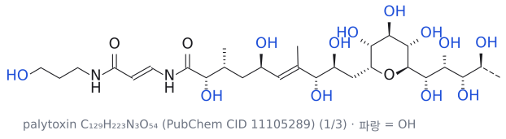
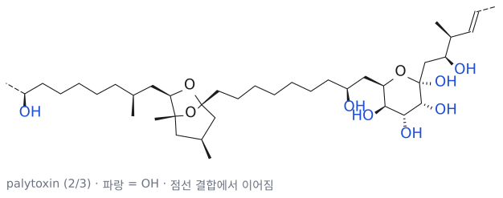
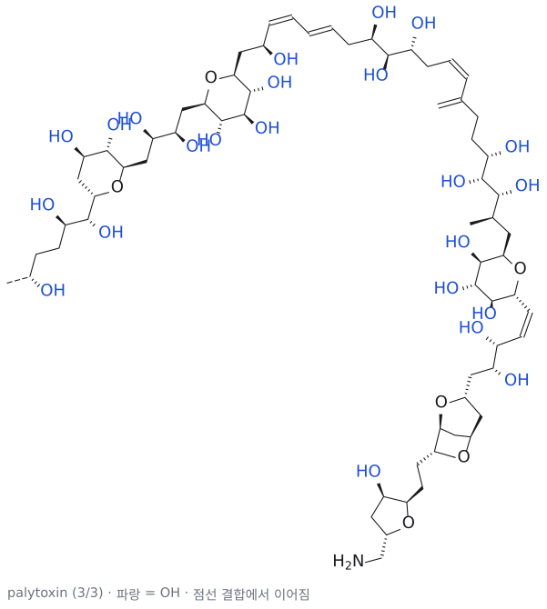

그림: 보충: palytoxin의 구조( $C_{129}H_{223}N_3O_{54}$ , PubChem CID 11105289의 SMILES로 그림). 너무 길어서 세 조각으로 나눴고, 점선 결합이 다음 조각으로 이어지는 자리다. 파랑은 모두 OH로, protecting group 없이는 이 중 하나만 골라 반응시킬 수 없다.

그런데 이 분자를 만들 때 진짜 골칫거리는 무엇일까? 바로 거의 똑같이 생긴 OH가 40개나 있다는 점이다. 그중 하나만 반응시키고 나머지는 그대로 두고 싶다면, 나머지 OH를 어떻게든 반응하지 못하게 막아야 한다. 즉 protecting group 없이는 이런 분자의 합성을 시도조차 할 수 없다.

(출처: L12 p.2)

### 2. 언제 protecting group을 쓰는가

> 개념 문서: [protecting group](../../wiki/개념/보호기.md), [Grignard reagent](../../wiki/시약/그리냐르%20시약.md)

보호가 필요한 이유는 둘이다. ketone과 ester 가운데 반응성이 더 낮은 쪽을 선택하려는 경우와, Grignard가 free OH나 carbonyl과 만나 원하는 반응 전에 소모되는 경우다. 보호 구조를 외우기 전에 원래 조건에서 일어날 실패 반응부터 그려야 선택 이유가 분명해진다. (출처: L12 p.3–4,13–14)

protecting group이 필요한 상황은 크게 두 가지로 정리된다.

**첫째, 덜 reactive한 작용기를 반응시켜야 할 때**
electrophilicity는 ketone이 ester보다 훨씬 크다(ketone >> ester).
그런데 ethyl acetoacetate(CH3COCH2CO2Et)에서 ester 쪽에만 PhMgBr 2당량을 붙여 CH3COCH2C(OH)Ph2를 얻고 싶다면 어떻게 될까?
그냥 PhMgBr을 넣으면 시약은 당연히 더 반응성 큰 ketone을 공격하고,
결과물은 CH3C(OH)(Ph)CH2CO2Et가 된다(슬라이드상 52% 수율).
원하는 것과 정반대다. 그래서 반응성이 큰 쪽을 먼저 가려 두는 수밖에 없다(→ 본문 6절 예제 1).

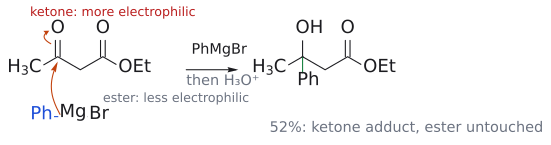

그림: PhMgBr(파랑)이 보호 없이 ethyl acetoacetate를 만나면 더 electrophilic한 ketone 탄소(빨강)를 공격하고 C=O의 π 전자는 O로 밀린다. 산 처리 후 얻는 것은 ketone 쪽 3차 alcohol(초록이 새 C–Ph 결합)이고 ester는 그대로다(슬라이드상 52%). (출처: L12 p.3)

**둘째, 한 분자 안에 incompatible한 작용기가 있을 때**
Grignard 시약은 nucleophile이고 carbonyl은 electrophile이므로, 둘을 한 분자에 넣으면 스스로를 공격해 버린다.
또 carboxylic acid(RCOOH)이나 alcohol(ROH) 같은 H+ 공급원이 있으면 Grignard 시약은 proton donor와의 acid–base reaction으로 소모된다. 슬라이드의 예가 바로 이것이다.

ethyl HCO2Et에 CH3CO(CH2)3MgBr 2당량을 붙여 대칭 hydroxy diketone을 만들고 싶지만, 이 Grignard 시약은 자기 분자 안에 ketone을 품고 있으므로 만들어지는 순간 다른 분자의 ketone을 공격한다. 슬라이드는 이를 "impossible Grignard reagent"이라고 부른다.

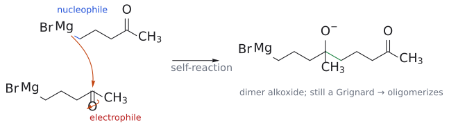

그림: 보충(슬라이드는 구조와 물음표만 보여 준다): 4-oxopentylmagnesium bromide가 생기면 그 C–Mg 결합(파랑)이 다른 분자의 ketone 탄소(빨강)를 공격하고 C=O 전자는 O로 간다. 생성물(초록이 새 C–C 결합)에는 여전히 C–MgBr이 남아 있어 같은 반응이 되풀이된다. 그래서 ketone을 acetal로 가리지 않으면 이 Grignard 시약은 존재할 수 없다. (출처: L12 p.3)

(출처: L12 p.3)

### 3. protecting group은 어떻게 쓰는가

> 개념 문서: [protecting group](../../wiki/개념/보호기.md)

그렇다면 해결책은 무엇일까? 답은 단순하다. FG1과 FG2가 있는 분자에서 FG2를 반응시키고 싶은데 FG1이 방해한다면, FG1을 보호하고 → FG2에서 반응시키고 → FG1을 deprotection하면 된다.

$$
\begin{aligned}
& \mathrm{FG_1{\sim}FG_2} \cr
& \xrightarrow{\text{보호}} \mathrm{PG{-}FG_1{\sim}FG_2} \cr
& \xrightarrow{\text{FG2에서 반응}} \mathrm{PG{-}FG_1{\sim}EE} \cr
& \qquad \xrightarrow{\text{deprotection}} \mathrm{FG_1{\sim}EE}
\end{aligned}
$$

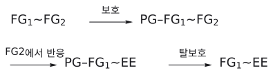

그림: 보충: protecting group 전략의 흐름. 방해되는 FG1을 PG로 보호하고, FG2에서 원하는 반응을 한 뒤(EE), PG를 떼어 FG1을 되살린다.

말은 쉽지만 여기에는 두 가지 조건이 붙는다. 하나는 보호와 deprotection 반응 자체가 깔끔하게 일어나야 한다는 것이고, 다른 하나는 protecting group이 FG2에서 일어나는 반응 조건을 견딜 만큼 안정해야 한다는 것이다. 결국 protecting group 선택이란 "어떤 조건에서 버티고, 어떤 조건에서 벗겨지는가"를 맞추는 퍼즐이다.

보충: 그러면 alcohol을 그냥 methyl ether로 막아 두면 안 될까? methyl ether는 만들기 쉽고 웬만한 반응을 다 견디지만, 문제는 **다시 벗기기가 너무 어렵다는** 것이다. 좋은 protecting group은 **계획한 합성 단계의 조건에서는 유지되고, 필요한 단계에서는 다른 작용기와 양립하는 조건으로 선택적으로 제거할 수 있어야 한다**. 모든 조건에 안정하거나 단 하나의 시약에만 반응한다는 뜻은 아니다. 이 관점으로 표를 다시 보면 각 protecting group의 약점이 분명하다. THP는 ether처럼 보이지만 사실 acetal이라 두 번째 산소가 산에서 약점이 되고, benzyl ether와 Cbz는 benzyl C–O 결합이 hydrogenolysis에 약하고, silyl ether는 Si가 F-를 유난히 좋아하며, Boc와 t-Bu ester는 안정한 t-butyl cation을 내놓을 수 있어 산에 약하다. 예외적으로 phenol의 methyl ether는 ArO-가 RO-보다 좋은 leaving group이라서 BBr3나 HBr로 벗길 수 있어 protecting group으로 쓰인다.
(보충 근거: Clayden p.550–552, p.556)

보충: protecting group은 공짜가 아니다. 씌우고 벗기는 두 단계가 더 들고, 각 단계 수율이 100%가 아니므로 시간과 물질을 모두 잃는다. 그래서 가능하면 protecting group 없이 가는 길도 먼저 검토한다. 예컨대 산성 양성자(OH, NH)가 몇 개 있는 ester에 값싼 Grignard 시약을 아주 과량 넣어, 양성자를 다 떼고도 남은 시약이 ester에 첨가하게 하는 방법이 실제로 쓰였다. 다만 이런 방법이 통할지는 해 보기 전에는 알 수 없다. (보충 근거: Clayden p.552)

대표적인 조합은 다음과 같다. alcohol은 silyl ether나 benzyl ether, amine은 carbamate( RO-C(=O)-NR2), aldehyde·ketone은 acetal, carboxylic acid는 ester로 보호한다. 다만 슬라이드에서 benzyl ether와 ester는 회색으로 처리되어 있고, 마지막 요약에도 silyl ether·carbamate·acetal 세 가지만 나온다. 즉 이 강의의 주인공은 이 셋이다.

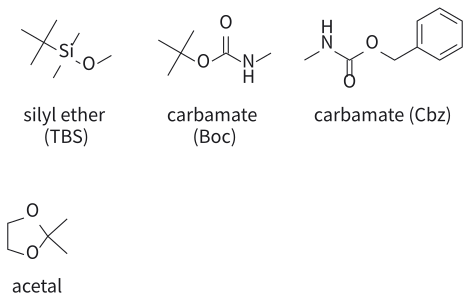

그림: 보충: 이 강의의 세 주인공. alcohol의 silyl ether(TBS, $R-O-SiMe_2tBu$ ), amine의 carbamate(Boc, Cbz), aldehyde·ketone의 acetal(1,3-dioxolane). R은 나머지 분자. 파랑은 보호되는 heteroatom(nucleophile), 빨강은 deprotection 때 공격·절단되는 자리(Si는 $F^-$ , t-Bu C는 $H^+$ , benzyl C는 $H_2/Pd$ , acetal C는 $H_3O^+$ ).

이 강의는 이 세 가지 대표 protecting group을 중심으로,
1) 각 protecting group을 어떻게 씌우고 벗기는지,
2) 그리고 왜 그 조건에서만 벗겨지는지를 메커니즘으로 설명한다(5·6·8절).

앞에서 다룬 Grignard addition, acetal 형성, SN1/SN2, E1cB 제거가 모두 다시 등장하며(→ Grignard reaction 문서, acetal 형성 문서, E1cB 제거 문서 참고),
마지막에는 이 모든 것이 peptide 합성이라는 실전 무대에서 어떻게 조합되는지 본다(7절).

(출처: L12 p.4, p.16)

### 4. 한눈에 보는 protecting group 표

> 개념 문서: [protecting group](../../wiki/개념/보호기.md), [THP protecting group](../../wiki/시약/THP%20보호기.md), [benzyl ether protecting group](../../wiki/시약/벤질%20에터%20보호기.md)

protecting group의 평가는 protection, 원하는 transformation, deprotection 세 번에 걸쳐 한다. acetal은 염기와 nucleophile에 안정하고 산성 수용액에서 제거된다. silyl ether는 종류별로 산·염기 안정성 순위가 다르다. Boc/Cbz/Fmoc은 모두 N 보호에 쓰여도 제거 조건이 서로 달라 peptide 합성 순서를 결정한다. (출처: L12 p.6–11,13)

강의 표의 아홉 가지 protecting group을 **보호 대상·구조·안정성**과 **도입·제거 조건**으로 나누어 비교한다. 강의에서 박스로 강조한 항목은 acetal, trialkylsilyl, Cbz, Boc, Fmoc다.

#### 보호 대상과 견디는 조건

| Protecting group | 보호 대상 | 보호된 구조 | 무엇으로부터 보호하는가 |
|---|---|---|---|
| **Acetal (dioxolane)** | aldehyde, ketone | 1,3-dioxolane 고리 | nucleophile, 염기 |
| **Trialkylsilyl** (예: TBS = TBDMS) | alcohol | $\mathrm{RO{-}SiMe_3}$ 또는 $\mathrm{RO{-}SiMe_2(t{-}Bu)}$ | nucleophile, 탄소·질소계 염기 |
| THP (tetrahydropyranyl) | alcohol | 2-alkoxytetrahydropyran | 강염기 |
| Benzyl ether (OBn) | alcohol | $\mathrm{RO{-}CH_2Ph}$ | 여러 반응 조건¹ |
| Methyl ether (ArOMe) | phenol | $\mathrm{ArOMe}$ | 염기 |
| tert-Butyl ester | carboxylic acid | $\mathrm{RCO_2C(CH_3)_3}$ | nucleophile |
| **Cbz (Z)** | amine | $\mathrm{RNH{-}CO{-}OCH_2Ph}$ | electrophile |
| **Boc** | amine | $\mathrm{RNH{-}CO{-}OC(CH_3)_3}$ | electrophile |
| **Fmoc** | amine | 9-fluorenylmethyl carbamate | electrophile |

¹ benzyl ether의 원문 표현은 “almost everything”이다. 이 칸은 강의의 일반적인 반응성 요약이며, 모든 시약·온도·반응 시간에 대해 안정하다는 보장은 아니다. silyl ether도 Si의 치환기에 따라 산·염기 조건에서의 안정성이 달라진다(5-5절 참고). (출처: L12 p.5,7)

#### 도입과 제거 조건

| Protecting group | 도입 조건 (protection) | 제거 조건 (deprotection) |
|---|---|---|
| **Acetal** | ethylene glycol $\mathrm{HOCH_2CH_2OH}$, $\mathrm{H^+}$ 촉매 | $\mathrm{H^+,\ H_2O}$ |
| **Trialkylsilyl** | $\mathrm{R_3SiCl}$, 염기 | $\mathrm{F^-}$ 또는 $\mathrm{H^+,\ H_2O}$ |
| THP | dihydropyran, 산 | $\mathrm{H^+,\ H_2O}$ |
| Benzyl ether (OBn) | $\mathrm{NaH}$, $\mathrm{BnBr}$ | $\mathrm{H_2/Pd/C}$ 또는 $\mathrm{HBr}$ |
| Methyl ether (ArOMe) | $\mathrm{NaH}$; $\mathrm{MeI}$ 또는 $\mathrm{(MeO)_2SO_2}$ | $\mathrm{BBr_3}$, $\mathrm{HBr}$, $\mathrm{HI}$ 또는 $\mathrm{Me_3SiI}$ |
| tert-Butyl ester | isobutene, $\mathrm{H^+}$ | 강산 |
| **Cbz (Z)** | $\mathrm{BnOCOCl}$, 염기 | $\mathrm{H_2/Pd}$ 또는 $\mathrm{HBr/AcOH}$ |
| **Boc** | $\mathrm{(t{-}BuOCO)_2O}$, 염기 | $\mathrm{H^+,\ H_2O}$ |
| **Fmoc** | Fmoc-Cl | 염기(예: amine) |

Bn은 benzyl($\mathrm{CH_2Ph}$), Ar은 aryl, R은 나머지 유기 치환기를 뜻한다. Boc와 tert-butyl ester는 산, Fmoc는 염기, benzyl ether와 Cbz는 hydrogenolysis, silyl ether는 fluoride를 대표 제거 조건으로 연결해서 읽는다. 표의 다른 제거법도 함께 남겨 두었다. (출처: L12 p.5–6,8)

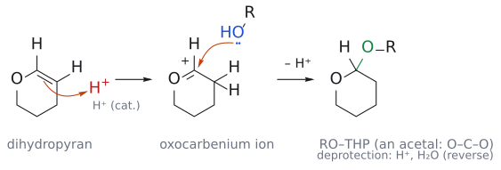

그림: 보충(슬라이드 표에는 "dihydropyran + 산"이라는 조건만 있다): dihydropyran은 enol ether라서 C=C(파랑)가 H⁺(빨강)를 β-탄소에서 받으면 O 옆 탄소에 oxocarbenium ion이 생긴다. 이 탄소(빨강)를 alcohol의 O(파랑)가 공격하고 H⁺를 잃으면 RO–THP(초록이 새 C–O 결합)이다. O–C–O를 가진 acetal이므로 염기에는 안정하고, H⁺/H2O에서는 같은 경로를 거꾸로 밟아 벗겨진다. (보충 근거: Clayden p.550–551)

### 5. alcohol의 protecting group: silyl ether

> 개념 문서: [silyl ether protecting group](../../wiki/시약/실릴%20에터%20보호기.md), [SN2 reaction](../../wiki/반응/SN2%20반응.md)

#### 5-1. 어떤 silyl group이 있나

alcohol의 O–H를 O–SiR3로 바꾼 것이 silyl ether다. Si에 붙는 R의 종류에 따라 이름이 달라진다.

| 약어 | 이름 | 구조 |
|---|---|---|
| TMS | trimethylsilyl | RO-SiMe3 |
| TES | triethylsilyl | RO-SiEt3 |
| TBS (= TBDMS) | tert-butyldimethylsilyl | RO-SiMe2(t-Bu) |
| TIPS | triisopropylsilyl | RO-Si(i-Pr)3 |
| TBDPS | tert-butyldiphenylsilyl | RO-SiPh2(t-Bu) |

TBS와 TBDMS는 같은 것을 부르는 두 이름이고, 슬라이드에서도 Si(Me)2(t-Bu)를 다 그린 구조와 "OTBDMS"라는 약어가 섞여 쓰인다.

#### 5-2. 어떻게 씌우나

보호는 silyl chloride와 imidazole로 한다.

$$
\mathrm{ROH} \xrightarrow[\text{imidazole}]{\ \mathrm{R'_3SiCl}\ \mathstrut} \mathrm{ROSiR'_3}
$$

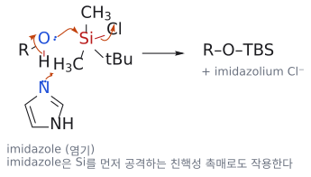

그림: 보충: alcohol O(파랑)의 전자쌍이 Si(빨강)를 공격하고 $Cl^-$ 가 떨어진다. imidazole의 N 전자쌍이 O–H 양성자를 받아 $HCl$ 을 중화한다. 실제로는 imidazole이 먼저 Si를 공격해 silyl imidazolium을 만드는 nucleophilic 촉매 경로가 주로 작동한다.

alcohol의 O(nucleophile)가 Si(electrophile)를 공격하고 Cl-가 떨어져 나가며 Si–O 결합이 생긴다. 그런데 imidazole은 왜 넣을까? imidazole은 생기는 HCl을 받아 주는 염기일 뿐 아니라, silyl chloride와 먼저 반응해 더 반응성이 큰 silyl imidazolium intermediate를 만드는 nucleophilic 촉매 역할도 한다.[2]

#### 5-3. 실전 예: acetylide alkylation

슬라이드의 예는 CH3CH(OH)CH2CH2CH2Br에 lithium acetylide를 붙여 말단 alkyne을 만드는 반응이다. 원래 의도는 acetylide가 C–Br 탄소를 SN2로 공격하는 것이다. 그런데 OH를 그대로 두면 어떻게 될까? lithium acetylide는 강염기이고, alcohol(pKa 약 16)은 말단 alkyne(pKa 약 25)보다 훨씬 산성이다.[3] 그래서 acetylide는 탄소를 공격하기도 전에 OH의 양성자부터 떼어 내고 그냥 acetyl렌으로 되돌아간다.

그래서 먼저 OH를 TBDMS ether로 바꾼다.

$$
\begin{aligned}
& \mathrm{CH_3CH(OH)CH_2CH_2CH_2Br} \cr
& \qquad \xrightarrow[\text{imidazole}]{\ \mathrm{\mathit{t}\text{-}BuMe_2SiCl}\ \mathstrut} \mathrm{CH_3CH(OTBDMS)CH_2CH_2CH_2Br} \cr
& \qquad \xrightarrow{\mathrm{HC{\equiv}C{-}Li}} \mathrm{CH_3CH(OTBDMS)CH_2CH_2CH_2C{\equiv}CH}
\end{aligned}
$$

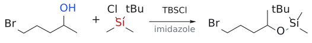

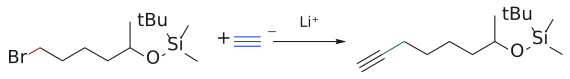

그림: 보충: 2차 alcohol을 TBS ether로 막은 뒤 $HC{\equiv}CLi$ 로 1차 $C-Br$ 를 $S_N2$ 치환한다. OH가 그대로 있으면 acetylide가 O–H 양성자부터 떼어 버린다.

산성 양성자가 사라졌으니 이제 acetylide는 원래 목적대로 C–Br에서 치환 반응만 하게 된다.

#### 5-4. 어떻게 벗기나

방법은 두 가지다. 하나는 tetrabutylammonium fluoride(TBAF), nBu4NF이고, 다른 하나는 산과 물이다.
fluoride가 잘 듣는 이유는 Si–F 결합이 Si–O 결합보다 훨씬 강하기 때문이다.
 $F^-$ 가 Si를 공격하면 alkoxide가 밀려나고, 이것이 protonate되어 원래의 alcohol로 돌아온다.[4]
 $F^-$ 는 탄소 화학에서는 그다지 좋은 nucleophile이 아니지만 Si에 대해서만큼은 효과적인 cleavage reagent이다. Si–F 결합 형성이 유리하다는 점을 이용하지만, 실제 선택성은 다른 작용기와 fluoride 조건의 compatibility를 확인해야 한다.

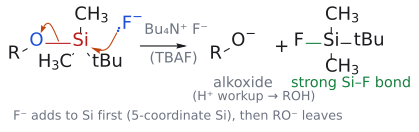

그림: 보충(슬라이드에는 조건만 있다). F⁻(파랑)의 전자쌍이 Si(빨강)를 공격하고, Si–O 결합(빨강)의 전자가 산소로 가서 alkoxide가 떨어진다. 실제로는 F⁻가 먼저 Si에 첨가해 다섯 배위 anion을 거친 뒤 분해되므로 단순한 SN2가 아니다. 새로 생기는 Si–F 결합(초록)이 강하다는 것이 추진력이고, alkoxide는 후처리에서 protonate되어 ROH가 된다. (보충 근거: Clayden p.550)

그림: fluoride가 Si에 접근하여 Si–O를 끊는 단계다. 탄소의 C–O 결합을 끊는 그림이 아니다. (원본 대조: L12_Protecting groups.pdf p.7)

[원본 자료에서 세부 구조·입체배치 확인: L12_Protecting groups.pdf p.7](../../figures/L12/source/L12_p07.png)

(출처: L12 p.5, p.6)

#### 5-5. 어느 silyl group이 더 튼튼한가

silyl group이 이렇게 여러 종류인 이유는 무엇일까? 튼튼함이 서로 크게 다르기 때문이다. 슬라이드에 제시된 상대 안정성은 다음과 같다.

- 산성 조건: TMS (1) < TES (64) < TBS (20,000) < TIPS (700,000) < TBDPS (5,000,000)
- 염기성 조건: TMS (1) < TES (10–100) < TBS ~ TBDPS (20,000) < TIPS (100,000)

대체로 Si 주변의 steric bulk가 클수록 cleavage에 대한 kinetic resistance가 커진다. Si 주변의 덩치 큰 치환기가 물, OH-, F- 같은 nucleophile이 Si에 다가가는 것을 막기 때문이다.[12] 그런데 TIPS와 TBDPS의 순서를 보면 흥미롭다. 산에서는 TBDPS가 압도적으로 가장 튼튼하지만, 염기에서는 TIPS가 가장 튼튼하고 TBDPS는 TBS와 비슷한 수준으로 내려온다. 즉 가장 높은 acid/base stability를 보이는 silyl group은 조건에 따라 다르다.

이 차이는 실전에서 무기가 된다. 한 분자에 TMS ether와 TBDPS ether가 같이 있다면, 약한 산 조건으로 TMS만 골라 벗길 수 있다.

(출처: L12 p.7)

| 비교 조건 | 강의의 상대 안정성 순서 |
| --- | --- |
| Acidic media | TMS < TES < TBS < TIPS < TBDPS |
| Basic media | TMS < TES < TBS ≈ TBDPS < TIPS |

비교 조건이 달라지면 순서도 달라진다. 수치는 보편적 수명이 아니므로 원본 비교표에서 조건과 함께 읽는다. (출처: L12 p.7)

### 6. amine의 protecting group: carbamate

> 개념 문서: [protecting group](../../wiki/개념/보호기.md), [Cbz protecting group](../../wiki/시약/Cbz%20보호기.md), [Boc protecting group](../../wiki/시약/Boc%20보호기.md), [hydrogenolysis](../../wiki/반응/수소화분해.md)

#### 6-1. 왜 carbamate인가

amine은 좋은 nucleophile이자 염기라서, electrophile이 있는 반응에서는 거의 항상 끼어든다. 그렇다면 amine의 질소의 nucleophilicity와 basicity를 어떻게 낮출 수 있을까? 답은 질소를 carbonyl에 붙여 carbamate(RO-C(=O)-NR2)로 만드는 것이다. 그러면 N lone pair가 carbonyl에 delocalized되어 nucleophilicity와 염기성이 크게 떨어진다.[5] 표에서 carbamate가 "electrophile로부터" amine을 보호한다고 적힌 이유가 이것이다.

#### 6-2. 어떻게 씌우나

carbamate는 두 가지 시약으로 만든다. Cl-CO-OR''를 쓰거나, dicarbonate(R''O-CO-O-CO-OR'', 일종의 anhydride)를 쓴다. 둘 다 염기를 함께 넣는다.

$$
\mathrm{RR'NH} \xrightarrow{\mathrm{Cl{-}CO{-}OR''},\ \text{base}} \mathrm{R'RN{-}CO{-}OR''}
$$

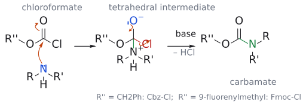

그림: 보충(슬라이드는 반응식만 보여 준다): amine N(파랑)의 전자쌍이 chloroformate의 carbonyl 탄소(빨강)를 공격하고 C=O의 π 전자가 O로 가 tetrahedral intermediate가 된다. O⁻의 전자쌍이 내려와 C=O를 되살리며 C–Cl 결합(빨강)의 전자가 Cl⁻로 떨어지고, 염기가 N⁺–H를 떼면 carbamate(초록 C–N)가 된다. R''가 benzyl이면 Cbz-Cl, 9-fluorenylmethyl이면 Fmoc-Cl이다. 표준 nucleophilic acyl substitution이다. (보충 근거: Clayden p.557)

$$
\mathrm{RR'NH} \xrightarrow[\text{base}]{\mathrm{R''O{-}CO{-}O{-}CO{-}OR''}} \mathrm{R'RN{-}CO{-}OR''}
$$

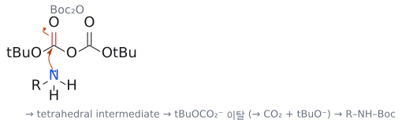

그림: 보충: amine N(파랑)의 전자쌍이 $Boc_2O$ 의 carbonyl C(빨강)를 공격하고 C=O $\pi$ 전자가 O로 가서 tetrahedral intermediate가 된다. 이어서 $tBuOCO_2^-$ 가 떨어지고, 이것이 $CO_2$ 와 $tBuO^-$ 로 분해되어 반응을 끌어당긴다.

대표 선수는 두 명이다. benzyl carbamate인 Cbz(Z라고도 함, R'RN-CO-OCH2Ph)는 BnOCOCl과 염기로 씌우고, t-butyl carbamate인 Boc(R'RN-CO-OC(CH3)3)는 (t-BuOCO)2O, 흔히 Boc2O라 부르는 시약과 염기로 씌운다.

보충: 왜 Cbz는 chloroformate로, Boc는 anhydride로 씌울까? Boc에 해당하는 tert-butyl chloroformate(t-BuOCOCl)은 불안정해서 시약으로 다루기 어렵기 때문이다. 그래서 Boc는 "Boc anhydride"인 di-tert-butyl dicarbonate를 쓴다. (보충 근거: Clayden p.558, Wade p.1186)

#### 6-3. 어떻게 벗기나

Boc는 산(예: TFA, trifluoroacetic acid)으로 벗긴다. Cbz는 H2/Pd hydrogenolysis로 벗기는 것이 기본이고, 산(HBr/AcOH)으로도 벗길 수 있다. Cbz를 hydrogenolysis하면 benzyl C–O 결합이 끊겨 toluene과 carbamic acid(RNH-COOH)이 생기고, carbamic acid은 스스로 CO2를 내놓으며 유리 amine이 된다.[6] 이 "carbamic acid → CO2 + amine" 단계는 뒤에 나올 Boc, Fmoc에서도 똑같이 마지막을 장식한다.

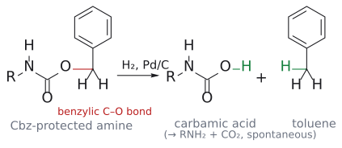

그림: 보충(슬라이드에는 조건만 있다). H₂/Pd 조건에서 benzyl C–O 결합(빨강)이 끊기고, H₂의 수소(초록)가 양쪽 조각에 붙어 carbamic acid와 toluene이 된다. 금속 표면에서 일어나는 반응이라 굽은 화살표는 그리지 않았다. carbamic acid는 저절로 CO₂를 잃고 amine이 된다(이 단계의 화살표는 7-3절의 두 번째 그림 참고). (보충 근거: Clayden p.557)

보충: carbamate의 N lone pair는 amide처럼 carbonyl과 conjugation한다. 그래서 Cbz 자체는 묽은 산 수용액과 염기 수용액을 모두 견디고, benzyl C–O 결합의 선택적 cleavage를 deprotection에 이용할 수 있다. HBr/AcOH 조건이 통하는 이유도 benzyl group에 있다. 강산 HBr이 carbonyl 산소를 protonate하면, nucleophilic Br-가 **benzyl 탄소를 SN2로 공격** 해 BnBr을 떼어 내고 carbamic acid가 남는다. benzyl 자리는 SN2가 빠른 자리이기 때문이다. 이 점이 7-3절 Boc와 대비된다. Boc는 t-butyl group이 SN1으로 떨어지므로 nucleophilic 짝염기 없이도 적절한 산성 조건에서 deprotection할 수 있지만, Cbz는 Br-처럼 좋은 nucleophile이 있어야 산으로 벗겨진다. (보충 근거: Clayden p.556–558)

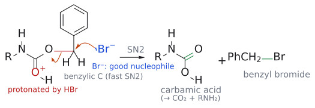

그림: 보충. HBr이 carbonyl 산소를 protonation한 상태(빨강 O⁺)에서, Br⁻(파랑)의 전자쌍이 benzyl 탄소(빨강)를 $CH_2\text{–}O$ 결합의 뒤쪽에서 SN2로 공격하고, $CH_2\text{–}O$ 결합(빨강)의 전자는 산소로 간다. carbamic acid(초록이 새 C=O)와 benzyl bromide(초록이 새 C–Br)가 생긴다. (보충 근거: Clayden p.557)

(출처: L12 p.8)

### 7. peptide 합성: protecting group의 실전 무대

> 개념 문서: [peptide synthesis](../../wiki/반응/펩타이드%20합성.md), [orthogonal protection](../../wiki/개념/직교%20보호.md), [tetrahedral intermediate](../../wiki/개념/사면체%20중간체.md), [Boc protecting group](../../wiki/시약/Boc%20보호기.md), [carbocation](../../wiki/개념/탄소%20양이온.md), [TFA](../../wiki/시약/TFA.md), [Fmoc protecting group](../../wiki/시약/Fmoc%20보호기.md), [E1cB elimination](../../wiki/개념/E1cB%20제거.md), [aromaticity](../../wiki/개념/방향족성.md), [DCC](../../wiki/시약/DCC.md)

#### 7-1. 무엇이 문제인가

Leu와 Gly를 이어 dipeptide LeuGly를 만든다고 하자. 필요한 것은 Leu의 CO2H와 Gly의 NH2 사이의 amide 결합이다. 이를 위해 Leu의 CO2H는 활성화되어 electrophilicity를 띠어야 하고, Gly의 NH2는 nucleophile로 작용해야 한다.

그런데 문제가 있다. 두 amino acid 모두 NH2와 CO2H를 다 가지고 있다. 그래서 보호 없이 섞어 활성화하면 Leu–Leu, Gly–Gly, Gly–Leu가 모두 생길 수 있다. 원하는 짝만 맺어 주려면 "반응하면 안 되는 쪽"을 모두 가려야 한다.

보충: 슬라이드의 C(=O)X에서 X로 무엇을 쓰는지도 이유가 있다. acyl chloride는 너무 반응성이 커서 peptide 합성에서는 쓰지 않는다. $\alpha$-탄소의 racemic화, 그리고 두 amino acid이 고리로 이어진 diketopiperazine 같은 부산물이 생기기 쉽기 때문이다. 대신 p-nitrophenyl ester나 2,4,6-trichlorophenyl ester처럼 "적당히 활성화된" ester, 또는 DCC 같은 coupling reagent를 쓴다. electron-withdrawing group가 붙은 phenoxide는 pKa가 낮아 좋은 leaving group이 되기 때문이다. 또 amino acid의 단순 methyl·ethyl ester는 다른 분자의 amine에게 공격받을 수 있어서, NH2가 보호되어 있거나 염산염(–NH3+)으로 "보호"되어 있을 때만 안정하다. (보충 근거: Clayden p.553, p.555, p.557)

보충: amino acid 곁사슬도 보호 대상이다. 글루탐산·아스파르트산은 CO2H를, 라이신은 NH2를 하나 더 가지므로, 이들을 그대로 두면 주사슬 대신 곁사슬에서 amide가 생긴다. 7-5절에서 "곁사슬 protecting group(PG)"가 따로 등장하는 이유다. (보충 근거: Wade p.1183)

#### 7-2. 해결 전략

해결책은 이렇다. Leu는 N을 PG1으로 보호하고 CO2H를 C(=O)X로 N-protected amino acid. Gly는 CO2H를 PG2로 보호한다. 그러면 Gly의 NH2(nucleophile)가 Leu의 활성화된 carbonyl electrophile을 공격해 tetrahedral intermediate를 만들고, X-가 떨어져 나가며 PG1-NH-Leu-Gly-O-PG2가 생긴다.

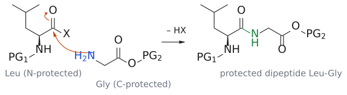

그림: Leu의 활성화된 C(=O)X(빨강)를 Gly의 NH2(파랑)가 공격하고 C=O의 π 전자가 O로 가 tetrahedral intermediate를 거친 뒤, X⁻가 떨어지며(– HX) 보호된 dipeptide(초록이 새 amide 결합)가 된다. Leu의 N은 PG1, Gly의 CO2H는 PG2로 막혀 있어 이 조합만 생긴다. (출처: L12 p.9)

다음은 어떻게 할까? 사슬을 N 쪽으로 늘리고 싶으면 PG1만 벗기고(N-deprotection, 슬라이드에서는 염기), C 쪽으로 늘리고 싶으면 PG2만 벗긴다(C-deprotection, 슬라이드에서는 산). 여기서 핵심은 PG1과 PG2가 서로 다른 조건에서 벗겨져야 한다는 것이다. 한쪽을 벗기는 조건에서 다른 쪽은 멀쩡히 버텨야 한다. 이렇게 서로 간섭하지 않고 각각 선택적으로 제거할 수 있는 protecting group 조합을 orthogonal protection라고 한다. 슬라이드는 N-보호 방식으로 N-Boc와 N-Fmoc 두 가지를 소개한다.

보충: N-protecting group으로 그냥 acetyl 같은 amide를 쓰면 안 될까? 안 된다. 보호용 amide를 hydrolysis하는 조건에서는 지금 막 만든 peptide amide 결합도 함께 끊기기 때문이다. 그래서 N lone pair의 delocalization으로 nucleophilicity를 낮추면서도 peptide 결합을 건드리지 않는 온화한 조건으로 벗겨지는 carbamate를 쓴다. C-protecting group 후보인 t-butyl ester가 산 불안정 짝으로 잘 맞는 이유도 같은 맥락이다. t-Bu의 부피 때문에 carbonyl이 OH- 같은 nucleophile의 공격(염기 hydrolysis)을 받지 않고, 산에서는 carbonyl 공격이 아니라 t-butyl cation 이탈(SN1/E1)이라는 전혀 다른 경로로 끊긴다. (보충 근거: Clayden p.553, p.556)

(출처: L12 p.9)

orthogonal protection은 두 protecting group이 존재하는 상태가 아니라 한쪽을 제거할 때 다른 쪽을 유지할 수 있는 조건 관계다. 실제 분자에 있는 alkene 등 다른 작용기도 제거 조건을 견디는지 확인해야 한다. 반응이 끝난 답안에서 보호된 O/N이 모두 원래 작용기로 돌아왔는지도 검산한다. (출처: L12 p.3–4,8–11,16)

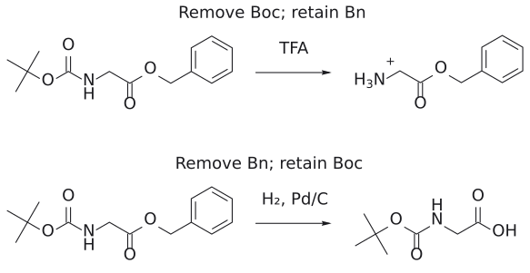

그림: ReShiki로 그린 개념 도식. 자세한 전자 이동과 출처는 연결된 개념 문서의 그림 설명에 있다.

#### 7-3. N-Boc: 산으로 벗기는 protecting group

Boc는 Boc2O("Boc anhydride")와 염기로 씌운다. 슬라이드의 예는 methionine을 Boc-Met으로 바꾸는 반응이다. amine N이 anhydride의 carbonyl 탄소를 공격하고, tetrahedral intermediate에서 t-BuOCO2-가 떨어져 나간다.[7]

$$
\text{methionine} \xrightarrow{\ \mathrm{Boc_2O},\ \text{base}\ \mathstrut} \mathrm{Boc{-}Met}
$$

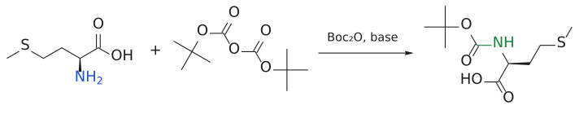

그림: $NH_2$ (파랑)가 Boc의 C=O(빨강)를 공격해 carbamate(초록)가 된다.

그렇다면 Boc는 왜 산에서 벗겨질까? 메커니즘을 따라가 보면 답이 보인다.

1. carbamate의 carbonyl O가 H+에 의해 protonate된다.
2. t-Bu–O 결합이 끊어지며 t-butyl cation이 떨어져 나간다. 이 cation은 3차 carbocation이라 비교적 안정하므로 이 SN1형 이탈이 쉽게 일어난다. 남는 것은 carbamic acid RNH-COOH다.
3. t-butyl cation은 $\beta$ -H를 잃고 isobutene(CH2=C(CH3)2)이 된다.
4. carbamic acid은 양성자가 옮겨 간 zwitterion(O-/NH2+) 형태를 거쳐 CO2를 내놓고 H2N–R이 된다.

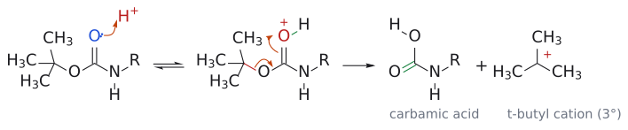

그림: 위 1–2단계. 왼쪽: carbonyl 산소(파랑)의 비공유 전자쌍이 H⁺(빨강)를 잡는다(가역). 가운데: t-Bu–O 결합(빨강)의 전자가 O–C 자리로 가서 새 C=O를 만들고, protonate된 C=O⁺H의 $\pi$ 전자는 산소로 돌아가 OH가 된다. 오른쪽: carbamic acid(초록이 새 C=O)과 3차 t-butyl cation이 생긴다.

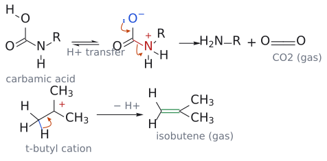

그림: 위 3–4단계. 윗줄: carbamic acid가 proton transfer로 $O^-/N^+H_2$ zwitterion이 된다. O⁻(파랑)의 전자쌍이 내려와 C=O를 만들고, C–N 결합(빨강) 전자가 질소로 가면서 $CO_2$ 와 $H_2N\text{–}R$ 이 떨어진다. 아랫줄: t-butyl cation의 methyl C–H 결합(파랑) 전자가 cation 탄소 쪽으로 가서 C=C(초록)가 되고 H⁺가 빠져 isobutene이 된다.

즉 Boc가 산에 약한 진짜 이유는 "안정한 3차 cation을 내놓을 수 있다"는 데 있다. 부산물이 CO2와 isobutene이라는 기체라서 반응이 한 방향으로 깔끔하게 진행된다는 점도 장점이다.[8]

보충: 반대로 Boc는 왜 염기에 강할까? carbonyl이 t-butyl group에 가려져 OH-조차 공격하지 못하기 때문이다. 그리고 산 쪽은 3 M HCl 정도의 묽은 산 수용액으로도 벗겨지며, 이 조건에서는 peptide 결합이나 methyl ester가 hydrolysis되지 않는다. 고체상 합성에서는 TFA로 짧게 처리해 벗긴다. (보충 근거: Clayden p.558–559, Wade p.1187)

(출처: L12 p.10)

#### 7-4. N-Fmoc: 염기로 벗기는 protecting group

Fmoc(9-fluorenylmethoxycarbonyl)은 Fmoc-Cl과 염기로 씌운다.

$$
\mathrm{RNH_2} \xrightarrow{\mathrm{Fmoc{-}Cl},\ \text{base}} \mathrm{Fmoc{-}NHR}
$$

Fmoc의 개성은 Boc와 정반대라는 데 있다. 먼저 왜 산에 안정할까? carbamate O에 붙은 탄소가 CH2, 즉 1차 탄소이므로 안정한 carbocation을 만들 수 없어 SN1이 불가능하다. 그렇다고 SN2가 되느냐 하면, 바로 옆에 덩치 큰 fluorenyl기가 버티고 있어 그것도 안 된다. 산이 Boc를 벗기던 경로가 Fmoc에는 아예 없는 것이다.

대신 Fmoc에는 다른 약점이 있다. fluorene 9번 위치의 C–H가 pKa 약 25로, 탄소에 붙은 수소치고는 꽤 산성이다. 이 H가 떨어지고 나면 생기는 anion이 14전자 aromatic계(14-electron aromatic system)를 이루어 안정화되기 때문이다. 그래서 염기를 만나면 다음과 같은 E1cB 제거가 일어난다.

1. amine 염기(:NR3)가 fluorene 9번 C–H를 deprotonation한다(가역).
2. 생긴 fluorenyl anion은 aromaticity로 안정화된다.
3. anion의 전자쌍이 C=C를 만들며 CH2–O 결합을 밀어내고, carbamate anion(RNH-CO2-)이 떨어져 나간다. 남은 탄화수소는 dibenzofulvene(9-methylylenefluorene)이다.
4. carbamate anion이 CO2를 잃고 H2N–R이 된다.

그림: 윗줄 왼쪽: $NR_3$ (파랑)의 비공유 전자쌍이 fluorene 9번 탄소의 H(빨강, pKa 약 25)를 떼고, C–H 결합 전자는 탄소에 남는다(가역). 윗줄 오른쪽: 생긴 fluorenyl anion은 14전자 aromatic계로 안정화된다. 이 anion의 전자쌍이 C9–CH2 사이에 C=C를 만들고, $CH_2\text{–}O$ 결합(빨강) 전자가 산소로 떨어져 E1cB. 아랫줄: dibenzofulvene(초록이 새 C=C)과 carbamate anion이 생기고, carbamate anion의 O⁻가 C=O를 만들며 C–N 결합(빨강)이 끊어져 $CO_2$ 와 $H_2N\text{–}R$ 이 된다.

보충: pKa 약 25짜리 C–H를 amine(conjugate acid pKa 약 10)이 뗀다는 것이 이상해 보일 수 있다. 실제로 평형에서 생기는 aromatic anion은 아주 적은 양뿐이다. 하지만 생기는 족족 곧바로 제거 반응으로 소모되므로, 평형이 계속 오른쪽으로 끌려가 결국 전부 벗겨진다. fluorenyl anion이 aromatic인 이유는 cyclopentadienyl anion과 같다(가운데 5원 고리의 anion이 두 benzene 고리와 함께 14전자 $\pi$ 계를 이룬다). (보충 근거: Clayden p.559)

실제 peptide 합성에서는 piperidine 같은 2차 amine을 주로 쓴다.[9] 결국 Boc(산에 약하고 염기에 강함)와 Fmoc(산에 강하고 염기에 약함)는 산·염기 조건에 대한 반응성이 상보적인 관계이고, 이것이 orthogonal protection 전략의 토대가 된다.

(출처: L12 p.11)

#### 7-5. solid-phase peptide synthesis(SPPS)

이 원리를 대규모로 돌리는 방법이 solid-phase peptide synthesis(SPPS)이다. amino acid을 고분자 수지(resin, 그림의 회색 구)에 붙여 놓고 그 위에서 사슬을 한 칸씩 늘려 가는 방식이다. 슬라이드는 두 가지 전략을 보여 준다.

**순차적 합성 sequential synthesis strategy.** 먼저 첫 amino acid(Y-Xaa-OH, Y = Fmoc 또는 Boc)을 수지에 붙인다. Cl-수지라면 염기만으로, H-X-수지(X = O 또는 NH)라면 coupling reagent와 염기로 붙인다. 그다음은 반복이다. A) Fmoc 또는 Boc기만 선택적으로 벗겨 NH2를 드러내고, B) 다음 Y-Xaa-OH를 coupling reagent와 염기로 붙인다. A와 B를 계속 돌리면 사슬이 C말단에서 N말단 방향으로 자란다. 다 만들면 수지에서 잘라 내면서 곁사슬 protecting group(PG)도 함께 벗긴다. 이때 X가 O였으면 C말단이 carboxylic acid, NH였으면 amide가 된다.

**수렴적 합성 convergent synthesis strategy.** 긴 peptide라면 한 칸씩 끝까지 늘리는 대신 조각을 따로 만들어 이어 붙이는 편이 낫다. SPPS로 수지 위에서 단편 A(H2N-Fragment A-수지)와 단편 B(PG-NH-Fragment B-O-수지)를 각각 만든 다음, 단편 B만 곁사슬 protecting group을 유지한 채 수지에서 떼어 내 PG-NH-Fragment B-OH를 얻는다. 이것을 coupling reagent와 염기로 수지 위 단편 A의 NH2에 이어 fragment coupling, 마지막에 수지 절단과 곁사슬 deprotection를 한 번에 하면 H2N-Fragment B-Fragment A-C(=O)XH가 된다.

두 전략 모두에서 반복해서 벗기는 N-protecting group(Y), 끝까지 남겨야 하는 곁사슬 protecting group(PG), 수지와의 연결부가 각각 다른 시점에 끊어지도록 설계되어 있다는 점이 핵심이다. orthogonal protection 개념이 없으면 성립할 수 없는 방법이다.

보충: 고체상 합성의 진짜 장점은 **각 합성 단계에서 용액상 성분을 세척으로 제거할 수 있다는** 데 있다. 사슬이 수지에 붙어 있으므로, 각 단계 뒤에 남은 시약과 용액상 부산물을 세척으로 제거할 수 있다. 다만 최종 cleavage 후의 peptide에는 불완전 반응으로 생긴 불순물 등이 남을 수 있으므로 최종 정제가 불필요하다는 뜻은 아니다. 용액상 합성은 단계마다 정제해야 해서, 긴 peptide에서는 전체 수율이 쓸 수 없을 만큼 떨어지고 시간도 몇 달씩 걸린다. 이 방법을 개발한 Merrifield(R. B. Merrifield)는 1984년 노벨 화학상을 받았다. 고전적인 Merrifield 법에서 수지는 chloromethyl기가 붙은 polystyrene이고, 첫 amino acid의 carboxylate가 이 benzyl chloride를 SN2로 공격해 **benzyl ester로** 붙는다. 즉 수지 자체가 C말단의 ester protecting group 역할을 한다. 마지막에는 무수 HF로 이 ester를 끊는데, ester가 amide보다 끊기 쉬워 peptide 결합은 남는다. (보충 근거: Wade p.1185–1188)

보충: 슬라이드가 SPPS의 N-protecting group으로 Cbz가 아니라 Boc·Fmoc만 드는 데도 이유가 있다. Cbz는 고체 Pd catalyst 위에서 hydrogenolysis로 벗기는데, 고분자 구슬에 붙은 peptide는 고체 촉매와 충분히 접촉할 수 없다. 또 용액상(고전적) 합성은 N말단에서 C말단 쪽으로 사슬을 늘리지만, 고체상 합성은 반대로 C말단 amino acid을 먼저 수지에 붙이고 N말단 쪽으로 늘린다. (보충 근거: Wade p.1183, p.1185–1186)

(출처: L12 p.12)

### 8. aldehyde·ketone의 protecting group: acetal

> 개념 문서: [acetal formation](../../wiki/반응/아세탈%20형성.md), [Grignard reagent](../../wiki/시약/그리냐르%20시약.md)

#### 8-1. 씌우기와 벗기기

carbonyl은 ethylene glycol과 $p$ -TsOH로 고리형 acetal(1,3-dioxolane)을 만들어 보호한다(→ [acetal 형성](../../wiki/반응/아세탈%20형성.md) 참고).

$$
\mathrm{RC({=}O)R'} + \mathrm{HOCH_2CH_2OH} \overset{\mathrm{\mathit{p}\text{-}TsOH}}{\rightleftharpoons} \text{2,2-이치환 1,3-dioxolane} + \mathrm{H_2O}
$$

화살표가 양방향인 데 주목하자. 이 반응은 평형이다. 그래서 보호할 때는 물을 빼 주어 평형을 acetal 쪽으로 밀고[10], 벗길 때는 반대로 물과 산(H2O, p-TsOH)을 넣어 원래 carbonyl로 되돌린다. 같은 산 촉매 반응을 물의 유무로 앞뒤로 돌리는 셈이다.

acetal의 성격은 분명하다. 염기와 nucleophile에는 안정하지만, 산성 조건에서는 불안정하다. Grignard 시약이나 hydride 같은 nucleophile을 써야 하는 반응에서 carbonyl을 가려 두기에 딱 맞는 이유다. 형성 메커니즘을 요약하면, carbonyl O가 protonate되어 탄소가 더 electrophilicity가 되고, 글라이콜 OH 하나가 공격해 hemiacetal이 되며, hemiacetal의 OH가 protonate되어 물로 떨어져 나가 oxocarbenium ion이 생기고, 마지막으로 같은 분자의 두 번째 OH가 고리를 닫는다.

그림: 보충(슬라이드는 전체 반응식만 보여 준다). 왼쪽: carbonyl 산소(파랑)의 전자쌍이 p-TsOH의 H⁺(빨강)를 잡는다. 가운데: protonate된 carbonyl(oxonium ion)의 탄소(빨강)를 ethylene glycol의 O(파랑)가 공격하고, C=O $\pi$ 전자는 O⁺로 돌아간다. 오른쪽: 양성자를 잃으면 hemiacetal이 된다(초록이 새 C–O). 모든 단계가 평형이다. (보충 근거: Clayden p.226, p.228)

그림: 보충. 왼쪽: hemiacetal의 OH가 protonate된 뒤, 이웃 산소(파랑)의 전자쌍이 내려와 C=O⁺를 만들면서 C–OH₂⁺ 결합(빨강)의 전자를 가지고 물이 떨어져 나간다. 가운데: oxonium ion의 탄소(빨강)를 같은 분자의 두 번째 OH(파랑)가 공격해 5원 고리를 닫는다. 오른쪽: 양성자를 잃어 1,3-dioxolane이 된다(초록이 새 C–O). deprotection(hydrolysis)는 이 과정을 거꾸로 밟는다. (보충 근거: Clayden p.228)

(출처: L12 p.13)

#### 8-2. 2절의 두 문제, 이렇게 푼다

이제 2절에서 막혔던 두 문제로 돌아가 보자.

**예제 1 (덜 반응성인 ester만 반응시키기).** ethyl acetoacetate의 ketone을 먼저 acetal로 가린다. 그러면 PhMgBr 2당량은 남은 ester를 공격할 수밖에 없다. 첫 번째 첨가 후 EtO-가 떨어져 ketone이 되고, 이 ketone에 두 번째 PhMgBr이 붙어 3차 alcohol이 된다. 마지막에 산성 수용액으로 처리하면 acetal이 벗겨진다.

$$
\begin{aligned}
& \mathrm{CH_3COCH_2CO_2Et} \xrightarrow{\ \mathrm{HOCH_2CH_2OH},\ \mathrm{H^+}\ \mathstrut} \text{ketone만 acetal화} \cr
& \qquad \xrightarrow{2\ \times\ \mathrm{PhMgBr}} \text{acetal-}\mathrm{CH_2C(OH)Ph_2} \cr
& \qquad \xrightarrow{\ \mathrm{H^+},\ \mathrm{H_2O}\ \mathstrut} \mathrm{CH_3COCH_2C(OH)Ph_2}
\end{aligned}
$$

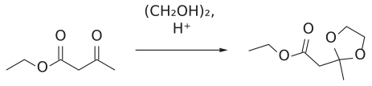

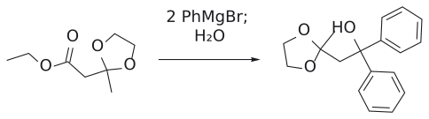

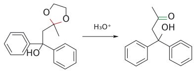

그림: 보충: ethyl acetoacetate의 ketone만 ethylene glycol acetal로 보호하고, $PhMgBr$ 2당량을 ester에 첨가해 3차 alcohol을 만든 뒤 산 수용액으로 acetal을 벗긴다.

**예제 2 (불가능한 Grignard reagent 만들기).** ketone이 있으면 Grignard 시약을 만들 수 없었다. 그렇다면 ketone을 가리면 된다.

1. $\mathrm{CH_3CO(CH_2)_3Br} \xrightarrow{\ \mathrm{HOCH_2CH_2OH},\ \mathrm{H^+}\ \text{촉매}\ \mathstrut} \text{acetal-}\mathrm{(CH_2)_3Br}$
2. $\xrightarrow[\mathrm{Et_2O}]{\mathrm{Mg}} \text{acetal-}\mathrm{(CH_2)_3MgBr}$

   ketone이 가려져 있으니 이제 Grignard 시약이 안정하게 존재할 수 있다.
3. $\xrightarrow{\ \mathrm{HCO_2Et}\ \mathstrut} (\text{acetal-}\mathrm{(CH_2)_3})_2\mathrm{CHOH}$

   ethyl formate에 Grignard reagent 2당량이 붙어 2차 alcohol이 된다.[11]
4. $\xrightarrow{\ \mathrm{H^+},\ \mathrm{H_2O}\ \mathstrut} \mathrm{(CH_3CO(CH_2)_3)_2CHOH}$

   (6-hydroxyundecane-2,10-dione) : 두 acetal이 한꺼번에 벗겨진다.

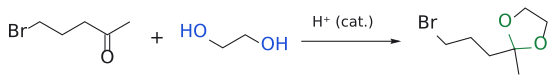

그림: ketone(빨강)을 고리 acetal(초록)로 보호한다.

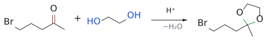

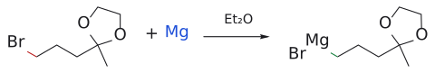

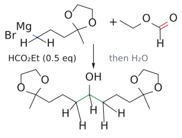

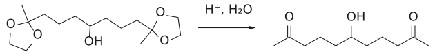

그림: 보충: 5-bromopentan-2-one의 ketone을 acetal로 막아야 같은 분자에서 Grignard 시약을 만들 수 있다. $HCO_2Et$ 에 Grignard 시약 두 분자가 첨가해 2차 alcohol이 되고, 마지막에 두 acetal을 함께 벗긴다.

그림: acetal 보호, Grignard 형성·첨가, deprotection를 단계별로 읽는다. 서로 다른 시약 처리 단계를 한 화살표로 합치지 않는다. (원본 대조: L12_Protecting groups.pdf p.14)

[원본 자료에서 세부 구조·입체배치 확인: L12_Protecting groups.pdf p.14](../../figures/L12/source/L12_p14.png)

(출처: L12 p.14, p.3)

### 9. 더 찾아보려면, 그리고 요약

> 개념 문서: [protecting group](../../wiki/개념/보호기.md)

슬라이드는 protecting group 정보를 찾을 곳으로 SynArchive(https://synarchive.com/protecting-group)를 소개한다. protecting group별로 도입·제거 조건과 실제 합성 사례가 정리된 데이터베이스다. 화면에는 1,2-amino alcohol을 고리형 oxazolidinone로, 1,2-diol을 acetonide, Me2C acetal, benzaldehyde acetal(PhCH acetal), 고리형 carbonate로 보호하는 예가 보인다. 두 작용기를 한 고리로 묶어 동시에 가리는 방법이다.

정리하면, protecting group은 분자의 다른 곳에서 변환이 일어나는 동안 한 작용기를 막아 두는 일시적인 "마스크"다. FG1이 반응 조건과 맞지 않으면 FG1 보호 → FG2에서 반응 → FG1 deprotection. 그리고 alcohol은 silyl ether, amine은 carbamate, aldehyde·ketone은 acetal이다.

(출처: L12 p.15, p.16)

## 흔한 오해

- **"protecting group은 튼튼할수록 좋다"고 생각하기 쉽지만 사실은** 필요할 때 원하는 조건에서 깔끔하게 벗겨지는 것이 더 중요하다. 그래서 TMS부터 TBDPS까지 튼튼함이 다른 silyl group이 여럿 존재하고, 상황에 맞춰 골라 쓴다.
- **"가장 튼튼한 silyl group은 언제나 TBDPS"라고 생각하기 쉽지만 사실은** 산에서만 그렇다. 염기에서는 TIPS (100,000)가 가장 튼튼하고 TBDPS는 TBS와 비슷한 20,000 수준이다.
- **"silyl ether는 염기로 벗긴다"고 생각하기 쉽지만 사실은** 슬라이드의 deprotection 방법은 F-(TBAF)와 산/물이다. silyl ether는 오히려 Grignard, 유기리튬, acetylide 같은 C/N 염기를 견디라고 쓰는 protecting group이다.
- **"Boc와 Fmoc는 같은 carbamate니까 같은 조건에서 벗겨진다"고 생각하기 쉽지만 사실은** 정반대다. Boc는 안정한 t-butyl cation을 낼 수 있어 산에 약하고, Fmoc는 1차 CH2라 SN1/SN2가 막혀 산에 강한 대신 9번 C–H가 산성이라 염기에 약하다. 둘은 서로 직교한다.
- **"Fmoc는 산성 수소를 가지니까 강염기가 있어야 벗겨진다"고 생각하기 쉽지만 사실은** pKa 약 25짜리 C–H라도 amine 염기로 충분하다. deprotonation이 가역이어도 이어지는 E1cB 제거와 decarboxylation이 반응을 끌고 가기 때문이다.
- **"acetal은 산이 있으면 생기니까 산 조건에서 안전하다"고 생각하기 쉽지만 사실은** acetal 형성은 평형이라, 물이 있는 산성 조건에서는 오히려 원래 carbonyl로 되돌아간다. acetal은 염기·nucleophile에 안정하고 산에는 불안정하다.
- **"산에 불안정한 protecting group끼리도 조심하면 구분해서 벗길 수 있다"고 쉽게 가정하기 쉽지만 사실은** Boc, acetal, silyl ether, THP, t-Bu ester는 모두 산에 약해서 산 조건에서는 서로 직교적이지 않다(silyl ether는 F-로 따로 벗길 수 있다). 마찬가지로 Cbz와 benzyl ether는 둘 다 H2/Pd로 벗겨진다.
- **"Cbz도 HBr/AcOH 같은 산으로 벗겨지니 Boc와 같은 원리"라고 생각하기 쉽지만 사실은** 경로가 다르다. Boc는 t-butyl cation이 SN1으로 떨어지므로 어떤 산이든 되지만, Cbz는 Br-가 benzyl 탄소를 SN2로 공격해야 하므로 nucleophilic 짝염기를 가진 산(HBr)이 필요하다. 그래서 TFA로 Boc만 벗기고 Cbz를 남길 수 있다. (보충 근거: Clayden p.557–558)
- **"hydrogenolysis로 벗기는 Cbz는 고체상 합성에서도 편하다"고 생각하기 쉽지만 사실은** 수지에 붙은 peptide가 고체 Pd 촉매와 접촉하기 어려워 SPPS의 N-protecting group으로는 Boc나 Fmoc를 쓴다. (보충 근거: Wade p.1186)
- **"ethyl formate에 Grignard 2당량을 넣으면 3차 alcohol"이라고 생각하기 쉽지만 사실은** formate의 carbonyl 탄소에는 H가 붙어 있으므로 2차 alcohol R2CHOH가 생긴다. 일반 ester + Grignard 2당량이 3차 alcohol이다.
- **p.9 그림의 PG1을 Boc로 읽기 쉽지만 사실은** 그림이 "N-deprotection는 염기, C-deprotection는 산"이라고 하므로 PG1은 Fmoc형, PG2는 t-Bu ester 같은 산 불안정 ester로 보는 것이 일관적이다. PG1이 Boc라면 C-deprotection용 산 처리에서 PG1도 함께 벗겨진다.

## 반응 정리표

<!-- Wide source table reformatted as entries for reading; all cells retained. -->

### alcohol

- protecting group: silyl ether (TMS, TES, TBS/TBDMS, TIPS, TBDPS)
- 도입 조건: R3SiCl, imidazole
- 안정한 조건: nucleophile, C/N 염기(Grignard, 유기리튬, acetylide 등)
- 제거 조건: TBAF (nBu4NF) 또는 H+/H2O
- 비고: 산 안정성: TMS < TES < TBS < TIPS < TBDPS; 염기 안정성: TMS < TES < TBS ~ TBDPS < TIPS

### alcohol

- protecting group: THP
- 도입 조건: dihydropyran + 산
- 안정한 조건: 강염기
- 제거 조건: H+, H2O
- 비고: THP 자체도 acetal

### alcohol

- protecting group: benzyl ether (OBn)
- 도입 조건: NaH, BnBr
- 안정한 조건: 거의 모든 조건
- 제거 조건: H2, Pd/C 또는 HBr
- 비고: 강의에서는 부차적(회색 표시)

### phenol

- protecting group: methyl ether (ArOMe)
- 도입 조건: NaH, MeI 또는 (MeO)2SO2
- 안정한 조건: 염기
- 제거 조건: BBr3, HBr, HI, Me3SiI
- 비고: —

### carboxylic acid

- protecting group: t-butyl ester
- 도입 조건: isobutene, H+
- 안정한 조건: nucleophile
- 제거 조건: 강산
- 비고: 산 절단은 t-Bu cation 경유(Boc와 같은 원리)

### amine

- protecting group: Boc (t-BuOCO)
- 도입 조건: Boc2O, 염기
- 안정한 조건: electrophile, 염기, 수소화
- 제거 조건: 산 (TFA; H+, H2O)
- 비고: 부산물 CO2 + isobutene

### amine

- protecting group: Cbz (Z, BnOCO)
- 도입 조건: BnOCOCl, 염기
- 안정한 조건: electrophile
- 제거 조건: H2, Pd (hydrogenolysis) 또는 HBr/AcOH
- 비고: 부산물 toluene + CO2

### amine

- protecting group: Fmoc
- 도입 조건: Fmoc-Cl, 염기
- 안정한 조건: electrophile, 산
- 제거 조건: amine 염기 (E1cB)
- 비고: 부산물 dibenzofulvene + CO2; 산에 안정하므로 Boc와 직교

### aldehyde, ketone

- protecting group: acetal (1,3-dioxolane)
- 도입 조건: HOCH2CH2OH, p-TsOH (물 제거)
- 안정한 조건: 염기, nucleophile (Grignard, hydride 등)
- 제거 조건: H2O, p-TsOH (H+, H2O)
- 비고: 가역 평형 반응

직교성 요약: Boc(산) / Fmoc(염기) / Cbz(H2, Pd) / silyl ether(F-)는 서로 다른 조건으로 골라 벗길 수 있다. 반면 산 불안정 protecting group(Boc, acetal, silyl ether, THP, t-Bu ester)끼리, 그리고 hydrogenolysis되는 Cbz와 benzyl ether끼리는 직교적이지 않다.

## 연습 문제

1. ethyl acetoacetate(CH3COCH2CO2Et)에 PhMgBr을 직접 가하면 어떤 생성물이 주로 생기는가? CH3COCH2C(OH)Ph2를 얻으려면 어떤 순서로 반응시켜야 하는가? (p.3, p.14)
2. CH3CO(CH2)3Br과 ethyl formate로부터 6-hydroxyundecane-2,10-dione을 합성하는 경로를 시약과 함께 쓰고, 보호 없이 Grignard 시약을 만들 수 없는 이유를 설명하라. (p.3, p.14)
3. CH3CH(OH)CH2CH2CH2Br을 lithium acetylide와 반응시켜 CH3CH(OH)(CH2)3C≡CH를 얻으려 한다. 필요한 보호/deprotection 단계와 시약을 쓰고, 보호가 필요한 이유를 설명하라. (p.6)
4. 한 분자에 TES ether와 TBDPS ether가 있다. 묽은 산 조건에서 어느 쪽이 먼저 제거되는가? 또 TBS와 TIPS를 염기 조건에서 비교하면? (p.7)
5. 산 조건에서 Boc-NHR이 deprotection되는 메커니즘을 단계별로 쓰고, 부산물 두 가지를 쓰라. (p.10)
6. Fmoc carbamate가 산에는 안정하고 amine 염기에는 불안정한 이유를 구조와 메커니즘으로 설명하라. (p.11)
7. p.9의 dipeptide 합성에서 Leu와 Gly를 보호 없이 커플링시키면 어떤 문제가 생기는가? N-protecting group은 염기로, C-protecting group은 산으로 제거되어야 한다면 각각 어떤 protecting group이 적합한가? (p.9, p.11, p.5)
8. amine이 Boc로, alcohol이 TBS로, ketone이 acetal로 보호된 분자가 있다. (a) TBAF, (b) TFA, (c) piperidine 처리 시 각각 어느 protecting group이 제거되는가(주된 반응 기준)? (p.5, p.6, p.8, p.13)

## 정답 및 해설

1. 직접 반응시키면 더 electrophilic ketone이 공격받아 CH3C(OH)(Ph)CH2CO2Et가 생성된다(슬라이드상 52%). 원하는 생성물을 얻으려면 (i) HOCH2CH2OH, H+로 ketone을 acetal로 보호하고, (ii) PhMgBr 2당량을 가한다. ester에 첫 번째 첨가 후 EtO-가 이탈해 ketone이 되고, 두 번째 첨가로 3차 alkoxide가 된다. (iii) H+, H2O로 protonation과 acetal hydrolysis를 함께 진행하면 CH3COCH2C(OH)Ph2가 된다. (출처: L12 p.3, p.14)

2. (i) HOCH2CH2OH, H+ 촉매로 ketone을 acetal로 바꾼다. (ii) Mg, Et2O로 Grignard 시약을 만든다. (iii) HCO2Et에 Grignard 2당량: 첫 번째 첨가 후 EtO- 이탈로 aldehyde, 두 번째 첨가로 2차 alkoxide. (iv) H+, H2O로 alcohol을 만들면서 두 acetal을 동시에 벗기면 (CH3CO(CH2)3)2CHOH. 보호하지 않으면 생성되는 C–MgBr(nucleophile)이 다른 분자의 ketone(electrophile)을 공격하므로 Grignard 시약이 존재할 수 없다("impossible Grignard reagent"). (출처: L12 p.3, p.14)

3. (i) t-BuMe2SiCl, imidazole로 OH를 OTBDMS로 바꾼다. (ii) HC≡CLi로 C–Br에서 SN2 치환하여 CH3CH(OTBDMS)(CH2)3C≡CH. (iii) TBAF(또는 H+/H2O)로 deprotection하여 CH3CH(OH)(CH2)3C≡CH. 이유: lithium acetylide는 강염기라 보호되지 않은 OH(alkyne보다 훨씬 산성)를 deprotonate하며 소모되어 alkylation이 일어나지 않는다. (출처: L12 p.6)

4. 산 안정성은 TES (64) << TBDPS (5,000,000)이므로 TES가 먼저 제거된다. 염기 조건에서는 TBS (20,000) < TIPS (100,000)이므로 TIPS가 더 안정하다. (출처: L12 p.7)

5. (1) carbonyl O가 protonate된다. (2) t-Bu–O 결합이 끊어지며 t-butyl cation이 이탈하고 carbamic acid RNHCOOH가 생긴다. (3) t-butyl cation이 H+를 잃고 isobutene이 된다. (4) carbamic acid가 decarboxylate되어 RNH2 + CO2가 된다. 부산물은 CO2와 isobutene(2-methylpropene). (출처: L12 p.10)

6. 산 안정성: carbamate O에 붙은 탄소가 1차 CH2라 안정한 carbocation이 생기지 않아 SN1이 불가능하고, 옆의 부피 큰 fluorenyl기 때문에 SN2도 불가능하다. 즉 Boc와 달리 산에서 C–O가 끊어질 경로가 없다. 염기 불안정성: fluorene 9번 C–H는 pKa 약 25로 비교적 산성인데, deprotonation으로 생기는 anion이 14전자 aromatic계로 안정하기 때문이다. amine 염기가 이 H를 떼면 anion이 CH2–O 결합을 밀어내며 dibenzofulvene과 carbamate anion을 E1cB, carbamate anion은 CO2를 잃고 amine이 된다. (출처: L12 p.11)

7. 두 amino acid 모두 NH2(nucleophile)와 CO2H를 가지므로 보호 없이 활성화·커플링하면 Leu–Leu, Gly–Gly, Gly–Leu 등 여러 dipeptide와 올리고머가 섞여 생긴다. N-protecting group을 염기로 벗기려면 Fmoc가 적합하다(amine 염기로 제거, 산에 안정). C-protecting group을 산으로 벗기려면 t-butyl ester가 적합하다(isobutene/H+로 도입, 강산으로 제거). 이 조합은 서로 직교적이어서 각 말단을 골라서 드러낼 수 있다. (출처: L12 p.5, p.9, p.11)

8. (a) TBAF: F-가 Si를 공격하여 TBS만 제거된다(Boc, acetal은 F-에 안정). (b) TFA: Boc가 제거된다. 다만 acetal과 TBS도 산에 불안정하므로 특히 물이 있으면 함께 손상될 위험이 있다. Boc/acetal/TBS는 산 조건에서 서로 직교적이지 않다. (c) piperidine(amine 염기): Boc, TBS, acetal 모두 염기에 안정하므로 제거되는 protecting group이 없다(piperidine은 Fmoc 제거용). (출처: L12 p.5, p.6, p.8, p.11, p.13)

## 각주

[1] 슬라이드에 인용된 문구는 "the Mount Everest of organic synthesis, the largest single molecule that anyone has ever even thought about making"이며, 출처로 위키백과 Palytoxin 문서가 링크되어 있다. (출처: L12 p.2)

[2] 보충: imidazole의 nucleophilic 촉매 역할은 슬라이드에 직접 나오지 않으며, 일반 교재 수준의 설명이다. imidazole N이 Si를 공격해 Cl-를 내보내고 N-silyl imidazolium을 만든 뒤, alcohol이 이 intermediate의 Si를 공격하고 imidazole이 떨어져 나가며 양성자를 받는다. (보충 근거: Clayden p.549)

[3] 보충: pKa 값(alcohol 약 16, 말단 alkyne 약 25)은 표준 교재 값이다. 슬라이드는 이유를 수치로 설명하지 않고 반응식만 보여 준다. (보충 근거: Clayden p.170, p.172)

[4] 보충: Si–F 결합이 Si–O보다 강하다는 것이 F- deprotection의 추진력이라는 설명은 교재 수준의 보충이다. 슬라이드에는 "TBAF 또는 산과 물"이라는 조건만 나온다. (보충 근거: Clayden p.668)

[5] 보충: carbamate 질소의 낮은 nucleophilic은 amide 질소가 nucleophilicity가 낮은 것과 같은 이유(N 비공유 전자쌍의 C=O로의 비편재화)다. (보충 근거: Clayden p.556)

[6] 보충: Cbz hydrogenolysis의 생성물(toluene, CO2, amine)은 표준 교재 내용이며 슬라이드에는 조건만 나온다. (보충 근거: Clayden p.557)

[7] 보충: 이탈한 t-BuOCO2-는 CO2와 t-BuO-로 분해된다. 슬라이드에는 Boc2O와 염기라는 조건과 생성물만 나온다.

[8] 보충: 기체 부산물이 반응을 정방향으로 밀어 준다는 해석은 교재 수준의 보충이다.

[9] 보충: 슬라이드의 염기는 일반적인 :NR3로 그려져 있다. 실제로 piperidine 같은 2차 amine이 흔히 쓰이고, 이 amine이 생성된 dibenzofulvene을 포획한다는 점은 표준 peptide 화학 내용이다.

[10] 보충: 물 제거에는 흔히 Dean–Stark 장치를 쓴다. 슬라이드는 평형 화살표와 생성물 "water"만 보여 준다. (보충 근거: Clayden p.228)

[11] 보충: 첫 번째 RMgBr addition 후 EtO-가 떨어져 aldehyde(RCHO)가 생기고, 이 aldehyde가 두 번째 RMgBr과 반응해 R2CH-O-가 된다. 산 처리 단계에서 alcohol이 되면서 acetal도 함께 hydrolysis된다. (보충 근거: Clayden p.549)

[12] 보충: 가장 약한 TMS ether는 methanol만으로도 벗겨지고, 가장 튼튼한 silyl group은 fluorine화 수소산(HF)이 필요할 정도다. 또 F-나 OH-에 의한 deprotection는 겉보기와 달리 단순한 SN2가 아니다. nucleophile이 먼저 Si에 첨가해 다섯 배위의 anion intermediate를 만들고, 이것이 alkoxide를 내보내며 분해된다. Si 주위가 붐비면 이 첨가 단계가 어려워지므로 부피 큰 silyl기일수록 튼튼하다. (보충 근거: Clayden p.550)
