# L13. Cycloaddition 1부: Diels–Alder 반응

> **통독본:** 기존 강의별 전체 설명을 바탕으로 2026-10-18에 공식 강의 확인·개념 보강·그림을 추가했다. 교재 보충은 출처를 구별하며 상세 개념은 연결된 위키에서 함께 읽는다. 뼈대 노트: [L13 뼈대](../L13_Cycloaddition_Part1.md) · [위키 대문](../../wiki/위키%20대문.md)

> **관련 위키 문서** ([위키 대문](../../wiki/위키%20대문.md))
> - 반응: [1,3-dipolar cycloaddition](../../wiki/반응/1,3-쌍극자%20고리화%20첨가.md), [Diels–Alder reaction](../../wiki/반응/딜스-알더%20반응.md), [Robinson annulation](../../wiki/반응/로빈슨%20고리%20형성.md), [Michael reaction](../../wiki/반응/마이클%20반응.md), [역 Diels–Alder reaction](../../wiki/반응/역%20딜스-알더%20반응.md)
> - 개념: [endo rule](../../wiki/개념/endo%20규칙.md), [s-cis conformation](../../wiki/개념/s-cis%20형태.md), [Diels–Alder regioselectivity](../../wiki/개념/딜스-알더%20위치선택성.md), [kinetic vs thermodynamic control](../../wiki/개념/속도론적%20지배와%20열역학적%20지배.md), [Woodward–Hoffmann rules](../../wiki/개념/우드워드-호프만%20규칙.md), [stereospecificity and stereoselectivity](../../wiki/개념/입체특이성과%20입체선택성.md), [suprafacial and antarafacial](../../wiki/개념/초면과%20대면.md), [electrophile and nucleophile](../../wiki/개념/친전자체와%20친핵체.md), [pericyclic reaction](../../wiki/개념/페리고리%20반응.md), [frontier molecular orbital](../../wiki/개념/프런티어%20분자%20오비탈.md)

CM3121 Advanced Organic Chemistry, Dr. Zhu Ye

> [Test 2 반응 판정·검산 순서](../../wiki/개념/Test%202%20반응%20판정과%20답안%20검산.md)로 각 단원의 질문을 연결할 수 있다.

## 1. 반응은 어떻게 분류되나: 극성, radical, 그리고 pericyclic

> 개념 문서: [pericyclic reaction](../../wiki/개념/페리고리%20반응.md)

지금까지 다룬 반응은 대부분 nucleophile이 electrophile을 공격하는 극성 반응이었다. enolate가 붙고, leaving group이 떨어지고, ionic intermediate가 생겼다가 사라지는 식이다(→ 앞선 enolate·Michael addition 강의 참고). 이 강의에서는 전혀 다른 방식으로 결합이 생기는 반응군인 pericyclic reaction을 처음 다룬다. 강의는 "무엇이 반응하나 → 어떻게 반응하나 → 무엇이 빠르게 하나 → stereochemistry는 어떻게 정해지나 → 왜 FMO, Woodward–Hoffmann" 순서로 진행된다.

결합이 끊어지고 생기는 방식은 몇 가지나 될까? 슬라이드는 세 가지로 나눈다.

첫째는 polar mechanism이다. 결합이 비대칭으로 끊어지거나(이종 분해 heterolysis) 비대칭으로 생긴다. 한 분자의 electron-rich nucleophile이 다른 분자의 electron-deficient electrophile에 전자쌍을 주고, 그 과정에서 ionic intermediate가 생긴다. 둘째는 radical mechanism이다. 결합이 대칭으로 끊어지거나(동종 분해 homolysis) 생기며, 홀전자를 가진 radical intermediate가 반응을 이끈다. 셋째가 이번 강의의 주인공인 pericyclic 메커니즘이다. 결합 전자의 cyclic redistribution이 하나의 elementary step에서 일어나며, 그 경로에는 별개의 intermediate가 없다. 이는 전자가 분자 안을 지속적으로 한 바퀴 순환한다는 뜻이 아니다. (출처: L13 p.3)

그렇다면 pericyclic 반응은 구체적으로 어떤 모습일까? 네 가지 특징이 있다. TS가 고리 모양이고, 그 고리 안에 radical이나 이온 intermediate가 없으며, 결합 형성과 절단이 한꺼번에(concerted, concerted) 일어난다. 그 결과 반응이 stereospecific이거나 stereoselective이다(또는 둘 다). 자연계에도 이런 반응이 있다. chorismate mutase라는 효소는 chorismate의 Claisen rearrangement를 촉매해 prephenate를 만든다. 효소 활성 자리의 Arg, Glu 같은 잔기가 수소 결합으로 고리형 TS를 붙잡아 안정화한다.[1] (출처: L13 p.4)

Pericyclic 반응은 다시 세 갈래로 나뉜다. 두 조각이 양 끝에서 동시에 이어져 고리가 되는 cycloaddition, 한 사슬의 양 끝이 이어지는 electrocyclic reaction, $\sigma$ 결합 하나가 자리를 옮기는 sigmatropic rearrangement다. cycloaddition에는 다시 Diels–Alder reaction, 1,3-dipole cycloaddition(1,3-dipolar cycloaddition), 그 밖의 cycloaddition이 속한다. 이번 강의는 이 가운데 Diels–Alder만 다룬다. (출처: L13 p.5)

## 2. 극성 반응으로도 6원자 고리는 만들 수 있지 않나?

> 개념 문서: [Diels–Alder reaction](../../wiki/반응/딜스-알더%20반응.md), [Robinson annulation](../../wiki/반응/로빈슨%20고리%20형성.md), [Michael reaction](../../wiki/반응/마이클%20반응.md)

물론 만들 수 있다. 다만 여러 단계를 거쳐야 한다. 슬라이드는 두 가지 예를 보여 준다.

첫 번째 예에서는 2-methylcyclohexane-1,3-dione과 methyl vinyl ketone이 10% NaOH 조건에서 Michael 첨가를 해 1,5-diketone이 된다. 이것을 piperidine 촉매와 함께 가열하면 물이 빠지면서 이중 고리 enone이 닫힌다. EtONa로 가열하면 같은 일을 한 one-pot에서 끝낼 수도 있다.[2]

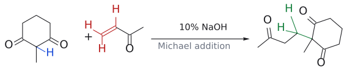

그림: 먼저 dione의 반응 중심(파랑)과 MVK의 alkene(빨강)을 확인한다. 초록색 C–C 결합이 새로 생겼지만, 이 단계에서는 새 고리가 아직 없다. 생성물의 측쇄에는 ketone이 남아 다음 intramolecular aldol 단계에 참여한다. 직선 화살표는 deprotonation·첨가·proton transfer를 합친 순변환이다. (출처: L13 p.6)

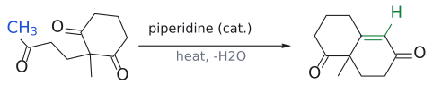

그림: 파란 CH₃ 탄소와 고리 carbonyl 탄소 사이에 연결이 생겨 새 6원 고리가 만들어진다. 이어지는 탈수 후 그 연결은 초록색 C=C가 된다. 그림의 화살표 하나가 단일 elementary step을 뜻하지는 않는다. Piperidine 촉매 경로의 세부 반응은 enamine 형성·고리화·촉매 재생을 포함한다. EtONa/가열의 one-pot 경로도 이 최종 골격을 주지만, 한 용기에서 진행한다는 것과 concerted라는 것은 다르다. (출처: L13 p.6; L12 연습 풀이 p.1)

두 번째 예는 I-(CH2)4-CH=CH-CO2Me와 CH3NO2를 Cs2CO3/DMF, 20 °C에서 반응시키는 것이다. 메커니즘을 따라가 보면 다음과 같다.
1. Cs2CO3가 CH3NO2의 $\alpha$ -H를 떼어 nitronate anion(nucleophile)을 만든다.
2. nitronate가 $\alpha,\beta$-unsaturated ester의 $\beta$-탄소(electrophile)에 Michael 첨가해 I-(CH2)4-CH(CH2NO2)-CH2CO2Me가 된다.
3. CH2NO2의 $\alpha$ -H가 다시 deprotonate된다. 이 탄소 anion이 같은 분자의 C–I 탄소를 SN2로 공격해 고리를 닫는다.

결과물은 2-(2-nitrocyclohexyl)acetic acid methyl ester다(65%).

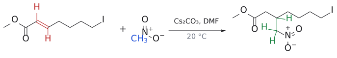

그림: 파란 CH₃에서 유래한 탄소가 ester의 $\beta$-carbon과 결합한다. 초록색 결합이 새 C–C 결합이며, 말단 C–I는 아직 남아 있다. 생성물의 CH₂NO₂는 다음 deprotonation에 필요한 H를 가진다. Nitro group의 N⁺/O⁻는 정상적인 formal charge 표기이며, 이 중성 부가물 전체가 nitronate anion이라는 뜻은 아니다. (출처: L13 p.6)

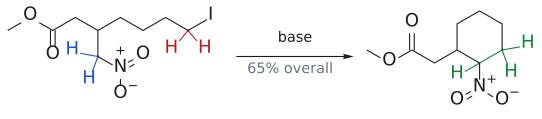

그림: 파란 CH₂NO₂ 탄소가 deprotonation된 뒤 빨간 C–I 탄소를 공격하고 iodide가 이탈한다. 초록색 C–C 결합이 고리를 닫는다. 두 반응 중심 사이의 기존 사슬을 따라 탄소 여섯 개를 세면 cyclohexane 골격임을 확인할 수 있다. 65%는 슬라이드에 적힌 전체 연속 반응의 수율이며, 고리화 단계만의 수율이 아니다. 입체배치는 원본처럼 지정하지 않았다. 이 그림은 deprotonation과 SN2를 합친 순변환이다. (출처: L13 p.6)

즉 극성 방식으로 고리를 만들려면 deprotonation, 첨가, 고리 닫기를 차례로 거쳐야 하고 그때마다 ionic intermediate가 생긴다. 반면 DA 반응은 이 모든 일을 한 단계로 끝낸다. 이 대비가 이 슬라이드의 핵심이다. (출처: L13 p.6)

## 3. Diels–Alder 반응이란 무엇인가

> 개념 문서: [Diels–Alder reaction](../../wiki/반응/딜스-알더%20반응.md)

pericyclic 반응의 대표가 Diels–Alder(DA) 반응이다. diene과 alkene을 한 단계로 이어 붙여 6원자 고리를 만들고, 두 탄소–탄소 결합과 최대 네 개의 입체중심을 한 번에 정해 준다. 그래서 합성에서 가장 강력한 고리 형성 반응 가운데 하나로 꼽힌다.

정의 자체는 간단하다. conjugated diene과 alkene이 반응해 cyclohexene을 만드는 반응이다. 가장 단순한 예는 1,3-butadiene + ethylene → cyclohexene이다. 그런데 조건을 보면 165 °C, 17 h, 900 atm이 필요하다(수율 78%). "가장 단순한 DA"가 결코 "가장 쉬운 DA"는 아니라는 뜻이다. 왜 이렇게 어려운지는 뒤의 속도 부분에서 다룬다.[3] (출처: L13 p.7)

반응을 그릴 때는 번호를 붙이면 편하다. diene 탄소를 C1–C4, alkene 탄소를 C5–C6으로 두면 굽은 화살표 세 개가 고리를 따라 돈다. 화살표 방향은 시계 방향이든 반시계 방향이든 상관없다. 결과는 같아서, 새 $\sigma$ 결합 C1–C6과 C4–C5가 생기고 diene 가운데에 새 $\pi$ 결합 C2=C3가 남는다. (출처: L13 p.7)

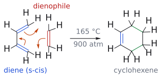

그림: 파란색은 diene(s-cis)의 두 $\pi$ 결합, 빨간색은 dienophile(ethylene)의 $\pi$ 결합, 주황색 굽은 화살표는 전자쌍의 이동, 초록색은 새로 생긴 $\sigma$ 결합 C1–C6과 C4–C5다. 화살표 셋은 모두 시계 방향으로 돈다. (1) C1=C2 $\pi$ 전자가 C1–C6 결합이 되고, (2) C5=C6 $\pi$ 전자가 C4–C5 결합이 되며, (3) C3=C4 $\pi$ 전자가 C2–C3로 옮겨가 새 $\pi$ 결합(파란 C2=C3)이 된다. 세 화살표는 한 단계에서 동시에 일어난다.

용어도 정리해 두자. diene은 C=C 두 개가 단일 결합 하나로 이어진 conjugated diene이어야 한다. diene과 반응하는 alkene(때로는 alkyne)은 dienophile라고 부르고, 생성물은 cyclohexene이다. 예를 들어 2,3-dimethyl-1,3-butadiene과 acrolein(CH2=CH-CHO)은 3,4-dimethylcyclohex-3-ene-1-carbaldehyde를 준다. diene이 고리형이면 어떻게 될까? cyclopentadiene + nitroethylene(CH2=CH-NO2)처럼 다리 걸친 이중 고리(bridged bicyclic)인 5-nitrobicyclo[2.2.1]hept-2-ene(5-nitronorbornene)이 생긴다. (출처: L13 p.8)

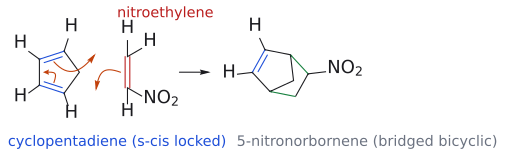

그림: 파란색은 cyclopentadiene의 두 $\pi$ 결합, 빨간색은 nitroethylene의 $\pi$ 결합, 주황색 굽은 화살표는 전자쌍의 이동(세 개가 같은 방향으로 돈다), 초록색은 새로 생긴 $\sigma$ 결합 두 개다. diene이 고리형이라 diene의 $CH_2$ (오각형의 오른쪽 꼭짓점)가 생성물에서 다리가 되어 bridged bicyclic(norbornene) 골격이 생긴다. 슬라이드처럼 $NO_2$ 의 endo/exo 배향은 지정하지 않았다.

이 반응은 실험실만의 것이 아니다. 자연계에는 DA 반응을 촉매하는 Diels–Alderase도 있다. 슬라이드의 예에서는 긴 사슬 끝의 diene과 tetronate 고리의 exo-methylene dienophile이 효소 주머니 안에서 분자 내 [4+2] cycloaddition을 해 spiro 구조의 cyclohexene을 만든다(J. Am. Chem. Soc. 2016, 138, 6095). (출처: L13 p.9)

## 4. 어떻게 반응하나: 메커니즘과 transition state

> 개념 문서: [Diels–Alder reaction](../../wiki/반응/딜스-알더%20반응.md), [suprafacial and antarafacial](../../wiki/개념/초면과%20대면.md), [aromaticity](../../wiki/개념/방향족성.md)

DA 반응에는 정말 intermediate가 없을까? 그렇다. DA는 pericyclic 반응의 전형으로, 단일 기본 단계(single elementary step)로 끝난다. 결합 전자의 재배치가 하나의 elementary step에서 진행되어 별개의 intermediate를 거치지 않는다. **Concerted는 두 새 결합이 transition state에서 같은 정도로 형성되어야 한다는 뜻이 아니다.** 치환기가 다른 경우에는 결합 형성 정도가 다른 asynchronous transition state와 partial charge가 나타날 수 있다. 아래 네 항목은 butadiene + ethylene의 전자 재배치를 나누어 설명한 것이며, 네 개의 연속 반응 단계가 아니다.
1. diene의 C1=C2 $\pi$ 전자가 C1–C6 결합을 만든다.
2. alkene의 C5=C6 $\pi$ 전자가 C4–C5 결합을 만든다.
3. diene의 C3=C4 $\pi$ 전자가 C2–C3로 옮겨가 새 $\pi$ 결합이 된다.
4. 이 모든 변화가 하나의 고리형 TS에서 동시에 일어나 cyclohexene이 된다.

그렇다면 이 반응은 왜 일어날까? 열역학과 속도론 두 측면에서 답할 수 있다. thermodynamically는 $\pi$ 결합 두 개를 잃는 대신 더 강한 C–C $\sigma$ 결합 두 개(C1–C6, C4–C5)를 얻으므로 이득이다.[4] kinetically는 TS에 6개의 $\pi$ 전자가 고리 모양으로 비편재화되어 있어, benzene처럼 aromaticity(4n+2)을 띠고 안정화된다. 이른바 "aromatic transition state"다. (출처: L13 p.10)

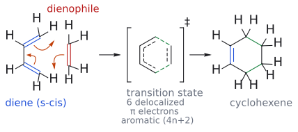

그림: 가운데 대괄호 안이 transition state다. 바깥 실선과 안쪽 점선은 단일·이중 결합의 중간 상태(부분 결합)를, 초록 점선은 생기는 중인 새 $\sigma$ 결합 C1–C6과 C4–C5를 뜻한다. 여섯 탄소에 $\pi$ 전자 6개가 고리 모양으로 퍼져 있어 benzene처럼 aromatic(4n+2)한 TS가 된다. 왼쪽의 파랑·빨강·주황은 그림 1과 같다.

이 TS가 실제로 어떻게 생겼는지는 계산 연구로 볼 수 있다. butadiene + ethylene의 TS에서 새로 생기는 C···C 거리는 약 2.2 Å(2.217–2.273 Å)으로, 결합이 반쯤 생긴 상태다. 고리 안의 다른 C–C 거리는 약 1.38–1.43 Å로 단일 결합과 이중 결합의 중간이다. 즉 TS에서는 전자가 고르게 퍼져 있어, 말 그대로 "반쯤 benzene 같은" 고리 상태다. (출처: L13 p.11)

dienophile을 maleic anhydride로 바꾸어도 그림은 같다. butadiene + maleic anhydride는 $6\pi$ 비편재화 TS를 거쳐 cis-1,2,3,6-tetrahydrophthalic anhydride를 준다. 두 고리 접합 H가 cis다. orbital로 보면 두 반응물이 평행한 평면으로 포개지고, 각 성분이 양 끝에서 같은 면을 써서 결합을 만든다. 이것을 suprafacial–suprafacial 접근이라고 한다. 이 "같은 면" 성질이 뒤에 나올 stereospecificity의 뿌리다. (출처: L13 p.12)

이 반응을 Woodward–Hoffmann 언어로 미리 표현하면 이렇다. diene은 4전자 $\pi$ 성분( $\pi4$ ), dienophile은 2전자 $\pi$ 성분( $\pi2$ )이고, 둘 다 suprafacial로 반응하므로 [ $\pi4\mathrm{s}$ + $\pi2\mathrm{s}$ ]다. 여기서 component이란 반응에 한 단위로 참여하는 결합이나 orbital을 말한다. diene과 dienophile은 각각 하나의 성분이다. 규칙 자체는 6절에서 다룬다(ChemTube3D 애니메이션 참고). (출처: L13 p.13)

한 번의 concerted \[4+2\]에서 새 $\sigma$ 결합 두 개와 남는 C=C 하나를 함께 그린다. diene의 가운데 결합은 생성물의 C=C가 되고, diene은 실제로 s-cis 배치를 만들 수 있어야 한다. 평면 종이에 s-trans로 그려져 있다는 사실과 s-cis로 회전할 수 없다는 사실은 다르다. (출처: L13 p.10–18)

## 5. 무엇이 반응을 빠르게 하나

### 5-1. Dienophile: 전자가 부족할수록 좋다

> 개념 문서: [Diels–Alder reaction](../../wiki/반응/딜스-알더%20반응.md)

앞에서 butadiene + ethylene이 900 atm까지 필요했던 이유는 무엇일까? 답은 dienophile의 전자적 성질에 있다. 실제로 쓰이는 dienophile에는 대개 electron-withdrawing group(EWG)가 붙어 있다. 슬라이드에 나온 예는 NO2, CN, SO2R, COOR, COR, Cl, Ph이고,[5] 대체로 dienophile의 전자가 부족할수록 반응이 빠르다. 숫자로 비교하면 차이가 확연하다.

- $\text{butadiene} + \text{ethylene} \xrightarrow[165\,{}^\circ\mathrm{C},\ 17\ \text{h}]{900\ \text{atm}} \text{cyclohexene}\ (78\%)$

- 반응식

$$
\begin{aligned} & \text{butadiene} + \text{acrolein} \cr  & \xrightarrow[0.5\ \text{h}]{150\thinspace {}^\circ\mathrm{C}} \text{cyclohex-3-ene-1-carbaldehyde} \end{aligned}
$$

- 반응식

$$
\begin{aligned} & \text{butadiene} + \mathrm{CH_2{=}C(COOMe)_2} \cr  & \xrightarrow[24\ \text{h}]{25\thinspace {}^\circ\mathrm{C}} \text{dimethyl cyclohex-3-ene-1,1-dicarboxylate}\ (80\text{ percent}) \end{aligned}
$$

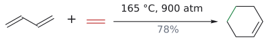

그림: diene(파랑)과 dienophile(빨강) 사이에 $\sigma$ 결합 두 개(초록).

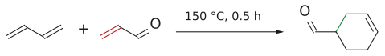

그림: EWG가 있는 dienophile은 훨씬 빠르다.

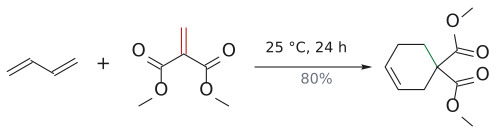

그림: EWG 두 개라 상온에서도 진행.

EWG 하나로 압력 조건이 사라지고, 두 개면 상온에서도 반응한다. 보충: 짝지음 기가 없는 단순 alkene이 얼마나 나쁜 dienophile인지는 cyclopentadiene에서 잘 드러난다. 반응성이 아주 큰 이 diene에 단순 alkene을 섞어 가열해도 alkene과는 거의 반응하지 않고, cyclopentadiene끼리 먼저 이량화해 버린다(5-4절). (보충 근거: Clayden p.880) 슬라이드 상자에는 이 밖에 1-chlorovinyl acetate(CH2=C(Cl)OAc), crotononitrile(CH3CH=CH-CN), 고리형 unsaturated sulfone(2-sulfolene), 1,2-dihydronaphthalene 같은 dienophile도 나온다. (출처: L13 p.14)

### 5-2. diene: 전자가 풍부하고, s-cis여야 한다

> 개념 문서: [s-cis conformation](../../wiki/개념/s-cis%20형태.md), [frontier molecular orbital](../../wiki/개념/프런티어%20분자%20오비탈.md)

diene 쪽은 반대다. electron-donating group(EDG)가 붙은 electron-rich diene이 중성이거나 electron-deficient diene보다 빠르다. 그래서 가장 이상적인 짝은 "EDG-diene + EWG-dienophile"이다. 왜 그런지는 7절의 FMO에서 설명한다.

그런데 diene에는 전자 말고도 중요한 조건이 하나 더 있다. 바로 모양이다. butadiene의 C2–C3 단일 결합은 회전할 수 있어서 두 가지 형태를 오간다. 두 C=C가 반대쪽을 향한 s-trans 형태는 더 안정하지만, C1과 C4가 멀리 떨어져 있어 dienophile의 양 끝에 동시에 닿을 수 없다. 두 C=C가 같은 쪽을 향한 s-cis 형태에서만 C1과 C4가 가까워져 반응할 수 있다. 비유하자면 dienophile을 양손으로 잡으려면 두 팔을 같은 방향으로 뻗어야 하는 셈이다. 두 형태는 빠르게 서로 바뀌므로 s-cis 분자가 반응해 없어지면 평형이 다시 채워 준다. 하지만 butadiene은 상온에서 겨우 1%만 s-cis 형태로 존재한다(슬라이드 수치). 예를 들어 butadiene(s-cis) + methyl acrylate는 methyl cyclohex-3-ene-1-carboxylate를 준다.

보충: s-trans가 더 안정한데도 반응이 되는 것은 C2–C3 회전 장벽이 약 30 kJ/mol로 작아서 s-cis로 넘어가는 일이 상온에서도 빠르기 때문이다. 같은 논리로 치환기가 s-cis를 방해하는지 돕는지가 속도를 바꾼다. (Z,Z)-hexa-2,4-diene처럼 말단 치환기가 "in" 자리에 놓이면 s-cis에서 두 치환기가 부딪혀 butadiene보다 느리고, (E,E)-hexa-2,4-diene("out" 치환기)은 butadiene과 비슷하며, 2,3-dimethylbutadiene처럼 가운데 치환기는 오히려 s-trans를 불안정하게 해서 더 빠르다. (보충 근거: Clayden p.879; Wade p.687) (출처: L13 p.15)

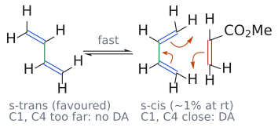

그림: 초록색은 회전하는 C2–C3 단일 결합, 파란색은 diene의 $\pi$ 결합, 빨간색은 dienophile(methyl acrylate)의 $\pi$ 결합이다. 왼쪽 s-trans는 더 안정하지만 C1과 C4가 멀어 dienophile의 양 끝에 동시에 닿지 못한다. C2–C3 결합이 빠르게 회전해 s-cis가 되면 C1과 C4가 가까워지고, 주황색 굽은 화살표 셋이 그림 1과 같은 방향으로 돌며 고리가 닫힌다.

### 5-3. 고리형 diene: 처음부터 s-cis로 고정된 diene

> 개념 문서: [s-cis conformation](../../wiki/개념/s-cis%20형태.md)

그렇다면 처음부터 s-cis로 묶여 있는 diene은 어떨까? 예상대로 반응성이 매우 크다. cyclopentadiene, furan, cyclohexa-1,3-diene, 1,2-dimethylenecyclohexane("exo-methylene" diene)은 고리 때문에 s-cis로 고정되어 있어서 사슬형 diene보다 훨씬 반응성이 크다. 예를 들어 cyclopentadiene + acrolein은 20 °C에서 68 h 만에 5-norbornene-2-carbaldehyde를 92%로 준다. 슬라이드에서는 CHO가 CH2 다리의 endo으로 그려져 있다. 반대로 3-methylenecyclohexene이나, 두 C=C가 서로 다른 고리에 걸쳐 transoid로 고정된 이중 고리 diene처럼 s-trans로 묶여 있는 diene은 아무리 가열해도 DA 반응을 할 수 없다. s-cis 형태를 취할 수 없는 diene은 DA 반응에 참여하지 못한다.

보충: s-trans 고정 diene이 안 되는 이유는 "두 끝이 멀어서"만이 아니다. DA에서 diene 가운데의 $\sigma$ 결합(C2–C3)은 생성물의 새 $\pi$ 결합이 되고, 그 $\sigma$ 결합의 s-cis/s-trans가 그대로 새 C=C의 cis/trans이 된다. s-trans로 반응한다면 6원자 고리 안에 trans C=C가 생겨야 하는데, 이것은 불가능한 구조다. (보충 근거: Clayden p.880) (출처: L13 p.16)

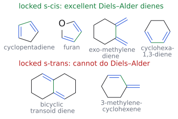

그림: 파란색은 diene의 두 $\pi$ 결합, 초록색은 두 C=C를 잇는 가운데 단일 결합(C2–C3)이다. 위 줄은 고리 때문에 두 C=C가 같은 쪽을 향하도록(s-cis) 묶인 diene이고, 아래 줄은 고리 때문에 반대쪽을 향하도록(s-trans) 묶인 diene이다. 아래 줄은 아무리 가열해도 C1과 C4를 dienophile 양 끝에 동시에 댈 수 없다.

p.17의 연습 문제(생성물에서 diene과 dienophile 찾기)는 아래 연습 문제 1, 2로 옮겼다. (출처: L13 p.17)

### 5-4. Cyclopentadiene 이야기: DA 반응은 되돌아갈 수도 있다

> 개념 문서: [역 Diels–Alder reaction](../../wiki/반응/역%20딜스-알더%20반응.md)

cyclopentadiene은 반응성이 너무 커서 생기는 문제가 있다. 바로 자기 자신과 반응한다는 것이다. 한 분자는 diene, 다른 분자는 dienophile로 DA 반응을 해서, 상온에서는 dicyclopentadiene로 존재한다. 그럼 단량체는 어떻게 얻을까? 이량체를 가열해 "분해(crack)"하면 된다. DA 반응은 가역적일 수 있으므로, 가열하면 역 DA(retro-Diels–Alder) 반응이 일어난다. 이때 끓는점이 낮은 단량체(b.p. 42 °C)를 증류로 빼내면 평형이 계속 단량체 쪽으로 밀린다. 이렇게 얻은 단량체는 −20 °C에서 며칠 보관할 수 있지만, 상온에서는 몇 시간 안에 다시 이량화한다.

보충: 왜 가열하면 거꾸로 갈까? DA는 두 분자가 한 분자가 되는 반응이라 엔트로피 면에서는 불리하다( $\Delta S$ < 0). 상온에서는 강한 $\sigma$ 결합 두 개를 얻는 엔탈피 이득이 이겨서 평형이 생성물 쪽에 있지만, 온도를 올리면 $-T\Delta S$ 항의 비중이 커져 해리(역 DA) 쪽이 유리해진다. cycloaddition의 평형이 보통 생성물 쪽에 치우치는 이유가 "C–C $\sigma$ 결합이 C–C $\pi$ 결합보다 강하기 때문"이라는 점과 짝을 이루는 설명이다. (보충 근거: Clayden p.880, 907)

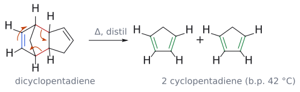

그림: 보충: 슬라이드에는 평형 화살표만 있고 굽은 화살표는 없다. 역 DA는 정방향 DA의 화살표를 거꾸로 돌린 것이므로 여기서 그려 넣었다. 빨간색은 끊어지는 $\sigma$ 결합(이량화 때 생겼던 C1–C6, C4–C5), 파란색은 diene 쪽에 남아 있던 $\pi$ 결합이다. 주황색 화살표 셋은 (1) C4–C5 $\sigma$ 전자가 C3=C4 $\pi$ 결합으로, (2) C2=C3 $\pi$ 전자가 C1=C2 $\pi$ 결합으로, (3) C1–C6 $\sigma$ 전자가 C5=C6 $\pi$ 결합으로 옮겨가는 과정이다. 초록색은 새로 생긴 $\pi$ 결합이다. 가운데 꺾인 선은 $CH_2$ 다리(C7)다.

응용 예도 있다. cyclopentadiene을 Cl2로 처리하면 hexachlorocyclopentadiene이 되고, 이것을 maleic anhydride와 DA 반응시키면 염소가 여섯 개 붙은 norbornene anhydride 부가물이 생긴다. 이 화합물은 flame retardant로 쓰인다.[6] (출처: L13 p.18)

## 6. stereochemistry: 반응물의 모양이 생성물에 어떻게 새겨지나

stereochemistry는 두 층이다. 각 성분이 suprafacial로 반응하므로 dienophile의 cis/trans는 보존된다. 그 위에서 diene과의 상대 접근을 endo/exo로 고른다. cis를 유지했다는 말만으로 endo가 증명되거나, endo라는 말만으로 모든 쐐기를 결정할 수는 없다. FMO의 위상은 허용성, 에너지 간격은 반응성, 큰 orbital 계수의 짝은 regioselectivity에 각각 답한다. (출처: L13 p.13–24; L14 p.3,10–17)

### 6-1. 이치환 dienophile: cis는 cis로, trans는 trans로

> 개념 문서: [Diels–Alder reaction](../../wiki/반응/딜스-알더%20반응.md), [stereospecificity and stereoselectivity](../../wiki/개념/입체특이성과%20입체선택성.md)

butadiene에 dimethyl maleate(cis)와 dimethyl fumarate(trans)를 각각 반응시키면 결과가 어떻게 다를까? 답은 "원래 배열 그대로"다. cis-dienophile은 cis 생성물을, trans-dienophile은 trans 생성물을 준다.

- 반응식

$$
\begin{aligned} & \text{butadiene} + \text{dimethyl maleate(Z)} \cr  & \longrightarrow \text{cis-dimethyl}\ \text{cyclohex-4-ene-1,2-dicarboxylate}(\text{두}\ \mathrm{CO_2Me}\text{가}\ \text{같은 쪽},\ \text{syn}) \end{aligned}
$$

- 반응식

$$
\begin{aligned} & \text{butadiene} + \text{dimethyl fumarate(E)} \cr  & \longrightarrow \text{trans-diester}(\text{두}\ \mathrm{CO_2Me}\text{가}\ \text{반대쪽},\ \text{anti},\ \text{라셈체}) \end{aligned}
$$

왜 그럴까? 반응이 concerted이고 suprafacial로 일어나기 때문이다. dienophile의 두 탄소는 같은 면에서 동시에 결합을 만들고, 그 사이에 C5–C6 결합이 회전할 수 있는 intermediate가 없다. 그래서 alkene의 cis/trans 정보가 고리에 그대로 찍힌다. 반응물의 stereochemistry가 생성물의 stereochemistry를 결정하므로 이것을 stereospecificity라고 한다. (출처: L13 p.19)

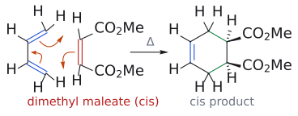

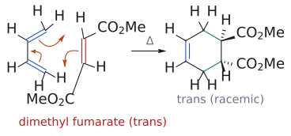

그림: 위는 cis-dienophile(dimethyl maleate), 아래는 trans-dienophile(dimethyl fumarate)이다. 파란색은 diene의 $\pi$ 결합, 빨간색은 dienophile의 $\pi$ 결합, 주황색 굽은 화살표는 전자쌍의 이동(세 화살표가 같은 방향으로 돈다), 초록색은 새 $\sigma$ 결합이다. 생성물에서 wedge는 지면 앞, 점선 hash는 지면 뒤를 뜻한다. 같은 쪽에 있던 두 $CO_2Me$ 는 둘 다 쐐기(cis)가 되고, 반대쪽에 있던 두 $CO_2Me$ 는 쐐기 하나와 점선 하나(trans, 라셈체)가 된다.

그림: dienophile의 cis/trans 관계가 생성물에 보존되는 두 예를 나누었다. 쐐기와 점선의 상대배치를 비교한다. (원본 대조: L13_cycloaddition part 1.pdf p.19)

[원본 자료에서 세부 구조·입체배치 확인: L13_cycloaddition part 1.pdf p.19](../../figures/L13/source/L13_p19.png)

### 6-2. 이치환 diene: "in"과 "out"

> 개념 문서: [Diels–Alder reaction](../../wiki/반응/딜스-알더%20반응.md), [s-cis conformation](../../wiki/개념/s-cis%20형태.md)

diene 쪽 치환기는 어떻게 될까? s-cis 형태의 diene을 그려 보면, 말단 탄소(C1, C4)의 치환기는 고리 안쪽을 향해 서로 마주 보는 "in" 자리와 바깥쪽을 향하는 "out" 자리 가운데 하나에 놓인다. 규칙은 단순하다. "in" 두 개는 생성물에서 1,4-cis가 되고, "out" 두 개도 서로 1,4-cis가 된다. 그러니 "in" 하나와 "out" 하나는 trans가 된다.

예를 들어 (E,E)-1,4-diphenyl-1,3-butadiene은 두 Ph가 모두 "out"이다. 그래서 dimethyl acetylenedicarboxylate(DMAD, MeO2C-C≡C-CO2Me)와 반응하면 두 Ph가 cis인 3,6-diphenylcyclohexa-1,4-diene-1,2-diester가 생긴다. 반면 (E,Z) diene(R 하나는 "in", 하나는 "out")은 두 R이 trans인 생성물을 준다. dienophile이 alkyne이면 원래 삼중 결합 자리에 C=C가 하나 남으므로, 생성물은 cyclohexene이 아니라 cyclohexa-1,4-diene이다.

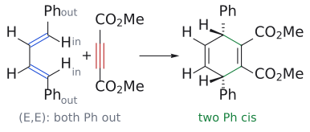

그림: (E,E)-1,4-diphenylbuta-1,3-diene을 s-cis로 그리면 두 Ph는 "out", 두 H는 "in" 자리에 놓인다(파랑: diene의 $\pi$ 결합). DMAD(빨간 삼중 결합)와 Diels–Alder 반응을 하면 두 out 치환기(Ph)는 고리의 같은 쪽(둘 다 점선 쐐기)에, 두 in 치환기(H)는 반대쪽(둘 다 굵은 쐐기)에 놓인다. 즉 두 Ph는 1,4-cis다. 초록색은 새로 생긴 $\sigma$ 결합이며, alkyne 자리에 C=C가 남아 생성물은 cyclohexa-1,4-diene이다.

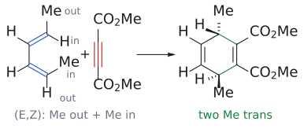

그림: 같은 반응을 (E,Z)-hexa-2,4-diene으로 바꾼 것이다(슬라이드 p.20의 R를 p.28처럼 Me로 적었다). s-cis로 그리면 C1의 Me는 "out", C4의 Me는 "in" 자리에 놓인다. 생성물에서 out 치환기는 점선 쐐기, in 치환기는 굵은 쐐기가 되므로 두 Me는 서로 trans(anti)다. 색은 위 그림과 같다.

보충: "trans,trans diene인데 왜 cis 생성물이 나오나?"가 헷갈린다면 대칭으로 확인하면 된다. (E,E)-diene + DMAD는 반응물 전체에 diene 가운데를 지나는 거울면이 하나 있다. 반응이 concerted이라 치환기가 도중에 자리를 옮길 수 없으므로, 생성물도 같은 거울면을 가져야 하고 그러려면 두 Ph가 같은 쪽(cis, meso형)이어야 한다. (E,Z)-diene은 처음부터 이 대칭이 없으므로 두 치환기가 반대쪽에 놓인다. 또 dienophile은 diene 평면 안이 아니라 아래에서 다가오므로 "in" 치환기가 있어도 반응 자체는 막히지 않는다(다만 s-cis를 방해해 느려진다, 5-2절 보충). (보충 근거: Clayden p.883) (출처: L13 p.20)

### 6-3. Endo 규칙: 두 반응물 사이의 stereoselectivity

> 개념 문서: [endo rule](../../wiki/개념/endo%20규칙.md)

지금까지는 한 반응물 안의 치환기끼리의 관계를 보았다. 그런데 dienophile의 치환기와 diene 사이의 관계는 무엇이 정할까? 예를 들어 cyclopentadiene + maleic anhydride에서는 anhydride 고리가 새 C=C 쪽을 향하는 endo 부가물과, CH2 다리 쪽을 향하는 exo 부가물이 둘 다 이론적으로 가능하다. 실제로는 endo 부가물만 생긴다. DA 반응은 보통 endo TS를 거치는 쪽이 우세하며, 이를 endo rule이라고 한다.

그 이유는 secondary orbital overlap이다. endo TS에서는 dienophile의 C=O 기가 diene 바로 아래에 놓여, 결합을 만들지 않는 diene의 "뒤쪽"(C2, C3)과 결합성으로 상호작용한다. 이 추가 안정화 덕분에 endo TS의 에너지가 낮아진다. 결과적으로 생성물에서는 새 이중 결합과 C=O 기가 분자의 같은 쪽에 놓인다. (출처: L13 p.21)

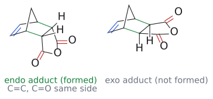

그림: 초록색은 DA 반응으로 새로 생긴 $\sigma$ 결합 두 개, 파란색은 다리 걸친 고리에 남은 C=C, 빨간색은 anhydride의 C=O다. 왼쪽 endo 부가물에서는 anhydride 고리가 C=C 쪽(아래)으로 접혀 들어가 있어 C=C와 C=O가 분자의 같은 쪽에 놓이고, 고리 접합 H 두 개는 $CH_2$ 다리 쪽(위)을 향한다. 오른쪽 exo 부가물은 반대로 anhydride이 $CH_2$ 다리 쪽을 향하고 H가 아래를 향한다. 실제로는 endo 부가물만 생긴다.

좀 더 기하학적으로 보면, TS에서 평면인 diene과 평면인 dienophile이 평행하게 포개진다. 이때 EWG(예: CHO)가 diene 아래로 들어가면 endo TS, 바깥으로 비켜나 있으면 exo TS다. dienophile에 carbonyl 같은 전자 끄는 $\pi$ 치환기가 있으면 보통 endo 첨가가 우세하다. 다만 이것은 "선호"이지 "법칙"이 아니어서 두 stereoisomer가 섞여 나오는 경우도 많다.[7]

보충: endo가 kinetic 생성물이라는 증거는 가역적인 DA에서 나온다. cyclopentadiene 대신 furan을 maleic anhydride와 반응시키면 DA가 가역적으로 일어나 평형(thermodynamic 지배)에 이르고, 이때는 exo 부가물이 얻어진다. exo가 더 안정한 이유는 다리 걸친 고리에서 anhydride 고리가 원자 하나짜리 다리(O 또는 CH2) 쪽을 향하는 것이 원자 두 개짜리 다리(C=C 쪽) 쪽을 향하는 것보다 steric hindrance가 작기 때문이다. 또 분자 내 DA에서는 두 반응 부위가 이미 묶여 있어 2차 orbital 겹침의 도움이 덜 중요해지므로, 사슬이 접히기 편한 쪽을 따라 exo가 나오기도 한다. 즉 endo 규칙은 분자 간·비가역 반응에서 가장 믿을 만하다. (보충 근거: Clayden p.884, 888–889) (출처: L13 p.22)

p.23–24의 연습 문제((E,E)-hexa-2,4-diene + acrolein의 endo 생성물 고르기)는 연습 문제 3으로 옮겼다. 슬라이드 p.24에 풀이가 있다. carbonyl이 diene 아래로 tucked under endo TS를 거치면 세 H가 한 면에 모이므로, CHO와 두 Me가 모두 cis인 all-cis 생성물이 생긴다.

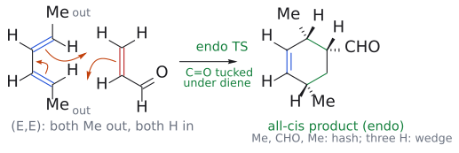

그림: 파란색은 diene의 $\pi$ 결합, 빨간색은 acrolein의 $\pi$ 결합, 주황색 화살표는 전자쌍 이동, 초록색은 새 $\sigma$ 결합이다. (E,E)-diene을 s-cis로 그리면 두 Me는 out, 두 H는 in이다. endo TS에서 C=O가 diene 아래로 들어가면 CHO 탄소의 H는 diene의 in H들과 같은 면에 모이므로, 생성물에서 세 H가 모두 굵은 쐐기(한 면), Me·CHO·Me가 모두 점선 쐐기(반대 면)인 all-cis 생성물이 된다. 평면 그림이라 "아래로 들어간" 모습 자체는 보이지 않으며 캡션으로만 적었다.

보충: 교재는 이런 문제를 푸는 순서를 다음처럼 제시한다. (1) 먼저 평면 구조로 메커니즘과 후보 생성물을 그리고 이미 아는 stereochemistry(여기서는 out/out → 두 Me cis)을 표시한다. (2) diene을 위에, dienophile을 아래에 겹쳐 그리되 C=O가 diene 밑으로 tucked under 놓는다. (3) 새 입체중심이 될 탄소에 H를 모두 그려 넣는다. (4) 고리를 펴서 그리면 같은 방향을 향하던 H들이 모두 고리의 한 면에 모인다. (5) 나머지 치환기를 반대 면에 그린다. 이 순서를 따르면 슬라이드 p.24의 all-cis 답이 그대로 나온다. (보충 근거: Clayden p.885) (출처: L13 p.23–24)

그림: 위가 cyclopentadiene( $CH_2$ 다리가 맨 위), 아래가 maleic anhydride, 초록 점선이 생기는 C···C 결합(2.25 Å로 고정)이다. endo TS에서는 anhydride의 C=O 쪽이 diene $\pi$ 계 밑으로 들어가 secondary orbital overlap을 하고, exo TS에서는 바깥쪽을 향한다. GFN2-xTB로는 endo가 약 2 kcal/mol 낮았다. 보충: xTB 구조는 GFN2-xTB로 계산한 모델이고, TS는 형성·절단 결합 길이를 고정해 최적화한 근사 구조다(진짜 안장점이 아니다).

그림: 보충: 바로 위의 3D TS 그림은 정량 계산으로 확정한 TS가 아닌 근사 접근 도식이다. 앞의 endo/exo 그림은 maleic anhydride 예의 endo/exo 구조다. 원본의 선택성 논리를 서로 다른 관찰 방향에서 확인한다. (원본 대조: L13_cycloaddition part 1.pdf p.22)

[원본 자료에서 세부 구조·입체배치 확인: L13_cycloaddition part 1.pdf p.22](../../figures/L13/source/L13_p22.png)

## 7. 왜 그런가: molecular orbital로 다시 보기

### 7-1. 재료 준비: alkene과 diene의 $\pi$ orbital

> 개념 문서: [frontier molecular orbital](../../wiki/개념/프런티어%20분자%20오비탈.md)

앞에서 나온 "왜?"들에 답하려면 orbital 그림이 필요하다. 먼저 ethylene을 보자. H–C–H 각은 117.8°, C–H는 108 pm, C=C는 133 pm이다. C–C $\sigma$ 결합은 sp2 orbital끼리, $\pi$ 결합은 p orbital끼리 겹쳐 생긴다. 두 p orbital이 같은 위상으로 합쳐지면 결합성 $\pi$ orbital(전자 2개, HOMO)이 되고, 반대 위상으로 합쳐지면 node 평면이 하나 있는 반결합성 $\pi^{\ast}$ orbital(LUMO)이 된다. (출처: L13 p.25)

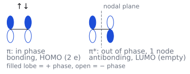

그림: 채운 lobe는 + 위상, 빈 lobe는 − 위상이다. 왼쪽 $\pi$ 는 두 p orbital이 같은 위상으로 겹친 결합성 orbital로 전자 2개(↑↓)가 들어 있는 HOMO이고, 오른쪽 $\pi^{\ast}$ 는 반대 위상으로 겹쳐 가운데에 node 평면(회색 점선)이 하나 있는 반결합성 orbital로 비어 있는 LUMO다. 슬라이드 p.25의 단순화한 표기를 따랐다.

butadiene은 이 alkene 두 개의 $\pi$ 와 $\pi^{\ast}$ 를 섞어 만든다고 생각하면 된다. 그러면 에너지 순서대로 $\psi_{1}$ (node 0개), $\psi_{2}$ (node 1개), $\psi_{3}$ (node 2개), $\psi_{4}$ (node 3개)의 네 MO가 생긴다. 전자 4개는 $\psi_{1}$ 과 $\psi_{2}$ 에 들어가므로 HOMO는 $\psi_{2}$ , LUMO는 $\psi_{3}$ 다. $\psi_{2}$ 의 양 끝 lobe는 위상이 반대이고, $\psi_{3}$ 의 양 끝 lobe는 위상이 같다는 점을 기억해 두면 이후 설명이 쉬워진다. (출처: L13 p.26)

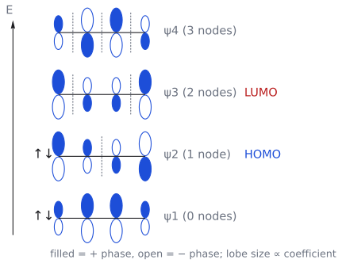

그림: 채운 lobe는 + 위상, 빈 lobe는 − 위상이고 lobe의 크기는 그 탄소의 계수 크기를 나타낸다. 회색 점선은 위상이 바뀌는 node다. 전자 4개(↑↓)는 아래 두 orbital $\psi_{1}$ 과 $\psi_{2}$ 에 들어가므로 $\psi_{2}$ 가 HOMO(파랑), $\psi_{3}$ 가 LUMO(빨강)다. $\psi_{2}$ 는 양 끝 lobe의 위상이 반대이고 $\psi_{3}$ 는 양 끝의 위상이 같다는 점을 확인해 둔다. 왼쪽 화살표는 에너지가 올라가는 방향이며 수치는 없다.

### 7-2. 왜 electron-rich diene + electron-deficient dienophile이 빠른가?

> 개념 문서: [frontier molecular orbital](../../wiki/개념/프런티어%20분자%20오비탈.md)

FMO 이론에 따르면 반응은 한쪽의 HOMO에서 다른 쪽의 LUMO로 전자가 흘러가는 상호작용으로 시작되고, 두 orbital의 에너지가 가까울수록 상호작용이 강하다. DA에서 가능한 짝은 두 가지다. diene HOMO( $\psi_{2}$ )와 dienophile LUMO( $\pi^{\ast}$ )의 짝은 에너지 차이가 작아 겹침이 좋다. 반대로 diene LUMO( $\psi_{3}$ )와 dienophile HOMO( $\pi$ )의 짝은 에너지 차이가 커서 겹침이 나쁘다. 그래서 주된 상호작용은 앞의 짝이다.

이제 답이 나온다. diene에 EDG를 붙이면 HOMO가 올라가고, dienophile에 EWG를 붙이면 LUMO가 내려간다. 둘 다 HOMO(diene)–LUMO(dienophile) 사이 간격을 좁혀 TS를 안정화하므로 반응이 빨라진다. ethylene이 900 atm을 요구했던 것도, acrolein이나 maleic anhydride가 쉽게 반응하는 것도 같은 이유다.[8]

보충: 여기서 헷갈리기 쉬운 점이 있다. 두 짝 가운데 하나를 고르는 기준은 **대칭이 아니라 에너지** 다. diene $\psi_{2}$ (가운데 node 1개)와 dienophile $\pi^{\ast}$ (node 1개)도, diene $\psi_{3}$ (node 2개)와 dienophile $\pi$ (node 0개)도 양 끝의 위상 관계가 같아서 둘 다 대칭은 맞는다. 단지 앞의 짝이 에너지가 더 가까워 주도할 뿐이다. 반대로 alkene + alkene(예: alkene + maleic anhydride를 가열)에서는 HOMO/LUMO를 어느 쪽으로 짝지어도 한쪽 끝이 반결합성이라, 에너지를 아무리 맞춰도 열적으로는 반응하지 않는다(→ [L14](L14_Cycloaddition_Part2.md) 광화학 [2+2]). (보충 근거: Clayden p.886) (출처: L13 p.27)

그림: 채운 lobe는 + 위상, 빈 lobe는 − 위상이다. diene HOMO( $\psi_{2}$ )의 아래쪽 lobe와 dienophile LUMO( $\pi^{\ast}$ )의 위쪽 lobe가 양 끝에서 모두 같은 위상이라, 두 $\sigma$ 결합이 같은 면(suprafacial)에서 동시에 생긴다. 끝 탄소의 lobe가 더 큰 것은 $\psi_{2}$ 의 계수가 말단에서 크기 때문이다. 보충: 슬라이드의 FMO 그림을 단순화해 다시 그린 것이다.

### 7-3. orbital로 본 stereospecificity

> 개념 문서: [suprafacial and antarafacial](../../wiki/개념/초면과%20대면.md)

stereospecificity도 orbital 그림으로 바로 이해된다. diene HOMO의 양 끝 lobe와 dienophile LUMO의 양 끝 lobe는 각각 같은 면에서 만나야 위상이 맞는다. 그래서 두 $\sigma$ 결합이 한 면에서 동시에 생기고(suprafacial–suprafacial), 치환기의 상대 배열이 보존된다. 슬라이드는 네 가지 경우를 짝지어 보여 준다. (Z)-maleate는 syn, (E)-fumarate는 anti 생성물을 준다. DMAD와 반응할 때 (E,E)-hexa-2,4-diene은 syn(cis-3,6-dimethyl), (E,Z)-hexa-2,4-diene은 anti(trans-3,6-dimethyl) 생성물을 준다. (출처: L13 p.28)

### 7-4. orbital로 본 endo 선호

> 개념 문서: [endo rule](../../wiki/개념/endo%20규칙.md)

endo 선호는 cyclopentadiene 이량화를 예로 설명한다. 두 cyclopentadiene이 만나면 endo-dicyclopentadiene이 생기고, 두 alkene이 서로 endo 관계에 놓인다. diene HOMO의 말단(C1, C4)과 dienophile LUMO의 결합성 겹침이 새 $\sigma$ 결합을 만드는 1차 상호작용이다. 그런데 endo TS에서는 그것만이 아니다. dienophile 분자에 남은 $\pi$ orbital이 diene의 C2, C3 lobe 바로 아래에 놓여 추가로 결합성 겹침을 한다. 이것이 2차 orbital 겹침이다. 이 겹침은 결합으로 이어지지 않고 TS만 안정화하는 "보너스"이므로, 남은 $\pi$ 계를 diene 아래에 둘 수 있는 endo 경로가 선호된다.[9] (출처: L13 p.29)

### 7-5. 그럼 diene 두 개는 왜 [4+4]를 하지 않을까?

> 개념 문서: [frontier molecular orbital](../../wiki/개념/프런티어%20분자%20오비탈.md), [Diels–Alder reaction](../../wiki/반응/딜스-알더%20반응.md)

butadiene 두 분자를 가열하면 [4+2] 생성물인 4-vinylcyclohexene은 생기지만, [4+4] 생성물인 cycloocta-1,5-diene은 생기지 않는다. 같은 diene 두 개인데 왜 한쪽만 될까? orbital을 겹쳐 보면 답이 보인다. [4+2]에서는 한 분자의 HOMO( $\psi_{2}$ )와 다른 분자의 LUMO(dienophile 역할을 하는 C=C 부분)의 양 끝이 모두 위상이 맞아 결합성이다. 그런데 [4+4]에서는 HOMO( $\psi_{2}$ )와 다른 분자의 LUMO( $\psi_{3}$ )를 겹치면, 한쪽 끝은 결합성이지만 다른 끝은 위상이 어긋나 반결합성이다. 두 결합을 동시에 만들 수 없으므로 열적으로는 진행되지 않는다.

![butadiene 2분자의 FMO: \[4+2\]에서는 HOMO ψ2와 LUMO의 양 끝이 모두 결합성이지만 \[4+4\]에서는 한쪽 끝이 반결합성이다](../../figures/L13/fmo_4plus2_vs_4plus4.svg)

그림: 채운 lobe는 + 위상, 빈 lobe는 − 위상이다. 왼쪽 [4+2]: 한 butadiene의 HOMO( $\psi_{2}$ , 위)와 다른 butadiene의 반응하는 C=C 하나의 LUMO( $\pi^{\ast}$ , 아래)를 겹치면 양 끝에서 모두 같은 위상이 마주 보아 결합성(초록 점선)이다. 오른쪽 [4+4]: HOMO $\psi_{2}$ 와 다른 분자의 LUMO $\psi_{3}$ 의 양 끝을 겹치면 한쪽은 결합성(초록)이지만 다른 쪽은 위상이 어긋나 반결합성(빨간 점선)이므로 두 결합을 동시에 만들 수 없다. 보충: 슬라이드의 그림을 평면으로 단순화했고, [4+2]의 아래쪽은 두 번째 butadiene의 반응하는 C=C 부분만 그렸다.

보충: "열적으로는"이라는 단서가 중요하다. 같은 [4+4]가 광화학 조건이나 Ni(0) 같은 전이 금속 촉매를 쓰면 가능하다. 광화학 조건에서 선택 규칙이 뒤집히는 이유는 [L14](L14_Cycloaddition_Part2.md)의 광화학 [2+2]와 같다. (보충 근거: Clayden p.887; Wade p.695) (출처: L13 p.30)

정리 슬라이드는 지금까지의 흐름을 다섯 줄로 요약한다. DA는 diene과 alkene이 cyclohexene을 만드는 반응이고, 메커니즘은 concerted이며 고리형 TS를 거친다. 속도는 electron-rich diene과 electron-deficient dienophile일수록 빠르다. stereochemistry는 반응물 안에서는 stereospecificity, 두 반응물 사이에서는 stereoselectivity(endo TS)으로 정해지고, 이는 FMO로 설명된다. Woodward–Hoffmann 규칙으로 반응성을 예측하는 부분은 회색으로 처리되어 있어 다음 강의로 넘어가는 것으로 보인다. (출처: L13 p.31)

## 8. Woodward–Hoffmann 규칙: 허용과 금지를 가르는 계산법

> 개념 문서: [Woodward–Hoffmann rules](../../wiki/개념/우드워드-호프만%20규칙.md), [suprafacial and antarafacial](../../wiki/개념/초면과%20대면.md)

FMO 그림을 매번 그리지 않고도 반응이 허용되는지 판단할 방법은 없을까? 그 답이 Woodward–Hoffmann 규칙이다.[10] (출처: L13 p.32)

규칙은 한 문장이다. thermal pericyclic 반응에서는 (4q+2)s 성분의 수와 (4r)a 성분의 수를 합한 값이 홀수여야 한다. 풀어 말하면, 전자 2, 6, 10개를 가진 suprafacial 성분의 수에 전자 0, 4, 8개를 가진 antarafacial 성분의 수를 더해 홀수가 나오면 그 반응은 "허용"된다. 여기서 allowed는 주어진 thermal 조건과 성분별 supra/antara 방식에 대해 orbital-symmetry-allowed라는 뜻이다. 실제 반응 여부와 속도는 activation barrier와 기하학적 제약도 충족해야 하므로, 관측되는 반응을 보장하지 않는다. (출처: L13 p.33)

용어도 정리해 두자. suprafacial 성분은 양 끝에서 같은 면으로 새 결합을 만드는 성분이고, antarafacial 성분은 양 끝에서 서로 반대 면으로 새 결합을 만드는 성분이다. (출처: L13 p.34)

이제 DA에 적용해 보자. DA는 [ $\pi4\mathrm{s}$ + $\pi2\mathrm{s}$ ]다. (4q+2)s에 해당하는 것은 alkene( $\pi2\mathrm{s}$ ) 1개다. (4r)a에 해당하는 성분은 없다. diene $\pi4$ 는 suprafacial이므로 (4r)s이고, 세는 대상이 아니다. 합이 1, 즉 홀수이므로 허용된 반응이다. 기하학적으로는 앞에서 본 suprafacial–suprafacial 접근 그대로다.

보충: Woodward–Hoffmann 규칙과 FMO는 역할이 다르다. 규칙은 "열적으로 허용되는가"만 답하고, endo 선택성이나 regioselectivity는 설명하지 못한다. 그것은 HOMO/LUMO의 크기와 계수를 보는 FMO의 몫이다. 또 규칙을 적용할 때 그리는 orbital은 각 성분 양 끝의 "색칠하지 않은" p orbital일 뿐 HOMO나 LUMO가 아니므로, 두 방법의 그림을 한 그림에 섞지 않는 것이 좋다. (보충 근거: Clayden p.892–893) (출처: L13 p.35)

p.36의 연습 문제(같은 규칙으로 [4+2]는 허용되고 [4+4]는 금지됨을 보이기)는 연습 문제 7로 옮겼다. (출처: L13 p.36)

WH 판정을 한 뒤에는 전자 수와 facial approach를 함께 적는다. \[4+2\]의 여섯 전자가 열적으로 허용이라는 결론은 supra–supra 성분이라는 맥락에서 쓴다. 다른 pericyclic 반응에 숫자 6만 그대로 옮기지 않는다. (출처: L13 p.33–35)

| 조건 | 허용 판정에 쓰는 합 |
| --- | --- |
| Thermal | $(4q+2)_s$ 성분 수 + $(4r)_a$ 성분 수가 홀수 |
| Photochemical | 같은 합이 짝수 |

허용은 실제 반응·속도·수율을 보장하지 않는다. 가능한 orbital symmetry를 판정한 다음 기하와 energetics를 따로 확인한다. (출처: L13 p.33; 광화학 비교: L14 p.24–28)

[원본 자료에서 세부 구조·입체배치 확인: L13_cycloaddition part 1.pdf p.33](../../figures/L13/source/L13_p33.png)

## 9. 보충: regioselectivity("ortho/para" 규칙)

> 개념 문서: [Diels–Alder regioselectivity](../../wiki/개념/딜스-알더%20위치선택성.md)

이 강의 슬라이드에는 regioselectivity가 나오지 않는다(아마 2부에서 다룰 것이다, → cycloaddition 2부 문서 참고). 여기서는 표준 교재의 결론만 짧게 적어 둔다. 비대칭 diene과 비대칭 dienophile이 반응할 때, 1-치환 diene(예: 1-methoxybutadiene)은 주로 "ortho"(1,2-이치환) 생성물을, 2-치환 diene(예: 2-methoxybutadiene)은 주로 "para"(1,4-이치환) 생성물을 준다. diene HOMO 계수가 가장 큰 말단 탄소가 dienophile LUMO 계수가 가장 큰 탄소(EWG의 $\beta$-탄소)와 결합하기 때문이다. (보충 근거: Clayden p.889–891)

## 흔한 오해

- **"butadiene은 그냥 diene이니 언제든 반응한다"고 생각하기 쉽지만 사실은** s-cis 형태일 때만 반응하고, 상온에서 s-cis인 분자는 약 1%뿐이다. s-trans로 고정된 diene(3-methylenecyclohexene 등)은 아예 반응하지 않고, s-cis로 고정된 cyclopentadiene은 상온에서도 잘 반응한다. (p.15–16)
- **"EWG는 HOMO를 낮추니 dienophile의 HOMO가 중요하다"고 생각하기 쉽지만 사실은** 정상 DA의 핵심 짝은 diene HOMO( $\psi_{2}$ )와 dienophile LUMO( $\pi^{\ast}$ )다. EWG는 dienophile의 LUMO를 낮추고 EDG는 diene의 HOMO를 올려서 둘 사이 간격을 줄인다. (p.27)
- **"stereospecificity와 stereoselectivity는 같은 말"이라고 생각하기 쉽지만 사실은** 한 반응물 안의 치환기 cis/trans, in/out는 stereospecific으로 100% 보존되고, 두 반응물 사이의 endo/exo는 stereoselective이라 혼합물이 생길 수 있다. (p.22, 31)
- **"(E,E)-diene의 두 치환기는 E니까 생성물에서 trans일 것"이라고 생각하기 쉽지만 사실은** 두 치환기가 모두 "out"이라서 생성물에서는 1,4-cis다. trans가 되는 것은 (E,Z)-diene(in + out)이다. (p.20, 28)
- **"endo는 치환기가 다리(CH2) 아래쪽, 안쪽에 있는 것"이라고 생각하기 쉽지만 사실은** endo는 dienophile의 $\pi$ 치환기가 diene $\pi$ 계 아래에 놓이는 배향이다. 그래서 norbornene 생성물에서는 치환기가 새 C=C 쪽, 즉 CH2 다리의 반대쪽에 있다. (p.21–22)
- **"2차 orbital 겹침이 새 결합을 만든다"고 생각하기 쉽지만 사실은** 결합으로 이어지지 않고 endo TS만 안정화하는 kinetic 효과다. (p.21, 29)
- **" $\pi4\mathrm{s}$ 도 Woodward–Hoffmann 계산에 넣는다"고 생각하기 쉽지만 사실은** (4q+2)s와 (4r)a만 센다. DA [ $\pi4\mathrm{s}$ + $\pi2\mathrm{s}$ ]의 합은 1(허용), [ $\pi4\mathrm{s}$ + $\pi4\mathrm{s}$ ]의 합은 0(금지)이다. 또 '허용'은 일어날 수 있다는 뜻이지 반드시 일어난다는 뜻이 아니다. (p.33–35)
- **"DA로 생긴 고리는 영원하다"고 생각하기 쉽지만 사실은** DA는 가역적일 수 있다. dicyclopentadiene을 가열·증류하면 역 DA로 단량체가 나온다. (p.18)
- **"DA 생성물은 언제나 cyclohexene"이라고 생각하기 쉽지만 사실은** alkyne dienophile(DMAD 등)을 쓰면 cyclohexa-1,4-diene이 생긴다. (p.20)
- **retrosynthesis 요령:** 생성물 고리의 C=C를 C2=C3로 놓고, 그 양옆 탄소 C1, C4에서 다음 결합(C1–C6, C4–C5)을 끊으면 diene과 dienophile이 나온다. (p.17) 보충: DA 생성물인지 알아보는 세 가지 표지는 (1) 6원자 고리, (2) 고리 안의 C=C, (3) 그 C=C의 맞은편(고리 밖)에 붙은 짝지음 기(EWG)다. 세 가지가 다 보이면 DA retrosynthesis을 먼저 시도한다. (보충 근거: Clayden p.881)
- **"Woodward–Hoffmann 규칙에서 홀수여야 하는 것은 전자 수"라고 생각하기 쉽지만 사실은** 홀수여야 하는 것은 (4q+2)s와 (4r)a에 해당하는 **성분의 개수** 다. DA의 전자 수 6은 짝수지만 세는 성분은 1개라 허용이다. (보충 근거: Clayden p.892)
- **"endo는 언제나 thermodynamically도 유리하다"고 생각하기 쉽지만 사실은** endo는 대개 덜 안정한 kinetic 생성물이다. 가역 조건(furan + maleic anhydride)에서는 더 안정한 exo가 얻어진다. (보충 근거: Clayden p.884)

## 반응 정리표

<!-- Wide source table reformatted as entries for reading; all cells retained. -->

### butadiene + ethylene

- 시약/조건: 165 °C, 17 h, 900 atm
- 생성물: cyclohexene (78%)
- regioselectivity: 해당 없음
- stereochemistry: 해당 없음
- 비고: 활성화되지 않은 dienophile이라 가혹한 조건 필요 (p.7, 14)

### 2,3-dimethylbutadiene + acrolein

- 시약/조건: 열
- 생성물: 3,4-dimethylcyclohex-3-ene-1-carbaldehyde
- regioselectivity: 대칭 diene이라 해당 없음
- stereochemistry: 새 입체중심 1개(라셈)
- 비고: (p.8)

### cyclopentadiene + nitroethylene

- 시약/조건: 열
- 생성물: 5-nitronorbornene
- regioselectivity: 해당 없음
- stereochemistry: endo/exo 가능
- 비고: 다리 걸친 이중 고리 (p.8)

### butadiene + acrolein

- 시약/조건: 150 °C, 0.5 h
- 생성물: cyclohex-3-ene-1-carbaldehyde
- regioselectivity: 해당 없음
- stereochemistry: 라셈
- 비고: EWG 1개라 빠름 (p.14)

### butadiene + CH2=C(CO2Me)2

- 시약/조건: 25 °C, 24 h
- 생성물: dimethyl cyclohex-3-ene-1,1-dicarboxylate (80%)
- regioselectivity: 해당 없음
- stereochemistry: 비카이랄
- 비고: EWG 2개라 상온에서 반응 (p.14)

### butadiene + methyl acrylate

- 시약/조건: 열
- 생성물: methyl cyclohex-3-ene-1-carboxylate
- regioselectivity: 해당 없음
- stereochemistry: 라셈
- 비고: s-cis 형태에서만 반응 (p.15)

### cyclopentadiene + acrolein

- 시약/조건: 20 °C, 68 h
- 생성물: 5-norbornene-2-carbaldehyde (92%)
- regioselectivity: 해당 없음
- stereochemistry: endo로 그려짐
- 비고: s-cis 고정 diene이라 상온 반응 (p.16)

### cyclopentadiene 2분자 (이량화)

- 시약/조건: 상온, 몇 시간
- 생성물: endo-dicyclopentadiene
- regioselectivity: 해당 없음
- stereochemistry: endo
- 비고: 가열·증류하면 역 DA로 단량체(b.p. 42 °C) 회수 (p.18, 29)

### hexachlorocyclopentadiene + maleic anhydride

- 시약/조건: 열
- 생성물: 육염소 norbornene anhydride
- regioselectivity: 해당 없음
- stereochemistry: cis-anhydride
- 비고: 난연제 (p.18)

### butadiene + maleic anhydride

- 시약/조건: 열
- 생성물: cis-1,2,3,6-tetrahydrophthalic anhydride
- regioselectivity: 해당 없음
- stereochemistry: cis(stereospecific)
- 비고: $6\pi$ aromaticity TS, suprafacial–suprafacial (p.12)

### butadiene + dimethyl maleate (Z)

- 시약/조건: 열
- 생성물: cis-cyclohex-4-ene-1,2-diester
- regioselectivity: 해당 없음
- stereochemistry: syn(cis)
- 비고: stereospecific (p.19, 28)

### butadiene + dimethyl fumarate (E)

- 시약/조건: 열
- 생성물: trans-cyclohex-4-ene-1,2-diester
- regioselectivity: 해당 없음
- stereochemistry: anti(trans), 라셈
- 비고: stereospecific (p.19, 28)

### (E,E)-1,4-diphenylbutadiene + DMAD

- 시약/조건: 열
- 생성물: cis-3,6-diphenylcyclohexa-1,4-diene-1,2-diester
- regioselectivity: 해당 없음
- stereochemistry: 두 Ph cis("out"/"out")
- 비고: alkyne dienophile (p.20)

### (E,Z)-RCH=CH-CH=CHR + DMAD

- 시약/조건: 열
- 생성물: trans-3,6-disubstituted cyclohexa-1,4-diene diester
- regioselectivity: 해당 없음
- stereochemistry: 두 R trans("in"/"out")
- 비고: (p.20, 28)

### (E,E)-hexa-2,4-diene + DMAD / (E,Z) + DMAD

- 시약/조건: 열
- 생성물: 3,6-dimethylcyclohexa-1,4-diene-1,2-diester
- regioselectivity: 해당 없음
- stereochemistry: (E,E)는 syn, (E,Z)는 anti
- 비고: (p.28)

### cyclopentadiene + maleic anhydride

- 시약/조건: 열
- 생성물: endo 부가물
- regioselectivity: 해당 없음
- stereochemistry: endo만 생성
- 비고: 2차 orbital 겹침 (p.21)

### (E,E)-hexa-2,4-diene + acrolein

- 시약/조건: 열
- 생성물: all-cis 2,5-dimethylcyclohex-3-ene-1-carbaldehyde
- regioselectivity: 대칭 diene
- stereochemistry: endo: CHO와 두 Me 모두 cis
- 비고: (p.23–24)

### butadiene 2분자

- 시약/조건: 가열
- 생성물: 4-vinylcyclohexene ([4+2]); cycloocta-1,5-diene([4+4])는 생기지 않음
- regioselectivity: 해당 없음
- stereochemistry: 해당 없음
- 비고: [ $\pi4\mathrm{s}$ + $\pi2\mathrm{s}$ ]는 허용, [ $\pi4\mathrm{s}$ + $\pi4\mathrm{s}$ ]는 금지 (p.30, 36)

### (비교) 2-methylcyclohexane-1,3-dione + MVK

- 시약/조건: 10% NaOH 후 piperidine/가열(−H2O), 또는 EtONa/가열(one-pot)
- 생성물: 이중 고리 enone
- regioselectivity: Michael → aldol
- stereochemistry: 4차 탄소 1개
- 비고: 극성 메커니즘 (p.6)

### (비교) I(CH2)4CH=CHCO2Me + CH3NO2

- 시약/조건: Cs2CO3, DMF, 20 °C
- 생성물: 2-(2-nitrocyclohexyl)acetic acid methyl ester (65%)
- regioselectivity: nitro-Michael → 분자 내 SN2
- stereochemistry: 표시 없음
- 비고: 극성 메커니즘 (p.6)

## 연습 문제

1. (p.17) 다음 생성물을 만드는 Diels–Alder 반응의 diene과 dienophile은 무엇인가? 생성물: tricyclo[5.2.1.0^2,6]deca-3,8-diene(dicyclopentadiene). norbornene 골격에 cyclopentene 고리가 융합된 구조다.
2. (p.17) 다음 생성물을 만드는 diene과 dienophile은 무엇인가? 생성물: benzene 고리(A)–CH2CH2가 있는 고리(B)–고리 C(cyclohexene: C=C가 고리 B와 공유하는 탄소에서 시작)–고리 D(cyclohexane-1,4-dione)가 차례로 융합된 사환 화합물(steroid형 골격, 고리 C의 C=C는 고리 B 쪽 탄소와 그 이웃 CH 사이에 있음).
3. (p.23–24) (E,E)-hexa-2,4-diene + acrolein의 Diels–Alder 반응에서 endo 규칙에 따라 우세한 생성물은 무엇인가? CHO와 두 Me의 상대 배열로 답하라.
4. (p.19, 28) butadiene을 (a) dimethyl maleate, (b) dimethyl fumarate와 반응시킬 때 생기는 생성물의 상대 stereochemistry를 쓰고, 이유를 설명하라.
5. (p.20, 28) (a) (E,E)-hexa-2,4-diene + DMAD, (b) (E,Z)-hexa-2,4-diene + DMAD의 생성물에서 두 Me의 관계는 무엇인가?
6. (p.14–16, 27) 다음 쌍에서 DA 반응이 더 빠른 쪽을 고르고 FMO로 설명하라. (a) butadiene + ethylene과 butadiene + acrolein (b) 1,3-butadiene + maleic anhydride와 cyclopentadiene + maleic anhydride (c) 3-methylenecyclohexene + maleic anhydride는 반응하는가?
7. (p.30, 36) suprafacial–suprafacial 접근을 가정하고, Woodward–Hoffmann 규칙과 FMO로 1,3-butadiene이 열적 [4+2]는 하지만 열적 [4+4]는 하지 않는 이유를 설명하라.
8. (p.18) dicyclopentadiene에서 cyclopentadiene 단량체를 얻는 방법과 그 원리를 쓰고, 단량체를 상온에 두면 어떻게 되는지 설명하라.

## 정답 및 해설

1. **diene은 cyclopentadiene, dienophile도 cyclopentadiene이다(이량화).** norbornene 부분의 C=C를 C2=C3로 보고 C1–C6, C4–C5 결합을 끊는다. 그러면 한 분자는 diene(s-cis 고정 cyclopentadiene)으로, 다른 분자는 C=C 하나만 쓰는 dienophile로 작용한 것이 보인다. 융합된 cyclopentene 고리의 C=C는 dienophile 분자에 남아 있던 이중 결합이다. 이 반응은 endo 선택적이어서 endo-dicyclopentadiene을 준다(p.29). (출처: L13 p.17, 18, 29)

2. **diene: 1-vinyl-3,4-dihydronaphthalene(CH2=CH-C1=C2H-CH2CH2- benzene 융합). Dienophile: cyclohex-2-ene-1,4-dione.** 새로 생긴 고리 C에서 C=C(고리 B와 공유하는 탄소 = C3, 그 이웃 CH = C2)를 C2=C3로 놓는다. 고리 C의 CH2가 C1, 고리 B/C 접합 CH가 C4가 된다. 그러면 C1–C6, C4–C5가 새 $\sigma$ 결합이고, C5와 C6은 고리 C/D 접합 탄소다. C5–C6을 다시 이중 결합으로 바꾸면 양쪽에 C=O가 붙은 cyclohex-2-ene-1,4-dione이 dienophile이 되고, diene은 dihydronaphthalene 고리 안의 C=C와 vinyl기가 s-cis로 conjugated diene이다. 고리 D에 C=O 외에 다른 C=C가 없으므로 p-benzoquinone(이 경우 생성물에 C=C가 하나 더 남음)이 아니라 cyclohexenedione이 맞다. 보충: 두 C=O는 dienophile을 강하게 활성화하는 EWG다. (보충 근거: Clayden p.886–887) (출처: L13 p.17)

3. **CHO와 두 Me가 모두 cis인 all-cis 2,5-dimethylcyclohex-3-ene-1-carbaldehyde(슬라이드의 왼쪽 생성물: Me, CHO, Me가 모두 hash).** (E,E)-diene의 두 Me는 "out"이므로 생성물에서 서로 cis다(stereospecificity). endo TS에서는 CHO가 diene 아래로 들어간다. 그러면 CHO 탄소의 H는 diene 말단의 "in" H들과 반대쪽, 즉 Me 쪽과 반대 방향을 향하게 된다. 결과적으로 세 H(C1-H, C2-H, C5-H)가 모두 한 면(wedge)에, CHO와 두 Me가 모두 반대 면에 놓인다(p.24 그림). exo 생성물은 CHO만 wedge에 있는 오른쪽 구조다. (출처: L13 p.23–24)

4. **(a) cis(syn)-dimethyl cyclohex-4-ene-1,2-dicarboxylate. (b) trans(anti)-diester(라셈).** DA는 concerted인 suprafacial–suprafacial 반응이다. dienophile의 두 탄소가 같은 면에서 동시에 새 $\sigma$ 결합을 만들고, C–C 회전이 가능한 intermediate가 없다. 따라서 Z-alkene의 cis 관계와 E-alkene의 trans 관계가 그대로 고리에 stereospecificity. (출처: L13 p.19, 28)

5. **(a) syn(cis-3,6-dimethyl). (b) anti(trans-3,6-dimethyl).** s-cis 형태에서 (E,E)-diene의 두 Me는 모두 "out"이고, out끼리는 생성물에서 1,4-cis다. (E,Z)-diene에서는 Me 하나가 "in", 하나가 "out"이므로 trans가 된다. DMAD는 alkyne이라 생성물은 cyclohexa-1,4-diene-1,2-dicarboxylate이다. (출처: L13 p.20, 28)

6. **(a) butadiene + acrolein이 훨씬 빠르다** (150 °C, 0.5 h 대 165 °C, 17 h, 900 atm). CHO(EWG)가 dienophile의 LUMO를 낮춰 diene HOMO–dienophile LUMO 에너지 차이가 줄어들기 때문이다. **(b) cyclopentadiene 쪽이 빠르다.** s-cis로 고정되어 있어 반응 가능한 형태가 100%인 반면, butadiene은 상온에서 약 1%만 s-cis다. 보충: cyclopentadiene의 고리 CH2(alkyl)는 diene HOMO를 약간 올리는 효과도 있다(보충 근거: Clayden p.886, 890). **(c) 반응하지 않는다.** 3-methylenecyclohexene은 두 C=C가 s-trans로 고정되어 있어 C1과 C4가 가까워질 수 없다. (출처: L13 p.14–16, 27)

7. **Woodward–Hoffmann:** [4+2]는 [ $\pi4\mathrm{s}$ + $\pi2\mathrm{s}$ ]다. (4q+2)s 성분( $\pi2\mathrm{s}$ )이 1개, (4r)a 성분이 0개로 합이 1(홀수)이므로 열적으로 허용된다. [4+4]는 [ $\pi4\mathrm{s}$ + $\pi4\mathrm{s}$ ]다. 두 성분 모두 (4r)s라서 세지 않으므로 (4q+2)s는 0개, (4r)a도 0개이고 합이 0(짝수)이다. 따라서 열적으로 금지된다. **FMO:** [4+2]에서는 한 butadiene의 HOMO( $\psi_{2}$ )와 다른 butadiene의 C=C 하나(dienophile 부분)의 LUMO가 겹치며 양 끝이 모두 결합성이므로, 4-vinylcyclohexene이 생긴다. [4+4]에서는 $\psi_{2}$ (HOMO)와 다른 분자의 $\psi_{3}$ (LUMO)의 양 끝 가운데 한쪽은 결합성이지만 다른 쪽은 위상이 맞지 않아 반결합성이다. 따라서 두 $\sigma$ 결합을 동시에 만들 수 없어 cycloocta-1,5-diene은 열적으로 생기지 않는다. (출처: L13 p.30, 33–36)

8. **dicyclopentadiene을 가열해 crack하고 증류한다.** 가열하면 역 DA 반응이 일어나 단량체가 생긴다. 끓는점이 낮은 cyclopentadiene(b.p. 42 °C)이 끓는점이 높은 이량체에서 증류되어 빠져나가므로 평형이 단량체 쪽으로 이동한다. 단량체는 −20 °C에서는 며칠 보관할 수 있지만, 상온에서는 몇 시간 안에 DA endo로 다시 dicyclopentadiene이 된다. 그래서 사용 직전에 새로 분해해서 쓴다. (출처: L13 p.18)

## 각주

[1] 보충: Claisen rearrangement는 [3,3]-sigmatropic rearrangement의 한 종류다. p.5의 분류에서 cycloaddition와는 다른 갈래(sigmatropic rearrangement)에 속한다. (보충 근거: Clayden p.909) (출처: L13 p.4–5)

[2] 보충: 첫 번째 예는 Robinson 고리 만들기(Robinson annulation, Michael addition + intramolecular aldol condensation)이고, 생성물은 Wieland–Miescher ketone으로 알려진 화합물이다(→ enolate·aldol·Robinson 고리 만들기 관련 강의 참고). (보충 근거: Clayden p.638–639, 845) (출처: L13 p.6)

[3] Diels–Alder 반응은 Otto Diels와 Kurt Alder가 1928년에 처음 보고했고, 두 사람은 이 업적으로 1950년 노벨 화학상을 받았다. (출처: L13 p.7)

[4] 보충: 엄밀히 세면 $\pi$ 결합 3개가 끊어지고, $\pi$ 결합 1개(C2=C3)와 $\sigma$ 결합 2개가 새로 생긴다. 순수하게 보면 $\pi$ 결합 2개가 $\sigma$ 결합 2개로 바뀐 셈이다. (보충 근거: Clayden p.878) (출처: L13 p.10)

[5] 보충: Cl과 Ph는 NO2나 C=O만큼 강한 EWG가 아니어서, dienophile을 활성화하는 효과가 상대적으로 작다. 그래도 Clayden은 dienophile에 "최소한 phenyl기나 염소 원자 정도의 추가 짝지음"이 있어야 cycloaddition이 일어난다고 하며, regioselectivity 요약표에서도 할로젠·alkene일·aryl을 CHO·COR·CO2R·CN·NO2와 함께 Z 칸("electron-withdrawing group 또는 짝지음 기")에 넣는다(aryl은 X 칸에도 함께 적혀 있다). (보충 근거: Clayden p.880, 890) Ph는 짝지음으로, Cl은 주로 유발 효과로 작용한다는 설명은 이 교재에서 직접 확인되지 않는다. (출처: L13 p.14)

[6] 보충: 이 부가물은 chlorendic anhydride로 불린다. (출처: L13 p.18)

[7] 보충: endo 생성물은 kinetic 생성물이다. steric hindrance가 적은 exo 생성물이 thermodynamically 더 안정한 경우가 많아서, 고온이나 장시간(역 DA가 가능한 가역 조건)에서는 exo 비율이 늘어날 수 있다. (보충 근거: Clayden p.884) (출처: L13 p.22)

[8] 보충: 이렇게 diene HOMO–dienophile LUMO 상호작용이 지배하는 전형적인 경우를 normal-electron-demand DA라고 부른다. (보충 근거: Clayden p.886–887) (출처: L13 p.27)

[9] 슬라이드 p.29의 그림에는 아래쪽(dienophile 역할) cyclopentadiene의 orbital이 "LUMO of diene"이라고 적혀 있다. 그 분자가 화합물로서 diene이라는 뜻으로 읽어야 하며, 반응에서의 역할은 dienophile이다(그 C=C의 LUMO). (출처: L13 p.29)

[10] R. B. Woodward와 R. Hoffmann의 첫 논문 "Stereochemistry of Electrocyclic Reactions"는 1964년 말 JACS에 투고되어 1965년 1월호에 실렸다. 슬라이드에는 Woodward가 편집인 Marshall Gates에게 보낸 편지와 게재 승인서가 실려 있다. 1981년 노벨 화학상은 "화학 반응의 진행에 관해 각자 독립적으로 발전시킨 이론"으로 Kenichi Fukui(FMO 이론)와 Roald Hoffmann이 공동 수상했다. Woodward는 1979년에 세상을 떠나 공동 수상하지 못했다(보충). (보충 근거: Clayden p.892) (출처: L13 p.32)
