# L16. Sigmatropic rearrangements

> **통독본:** 기존 강의별 전체 설명을 바탕으로 2026-10-18에 공식 강의 확인·개념 보강·그림을 추가했다. 교재 보충은 출처를 구별하며 상세 개념은 연결된 위키에서 함께 읽는다. 뼈대 노트: [L16 뼈대](../L16_Sigmatropic_Rearrangements.md) · [위키 대문](../../wiki/위키%20대문.md)

> **관련 위키 문서** ([위키 대문](../../wiki/위키%20대문.md))
> - 반응: [1,5-hydrogen shift](../../wiki/반응/1,5-수소%20이동.md), [sigmatropic rearrangement](../../wiki/반응/시그마트로픽%20자리옮김.md), [Cope rearrangement](../../wiki/반응/코프%20자리옮김.md), [Claisen rearrangement](../../wiki/반응/클라이젠%20자리옮김.md)

> **2026-10-18 강의 반영:** 앞의 강의 확인·보강 절과 그림은 공식 PDF를 근거로 추가했다. 기존 Clayden/Wade 설명은 교재 보충으로 유지하며 쪽수를 구별한다.

CM3121 Advanced Organic Chemistry — 공식 강의 반영 및 교재 보충 (2026-10-18)

> [Test 2 반응 판정·검산 순서](../../wiki/개념/Test%202%20반응%20판정과%20답안%20검산.md)로 각 단원의 질문을 연결할 수 있다.

## 공식 L16: TS, driving force, hydrogen shift — 강의 확인·보강

공개된 강의는 [3,3] Claisen/Ireland–Claisen/Cope/oxy-Cope, C·S·Se의 [2,3], [1,5]/[1,7]H 이동 순서다. 아래의 교재 보충은 유지하되 강의 범위의 기준은 이제 PDF p.3–26이다. [i,j]의 숫자는 전자 수가 아니라 옛 결합과 새 결합 사이의 위치를 세는 수다. (출처: L16 p.3,26)

Claisen의 chair orbital 그림은 겹침의 기하를 보여 주며 특정 HOMO/LUMO 그림 자체는 아니다. 큰 치환기의 equatorial 선호가 E 생성물을 설명하고, carbonyl 결합의 안정성이 진행 방향을 민다. acetal/orthoester/orthoamide를 바꾸어도 [3,3] 추적은 같지만 마지막 aldehyde/ketone/ester/amide는 달라진다. (출처: L16 p.4–12)

Cope는 strain 해소와 conjugation 같은 추진력을 확인한다. oxy-Cope의 중성 경로와 anionic 경로는 enol과 enolate를 구별하고, KH와 H+ 후처리의 역할을 각각 그린다. SeO2는 ene → [2,3] → 분해/추가 산화로 이어지며 첫 단계를 보통의 [4+2] cycloaddition으로 분류하지 않는다. (출처: L16 p.13–20)

thermal [1,5]H는 supra, thermal [1,7]H는 antara다. 그 차이는 orbital 말단 위상과 실제 사슬의 도달 가능성을 함께 확인해 설명한다. vitamin D의 마지막 thermal [1,7]과 앞의 광화학 ring opening은 서로 다른 단계다. (출처: L16 p.21–25; L17 p.17–18)

더 읽기: [Claisen](../../wiki/반응/클라이젠%20자리옮김.md), [Cope](../../wiki/반응/코프%20자리옮김.md), [hydrogen shifts](../../wiki/반응/1,5-수소%20이동.md), [Tutorial 6](../../practice/Tutorial_6.md).

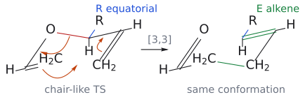

그림: chair-like [3,3]의 배치와 R의 equatorial 선택을 보여 주는 모형이다. 이 배치도와 전체 HOMO/LUMO 그림은 서로 다른 설명 수준이다. (원본 대조: L16_Sigmatropic rearrangements.pdf p.6)

[원본 자료에서 세부 구조·입체배치 확인: L16_Sigmatropic rearrangements.pdf p.6](../../figures/L16/source/L16_p06.png)

| 출발 전구체 | [3,3] 및 후처리로 읽을 carbonyl class |
| --- | --- |
| Aldehyde-derived allyl vinyl ether | Aldehyde |
| Ketone-derived allyl vinyl ether | Ketone |
| Orthoester-derived ketene acetal | Ester |
| Amide acetal-derived 계 | Amide |

원자 번호를 보존해 새 C–C 결합과 carbonyl 탄소를 추적한다. (출처: L16 p.11)

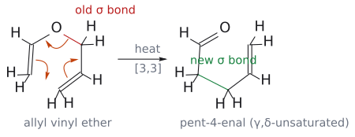

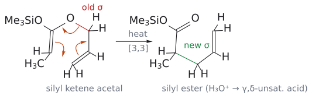

그림: allyl vinyl ether와 silyl ketene acetal을 별도 패널로 보여 준다. 원본의 acetal·orthoester·amide acetal 전체 구조는 원본 링크로 대조한다. (원본 대조: L16_Sigmatropic rearrangements.pdf p.11)

[원본 자료에서 세부 구조·입체배치 확인: L16_Sigmatropic rearrangements.pdf p.11](../../figures/L16/source/L16_p11.png)

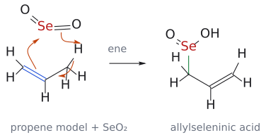

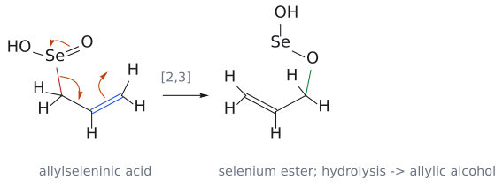

그림: propene 모형으로 ene와 뒤의 [2,3]을 나누었다. 주황은 전자쌍 이동, 초록은 새 결합이다. [2,3] 뒤 selenium ester의 hydrolysis가 allylic alcohol을 준다. (원본 대조: L16_Sigmatropic rearrangements.pdf p.20)

[원본 자료에서 세부 구조·입체배치 확인: L16_Sigmatropic rearrangements.pdf p.20](../../figures/L16/source/L16_p20.png)

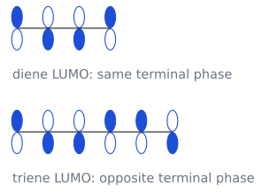

그림: ReShiki로 그린 개념 도식. 자세한 전자 이동과 출처는 연결된 개념 문서의 그림 설명에 있다.

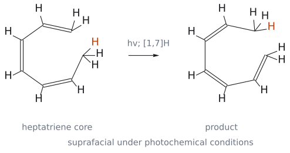

그림: 보충: 원본의 치환기를 생략한 heptatriene 모형이다. 주황 H로 옮겨지는 수소를 표시하고 세 C=C의 위치 변화를 함께 추적한다. 광화학 [1,7]은 suprafacial이다. (원본 대조: L16_Sigmatropic rearrangements.pdf p.25)

[원본 자료에서 세부 구조·입체배치 확인: L16_Sigmatropic rearrangements.pdf p.25](../../figures/L16/source/L16_p25.png)

## 개요

[L13](L13_Cycloaddition_Part1.md)에서 pericyclic 반응을 세 갈래로 나눴다. cycloaddition, electrocyclic reaction, sigmatropic rearrangement다. L13–L15는 첫 번째 갈래만 다뤘고, 이 노트는 세 번째 갈래를 다룬다. 두 번째 갈래는 [L17](L17_Electrocyclic_Reactions.md)에서 다룬다.

sigmatropic rearrangement는 이름 그대로 **$\sigma$ 결합 하나가 자리를 옮기는** 반응이다. 한쪽에서 $\sigma$ 결합이 끊어지는 동시에 다른 곳에서 새 $\sigma$ 결합이 생기고, $\pi$ 결합들은 그에 맞춰 위치를 바꾼다. cycloaddition처럼 전자가 고리를 따라 돌고, ionic intermediate가 없으며, 한 단계로 끝난다. 다른 점은 굽은 화살표 하나가 $\pi$ 결합이 아니라 **$\sigma$ 결합에서 출발한다는** 것이다.

이 노트는 다음 질문을 차례로 따라간다. 이름의 숫자 [i,j]는 무엇을 세나? 가장 중요한 [3,3] Claisen, Cope은 왜 *E* alkene을 주나? Woodward–Hoffmann 규칙으로는 어떻게 "허용"을 판정하나? 규칙이 방향을 알려 주지 않는다면 반응은 왜 한쪽으로만 가나? 마지막으로 [2,3] rearrangement와 수소 이동([1,5]H 등)을 보고, 수소가 몇 칸 옮기느냐에 따라 suprafacial/antarafacial이 어떻게 바뀌는지 정리한다. (출처: Clayden p.909)

## 1. sigmatropic rearrangement란 무엇인가

> 개념 문서: [sigmatropic rearrangement](../../wiki/반응/시그마트로픽%20자리옮김.md)

### 1.1 세 갈래를 $\sigma$ 결합 수로 가르기

세 갈래는 반응 전후 **$\sigma$ 결합 수의 변화( $\Delta\sigma$ )로** 깔끔하게 나뉜다.[^1]

| 갈래 | 무슨 일이 일어나나 | $\Delta\sigma$ |
|---|---|---|
| cycloaddition | 새 $\sigma$ 결합 둘이 생긴다(역반응이면 둘이 끊어진다) | ±2 |
| sigmatropic rearrangement | $\sigma$ 결합 하나가 생기는 동시에 하나가 끊어진다 | 0 |
| electrocyclic reaction | conjugation $\pi$ 계 양 끝을 잇는 $\sigma$ 결합 하나가 생긴다(또는 끊어진다) | ±1 |

 $\Delta\sigma$ = 0이라는 것은 분자식도 그대로, 결합 개수도 그대로라는 뜻이다. 그래서 sigmatropic 반응은 늘 **rearrangement(이성질화)이다**. (출처: Clayden p.922)

### 1.2 [i,j] 표기: 옛 결합과 새 결합 사이를 센다

[3,3], [2,3], [1,5] 같은 숫자는 원자 수도 전자 수도 아니고 **옛 $\sigma$ 결합과 새 $\sigma$ 결합의 위치 관계** 다. 세는 법은 다음과 같다. (출처: Clayden p.910)

1. 끊어지는 옛 $\sigma$ 결합의 양 끝 원자에 각각 1번을 붙인다.
2. 각 끝에서 사슬을 따라 2, 3, …으로 센다.
3. 새 $\sigma$ 결합의 양 끝이 몇 번인지 읽는다. 그 두 숫자가 [i,j]다.

예를 들어 allyl vinyl ether CH2=CH–O–CH2–CH=CH2에서 끊어지는 것은 O–CH2 결합이다. O 쪽으로 O(1)–CH(2)=CH2(3), C 쪽으로 CH2(1)–CH(2)=CH2(3)이고, 새 결합은 두 3번 탄소 사이에 생기므로 [3,3]이다.

이렇게 세면 **transition state(TS) 고리의 크기 = i + j** 라는 편리한 관계가 생긴다. [3,3]은 6원자 고리 TS, [2,3]은 5원자 고리 TS, [1,5]도 6원자 고리 TS를 거친다.[^2] (출처: Clayden p.917, p.919)

### 1.3 cycloaddition의 대괄호와 혼동하지 말 것

cycloaddition의 [4+2]는 두 성분 각각의 **원자 수를** 더하기로 쓴 것이고([L15](L15_Cycloaddition_Part3.md) 15.2절의 [3+2]처럼), sigmatropic의 [3,3]은 쉼표로 쓴 **위치 번호** 다. 어느 쪽이든 허용 여부는 대괄호 숫자가 아니라 **전자 수와 suprafacial/antarafacial로** 판정한다(→ 4절). (출처: Clayden p.894, p.910)

### 1.4 그림으로 읽는 [i,j]: 두 경로를 각각 1에서 시작한다

보충: 아래 A/B는 끊어지는 결합의 양쪽 경로를 구별하기 위한 그림 라벨이다. 분자 전체의 IUPAC 번호도, sigmatropic 이름의 추가 기호도 아니다. **옛 결합 양 끝을 각각 1로 잡고, 새 결합의 양 끝 번호를 읽는다.** O 같은 heteroatom도 경로 위의 원자라면 번호에 포함한다. (보충 근거: Clayden p.910,917)

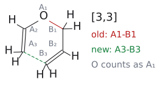

그림: 빨간 옛 결합은 O(A1)–CH₂(B1), 초록 점선은 새로 생길 A3–B3 결합이다. A 경로는 O–CH=CH₂, B 경로는 CH₂–CH=CH₂다. 각 경로의 세 번째 원자를 연결하므로 [3,3]이며, 반응에 관여하는 원자는 O를 포함해 여섯 개다. 점선은 결합 연결을 표시하며 실제 TS의 3D 기하를 뜻하지 않는다. (보충 근거: Clayden p.910)

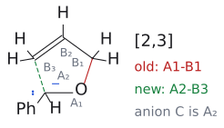

그림: 옛 O(A1)–CH₂(B1) 결합에서 출발한다. A 경로에서는 O 다음의 carbanion이 A2, B 경로에서는 allyl 말단이 B3다. 새 결합이 A2–B3이므로 [2,3]이다. **전자쌍을 가진 탄소가 A1이 아니라 A2**라는 점을 확인한다. O도 원자로 세기 때문에 두 원자 경로가 된다. 전하는 출발 anion에 그대로 표시했고, 점선은 형성될 C–C 결합이다. (보충 근거: Clayden p.917–918)

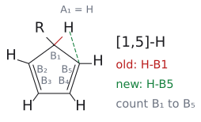

그림: 이동하는 H가 A1이고, 그 H가 떠나는 탄소가 B1이다. 두 C=C를 따라 B1 → B2 → B3 → B4 → B5로 세면 새 H–B5 결합이 [1,5]가 된다. B1과 B5는 고리에서 이웃해 보여도, 번호는 **전자 이동에 참여하는 diene 경로**를 따라 센다. 고리의 가장 짧은 길로 세어 [1,2]라고 부르지 않는다. H 하나와 탄소 다섯 개가 참여하므로 TS의 고리 원자 수는 여섯이다. (보충 근거: Clayden p.919)

세 그림에서 [i,j]의 합은 참여 경로의 원자 수를 알려 주지만, **그 합을 전자 수로 바꾸면 안 된다.** [2,3]의 5원자 경로에는 carbanion의 비공유 전자쌍에 있는 전자 두 개, 옛 sigma bond의 전자 두 개, alkene의 전자 두 개가 참여한다. 이 두 예는 [3,3]과 [2,3]으로 위치 표기는 다르지만, 모두 6전자 반응이다. (보충 근거: Clayden p.912,917–918)

## 2. Claisen rearrangement: 처음 발견된 [3,3]

> 개념 문서: [Claisen rearrangement](../../wiki/반응/클라이젠%20자리옮김.md), [acetal formation](../../wiki/반응/아세탈%20형성.md)

### 2.1 aromatic Claisen rearrangement

최초의 sigmatropic rearrangement는 allyl aryl ether를 용매 없이 가열했을 때 *ortho*-allylphenol이 생긴 반응이다. 이것이 Claisen rearrangement다.

- 전체: $\mathrm{PhO{-}CH_2{-}CH{=}CH_2} \xrightarrow{\text{가열}} \text{2-allylphenol}$

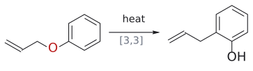

그림: [3,3] rearrangement 뒤 tautomer화. C–O(빨강)가 끊기고 새 C–C(초록).

반응은 두 단계다.

1. **[3,3] sigmatropic 단계(페리고리):** O–CH2 $\sigma$ 결합이 끊어지면서 allyl group의 말단 탄소가 benzene 고리의 *ortho* 탄소와 결합한다. 이 단계의 생성물은 aromaticity를 잃은 cyclohexadienone이다.
2. **proton transfer(ionic):** ortho 탄소의 H가 떨어지고 산소가 proton을 받아 aromatic phenol로 돌아온다. 이 keto–enol tautomerization에서는 aromaticity의 회복이 추진력이다.

(출처: Clayden p.909–910)

![allyl phenyl ether의 [3,3] 단계: 굽은 화살표 세 개가 6원자 고리를 돌아 cyclohexadienone이 된다](../../figures/L16/claisen_aromatic.svg)

그림: 빨간색은 끊어지는 $O\text{–}CH_2$ $\sigma$ 결합, 초록색은 새로 생긴 C–C $\sigma$ 결합, 주황색 굽은 화살표는 전자쌍의 이동이다. (1) benzene 고리의 *ipso*=*ortho* $\pi$ 전자가 *ortho* 탄소와 allyl 말단 탄소 사이의 새 $\sigma$ 결합이 되고, (2) allyl C=C $\pi$ 전자가 $CH_2\text{–}CH$ 사이로 옮겨 새 $\pi$ 결합이 되며, (3) $O\text{–}CH_2$ $\sigma$ 전자가 C–O 사이로 옮겨 C=O가 된다. 세 화살표는 한 단계에서 동시에 일어난다. 생성물은 aromaticity를 잃은 cyclohexadienone이고, 이어지는 ionic 양성자 tautomerization으로 2-allylphenol이 된다. 산소에 붙어 있던 $CH_2$ 가 아니라 반대쪽 끝 $CH_2$ 가 고리에 붙는다는 점(inside out)도 그림에서 확인할 수 있다. Clayden p.909의 그림을 따랐다.

### 2.2 메커니즘의 증거: allyl group이 "뒤집혀" 붙는다

이 메커니즘이 맞다는 것을 어떻게 알까? allyl group이 비대칭이면 산소에 붙어 있던 탄소가 아니라 **반대쪽 끝 탄소가** 고리에 붙는다. Clayden은 prenyl(3-methylbut-2-enyl) ether PhO–CH2–CH=CMe2를 가열하면 2-(1,1-dimethylallyl)phenol, 즉 CMe2가 고리에 붙고 CH=CH2가 남은 생성물이 생긴다는 예를 든다. 즉 원래 O에 결합했던 allyl 말단의 C–O 결합이 끊어지고, 반대쪽 말단에서 새 C–C 결합이 생긴다. 이 atom mapping과 이중결합 위치의 변화를 함께 확인하면 [3,3] rearrangement를 읽을 수 있다. 제시된 regiochemistry는 6원자 cyclic transition state를 거치는 concerted 경로와 일치한다. 생성물의 연결 관계만으로 가능한 모든 stepwise 경로가 배제되었다고 단정하지는 않는다. (출처: Clayden p.910)

### 2.3 지방족 Claisen rearrangement

같은 반응은 aromatic 고리 없이도 일어난다. 가장 단순한 예는 다음과 같다.

- 반응식

$$
\begin{aligned} & \mathrm{CH_2{=}CH{-}O{-}CH_2{-}CH{=}CH_2} \cr  & \xrightarrow[\text{가열}]{\mathrm{[3,3]}} \mathrm{OHC{-}CH_2{-}CH_2{-}CH{=}CH_2}\ \text{(pent-4-enal)} \end{aligned}
$$

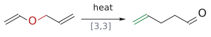

그림: Claisen [3,3]. C–O(빨강)가 끊기고 새 C–C와 C=O가 생긴다.

이를 지방족 Claisen rearrangement, 또는 Claisen-Cope rearrangement라고 부른다. 생성물의 공통점은 **$\gamma,\delta$-unsaturated carbonyl 화합물이라는** 것이다. carbonyl 탄소에서 $\alpha, \beta, \gamma, \delta$ 로 세면 C=C가 $\gamma$ 와 $\delta$ 사이에 놓인다. 합성에서 $\gamma,\delta$-unsaturated carbonyl이 필요하면 Claisen rearrangement를 떠올리라는 것이 Clayden의 조언이다. (출처: Clayden p.910, p.912)

![allyl vinyl ether의 [3,3] Claisen rearrangement: 굽은 화살표 세 개가 6원자 고리를 돌아 pent-4-enal이 된다](../../figures/L16/claisen_aliphatic.svg)

그림: 빨간색은 끊어지는 옛 $\sigma$ 결합( $O\text{–}CH_2$ ), 초록색은 새로 생긴 $\sigma$ 결합(C–C), 주황색 굽은 화살표는 전자쌍의 이동이다. 화살표 셋은 같은 방향(반시계)으로 돈다. (1) vinyl 쪽 C=C $\pi$ 전자가 두 말단 탄소 사이의 새 $\sigma$ 결합이 되고, (2) allyl 쪽 C=C $\pi$ 전자가 $CH_2\text{–}CH$ 사이로 옮겨 새 $\pi$ 결합이 되며, (3) $O\text{–}CH_2$ $\sigma$ 전자가 O–C 사이로 옮겨 C=O가 된다. 생성물을 출발물과 같은 고리 모양으로 그려 두었으므로 어떤 결합이 바뀌었는지 바로 비교할 수 있다. 옛 결합 양 끝을 1로 두고 세면 새 결합 양 끝이 모두 3이라 [3,3]이다. Clayden p.910의 그림을 따랐다.

### 2.4 allyl vinyl ether는 어떻게 만드나

allyl 쪽은 쉽다. allyl alcohol은 안정하고 만들기 쉽다. 문제는 vinyl 쪽이다. "vinyl alcohol"은 acetaldehyde의 enol이라 병에 담아 둘 수 없다.

해결책은 **acetal 교환이다**. aldehyde의 acetal(예: MeCH(OMe)2)과 allyl alcohol을 산 propanoic acid EtCO2H와 함께 가열한다.

1. **acetal 교환(SN1형):** protonate된 OMe가 methanol로 떨어져 oxocarbenium ion이 생기고, allyl alcohol이 그 자리에 들어간다. methanol은 혼합물에서 가장 휘발성이 커서 증류로 빠져나가며 평형을 오른쪽으로 민다.
2. **제거(E1형):** 남은 OMe가 다시 protonate되어 떨어지고, oxocarbenium ion에서 $\alpha$ -H가 빠져 vinyl ether가 된다.
3. **[3,3] rearrangement:** 가열하면 그 자리에서 Claisen rearrangement가 일어난다. allyl vinyl ether를 따로 분리할 필요가 없다. 조금만 생겨도 곧바로 rearrangement해 빠져나가기 때문이다.

propanoic acid을 쓰는 이유는 끓는점이 높아 혼합물 전체를 높은 온도에서 평형시킬 수 있기 때문이다.[^3] (출처: Clayden p.911)

같은 전략은 다른 carbonyl 화합물에도 통한다. 출발물만 바꾸면 된다. (출처: Clayden p.911–912)

| acetal류 출발물 | [3,3] 생성물 |
|---|---|
| aldehyde의 acetal | $\gamma,\delta$-unsaturated aldehyde |
| ketone의 acetal | $\gamma,\delta$-unsaturated ketone |
| orthoester RC(OMe)3 | $\gamma,\delta$-unsaturated ester |
| orthoamide(예: DMF dimethyl acetal, "amide acetal") | $\gamma,\delta$-unsaturated amide |

(→ acetal 화학은 [L12](L12_Protecting_Groups.md) protecting group 문서의 acetal 부분 참고)

## 3. 의자형 transition state: 왜 *E* alkene이 생기나

> 개념 문서: [Claisen rearrangement](../../wiki/반응/클라이젠%20자리옮김.md)

### 3.1 6원자 고리 TS는 의자 모양이다

[3,3] rearrangement의 TS는 cyclohexane처럼 **chair-like이다**. 이 모양에서는 새 $\sigma$ 결합을 만들 두 p orbital이 서로 정면으로 마주 보고, 새 $\pi$ 결합 두 개를 만들 orbital들도 처음부터 평행하게 놓인다. 그래서 orbital 겹침이 좋다. 이 그림은 특정한 프런티어 orbital을 나타낸 것이 아니라 겹침의 기하만 보여 주는 것이다. (출처: Clayden p.910)

### 3.2 치환기는 적도 자리로 간다

산소 옆 포화 탄소(옛 $\sigma$ 결합의 탄소 쪽 끝)에 치환기 R이 있으면 새로 생기는 C=C는 **trans(*E*)가** 강하게 우세하다. 이유는 [L13](L13_Cycloaddition_Part1.md)에서 본 stereospecificity와 같은 결의 논리다.

1. 의자형 TS에서 R은 cyclohexane 치환기처럼 축(axial) 또는 equatorial 자리에 놓일 수 있다.
2. 적도 자리가 입체적으로 유리하므로 R은 적도 자리를 택한다.
3. R은 그 자리를 유지한 채 생성물로 넘어가고, 적도 R과 사슬의 나머지가 새 C=C의 반대쪽에 놓여 *E* alkene이 된다.

즉 생성물의 trans 기하는 **출발물이 택한 형태와 TS에 이미 들어 있다** . intermediate가 없으니 그 사이에 바뀔 틈도 없다. (출처: Clayden p.910–911)

예:

$$
\begin{aligned} & \mathrm{MeCH(OMe)_2} + \mathrm{CH_2{=}CH{-}CH(OH){-}R} \cr  & \xrightarrow[\text{가열}]{\mathrm{EtCO_2H}} \mathrm{OHC{-}CH_2{-}CH_2{-}CH{=}CH{-}R}\ (\mathit{E}) \end{aligned}
$$

(출처: Clayden p.911)

그림: Clayden처럼 출발물을 chair형 TS와 같은 모양으로 그렸다. 빨간색은 끊어지는 O–C $\sigma$ 결합, 파란색은 equatorial 자리의 R이고, 같은 탄소의 H는 axial 자리(아래쪽 세로선)에 있다. 주황색 화살표 셋은 지방족 Claisen과 같다. 오른쪽은 원자 배치를 그대로 둔 채 결합만 바꾼 생성물이며, 초록색은 새 C–C $\sigma$ 결합과 새 C=C다. equatorial R과 사슬의 나머지( $CH_2$ 쪽)가 새 C=C의 반대쪽에 놓이므로 *E* alkene이 된다. 보충: R이 axial이었다면 *Z*가 되었을 것이다. 그림을 단순하게 하려고 말단 $CH_2$ 두 개는 묶음 라벨( $H_2C$ , $CH_2$ )로 적었다. Clayden p.911의 그림을 따랐다.


그림: 두 allyl 조각(위/아래)이 2.00 Å(초록 점선)에서 결합을 주고받는다. chair TS는 두 allyl의 가운데 탄소가 서로 반대쪽으로 꺾이고, boat TS는 같은 쪽으로 꺾여 가려진(eclipsed) 상호작용이 생긴다. GFN2-xTB로 boat가 약 8 kcal/mol 높았다(실험값 약 6 kcal/mol). Claisen rearrangement도 같은 chair TS를 거친다. 보충: xTB 구조는 GFN2-xTB로 계산한 모델이고, TS는 형성·절단 결합 길이를 고정해 최적화한 근사 구조다(진짜 안장점이 아니다).

## 4. Woodward–Hoffmann 규칙으로 [3,3]을 판정하기

> 개념 문서: [Claisen rearrangement](../../wiki/반응/클라이젠%20자리옮김.md), [sigmatropic rearrangement](../../wiki/반응/시그마트로픽%20자리옮김.md), [Woodward–Hoffmann rules](../../wiki/개념/우드워드-호프만%20규칙.md)

### 4.1 왜 FMO보다 Woodward–Hoffmann인가

cycloaddition은 두 분자가 공간을 사이에 두고 만나므로 한쪽 HOMO와 다른 쪽 LUMO를 겹쳐 보면 됐다([L14](L14_Cycloaddition_Part2.md) 1–2절). 그런데 [3,3] rearrangement는 한 분자 안에서 일어나고 성분이 **셋이다**. conjugation되지 않은 $\pi$ 결합 두 개, 그리고 그 둘을 잇는 사슬 속 $\sigma$ 결합 하나다. 이런 경우에는 FMO보다 Woodward–Hoffmann 규칙이 깔끔하다. (출처: Clayden p.912)

규칙은 L13 8절과 같다. **열적 페리고리 반응에서는 (4q+2)s 성분 수와 (4r)a 성분 수의 합이 홀수여야 한다.** (출처: Clayden p.892, p.912)

### 4.2 여섯 단계 절차

Clayden이 cycloaddition에 쓴 절차를 그대로 적용한다. (출처: Clayden p.912–913)

1. Allyl vinyl ether에서 $\gamma,\delta$-unsaturated aldehyde로 가는 mechanism을 그리고, 끊어지는 sigma bond와 새로 생기는 결합을 표시한다.
2. 성분을 고른다. 메커니즘에 참여하는 결합은 모두 넣고, 나머지는 넣지 않는다. → $\pi2$ (C=C), $\sigma2$ (O–C), $\pi2$ (C=C)
3. 의자형 TS 모양으로 3차원 그림을 그리고 **성분의 끝에만** orbital을 그린다.
4. 새 결합이 생길 곳끼리 점선으로 잇는다.
5. 각 성분에 s 또는 a를 붙인다. Clayden의 그림에서는 $\pi2\mathrm{s}$ , $\sigma2\mathrm{a}$ , $\pi2\mathrm{a}$ 가 된다.
6. 센다. (4q+2)s는 $\pi2\mathrm{s}$ 하나, (4r)a는 없다. 합 = 1(홀수) → **열적 허용** . $\pi2\mathrm{a}$ 와 $\sigma2\mathrm{a}$ 는 세는 대상이 아니다.

### 4.3 $\sigma$ 결합의 s와 a는 어떻게 정하나

 $\pi$ 결합은 쉽다. 두 새 결합이 옛 $\pi$ 결합의 같은 면에서 생기면 s, 반대 면이면 a다. $\sigma$ 결합은 "면"이 분명하지 않으므로 다른 기준을 쓴다. sp3 orbital의 **큰 lobe로 반응하면 retention, 작은 lobe로 반응하면 inversion** 이라고 부르고,

- 양 끝 모두 보존이거나 양 끝 모두 반전이면 **$\sigma2\mathrm{s}$**
- 한쪽 끝은 보존, 다른 끝은 반전이면 **$\sigma2\mathrm{a}$**

로 정한다. (출처: Clayden p.913)

### 4.4 점선을 다르게 이어도 결론은 같다

4단계에서 점선 하나를 다르게 이으면 $\sigma$ 결합이 $\sigma2\mathrm{s}$ 로 바뀌는 대신 $\pi$ 결합 하나가 $\pi2\mathrm{a}$ 로 바뀐다. 그래도 (4q+2)s는 여전히 하나뿐이라 합은 1이고, 반응은 여전히 허용이다. 즉 **꼬리표 붙이는 방식은 여러 가지일 수 있지만 셈의 결과(홀짝)는 바뀌지 않는다** . 시험에서 "s/a를 내가 붙인 것과 다르게 붙였는데 틀렸나?"라고 걱정할 필요가 없는 이유다.[^4] (출처: Clayden p.913)

### 4.5 표기의 세 부분: 성분 종류 → 전자 수 → 반응하는 면

보충: 강의·교재의 $\pi4\mathrm{s}$는 **pi 성분 / 전자 4개 / suprafacial**로 읽는다. 숫자 4는 [i,j]의 위치 번호가 아니다. $\sigma2\mathrm{a}$는 **sigma 성분 / 전자 2개 / antarafacial**, $\omega2\mathrm{a}$는 **p orbital 하나 / 전자 2개 / 서로 다른 lobe로 연결**을 뜻한다. 이 노트는 기존 교재의 붙여 쓰는 표기를 유지한다. (보충 근거: Clayden p.912–913,918)

그림: alkene의 두 p orbital은 합쳐서 전자 두 개를 가진 pi2 성분이다. 끊어지는 sigma bond는 전자 두 개를 가진 sigma2 성분이고, carbanion의 p orbital 하나는 전자 두 개를 가진 omega2 성분이다. 같은 p orbital이 비어 있는 carbocation이면 omega0이다. 따라서 **orbital 한 개 = 전자 한 개**가 아니다. 채운 lobe와 빈 lobe는 위상 차이이며 전자가 찼는지 비었는지를 표시한 것이 아니다. pi4(diene)는 여기의 pi2 그림보다 p orbital이 두 개 더 많은 별도 성분이다. (보충 근거: Clayden p.912,918)

그림: 초록 점선은 pi 성분의 양 끝에서 다른 성분과 생길 새 결합의 접촉 방향이다. 위에서는 두 접촉이 같은 면이라 s, 아래에서는 반대 면이라 a다. **분자 전체가 종이 위에 그려졌다는 사실로 s/a를 정하지 않고, 성분 양 끝의 접촉 면을 비교한다.** 이 그림은 면 구분용 도식이며 전자 이동 화살표가 아니다. (보충 근거: Clayden p.913)

그림: 옛 sigma bond를 만드는 sp³ orbital의 큰 lobe 쪽 반응은 retention(R), 작은 lobe 쪽 반응은 inversion(I)으로 표시했다. 양 끝이 R/R 또는 I/I면 sigma2s, R/I 또는 I/R면 sigma2a다. 따라서 **s는 무조건 retention이라는 뜻이 아니다.** 두 끝에서 같은 방식인지 다른 방식인지가 기준이다. 초록 점선은 새 접촉이고 orbital 모양은 정성적이다. (보충 근거: Clayden p.913)

보충: H 이동의 H는 위 sp³ orbital 그림과 달리 **1s orbital**로 반응한다. 1s는 구대칭이고 node가 없으므로 H 쪽의 연결을 어느 방향으로 그려도 retention이다. [1,5]H의 같은 면 이동을 $\pi4\mathrm{s}+\sigma2\mathrm{s}$로 적을 때는, H의 1s와 탄소 쪽 orbital이 어떻게 연결되는지 함께 확인한다. H에 작은 sp³ lobe를 따로 그려 inversion을 주장하지 않는다. (보충 근거: Clayden p.921)

### 4.6 전자 수와 판정 합을 따로 계산하기

보충: 열적 Woodward–Hoffmann 판정에서 홀수여야 하는 것은 전자 수가 아니라 **(4q+2)s 성분 수 + (4r)a 성분 수**다. 2·6·10 전자 성분은 s일 때, 0·4·8 전자 성분은 a일 때 이 합에 들어간다. 아래는 이 노트에서 선택한 연결 방식에 대한 예이며, 모든 TS에 같은 꼬리표를 무조건 붙이라는 규칙이 아니다. (보충 근거: Clayden p.912–913,918,921)

| 예 | 참여 성분 | 합에 들어가는 성분 | 합과 판정 |
|---|---|---|---|
| [3,3] Claisen | $\pi2\mathrm{s}+\sigma2\mathrm{a}+\pi2\mathrm{a}$ | pi2s 하나 | 1, 열적 허용 |
| [2,3]-Wittig | $\omega2\mathrm{a}+\sigma2\mathrm{s}+\pi2\mathrm{a}$ | sigma2s 하나 | 1, 열적 허용 |
| [1,5]H, 같은 면 | $\pi4\mathrm{s}+\sigma2\mathrm{s}$ | sigma2s 하나 | 1, 열적 허용 |
| [1,3]H, 같은 면 | $\pi2\mathrm{s}+\sigma2\mathrm{s}$ | 두 성분 모두 | 2, 열적 금지 |
| [1,3]H, 반대 면 | $\pi2\mathrm{a}+\sigma2\mathrm{s}$ | sigma2s 하나 | 1, 형식상 허용; 단순 allyl 경로에서는 기하상 불가 |
| [1,7]H, 반대 면 | $\pi6\mathrm{a}+\sigma2\mathrm{s}$ | sigma2s 하나 | 1, 열적 허용 |

표의 처음 세 예는 총전자 수가 모두 6이다. 반면 [1,3]H는 2 + 2 = 4전자, [1,7]H는 6 + 2 = 8전자다. 이 총전자 수와 마지막 열의 **성분 개수 합**을 구분한다.

[1,5]의 pi4s는 전자 4개가 있지만 (4r)**s**이므로 합에서 제외한다. [2,3]의 omega2a도 (4q+2)**a**이므로 제외한다. 제외한다는 것은 그 전자가 반응하지 않는다는 뜻이 아니라, **이 홀짝 판정식에서 세는 종류에 해당하지 않는다**는 뜻이다. 또한 형식상 허용이라는 판정은 반응 속도·수율이나 실제 TS에 도달할 수 있는 기하를 보장하지 않는다. (보충 근거: Clayden p.913,918,921)

### 4.7 같은 면을 판정하는 네 가지 예

보충: 먼저 **어느 성분의 양 끝을 비교하는지** 정한다. 그림 전체의 위·아래나 생성물 치환기의 cis/trans를 보고 s/a를 바로 붙이지 않는다. 아래에서 회색 점선은 한 pi 성분의 기준면을 옆에서 본 것이고, 초록 점선은 그 성분이 다른 성분과 연결되는 두 접촉이다. Orbital 사이의 거리는 가독성을 위한 도식이며 실제 결합 길이나 TS 구조가 아니다. (보충 근거: Clayden p.892–893,913)

그림: 위/위와 아래/아래는 모두 suprafacial이다. 위/아래와 아래/위는 모두 antarafacial이다. 페이지를 뒤집거나 분자 전체를 회전하면 위와 아래라는 이름은 바뀔 수 있어도 **두 접촉이 같은 면인지 반대 면인지는 유지된다**. 휘어진 사슬에서는 종이의 위·아래 대신 conjugated component를 따라 이어지는 국소적인 면을 추적한다. (보충 근거: Clayden p.913,921)

Sigmatropic H 이동에서는 옛 C–H 결합이 끊어지는 쪽과 새 C–H 결합이 생기는 쪽의 관계를 본다. “H가 같은 면으로 이동한다”는 말은 두 끝의 결합 변화가 같은 면을 이용한다는 뜻이다. H가 평면 위를 따라 미끄러지는 실제 궤적을 관측했다는 뜻은 아니다. 또한 suprafacial과 antarafacial은 endo/exo, syn/anti, cis/trans와 구분해서 쓴다. (보충 근거: Clayden p.920–921)

### 4.8 같은 면과 같은 위상은 다른 질문이다

보충: **Face는 공간적인 접촉 방향이고, phase는 orbital wavefunction의 부호다.** 아래 alkene antibonding MO에서는 위쪽 lobe 두 개의 위상이 서로 반대여도, 두 접촉이 모두 위쪽이면 기하학적 분류는 suprafacial이다. 이 그림만으로 반응이 허용되는지는 결정할 수 없다. 다른 성분까지 포함한 전체 orbital 연결을 확인해야 한다. (보충 근거: Clayden p.892–893,913)

그림: 파랗게 채운 lobe와 빈 lobe는 반대 위상이다. 채웠다고 occupied, 비웠다고 unoccupied라는 뜻이 아니다. Woodward–Hoffmann의 s/a를 정하는 그림에서는 위상을 칠하지 않아도 되지만, FMO로 겹침을 검사하는 그림에서는 위상 정보가 필요하다. 같은 그림 기호를 서로 다른 의미로 읽지 않는다. (보충 근거: Clayden p.892–893)

### 4.9 sigma 성분: R/R, I/I, R/I, I/R을 모두 보기

보충: 아래 R은 retention, I는 inversion이며, 입체중심의 CIP 표기 R/S가 아니다. 빨간 선은 옛 sigma bond, 파란 큰 lobe와 작은 lobe는 양 끝의 hybrid orbital을 나타낸다. 초록 점선이 어느 lobe와 연결되는지 **각 끝에서 먼저** 읽은 다음 두 결과를 비교한다. (보충 근거: Clayden p.913)

그림: R/R뿐 아니라 I/I도 양 끝에서 같은 방식으로 반응하므로 sigma2s다. R/I와 I/R은 양 끝의 방식이 달라 sigma2a다. 따라서 “retention 하나가 보이면 s” 또는 “inversion 하나가 보이면 a”라고 판정할 수 없다. 두 끝을 한 쌍으로 비교해야 한다. 이 그림은 hybrid orbital 연결 도식이며 독립적인 네 가지 생성물 구조를 나타내지는 않는다. (보충 근거: Clayden p.913)

H의 1s orbital은 작은 뒤쪽 lobe가 따로 없고 구 전체의 위상이 같다. 따라서 H 쪽 접촉은 항상 retention이다. 다만 이것만으로 **C–H 성분 전체가 무조건 sigma2s라고 결론 내리지는 않는다**. 탄소 쪽 접촉도 확인해야 한다. 뒤의 H 이동 예에서는 탄소 쪽도 retention인 연결을 선택하여 sigma2s로 세고, 필요한 면의 차이를 pi 성분의 s/a로 표시한다. (보충 근거: Clayden p.921)

### 4.10 [3,3]의 꼬리표가 달라도 같은 판정이 나오는 이유

보충: Claisen의 참여 결합을 pi2, sigma2, pi2로 나누고 Clayden의 연결 방식을 따르면 아래 위쪽 행이 된다. 가운데 sigma2a에 a가 있다는 이유만으로 반응 전체를 금지라고 판단하지 않는다. 2전자 성분은 s일 때만 판정 합에 들어가므로, 이 행에서는 pi2s 하나만 센다. (보충 근거: Clayden p.912–913)

그림: 점선 연결 하나를 다른 lobe로 그리면 그 연결에 참여한 **두 성분의 꼬리표가 함께** 바뀐다. 위 행의 pi2s와 sigma2a가 아래 행에서는 pi2a와 sigma2s가 되어, 세는 대상만 옮겨 가고 합은 1로 유지된다. 한 성분의 a만 임의로 s로 바꾸고 나머지를 그대로 두는 것은 이 재표현에 해당하지 않는다. (보충 근거: Clayden p.913)

이 때문에 다른 자료의 “suprafacial–suprafacial [3,3]”이라는 전체 allylic framework 설명과 이 절의 **세 결합 성분에 붙인 s/a 목록**을 글자 수만으로 비교하면 혼동하기 쉽다. 어떤 원자 묶음과 접촉을 가리키는지 먼저 맞춘다. 여기서는 교재가 정의한 세 성분과 실제 점선 연결을 기준으로 계산한다. (보충: 표기 범위의 구분; Clayden p.912–913)

## 5. 방향: 규칙은 "허용"만 말하고 "어느 쪽"은 말하지 않는다

> 개념 문서: [Claisen rearrangement](../../wiki/반응/클라이젠%20자리옮김.md), [sigmatropic rearrangement](../../wiki/반응/시그마트로픽%20자리옮김.md)

### 5.1 Claisen은 왜 늘 carbonyl 쪽으로 가나

orbital 대칭은 [3,3] rearrangement가 허용된다는 것만 알려 준다. 정반응이 허용이면 역반응도 허용이다. 그런데 Claisen rearrangement는 늘 carbonyl 화합물 쪽으로 간다. 왜일까?

[L10](L10_Enol_and_Enamine.md)의 keto-enol 평형을 떠올리면 된다. keto형은 **C=O $\pi$ + C–C $\sigma$** , enol형은 **C=C $\pi$ + C–O $\sigma$** 조합을 가지며, 앞의 조합이 더 안정해서 keto형이 우세하다. allyl vinyl ether(C=C + C–O)와 $\gamma,\delta$-unsaturated carbonyl(C=O + C–C)의 관계가 정확히 이와 같다. **carbonyl 생성이 반응을 오른쪽으로 민다.** (출처: Clayden p.913)

### 5.2 판정 순서 정리

sigmatropic 반응 문제를 풀 때는 두 질문을 따로 묻는다.

1. **허용되는가?** → Woodward–Hoffmann(또는 FMO)
2. **어느 쪽이 유리한가?** carbonyl 생성, ring strain 해소, 더 치환된 alkene 형성, conjugation, anion 안정화 등의 열역학적 요인을 비교한다.

이 구분은 [L13](L13_Cycloaddition_Part1.md) 5-4절의 역 Diels–Alder처럼 cycloaddition에서도 이미 본 것이다. (출처: Clayden p.913, p.923)

## 6. Cope rearrangement

> 개념 문서: [Cope rearrangement](../../wiki/반응/코프%20자리옮김.md), [Ireland–Claisen](../../wiki/반응/클라이젠%20자리옮김.md)

### 6.1 탄소만 있는 [3,3]

고리 TS가 탄소로만 이루어진 [3,3] rearrangement가 Cope rearrangement다. 가장 단순한 hexa-1,5-diene은 rearrangement해도 **출발물과 생성물이 같다** . 반응은 일어나지만 눈에 보이는 변화가 없다. 그러니 Cope rearrangement를 쓸모 있게 만들려면 한쪽으로 미는 힘이 필요하다. (출처: Clayden p.913)

### 6.2 oxy-Cope: OH 하나로 carbonyl을 만들어 민다

3번 탄소에 OH를 달면(hexa-1,5-diene-3-ol) [3,3] 생성물은 **enol이** 되고, enol은 곧바로 aldehyde로 tautomerization한다. 5.1절의 논리로 반응이 한쪽으로 간다.

- 반응식

$$
\begin{aligned} & \mathrm{CH_2{=}CH{-}CH(OH){-}CH_2{-}CH{=}CH_2} \cr  & \xrightarrow[\text{가열}]{\mathrm{[3,3]}} \mathrm{HO{-}CH{=}CH{-}CH_2{-}CH_2{-}CH{=}CH_2} \cr  & \longrightarrow \mathrm{OHC{-}CH_2{-}CH_2{-}CH_2{-}CH{=}CH_2} \end{aligned}
$$

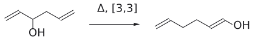

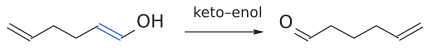

그림: 보충: hexa-1,5-dien-3-ol이 [3,3] rearrangement로 enol이 되고, enol이 aldehyde로 토토머화하면서 반응이 되돌아가지 않는다.

![oxy-Cope [3,3]의 굽은 화살표](../../figures/L16/oxy_cope_arrows.svg)

그림: 보충: 6원자 고리를 도는 화살표 셋. C3–C4 $\sigma$ 결합(빨강)이 끊어지고 C1–C6 $\sigma$ 결합(초록)이 생기며, 두 $\pi$ 결합이 자리를 옮긴다. 생성물 enol은 aldehyde로 토토머화한다.

(출처: Clayden p.913–914)

### 6.3 anion oxy-Cope: KH로 alkoxide를 만들면 훨씬 빨라진다

alcohol을 먼저 염기(KH가 가장 좋다)로 처리해 alkoxide로 만들면 rearrangement가 크게 빨라진다. 왜일까? 생성물이 이번에는 칼륨 enolate인데, enolate는 출발물인 칼륨 alkoxide보다 안정하다. 반응이 진행될수록 O⁻와 새로 생기는 $\pi$ 결합 사이의 conjugation이 자라나 TS부터 안정해진다. 산성 후처리로 enolate를 protonate하면 같은 aldehyde가 나온다. Clayden은 중성 반응을 "SLOW", anion 반응을 "FAST"로 표시한다. (출처: Clayden p.914)

![anionic oxy-Cope rearrangement: potassium alkoxide의 [3,3]으로 potassium enolate가 생긴다](../../figures/L16/anionic_oxy_cope.svg)

그림: 빨간색은 끊어지는 $\sigma$ 결합(O⁻가 달린 탄소와 이웃 $CH_2$ 사이), 초록색은 새로 생긴 C–C $\sigma$ 결합이다. 화살표 셋은 Claisen과 같은 [3,3] 패턴이다. (1) 왼쪽 C=C $\pi$ 전자가 두 말단 탄소 사이의 새 $\sigma$ 결합이 되고, (2) 오른쪽 C=C $\pi$ 전자가 옆자리로 옮겨 새 $\pi$ 결합이 되며, (3) 빨간 $\sigma$ 결합의 전자가 O⁻ 쪽 탄소와 이웃 탄소 사이의 새 $\pi$ 결합이 된다. 생성물은 O⁻와 conjugation된 potassium enolate이고, 후처리(H⁺, $H_2O$ )로 hex-5-enal이 된다. 중성 OH(느림) 대신 KH로 만든 O⁻(빠름)를 쓰는 이유가 바로 이 enolate의 안정성이다. Clayden p.914의 그림을 따랐다.

이 방법은 특이한 화합물도 만든다. 4원 고리가 붙은 allyl alcohol을 KH/THF로 처리하면 anion oxy-Cope로 4원 고리가 8원 고리로 넓어지면서, 원래라면 Bredt 규칙에 걸릴 **bridgehead 위치의 trans 이중결합을** 가진 bicyclic ketone이 생긴다. (출처: Clayden p.914)

### 6.4 Ireland–Claisen: ester enolate로 산을 만든다

고리 안의 산소 하나와 고리 밖의 산소 하나를 함께 두면 [3,3] rearrangement가 아주 잘 일어난다. 이를 쉽게 만드는 방법이 **allyl alcohol의 ester를 enolate로 만드는 것이다**.

1. allyl alcohol을 acetyl chloride와 염기로 acetic acid allyl ester로 만든다.
2. LDA로 ester의 lithium enolate를 만든다(→ [L7](L07_Enolate_Alkylation.md) LDA). 필요하면 Me3SiCl로 silyl ketene acetal로 바꾼다.
3. [3,3] rearrangement로 $\gamma,\delta$-unsaturated carboxylic acid의 lithium염(또는 silyl ester)이 생긴다.
4. H⁺/H2O 후처리로 $\gamma,\delta$-unsaturated carboxylic acid을 얻는다.

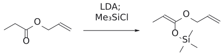

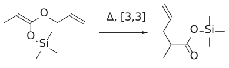

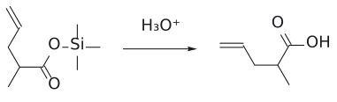

그림: 보충: allyl ester를 LDA로 enolate로 만들고 $Me_3SiCl$ 로 잡아 silyl ketene acetal을 얻는다. [3,3] rearrangement로 silyl ester가 되고, 산 처리하면 $\gamma,\delta$-unsaturated carboxylic acid가 된다.

![Ireland–Claisen [3,3]의 굽은 화살표](../../figures/L16/ireland_claisen_arrows.svg)

그림: 보충: silyl ketene acetal의 allyl O–C $\sigma$ 결합(빨강)이 끊어지고 새 C–C $\sigma$ 결합(초록)이 생긴다. 생성물은 silyl ester이고 $H_3O^+$ 처리로 $\gamma,\delta$-unsaturated carboxylic acid가 된다.

R. E. Ireland가 1970년대에 개발해 Ireland–Claisen rearrangement라고 부른다. 치환기가 알맞게 놓이면 단순 Claisen과 같은 이유(의자형 TS, 적도 R)로 *E* 선택성을 보인다. (출처: Clayden p.914)

### 6.5 산소 없이 미는 법: ring strain과 더 치환된 alkene

산소가 전혀 없어도 출발물이 불안정하거나 생성물이 안정하면 Cope rearrangement를 한쪽으로 몰 수 있다. (출처: Clayden p.915)

- **ring strain 해소:** 3원 고리의 약한 $\sigma$ 결합이 끊어지는 [3,3] rearrangement는 33 °C, 36시간 만에 정량적(100%)으로 진행한다. 실온보다 조금 높은 온도에서 끝난다는 것은 그만큼 유리하다는 뜻이다.
- **더 치환된 alkene:** exo-methylene(말단 C=CH2) 두 개를 가진 출발물이 [3,3] rearrangement로 5원 고리 안의 삼치환 이중결합 두 개를 가진 생성물이 된다.

해조류의 pheromone 이야기도 같은 원리다. 갈조류 암배우자는 cyclopropane pheromone을 내놓는데, 이 분자는 상온에서 반감기 몇 분으로 [3,3] rearrangement를 해 cycloheptadiene인 ectocarpene이 되면서 스스로 활성을 잃는다. 3원 ring strain 해소가 추진력이다.[^5] (출처: Clayden p.915)

### 6.6 Claisen 다음 Cope: 시트랄의 공업 합성

비타민 A 합성의 핵심 intermediate인 citral은 [3,3] rearrangement를 **두 번 연달아** 써서 만든다. (출처: Clayden p.915)

1. unsaturated aldehyde와 unsaturated alcohol(프레놀형)이 물을 잃고 enol ether(allyl vinyl ether)를 만든다.
2. **Claisen rearrangement:** 가열하면 carbonyl 생성에 힘입어 $\gamma,\delta$-unsaturated aldehyde가 된다.
3. **Cope rearrangement:이** 생성물은 다시 1,5-diene 구조를 가지므로 두 번째 [3,3]이 일어난다. 이번에는 C=O와의 conjugation, 그리고 말단 이중결합 둘이 삼치환 이중결합 둘로 바뀌는 것이 추진력이다.

결과적으로 prenyl기가 분자 한쪽 끝에서 다른 쪽 끝으로 "걸어가며" 두 번 뒤집힌다(2.2절의 inside-out이 두 번 일어난 셈이다).

## 7. 다른 원소가 낀 [3,3] rearrangement

> 개념 문서: [sigmatropic rearrangement](../../wiki/반응/시그마트로픽%20자리옮김.md)

[3,3] rearrangement는 탄소와 산소에만 한정되지 않는다. (출처: Clayden p.916–917)

- **피셔 인돌 합성의 핵심 단계:** phenylhydrazine과 ketone이 약산성에서 phenylhydrazone을 만들고, 이것이 enamine tautomer와 평형을 이룬다. enamine은 [3,3] rearrangement에 딱 맞게 놓여 있다. 끊어지는 $\sigma$ 결합은 **약한 N–N 결합이고**, $\pi$ 결합 하나는 benzene 고리의 것이다. 생성물인 불안정한 diimine은 aromaticity를 회복하고, proton transfer과 C–N 결합 형성·절단(NH3 이탈)을 거쳐 인돌이 된다.
- **chromate ester의 [3,3] (산화적 rearrangement):** 3차 allyl alcohol을 산성 CrO3로 산화하면 C–H가 없어 직접 산화가 안 된다. 대신 생긴 chromate ester가 [3,3] rearrangement로 allyl계 반대쪽 끝(H가 있는 탄소)으로 옮겨 가고, 거기서 보통의 Cr(VI) 산화가 일어난다. 결과는 enone이다. 예:

$$
\begin{aligned} & \text{cyclohexenone} \cr  & \xrightarrow{1.\ \mathrm{RLi};\ 2.\ \mathrm{CrO_3},\ \mathrm{H^+}} \cr  & \text{3-R-cyclohex-2-enone}(\text{carbonyl이 원래 자리에서 allyl계 반대쪽으로 옮겨진다}) \end{aligned}
$$

. Cr은 주황색 Cr(VI)에서 Cr(IV)를 거쳐 녹색 Cr(III)로 내려간다(→ [L6](L06_Oxidation_and_Alkene_Synthesis.md) 산화 문서 참고).

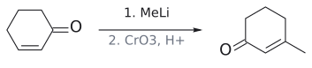

그림: 1,2-첨가로 3차 allyl alcohol을 만든 뒤 chromate ester [3,3]과 산화로 enone 위치가 옮겨 간다.

## 8. [2,3] sigmatropic rearrangement

> 개념 문서: [2,3-sigmatropic rearrangement](../../wiki/반응/2,3-시그마트로픽%20자리옮김.md), [SeO2](../../wiki/시약/SeO2.md)

### 8.1 5원자 고리 TS에는 "원자에서 출발하는 화살표"가 필요하다

[2,3] rearrangement는 5원자 고리 TS를 거친다(2 + 3 = 5). 그런데 5원자 고리를 따라 굽은 화살표 세 개를 돌리려면 하나는 **결합이 아니라 원자에서** 출발하거나 끝나야 한다. 그 원자가 탄소 anion이면 괜찮다. carbocation이거나, 산화수를 바꾸기 좋아하는 S, Se여도 된다. (출처: Clayden p.917)

### 8.2 benzyl allyl ether의 anion

benzyl allyl ether PhCH2–O–CH2–CH=CH2를 BuLi로 처리하면 benzyl 위치가 deprotonate되어 탄소 anion이 생긴다. 이 anion이 [2,3] rearrangement를 한다.

- $\mathrm{PhCH_2{-}O{-}CH_2CH{=}CH_2} \xrightarrow{1.\ \mathrm{BuLi};\ 2.\ \mathrm{H^+}} \mathrm{PhCH(OH){-}CH_2{-}CH{=}CH_2}$

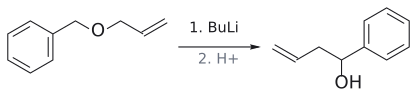

그림: benzyl 자리 carbanion(파랑)을 거친 [2,3]-Wittig rearrangement.

C–O $\sigma$ 결합을 잃고 C–C $\sigma$ 결합을 얻는 것은 손해다(C–O가 더 강하다). 그래도 반응이 가는 이유는 출발물의 **탄소 anion보다 생성물의 산소 anion(alkoxide)이 훨씬 안정** 하기 때문이다. (출처: Clayden p.917)

![benzyl allyl ether anion의 [2,3] rearrangement: 5원자 고리를 도는 화살표 셋 가운데 하나가 탄소 anion의 전자쌍에서 출발한다](../../figures/L16/wittig23_benzyl_allyl.svg)

그림: 파란색은 BuLi로 만든 benzyl 탄소 anion(비공유 전자쌍), 빨간색은 끊어지는 $O\text{–}CH_2$ $\sigma$ 결합, 초록색은 새로 생긴 C–C $\sigma$ 결합이다. 5원자 고리를 따라 화살표 셋을 돌리려면 하나는 결합이 아니라 원자에서 출발해야 한다. (1) 탄소 anion의 전자쌍이 allyl 말단 탄소와 새 $\sigma$ 결합을 만들고, (2) C=C $\pi$ 전자가 $CH\text{–}CH_2$ 사이로 옮겨 새 $\pi$ 결합이 되며, (3) $O\text{–}CH_2$ $\sigma$ 전자가 산소로 가서 alkoxide가 된다. 덜 안정한 탄소 anion이 더 안정한 산소 anion으로 바뀌는 것이 추진력이고, H⁺ 후처리로 homoallylic alcohol $PhCH(OH)\text{–}CH_2\text{–}CH=CH_2$ 가 된다. Clayden p.917의 그림을 따랐다.

### 8.3 [2,3]에서도 *E* 선택성

5원자 고리라 완전한 의자는 아니지만, 새 $\pi$ 결합이 될 부분은 의자형에 가까운 배치를 할 수 있다. 치환된 allyl alcohol로 ether를 만들어 두면 치환기 R이 적도 자리를 택해 **새 C=C가 trans가** 된다. (출처: Clayden p.917)

- 반응식

$$
\begin{aligned}& \mathrm{CH_2{=}CH{-}CH(OH){-}R} \xrightarrow{\mathrm{NaH},\ \mathrm{PhCH_2Br}} \text{benzyl ether} \cr  & \xrightarrow{1.\ \mathrm{BuLi};\ 2.\ \mathrm{H^+}} \mathrm{PhCH(OH){-}CH_2{-}CH{=}CH{-}R}\ (\mathit{E})\end{aligned}
$$

### 8.4 $\omega$ 성분: p orbital 하나를 어떻게 세나

[2,3]에는 $\pi$ 결합, $\sigma$ 결합, 그리고 **탄소 anion(p orbital 하나)이** 참여한다. Woodward–Hoffmann에서 p orbital 하나는 $\omega$ (오메가) 성분으로 쓴다. 탄소 anion은 전자 2개라 $\omega2$ , carbocation은 0개라 $\omega0$ 이다. 두 새 결합이 p orbital의 같은 lobe로 생기면 $\omega2\mathrm{s}$ , 다른 lobe로 생기면 $\omega2\mathrm{a}$ 다.

benzyl allyl ether anion의 [2,3]은 **$\omega2\mathrm{a}$ + $\sigma2\mathrm{s}$ + $\pi2\mathrm{a}$로** 기술된다. (4q+2)s는 $\sigma2\mathrm{s}$ 하나, (4r)a는 없으므로 합 1, 열적 허용이다. (출처: Clayden p.917–918)

### 8.5 황의 [2,3]: sulfenate ester와 allyl sulfoxide

S와 Se는 S(II), S(IV), S(VI)처럼 세 산화 상태를 오갈 수 있어서, 화살표가 그 원자에서 출발하고 끝나는 [2,3] rearrangement를 잘 한다. (출처: Clayden p.918)

1. 반응식

$$
\begin{aligned} & \text{allyl alcohol} + \text{PhSCl(pyridine)} \cr  & \longrightarrow \text{불안정한 sulfenate ester}\ \mathrm{R{-}CH{=}CH{-}CH_2{-}O{-}SPh} \end{aligned}
$$

2. 가열하면 [2,3] rearrangement로 **allyl sulfoxide** (S=O)가 된다. 황은 S(II)에서 S(IV)로 바뀐다.
3. allyl sulfoxide는 황이 안정화하는 anion을 만들 수 있어 염기 처리 후 RBr로 alkylation할 수 있다.
4. alkylate된 sulfoxide를 methanol 속에서 (MeO)3P와 가열하면 [2,3]이 **거꾸로** 진행해 sulfenate ester가 다시 생긴다. 평형은 sulfoxide 쪽이지만, 황을 좋아하는 (MeO)3P가 sulfenate ester를 붙잡고 methanol이 alkoxide를 바로 protonate해 allyl alcohol로 끌어낸다(부산물 PhSMe, (MeO)3P=O).

이 순환의 쓸모는 **allyl alcohol을 보통은 alkylation할 수 없는 위치에서 alkylation** 한다는 데 있다. 동시에 sigmatropic 반응이 가역적이라는 직접적인 증거이기도 하다. (출처: Clayden p.918)

### 8.6 selenium의 [2,3]: SeO2 allyl 산화

[L6](L06_Oxidation_and_Alkene_Synthesis.md)에서 본 SeO2 allyl 산화도 사실은 페리고리 반응 두 번이다. (출처: Clayden p.919)

1. **엔(ene) 반응과 비슷한 [4+2]:** SeO2가 alkene과 반응해 allyl seleninic acid이 생긴다.
2. **[2,3] rearrangement:** allyl seleninic acid은 allyl sulfoxide처럼(C–Se 결합이 더 약해서 더 쉽게) [2,3] rearrangement를 해 불안정한 Se(II) ester가 되고, 이것이 곧 분해되어 allyl alcohol이 된다.
3. 특히 methyl group의 경우 산화가 더 진행되어 aldehyde(또는 ketone)가 되기도 한다.

결과적으로 allyl 위치의 CH3가 CH2OH나 CH=O로 바뀐다. NBS allyl bromination과 결과는 비슷하지만 메커니즘은 전혀 다르다. 촉매량 SeO2와 t-BuOOH(재산화제)를 함께 쓰면 독성 있고 냄새나는 selenium 부산물을 줄일 수 있다.

## 9. [1,5] sigmatropic 수소 이동

> 개념 문서: [1,5-hydrogen shift](../../wiki/반응/1,5-수소%20이동.md)

### 9.1 숫자 "1"의 뜻: 같은 원자가 옮겨 간다

[i,j]의 한 숫자가 1이면 옛 $\sigma$ 결합과 새 $\sigma$ 결합이 **같은 원자에** 붙어 있다는 뜻이다. 즉 그 원자(또는 기)가 conjugation계를 따라 이동한다. 옮겨 가는 원자를 밝혀 [1,5]H 이동처럼 쓰기도 한다. [1,5]의 TS도 6원자 고리다(1 + 5 = 6). (출처: Clayden p.919)

대표 예가 치환 cyclopentadiene이다. 5-R-cyclopenta-1,3-diene의 C5–H가 이웃 탄소로 옮겨 간다. 번호를 셀 때는 메커니즘이 실제로 가는 방향, 즉 **5원 고리를 긴 쪽으로** 돌아 세야 1→5 관계가 된다. (출처: Clayden p.919)

![5-R-cyclopentadiene의 [1,5]H 이동: H가 이웃 탄소로 옮겨 가며 1-R 이성질체가 된다](../../figures/L16/h15_shift_cp.svg)

그림: 빨간색은 끊어지는 C5–H $\sigma$ 결합, 초록색은 새로 생긴 C1–H 결합이다. (1) C5–H $\sigma$ 전자가 H를 이웃 탄소 C1로 데려가 새 C–H 결합이 되고, (2) C1=C2 $\pi$ 전자가 C2–C3 사이로, (3) C3=C4 $\pi$ 전자가 C4–C5 사이로 옮겨 간다. 고리를 긴 쪽으로 세면 H(1)에서 C5(1)–C4(2)–C3(3)–C2(4)–C1(5)이라 [1,5]다. 옛 C–H 결합과 새 C–H 결합의 변화가 고리의 같은 면에서 연결되므로 suprafacial이다. 생성물 1-R 이성질체는 치환기가 이중결합에 붙어 더 안정하고, 같은 이동이 한 번 더 일어나면 2-R 이성질체도 생긴다. Clayden p.919–920의 그림을 따랐다.

### 9.2 왜 alkylation한 cyclopentadiene으로 DA를 하면 혼합물이 나오나

cyclopentadienyl anion은 aromatic이라 쉽게 만들고 alkylate하기도 쉽다. 그러면 "Cp⁻ alkylation → 5-R-cyclopentadiene → DA" 순서로 원하는 bicyclic 화합물을 만들 수 있을 것 같다. 그런데 실제로는 **DA 생성물 세 가지의 혼합물이** 나온다. 왜일까?

5-R 이성질체가 빠른 [1,5]H 이동으로 1-R, 2-R 이성질체와 평형을 이루기 때문이다. 게다가 1-R, 2-R 이성질체는 이중결합에 치환기가 하나 더 붙어 더 안정하므로 혼합물에서 더 많다. 그래서 처음에 의도한 5-R diene의 DA 생성물은 오히려 소량 생성물이 된다. (출처: Clayden p.919–920)

Dreiding(1983)의 분자 내 DA 예가 이를 잘 보여 준다. 단편화 반응으로 만든 치환 cyclopentadiene은 그대로 분자 내 DA를 할 것으로 보였지만, [1,5]H 이동이 더 빨라 이중결합에 치환기가 더 많은 diene으로 먼저 바뀐 뒤 DA를 했다(74%). dienophile에 ester를 conjugation시켜 DA를 빠르게 하면 대부분이 [1,5]H 이동보다 먼저 DA를 했다(54%, [1,5]H 경유 생성물 39%). 이는 **두 반응의 속도 경쟁이라는** 것을 보여 준다(→ [L13](L13_Cycloaddition_Part1.md) 5-1절, dienophile의 EWG와 속도). (출처: Clayden p.920)

### 9.3 orbital: FMO로도, Woodward–Hoffmann으로도

[1,5]H 이동은 FMO와 Woodward–Hoffmann 둘 다 쓰기 좋다. diene을 한 성분(HOMO, LUMO 또는 $\pi4$ ), C–H 결합을 다른 성분(LUMO, HOMO 또는 $\sigma2$ )으로 본다. (출처: Clayden p.920–921)

- **FMO:** diene의 LUMO( $\psi_{3}$ )와 C–H 결합의 HOMO(채워진 $\sigma$ orbital)를 겹친다. H는 구형 1s orbital만 가지므로 위상이 문제 되지 않고, $\psi_{3}$ 의 양 끝 lobe는 위상이 같아서([L13](L13_Cycloaddition_Part1.md) 7-1절) 모든 orbital이 맞는다. diene HOMO + C–H LUMO 조합으로 봐도 똑같이 성립한다.
- **Woodward–Hoffmann:** diene $\pi4$ , C–H $\sigma2$ . H의 1s orbital에는 node가 없으므로 H 쪽 끝은 **언제나 보존이다**. diene 위쪽 lobe에 양 끝을 이으면 $\pi4\mathrm{s}$ + $\sigma2\mathrm{s}$ 가 되고, (4q+2)s 하나( $\sigma2\mathrm{s}$ ), (4r)a 없음 → 합 1, 허용.

두 방법 모두 같은 그림을 준다. H 이동의 두 끝은 평면 cyclopentadiene 고리의 **같은 면**을 이용한다. 떠난 면과 같은 면으로 돌아오므로 **suprafacial 이동이다**. 고리에서 antarafacial 이동(윗면에서 떠나 아랫면으로 돌아오는 것)은 애초에 불가능하다. (출처: Clayden p.920–921)

#### [1,5]H를 실제 성분과 연결해 계산하기

보충: 이 예시에서는 이동 전 H가 붙은 탄소를 C1, 도착하는 탄소를 C5로 새로 번호 매긴다. 앞 cyclopentadiene 골격의 관용 번호와 혼용하지 않는다. C2–C5의 diene이 pi4, 옛 C1–H 결합이 sigma2 성분이다. 아래는 성분을 펼친 **연결 도식**이며 탄소 사슬의 실제 conformation이나 C–H 결합 길이를 나타내지 않는다. 다른 수소와 치환기는 이 orbital 도식에서 생략했다. (보충 근거: Clayden p.920–921)

그림: 초록 점선 두 개는 C1–C2에 생길 pi 결합의 겹침과 C5–H에 생길 sigma 결합의 겹침을 표시한다. 가운데 C3–C4에도 새 pi 결합이 생기며, 이는 pi4 성분 내부의 전자 재배치다. 두 말단 접촉이 모두 pi 성분의 위쪽이므로 pi4s다. 선택한 sigma 성분의 두 끝은 모두 retention이라 sigma2s다. (보충 근거: Clayden p.920–921)

- pi4s: 전자 수 4는 4r형이지만 **s**이므로 판정 합에 0을 더한다.
- sigma2s: 전자 수 2는 4q+2형이고 **s**이므로 1을 더한다.
- 합은 1로 홀수이므로, 이 suprafacial 경로는 **thermally orbital-symmetry-allowed**다.

반대로 같은 sigma2s 연결을 유지하면서 pi4a 경로를 시험하면, pi4a도 1이고 sigma2s도 1이어서 합이 2다. 따라서 이 antarafacial 경로는 열적으로 forbidden이다. 전자는 두 경우 모두 총 6개다. 바뀐 것은 전자 수가 아니라 두 말단의 접촉 방식이다. (보충 근거: Clayden p.921)

그림: diene LUMO psi3의 위쪽 lobe 부호는 한 위상 선택에서 +, −, −, +다. 사슬을 따라 부호가 바뀌는 node는 두 개이며 양 끝의 위상은 같다. 초록 접촉을 같은 면에 두면 occupied C–H sigma orbital과 양 끝에서 일관된 겹침을 만들 수 있다. FMO가 Woodward–Hoffmann 계산과 같은 suprafacial 결론을 주는 예다. Lobe 크기는 부호 비교를 위해 같게 그렸으며 coefficient magnitude를 정량적으로 표시한 것이 아니다. (보충 근거: Clayden p.920–921)

### 9.4 사슬형 diene에서도 일어난다

[1,5]H 이동은 cyclopentadiene에만 있는 것이 아니다. (*E*,*Z*)-diene은 *Z* 쪽 말단의 C–H가 diene 반대쪽 끝에 닿을 수 있어 [1,5]H 이동을 꽤 쉽게 하고, 그 결과 diene의 기하와 위치가 바뀐 혼합물이 생긴다. Clayden은 이것을 (*E*,*Z*)-diene을 쓴 DA 예가 드문 이유 가운데 하나로 든다(→ [L13](L13_Cycloaddition_Part1.md) 6-2절 in/out 치환기). (출처: Clayden p.921)

## 10. [1,3]H와 [1,7]H: 사슬 길이가 suprafacial/antarafacial을 바꾼다

> 개념 문서: [1,5-hydrogen shift](../../wiki/반응/1,5-수소%20이동.md), [electrocyclic reaction](../../wiki/반응/전자고리화%20반응.md)

### 10.1 열적 수소 이동 정리

[1,5]H만 suprafacial로 쉽게 일어나고 [1,3]H와 [1,7]H는 **antarafacial** 이어야 한다. Woodward–Hoffmann으로 확인하면 다음과 같다(H 쪽은 언제나 보존이므로 $\sigma2\mathrm{s}$ 로 둔다).

| 이동 | 성분 | suprafacial이면 | antarafacial이면 | 열적 결론 |
|---|---|---|---|---|
| [1,3]H | $\pi2$ + $\sigma2\mathrm{s}$ | $\pi2\mathrm{s}$ + $\sigma2\mathrm{s}$ : (4q+2)s 2개 → 금지 | $\pi2\mathrm{a}$ + $\sigma2\mathrm{s}$ : 1개 → 허용 | antarafacial만 허용, 그러나 **불가능** |
| [1,5]H | $\pi4$ + $\sigma2\mathrm{s}$ | $\pi4\mathrm{s}$ + $\sigma2\mathrm{s}$ : 1개 → 허용 | $\pi4\mathrm{a}$ + $\sigma2\mathrm{s}$ : (4r)a 1개 + $\sigma2\mathrm{s}$ 1개 = 2 → 금지 | **suprafacial, 쉬움** |
| [1,7]H | $\pi6$ + $\sigma2\mathrm{s}$ | $\pi6\mathrm{s}$ + $\sigma2\mathrm{s}$ : 2개 → 금지 | $\pi6\mathrm{a}$ + $\sigma2\mathrm{s}$ : 1개 → 허용 | **antarafacial, 가능** |

Clayden의 요약표도 같다. [1,3]H antarafacial·불가능, [1,5]H suprafacial·쉬움, [1,7]H antarafacial·가능. (출처: Clayden p.921)

- **[1,3]H가 불가능한 이유:** antarafacial이면 허용이지만, 단순 allyl 경로의 짧은 3탄소 골격에서는 필요한 antarafacial 겹침을 동시에 만들기 어렵다. Net [1,3] 이동이 관측되더라도 이 concerted 경로로 일어났는지는 별도로 판단해야 한다.
- **[1,7]H가 가능한 이유:** triene 사슬은 충분히 길고 유연해서 H가 윗면에서 떠나 아랫면으로 돌아올 수 있다. orbital로 보면 hexatriene LUMO는 node가 셋이라 양 끝 lobe 위상이 반대이고, 그래서 antarafacial 이동에서 겹침이 맞는다.

(출처: Clayden p.921)

#### [1,3]H: 규칙상 allowed여도 기하가 맞지 않는 예

보충: C1–H에서 C3–H로 옮기는 단순 allyl 경로를 생각한다. Pi 성분은 C2–C3의 pi2이고, 옛 C1–H는 sigma2다. Suprafacial로 연결하면 pi2s와 sigma2s가 각각 1씩 들어가 합 2로 금지다. Antarafacial로 바꾸면 아래처럼 pi2a는 세지 않고 sigma2s만 세어 합 1이 된다. (보충 근거: Clayden p.921)

그림: 오른쪽 초록 곡선은 H와 반대 면 lobe를 **연결하라는 요구**를 나타낸다. H가 저 곡선을 따라 실제로 이동하거나, 긴 C–H 결합으로 양쪽에 닿을 수 있다는 뜻이 아니다. 보통의 짧은 3탄소 골격은 필요한 동시 겹침을 만들기 어렵기 때문에 이 concerted 경로가 실현되지 않는다. 산·염기 촉매의 단계적 proton transfer나 다른 메커니즘으로 일어난 net [1,3] 이동은 이 그림의 concerted sigmatropic 경로와 구별한다. (보충 근거: Clayden p.921; 판정 범위 설명)

#### [1,7]H: antarafacial 겹침을 만들 수 있는 긴 사슬

보충: C1–H에서 C7–H로 이동하는 경우, C2–C7의 triene은 pi6 성분이다. Suprafacial이면 pi6s와 sigma2s가 각각 1씩 들어가 합 2다. Antarafacial이면 pi6a는 세지 않고 sigma2s만 세어 합 1이 된다. **총 8전자라도 한 성분이 antarafacial이면 열적 허용 경로가 가능하다**는 예다. (보충 근거: Clayden p.921)

그림: pi 성분의 왼쪽 끝은 위쪽, 오른쪽 끝은 아래쪽 lobe로 연결하여 pi6a가 된다. H의 1s에 inversion을 도입한 것이 아니다. 오른쪽 곡선은 접촉 상대를 표시하며, 실제로는 triene 사슬이 적절하게 휘고 비틀린 conformation에서 그 접촉을 만들어야 한다. 따라서 모든 triene이 같은 속도로 반응하거나 rigid한 고리에서도 반드시 가능한 것은 아니다. (보충 근거: Clayden p.921)

그림: triene LUMO psi4의 위쪽 lobe 부호를 +, −, −, +, +, −로 택하면 사슬을 따른 node는 세 개다. 같은 면의 양 끝 위상은 반대지만, 한쪽 끝에서 아래쪽 lobe를 택하면 초록 접촉 두 곳의 위상이 같아진다. 이것이 [1,5]H의 diene 그림과 달리 **antarafacial** 겹침이 필요한 이유다. 전체 orbital의 부호를 한꺼번에 뒤집어도 상대 위상과 결론은 같다. (보충 근거: Clayden p.921)

### 10.2 광화학 반응에서는 규칙이 뒤집힌다

[L14](L14_Cycloaddition_Part2.md) 10절에서 열적으로 금지인 [2+2]가 빛으로는 허용됐듯이, 광화학 [1,n]H 이동도 열적 규칙과 반대다. Clayden은 단단한 고리 안이라 antarafacial [1,7]H 이동을 할 수 없는 화합물이 빛을 받으면 **suprafacial로** [1,7]H 이동을 하는 예를 든다. (출처: Clayden p.896–897, p.921)

보충: 다음 비교는 **H가 retention으로 반응하는 concerted [1,n]H 경로**에 대한 선택 규칙이다. Photochemical 조건에서는 전자 배치가 달라지므로, 열적 ground-state 계산의 홀수 기준을 그대로 재사용하지 않는다. 그림의 허용 관계와 실제 기질이 그 conformation에 도달할 수 있는지는 별도로 검사한다. (보충 근거: Clayden p.896–897,921)

그림: [1,5]H는 thermal suprafacial과 photochemical antarafacial이 서로 대응하고, [1,7]H는 thermal antarafacial과 photochemical suprafacial이 대응한다. 각 작은 그림은 pi 성분의 두 말단만 표시했다. 같은 면인지 반대 면인지 직접 읽은 뒤 왼쪽의 이동 종류와 위의 조건을 확인한다. Vitamin D 경로의 마지막 [1,7]H 이동에는 thermal 조건으로 판정하며, 앞 단계에 빛이 필요했다는 이유로 마지막 H 이동을 photochemical로 바꾸지 않는다. (보충 근거: Clayden p.921–922)

### 10.3 비타민 D: [1,7]H 이동은 빛 없이 일어난다

몸이 비타민 D를 만드는 마지막 단계가 [1,7]H sigmatropic 이동이다. 프로비타민 D2가 비타민 D2로 바뀌는 이 단계는 **빛 없이 저절로** 일어나므로 열적 반응이고, 따라서 antarafacial이어야 한다. triene이 충분히 유연하므로 문제없다. 그렇다면 몸은 왜 햇빛이 필요할까? 그 앞 단계, 즉 ergosterol에서 프로비타민 D2를 만드는 고리 열림이 빛으로만 일어나는 **electrocyclic reaction** 이기 때문이다. 이 이야기는 [L17](L17_Electrocyclic_Reactions.md) 5.2절에서 이어진다.[^6] (출처: Clayden p.921–922; Wade p.693)

## 11. 한 장 정리: sigmatropic 반응의 허용 판정

> 개념 문서: [sigmatropic rearrangement](../../wiki/반응/시그마트로픽%20자리옮김.md)

| 반응 | TS 고리 | Woodward–Hoffmann 기술 | 열적 | stereochemistry의 열쇠 |
|---|---|---|---|---|
| [3,3] Claisen·Cope | 6원자(의자형) | $\pi2\mathrm{s}$ + $\sigma2\mathrm{a}$ + $\pi2\mathrm{a}$ (합 1) | 허용 | $\text{적도}\ \mathrm{R} \longrightarrow \mathit{E}\ \text{alkene}$ |
| [2,3] (탄소 anion, S, Se) | 5원자 | $\omega2\mathrm{a}$ + $\sigma2\mathrm{s}$ + $\pi2\mathrm{a}$ (합 1) | 허용 | $\text{의자형 부분} \longrightarrow \mathit{E}\ \text{alkene}$ |
| [1,5]H | 6원자 | $\pi4\mathrm{s}$ + $\sigma2\mathrm{s}$ (합 1) | suprafacial 허용 | H는 같은 면으로 |
| [1,3]H | 4원자 | $\pi2\mathrm{a}$ + $\sigma2\mathrm{s}$ (합 1) | antarafacial만 허용, 기하상 불가 | – |
| [1,7]H | 8원자 | $\pi6\mathrm{a}$ + $\sigma2\mathrm{s}$ (합 1) | antarafacial 허용, 가능 | 비타민 D |

광화학 조건에서는 suprafacial/antarafacial 결론이 뒤집힌다. (출처: Clayden p.912–913, p.918, p.921)

## 흔한 오해

- "[3,3]은 6전자, [2,3]은 5전자라서 다르다": 대괄호 숫자는 **위치 번호이고** 전자 수가 아니다. [3,3]과 [2,3] 모두 참여 전자는 6개( $\pi2$ + $\sigma2$ + $\pi2$ , 또는 $\omega2$ + $\sigma2$ + $\pi2$ )다. 이것은 cycloaddition의 [3+2]가 5전자가 아닌 것과 같은 함정이다([L15](L15_Cycloaddition_Part3.md) 흔한 오해). (출처: Clayden p.910, p.918)
- "Claisen rearrangement와 Claisen condensation은 같은 반응": 이름만 같다. Claisen condensation([L9](L09_Claisen_Condensation.md))은 ester enolate의 nucleophilic acyl substitution으로 $\beta$ -keto ester를 만드는 극성 반응이고, Claisen rearrangement는 allyl vinyl(aryl) ether의 [3,3] 페리고리 반응으로 $\gamma,\delta$-unsaturated carbonyl을 만든다. (출처: Clayden p.909, p.912)
- "Cope rearrangement와 Cope 제거는 같은 것": Cope Cope elimination은 3차 amine oxide가 고리형 TS를 거쳐 alkene과 hydroxylamine으로 쪼개지는 **제거 반응이다**. [3,3] rearrangement인 Cope rearrangement와 다르다. (출처: Wade p.908; Clayden p.913)
- "Woodward–Hoffmann으로 허용이면 그쪽으로 반응이 간다": 규칙은 정반응과 역반응을 똑같이 허용한다. 방향은 carbonyl 생성, ring strain, anion 안정성 같은 열역학이 정한다. sulfoxide ⇌ sulfenate ester의 역반응이 실제로 쓰인다는 것이 그 증거다. (출처: Clayden p.913, p.918)
- " $\sigma$ 결합은 suprafacial/antarafacial을 정할 수 없다": 큰 lobe(보존)와 작은 lobe(반전)로 정한다. 양 끝이 같으면 s, 다르면 a다. 그리고 꼬리표를 다르게 붙여도 셈의 홀짝은 같다. (출처: Clayden p.913)
- "[1,3]H는 규칙상 금지라서 안 일어난다": 열적 [1,3]H는 **antarafacial로는 허용이다**. 안 일어나는 이유는 3탄소 사슬이 너무 짧아 기하학적으로 불가능하기 때문이다. [L14](L14_Cycloaddition_Part2.md)의 $\pi2\mathrm{s}$ + $\pi2\mathrm{a}$ [2+2]가 "허용이지만 일어나지 않는" 것과 같은 구조다. (출처: Clayden p.921)
- "[1,5]H 이동은 cyclopentadiene에서만 일어난다": (*E*,*Z*)-diene 같은 사슬형 계에서도 쉽게 일어난다. (출처: Clayden p.921)
- "비타민 D 합성의 [1,7]H 이동에 빛이 필요하다": 빛이 필요한 것은 그 앞의 electrocyclic reaction 고리 열림이고, [1,7]H 이동 자체는 열적(antarafacial)이다. (출처: Clayden p.921–922)

## 반응별 조건과 추진력

### aromatic Claisen

 $\text{allyl aryl ether} \longrightarrow \mathit{o}\ \text{-allylphenol}$

- 조건: 가열
- 추진력: aromaticity tautomerization
- stereochemistry: allyl group inside-out
- 출처: Clayden p.909–910

### 지방족 Claisen

 $\text{allyl vinyl ether} \longrightarrow \gamma,\delta\ \text{-unsaturated aldehyde}$

- 조건: 가열
- 추진력: C=O 생성
- stereochemistry: 의자형 TS, *E*
- 출처: p.910–911

### acetal 교환 + Claisen

 $\text{allyl alcohol} + \mathrm{MeCH(OMe)_2} \longrightarrow \gamma,\delta\ \text{-unsaturated aldehyde}$

- 조건: EtCO2H, 가열(MeOH 증류)
- 추진력: 위와 같음
- stereochemistry: *E*
- 출처: p.911

### orthoester·orthoamide 변형

allyl alcohol을 $\mathrm{RC(OMe)_3}$ 또는 DMF dimethyl acetal과 반응시키면 각각 $\gamma,\delta$-unsaturated ester 또는 amide를 얻는다.

- 조건: 산, 가열
- 추진력: 위와 같음
- stereochemistry: –
- 출처: p.912

### Cope(모체)

 $\text{hexa-1,5-diene} \longrightarrow \text{자기 자신}$

- 조건: 가열
- 추진력: 없음(축퇴)
- stereochemistry: –
- 출처: p.913

### oxy-Cope

 $\text{hexa-1,5-diene-3-ol} \longrightarrow \text{hex-5-enal}$

- 조건: 가열(느림)
- 추진력: enol → C=O
- stereochemistry: –
- 출처: p.913–914

### anion oxy-Cope

같은 alcohol → potassium enolate → aldehyde

- 조건: KH, 가열; H⁺/H2O
- 추진력: enolate 안정화
- stereochemistry: 빠름
- 출처: p.914

### Ireland–Claisen

 $\text{allyl ester} \longrightarrow \gamma,\delta\ \text{-unsaturated carboxylic acid}$

- 조건: LDA(필요하면 Me3SiCl); H⁺/H2O
- 추진력: carboxylate 생성
- stereochemistry: *E*
- 출처: p.914

### 긴장 해소 Cope

 $\text{3원 고리 포함 1,5-diene} \longrightarrow \text{고리 확장 생성물}$

- 조건: 33 °C, 36 h (100%)
- 추진력: ring strain 해소
- stereochemistry: –
- 출처: p.915

### 시트랄 합성

enol ether → (Claisen) → (Cope) → 시트랄

- 조건: 가열
- 추진력: C=O, conjugation, 삼치환 alkene
- stereochemistry: –
- 출처: p.915

### 피셔 인돌

phenylhydrazone(enamine형) → diimine → indole

- 조건: 약산, 가열
- 추진력: 약한 N–N 절단, aromatic화
- stereochemistry: –
- 출처: p.916

### chromate ester [3,3]

 $\text{3차 allyl alcohol} \longrightarrow \text{자리 옮긴 enone}$

- 조건: CrO3, H⁺
- 추진력: Cr(VI) 산화
- stereochemistry: –
- 출처: p.916–917

### [2,3] 탄소 anion

 $\text{benzyl allyl ether} \longrightarrow \text{호모allyl alcohol}$

- 조건: BuLi; H⁺
- 추진력: 탄소 anion → alkoxide
- stereochemistry: *E*
- 출처: p.917

### [2,3] 황

allyl alcohol → sulfenate ester → allyl sulfoxide

- 조건: PhSCl, pyridine
- 추진력: S=O 생성
- stereochemistry: –
- 출처: p.918

### 역 [2,3] 황

 $\text{alkylate된 allyl sulfoxide} \longrightarrow \text{allyl alcohol}$

- 조건: (MeO)3P, MeOH
- 추진력: 친황 포획
- stereochemistry: –
- 출처: p.918

### SeO2 allyl 산화

 $\text{alkene} \longrightarrow \text{allyl alcohol}\ \mathrm{/}\ \text{엔알}$

- 조건: SeO2 (촉매 + t-BuOOH)
- 추진력: ene reaction 후 [2,3]
- stereochemistry: –
- 출처: p.919

### [1,5]H 이동

 $\text{5-R-cyclopentadiene} \rightleftharpoons \mathrm{1{-}R},\ \mathrm{2{-}R}\ \text{이성질체}$

- 조건: 빠른 평형(DA보다 빠를 수 있음)
- 추진력: 더 치환된 diene
- stereochemistry: suprafacial
- 출처: p.919–921

### [1,7]H 이동

프로비타민 D2 → 비타민 D2

- 조건: 열(빛 불필요)
- 추진력: –
- stereochemistry: antarafacial
- 출처: p.921–922

(보충 근거: Clayden p.909–922; 강의 대조: L16 p.4–25)

## 자가 점검 문제

1. 다음 반응을 [i,j]로 분류하고 TS 고리 크기를 쓰라. (a) 2-allylphenol을 주는 allyl phenyl ether의 첫 단계, (b) BuLi로 만든 benzyl allyl ether anion의 rearrangement, (c) 5-methylcyclopentadiene이 1-methylcyclopentadiene으로 바뀌는 과정, (d) 프로비타민 D2 → 비타민 D2.

2. (*E*)-뷰트-2-엔일 phenyl ether PhO–CH2–CH=CH–CH3를 가열했다. [3,3] 단계 직후의 intermediate와 최종 생성물을 쓰고, methyl group이 어느 탄소에 놓이는지 설명하라.

3. 펜트-1-ene-3-ol CH2=CH–CH(OH)–CH2CH3를 (a) MeCH(OMe)2, (b) MeC(OMe)3와 각각 propanoic acid 촉매로 가열했다. 각 생성물의 구조와 이중결합의 기하를 쓰고, 기하가 그렇게 정해지는 이유를 설명하라.

4. hexa-1,5-diene-3-ol을 그냥 가열할 때와 KH로 먼저 처리한 뒤 가열할 때를 비교하라. 두 경우의 [3,3] 직후 생성물, 최종 생성물(후처리 포함), 속도 차이의 이유를 쓰라.

5. (a) [1,5]H 이동을 $\pi4$ + $\sigma2$ 로 놓고 Woodward–Hoffmann 셈을 해서 suprafacial 이동이 열적으로 허용됨을 보이라. (b) 같은 방식으로 열적 [1,3]H 이동이 어떤 조건에서 허용되는지 구하고, 그런데도 실제로 일어나지 않는 이유를 쓰라.

6. 5-benzylcyclopentadiene을 만든 뒤 바로 DMAD(MeO2C–C≡C–CO2Me)와 반응시켰더니 DA 생성물 세 가지가 섞여 나왔다. 이유를 설명하고, 의도한 생성물이 주생성물이 되지 않는 이유도 쓰라.

---

## 해설

1. (a) [3,3], 6원자 고리 TS. 옛 O–CH2 결합 양 끝을 1로 두면 새 C–C 결합은 고리의 *ortho* 탄소(3)와 allyl 말단 탄소(3) 사이에 생긴다. (b) [2,3], 5원자 고리 TS. 탄소 anion(2번)과 allyl 말단(3번)이 이어진다. (c) [1,5]H, 6원자 고리 TS. 같은 H가 옛 결합과 새 결합의 한쪽 끝(1)이고, 고리를 긴 쪽으로 돌아 5번 탄소에 붙는다(여러 번 일어나면 2-methyl 이성질체도 생긴다). (d) [1,7]H, 8원자 고리 TS, 열적 antarafacial 이동. (출처: Clayden p.909–910, p.917, p.919, p.921)

2. [3,3] 직후에는 aromaticity를 잃은 6-치환 cyclohexa-2,4-diene온이 생기고, tautomerization으로 2-(뷰트-3-ene-2-일)phenol *o*-C6H4(OH)–CH(CH3)–CH=CH2가 된다. allyl group이 inside-out으로 붙으므로 산소에 붙어 있던 CH2가 아니라 반대쪽 끝, 즉 CH3가 달린 탄소가 고리와 결합한다. 그래서 methyl은 고리에 붙은 탄소에 놓이고 말단 vinyl기가 남는다. (출처: Clayden p.909–910의 prenyl 예를 바꿈)

3. (a) acetal 교환으로 CH2=CH–O–CH(Et)–CH=CH2가 생기고, [3,3] rearrangement로 (*E*)-헵트-4-enal OHC–CH2–CH2–CH=CH–CH2CH3이 된다. (b) orthoester에서는 MeO–C(=CH2)–O–CH(Et)–CH=CH2(ketene acetal)를 거쳐 methyl (*E*)-헵트-4-엔오에이트 MeO2C–CH2–CH2–CH=CH–Et가 된다. 두 경우 모두 의자형 TS에서 Et가 적도 자리를 택하고 그 배치가 그대로 새 C=C로 넘어가므로 *E*가 우세하다. 추진력은 C=O 생성이다. (출처: Clayden p.910–912)

4. 중성: [3,3] 직후 enol HO–CH=CH–CH2–CH2–CH=CH2가 생기고 tautomerization으로 hex-5-enal이 된다. 느리다. KH 처리: alkoxide가 [3,3]을 해서 칼륨 enolate가 생기고, H⁺/H2O 후처리로 같은 hex-5-enal이 된다. enolate가 alkoxide보다 안정하고, TS에서부터 O⁻와 새 $\pi$ 결합의 conjugation이 자라므로 훨씬 빠르다. (출처: Clayden p.913–914)

5. (a) diene 윗면 lobe에 양 끝을 이으면 $\pi4\mathrm{s}$ , H는 1s orbital이라 언제나 보존이므로 C–H는 $\sigma2\mathrm{s}$ . (4q+2)s = 1( $\sigma2\mathrm{s}$ ), (4r)a = 0 → 합 1(홀수), 허용. (b) [1,3]H는 $\pi2$ + $\sigma2\mathrm{s}$ . suprafacial( $\pi2\mathrm{s}$ )이면 (4q+2)s가 2개라 금지, antarafacial( $\pi2\mathrm{a}$ )이면 $\sigma2\mathrm{s}$ 하나뿐이라 합 1, 허용. 즉 antarafacial이면 허용이지만 3탄소 사슬이 짧고 단단해 H가 반대 면으로 갈 수 없어 실제로는 불가능하다. (출처: Clayden p.920–921)

6. 5-benzyl 이성질체는 빠른 suprafacial [1,5]H 이동으로 1-benzyl, 2-benzyl 이성질체와 평형을 이룬다. 세 diene이 모두 DMAD와 DA를 하므로 생성물이 셋이다. 1-, 2-치환 이성질체는 이중결합에 치환기가 붙어 더 안정하므로 혼합물 속에 더 많고, 그래서 5-치환 diene에서 나온 의도한 생성물은 오히려 소량이 된다. DA를 [1,5]H 이동보다 빠르게 만들면(더 반응성 큰 dienophile) 이 경쟁을 줄일 수 있다. (출처: Clayden p.919–920)

## 각주

[^1]: Clayden은 이 구분을 35장 electrocyclic reaction 절의 상자로 정리한다. cycloaddition과 그 역반응을 한데 묶어 sigma 결합 수의 변화가 ±2로 쓰는 식이다. (출처: Clayden p.922)
[^2]: [1,3]H 이동은 4원자, [1,7]H 이동은 8원자 고리 TS를 거치는 셈이다. 이 크기 차이가 10절의 "suprafacial이냐 antarafacial이냐, 그리고 기하학적으로 가능하냐"를 가른다. (출처: Clayden p.917, p.921)
[^3]: Clayden은 이 acetal 교환에서 첫 methanol은 SN1, 두 번째는 E1로 떨어진다고 강조하고 "acetal에서는 절대 SN2 메커니즘을 쓰지 말라"고 덧붙인다. protonate된 OR이나 OH가 떨어지는 단계가 acetal 화학의 중심이다. (출처: Clayden p.911)
[^4]: Clayden은 [3,3] rearrangement를 FMO로 다루는 방법이 궁금하면 Ian Fleming의 *Frontier Orbitals and Organic Chemical Reactions*(2판, 2009)를 보라고 하고, [1,5] rearrangement에서는 FMO 접근도 함께 쓴다. (출처: Clayden p.913)
[^5]: 1995년에 발표된 결과로, 그전까지 pheromone으로 알려졌던 ectocarpene이 사실은 비활성이고 진짜 pheromone은 cyclopropane 화합물이라는 것이 밝혀졌다. 스스로 몇 분 만에 꺼지는 신호라서 바닷물을 쓸모없는 pheromone으로 채우지 않고 정확한 순간만 알릴 수 있다. (출처: Clayden p.915)
[^6]: Clayden은 ergosterol → 프로비타민 D2 → 비타민 D2(D2 계열)로, Wade는 7-dehydrocholesterol → 프로비타민 D3(D3 계열)로 설명한다. 출발 sterol과 곁사슬이 다를 뿐, "햇빛이 필요한 페리고리 고리 열림"이라는 핵심은 같다. Wade는 햇빛을 덜 받는 추운 지방 아이들의 rickets을 예로 든다. (출처: Clayden p.921–922; Wade p.693)
