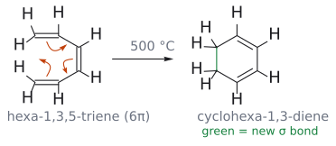
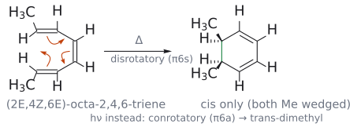
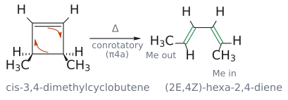
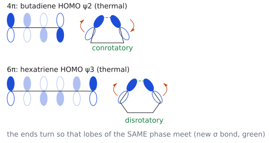
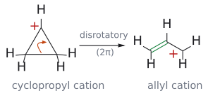

# L17. 전자고리화 반응 (Electrocyclic reactions)

> **통독본**: 2026-10-12 재구성 직전의 강의별 전체 노트(교과서 보강 포함)를 그대로 보존한 사본이다. 강의 흐름대로 한 번에 읽을 때 쓴다. 이후의 수정과 보충은 개념 문서에만 반영되므로, **최신 내용은 개념 문서**가 기준이다. 뼈대 노트: [L17 뼈대](../L17_Electrocyclic_Reactions.md) · [위키 대문](../../wiki/위키%20대문.md)

> **관련 위키 문서** ([위키 대문](../../wiki/위키%20대문.md))
> - 반응: [Nazarov cyclization](../../wiki/반응/나자로프%20고리화.md), [electrocyclic reaction](../../wiki/반응/전자고리화%20반응.md), [Cope rearrangement](../../wiki/반응/코프%20자리옮김.md)
> - 개념: [conrotatory and disrotatory](../../wiki/개념/콘로테이션과%20디스로테이션.md)

> 이 노트는 슬라이드 공개 전에 Clayden 2판 35장과 Wade 8판으로 만든 **예습판**이다. 강의 슬라이드가 나오면 슬라이드 기준으로 다시 정리한다. 슬라이드와 다르면 슬라이드를 따른다.

CM3121 Advanced Organic Chemistry (10/21 강의 예습)

## 개요

페리고리 반응 세 갈래 가운데 마지막이 전자고리화 반응(electrocyclic reaction)이다. cycloaddition([L13](L13_Cycloaddition_Part1.md)–[L15](L15_Cycloaddition_Part3.md))는 두 π계가 만나 σ 결합 둘을 만들고, 시그마트로픽 자리옮김([L16](L16_Sigmatropic_Rearrangements.md))은 σ 결합 하나를 옮긴다. 전자고리화 반응은 **하나의 콘쥬게이션 π계 양 끝을 σ 결합 하나로 잇거나, 그 반대로 끊는다**.

이 갈래가 특별한 이유는 입체화학에 있다. 평면 폴리엔이 고리가 되려면 양 끝 탄소가 거의 90° 돌아야 하는데, 두 끝이 **같은 방향으로 conrotatory 반대 방향으로 disrotatory**에 따라 생성물의 입체이성질체가 달라진다. 그리고 어느 쪽으로 돌지는 전자 수(4n이냐 4n+2냐)와 조건(열이냐 빛이냐)이 정확히 정한다. 시험에서 가장 자주 묻는 것도 이 판정이다.

이 노트는 다음 순서로 간다. 전자고리화 반응은 무엇이고 어느 방향이 유리한가? Woodward–Hoffmann 규칙으로 판정하면 왜 4π는 대면, 6π는 초면인가? 그것이 왜 conrotatory/disrotatory이라는 말로 바뀌나? HOMO의 양 끝 위상으로도 같은 답이 나오나? 빛을 쬐면 왜 뒤집히나? 마지막으로 cation(Nazarov cyclization)과 anion, 작은 고리의 열림(cyclopropyl cation, 아지리딘), 천연물 합성의 예를 본다.[^1] (출처: Clayden p.922–923)

## 1. 전자고리화 반응이란 무엇인가

> 개념 문서: [electrocyclic reaction](../../wiki/반응/전자고리화%20반응.md)

### 1.1 정의와 다른 두 갈래와의 차이

Clayden의 정의는 한 줄이다. **콘쥬게이션 폴리엔의 양 끝을 가로지르는 새 σ 결합이 생기는 반응, 또는 그 역반응.** 고리가 늘 생기거나 깨진다. cycloaddition도 고리를 만들지만 σ 결합이 **둘** 생기고, 시그마트로픽 자리옮김은 하나가 생기면서 하나가 끊어진다. 전자고리화 반응은 σ 결합이 **하나만** 생기거나 끊어진다(Δσ = ±1). (출처: Clayden p.922–923)

| 갈래 | σ 결합 변화 | 참여하는 π계 | 대표 예 |
|---|---|---|---|
| cycloaddition | ±2 | 둘 이상 | Diels–Alder |
| 시그마트로픽 자리옮김 | 0 | (σ 결합 + π계) | Claisen, Cope, [1,5]H |
| 전자고리화 반응 | ±1 | 하나 | hexatriene 고리 닫힘 |

"전자고리화(electrocyclic)"와 "페리고리(pericyclic)"를 혼동하지 말아야 한다. 페리고리는 전체 집안 이름이고, 전자고리화는 그 세 식구 중 하나다. (출처: Clayden p.923)

### 1.2 어느 방향이 유리한가: 결합 에너지와 고리 긴장

Woodward–Hoffmann 규칙은 반응이 **허용되는지만** 알려 주고 어느 방향으로 가는지는 알려 주지 않는다([L16](L16_Sigmatropic_Rearrangements.md) 5절과 같은 이야기다). 방향은 열역학이 정한다. (출처: Clayden p.922–923)

- **hexatriene → cyclohexa-1,3-diene (500 °C):** 고리가 **닫힌다**. 잃는 π 결합보다 새로 생기는 σ 결합이 강하기 때문이다.
- **cyclobutene → 뷰타-1,3-diene (200 °C):** 고리가 **열린다**. 4원 고리의 긴장이 σ 결합 하나의 이득보다 크다.
- **cycloheptatriene ⇌ norcaradiene:** 3원 고리 긴장 해소와 "π 결합 대신 σ 결합"의 이득이 거의 정확히 비긴다. 보통은 cycloheptatriene이 많지만 치환 양식에 따라 norcaradiene이 우세하기도 하다.

*그림: 굽은 화살표(주황) 세 개가 고리를 따라 한 방향으로 돈다. 한쪽 끝 π 결합의 전자가 양 끝 탄소(C1, C6) 사이에 새 σ 결합(초록)을 만들고, 나머지 두 π 결합은 한 칸씩 옮겨 가 cyclohexa-1,3-diene의 두 C=C가 된다. 화살표를 모두 반대 방향으로 돌려 그려도 같은 반응이다. 500 °C에서 고리가 닫히는 쪽이 유리한 것은 잃는 π 결합보다 새 σ 결합이 강하기 때문이다. (근거: Clayden p.922)*

규칙을 적용할 때는 고리 열림이 유리한 반응이라도 **고리 닫힘 쪽으로 생각하는 것이 대개 쉽다**. 정반응이 허용이면 역반응도 허용이므로 결론은 같다. (출처: Clayden p.923)

## 2. Woodward–Hoffmann 규칙으로 판정하기

> 개념 문서: [electrocyclic reaction](../../wiki/반응/전자고리화%20반응.md), [Woodward–Hoffmann rules](../../wiki/개념/우드워드-호프만%20규칙.md), [conrotatory and disrotatory](../../wiki/개념/콘로테이션과%20디스로테이션.md)

### 2.1 왜 FMO가 아니라 Woodward–Hoffmann인가

cycloaddition과 시그마트로픽 반응은 HOMO–LUMO 논리와 Woodward–Hoffmann 규칙 중 편한 것을 골라 쓸 수 있었다. 전자고리화 반응, 적어도 고리 닫힘은 **분자 오비탈이 하나만** 관여하므로 두 오비탈을 겹치는 FMO 논리를 그대로 쓰기 어렵다. 그래서 Clayden은 여기서는 Woodward–Hoffmann 규칙을 쓰라고 한다(HOMO 하나의 대칭으로 보는 방법은 4절에서 보충한다). 규칙은 L13 8절과 같다. **열적 페리고리 반응에서는 (4q+2)s 성분 수와 (4r)a 성분 수의 합이 홀수여야 한다.** (출처: Clayden p.923)

### 2.2 hexatriene(6π): 초면이면 허용

hexatriene은 π6 성분 하나다. 고리가 닫히려면 양 끝 p 오비탈이 90° 돌아 σ 결합을 만들어야 한다. (출처: Clayden p.923)

1. 메커니즘을 그린다.
2. 성분: π6 하나.
3. 양 끝에만 오비탈을 그린다.
4. 새 결합이 생길 곳을 잇는다. 양 끝의 **윗면 로브끼리** 잇는다.
5. 같은 면끼리 이었으므로 **π6s**.
6. (4q+2)s = 1, (4r)a = 0 → 합 1 → **열적 허용**.

### 2.3 butadiene(4π): 초면이면 금지, 대면이면 허용

cyclobutene의 고리 열림은 실제로 잘 일어난다. 역반응인 butadiene의 고리 닫힘으로 같은 절차를 밟아 보자. (출처: Clayden p.924)

- **처음 시도:** 양 끝 윗면 로브끼리 이으면 **π4s**. (4q+2)s도 (4r)a도 없어 합 0 → 금지. 그런데 반응은 실제로 일어난다. 무엇이 잘못됐을까? 규칙이 아니라 **오비탈을 잇는 방식**이 잘못됐다.
- **다시 시도:** 한쪽 끝은 윗면 로브, 다른 끝은 아랫면 로브로 이으면 **π4a**. (4r)a = 1 → 합 1 → **열적 허용**.

이 논리를 넓히면 결론은 간단하다. **모든 전자고리화 반응은 허용된다.** 다만 (4n+2)π계는 **초면**으로, (4n)π계는 **대면**으로 자기 자신과 반응하도록 그려야 한다. (출처: Clayden p.924)

### 2.4 그래서 무엇이 달라지나

"어떻게 그리든 허용되는 방식이 하나는 있다"면 이 판정이 무슨 쓸모가 있을까? 양 끝에 치환기가 있으면 **초면이냐 대면이냐가 생성물의 입체화학을 바꾼다.** 그것이 3절의 conrotatory/disrotatory이다. (출처: Clayden p.924)

## 3. conrotatory과 disrotatory

> 개념 문서: [conrotatory and disrotatory](../../wiki/개념/콘로테이션과%20디스로테이션.md)

### 3.1 octatriene: 6π 열적 반응은 disrotatory

(2*E*,4*Z*,6*E*)-옥타-2,4,6-triene을 가열하면 고리가 닫혀 5,6-dimethylcyclohexa-1,3-diene이 된다. 두 가지 그림을 비교해 보자. (출처: Clayden p.924–925)

- **π6s (허용):** 양 끝 윗면 로브가 만나도록 두 methyl이 **모두 위로** 돈다. 생성물에서 두 Me는 **syn(cis)**이다.
- **π6a (금지):** 한쪽 methyl은 위로, 다른 쪽은 아래로 돈다. 생성물에서 두 Me는 anti(trans)일 것이다.

실제로는 **cis 이성질체만** 생긴다. 반응이 초면이라는 명백한 증거다. (출처: Clayden p.924–925)

*그림: (2E,4Z,6E)-octa-2,4,6-triene을 U자형으로 그렸다. E 배치라 두 Me는 바깥쪽, 두 말단 H는 안쪽을 향한다. 굽은 화살표(주황) 세 개로 양 끝 사이에 새 σ 결합(초록)이 생긴다. 열적 6π 반응은 disrotatory(π6s)라 두 Me가 고리 면의 같은 쪽으로 돌아, 생성물에서 두 Me는 모두 쐐기(cis), 두 H는 모두 점선이 된다. 빛을 쬐면 conrotatory(π6a)가 되어 trans-dimethyl 생성물이 생긴다. (근거: Clayden p.924–925, p.927)*

### 3.2 cyclobutene: 4π 열적 반응은 conrotatory

cis-3,4-dimethylcyclobutene을 가열하면 (*E*,*Z*)-헥사-2,4-diene **한 가지 입체이성질체만** 생긴다.[^2] 역반응으로 그려 보면, (*E*,*Z*)-diene의 양 끝이 π4a 방식으로 겹쳐야 두 Me가 cis인 cyclobutene이 된다. 즉 반응은 대면이다. (출처: Clayden p.925)

*그림: cis-3,4-dimethylcyclobutene(두 Me가 모두 쐐기)의 고리 열림. 아래쪽 주황 화살표는 끊어지는 C3–C4 σ 결합의 전자가 왼쪽 C=C π 결합이 되는 것, 위쪽 화살표는 원래의 C1=C2 π 결합이 오른쪽 C=C로 옮겨 가는 것이다. 새로 생긴 두 π 결합은 초록이다. 열적 4π 반응은 conrotatory(π4a)라 두 끝이 같은 회전 방향으로 돌고, 그 결과 한 Me는 바깥(E), 다른 Me는 안쪽(Z)으로 가서 (2E,4Z)-hexa-2,4-diene 한 가지만 생긴다. 생성물은 고리와의 대응이 보이도록 s-cis 형태로 그렸다. (근거: Clayden p.922, p.925)*

### 3.3 이름 붙이기: "같은 방향으로 도느냐"

Clayden은 치환기가 움직이는 방향을 초록 화살표로 표시하고 이렇게 이름 붙인다. (출처: Clayden p.925)

- **disrotatory:** 한 끝은 시계 방향, 다른 끝은 반시계 방향으로 돈다. octatriene에서는 두 Me가 "모두 위로" 가지만, 양 끝에서 보면 회전 방향은 서로 반대다. 허용된 **초면** 6π 반응이 이것이다.
- **conrotatory:** 두 끝이 **같은 회전 방향**(둘 다 시계 방향, 또는 둘 다 반시계 방향)으로 돈다. 허용된 **대면** 4π 반응이 이것이다.

"둘 다 위로 간다 = 같은 방향"이라고 착각하기 쉬우니 **회전 방향(시계/반시계)**으로 세야 한다는 점에 주의한다.

### 3.4 전자고리화 반응의 규칙

Clayden의 요약 상자를 옮기면 다음과 같다. (출처: Clayden p.925)

- 모든 전자고리화 반응은 허용된다.
- (4n+2)π 전자가 참여하는 **열적** 전자고리화 반응은 **disrotatory**이다.
- (4n)π 전자가 참여하는 **열적** 전자고리화 반응은 **conrotatory**이다.
- conrotatory에서는 두 기가 같은 회전 방향(둘 다 시계 또는 둘 다 반시계)으로 돈다.
- disrotatory에서는 하나는 시계, 하나는 반시계 방향으로 돈다.

### 3.5 왜 전자고리화 반응만 따로 조심해야 하나

cycloaddition과 시그마트로픽 반응에서도 결합각이 109°와 120° 사이에서 바뀌며 조금씩 회전은 있다. 하지만 전자고리화 반응에서는 평면 폴리엔이 고리가 되면서 **거의 90°**를 돈다. 이 큰 회전의 방향이 입체화학을 정하므로, 다른 페리고리 반응과 섞지 말고 따로 판정해야 한다. (출처: Clayden p.925)

## 4. HOMO 대칭으로 다시 보기

> 개념 문서: [conrotatory and disrotatory](../../wiki/개념/콘로테이션과%20디스로테이션.md), [frontier molecular orbital](../../wiki/개념/프런티어%20분자%20오비탈.md)

> 보충: Clayden은 전자고리화 반응을 Woodward–Hoffmann 셈으로만 다루고, HOMO 하나의 양 끝 위상으로 판정하는 방법은 쓰지 않는다. 아래는 Wade가 그린 butadiene·hexatriene π 분자 오비탈의 위상 배열과 Clayden의 결론(3.4절, 5절)을 맞대어 본 것이다. 결론은 두 교과서의 규칙과 같다. (보충 근거: Wade p.671–672, p.698; Clayden p.925–927)

### 4.1 생각의 틀: 고리를 닫는 것은 HOMO의 양 끝이다

새 σ 결합은 폴리엔 양 끝 p 오비탈이 돌아서 만난다. 결합성으로 만나려면 **같은 위상의 로브끼리** 마주 봐야 한다. 그래서 가장 높은 에너지의 전자가 들어 있는 HOMO의 **양 끝 로브 위상**을 보면 어느 쪽으로 돌아야 하는지 알 수 있다.

- 양 끝 위상이 **반대**(위쪽 로브가 한쪽은 +, 다른 쪽은 −)면, 한쪽 끝을 뒤집어야 같은 위상끼리 만난다 → **conrotatory**
- 양 끝 위상이 **같으면**, 둘이 거울상으로 돌아야 같은 위상끼리 만난다 → **disrotatory**

### 4.2 열적 반응: 바닥 상태의 HOMO

| π계 | 전자 수 | HOMO | 위쪽 로브 위상(C1 → 끝) | 양 끝 | 회전 |
|---|---|---|---|---|---|
| butadiene | 4 | ψ2 | + + − − | 반대 | conrotatory |
| hexatriene | 6 | ψ3 | + + − − + + | 같음 | disrotatory |

butadiene ψ2의 양 끝 위상이 반대라는 것은 [L13](L13_Cycloaddition_Part1.md) 7-1절에서 이미 본 사실이다. (보충 근거: Wade p.672, p.698)

*그림: 왼쪽은 HOMO의 위상(채움 +, 빈 것 −; 흐린 로브는 가운데 탄소). 4π의 ψ₂는 양 끝의 위쪽 로브 위상이 반대라 두 끝이 같은 방향으로 돌아야(conrotatory) 같은 위상끼리 만난다. 6π의 ψ₃는 양 끝 위상이 같아서 반대 방향으로 돌아야(disrotatory) 한다. 주황 화살표는 회전 방향, 초록 점선은 새 σ 결합이다. 보충: 슬라이드의 HOMO 대칭 논리를 그림으로 옮긴 것이다.*

### 4.3 광화학 반응: 들뜬 상태의 HOMO

빛을 받으면 전자 하나가 HOMO에서 LUMO로 올라가고, 원래 LUMO가 들뜬 상태의 새 HOMO(HOMO*)가 된다. 이것은 [L14](L14_Cycloaddition_Part2.md) 10절의 광화학 [2+2]와 같은 논리다. (보충 근거: Wade p.694–695)

| π계 | 들뜬 상태 HOMO* | 위쪽 로브 위상 | 양 끝 | 회전 |
|---|---|---|---|---|
| butadiene | ψ3* | + − − + | 같음 | disrotatory |
| hexatriene | ψ4* | + − − + + − | 반대 | conrotatory |

HOMO가 한 단계 위의 오비탈로 바뀌면 양 끝 위상 관계가 뒤집히므로, **빛을 쬐면 콘/디스가 뒤바뀐다**. 이것이 5절에서 볼 Clayden의 결론과 정확히 맞는다. (보충 근거: Wade p.698; Clayden p.926–927)

## 5. 광화학 전자고리화 반응: 규칙이 뒤집힌다

> 개념 문서: [conrotatory and disrotatory](../../wiki/개념/콘로테이션과%20디스로테이션.md), [electrocyclic reaction](../../wiki/반응/전자고리화%20반응.md), [1,5-hydrogen shift](../../wiki/반응/1,5-수소%20이동.md)

### 5.1 한 장 판정표

cycloaddition과 시그마트로픽 반응에서 이미 봤듯이, 광화학 조건에서는 콘/디스 규칙이 뒤집힌다. octatriene의 경우, 가열하면 π6s disrotatory으로 cis-dimethyl 생성물이, 빛을 쬐면 π6a conrotatory으로 trans-dimethyl 생성물이 생긴다. (출처: Clayden p.926–927)

| π 전자 수 | 열(Δ) | 빛(hν) |
|---|---|---|
| 4n (4, 8, …) | conrotatory (π4a) | disrotatory (π4s) |
| 4n+2 (2, 6, …) | disrotatory (π6s) | conrotatory (π6a) |

외우는 요령: **"4n·열·콘"** 하나만 기억하고, 전자 수나 조건 중 하나가 바뀌면 뒤집고, 둘 다 바뀌면 그대로 둔다. 이는 [L15](L15_Cycloaddition_Part3.md) 최종 정리의 "열적으로는 4n+2, 광화학적으로는 4n"과 같은 구조다.

### 5.2 비타민 D: 햇빛이 필요한 이유

[L16](L16_Sigmatropic_Rearrangements.md) 10.3절에서 남겨 둔 질문으로 돌아가자. ergosterol의 B 고리(cyclohexadiene)는 햇빛을 받아 6π 전자고리화 **고리 열림**을 하여 프로비타민 D2(triene)가 된다. 이 반응은 페리고리이지만 cycloaddition(π계가 하나뿐)도 시그마트로픽(σ 결합이 옮겨지지 않고 끊어진다)도 아니다. (출처: Clayden p.922)

출발물과 생성물을 비교하면 이 반응은 **conrotatory**이다. 6π의 광화학 반응이니 5.1절 표와 맞는다. 그런데 이것은 표만이 아니라 구조로도 강제된다. 열적 6π disrotatory으로 열리면 두 6원 고리 중 하나에 **불가능한 트랜스 이중결합**이 들어가야 한다. 그래서 이 고리 열림은 빛으로만 일어나고, 햇빛이 몇 달씩 부족한 지역에 비타민 D 결핍이 흔한 것도 결국 오비탈 대칭 때문이다. 그다음 단계인 프로비타민 D2 → 비타민 D2는 열적 대면 [1,7]H 이동이다. (출처: Clayden p.921–922, p.927)

Wade는 같은 이야기를 7-dehydrocholesterol → 프로비타민 D3로 소개하고, 햇빛을 덜 받는 추운 지방 아이들이 구루병에 걸리기 쉽다고 덧붙인다. (출처: Wade p.693)

## 6. 자연 속 전자고리화 반응: endiandric acid

> 개념 문서: [electrocyclic reaction](../../wiki/반응/전자고리화%20반응.md), [Diels–Alder reaction](../../wiki/반응/딜스-알더%20반응.md)

endiandric acid 계열 천연물은 특이하게도 **라세미체**로 발견된다. 대부분의 키랄 천연물은 거울상 순수한 효소가 만들어 거울상 순수(또는 농축)하므로, 라세미체라는 것은 효소 없이 고리화가 일어났다는 단서였다. 발견자 Black은 1980년대 초에 사슬형 폴리엔 전구체에서 전자고리화 반응이 연달아 일어난다고 제안했다. (출처: Clayden p.925)

1. **8π conrotatory, π8a:** 사슬형 tetraene 부분이 cyclooctatriene으로 닫힌다. 4n(8)π의 열적 반응이므로 conrotatory이고, 그 결과 두 곁사슬이 trans로 놓인다.
2. **6π disrotatory, π6s:** cyclooctatriene 안의 새 6π계가 닫혀 이환[4.2.0] 골격이 된다. 이미 입체중심이 있으므로 disrotatory 방식 두 가지에서 두 부분입체이성질체, endiandric acid D와 E가 생긴다.
3. **분자 내 Diels–Alder:** endiandric acid E의 곁사슬 diene이 cyclohexadiene(diene오필)과 반응해 고리 넷, 입체중심 여덟 개를 가진 endiandric acid A가 된다.

1982년 K. C. Nicolaou 그룹은 제안된 전구체를 합성해 **한 단계로** endiandric acid D, E, A를 모두 얻어 이 가설을 확인했다. endiandric acid D의 입체화학이 Woodward–Hoffmann 규칙의 요구와 정확히 맞는다는 것이 제안을 설득력 있게 만든 핵심이었다. (출처: Clayden p.925–926)

## 7. cation과 anion의 전자고리화 반응

> 개념 문서: [Nazarov cyclization](../../wiki/반응/나자로프%20고리화.md), [electrocyclic reaction](../../wiki/반응/전자고리화%20반응.md)

### 7.1 Nazarov cyclization: pentadienyl cation의 4π 반응

이중으로 α,β-unsaturated된 ketone(다이바이닐 ketone)이 고리가 닫혀 cyclopentenone이 되는 반응이 Nazarov cyclization이다. 러시아 화학자 Nazarov의 이름을 땄다. (출처: Clayden p.927)

1. 산이 ketone 산소를 protonation한다. 공명으로 양전하가 양쪽 β-탄소까지 퍼져, **p 오비탈 다섯 개에 π 전자 4개**인 pentadienyl cation이 된다.
2. 다섯 오비탈 가운데 하나가 비어 있으므로 이것은 **4π 전자고리화 반응**이다. 열적이므로 새 σ 결합을 만드는 오비탈은 **대면(π4a)**, 즉 **conrotatory**으로 만난다.
3. 고리가 닫혀 생긴 cation(OH가 붙은 고리 속 allyl cation)에서 양성자가 빠지고 tautomerize하여 cyclopentenone이 된다.

전자 수를 셀 때 **오비탈 수(5)가 아니라 전자 수(4)**로 센다는 점이 핵심이다. 대괄호 숫자가 원자 수였던 cycloaddition의 함정과 같은 종류다. (출처: Clayden p.927)

*그림: protonate된 divinyl ketone의 공명 구조 가운데 양전하(빨강 +)가 OH 탄소에 있는 형태로 그렸다(Clayden과 같은 그림). 왼쪽 주황 화살표는 C=C π 전자가 양 끝 탄소 사이에 새 σ 결합(초록)을 만드는 것, 오른쪽 화살표는 다른 C=C π 전자가 OH 탄소 쪽으로 옮겨 가 양전하를 채우는 것이다. 결과는 OH가 가운데 붙은 고리 속 allyl cation이다. p 오비탈 5개에 π 전자 4개이므로 열적 반응은 conrotatory(π4a)다. 보충: R을 바깥쪽에 둔 (E,E)-출발물이 conrotatory로 닫히면 두 R은 trans(하나는 쐐기, 하나는 점선)가 된다. Clayden의 이 그림은 R의 입체화학을 표시하지 않으며, trans는 같은 쪽 고리 접합 H 예(산 촉매 → trans)와 같은 논리로 그린 것이다. 이후 양성자가 빠지고 tautomerize하여 cyclopentenone이 된다. (근거: Clayden p.927–928)*

### 7.2 열과 빛이 반대 입체화학을 준다

다이(cyclohexene일) ketone으로 확인할 수 있다. (출처: Clayden p.927–928)

- H3PO4, AcOH(열적, 산 촉매): **conrotatory(π4a)** → 고리 접합 두 H가 **trans**인 삼환 cyclopentenone
- hν, benzene(광화학): **disrotatory(π4s)** → 두 H가 **cis**인 생성물

같은 출발물에서 조건에 따라 입체화학이 뒤집힌다는 것이 이 반응이 전자고리화 반응이라는 강한 증거다.[^3]

### 7.3 cyclooctadienyl anion: 6π disrotatory

dienyl anion도 고리가 닫힌다. Clayden이 든 cyclooctadiene을 −78 °C에서 BuLi로 deprotonate하면 cyclooctadienyl anion이 생긴다. p 오비탈은 여전히 다섯 개지만 전자는 **6개**이므로, 0 °C로 데우면 **disrotatory(π6s)**으로 고리가 닫혀 **cis-융합** 이환[3.3.0] anion이 되고, protonate하면 cis-이환[3.3.0]옥텐이 된다. (출처: Clayden p.928)

여기서는 광화학 conrotatory이 **고리 긴장 때문에 막힌다**. conrotatory으로 닫히면 trans-융합 5,5 고리계가 되어야 하기 때문이다. 실제로 이 anion은 −78 °C, 한낮의 햇빛 아래에서도 적어도 일주일 동안 안정했다. 같은 이유로 cyclooctadienyl **cation**(4π, 열적 conrotatory)의 고리 닫힘도 일어나지 않는다. (출처: Clayden p.928)

> **모든 전자고리화 반응은 허용된다. 그러나** conrotatory이나 disrotatory에 필요한 기하가 입체적으로 불가능하면 한쪽 또는 양쪽 방식이 모두 막힐 수 있다. (출처: Clayden p.928)

## 8. 작은 고리는 전자고리화로 열린다

> 개념 문서: [electrocyclic reaction](../../wiki/반응/전자고리화%20반응.md), [allyl cation](../../wiki/개념/알릴%20양이온.md), [1,3-dipolar cycloaddition](../../wiki/반응/1,3-쌍극자%20고리화%20첨가.md)

### 8.1 cyclopropyl cation → allyl cation

이 장의 내용만 안다면, 2π 전자를 가진 allyl cation([L14](L14_Cycloaddition_Part2.md) 9절의 [4+3]에서 본 그 cation)이 disrotatory으로 고리를 닫아 cyclopropyl cation이 될 것이라고 예상할지 모른다(2π = 4n+2, n = 0). 실제로는 **반대 방향**이 일어난다. cyclopropyl cation은 고리 긴장 때문에 생기자마자 전자고리화로 열려 allyl cation이 된다. cyclopropyl cation은 사실상 관찰되지 않는다. (출처: Clayden p.928)

*그림: cyclopropyl cation(빨강 +)에서 cation 탄소 맞은편의 C–C σ 결합 전자(주황 화살표)가 옆 C–C 결합 쪽으로 옮겨 가 C=C π 결합(초록)이 되고, 양전하는 반대쪽 끝 탄소로 옮겨 allyl cation이 된다. 2π(4n+2, n = 0)의 열적 반응이므로 disrotatory다. 대칭으로는 역반응(allyl → cyclopropyl)도 허용이지만 3원 고리 긴장 때문에 고리 열림 쪽으로만 간다. (근거: Clayden p.928)*

그래서 cyclopropane 고리에서 친핵성 치환을 시도하면 allyl 생성물이 나온다.

- cyclopropyl chloride --[KOAc, AcOH]--> allyl acetate (cyclopropyl acetate는 생기지 않는다)

(출처: Clayden p.928)

### 8.2 아지리딘 → azomethine ylide: 4π conrotatory

아지리딘은 대부분 안정하지만, 전자 끄는 기(ester)를 가진 것은 가열하면 전자고리화로 열려 **azomethine ylide**가 된다. azomethine ylide는 [L15](L15_Cycloaddition_Part3.md) 15.1절 표에 나온 1,3-쌍극자이므로, 쌍극친화체와 [3+2] cycloaddition으로 붙잡을 수 있다. (출처: Clayden p.929)

이 붙잡기로 고리 열림의 입체화학을 알아낼 수 있다. [3+2]는 양쪽 성분 모두 초면인 입체특이적 반응([π4s + π2s])이므로, 생성물의 입체화학이 곧 intermediate ylide의 기하를 알려 준다. 결과는 **conrotatory**이다. ylide는 4π 전자계이므로 열적 conrotatory이 규칙과 맞는다. (출처: Clayden p.929)

- cis-2,3-비스(methoxycarbonyl)-1-phenyl아지리딘 --[EtO2C–C≡C–CO2Et, 100 °C]--> 2,5-**trans**-dihydropyrrole
- trans-아지리딘 --[같은 조건]--> 2,5-**cis**-dihydropyrrole

cis가 trans를, trans가 cis를 준다는 "뒤집힘"이 conrotatory의 지문이다. (출처: Clayden p.929)

## 9. 페리고리 반응만으로 만든 페로몬: 페리플라논 B

> 개념 문서: [electrocyclic reaction](../../wiki/반응/전자고리화%20반응.md), [photochemical \[2+2\] cycloaddition](../../wiki/반응/광화학%202+2%20고리화%20첨가.md), [Cope rearrangement](../../wiki/반응/코프%20자리옮김.md)

미국 바퀴벌레의 성 페로몬인 페리플라논 B(periplanone B)를 Schreiber는 1984년에 대부분 페리고리 반응으로 합성했다. 지금까지 배운 반응이 한 합성 안에 모두 나온다. (출처: Clayden p.929–930)

1. **광화학 [2+2] cycloaddition:** cyclohexenone과 알렌을 hν(Et2O)로 반응시켜 cyclobutane을 만든다(72%). regioselectivity은 예측하기 어렵지만 알렌 + unsaturated ketone에서 전형적인 것이다. 새 4원 고리의 두 입체중심은 완전히 입체특이적이다(→ [L14](L14_Cycloaddition_Part2.md) 10절).
2. **바이닐 Grignard addition:** ketone에 CH2=CHMgBr를 더해 3차 allyl alcohol을 만든다(63%).
3. **anion 옥시-Cope rearrangement:** KH, 60 °C. 6원 고리가 10원 고리로 넓어진다(75%)(→ [L16](L16_Sigmatropic_Rearrangements.md) 6.3절).
4. **4π 전자고리화 고리 열림:** 175 °C로 가열하면 4원 고리가 열려 12원 고리가 된다. 새 이중결합은 *Z*/*E* 혼합물로 생기는데(77%), 빛을 쬐면 덜 안정한 *Z*가 더 안정한 *E*로 이성질화된다(82%).
5. 이후 *Z* alkene 하나와 epoxide 둘을 더 넣어 페리플라논 B를 완성한다.

4단계에서 주의할 점이 있다. 이 고리 열림은 4π이므로 반드시 conrotatory이지만, **생성된 diene의 다른 쪽 끝에 치환기가 없어** conrotatory인지를 생성물로 구별할 수 없다. 그러니 이중결합이 *Z*/*E* 혼합물로 나온 것은 콘/디스와 무관하다. 또 12원 고리에서는 트랜스 이중결합이 가능할 뿐 아니라 오히려 선호된다. (출처: Clayden p.930)

## 10. 세 갈래 총정리

> 개념 문서: [electrocyclic reaction](../../wiki/반응/전자고리화%20반응.md), [pericyclic reaction](../../wiki/개념/페리고리%20반응.md)

| | cycloaddition | 시그마트로픽 자리옮김 | 전자고리화 반응 |
|---|---|---|---|
| Δσ | ±2 | 0 | ±1 |
| 판정 도구 | FMO 또는 Woodward–Hoffmann | Woodward–Hoffmann(또는 FMO) | Woodward–Hoffmann(보충: HOMO 양 끝 위상) |
| 열적 허용의 모양 | 전 성분 초면이면 4n+2 전자 | [3,3]·[2,3] 허용, [1,5]H 초면, [1,7]H 대면 | 4n+2 디스, 4n 콘 |
| 빛을 쬐면 | 4n 초면-초면 허용 | 초면/대면 뒤집힘 | 콘/디스 뒤집힘 |
| 입체화학의 열쇠 | 각 성분 기하 보존, endo | 의자형 TS의 적도 R → *E* | 양 끝 회전 방향 |
| 노트 | [L13](L13_Cycloaddition_Part1.md)–[L15](L15_Cycloaddition_Part3.md) | [L16](L16_Sigmatropic_Rearrangements.md) | 이 노트 |

(출처: Clayden p.922–925, p.927; L13–L16 노트)

## 흔한 오해

- "열적 반응은 늘 disrotatory이다": 전자 수에 달려 있다. 열적 4n은 **conrotatory**, 열적 4n+2는 disrotatory이다. cyclobutene 고리 열림(4π)은 열적 conrotatory이다. (출처: Clayden p.925)
- "두 Me가 모두 위로 돌면 conrotatory": octatriene의 disrotatory에서 두 Me는 모두 위로 가지만 회전 방향은 하나는 시계, 하나는 반시계다. **회전 방향**으로 판단한다. (출처: Clayden p.925)
- "Nazarov는 탄소 다섯 개니까 5전자, 또는 6π 반응": pentadienyl **cation**은 p 오비탈 5개에 전자 4개, 즉 4π라 열적 conrotatory이다. 같은 5오비탈이라도 dienyl **anion**은 6π라 disrotatory이다. (출처: Clayden p.927–928)
- "금지된 반응은 영원히 안 된다, 허용된 반응은 반드시 된다": 전자고리화 반응은 회전 방향만 맞으면 **모두 허용**이다. 그래도 cyclooctadienyl anion의 광화학 conrotatory처럼 기하상 불가능해 막히는 경우가 있다. (출처: Clayden p.924, p.928)
- "allyl cation은 disrotatory으로 cyclopropyl cation이 된다": 대칭으로는 허용이지만 thermodynamic으로 반대 방향, 즉 cyclopropyl → allyl 고리 열림이 일어난다. 규칙은 방향을 말하지 않는다. (출처: Clayden p.928)
- "비타민 D 합성의 6π 고리 열림은 열적으로도 될 것이다": 열적 disrotatory은 6원 고리에 트랜스 이중결합을 넣어야 해서 불가능하다. 그래서 빛(conrotatory)이 필요하다. (출처: Clayden p.927)
- "4π 고리 열림에서 생긴 이중결합의 *E*/*Z*는 언제나 conrotatory으로 정해진다": diene 반대쪽 끝에 치환기가 없으면 콘/디스를 구별할 수 없다. 페리플라논 B 합성의 *Z*/*E* 혼합물이 그 예다. (출처: Clayden p.930)
- "전자고리화 = 페리고리": 페리고리는 집안 이름, 전자고리화는 그 세 갈래 중 하나다. (출처: Clayden p.923)

## 반응 요약표

| 반응 | 출발물 → 생성물 | 조건 | π 전자 | 회전 | 입체화학 결과 | 출처 |
|---|---|---|---|---|---|---|
| hexatriene 고리 닫힘 | 헥사-1,3,5-triene → cyclohexa-1,3-diene | 500 °C | 6 | 디스 | – | Clayden p.922 |
| cyclobutene 고리 열림 | cyclobutene → 뷰타-1,3-diene | 200 °C | 4 | 콘 | – | p.922 |
| norcaradiene 평형 | cycloheptatriene ⇌ norcaradiene | – | 6 | 디스 | 치환에 따라 평형 이동 | p.922 |
| octatriene (열) | (2*E*,4*Z*,6*E*)-octatriene → 5,6-dimethylcyclohexa-1,3-diene | 가열 | 6 | 디스 (π6s) | cis-dimethyl만 | p.924–925 |
| octatriene (빛) | 같은 triene → 같은 골격 | hν | 6 | 콘 (π6a) | trans-dimethyl | p.927 |
| dimethylcyclobutene 열림 | cis-3,4-dimethylcyclobutene → (*E*,*Z*)-헥사-2,4-diene | 가열 | 4 | 콘 (π4a) | 단일 이성질체 | p.925 |
| 비타민 D (1단계) | ergosterol → 프로비타민 D2 | 햇빛 | 6 | 콘 | 열적 디스는 기하상 불가 | p.922, 927 |
| endiandric acid | 폴리엔 → cyclooctatriene → endiandric acid D/E → A | 열 | 8 → 6 | 콘 → 디스 | 라세미 천연물 | p.925–926 |
| Nazarov (산) | 다이바이닐 ketone → cyclopentenone | H3PO4, AcOH | 4 (5 오비탈) | 콘 (π4a) | 고리 접합 H trans | p.927–928 |
| Nazarov (빛) | 같은 출발물 | hν, benzene | 4 | 디스 (π4s) | 고리 접합 H cis | p.927–928 |
| dienyl anion | cyclooctadiene → cis-이환[3.3.0]옥텐 | BuLi, −78 → 0 °C; H⁺ | 6 (5 오비탈) | 디스 (π6s) | cis 융합 | p.928 |
| cyclopropyl cation | cyclopropyl chloride → allyl acetate | KOAc, AcOH | 2 | 디스(고리 열림) | – | p.928 |
| 아지리딘 열림 + [3+2] | ester 치환 아지리딘 → azomethine ylide → dihydropyrrole | 100–175 °C, 쌍극친화체 | 4 | 콘 | cis → 2,5-trans, trans → 2,5-cis | p.929 |
| 페리플라논 B의 고리 열림 | cyclobutene 융합 10원 고리 → 12원 고리 diene | 175 °C; hν(이성질화) | 4 | 콘(구별 불가) | *Z*/*E* → *E* | p.930 |

---

## 자가 점검 문제

1. (2*E*,4*Z*,6*Z*)-옥타-2,4,6-triene을 (a) 가열했을 때와 (b) 빛을 쬐었을 때 생기는 5,6-dimethylcyclohexa-1,3-diene의 두 Me cis/trans를 각각 쓰고, 각 반응을 π6s/π6a로 표시하라.

2. trans-3,4-dimethylcyclobutene을 가열하면 헥사-2,4-diene의 어떤 기하 이성질체가 생기는가? cis 이성질체를 가열한 결과(Clayden 예)와 비교해 설명하라. 또 이 반응을 HOMO의 양 끝 위상으로 설명하려면 어느 쪽(cyclobutene 쪽 또는 diene 쪽) 오비탈을 보는 것이 편한지 쓰라.

3. 다음 반응 각각에 대해 Δσ로 페리고리 갈래를 정하고, 참여 전자 수와 Woodward–Hoffmann 기술을 쓰라. (a) hexatriene → cyclohexadiene, (b) 펜트-4-enal을 주는 allyl 바이닐 ether 자리옮김, (c) butadiene + ethylene → cyclohexene, (d) 산 촉매 Nazarov 고리화의 고리 닫힘 단계.

4. 양 말단에 Me가 하나씩 있는 (*E*,*E*)-헵타-2,5-diene-4-one MeCH=CH–CO–CH=CHMe를 산으로 처리해 Nazarov 고리화를 시켰다. 고리 닫힘 단계에서 새 σ 결합 양쪽 탄소(각각 Me를 가진 탄소)의 두 Me는 cis와 trans 중 어느 관계가 되는가? 근거를 쓰라. (tautomerization 단계에서 한쪽 입체중심이 없어질 수 있다는 점은 무시하고 고리 닫힘 직후만 생각하라.)

5. cyclopropyl tosylate를 acetic acid 속에서 가용매 분해했더니 cyclopropyl acetate가 아니라 allyl acetate가 생겼다. 이 결과를 전자고리화 반응으로 설명하고, 반응 방향이 "allyl → cyclopropyl"이 아닌 이유를 쓰라.

6. trans-2,3-비스(methoxycarbonyl)-1-phenyl아지리딘을 dimethyl acetylylenedicarboxylate(MeO2C–C≡C–CO2Me)와 가열했다. 생성 dihydropyrrole의 2,5-위치 두 ester는 cis와 trans 중 어느 쪽인가? 두 단계 각각의 입체화학 규칙을 쓰라.

---

## 해설

1. (a) 가열: 6π 열적 → disrotatory(π6s). (2*E*,4*Z*,6*E*)에서 cis가 나오므로, 한쪽 말단 기하(6*E* → 6*Z*)를 바꾼 이 triene에서는 그 끝의 Me가 반대쪽을 향하게 되어 **trans**-5,6-dimethyl이 된다. (b) 빛: 6π 광화학 → conrotatory(π6a) → 이번에는 **cis**. 말단 기하 하나를 바꾸거나 회전 방식을 바꾸면 결과가 뒤집히고, 둘 다 바꾸면 그대로라는 점을 확인한다. (출처: Clayden p.924–927)

2. 4π 열적 → conrotatory. cis 이성질체가 (*E*,*Z*)를 Clayden, 한쪽 입체중심을 뒤집은 trans 이성질체는 (*E*,*E*)-헥사-2,4-diene을 준다.[^4] HOMO로 설명할 때는 Clayden처럼 **고리 닫힘(diene 쪽)**으로 생각하는 것이 편하다. butadiene HOMO ψ2의 양 끝 위상이 반대이므로 conrotatory이다. (출처: Clayden p.923, p.925; 보충 근거: Wade p.672)

3. (a) Δσ = +1 전자고리화, 6π, π6s(합 1). (b) Δσ = 0 시그마트로픽 [3,3], 6전자, π2s + σ2a + π2a(합 1). (c) Δσ = +2 cycloaddition, 6전자, π4s + π2s(합 1). (d) Δσ = +1 전자고리화, pentadienyl cation 4π(5오비탈), π4a(합 1, conrotatory). 네 반응 모두 열적 허용이지만 전자고리화만 "회전 방향"이라는 추가 정보를 준다. (출처: Clayden p.912–913, p.922–924, p.927)

4. pentadienyl cation은 4π이므로 열적(산 촉매) 반응은 conrotatory이다. 양 끝이 (*E*) 기하로 Me를 바깥쪽에 두고 있으므로, 같은 회전 방향으로 돌면 한 Me는 고리 면 위로, 다른 Me는 아래로 간다. 따라서 고리 닫힘 직후 두 Me는 **trans**다. 같은 반응을 빛으로 disrotatory cis가 된다. Clayden의 고리 접합 H 예(산 → trans, 빛 → cis)와 같은 논리다. (출처: Clayden p.927–928)

5. tosylate가 떨어지기 시작하면 cyclopropyl cation이 생기려 하지만, 이 2π계는 고리 긴장 때문에 생기자마자 disrotatory 전자고리화로 열려 allyl cation이 된다. acetic acid이 allyl cation을 붙잡아 allyl acetate가 생긴다. 대칭으로는 allyl → cyclopropyl 고리 닫힘도 허용이지만, 3원 고리 긴장 때문에 열역학이 고리 열림 쪽을 택한다. Woodward–Hoffmann 규칙은 허용만 말하고 방향은 말하지 않는다. (출처: Clayden p.928의 사이클로프로필 클로라이드 예를 바꿈)

6. **cis**. (1) 아지리딘 고리 열림은 4π azomethine ylide를 주는 열적 전자고리화이므로 conrotatory이다. trans-아지리딘을 conrotatory으로 열면 두 ester가 ylide에서 같은 방향을 향하는 기하가 된다. (2) [3+2]는 π4s + π2s 초면-초면이라 ylide 기하가 그대로 고리에 옮겨진다. 그래서 trans-아지리딘 → 2,5-cis, cis-아지리딘 → 2,5-trans다. Clayden은 쌍극친화체로 EtO2C–C≡C–CO2Et를 썼지만 DMAD여도 논리는 같다. (출처: Clayden p.929)

## 각주

[^1]: 전자고리화 반응의 회전 방향 가운데 어느 쪽(예: conrotatory의 두 방향 중 어느 쪽)이 선택되는지를 다루는 torquoselectivity은 Clayden 35장과 Wade 15장 어디에도 없어 이 예습판에서는 다루지 않는다. 슬라이드에 나오면 그때 추가한다.
[^2]: Clayden 그림에는 출발물이 "syn-1,2-dimethylcyclobutene"으로 적혀 있다. 그림의 구조(cyclobutene의 두 sp3 탄소에 Me가 같은 쪽으로 붙은 것)를 IUPAC 번호로 부르면 cis-3,4-dimethylcyclobutene이다. 이 노트는 IUPAC 이름을 쓴다. (출처: Clayden p.925)
[^3]: Clayden은 이 비교를 근거로 "열적으로는 conrotatory, 광화학적으로는 disrotatory"을 확인한다고 쓴다. 광화학 반응 쪽도 protonate된 π4 cation으로 그려져 있다. (출처: Clayden p.928)
[^4]: 보충: conrotatory에는 두 끝이 모두 시계 방향인 경우와 모두 반시계 방향인 경우가 있어, trans-3,4-dimethylcyclobutene에서는 이론상 (*E*,*E*)와 (*Z*,*Z*)가 모두 conrotatory 생성물이다. 두 교과서는 이 두 방향 사이의 선택을 다루지 않으므로(각주 1의 토크선택성), 여기서는 입체 장애가 작은 (*E*,*E*)라고만 적는다. 슬라이드가 나오면 확인할 부분이다.
