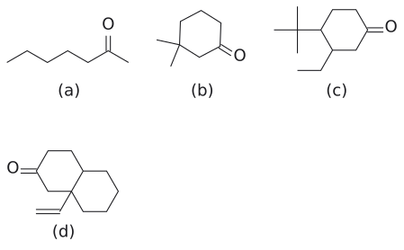
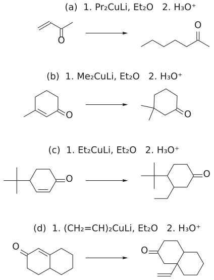
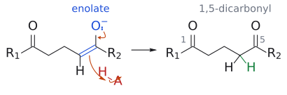
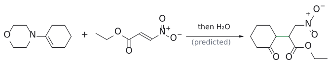
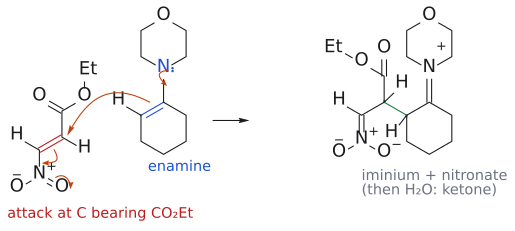
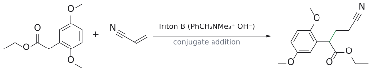
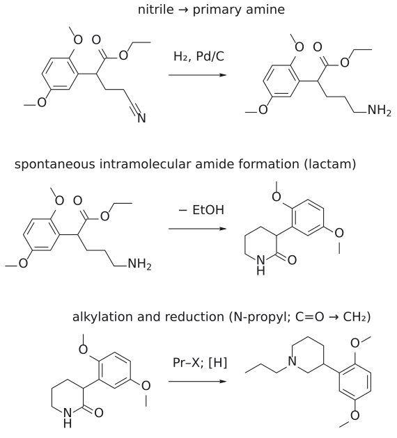
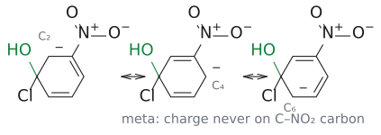

# L11 연습 문제와 해설

> [L11 conjugate addition](../notes/L11_Conjugate_Addition.md) 강의 노트에 있던 연습 문제와 해설을 그대로 옮겼다. 관련 개념: [organocuprate](../wiki/시약/유기구리%20시약.md)(문제 1), [1,2-addition vs 1,4-addition](../wiki/개념/1,2-첨가와%201,4-첨가.md)(문제 2, 3), [Michael reaction](../wiki/반응/마이클%20반응.md)(문제 4–7), [nucleophilic aromatic substitution](../wiki/반응/친핵성%20방향족%20치환.md)(문제 8).

## 연습 문제

**문제 1** (p.8) 분자 간 유기구리 conjugate addition만 써서 다음 화합물을 만드는 방법(출발 enone + cuprate)을 제시하라.
(a) 2-heptanone CH3CH2CH2CH2CH2COCH3
(b) 3,3-dimethylcyclohexanone
(c) 3-ethyl-4-tert-butylcyclohexanone
(d) 4a-vinyl-octahydronaphthalene-2(1H)-온(고리 접합 탄소에 CH=CH2가 있고, 그 탄소가 C=O의  $\beta$  위치인 데칼론)

그림: 슬라이드 p.8의 네 목표 화합물을 골격식으로 옮긴 것이다. 각 구조에서 carbonyl 탄소를 찾고 $\beta$ 위치의 치환기 가운데 cuprate에서 올 조각을 고른다. (d)는 고리 접합 탄소에 vinyl이 붙은 decalone이다. (출처: L11 p.8)

**문제 2** (p.11) 2-cyclohexenone을 (i) CH3MgBr로 처리한 뒤 H3O+로, (ii) (CH3)2CuLi로 처리한 뒤 H3O+로 처리했을 때의 주생성물을 각각 쓰고, 차이를 hard/soft 개념으로 설명하라.

**문제 3** (p.13) methyl vinyl ketone에 NaCN/HCN을 5–10 °C와 80 °C에서 반응시켰을 때의 생성물을 쓰고, 어느 쪽이 kinetic·thermodynamic 생성물인지 결합 에너지로 설명하라.

**문제 4** (p.14 빈칸) ketone R1COCH3의 enolate가 Michael 받개 CH2=CH-COR2에 첨가할 때, 빈칸에 들어갈 intermediate와 protonation 후 최종 생성물을 쓰라.

**문제 5** (p.16) 2-methylcyclopentanone과 methyl acrylate를 t-BuOK로 반응시키면 새 결합이 C2(methyl이 붙은 탄소)에 생긴다. 이유를 설명하라.

**문제 6** (p.19 빈칸) cyclohexanone의 모폴린 enamine과 ethyl (E)-3-nitroacrylate(EtO2C-CH=CH-NO2)를 반응시킨 뒤 H2O로 처리했을 때의 생성물을 예측하라.

**문제 7** (p.20 빈칸) ethyl 2-(2,5-dimethoxyphenyl)acetate에서 1-propyl-3-(2,5-dimethoxyphenyl)piperidine까지 가는 경로에서 (i) acrylonitrile/Triton B 처리 생성물, (ii) H2/Pd/C 처리 생성물(과 그 뒤 일어나는 일)을 쓰고, (iii) 마지막 "alkylation and reduction" 단계를 설명하라.

**문제 8** (p.23) 4-chloronitrobenzene은 HO-와 SNAr로 쉽게 반응하지만 3-chloronitrobenzene은 그렇지 않다. 이유를 설명하고, leaving group 반응성 순서가 SN2와 다른 이유도 쓰라.

---

## 정답 및 해설

**문제 1**
- (a) **methyl vinyl ketone(CH2=CH-CO-CH3) + (CH3CH2CH2)2CuLi** . MVK의  $\beta$ -탄소(말단 CH2)에 propyl이 붙으면 Pr-CH2-CH2-CO-CH3 = CH3(CH2)4COCH3가 된다. 거꾸로 CH3CH=CH-COCH3 + Et2CuLi로 하면 가지 달린 CH3CH(Et)CH2COCH3가 나오므로 틀린 답이다.
- (b) **3-methyl-2-cyclohexenone + (CH3)2CuLi** . 이미 Me가 있는  $\beta$ -탄소(C3)에 Me가 하나 더 붙어 gem-dimethyl이 된다(isophorone → 3,3,5,5-tetramethylcyclohexanone 예시와 같은 원리, p.6–7).
- (c) **4-tert-butyl-2-cyclohexenone + (CH3CH2)2CuLi** . ethyl이 C3( $\beta$ )에 있으므로 ethyl이 nucleophile이어야 한다. tBu는 C4( $\gamma$ )에 있으니 출발물에 이미 있어야 한다. 3-ethylcyclohexenone + tBu2CuLi로는 tBu가 C3에 붙으므로 안 된다. 보충: 일반적으로 cuprate는 tBu 반대 면으로 주로 들어가서 trans 이성질체가 우세하지만, 슬라이드는 stereochemistry를 묻지 않는다.
- (d)  $\Delta^{1(8a)}$ -octalone(4,4a,5,6,7,8-hexahydronaphthalen-2(3H)-one, 고리 접합 탄소가  $\beta$ -탄소인 이고리 enone) + (CH2=CH)2CuLi . vinyl기가 고리 접합  $\beta$ -탄소에 붙어 4차 탄소가 생긴다. vinyl cuprate도 R2CuLi의 일종이다.

그림: 위 풀이 네 줄을 반응식으로 옮긴 것이다. (a) MVK + Pr₂CuLi, (b) 3-methyl-2-cyclohexenone + Me₂CuLi, (c) 4-tert-butyl-2-cyclohexenone + Et₂CuLi, (d) $\Delta^{1(8a)}$-octalone + (CH₂=CH)₂CuLi. 모두 R이 enone의 $\beta$-탄소에 붙고 H₃O⁺ 후처리로 C=O가 회복된다. 입체배치는 그리지 않았다. (출처: L11 p.8, p.11)
(근거: L11 p.6–8, p.11)

**문제 2**
(i) 1-methyl-2-cyclohexene-1-올(1,2-첨가, 95%). (ii) 3-methylcyclohexanone(1,4-첨가, 97%). C-Mg 결합은 분극이 커서 탄소가 hard nucleophile이 되고, hard electrophilic site인 carbonyl 탄소를 공격한다. Cu(1.9)는 Mg(1.3)보다 전기음성도가 커서 C-Cu 결합의 분극이 작다. 그래서 cuprate는 soft nucleophile로서  $\beta$ -탄소를 공격한다. (근거: L11 p.6, p.11, p.12)

**문제 3**
5–10 °C에서는 cyanohydrin CH2=CH-C(OH)(CN)CH3(1,2, kinetic 생성물 P1, 가역)이 생긴다. 80 °C에서는 NC-CH2CH2-CO-CH3(1,4, thermodynamic 생성물 P2)이 생긴다. 1,2-첨가의 activation energy가 더 낮아 저온에서 빨리 생긴다. 하지만 1,2는 C=O  $\pi$ (약 369 kJ/mol)를 잃고 1,4는 더 약한 C=C  $\pi$ (약 280 kJ/mol)를 잃으므로(둘 다 C-C  $\sigma$ 를 얻음), 1,4 생성물이 더 안정하다. 고온에서는 1,2-첨가가 되돌려지므로 평형이 안정한 P2 쪽으로 이동한다. (근거: L11 p.13)

**문제 4**
enolate의  $\alpha$ -탄소가 받개의  $\beta$ -탄소를 공격하면 새 enolate intermediate R1-CO-CH2-CH2-CH=C(O-)-R2가 생긴다. 이것이 protonation(그리고 tautomerization)되면 **1,5-다이카르보닐 화합물 R1-CO-CH2CH2CH2-CO-R2**가 된다. (근거: L11 p.14, p.24 요약 "1,5-dicarbonyl products")

그림: p.14 빈칸의 답. 왼쪽은 첨가 직후의 새 enolate(파란 C=C–O⁻)이고, 주황 화살표는 O⁻ 전자쌍이 C=O를 되살리고 enolate C=C 전자가 산(H–A, 빨강)의 H를 받는 흐름이다. 오른쪽 생성물에서 초록 H가 $\alpha$-탄소에 새로 들어간 H이며, 두 carbonyl 탄소를 1과 5로 세면 1,5-dicarbonyl 관계가 보인다. 보충: 슬라이드는 빈칸이므로 enolate의 C-protonation으로 그렸다(O-protonation 후 tautomerization과 결과는 같다). (출처: L11 p.14)

**문제 5**
t-BuOK 조건에서는 deprotonation이 가역적이라서 두 enolate가 평형을 이룬다. 평형에서는 C=C가 더 많이 치환된 thermodynamic enolate(C1=C2, C2에 Me)가 우세하다. 그래서 C2가 methyl acrylate의  $\beta$ -탄소를 공격해 4차 탄소를 가진 methyl 3-(1-methyl-2-oxocyclopentyl)propanoate(53%)가 생긴다. (근거: L11 p.16)

**문제 6**
**ethyl 3-nitro-2-(2-oxocyclohexyl)propanoate**, 즉 (2-oxocyclohexyl)-CH(CO2Et)-CH2NO2다. 받개에는 EWG가 두 개 있다. nitro group이 ester보다 훨씬 강한 EWG이므로 nitro group을 기준으로 한  $\beta$ -탄소, 즉 CO2Et가 붙은 탄소가 공격을 받는다. 그러면 음전하는 nitronate로 안정화된다. 그 뒤 H2O 처리로 iminium이 hydrolysis되어 iminium hydrolysis로 donor의 carbonyl group이 재생된다. 보충: 슬라이드에는 이 칸의 답이 없다. 위 답은 "더 강한 EWG가 regioselectivity를 정한다"는 원리(Clayden 2판 25장)에 따른 예측이다(보충 근거: Clayden p.611). (근거: L11 p.19, p.23의 EWG 세기 순서 NO2 > ... > COMe)

그림: 문제 6의 예측 생성물. enamine 탄소가 받개의 CO₂Et가 붙은 탄소(nitro group 기준 $\beta$-탄소)와 결합하고(초록), H₂O 처리로 cyclohexanone이 회복된다. 보충: 슬라이드 빈칸의 공식 답은 없으며, 위 설명대로 더 강한 EWG(NO₂)를 기준으로 예측한 구조다. (출처: L11 p.19)

그림: 보충: 예측의 근거가 되는 전자 이동. 질소(파랑)의 비공유 전자쌍이 C=N⁺를 만들고, 파란 enamine C=C 전자가 빨간 C=C의 CO₂Et 쪽 탄소를 공격한다. 받개 쪽에서는 C=C 전자가 C–N 자리로, N=O 전자가 산소로 밀려 nitronate가 된다. 오른쪽은 iminium과 nitronate를 한 분자에 가진 zwitterion이며, H₂O 처리로 iminium이 hydrolysis되어 ketone이 된다. 새로 생긴 두 입체중심의 배치는 지정하지 않았다. (보충 근거: Clayden p.611)

**문제 7**
- (i) ester  $\alpha$ -H가 deprotonate되고, 그 enolate가 acrylonitrile의  $\beta$ -탄소에 conjugate addition한다. 생성물은 **ethyl 4-cyano-2-(2,5-dimethoxyphenyl)butanoate**, Ar-CH(CO2Et)-CH2CH2-CN이다.
- (ii) H2/Pd/C로 nitrile이 1차 amine으로 환원되어 Ar-CH(CO2Et)-CH2CH2CH2-NH2가 된다. 이 amine이 같은 분자의 ester를 분자 내에서 공격해서(EtOH가 빠짐) 6원자 lactam **3-(2,5-dimethoxyphenyl)piperidin-2-one**이 생긴다. 보충: 슬라이드 빈칸에 lactam까지 그려져 있는지는 확인할 수 없다. 하지만 최종 생성물의 고리가 N-CH2-CH2-CH2-CH(Ar)-CH2 구조이므로, lactam C=O 탄소가 최종 생성물에서 N 옆 CH2가 된다는 것과 일치한다. Clayden도 같은 경로에서 이 lactam 고리화가 저절로 일어난다고 설명한다(보충 근거: Clayden p.612).
- (iii) lactam 질소를 propyl group으로 alkylation(N-propyl)하고, amide C=O를 CH2로 환원(보충: 보통 LiAlH4 사용, 보충 근거: Clayden p.236)하면 1-propyl-3-(2,5-dimethoxyphenyl)piperidine이 된다.
(근거: L11 p.20)

그림: 빈칸 1의 답. Triton B가 ester $\alpha$-H를 떼어 만든 enolate 탄소(파랑)가 acrylonitrile의 말단 CH₂(빨강)에 붙어 초록 C–C 결합이 생긴다. CN은 사슬 끝에 그대로 남는다. (출처: L11 p.20)

그림: 빈칸 2와 마지막 단계. 첫 줄은 H₂/Pd/C로 nitrile이 1차 amine이 되는 단계, 둘째 줄은 그 NH₂가 같은 분자의 ester를 공격해 EtOH를 내보내고 6원자 lactam이 되는 단계, 셋째 줄은 N-propyl alkylation과 amide C=O의 CH₂ 환원([H])으로 dopamine antagonist가 되는 단계다. 보충: 둘째 줄의 자발적 lactam 형성은 슬라이드에 없고 Clayden의 설명을 따랐다. (출처: L11 p.20) (보충 근거: Clayden p.612)

**문제 8**
4-chloronitrobenzene에서는 HO-가 C-Cl 탄소에 첨가할 때 생긴 음전하가 공명으로 NO2가 붙은 탄소, 나아가 nitro group 산소까지 퍼진다. 그래서  $\sigma$  착물이 안정화된다. meta 이성질체에서는 음전하가 NO2가 붙은 탄소에 오지 않아 이런 안정화가 없다. 그래서 leaving group은 EWG의 ortho/para에 있어야 한다. leaving group 순서가 F >> Cl ~ Br >> I인 것은 SNAr의 rate-determining step가 C-X가 끊기는 단계가 아니라 첫 번째 첨가 단계이기 때문이다. 전기음성도가 가장 큰 F가 ipso 탄소를 가장 강하게  $\delta^{+}$ 로 만들고 anionic intermediate를 안정화하므로 첨가가 가장 빠르다(보충, Clayden 22장) (보충 근거: Clayden p.518). (근거: L11 p.22, p.23)

그림: 보충: meta 이성질체가 반응하지 않는 이유. HO⁻가 ipso 탄소(C1)에 붙은 뒤(초록이 새 C–O 결합) 음전하를 고리를 따라 옮기면 C2, C4, C6(ipso 기준 ortho·para)에만 놓인다. NO₂가 붙은 C3에는 어떤 공명 구조에서도 음전하가 오지 않으므로 nitro group이 음전하를 받아 주지 못하고 $\sigma$ complex가 안정화되지 않는다. para 이성질체의 공명은 통독본 7.2절 그림과 비교한다. (출처: L11 p.23; 보충 근거: Clayden p.517–518)
