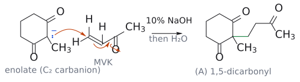
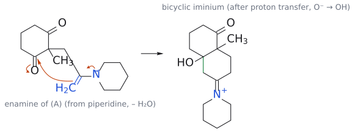
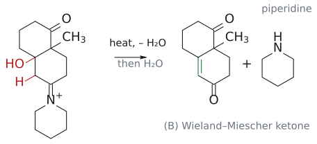
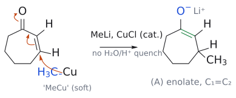
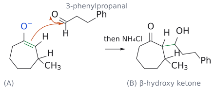
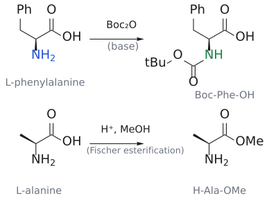
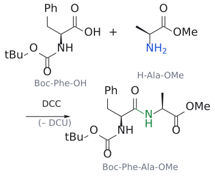
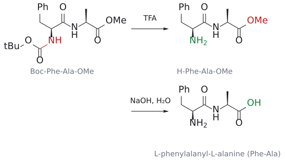

# L12 연습문제: 짝첨가 반응과 protecting group

> 출처: L12_Practice_Conjugate_addition_and_Protecting_groups.pdf (문제), L12_Practice_solutions.pdf (공식 풀이). CM3121 Advanced Organic Chemistry (Dr. Zhu Ye)

---

## 문제 1

짝첨가 반응(conjugate addition reactions). 다음 변환을 완성하라.

1. 반응식:

$$
\begin{aligned} & \text{2-methylcyclohexane-1,3-dione} + \text{methyl vinyl}\thinspace  \cr & \text{ketone}(\text{methyl vinyl ketone},\thinspace \mathrm{MVK},\thinspace \mathrm{CH_2{=}CH{-}CO{-}CH_3}) \cr & \xrightarrow{10\text{ percent}\thinspace \mathrm{NaOH}} \mathrm{(A)} \end{aligned}
$$

2. 반응식:

$$
\begin{aligned} & \mathrm{(A)} \cr & \xrightarrow[\text{가열}]{\text{piperidine}(\text{piperidine},\thinspace \text{촉매}),\thinspace \mathrm{{-}H_2O}} \mathrm{(B)}\thinspace (\text{bicyclic 분자},\thinspace \text{bicyclic molecule}) \end{aligned}
$$

3. 또는 출발물질로부터  $\xrightarrow[\text{가열}]{\mathrm{EtONa}} \mathrm{(B)}$  (한 용기 반응, one-pot reactions)

### 공식 풀이

- (A): 2-methyl-2-(3-oxobutyl)cyclohexane-1,3-dione. C2가 CH3와 CH2CH2COCH3를 가진 4급 탄소.
- (B): Wieland–Miescher ketone 골격. 8a-methyl-3,4,8,8a-tetrahydronaphthalene-1,6(2H,7H)-dione, 즉 각 methyl(angular methyl)과 포화 ketone(C1)을 가진 고리 + 고리 접합부 C=C와 짝을 이룬 enone(C6=O)을 가진 고리.
- 메커니즘(손글씨): 염기가 C2-H를 떼어 enolate 형성 → MVK에 Michael addition → (A). piperidine이 측쇄 methyl ketone과 enamine(말단 C=CH2-N) 형성 → enamine이 고리 ketone 하나를 분자 내 공격 → OH와 iminium을 가진 bicyclic intermediate → 탈수 및 piperidine 재생으로 (B). 또는 (A)에서 EtONa로 직접 (B).

그림: 공식 풀이 1단계. 염기(10% NaOH)가 떼어 낸 C2 carbanion(파랑, 전자쌍)이 MVK의 β-탄소(빨강)를 공격하고(주황 화살표), C=C의 π 전자는 C–C(=O) 쪽으로, C=O의 π 전자는 O로 밀려 enolate가 된다. 물에서 양성자를 받으면 1,5-dicarbonyl (A)가 된다(초록이 새 C–C 결합). (출처: L12_Practice_solutions p.1)

그림: 공식 풀이 2단계. (A)의 측쇄 methyl ketone이 piperidine과 enamine(파랑)이 된 뒤, enamine의 말단 CH2가 고리 ketone 탄소(빨강)를 분자 내 공격한다. N의 전자쌍은 C=N⁺을 만들고 C=O의 π 전자는 O로 간다. 새 6원 고리가 닫힌(초록) bicyclic hydroxy iminium이 생긴다. 보충: 공식 손글씨는 O⁻ 단계를 생략하고 바로 OH로 적었으므로 그림도 양성자 이동 뒤의 구조로 그렸다. (출처: L12_Practice_solutions p.1)

그림: 공식 풀이 마지막 단계. OH(빨강)와 이웃한 C–H(빨강)가 물로 떨어져 나가며 C=C(초록)가 생기고, iminium이 가수분해되어 ketone으로 돌아가면서 piperidine이 재생된다. 생성물 (B)가 Wieland–Miescher ketone이다(각 methyl, 포화 ketone, 고리 접합부 C=C와 짝을 이룬 enone). 공식 손글씨처럼 탈수와 가수분해를 화살표 하나로 묶었다. (출처: L12_Practice_solutions p.1)

(출처: L12_Practice_solutions p.1)

### 해설

이 문제의 핵심은 왜 두 단계(Michael addition + aldol condensation)가 이어져 새 6원 고리가 만들어지는가, 즉 Robinson cyclization(Robinson annulation)의 논리이다.

먼저 2-methylcyclohexane-1,3-dione의 C2-H는 두 carbonyl 사이에 있어 pKa 약 11로 매우 산성이다. 그래서 묽은 NaOH만으로도 안정화된 enolate가 만들어진다. 이런 "soft" 안정화 enolate는 MVK의 carbonyl 탄소(1,2-첨가)보다  $\beta$ -탄소(1,4-첨가)를 선호하므로 Michael addition이 일어난다(→ [L11](../notes/L11_Conjugate_Addition.md) 짝첨가 문서 참고). 생성된 enolate가 양성자를 받으면 1,5-dicarbonyl 화합물 (A)가 된다. 이때 C2는 4급 탄소가 되며 각 methyl이 여기서 정해진다.

그런데 (A)에는 1,5-관계의 carbonyl들이 있으므로 intramolecular aldol 반응으로 6원 고리를 닫을 수 있다(→ [L8](../notes/L08_Aldol_Reactions.md) aldol 문서 참고). 공식 풀이는 이를 piperidine 촉매의 enamine 경로로 보여 준다(→ [L10](../notes/L10_Enol_and_Enamine.md) enamine 문서 참고). piperidine은 2차 amine이므로 측쇄의 methyl ketone과 iminium을 거쳐 enamine을 만든다. 측쇄 말단 CH3 쪽 enamine의 탄소가 고리 ketone 하나를 공격하면 고리 원자가 C2(4급), CH2, CH2, C(=N⁺), CH2, C(OH)로 6원 고리가 된다. 즉 고리 크기가 반응 위치를 결정한다. 그 뒤 iminium이 hydrolysis되어 ketone으로 돌아가고  $\beta$ -hydroxy ketone이 탈수되면, 새로 생긴 C=C가 ketone과 짝을 이루는  $\alpha,\beta$ -unsaturated ketone(enone)이 된다. 탈수가 잘 일어나는 이유는 짝을 이룬 enone이 thermodynamically 안정하기 때문이다. piperidine은 마지막에 재생되므로 촉매이다.

EtONa/가열 조건은 같은 일을 enamine 대신 enolate로 한 번에 수행하는 것이다. Michael addition 후 methyl ketone의 enolate가 고리 ketone을 공격하고, E1cB 탈수까지 한 용기에서 진행된다.

검토 의견: 공식 답은 옳다. 다만 손글씨 메커니즘은 iminium intermediate에서 곧바로 enone + piperidine으로 화살표를 그어, E1cB와 iminium hydrolysis 단계를 한 번에 생략해 표기하였다. 또한 achiral한 piperidine이나 EtONa를 쓰면 (B)는 racemate로 얻어진다. chiral 촉매인 L-proline을 쓰면 비대칭 변형(하조스-패리시 반응, Hajos-Parrish reaction 계열)이 가능하다는 점도 알아 두면 좋다.

### 핵심 개념

Robinson cyclization = Michael addition(1,5-dicarbonyl 생성) + intramolecular aldol condensation(6원 고리 enone 생성). 결과물이 Wieland–Miescher ketone이다.

---

## 문제 2

다음 변환을 완성하라.

1.  $\text{cyclohept-2-en-1-one} \xrightarrow{\mathrm{MeLi},\ \mathrm{CuCl}\ (\text{촉매})} \mathrm{(A)}$  (물이나 산으로 퀜칭하지 않음, without quenching by water or acid)
2.  $\mathrm{(A)} \xrightarrow{\substack{\text{3-phenylpropanal}(\mathrm{PhCH_2CH_2CHO}),\  \\ \text{그다음}\ \mathrm{NH_4Cl}\text{로}\ \text{퀜칭}}} \mathrm{(B)}$

### 공식 풀이

- methyl이 enone의  $\beta$ -탄소(C3)에 첨가(손글씨로 "MeCu"로 보이는 표기가 C3를 공격하는 화살표).
- (A): 3-methylcycloheptanone의 enolate, 즉 C1(-O⁻)=C2 이중결합을 가지고 C3에 methyl이 있는 금속 enolate.
- (A)의 C2가 aldehyde carbonyl을 공격.
- (B): 2-(1-hydroxy-3-phenylpropyl)-3-methylcycloheptan-1-one (C2에 CH(OH)-CH2CH2-Ph, C3에 CH3).

그림: 공식 풀이 1단계. MeLi와 촉매량 CuCl에서 생긴 유기구리 종('MeCu', 파랑)의 C–Cu 결합 전자가 enone의 β-탄소 C3(빨강)로 가고(1,4-첨가), C2=C3 π 전자는 C1–C2로, C1=O π 전자는 O로 밀려 lithium enolate (A)(초록이 C1=C2)가 된다. 물이나 산으로 퀜칭하지 않으므로 enolate가 그대로 남는다. (출처: L12_Practice_solutions p.2)

그림: 공식 풀이 2단계. enolate (A)의 C1=C2 π 전자가 3-phenylpropanal의 carbonyl 탄소(빨강)를 공격하고 C=O 전자는 O로 가서 alkoxide가 된다(aldol addition). NH4Cl로 퀜칭하면 β-hydroxy ketone (B)(초록이 새 C–C 결합)가 된다. (출처: L12_Practice_solutions p.2)

(출처: L12_Practice_solutions p.2)

### 해설

이 문제의 핵심은 왜 MeLi 단독이 아니라 CuCl을 함께 쓰는가, 그리고 왜 퀜칭하지 않는 것이 중요한가이다.

MeLi 같은 유기리튬은 "hard" nucleophile여서 enone에 쓰면 주로 carbonyl 탄소에 직접 붙는 1,2-첨가를 한다. 그런데 촉매량의 Cu(I)가 있으면 MeLi가 구리와 transmetalation하여 methyl 쿠프레이트(cuprate, 예: Me2CuLi) 같은 유기구리 종을 만들고, 이 유기구리 종은 "soft" nucleophile로서  $\beta$ -탄소에 붙는 1,4-짝첨가를 선택한다(→ [L11](../notes/L11_Conjugate_Addition.md) 짝첨가 문서 참고). 그래서 methyl은 C3에 들어가고, 전자는 carbonyl 산소 쪽으로 밀려 enolate가 생긴다. 이 enolate는 정확히 C1=C2 위치에 만들어진다. 즉 짝첨가는 "원하는 위치에 enolate를 만드는" 방법이기도 하다.

여기서 물이나 산으로 퀜칭하지 않는 것이 결정적이다. 퀜칭하면 enolate가 양성자를 받아 단순한 3-methylcycloheptanone이 되어 버린다. 그래서 enolate를 살려 둔 채 aldehyde를 넣으면, C2가 nucleophile로 작용하여 aldehyde carbonyl을 공격하는 aldol addition이 일어난다(→ [L8](../notes/L08_Aldol_Reactions.md) aldol 문서 참고). 생성된 alkoxide는 NH4Cl 퀜칭으로 양성자를 받아  $\beta$ -hydroxy ketone (B)가 된다. 약산인 NH4Cl을 쓰는 이유는 강산·가열 조건에서 일어날 수 있는  $\beta$ -hydroxy ketone의 탈수를 피하기 위해서이다. 결과적으로 한 용기에서  $\beta$ -탄소와  $\alpha$ -탄소 두 곳에 연속으로 새 C-C 결합을 만드는 "짝첨가-enolate conjugate addition-enolate trapping" 전략이 된다.

### 핵심 개념

$$
\begin{aligned} & \text{촉매}\thinspace \mathrm{Cu(I)} + \mathrm{MeLi} \cr & \longrightarrow \text{유기구리 종의 1,4-짝첨가} \cr & \longrightarrow \text{위치가 정해진 enolate} \cr & \longrightarrow \text{aldehyde로 aldol} \end{aligned}
$$

. 두 개의 C-C 결합을 연속 형성.

---

## 문제 3

protecting group(protecting groups). 두 amino acid으로부터 dipeptide의 합성을 제안하라. amine과 carboxylic acid을 amide로 바꾸는 데 DCC(N, N'-디사이클로헥실카보디이미드, N'-dicyclohexylcarbodiimide)를 사용할 수 있다.

$$
\begin{aligned}
& \text{L-phenylalanine} + \text{L-alanine} \cr
& \xrightarrow{\text{여러 단계}} \text{L-phenylalanyl-L-alanine}\ \mathrm{(Phe{-}Ala)}
\end{aligned}
$$

(Phe의 carboxyl group과 Ala의 amino기가 amide 결합을 형성하고, Phe의 NH2와 Ala의 COOH는 자유 상태로 남는 구조)

### 공식 풀이

1.  $\text{L-phenylalanine} \xrightarrow{\mathrm{Boc_2O}} \mathrm{Boc{-}Phe{-}OH}$  (N을 tBuO-C(=O)-NH로 보호)
2.  $\text{L-alanine} \xrightarrow[\mathrm{MeOH}]{\mathrm{H^+}} \mathrm{H_2N{-}CH(CH_3){-}CO_2Me}$  (methyl ester로 보호)
3.  $\mathrm{Boc{-}Phe{-}OH} + \mathrm{H{-}Ala{-}OMe} \xrightarrow{\mathrm{DCC}} \mathrm{Boc{-}Phe{-}Ala{-}OMe}$
4.  $\xrightarrow{\mathrm{TFA}} \mathrm{H_2N{-}Phe{-}Ala{-}OMe}$  (Boc 제거)
5.  $\xrightarrow{\mathrm{NaOH},\ \text{물}} \text{L-phenylalanyl-L-alanine}$  (methyl ester hydrolysis)

그림: 공식 풀이 1·2단계. L-phenylalanine의 NH2(파랑)를 Boc2O로 carbamate(초록 NH)로 막고, L-alanine의 CO2H(빨강)를 MeOH/H⁺로 methyl ester(초록)로 막는다. 쐐기는 두 α-탄소의 L 배열이다. (출처: L12_Practice_solutions p.3)

그림: 공식 풀이 3단계. 남은 두 작용기, Boc-Phe-OH의 CO2H(빨강)와 H-Ala-OMe의 NH2(파랑)만 DCC로 이어져 amide 결합(초록)이 생긴다. 부산물은 DCU이다. (출처: L12_Practice_solutions p.3)

그림: 공식 풀이 4·5단계. TFA로 Boc(빨강)만 벗겨 유리 amine(초록)을 얻고, NaOH 수용액으로 methyl ester(빨강)를 가수분해해 carboxylic acid(초록)를 얻으면 L-phenylalanyl-L-alanine이다. 가운데 amide 결합은 두 조건을 모두 견딘다. (출처: L12_Practice_solutions p.3)

(출처: L12_Practice_solutions p.3)

### 해설

이 문제의 핵심은 왜 두 amino acid을 DCC와 그냥 섞으면 안 되는가이다. 각 amino acid은 amine(nucleophile)과 carboxylic acid(DCC로 활성화되는 electrophile)을 모두 가지고 있다. 그래서 그냥 섞으면 Phe-Phe, Ala-Ala, Ala-Phe, Phe-Ala, 그리고 더 긴 올리고머까지 무작위로 생긴다. 즉 원하는 Phe-Ala 하나만 얻으려면 "반응해서는 안 되는 작용기"를 보호해야 한다(→ [L12](../notes/L12_Protecting_Groups.md) protecting group 문서 참고).

그래서 Phe에서는 amine을 Boc(tert-butoxycarbonyl)으로 막는다. Boc2O와 반응한 amine은 carbamate가 되어 nucleophilicity를 잃는다. Ala에서는 carboxylic acid을 methyl ester로 막는다(피셔 ester화). 이제 남은 자유 작용기는 Phe의 COOH와 Ala의 NH2 하나씩뿐이므로, DCC가 Phe의 COOH를 O-acyl이소우레아(O-acylisourea)로 활성화하면 Ala의 NH2만이 이를 공격하여 원하는 amide 결합 하나만 만들어진다. 부산물은 디사이클로헥실우레아(DCU)이다.

protecting group 제거 순서도 이유가 있다. Boc는 산(TFA)에 약한데, 이는 tert-부틸 cation(또는 이소부텐)과 CO2로 깨지기 쉽기 때문이다. 반면 methyl ester와 amide는 TFA에서 안정하다. 그 뒤 NaOH 수용액으로 methyl ester를 비누화하면 amide 결합은 남기고 ester만 hydrolysis된다(amide가 ester보다 훨씬 덜 반응성이기 때문). 이렇게 서로 다른 조건에서 하나씩 제거할 수 있는 protecting group 조합을 직교 orthogonal protection 전략이라 부른다.

검토 의견: 공식 경로는 표준적이고 옳다. 다만 공식 손글씨는 intermediate들에 입체 표기(쐐기)를 생략했는데, 각  $\alpha$ -탄소의 L 배열은 전 과정에서 유지되어야 한다. 실제로 NaOH 비누화나 DCC 활성화 단계에서는  $\alpha$ -위치 racemic화(에피머화)의 위험이 있으므로, 실무에서는 온화한 조건(LiOH, 저온)이나 HOBt 같은 첨가제를 함께 쓴다. 또한 마지막 단계 후에는 중화(산 처리)를 해야 carboxylate가 아닌 zwitterion dipeptide를 얻는다.

### 핵심 개념

$$
\begin{aligned} & \text{amine은}\thinspace \mathrm{Boc}(\text{산으로 제거}),\thinspace \text{carboxylic acid는 methyl}\thinspace  \cr & \text{ester}(\text{염기로 제거})\text{로}\thinspace \text{orthogonal protection} \cr & \longrightarrow \mathrm{DCC}\thinspace \text{커플링} \cr & \longrightarrow \text{순차 deprotection} \end{aligned}
$$

.
