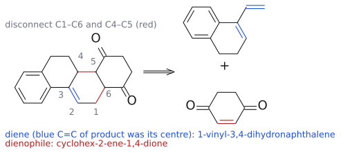

# L13 연습 문제와 해설

> [L13 cycloaddition 1부 노트](../notes/L13_Cycloaddition_Part1.md)에서 옮긴 연습 문제와 해설이다. 개념 설명은 [Diels–Alder reaction](../wiki/반응/딜스-알더%20반응.md), [s-cis conformation](../wiki/개념/s-cis%20형태.md), [endo rule](../wiki/개념/endo%20규칙.md), [retro-Diels–Alder reaction](../wiki/반응/역%20딜스-알더%20반응.md), [frontier molecular orbital](../wiki/개념/프런티어%20분자%20오비탈.md), [Woodward–Hoffmann rules](../wiki/개념/우드워드-호프만%20규칙.md)에 있다.

## 문제

1. (p.17) 다음 생성물을 만드는 Diels–Alder 반응의 diene과 dienophile은 무엇인가? 생성물: tricyclo[5.2.1.0^2,6]deca-3,8-diene(dicyclopentadiene). norbornene 골격에 cyclopentene 고리가 융합된 구조다.
2. (p.17) 다음 생성물을 만드는 diene과 dienophile은 무엇인가? 생성물: benzene 고리(A)–CH2CH2가 있는 고리(B)–고리 C(cyclohexene: C=C가 고리 B와 공유하는 탄소에서 시작)–고리 D(cyclohexane-1,4-dione)가 차례로 융합된 사환 화합물(steroid형 골격, 고리 C의 C=C는 고리 B 쪽 탄소와 그 이웃 CH 사이에 있음).
3. (p.23–24) (E,E)-hexa-2,4-diene + acrolein의 Diels–Alder 반응에서 endo 규칙에 따라 우세한 생성물은 무엇인가? CHO와 두 Me의 상대 배열로 답하라.
4. (p.19, 28) butadiene을 (a) dimethyl maleate, (b) dimethyl fumarate와 반응시킬 때 생기는 생성물의 상대 stereochemistry를 쓰고, 이유를 설명하라.
5. (p.20, 28) (a) (E,E)-hexa-2,4-diene + DMAD, (b) (E,Z)-hexa-2,4-diene + DMAD의 생성물에서 두 Me의 관계는 무엇인가?
6. (p.14–16, 27) 다음 쌍에서 DA 반응이 더 빠른 쪽을 고르고 FMO로 설명하라. (a) butadiene + ethylene과 butadiene + acrolein (b) 1,3-butadiene + maleic anhydride와 cyclopentadiene + maleic anhydride (c) 3-methylenecyclohexene + maleic anhydride는 반응하는가?
7. (p.30, 36) suprafacial–suprafacial 접근을 가정하고, Woodward–Hoffmann 규칙과 FMO로 1,3-butadiene이 열적 [4+2]는 하지만 열적 [4+4]는 하지 않는 이유를 설명하라.
8. (p.18) dicyclopentadiene에서 cyclopentadiene 단량체를 얻는 방법과 그 원리를 쓰고, 단량체를 상온에 두면 어떻게 되는지 설명하라.

## 정답 및 해설

1. **diene은 cyclopentadiene, dienophile도 cyclopentadiene이다(이량화).** norbornene 부분의 C=C를 C2=C3로 보고 C1–C6, C4–C5 결합을 끊는다. 그러면 한 분자는 diene(s-cis 고정 cyclopentadiene)으로, 다른 분자는 C=C 하나만 쓰는 dienophile로 작용한 것이 보인다. 융합된 cyclopentene 고리의 C=C는 dienophile 분자에 남아 있던 이중 결합이다. 이 반응은 endo 선택적이어서 endo-dicyclopentadiene을 준다(p.29). (출처: L13 p.17, 18, 29)

   

   그림: 통독본 5-4절의 역 DA 그림을 그대로 가져왔다. norbornene 부분의 파란 C=C를 C2=C3로 놓고 빨간 결합 두 개(C1–C6, C4–C5)를 끊으면(주황 화살표) 왼쪽 분자는 diene, 오른쪽 분자는 dienophile로 작용했음이 보인다. 초록색은 되살아나는 $\pi$ 결합이다.

2. **diene: 1-vinyl-3,4-dihydronaphthalene(CH2=CH-C1=C2H-CH2CH2- benzene 융합). Dienophile: cyclohex-2-ene-1,4-dione.** 새로 생긴 고리 C에서 C=C(고리 B와 공유하는 탄소 = C3, 그 이웃 CH = C2)를 C2=C3로 놓는다. 고리 C의 CH2가 C1, 고리 B/C 접합 CH가 C4가 된다. 그러면 C1–C6, C4–C5가 새  $\sigma$  결합이고, C5와 C6은 고리 C/D 접합 탄소다. C5–C6을 다시 이중 결합으로 바꾸면 양쪽에 C=O가 붙은 cyclohex-2-ene-1,4-dione이 dienophile이 되고, diene은 dihydronaphthalene 고리 안의 C=C와 vinyl기가 s-cis로 conjugated diene이다. 고리 D에 C=O 외에 다른 C=C가 없으므로 p-benzoquinone(이 경우 생성물에 C=C가 하나 더 남음)이 아니라 cyclohexenedione이 맞다. 보충: 두 C=O는 dienophile을 강하게 활성화하는 EWG다. (보충 근거: Clayden p.886–887) (출처: L13 p.17)

   

   그림: 생성물에서 파란 C=C가 C2=C3, 빨간 결합 두 개가 끊을 C1–C6과 C4–C5다(번호는 본문 해설과 같다). 역합성 화살표 오른쪽에서 파란색은 diene의 두 $\pi$ 결합, 빨간색은 dienophile의 $\pi$ 결합이다. 고리 D에는 C=O 두 개만 있으므로 dienophile은 p-benzoquinone이 아니라 cyclohex-2-ene-1,4-dione이다.

3. **CHO와 두 Me가 모두 cis인 all-cis 2,5-dimethylcyclohex-3-ene-1-carbaldehyde(슬라이드의 왼쪽 생성물: Me, CHO, Me가 모두 hash).** (E,E)-diene의 두 Me는 "out"이므로 생성물에서 서로 cis다(stereospecificity). endo TS에서는 CHO가 diene 아래로 들어간다. 그러면 CHO 탄소의 H는 diene 말단의 "in" H들과 반대쪽, 즉 Me 쪽과 반대 방향을 향하게 된다. 결과적으로 세 H(C1-H, C2-H, C5-H)가 모두 한 면(wedge)에, CHO와 두 Me가 모두 반대 면에 놓인다(p.24 그림). exo 생성물은 CHO만 wedge에 있는 오른쪽 구조다. (출처: L13 p.23–24)

   

   그림: 파란색은 diene의 $\pi$ 결합, 빨간색은 acrolein의 $\pi$ 결합, 주황색 화살표는 전자쌍 이동, 초록색은 새 $\sigma$ 결합이다. (E,E)-diene은 두 Me가 out, 두 H가 in이다. endo TS에서 C=O가 diene 아래로 들어가면 CHO 탄소의 H가 diene의 in H들과 같은 면에 모여, 세 H가 굵은 쐐기, Me·CHO·Me가 점선 쐐기인 all-cis 생성물이 된다. 평면 그림이므로 C=O가 "아래로 들어간" 모습은 캡션으로만 적었다.

4. **(a) cis(syn)-dimethyl cyclohex-4-ene-1,2-dicarboxylate. (b) trans(anti)-diester(라셈).** DA는 concerted인 suprafacial–suprafacial 반응이다. dienophile의 두 탄소가 같은 면에서 동시에 새  $\sigma$  결합을 만들고, C–C 회전이 가능한 intermediate가 없다. 따라서 Z-alkene의 cis 관계와 E-alkene의 trans 관계가 그대로 고리에 stereospecificity. (출처: L13 p.19, 28)

5. **(a) syn(cis-3,6-dimethyl). (b) anti(trans-3,6-dimethyl).** s-cis 형태에서 (E,E)-diene의 두 Me는 모두 "out"이고, out끼리는 생성물에서 1,4-cis다. (E,Z)-diene에서는 Me 하나가 "in", 하나가 "out"이므로 trans가 된다. DMAD는 alkyne이라 생성물은 cyclohexa-1,4-diene-1,2-dicarboxylate이다. (출처: L13 p.20, 28)

   

   그림: (b)의 경우다. s-cis로 그리면 C1의 Me는 out, C4의 Me는 in이고, 생성물에서 out은 점선 쐐기, in은 굵은 쐐기가 되어 두 Me가 trans다. (a)의 (E,E) 예는 통독본 6-2절의 (E,E)-1,4-diphenylbutadiene 그림(두 out 치환기가 cis)과 같은 논리다. 파란색은 diene의 $\pi$ 결합, 빨간색은 DMAD의 삼중 결합, 초록색은 새 $\sigma$ 결합이다.

6. **(a) butadiene + acrolein이 훨씬 빠르다**(150 °C, 0.5 h 대 165 °C, 17 h, 900 atm). CHO(EWG)가 dienophile의 LUMO를 낮춰 diene HOMO–dienophile LUMO 에너지 차이가 줄어들기 때문이다. **(b) cyclopentadiene 쪽이 빠르다.** s-cis로 고정되어 있어 반응 가능한 형태가 100%인 반면, butadiene은 상온에서 약 1%만 s-cis다. 보충: cyclopentadiene의 고리 CH2(alkyl)는 diene HOMO를 약간 올리는 효과도 있다(보충 근거: Clayden p.886, 890). **(c) 반응하지 않는다.** 3-methylenecyclohexene은 두 C=C가 s-trans로 고정되어 있어 C1과 C4가 가까워질 수 없다. (출처: L13 p.14–16, 27)

   

   그림: (b)와 (c)의 근거다. 파란색은 diene의 $\pi$ 결합, 초록색은 가운데 C2–C3 단일 결합이다. 위 줄(cyclopentadiene 등)은 고리 때문에 s-cis로 고정되어 반응성이 크고, 아래 줄의 3-methylenecyclohexene과 bicyclic transoid diene은 s-trans로 고정되어 DA 반응을 할 수 없다.

7. **Woodward–Hoffmann:** [4+2]는 [ $\pi4\mathrm{s}$  +  $\pi2\mathrm{s}$ ]다. (4q+2)s 성분( $\pi2\mathrm{s}$ )이 1개, (4r)a 성분이 0개로 합이 1(홀수)이므로 열적으로 허용된다. [4+4]는 [ $\pi4\mathrm{s}$  +  $\pi4\mathrm{s}$ ]다. 두 성분 모두 (4r)s라서 세지 않으므로 (4q+2)s는 0개, (4r)a도 0개이고 합이 0(짝수)이다. 따라서 열적으로 금지된다. **FMO:** [4+2]에서는 한 butadiene의 HOMO( $\psi_{2}$ )와 다른 butadiene의 C=C 하나(dienophile 부분)의 LUMO가 겹치며 양 끝이 모두 결합성이므로, 4-vinylcyclohexene이 생긴다. [4+4]에서는  $\psi_{2}$ (HOMO)와 다른 분자의  $\psi_{3}$ (LUMO)의 양 끝 가운데 한쪽은 결합성이지만 다른 쪽은 위상이 맞지 않아 반결합성이다. 따라서 두  $\sigma$  결합을 동시에 만들 수 없어 cycloocta-1,5-diene은 열적으로 생기지 않는다. (출처: L13 p.30, 33–36)

   ![butadiene 2분자의 FMO: \[4+2\]는 양 끝 모두 결합성, \[4+4\]는 한쪽 끝이 반결합성](../figures/L13/fmo_4plus2_vs_4plus4.svg)

   그림: FMO 부분의 근거다. 채운 lobe는 + 위상, 빈 lobe는 − 위상이다. 왼쪽 [4+2]는 HOMO $\psi_{2}$ 와 다른 분자의 반응하는 C=C의 LUMO가 양 끝에서 모두 같은 위상(초록 점선, 결합성)이고, 오른쪽 [4+4]는 HOMO $\psi_{2}$ 와 LUMO $\psi_{3}$ 의 한쪽 끝이 위상이 어긋나(빨간 점선, 반결합성) 두 $\sigma$ 결합을 동시에 만들 수 없다.

8. **dicyclopentadiene을 가열해 crack하고 증류한다.** 가열하면 역 DA 반응이 일어나 단량체가 생긴다. 끓는점이 낮은 cyclopentadiene(b.p. 42 °C)이 끓는점이 높은 이량체에서 증류되어 빠져나가므로 평형이 단량체 쪽으로 이동한다. 단량체는 −20 °C에서는 며칠 보관할 수 있지만, 상온에서는 몇 시간 안에 DA endo로 다시 dicyclopentadiene이 된다. 그래서 사용 직전에 새로 분해해서 쓴다. (출처: L13 p.18)
