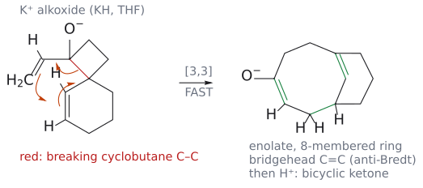
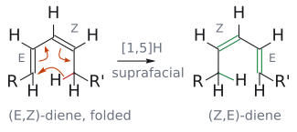
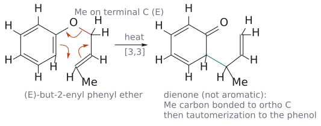
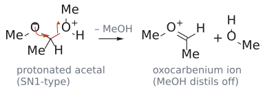
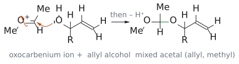
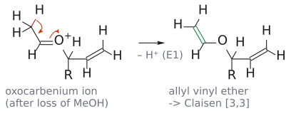
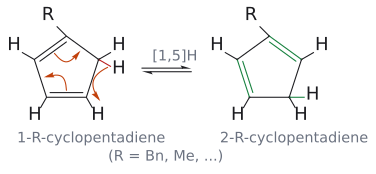

# L16 연습 문제와 해설

> [L16 sigmatropic rearrangement](../notes/L16_Sigmatropic_Rearrangements.md) 교재 기반 자가 점검을 유지하고 공식 강의 문제를 추가했다. Clayden 쪽수와 L# PDF 쪽수를 구별한다. 개념 설명은 [sigmatropic rearrangement](../wiki/반응/시그마트로픽%20자리옮김.md), [Claisen rearrangement](../wiki/반응/클라이젠%20자리옮김.md), [Cope rearrangement](../wiki/반응/코프%20자리옮김.md), [2,3-sigmatropic rearrangement](../wiki/반응/2,3-시그마트로픽%20자리옮김.md), [1,5-hydrogen shift](../wiki/반응/1,5-수소%20이동.md)에 있다.

## 공식 강의 문제 — 슬라이드와 답을 함께 보기

### carbonyl class를 바꾸는 [3,3]

p.10의 aldehyde acetal, ketone acetal, orthoester, orthoamide에서 출발해 생성물을 그려 본 뒤 p.11과 대조한다. 공통으로 새 C–C 결합이 생기는 말단은 같고, carbonyl에 남는 H/Me/OR/NR2가 각각 aldehyde/ketone/ester/amide를 가른다. 산 후처리라는 조건만으로 생성물 class를 정하지 않는다. (출처: L16 p.10–11)

| 출발 전구체 | [3,3] 및 후처리로 읽을 carbonyl class |
| --- | --- |
| Aldehyde-derived allyl vinyl ether | Aldehyde |
| Ketone-derived allyl vinyl ether | Ketone |
| Orthoester-derived ketene acetal | Ester |
| Amide acetal-derived 계 | Amide |

원자 번호를 보존해 새 C–C 결합과 carbonyl 탄소를 추적한다. (출처: L16 p.11)

그림: allyl vinyl ether와 silyl ketene acetal을 별도 패널로 보여 준다. 원본의 acetal·orthoester·amide acetal 전체 구조는 원본 링크로 대조한다. (원본 대조: L16_Sigmatropic rearrangements.pdf p.11)

[원본 자료에서 세부 구조·입체배치 확인: L16_Sigmatropic rearrangements.pdf p.11](../figures/L16/source/L16_p11.png)

### anionic oxy-Cope의 ring expansion

p.16 아래 구조에서 OH를 KH로 deprotonate한 뒤, 참여 1,5-diene의 여섯 원자만 번호를 매긴다. 중앙  $\sigma$  결합을 끊고 말단끼리 이은 뒤 두  $\pi$  결합을 이동시킨 enolate를 그린다. H+ 후처리로 carbonyl을 회복한 답은 p.17에 있다. 기존 fused 작은 고리의 결합을 임의로 추가로 끊지 않는다. (출처: L16 p.16–17)

그림: p.17의 답을 그린 것이다. 빨간색은 끊어지는 cyclobutane C–C $\sigma$ 결합(O⁻가 달린 탄소와 spiro 탄소 사이), 주황색 화살표 셋은 [3,3] 패턴, 초록색은 새 C–C $\sigma$ 결합과 자리를 옮긴 두 C=C(하나는 bridgehead C=C)다. 참여하는 여섯 원자는 vinyl 두 탄소, O⁻ 탄소, spiro 탄소, cyclohexene 두 탄소다. 생성물은 8원 고리 enolate이고 H⁺ 후처리로 ketone이 된다. (원본 대조: L16_Sigmatropic rearrangements.pdf p.16–17)

### E,Z와 E,E diene의 [1,5]H

p.22의 접힌 E,Z 구조에서 이동 H가 양 말단에 같은 면으로 닿는지 확인한다. 마지막 E,E 질문은 규칙상 허용이라는 말만으로 해결하지 않고 실제 H–말단 탄소의 접근 기하를 그리는 문제다. p.24의 표와 함께 orbital 허용성과 공간적 도달 가능성을 구별한다. (출처: L16 p.22–24)

그림: p.22의 접힌 (E,Z)-diene이다. 빨간색 C–H의 H가 diene의 같은 면을 따라 R이 달린 말단 탄소로 옮겨 가고(초록색 새 C–H), 두 C=C가 자리를 옮겨(초록색) R 쪽이 Z, R' 쪽이 E인 diene이 된다. 이동 H가 양 말단에 같은 면으로 닿는지는 이 접힌 그림에서 확인한다. (E,E)-diene은 CH2R'가 반대쪽을 향해 같은 접힌 배치를 만들기 어렵다는 점이 p.22 마지막 질문의 핵심이다. (원본 대조: L16_Sigmatropic rearrangements.pdf p.22)

## 교재 기반 자가 점검 문제

1. 다음 반응을 [i,j]로 분류하고 TS 고리 크기를 쓰라. (a) 2-allylphenol을 주는 allyl phenyl ether의 첫 단계, (b) BuLi로 만든 benzyl allyl ether anion의 rearrangement, (c) 5-methylcyclopentadiene이 1-methylcyclopentadiene으로 바뀌는 과정, (d) 프로비타민 D2 → 비타민 D2.

2. (*E*)-뷰트-2-엔일 phenyl ether PhO–CH2–CH=CH–CH3를 가열했다. [3,3] 단계 직후의 intermediate와 최종 생성물을 쓰고, methyl group이 어느 탄소에 놓이는지 설명하라.

3. 펜트-1-ene-3-ol CH2=CH–CH(OH)–CH2CH3를 (a) MeCH(OMe)2, (b) MeC(OMe)3와 각각 propanoic acid 촉매로 가열했다. 각 생성물의 구조와 이중결합의 기하를 쓰고, 기하가 그렇게 정해지는 이유를 설명하라.

4. hexa-1,5-diene-3-ol을 그냥 가열할 때와 KH로 먼저 처리한 뒤 가열할 때를 비교하라. 두 경우의 [3,3] 직후 생성물, 최종 생성물(후처리 포함), 속도 차이의 이유를 쓰라.

5. (a) [1,5]H 이동을  $\pi4$  +  $\sigma2$ 로 놓고 Woodward–Hoffmann 셈을 해서 suprafacial 이동이 열적으로 허용됨을 보이라. (b) 같은 방식으로 열적 [1,3]H 이동이 어떤 조건에서 허용되는지 구하고, 그런데도 실제로 일어나지 않는 이유를 쓰라.

6. 5-benzylcyclopentadiene을 만든 뒤 바로 DMAD(MeO2C–C≡C–CO2Me)와 반응시켰더니 DA 생성물 세 가지가 섞여 나왔다. 이유를 설명하고, 의도한 생성물이 주생성물이 되지 않는 이유도 쓰라.

---

## 해설

1. (a) [3,3], 6원자 고리 TS. 옛 O–CH2 결합 양 끝을 1로 두면 새 C–C 결합은 고리의 *ortho* 탄소(3)와 allyl 말단 탄소(3) 사이에 생긴다. (b) [2,3], 5원자 고리 TS. 탄소 anion(2번)과 allyl 말단(3번)이 이어진다. (c) [1,5]H, 6원자 고리 TS. 같은 H가 옛 결합과 새 결합의 한쪽 끝(1)이고, 고리를 긴 쪽으로 돌아 5번 탄소에 붙는다(여러 번 일어나면 2-methyl 이성질체도 생긴다). (d) [1,7]H, 8원자 고리 TS, 열적 antarafacial 이동. (출처: Clayden p.909–910, p.917, p.919, p.921)

2. [3,3] 직후에는 aromaticity를 잃은 6-치환 cyclohexa-2,4-diene온이 생기고, tautomerization으로 2-(뷰트-3-ene-2-일)phenol *o*-C6H4(OH)–CH(CH3)–CH=CH2가 된다. allyl group이 inside-out으로 붙으므로 산소에 붙어 있던 CH2가 아니라 반대쪽 끝, 즉 CH3가 달린 탄소가 고리와 결합한다. 그래서 methyl은 고리에 붙은 탄소에 놓이고 말단 vinyl기가 남는다. (출처: Clayden p.909–910의 prenyl 예를 바꿈)

   

   그림: [3,3] 단계다. 빨간색은 끊어지는 O–CH2 $\sigma$ 결합, 주황색 화살표 셋은 aromatic Claisen의 패턴, 초록색은 ortho 탄소와 Me가 달린 말단 탄소 사이의 새 C–C $\sigma$ 결합이다. intermediate는 aromaticity를 잃은 dienone이고, tautomerization으로 2-(but-3-en-2-yl)phenol이 된다. 보충: 슬라이드 p.4의 prenyl 예(2-(1,1-dimethylallyl)phenol)를 crotyl로 바꾼 그림이다.

3. (a) acetal 교환으로 CH2=CH–O–CH(Et)–CH=CH2가 생기고, [3,3] rearrangement로 (*E*)-헵트-4-enal OHC–CH2–CH2–CH=CH–CH2CH3이 된다. (b) orthoester에서는 MeO–C(=CH2)–O–CH(Et)–CH=CH2(ketene acetal)를 거쳐 methyl (*E*)-헵트-4-엔오에이트 MeO2C–CH2–CH2–CH=CH–Et가 된다. 두 경우 모두 의자형 TS에서 Et가 적도 자리를 택하고 그 배치가 그대로 새 C=C로 넘어가므로 *E*가 우세하다. 추진력은 C=O 생성이다. (출처: Clayden p.910–912)

   

   

   

   그림: (a)의 acetal 교환 경로(p.9)를 세 단계로 나눈 것이다(R = Et). 빨간색은 끊어지는 결합, 초록색은 새 결합, 주황색 화살표는 전자쌍 이동이다. 첫 그림은 protonate된 OMe가 methanol로 떨어지는 SN1형 단계, 둘째는 allyl alcohol이 oxocarbenium ion을 공격해 mixed acetal이 되는 단계, 셋째는 남은 OMe가 떨어진 뒤 $\alpha$-H를 잃는 E1형 단계다. 이렇게 생긴 allyl vinyl ether가 그 자리에서 [3,3]을 한다. (b)의 orthoester도 같은 경로로 ketene acetal을 만든다. (원본 대조: L16_Sigmatropic rearrangements.pdf p.9)

4. 중성: [3,3] 직후 enol HO–CH=CH–CH2–CH2–CH=CH2가 생기고 tautomerization으로 hex-5-enal이 된다. 느리다. KH 처리: alkoxide가 [3,3]을 해서 칼륨 enolate가 생기고, H⁺/H2O 후처리로 같은 hex-5-enal이 된다. enolate가 alkoxide보다 안정하고, TS에서부터 O⁻와 새  $\pi$  결합의 conjugation이 자라므로 훨씬 빠르다. (출처: Clayden p.913–914)

5. (a) diene 윗면 lobe에 양 끝을 이으면  $\pi4\mathrm{s}$ , H는 1s orbital이라 언제나 보존이므로 C–H는  $\sigma2\mathrm{s}$ . (4q+2)s = 1( $\sigma2\mathrm{s}$ ), (4r)a = 0 → 합 1(홀수), 허용. (b) [1,3]H는  $\pi2$  +  $\sigma2\mathrm{s}$ . suprafacial( $\pi2\mathrm{s}$ )이면 (4q+2)s가 2개라 금지, antarafacial( $\pi2\mathrm{a}$ )이면  $\sigma2\mathrm{s}$  하나뿐이라 합 1, 허용. 즉 antarafacial이면 허용이지만 3탄소 사슬이 짧고 단단해 H가 반대 면으로 갈 수 없어 실제로는 불가능하다. (출처: Clayden p.920–921)

6. 5-benzyl 이성질체는 빠른 suprafacial [1,5]H 이동으로 1-benzyl, 2-benzyl 이성질체와 평형을 이룬다. 세 diene이 모두 DMAD와 DA를 하므로 생성물이 셋이다. 1-, 2-치환 이성질체는 이중결합에 치환기가 붙어 더 안정하므로 혼합물 속에 더 많고, 그래서 5-치환 diene에서 나온 의도한 생성물은 오히려 소량이 된다. DA를 [1,5]H 이동보다 빠르게 만들면(더 반응성 큰 dienophile) 이 경쟁을 줄일 수 있다. (출처: Clayden p.919–920)

   

   그림: R = Bn일 때 1-benzyl 이성질체가 2-benzyl 이성질체로 바뀌는 둘째 [1,5]H다(첫째 5-R → 1-R 이동은 통독본 9.1절 그림). 빨간색은 끊어지는 CH2의 C–H, 초록색은 새 C–H와 자리를 옮긴 두 C=C다. 세 이성질체가 모두 이 평형으로 이어지므로 DA 생성물이 셋이 된다. (원본 대조: L16_Sigmatropic rearrangements.pdf p.21)
