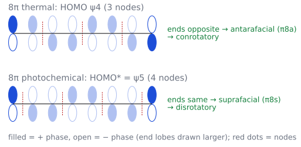
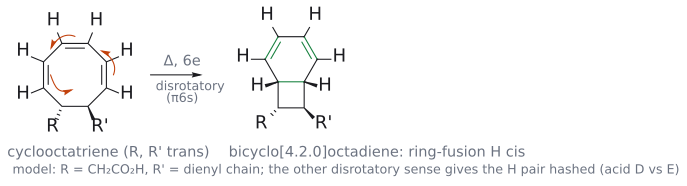
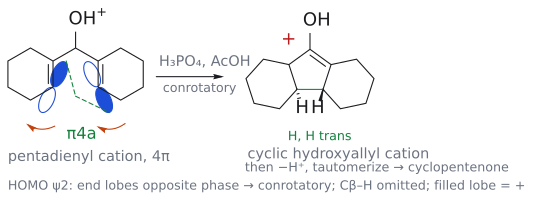
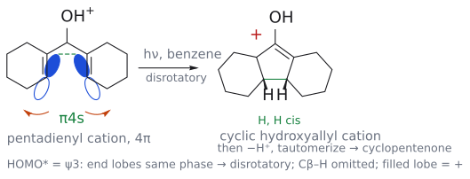
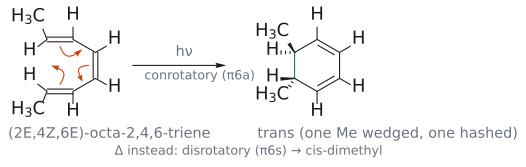
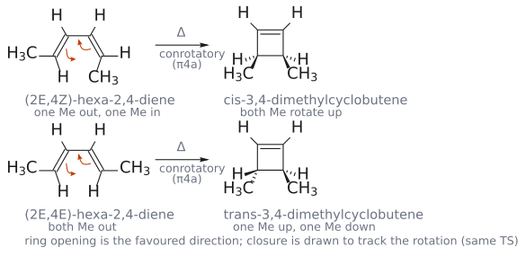
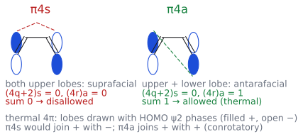

# L17 연습 문제와 해설

> [L17 electrocyclic reaction](../notes/L17_Electrocyclic_Reactions.md) 교재 기반 자가 점검을 유지하고 공식 강의 문제를 추가했다. Clayden 쪽수와 L# PDF 쪽수를 구별한다. 개념 설명은 [electrocyclic reaction](../wiki/반응/전자고리화%20반응.md), [conrotatory and disrotatory](../wiki/개념/콘로테이션과%20디스로테이션.md), [Nazarov cyclization](../wiki/반응/나자로프%20고리화.md)에 있다.

## 공식 강의 문제 — 회전과 출발 기하

### endiandric acid cascade

p.14의 polyene에서 첫 닫힘의 전자 수와 회전을 적고, 생긴 intermediate에서 남은 conjugated 계를 다시 센다. 답은 8e conrotatory 다음 6e disrotatory다. 두 단계의 새  $\sigma$  결합과 고리 접합 H를 p.15와 비교한다. (출처: L17 p.14–15)

그림: 첫 닫힘이 8e conrotatory인 이유. 열적 HOMO ψ4(마디 3개)는 양 끝 위상(채움 +, 빈 것 −)이 반대라 antarafacial(π8a) = conrotatory이고, 광화학이라면 ψ5(마디 4개)로 양 끝 위상이 같아 disrotatory다. (출처: L17 p.19)

그림: 두 번째 닫힘. 8e conrotatory로 생긴 cyclooctatriene(치환기 trans, R = CH2CO2H와 dienyl 사슬 R'의 모형)의 6π 계가 열적 disrotatory(π6s)로 닫혀 bicyclo[4.2.0]octadiene이 되고, 고리 접합의 두 H는 cis(둘 다 쐐기)가 된다. 주황 화살표는 전자 이동, 초록은 새 σ 결합과 옮겨 간 π 결합이다. 반대 방향의 disrotatory는 두 H가 모두 점선인 endiandric acid E 쪽을 준다. (출처: L17 p.15)

### vitamin D와 Nazarov

vitamin D의 앞 6e ring opening은 광조건 conrotatory이고, 뒤의 [1,7]H는 thermal antarafacial이다. Nazarov의 pentadienyl cation은 5 orbital/4e로, thermal conrotatory와 photochemical disrotatory가 다른 접합 입체배치를 준다. 반응명만 쓰지 말고 두 H의 앞/뒤 면을 p.18,21–22와 대조한다. (출처: L17 p.17–22)

그림: H3PO4/AcOH에서 pentadienyl cation(p orbital 5개, 4π)의 HOMO ψ2는 양 끝 위상(채움 +, 빈 것 −)이 반대라 antarafacial(π4a, 초록 점선) = conrotatory(주황 화살표 같은 방향)로 닫히고, 고리 접합 두 H는 trans(쐐기 + 점선)다. 보충: lobe 위상은 HOMO 모델로 보충한 것이다. (출처: L17 p.20, 22)

그림: hν, benzene에서는 HOMO*가 ψ3라 양 끝 위상이 같고, suprafacial(π4s) = disrotatory(주황 화살표 반대 방향)로 닫혀 두 H가 cis(둘 다 쐐기)다. 두 그림 모두 그다음 −H⁺와 tautomerization으로 cyclopentenone이 된다. (출처: L17 p.20–21)

### aziridine을 생성물에서 역산하기

p.24 아래의 두 pyrroline 생성물에서 ester의 cis/trans를 읽는다. [3+2]를 거꾸로 잘라 ylide 기하를 얻고, thermal 4e conrotatory opening을 역으로 적용해 출발 aziridine의 cis/trans를 찾는다. 답은 p.25에 있으며 alkene 포획과 alkyne 포획의 온도는 서로 다른 예의 조건이다. (출처: L17 p.24–25)

| 역산 단계 | 확인할 항목 |
| --- | --- |
| Aziridine opening | N lone pair를 포함한 4e; thermal conrotatory |
| Azomethine ylide 포획 | 4e dipole + alkyne 2e의 [3+2] |
| 최종 배치 역산 | 출발 aziridine cis/trans와 최종 고리의 상대배치를 원자별로 추적 |

원본 문제의 정답 쐐기·점선은 아래 공식 풀이를 기준으로 한다. 위 표는 그 구조를 대체하는 임의의 생성물 배정이 아니다. (출처: L17 p.24–25)

[원본 자료에서 세부 구조·입체배치 확인: L17_Electrocyclic reactions.pdf p.25](../figures/L17/source/L17_p25.png)

## 교재 기반 자가 점검 문제

1. (2*E*,4*Z*,6*Z*)-옥타-2,4,6-triene을 (a) 가열했을 때와 (b) 빛을 쬐었을 때 생기는 5,6-dimethylcyclohexa-1,3-diene의 두 Me cis/trans를 각각 쓰고, 각 반응을  $\pi6\mathrm{s}$ / $\pi6\mathrm{a}$ 로 표시하라.

2. trans-3,4-dimethylcyclobutene을 가열하면 hexa-2,4-diene의 어떤 기하 이성질체가 생기는가? cis 이성질체를 가열한 결과(Clayden 예)와 비교해 설명하라. 또 이 반응을 HOMO의 양 끝 위상으로 설명하려면 어느 쪽(cyclobutene 쪽 또는 diene 쪽) orbital을 보는 것이 편한지 쓰라.

3. 다음 반응 각각에 대해  $\Delta\sigma$ 로 페리고리 갈래를 정하고, 참여 전자 수와 Woodward–Hoffmann 기술을 쓰라. (a) hexatriene → cyclohexadiene, (b) pent-4-enal을 주는 allyl vinyl ether rearrangement, (c) butadiene + ethylene → cyclohexene, (d) 산 촉매 Nazarov 고리화의 고리 닫힘 단계.

4. 양 말단에 Me가 하나씩 있는 (*E*,*E*)-헵타-2,5-diene-4-one MeCH=CH–CO–CH=CHMe를 산으로 처리해 Nazarov 고리화를 시켰다. 고리 닫힘 단계에서 새  $\sigma$  결합 양쪽 탄소(각각 Me를 가진 탄소)의 두 Me는 cis와 trans 중 어느 관계가 되는가? 근거를 쓰라. (tautomerization 단계에서 한쪽 입체중심이 없어질 수 있다는 점은 무시하고 고리 닫힘 직후만 생각하라.)

5. cyclopropyl tosylate를 acetic acid 속에서 가용매 분해했더니 cyclopropyl acetate가 아니라 allyl acetate가 생겼다.

$$
\begin{aligned} & \text{이 결과를 electrocyclic reaction으로 설명하고},\thinspace \text{반응 방향이 "allyl} \cr & \longrightarrow \text{cyclopropyl"이 아닌 이유를 쓰라} \end{aligned}
$$

.

6. trans-2,3-비스(methoxycarbonyl)-1-phenylaziridine을 dimethyl acetylylenedicarboxylate(MeO2C–C≡C–CO2Me)와 가열했다. 생성 dihydropyrrole의 2,5-위치 두 ester는 cis와 trans 중 어느 쪽인가? 두 단계 각각의 stereochemistry 규칙을 쓰라.

---

## 해설

1. (a) 가열:  $6\pi$  열적 → disrotatory( $\pi6\mathrm{s}$ ). (2*E*,4*Z*,6*E*)에서 cis가 나오므로, 한쪽 말단 기하(6*E* → 6*Z*)를 바꾼 이 triene에서는 그 끝의 Me가 반대쪽을 향하게 되어 **trans**-5,6-dimethyl이 된다. (b) 빛:  $6\pi$  광화학 → conrotatory( $\pi6\mathrm{a}$ ) → 이번에는 **cis**. 말단 기하 하나를 바꾸거나 회전 방식을 바꾸면 결과가 뒤집히고, 둘 다 바꾸면 그대로라는 점을 확인한다. (출처: Clayden p.924–927)

   

   그림: 강의 예 (2E,4Z,6E)-triene의 광화학 고리 닫힘. conrotatory(π6a)라 두 Me가 반대 면으로 돌아 trans-dimethyl(쐐기 + 점선)이 되고, 가열하면 disrotatory(π6s)로 cis가 된다. 이 문제의 (2E,4Z,6Z)-triene은 한쪽 말단 기하가 바뀐 경우이므로 결과가 뒤집힌다. (출처: L17 p.16)

2.  $4\pi$  열적 → conrotatory. cis 이성질체가 (*E*,*Z*)를 Clayden, 한쪽 입체중심을 뒤집은 trans 이성질체는 (*E*,*E*)-hexa-2,4-diene을 준다.[^1] HOMO로 설명할 때는 Clayden처럼 **고리 닫힘(diene 쪽)** 으로 생각하는 것이 편하다. butadiene HOMO  $\psi_{2}$ 의 양 끝 위상이 반대이므로 conrotatory이다. (출처: Clayden p.923, p.925; 보충 근거: Wade p.672)

   

   그림: 고리 닫힘 방향으로 그린 대응 관계. 위는 강의 예(cis-cyclobutene ⇄ (2E,4Z)-diene), 아래는 보충: 이 문제의 trans-cyclobutene ⇄ (2E,4E)-diene이다. 같은 conrotatory 회전이지만 두 Me가 모두 바깥에 있으면 한 Me는 위, 다른 Me는 아래로 간다. 주황 화살표는 전자 이동이다. (출처: L17 p.12)

   

   그림: diene 쪽 HOMO ψ2의 양 끝 위상(채움 +, 빈 것 −)이 반대라 윗면끼리 잇는 π4s(빨강 점선)는 금지이고 한쪽 아랫면과 잇는 π4a(초록 점선), 즉 conrotatory가 허용이다. 보충: 슬라이드는 lobe 위상 없이 Woodward–Hoffmann 성분 셈으로만 판정한다. (출처: L17 p.10)

3. (a)  $\Delta\sigma$  = +1 electrocyclic reaction,  $6\pi, \pi6\mathrm{s}$ (합 1). (b)  $\Delta\sigma$  = 0 sigmatropic [3,3], 6전자,  $\pi2\mathrm{s}$  +  $\sigma2\mathrm{a}$  +  $\pi2\mathrm{a}$ (합 1). (c)  $\Delta\sigma$  = +2 cycloaddition, 6전자,  $\pi4\mathrm{s}$  +  $\pi2\mathrm{s}$ (합 1). (d)  $\Delta\sigma$  = +1 electrocyclic reaction, pentadienyl cation  $4\pi$ (5orbital),  $\pi4\mathrm{a}$ (합 1, conrotatory). 네 반응 모두 열적 허용이지만 electrocyclic reaction만 "회전 방향"이라는 추가 정보를 준다. (출처: Clayden p.912–913, p.922–924, p.927)

4. pentadienyl cation은  $4\pi$ 이므로 열적(산 촉매) 반응은 conrotatory이다. 양 끝이 (*E*) 기하로 Me를 바깥쪽에 두고 있으므로, 같은 회전 방향으로 돌면 한 Me는 고리 면 위로, 다른 Me는 아래로 간다. 따라서 고리 닫힘 직후 두 Me는 **trans**다. 같은 반응을 빛으로 disrotatory cis가 된다. Clayden의 고리 접합 H 예(산 → trans, 빛 → cis)와 같은 논리다. (출처: Clayden p.927–928)

5. tosylate가 떨어지기 시작하면 cyclopropyl cation이 생기려 하지만, 이  $2\pi$ 계는 ring strain 때문에 생기자마자 disrotatory electrocyclic reaction로 열려 allyl cation이 된다. acetic acid이 allyl cation을 붙잡아 allyl acetate가 생긴다. 대칭으로는 allyl → cyclopropyl 고리 닫힘도 허용이지만, 3원 ring strain 때문에 열역학이 고리 열림 쪽을 택한다. Woodward–Hoffmann 규칙은 허용만 말하고 방향은 말하지 않는다. (출처: Clayden p.928의 사이클로프로필 클로라이드 예를 바꿈)

6. **cis**. (1) aziridine 고리 열림은  $4\pi$  azomethine ylide를 주는 열적 electrocyclic reaction이므로 conrotatory이다. trans-aziridine을 conrotatory로 열면 두 ester가 ylide에서 같은 방향을 향하는 기하가 된다. (2) [3+2]는  $\pi4\mathrm{s}$  +  $\pi2\mathrm{s}$  suprafacial–suprafacial이라 ylide 기하가 그대로 고리에 옮겨진다. 그래서 trans-aziridine → 2,5-cis, cis-aziridine → 2,5-trans다. Clayden은 dipolarophile로 EtO2C–C≡C–CO2Et를 썼지만 DMAD여도 논리는 같다. (출처: Clayden p.929)

[^1]: 보충: conrotatory에는 두 끝이 모두 시계 방향인 경우와 모두 반시계 방향인 경우가 있어, trans-3,4-dimethylcyclobutene에서는 이론상 (*E*,*E*)와 (*Z*,*Z*)가 모두 conrotatory 생성물이다. 두 교과서는 이 두 방향 사이의 선택을 다루지 않으므로([electrocyclic reaction](../wiki/반응/전자고리화%20반응.md) 문서 각주의 토크선택성), 여기서는 steric hindrance가 작은 (*E*,*E*)라고만 적는다. 슬라이드가 나오면 확인할 부분이다.
