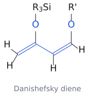
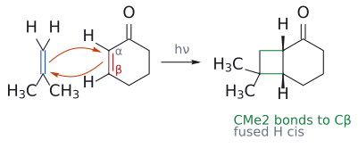
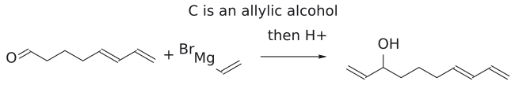
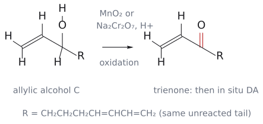

# CM3121 Tutorial 4 — Cycloadditions

> 문제: `Tutorial Questions 4.pdf` p.1–2. 공식 풀이: `Tutorial 4_answers.pdf` p.1–2. 2026-10-18에 공식 답안을 반영했다. 아래의 **공식 풀이**와 **해설·검토 의견**은 구별한다.

## 문제 1 — Danishefsky diene의 regioselectivity와 endo 접근

그림: 첫 그림은 Danishefsky 주개 구조, 두 번째는 endo와 in 치환기의 별도 강의 예다. Tutorial 4 Q1의 실제 cyclic dienophile 및 생성물의 두 syn 관계는 아래 공식 답안에서 확인한다. 두 번째 그림을 그 문제의 생성물로 복사하지 않는다. (원본 대조: Tutorial 4_answers.pdf p.1)

[원본 자료에서 세부 구조·입체배치 확인: Tutorial 4_answers.pdf p.1](../figures/tutorials/T04_answers_q1.png)

### 공식 풀이

Danishefsky diene은 electron-rich diene으로 HOMO를, ester와 conjugated된 cyclic alkene은 dienophile로 LUMO를 사용한다. 새 C–C 결합 두 개를 만들어 cis-fused bicyclic cyclohexene을 만든다. 다른 고립된 C=C는 이 단계에서 그대로 남는다. 답안은 [4+2] **endo** 접근을 그리고 **OMe와 CO2Me가 syn**, 그리고 dienophile에서 유래한 고리 접합 관계가 **syn/stereospecific**이라고 구분해 표시한다. (출처: Tutorial 4_answers p.1)

### 왜 두 가지 syn을 나누어 설명하나

regioselectivity는 먼저 어느 말단끼리 연결되는지를 고른다. OMe/OSiMe3가 주는 polarization을 같은 방향으로 맞춘 뒤 그 결합 연결을 고정한다. endo는 그 상태에서 dienophile이 diene의 어느 쪽으로 접근하는지를 고르고, 고리 융합 관계는 dienophile에 대한 suprafacial 결합 형성으로 보존된다. 따라서 “cis이므로 endo”라고 둘을 같은 원리로 쓰지 않는다. (출처: L14 p.11–17; Tutorial 4_answers p.1)

**검토 의견:** 이전 제안에서 OMe–CO2Me 관계를 불확실로 두었으나 제공된 답안은 syn(endo)로 명시한다. 이 문제의 답은 공식 그림의 일차 cycloaddition 생성물이다. 산 후처리로 OSiMe3/OMe가 바뀌어 enone이 되는 일반적인 Danishefsky 후속 반응은 별도 보충이며, 문제에 없는 산 처리 단계를 답안에 임의로 넣지 않는다. (출처: Tutorial 4_answers p.1; L15 p.26)

[공식 답안 p.1 전체 보기](../figures/tutorials/T04_answers_p01.png)

## 문제 2(a) — 광화학 [2+2] 다음 환원

그림: 광[2+2]의 기본 연결과 stereospecificity를 보여 주는 별도 강의 예다. 실제 Q2(a)의 cyclobutene diester, NaBH4 후 lactone과 접합 입체배치는 아래 공식 답안에 있다. (원본 대조: Tutorial 4_answers.pdf p.1)

[원본 자료에서 세부 구조·입체배치 확인: Tutorial 4_answers.pdf p.1](../figures/tutorials/T04_answers_q2a.png)

### 공식 풀이

두 출발물은 cyclobutene-1,2-dicarboxylic acid의 dimethyl ester와 3-methylcyclohex-2-en-1-one이다. $h\nu$ 조건에서 [2+2]로 두 alkene을 연결해 공식 그림의 다환 keto diester를 만들고, NaBH4 처리 후 제시된 lactone을 얻는다. 중간체의 CO2Me 두 개와 접합 H/Me의 상대배치는 p.1의 쐐기·점선을 따른다. (출처: Tutorial 4_answers p.1)

환원으로 생긴 alcohol이 가까운 ester와 고리형 ester를 형성하는 연결을 확인한다. NaBH4 단계에서 모든 ester가 alcohol로 바뀐다고 그려서는 표적의 lactone carbonyl과 남은 CO2Me를 보존할 수 없다. **검토 의견:** 답안은 이 단계의 자세한 proton transfer와 work-up을 생략하므로, 이를 독립된 추가 공식 조건처럼 만들어 적지 않는다. (출처: Tutorial 4_answers p.1)

## 문제 2(b) — allylic alcohol C를 거쳐 in situ DA

[원본 자료에서 세부 구조·입체배치 확인: Tutorial 4_answers.pdf p.1](../figures/tutorials/T04_answers_q2b.png)

### 공식 풀이

aldehyde와 vinylmagnesium bromide를 반응시키고 산성 후처리하면 **C는 allylic alcohol**이다. 그다음 MnO2 또는 Na2Cr2O7/H+로 alcohol을 ketone으로 산화해 trienone을 만들며, 이것이 in situ intramolecular Diels–Alder를 한다. 공식 그림은 최종 cis-fused bicyclic ketone과 endo 접근을 표시한다. (출처: Tutorial 4_answers p.1)

그림: 첫 변환에서 vinyl C–C 결합이 aldehyde carbonyl 탄소에 생기고 C=O는 OH가 된다. C에는 아직 OH가 있다. (출처: Tutorial 4_answers p.1)

그림: MnO2 또는 Na2Cr2O7/H+가 allylic alcohol을 trienone으로 만든다. 그림은 산화까지만 보이며 뒤의 in situ DA는 원본 공식 답안에서 확인한다. (출처: Tutorial 4_answers p.1)

**정정:** 이전 문서는 Weinreb amide + vinyl Grignard를 권장하고 C를 trienone으로 해석했다. 이는 공식 답안의 경로와 다르므로 공식 풀이에서 제외했다. aldehyde → allylic alcohol → 산화라는 대안의 큰 흐름은 맞았지만, 공식 산화제는 위에 적은 두 조건이며 DMP는 공식 답안에 없다. (출처: Tutorial 4_answers p.1)

## 문제 3 — tropone과 aza-oxyallyl 성분

| 공식 메커니즘의 성분 | 전자 수·결합 추적 |
| --- | --- |
| Aza-oxyallyl형 3원자 성분 | $2\pi$; LUMO 받개 |
| Tropone 경로 | O부터 고리 말단까지 $8\pi$; HOMO 주개 |
| 새 결합 | Tropone O–CMe2 및 tropone C–N |
| WH 판정 | $\pi2_s+\pi8_s$: 열적 허용 |

전체 원자 연결과 공식 화살표는 원본 답안으로 확인한다. 표의 반응 성분 수와 원자 수를 혼동하지 않는다. (출처: Tutorial 4_answers p.2)

[원본 자료에서 세부 구조·입체배치 확인: Tutorial 4_answers.pdf p.2](../figures/tutorials/T04_answers_p02.png)

### 공식 풀이의 단계

1. Na2CO3가 amide N–H를 제거한다. N 중심 anion과 O 중심 공명 기여체를 구별해 그린다.
2. Br−가 이탈해 aza-oxyallyl형 3원자 **$2\pi$** 성분이 생긴다. 전하는 그림의 공명 구조처럼 분산되어 있으므로 이름만 보고 전체 순전하를 임의로 더하지 않는다.
3. tropone은 carbonyl O에서 고리의 반대 방향 $\pi$ 경로를 따라 끝 탄소까지 **$8\pi$** 성분으로 참여한다. 공식 답안은 aza-oxyallyl의 LUMO와 tropone의 HOMO를 표시한다.
4. tropone O–CMe2와 tropone 탄소–N 사이의 새 결합이 생기고, 이어 공명 구조의 전자를 되돌려 carbonyl을 회복해 제시된 fused heterocycle이 된다.

(출처: Tutorial 4_answers p.2)

### Woodward–Hoffmann과 regioselectivity

공식 판정은 $\pi2_s+\pi8_s$다. $(4q+2)_s$에 해당하는 $2\pi$ 성분은 하나, $8\pi$s는 세는 대상이 아니므로 합은 1이다. thermal 허용이다. 원자 수로 [8+3]이라고 부르는 것과 참여 전자 8+2=10은 같은 숫자가 아니다. (출처: Tutorial 4_answers p.2)

regioselectivity는 electron-rich tropone O와 electrophilic CMe2 말단, 나머지 N 말단과 tropone 탄소를 짝지어 설명한다. **검토 의견:** 공식 답안이 concerted cycloaddition 도식을 제시한다는 사실과 실험적으로 stepwise 가능성이 배제됐다는 주장은 다르다. 이 자료로 후자를 단정하지 않는다. HFIP 같은 구체 용매도 문제의 `solvent`에 임의로 대입하지 않는다. (출처: Tutorial 4_answers p.2)

## 관련 개념

- [DA regioselectivity](../wiki/개념/딜스-알더%20위치선택성.md), [endo](../wiki/개념/endo%20규칙.md), [photochemical [2+2]](../wiki/반응/광화학%202+2%20고리화%20첨가.md), [Woodward–Hoffmann](../wiki/개념/우드워드-호프만%20규칙.md)
