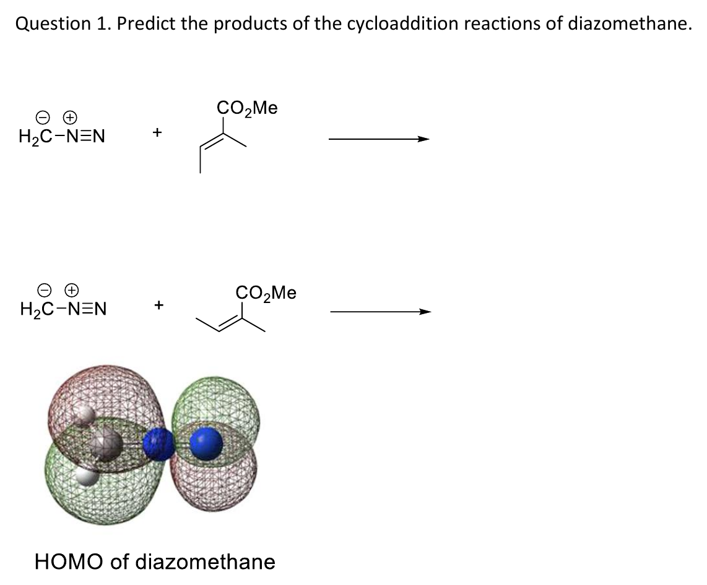
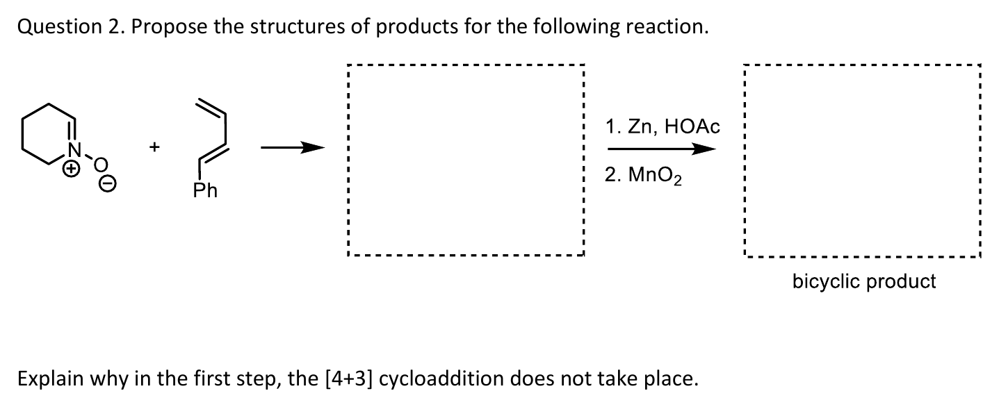
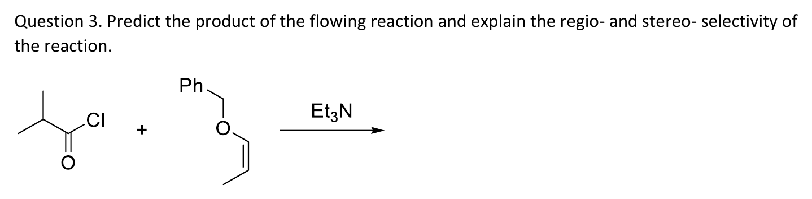
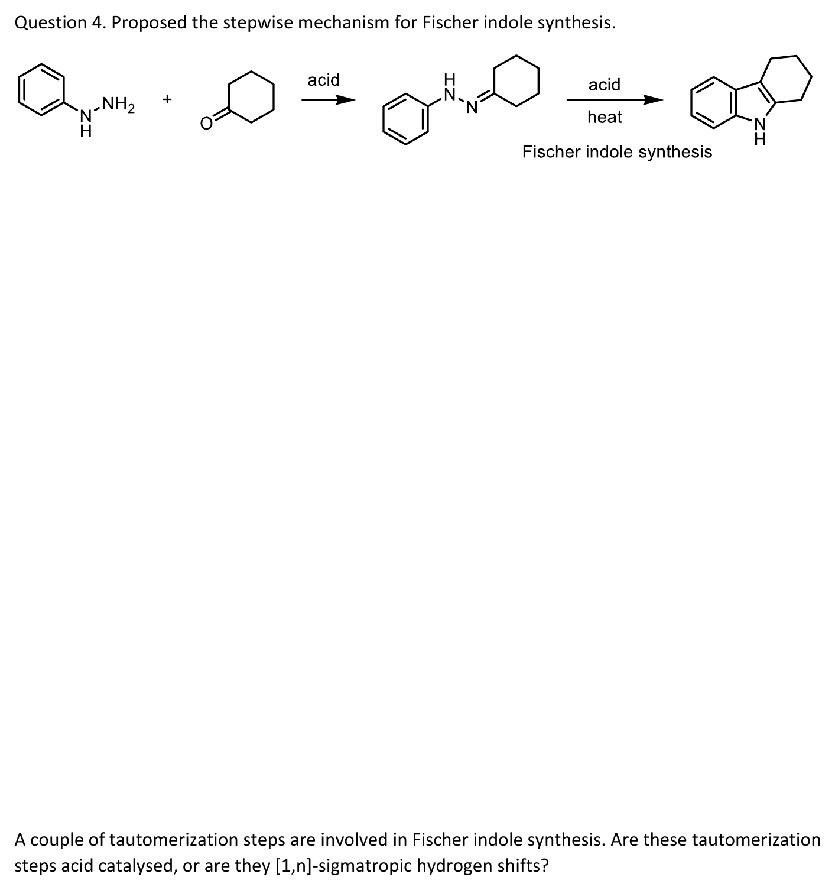

# CM3121 Tutorial 5 — Dipoles, ketene, Fischer indole

> 출처: `Tutorial Questions 5.pdf` p.1–4. **공식 답안은 현재 제공된 폴더에 없다.** 아래는 강의·교재에 근거한 풀이 제안이다. 제시된 구조 그림이 문제의 기준이고, 구체적인 regio-/stereoisomer 예측은 공식 답 확인 전까지 제안으로 취급한다.

## 문제 1 — diazomethane과 두 alkene

그림: 두 alkene의 치환기와 E/Z가 다르다. 아래는 diazomethane HOMO 그림이며 작은/큰 로브를 반응 계수와 연결한다. (출처: Tutorial Questions 5 p.1)

### 풀이 제안과 검산

diazomethane은 세 원자 4e 성분이다. alkene 2e와 [3+2]로 만나 pyrazoline형 5원 고리를 만든다. 이 단계에서 질소 두 개를 N2로 날리고 cyclopropane을 그리는 것은 문제의 cycloaddition 생성물과 다른 후속 변환을 넣는 것이다. (출처: Tutorial Questions 5 p.1; L15 p.13–14)

CH2 쪽 큰 HOMO 계수를 electron-poor alkene의 $\beta$-탄소와 맞추는 연결을 먼저 검토한다. 원자 연결은 diazomethane의 C–N–N을 유지하고, C 말단–alkene $\beta$와 N 말단–alkene $\alpha$의 두 결합을 만든다. 그다음 출발 alkene에서 CO2Me와 $\beta$-Me가 같은 쪽인지 반대쪽인지를 생성물의 상대배치로 옮긴다. 문제의 위 alkene과 아래 alkene을 같은 substrate로 복사하지 않는다. **검토 의견:** 이 연결 방향은 FMO에 따른 예측이며 공식 답 확인 전에는 단일 생성물 확정으로 쓰지 않는다. (출처: Tutorial Questions 5 p.1; L15 p.14–19)

그림: 공명 기여체에서 전하 위치가 달라도 같은 세 원자가 반응 성분이다. 주황 화살표는 전자쌍 이동이고 공명 화살표는 두 구조가 같은 분자임을 뜻한다. (출처: Tutorial Questions 5 p.1; L15 p.13)

## 문제 2 — nitrone + diene, 그다음 Zn/HOAc와 MnO2

그림: 첫 빈칸은 bicyclic product이고, 다음 조건은 1. Zn/HOAc, 2. MnO2다. (출처: Tutorial Questions 5 p.2)

### 풀이 제안

nitrone 4e와 diene의 C=C 하나 2e가 [3+2]를 한다. nitrone이 속한 6원 고리는 남고 그 옆에 isoxazolidine 5원 고리가 생기는 bicyclic adduct를 검토한다. 이어 Zn/HOAc로 N–O가 끊어지면 amino alcohol이 되고, 남은 C=C 옆의 allylic OH가 MnO2로 carbonyl로 바뀌는 경로가 조건과 맞는다. (출처: Tutorial Questions 5 p.2; L15 p.15–16)

후속 산화까지 연결되는 제안은 diene의 말단 C=C를 사용하고, nitrone C가 말단 CH2와, O가 그 옆 CH와 결합하는 방향이다. 환원 뒤에는 piperidine의 $\alpha$-탄소에 $\mathrm{{-}CH_2CH(OH)CH{=}CHPh}$ 사슬이 남고, 산화 뒤에는 $\mathrm{{-}CH_2C(=O)CH{=}CHPh}$가 된다. **검토 의견:** 이 구체 연결과 exo 상대배치는 공식 답안으로 확인되지 않았으므로 원본 구조의 atom mapping과 함께 검토한다. (출처: Tutorial Questions 5 p.2; L15 p.15–16)

### 왜 첫 단계가 [4+3]이 아닌가

nitrone은 allyl cation처럼 2e가 아니라 4e 성분이다. diene 전체 4e와 supra–supra로 결합하면 8e thermal 계가 되지만, 한 C=C만 쓰면 6e [3+2]가 된다. 이 판정은 강의의 concerted thermal 접근에 대한 것이며 모든 stepwise [4+3]을 보편적으로 금지하는 명제는 아니다. (출처: L14 p.4–6,22–23; L15 p.13–14; Tutorial Questions 5 p.2)

## 문제 3 — acid chloride + enol ether

그림: Et3N은 acid chloride에서 ketene을 만드는 단서다. O-benzyl 치환 alkene의 출발 기하를 유지해 읽는다. (출처: Tutorial Questions 5 p.3)

### 풀이 제안

Et3N에 의한 제거로 dimethylketene $\mathrm{Me_2C{=}C{=}O}$를 만든다. 이것이 enol ether와 thermal [2+2]를 해 cyclobutanone을 주는 경로다. enol ether의 $\beta$-탄소가 ketene carbonyl 탄소에, O-benzyl을 가진 $\alpha$-탄소가 ketene의 CMe2 탄소에 연결되는 극성 짝을 우선 검토한다. 이 연결이면 고리의 carbonyl을 C1로 셀 때 C2에 gem-dimethyl, C3에 OBn, C4에 Me가 놓인다. (출처: Tutorial Questions 5 p.3; L15 p.6–8)

원래 enol ether의 OBn와 Me 상대배치는 suprafacial alkene 성분에서 보존해 고리 면으로 옮긴다. **검토 의견:** 쐐기/점선의 최종 그림은 원본 E/Z와 함께 검산할 대상이며 공식 답으로 확정하지 않는다. 중요한 구조 검산은 C=O가 ketene에서 왔고 O-benzyl의 O는 고리 밖에 남는다는 것이다. (출처: Tutorial Questions 5 p.3; L15 p.6–8)

## 문제 4 — Fischer indole synthesis

그림: phenylhydrazine과 cyclohexanone의 hydrazone에서 fused indole로 가는 단계적 메커니즘을 묻는다. (출처: Tutorial Questions 5 p.4)

### 교재 근거로 검증한 메커니즘

hydrazone을 먼저 만든 뒤 acid-catalysed tautomerization으로 enehydrazine을 만든다. 이 구조에서 N–N $\sigma$ 결합과 두 $\pi$ 성분을 따라 [3,3]이 일어나 diimine으로 간다. aromaticity 회복 뒤 aryl에 남는 질소가 다른 imine 탄소를 공격해 고리를 닫고, 다른 질소는 NH3로 빠져나가 indole 골격을 만든다. 전체 과정이 한 번의 [3,3]인 것은 아니다. (보충 근거: Clayden p.916; 출제: Tutorial Questions 5 p.4)

tautomerization에서 H를 한 화살표로 [1,3] 이동시키지 않는다. 산 촉매의 protonation/deprotonation으로 그리며, concerted [3,3]은 별도의 고리형 전자 이동이다. 열적 [1,3]H는 antarafacial로만 허용되지만 이 짧은 사슬에서 기하상 불가능하다는 강의 설명과도 구별된다. 자세한 구조와 N 원자 추적은 [Fischer indole synthesis](../wiki/반응/Fischer%20indole%20synthesis.md)에 있다. (출처: L16 p.24; 보충 근거: Clayden p.916)

## 관련 개념

- [1,3-dipolar cycloaddition](../wiki/반응/1,3-쌍극자%20고리화%20첨가.md), [nitrone](../wiki/반응/나이트론%20고리화%20첨가.md), [ketene](../wiki/반응/케텐%202+2%20고리화%20첨가.md), [sigmatropic rearrangement](../wiki/반응/시그마트로픽%20자리옮김.md)
