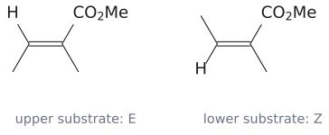
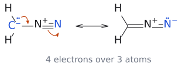
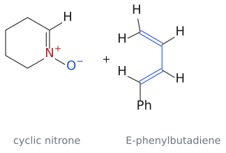
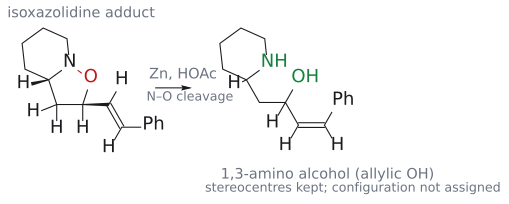
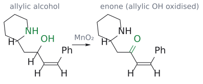
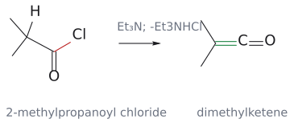
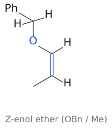
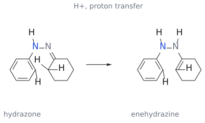
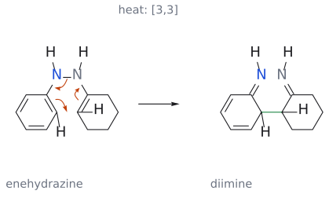

# CM3121 Tutorial 5 — Dipoles, ketene, Fischer indole

> 출처: `Tutorial Questions 5.pdf` p.1–4. **공식 답안은 현재 제공된 폴더에 없다.** 아래는 강의·교재에 근거한 풀이 제안이다. 제시된 구조 그림이 문제의 기준이고, 구체적인 regio-/stereoisomer 예측은 공식 답 확인 전까지 제안으로 취급한다.

## 문제 1 — diazomethane과 두 alkene

그림: 첫 패널은 문제의 두 alkene E/Z를 그대로 구별했다. 두 번째 패널은 공명 전자 이동이다. 생성물의 regio·stereo는 공식 정답으로 확정하지 않는다. 원본의 HOMO 로브 크기는 원본 링크에서 대조한다. (원본 대조: Tutorial Questions 5.pdf p.1)

[원본 자료에서 세부 구조·입체배치 확인: Tutorial Questions 5.pdf p.1](../figures/tutorials/T05_p01.png)

### 풀이 제안과 검산

diazomethane은 세 원자 4e 성분이다. alkene 2e와 [3+2]로 만나 pyrazoline형 5원 고리를 만든다. 이 단계에서 질소 두 개를 N2로 날리고 cyclopropane을 그리는 것은 문제의 cycloaddition 생성물과 다른 후속 변환을 넣는 것이다. (출처: Tutorial Questions 5 p.1; L15 p.13–14)

CH2 쪽 큰 HOMO 계수를 electron-poor alkene의 $\beta$-탄소와 맞추는 연결을 먼저 검토한다. 원자 연결은 diazomethane의 C–N–N을 유지하고, C 말단–alkene $\beta$와 N 말단–alkene $\alpha$의 두 결합을 만든다. 그다음 출발 alkene에서 CO2Me와 $\beta$-Me가 같은 쪽인지 반대쪽인지를 생성물의 상대배치로 옮긴다. 문제의 위 alkene과 아래 alkene을 같은 substrate로 복사하지 않는다. **검토 의견:** 이 연결 방향은 FMO에 따른 예측이며 공식 답 확인 전에는 단일 생성물 확정으로 쓰지 않는다. (출처: Tutorial Questions 5 p.1; L15 p.14–19)

![풀이 제안: diazomethane과 methyl tiglate(E)의 [3+2]로 1-pyrazoline이 생기는 과정](../figures/L15/tutorial5_q1_cycloaddition.svg)

그림: 문제 1 위쪽 alkene(E)의 풀이 제안이다. 파란 diazomethane(HOMO)의 C⁻ 비공유 전자쌍이 빨간 alkene(LUMO)의 $\beta$-탄소(H, Me가 달린 탄소)와 결합하고, alkene의 $\pi$ 전자가 $\alpha$-탄소에서 말단 N과 결합하며, N≡N의 $\pi$ 전자 하나가 N⁺로 돌아간다. 초록 결합이 새로 생긴 C–C와 C–N이고, alkene의 E 기하(CO2Me와 $\beta$-Me가 반대쪽)가 생성물의 trans 관계로 보존된다. 아래쪽 Z alkene은 같은 연결에서 두 치환기가 cis가 된다. 공식 답이 아니므로 regio·stereo는 제안으로 둔다. (출처: Tutorial Questions 5 p.1; L15 p.13–14)

그림: 공명 기여체에서 전하 위치가 달라도 같은 세 원자가 반응 성분이다. 주황 화살표는 전자쌍 이동이고 공명 화살표는 두 구조가 같은 분자임을 뜻한다. (출처: Tutorial Questions 5 p.1; L15 p.13)

## 문제 2 — nitrone + diene, 그다음 Zn/HOAc와 MnO2

그림: 첫 패널은 문제의 cyclic nitrone과 E-diene 출발물이다. 두 번째는 N–O 환원의 일반 모형이며, 실제 bicyclic 생성물의 확정 답안이 아니다. (원본 대조: Tutorial Questions 5.pdf p.2)

[원본 자료에서 세부 구조·입체배치 확인: Tutorial Questions 5.pdf p.2](../figures/tutorials/T05_p02.png)

### 풀이 제안

nitrone 4e와 diene의 C=C 하나 2e가 [3+2]를 한다. nitrone이 속한 6원 고리는 남고 그 옆에 isoxazolidine 5원 고리가 생기는 bicyclic adduct를 검토한다. 이어 Zn/HOAc로 N–O가 끊어지면 amino alcohol이 되고, 남은 C=C 옆의 allylic OH가 MnO2로 carbonyl로 바뀌는 경로가 조건과 맞는다. (출처: Tutorial Questions 5 p.2; L15 p.15–16)

![풀이 제안: 6원 고리 nitrone과 (E)-1-phenylbutadiene 말단 C=C의 [3+2]로 bicyclic isoxazolidine이 생기는 과정](../figures/L15/tutorial5_q2_cycloaddition.svg)

그림: 빨간 C=N⁺을 가진 고리형 nitrone(LUMO)과 파란 diene(HOMO)의 말단 C=C만 반응한다. O⁻의 전자쌍이 치환된 CH(styryl이 달린 탄소)와, nitrone 탄소가 말단 $CH_2$ 와 결합하며, 초록 결합이 새 C–O와 C–C다. 생성물은 piperidine에 isoxazolidine이 융합된 bicyclic adduct이고, 남은 C=C(styryl)는 O 옆 탄소에 붙는다. exo 배치(접합 H와 styryl 둘 다 쐐기)는 L15 p.16의 cyclic nitrone 예를 따른 제안이며 공식 답이 아니다. (출처: Tutorial Questions 5 p.2; L15 p.15–16)

후속 산화까지 연결되는 제안은 diene의 말단 C=C를 사용하고, nitrone C가 말단 CH2와, O가 그 옆 CH와 결합하는 방향이다. 환원 뒤에는 piperidine의 $\alpha$-탄소에 $\mathrm{{-}CH_2CH(OH)CH{=}CHPh}$ 사슬이 남고, 산화 뒤에는 $\mathrm{{-}CH_2C(=O)CH{=}CHPh}$가 된다. **검토 의견:** 이 구체 연결과 exo 상대배치는 공식 답안으로 확인되지 않았으므로 원본 구조의 atom mapping과 함께 검토한다. (출처: Tutorial Questions 5 p.2; L15 p.15–16)

그림: 첫 단계 adduct의 빨간 N–O 결합만 Zn/HOAc로 끊어지며, cycloaddition에서 만든 C–C·C–O 결합은 그대로 남는다. 초록 NH와 OH가 1,3 관계로 드러나고, OH는 styryl C=C 옆의 allylic 위치다. 입체 중심은 유지되지만 배치는 확정하지 않았다. (출처: Tutorial Questions 5 p.2; L15 p.16)

그림: $MnO_2$ 는 allylic alcohol만 선택적으로 산화한다. 왼쪽 초록 OH가 오른쪽 초록 C=O가 되어 Ph-CH=CH-C(=O)- enone이 되고, 2차 amine(NH)과 piperidine 고리는 그대로다. 이것이 문제가 말한 bicyclic이 아닌 점에 주의한다. 검토 의견: 문제는 최종 생성물을 "bicyclic product"라고 표시하므로, 생성된 NH가 enone에 분자 내 conjugate addition하여 두 번째 고리를 만드는 후속 단계가 의도되었을 수 있다. 그 구조는 공식 답 확인 전까지 그리지 않는다. (출처: Tutorial Questions 5 p.2)

### 왜 첫 단계가 [4+3]이 아닌가

nitrone은 allyl cation처럼 2e가 아니라 4e 성분이다. diene 전체 4e와 supra–supra로 결합하면 8e thermal 계가 되지만, 한 C=C만 쓰면 6e [3+2]가 된다. 이 판정은 강의의 concerted thermal 접근에 대한 것이며 모든 stepwise [4+3]을 보편적으로 금지하는 명제는 아니다. (출처: L14 p.4–6,22–23; L15 p.13–14; Tutorial Questions 5 p.2)

## 문제 3 — acid chloride + enol ether

그림: 문제의 acid chloride로부터 dimethylketene이 생기는 net 반응과 Z-enol ether를 분리했다. cyclobutanone의 최종 쐐기·점선은 여기서 확정하지 않는다. (원본 대조: Tutorial Questions 5.pdf p.3)

[원본 자료에서 세부 구조·입체배치 확인: Tutorial Questions 5.pdf p.3](../figures/tutorials/T05_p03.png)

### 풀이 제안

Et3N에 의한 제거로 dimethylketene $\mathrm{Me_2C{=}C{=}O}$를 만든다. 이것이 enol ether와 thermal [2+2]를 해 cyclobutanone을 주는 경로다. enol ether의 $\beta$-탄소가 ketene carbonyl 탄소에, O-benzyl을 가진 $\alpha$-탄소가 ketene의 CMe2 탄소에 연결되는 극성 짝을 우선 검토한다. 이 연결이면 고리의 carbonyl을 C1로 셀 때 C2에 gem-dimethyl, C3에 OBn, C4에 Me가 놓인다. (출처: Tutorial Questions 5 p.3; L15 p.6–8)

원래 enol ether의 OBn와 Me 상대배치는 suprafacial alkene 성분에서 보존해 고리 면으로 옮긴다. **검토 의견:** 쐐기/점선의 최종 그림은 원본 E/Z와 함께 검산할 대상이며 공식 답으로 확정하지 않는다. 중요한 구조 검산은 C=O가 ketene에서 왔고 O-benzyl의 O는 고리 밖에 남는다는 것이다. (출처: Tutorial Questions 5 p.3; L15 p.6–8)

![풀이 제안: dimethylketene과 (Z)-1-(benzyloxy)propene의 열적 [2+2]로 cyclobutanone이 생기는 과정](../figures/L15/tutorial5_q3_cycloaddition.svg)

그림: 파란색은 enol ether의 C=C로 OBn 반대쪽 $\beta$-탄소가 nucleophilic 자리이고, 빨간색은 ketene의 C=O로 carbonyl 탄소가 electrophilic 자리다. 위쪽 화살표는 $\beta$-탄소가 carbonyl 탄소와 결합하는 것을, 아래쪽 화살표는 ketene C=C의 전자가 OBn 달린 $\alpha$-탄소와 결합하는 것을 나타낸다. 초록 결합이 새 두 $\sigma$ 결합이며, Z alkene에서 같은 쪽이던 Me와 OBn은 생성물에서도 둘 다 쐐기(cis)로 남는다. 공식 답이 아닌 제안이다. (출처: Tutorial Questions 5 p.3; L15 p.6–8)

## 문제 4 — Fischer indole synthesis

그림: 문제와 같은 cyclohexanone 유래 hydrazone에서 시작한다. 첫 패널은 acid-catalysed tautomerization, 두 번째는 [3,3]이다. 파란 N은 최종 indole에 남고 회색 N은 뒤에 NH3로 나간다. 상세 후속 단계는 Fischer indole 개념 문서에 있다. (보충 근거: Clayden p.916) (원본 대조: Tutorial Questions 5.pdf p.4)

[원본 자료에서 세부 구조·입체배치 확인: Tutorial Questions 5.pdf p.4](../figures/tutorials/T05_p04.png)

### 교재 근거로 검증한 메커니즘

hydrazone을 먼저 만든 뒤 acid-catalysed tautomerization으로 enehydrazine을 만든다. 이 구조에서 N–N $\sigma$ 결합과 두 $\pi$ 성분을 따라 [3,3]이 일어나 diimine으로 간다. aromaticity 회복 뒤 aryl에 남는 질소가 다른 imine 탄소를 공격해 고리를 닫고, 다른 질소는 NH3로 빠져나가 indole 골격을 만든다. 전체 과정이 한 번의 [3,3]인 것은 아니다. (보충 근거: Clayden p.916; 출제: Tutorial Questions 5 p.4)

tautomerization에서 H를 한 화살표로 [1,3] 이동시키지 않는다. 산 촉매의 protonation/deprotonation으로 그리며, concerted [3,3]은 별도의 고리형 전자 이동이다. 열적 [1,3]H는 antarafacial로만 허용되지만 이 짧은 사슬에서 기하상 불가능하다는 강의 설명과도 구별된다. 자세한 구조와 N 원자 추적은 [Fischer indole synthesis](../wiki/반응/Fischer%20indole%20synthesis.md)에 있다. (출처: L16 p.24; 보충 근거: Clayden p.916)

## 관련 개념

- [1,3-dipolar cycloaddition](../wiki/반응/1,3-쌍극자%20고리화%20첨가.md), [nitrone](../wiki/반응/나이트론%20고리화%20첨가.md), [ketene](../wiki/반응/케텐%202+2%20고리화%20첨가.md), [sigmatropic rearrangement](../wiki/반응/시그마트로픽%20자리옮김.md)
