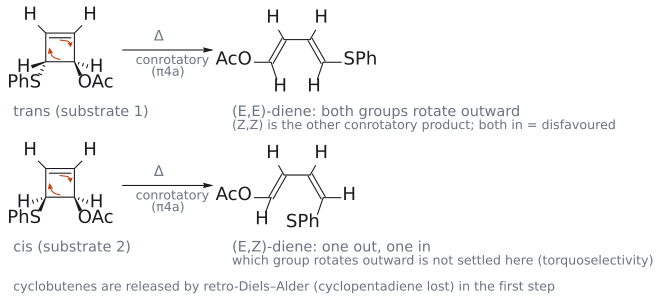
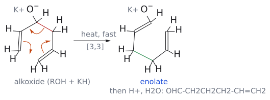
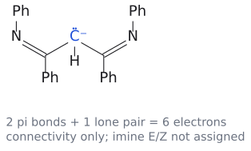
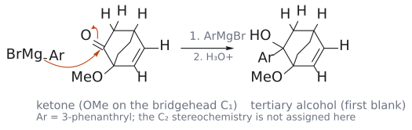
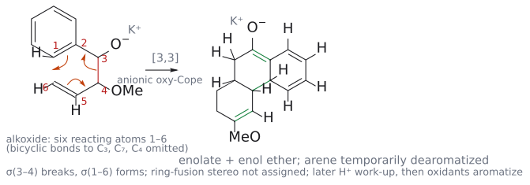
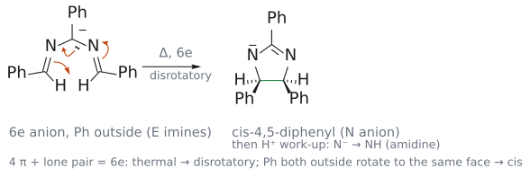
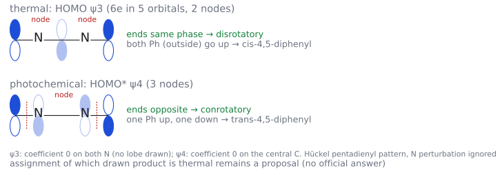

# CM3121 Tutorial 6 — Pericyclic cascades

> 출처: `Tutorial Questions 6.pdf` p.1–2. **공식 답안은현재 제공된 폴더에 없다.** 아래에서는 문제의 구조와 강의로 확인한 단계, 아직 확정하지 않은 생성물 배치를 구분한다. 불확실한 구조를 임의의 공식 정답 그림으로 대체하지 않았다.

## 문제 1 — 두 입체이성질체의 열반응

그림: retro-DA의 결합 변화를 보여 주는 무치환 dicyclopentadiene 예다. 원본 SPh/OAc 두 기질의 입체배치를 대체하지 않는다. 원본 구조와 아직 미확정인 최종 생성물은 아래 자료와 본문 검토 중 표시를 함께 읽는다. (원본 대조: Tutorial Questions 6.pdf p.1)

[원본 자료에서 세부 구조·입체배치 확인: Tutorial Questions 6.pdf p.1](../figures/tutorials/T06_p01.png)

### 확인된 출발점과 풀이 절차

먼저 bicyclic 골격에서 Diels–Alder로 만들어졌던 두 C–C $\sigma$ 결합을 찾아 끊고, 생성되는 $\pi$ 결합을 함께 되돌린다. 남는 cyclopentadiene 조각과 다른 조각을 별개로 그린 다음, 원래의 SPh와 OAc 치환기가 어느 탄소에 남는지 번호로 추적한다. 두 출발물의 차이를 retro-DA 이전에 지우면 그 뒤의 입체선택성을 설명할 수 없다. (출처: Tutorial Questions 6 p.1; L13의 retro-DA 예)

**검토 중:** 문제의 최종 빈칸은 단순히 “retro-DA”라는 반응명만 적는 칸이 아니다. 생성된 조각에서 이어질 반응과 두 기질의 최종 stereoisomer를 구조적으로 확인해야 한다. 현재는 그 최종 구조를 확정하지 않았으며, 아래 일반 규칙만으로 임의의 cis/trans 정답을 제시하지 않는다. (출처: Tutorial Questions 6 p.1)

그림: 풀이 제안(공식 답 없음). retro-Diels–Alder로 cyclopentadiene이 떨어져 나간 뒤 남는 3-acetoxy-4-(phenylthio)cyclobutene의 열적 4π 고리 열림을 그렸다. 열적 4π는 conrotatory(π4a)이므로 OAc와 SPh가 trans인 기질(원본 위 그림)은 두 기가 같은 방향으로 돌아 둘 다 바깥으로 나가는 (E,E)-1-acetoxy-4-(phenylthio)buta-1,3-diene(둘 다 안쪽으로 가는 (Z,Z)는 입체 반발 때문에 불리)을, cis인 기질(원본 아래 그림)은 한 기는 바깥, 다른 기는 안쪽으로 가는 (E,Z)-diene을 준다. 두 기질이 서로 다른 기하 이성질체를 주는 것이 stereospecific conrotatory 개환의 지문이다. cis 기질에서 어느 기가 바깥으로 도는지(torquoselectivity)와 원본 기질의 cis/trans 판독은 추가 검증 항목이다. 주황 화살표는 전자 이동이다. (출처: Tutorial Questions 6 p.1; L17 p.12)

## 문제 2 — Grignard, anionic oxy-Cope, aromatization

그림: 첫 패널은 Q2의 [3,3]을 이해하기 위한 기본 모형이며 실제 phenanthrene 골격의 정답은 아니다. 두 번째는 Q3 탈양성자화 계의 원자 연결·6e 셈이다. imine E/Z 및 최종 thermal/photo 생성물 배정은 확정하지 않았다. (원본 대조: Tutorial Questions 6.pdf p.2)

검토 의견: 위 두 번째 그림(`tutorial6_6e_anion.svg`)은 원래 Ph가 N에 붙은 PhN=C(Ph)–CH⁻–C(Ph)=NPh로 그려져 있었으나, 원본 Q3 기질 PhCH=N–CH(Ph)–N=CHPh(Ph가 탄소에, N은 고리 안쪽)에 맞게 2026-10-22에 그림을 원본 구조 PhCH=N–C⁻(Ph)–N=CHPh로 수정했다. (출처: Tutorial Questions 6 p.2)

[원본 자료에서 세부 구조·입체배치 확인: Tutorial Questions 6.pdf p.2](../figures/tutorials/T06_p02.png)

### 단계별로 확인할 구조

첫 빈칸에서는 arylmagnesium bromide의 MgBr가 붙었던 탄소와 ketone carbonyl 탄소 사이에 새 C–C 결합이 생기고, 산성 후처리로 OH가 된다. aromatic Grignard의 위치를 다른 phenanthrene 탄소로 옮기지 않는다. 그다음 KH는 OH를 alkoxide로 바꾸고, 주어진 [3,3] rearrangement는 적절한 1,5-diene 경로에서 중앙 $\sigma$ 결합을 끊고 두 말단을 잇는다. (출처: Tutorial Questions 6 p.2; L16 p.16–17)

그림: 풀이 제안(공식 답 없음). 1-methoxybicyclo[2.2.2]oct-5-en-2-one의 C=O 탄소에 Ar–MgBr(Ar = 3-phenanthryl)의 C–Mg 결합 전자가 들어가고(주황 화살표) C=O의 π 전자는 O로 옮겨 간다. 산성 후처리로 OH가 되어 첫 빈칸의 3차 alcohol이 된다. 새 입체중심 C2의 배치는 정하지 않았다. (출처: Tutorial Questions 6 p.2)

[3,3] 직후에는 enolate를 먼저 그린다. 마지막 oxidants는 ring fusion을 새로 발명하는 지시가 아니라 이미 만들어진 골격의 dehydrogenative aromatization 조건이다. 문제는 최종 fused aromatic compound에 benzene ring 다섯 개가 있다고 명시하므로 ring count와 carbon count를 함께 검사한다. (출처: Tutorial Questions 6 p.2; L16 p.16–17)

그림: 풀이 제안(공식 답 없음). KH가 OH를 alkoxide로 바꾸면 arene의 C=C(원자 1, 2), alkoxide 탄소(3), OMe 탄소(4), 고리 alkene(5, 6)이 1,5-diene 역할을 한다. 빨강 σ(3–4)가 끊어지고 σ(1–6)이 생기며(주황 화살표 세 개), 초록이 새로 생긴 결합이다. 생성물은 enolate와 enol ether(OMe)를 가진 고리 넓힘 골격이며 arene 고리는 일시적으로 aromaticity를 잃는다. 3-phenanthryl 대신 Ph 모형이고 bicyclo 골격의 나머지 결합은 생략했으며, 고리 접합 배치는 정하지 않았다. 이후 H⁺ 후처리와 oxidants의 dehydrogenative aromatization으로 benzene 고리 다섯 개짜리 fused aromatic이 되는 것이 문제의 요구다. (출처: Tutorial Questions 6 p.2; L16 p.16–17)

**검토 중:** 마지막 fused polycycle의 정확한 연결 이성질체와 두 번째 빈칸의 상세 구조는 공식 답 없이 확정하지 않았다. 원자 번호를 보존한 구조 검증이 필요한 항목으로 남겼다. 이는 anionic oxy-Cope의 일반 원리가 미확인이라는 뜻은 아니다. (출처: Tutorial Questions 6 p.2)

## 문제 3 — base 처리 후 열/빛에서 달라지는 상대배치

### 풀이 제안: 먼저 전자 수를 센다

가운데 C–H가 제거되면 두 C=N과 가운데 carbanion의 lone pair가 이어지는 5원자 **6e** 계를 검토한다. 다섯 원자가 있으니 $5\pi$라고 세거나, Nazarov cation과 같다고 4e로 세지 않는다. thermal 6e closure는 disrotatory, photochemical 조건에서는 conrotatory다. 닫힌 뒤 N 중심 anion을 acid work-up에서 protonate하면 제시된 NH가 있는 고리로 연결될 수 있다. (출처: Tutorial Questions 6 p.2; L17 p.11–16; 보충 근거: Clayden p.928의 6e anion 논리)

두 생성물의 아래쪽 Ph 두 개는 한쪽에서 cis, 다른 쪽에서 trans다. 어떤 회전이 어느 그림을 주는지는 출발 imine의 E/Z와 실제 reactive conformation에서 말단 Ph를 같은 관찰 방향으로 추적해 정해야 한다. **검토 중:** 전자 수·회전 규칙과 별개로, 원본 출발 기하에서 왼쪽/오른쪽 생성물 중 무엇이 thermal major인지의 최종 배정은 추가 구조 검증 전까지 확정하지 않았다. (출처: Tutorial Questions 6 p.2; L17 p.11–16)

그림: 풀이 제안(공식 답 없음). base가 가운데 C–H를 떼어 내면 PhCH=N–C⁻(Ph)–N=CHPh(C=N 2개 + 탄소 lone pair = 6e, p orbital 5개)가 된다. 주황 화살표: lone pair가 C=N을 만들고, C=N의 π 전자가 양 끝 CHPh 탄소 사이의 새 σ 결합(초록)을 만들며, 다른 C=N의 π 전자는 N으로 가 N 음이온이 된다. 열적 6e는 disrotatory이고, 두 Ph가 모두 바깥(E imine)에 있으면 같은 면으로 돌아 cis-4,5-diphenyl이 된다. 산 후처리로 N⁻가 NH(amidine)가 된다. (출처: Tutorial Questions 6 p.2; L17 p.11, 13)

그림: 풀이 제안. 6e가 p orbital 5개에 들어가면 HOMO는 ψ3(마디 2개, 두 N 위 계수 0)로 양 끝 위상(채움 +, 빈 것 −)이 같아 disrotatory → cis-4,5-diphenyl(열적 주생성물 제안). 빛에서는 ψ4(마디 3개)가 HOMO*가 되어 양 끝 위상이 반대 → conrotatory → trans-4,5-diphenyl(광화학 주생성물 제안). 보충: N의 전기음성도 섭동을 무시한 Hückel pentadienyl 패턴이며, 출발 imine의 E/Z 가정에 따라 cis/trans 배정이 뒤집힐 수 있다. (출처: Tutorial Questions 6 p.2; L17 p.11, 16, 19)

## 관련 개념

- [retro-Diels–Alder](../wiki/반응/역%20딜스-알더%20반응.md), [Cope/oxy-Cope](../wiki/반응/코프%20자리옮김.md), [electrocyclic reaction](../wiki/반응/전자고리화%20반응.md), [con/dis](../wiki/개념/콘로테이션과%20디스로테이션.md)
