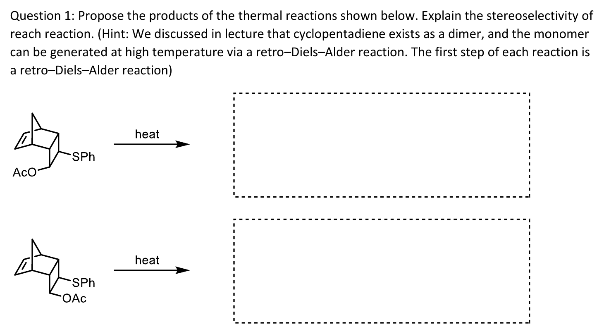
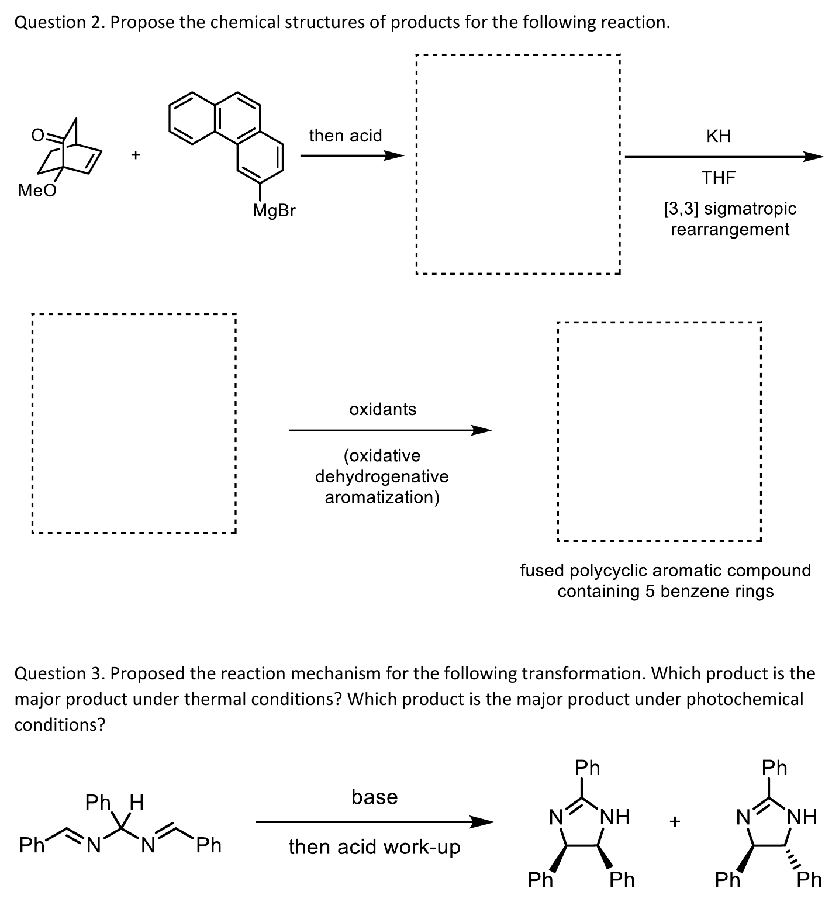

# CM3121 Tutorial 6 — Pericyclic cascades

> 출처: `Tutorial Questions 6.pdf` p.1–2. **공식 답안은현재 제공된 폴더에 없다.** 아래에서는 문제의 구조와 강의로 확인한 단계, 아직 확정하지 않은 생성물 배치를 구분한다. 불확실한 구조를 임의의 공식 정답 그림으로 대체하지 않았다.

## 문제 1 — 두 입체이성질체의 열반응

그림: 두 출발 구조의 AcO/OAc 방향이 다르다. 문제는 두 반응 모두 첫 단계가 retro-Diels–Alder라고 명시한다. (출처: Tutorial Questions 6 p.1)

### 확인된 출발점과 풀이 절차

먼저 bicyclic 골격에서 Diels–Alder로 만들어졌던 두 C–C $\sigma$ 결합을 찾아 끊고, 생성되는 $\pi$ 결합을 함께 되돌린다. 남는 cyclopentadiene 조각과 다른 조각을 별개로 그린 다음, 원래의 SPh와 OAc 치환기가 어느 탄소에 남는지 번호로 추적한다. 두 출발물의 차이를 retro-DA 이전에 지우면 그 뒤의 입체선택성을 설명할 수 없다. (출처: Tutorial Questions 6 p.1; L13의 retro-DA 예)

**검토 중:** 문제의 최종 빈칸은 단순히 “retro-DA”라는 반응명만 적는 칸이 아니다. 생성된 조각에서 이어질 반응과 두 기질의 최종 stereoisomer를 구조적으로 확인해야 한다. 현재는 그 최종 구조를 확정하지 않았으며, 아래 일반 규칙만으로 임의의 cis/trans 정답을 제시하지 않는다. (출처: Tutorial Questions 6 p.1)

## 문제 2 — Grignard, anionic oxy-Cope, aromatization

그림: Q2에는 Grignard 첨가, KH/THF의 [3,3], oxidative dehydrogenative aromatization 조건이 주어져 있다. Q3은 열/빛의 두 생성물을 비교한다. (출처: Tutorial Questions 6 p.2)

### 단계별로 확인할 구조

첫 빈칸에서는 arylmagnesium bromide의 MgBr가 붙었던 탄소와 ketone carbonyl 탄소 사이에 새 C–C 결합이 생기고, 산성 후처리로 OH가 된다. aromatic Grignard의 위치를 다른 phenanthrene 탄소로 옮기지 않는다. 그다음 KH는 OH를 alkoxide로 바꾸고, 주어진 [3,3] rearrangement는 적절한 1,5-diene 경로에서 중앙 $\sigma$ 결합을 끊고 두 말단을 잇는다. (출처: Tutorial Questions 6 p.2; L16 p.16–17)

[3,3] 직후에는 enolate를 먼저 그린다. 마지막 oxidants는 ring fusion을 새로 발명하는 지시가 아니라 이미 만들어진 골격의 dehydrogenative aromatization 조건이다. 문제는 최종 fused aromatic compound에 benzene ring 다섯 개가 있다고 명시하므로 ring count와 carbon count를 함께 검사한다. (출처: Tutorial Questions 6 p.2; L16 p.16–17)

**검토 중:** 마지막 fused polycycle의 정확한 연결 이성질체와 두 번째 빈칸의 상세 구조는 공식 답 없이 확정하지 않았다. 원자 번호를 보존한 구조 검증이 필요한 항목으로 남겼다. 이는 anionic oxy-Cope의 일반 원리가 미확인이라는 뜻은 아니다. (출처: Tutorial Questions 6 p.2)

## 문제 3 — base 처리 후 열/빛에서 달라지는 상대배치

### 풀이 제안: 먼저 전자 수를 센다

가운데 C–H가 제거되면 두 C=N과 가운데 carbanion의 lone pair가 이어지는 5원자 **6e** 계를 검토한다. 다섯 원자가 있으니 $5\pi$라고 세거나, Nazarov cation과 같다고 4e로 세지 않는다. thermal 6e closure는 disrotatory, photochemical 조건에서는 conrotatory다. 닫힌 뒤 N 중심 anion을 acid work-up에서 protonate하면 제시된 NH가 있는 고리로 연결될 수 있다. (출처: Tutorial Questions 6 p.2; L17 p.11–16; 보충 근거: Clayden p.928의 6e anion 논리)

두 생성물의 아래쪽 Ph 두 개는 한쪽에서 cis, 다른 쪽에서 trans다. 어떤 회전이 어느 그림을 주는지는 출발 imine의 E/Z와 실제 reactive conformation에서 말단 Ph를 같은 관찰 방향으로 추적해 정해야 한다. **검토 중:** 전자 수·회전 규칙과 별개로, 원본 출발 기하에서 왼쪽/오른쪽 생성물 중 무엇이 thermal major인지의 최종 배정은 추가 구조 검증 전까지 확정하지 않았다. (출처: Tutorial Questions 6 p.2; L17 p.11–16)

## 관련 개념

- [retro-Diels–Alder](../wiki/반응/역%20딜스-알더%20반응.md), [Cope/oxy-Cope](../wiki/반응/코프%20자리옮김.md), [electrocyclic reaction](../wiki/반응/전자고리화%20반응.md), [con/dis](../wiki/개념/콘로테이션과%20디스로테이션.md)
