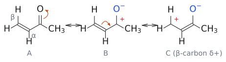
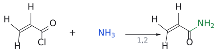
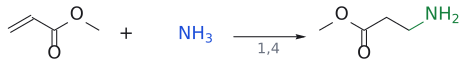
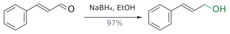
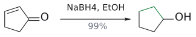
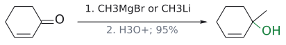
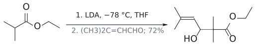
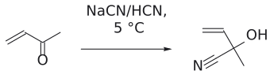
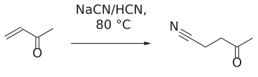
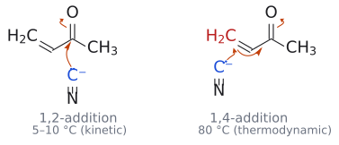

# 1,2-첨가와 1,4-첨가

> $\alpha,\beta$-unsaturated carbonyl에서 nucleophile이 **carbonyl 탄소**를 치면 1,2-addition(direct addition), **$\beta$-탄소**를 치면 1,4-addition([conjugate addition](../반응/공액%20첨가.md))이다. 어느 쪽인지는 acceptor의 carbonyl, nucleophile, 반응 조건이 정한다.

## 개요

공명 구조에서 carbonyl 탄소와 $\beta$-탄소가 모두 $\delta^{+}$를 띠므로, nucleophile이 노릴 자리가 두 곳이다. 1,2-addition은 C=C가 남은 allylic alcohol(C=C–C(OH)Nu)을 준다. 1,4-addition은 먼저 enol(Nu–C–C=C–OH)을 주고, 이것이 tautomerize해 ketone(Nu–C–CH–C=O)이 된다. "1,4"라는 이름은 O=C–C=C의 O를 1번으로 셀 때 Nu와 H가 4번($\beta$-C)과 1번(O)에 붙은 것처럼 보이는 데서 왔다. (출처: L11 p.3, p.9)

## 원리: 세 가지 요인

그러면 어느 쪽으로 갈지는 무엇이 정할까? 슬라이드는 세 가지를 꼽는다. (1) $\alpha,\beta$-unsaturated 계의 작용기, (2) nucleophile, (3) 반응 조건이다. (출처: L11 p.9)

### 1. acceptor의 carbonyl

carbonyl이 electrophilic할수록 1,2, 덜 electrophilic할수록 1,4로 간다. direct addition 비율은 다음 순서다. (출처: L11 p.10)

**acyl chloride > enal > enone > ester > amide**

acryloyl chloride + NH₃가 acrylamide를 주는 것은 엄밀히는 nucleophilic acyl substitution이다(→ [addition-elimination](../반응/첨가-제거%20반응.md)). cyclopentenone + NaBH₄에서는 먼저 hydride가 1,4로 들어가 cyclopentanone이 되고, 그 ketone이 다시 1,2로 환원된다. 반면 cinnamaldehyde는 aldehyde라서 직접 환원된다(예는 아래 표). (출처: L11 p.10)

보충: 이 순서가 "왜" carbonyl의 반응성 순서인지는 앞 강의에서 본 carbonyl 반응성과 같다. ester의 OR, amide의 NR₂는 비공유 전자쌍을 C=O로 밀어 넣어 carbonyl 탄소의 $\delta^{+}$를 줄인다. 그래서 nucleophile이 C=O로 직접 갈 이유가 약해지고 $\beta$-탄소가 상대적으로 유리해진다. 극단적으로 NaBH₄는 ester·amide C=O를 아예 환원하지 못하므로, $\alpha,\beta$-unsaturated ester에는 conjugate reduction만 일어난다. 반대로 enone에서 C=O만 골라 환원하고 싶으면 NaBH₄에 CeCl₃를 넣는 Luche reduction을 쓴다. (보충 근거: Clayden p.506)

보충: 슬라이드의 세 요인 외에 Clayden은 **$\beta$-탄소의 입체 장애**도 요인으로 꼽는다. $\beta$-탄소가 붐비면 direct(1,2) addition 쪽으로, $\beta$-탄소가 드러나 있으면 conjugate addition 쪽으로 기운다. methyl vinyl ketone이나 exo-methylene ketone처럼 $\beta$가 CH₂인 acceptor가 가장 반응성 좋은 Michael acceptor인 이유다(→ [Michael reaction](../반응/마이클%20반응.md)). (보충 근거: Clayden p.510, p.609)

### 2. nucleophile: hard와 soft

hard nucleophile(RMgBr, RLi, RO⁻ 등)은 hard한 carbonyl 탄소로(1,2), soft nucleophile(R₂CuLi, RS⁻, RSH 등)은 soft한 $\beta$-탄소로(1,4) 가는 경향이 있다(→ [hard and soft acids and bases (HSAB)](하드-소프트%20산염기.md)). C–Cu 결합은 C–Mg보다 덜 분극되어 있어(전기음성도 Cu 1.9, Mg 1.3) [organocuprate](../시약/유기구리%20시약.md)가 soft nucleophile이 된다. hard nucleophile은 전하가 크고 작은 원자에 몰려 있어서 정전기적 인력이 큰 자리를 고른다고 보면 된다. HSAB 표와 charge control/orbital control 설명은 [hard and soft acids and bases (HSAB)](하드-소프트%20산염기.md)에 있다. (출처: L11 p.6, p.11–12)

### 3. 반응 조건: kinetics와 thermodynamics

강의의 MVK/cyanide 계에서는 1,2-addition의 activation energy가 낮아 **빠르고**(kinetic product), 1,4-addition 생성물은 에너지가 낮아 **안정하다**(thermodynamic product). 이 장벽 순서를 모든 nucleophile과 받개에 일반화하지 않는다. 두 경로 모두 C–C $\sigma$ 결합 하나를 얻지만, 1,2는 C=O $\pi$(약 369 kJ/mol)를, 1,4는 더 약한 C=C $\pi$(약 280 kJ/mol)를 잃는다. 1,2-addition이 가역이면 고온에서 되돌아갔다가 안정한 1,4 생성물로 모인다(→ [kinetic vs thermodynamic control](속도론적%20지배와%20열역학적%20지배.md)). 슬라이드의 예는 methyl vinyl ketone(MVK) + cyanide ion이다. 5–10 °C에서는 cyanohydrin(1,2, kinetic product P1), 80 °C에서는 4-oxopentanenitrile(1,4, thermodynamic product P2)이 생긴다. 에너지 도표에서 EA1(TS1)이 EA2(TS2)보다 낮고, P2가 P1보다 낮다. (출처: L11 p.13)

보충: 그렇다면 1,2가 "왜" 더 빠를까? $\beta$-탄소도 $\delta^{+}$를 띠지만 carbonyl 탄소가 더 큰 양전하를 띠므로, 음전하를 띤 CN⁻는 정전기적으로 carbonyl 탄소에 더 빨리 끌린다. 그리고 결정적인 차이는 **가역성**이다. cyanohydrin 형성은 가역이라 평형 속에 늘 출발 enone이 조금 남아 있고, 이 enone이 가끔 1,4-첨가를 하면 그 생성물은 (사실상) 되돌아오지 않는다. 그 결과 1,4 생성물이 조금씩 쌓이고, enone–cyanohydrin 평형이 이를 보충하느라 cyanohydrin이 점점 소모된다. 실온에서도 원리상 일어나지만 매우 느리고, 80 °C에서는 몇 시간이면 끝난다. 같은 논리로 더 높은 온도(예: 160 °C)를 쓰는 예도 있다. (보충 근거: Clayden p.504–505)

이 kinetic/thermodynamic 논리는 enolate의 conjugate addition과 aldol의 경쟁에도 그대로 쓰인다(→ [Michael reaction](../반응/마이클%20반응.md)). amine의 1,2-addition(hemiaminal)이 가역이라 1,4 생성물이 쌓이는 것도 같은 구도다(→ [conjugate addition](../반응/공액%20첨가.md)).

그림: B에서는 carbonyl 탄소(1,2 자리), C에서는 $\beta$-탄소(1,4 자리)가 양전하를 띤다.

## 예

| 기질 + 시약 | 결과 | 요인 |
|---|---|---|
| cyclohex-2-enone + CH₃MgBr(또는 CH₃Li); H₃O⁺ | 1-methylcyclohex-2-en-1-ol (95%), 1,2 | hard nucleophile |
| cyclohex-2-enone + (CH₃)₂CuLi; H₃O⁺ | 3-methylcyclohexanone (97%), 1,4 | soft nucleophile |
| MVK + NaCN, HCN, 5–10 °C | cyanohydrin, 1,2 | kinetic |
| MVK + NaCN, HCN, 80 °C | NC–CH₂CH₂–CO–CH₃, 1,4 | thermodynamic |
| cinnamaldehyde + NaBH₄, EtOH | cinnamyl alcohol (97%), 1,2 | aldehyde |
| cyclopentenone + NaBH₄, EtOH | cyclopentanol (99%), 1,4 후 1,2 | enone |
| CH₂=CH–COCl + NH₃ / CH₂=CH–CO₂Me + NH₃ | acrylamide(1,2) / H₂N–CH₂CH₂–CO₂Me(1,4) | acceptor의 carbonyl |

(출처: L11 p.10, p.11, p.13)

그림: acyl chloride는 C=O(빨강)에서 바로 치환된다.

그림: ester에서는 $\beta$-탄소(빨강)로 1,4-첨가한다.

그림: aldehyde는 C=O(빨강)가 직접 환원된다.

그림: 먼저 1,4로 C=C가, 그다음 C=O가 환원된다.

그림: 단단한 유기금속은 C=O(빨강)에 1,2-첨가한다.

그림: 입체 장애가 큰 $\beta$-탄소 대신 C=O에 1,2-첨가한다.

## diene과의 비교

같은 이름이 L2의 [electrophilic addition to dienes](../반응/다이엔의%20친전자성%20첨가.md)에도 나온다. 1,3-butadiene + Br₂는 0 °C에서 1,2-생성물(kinetic), 가열하면 1,4-생성물(thermodynamic)을 준다. 다만 그쪽은 **electrophile**이 diene에 붙는 반응이고, 이 문서는 **nucleophile**이 enone에 붙는 반응이다. 번호를 세는 기준도 다르다. "빠른 1,2, 안정한 1,4"라는 구도만 같다. (출처: L2 p.6, L11 p.13)

그림: 보충: 저온에서는 빠른 1,2-첨가(cyanohydrin, kinetic product)가, 80 °C에서는 가역적인 1,2-첨가가 되돌아가고 더 안정한 1,4-첨가 생성물(4-oxopentanenitrile, thermodynamic product)이 쌓인다.

그림: 보충: 왼쪽: $CN^-$ (파랑)이 carbonyl C를 직접 공격하고 C=O $\pi$ 전자가 O로 간다(1,2-첨가, 빠르지만 가역). 오른쪽: $CN^-$ 이 $\beta$-탄소(빨강)를 공격하고 C=C $\pi$ 전자가 C–C로, C=O $\pi$ 전자가 O로 밀려 enolate가 된다(1,4-첨가, 더 안정한 생성물).

## 흔한 오해

- "Grignard도 탄소 nucleophile이니 enone에 1,4로 간다": RMgBr, RLi는 hard해서 주로 1,2다. 1,4로 보내려면 R₂CuLi를 쓰거나 CuCl을 촉매량(0.01 eq) 넣는다. (출처: L11 p.7, p.11)
- "1,2 생성물은 덜 안정하니 아예 안 생긴다": cyanide ion 첨가에서는 저온에서 1,2가 먼저 생기는 kinetic product다. (출처: L11 p.13)
- "NaBH₄는 enone의 C=O만 환원한다": cyclopentenone은 1,4 후 1,2가 일어나 cyclopentanol까지 간다(→ [NaBH4](../시약/NaBH4.md)). (출처: L11 p.10)

## 실제 문제에서는 세 가지를 함께 고른다

같은 enone에서 nucleophile만 바꾸면 결과가 뒤집힌다. RMgBr를 보면 먼저 carbonyl 탄소의 1,2-addition을, Cu가 관여하는 organocopper 조건이면 먼저 $\beta$-탄소의 1,4-addition을 검토한다. 그러나 “hard/soft”라는 단어만으로 답을 끝내면 안 된다. 받개의 carbonyl이 aldehyde인지, ketone인지, ester·amide인지 확인하고 counterion과 온도까지 읽어야 한다. L11은 받개, nucleophile, 조건을 서로 독립인 세 항목으로 제시한다. (출처: L11 p.9–12)

cyanide와 methyl vinyl ketone의 비교는 이 구분을 보여 준다. 저온에서는 carbonyl 첨가가 빨라 cyanohydrin형 1,2 생성물이 잡히고, 더 높은 온도에서는 가역적인 첨가 가운데 안정한 1,4 생성물이 우세해진다. 이것을 “낮은 온도는 언제나 1,2”로 일반화해서는 안 된다. 이 사례의 핵심은 같은 반응계에서 빠른 경로와 평형에서 유리한 경로가 다르다는 것이다. (출처: L11 p.13)

답안을 쓸 때에는 출발물의 carbonyl C, $\alpha$-C, $\beta$-C를 먼저 표시한다. 1,2라면 C=O가 alcohol로 바뀌고 원래 C=C가 남는다. 1,4라면 nucleophile이 $\beta$에 붙고, 생긴 enolate가 protonate된 뒤 C=O가 회복된다. “어디에 붙었나”와 “어느 이중결합이 남았나”를 함께 확인하면 번호만 외우는 실수를 피할 수 있다. (출처: L11 p.7,9,13)

## 그림으로 확인하기

그림: 같은 MVK/CN− 계의 저온 1,2와 고온 1,4 공격 위치를 나란히 비교한다. 에너지 곡선의 높이는 정량값으로 재구성하지 않았다. (원본 대조: L11_Conjugate addition.pdf p.13)

[원본 자료에서 세부 구조·입체배치 확인: L11_Conjugate addition.pdf p.13](../../figures/L11/source/L11_p13.png)

## 받개의 작용기도 확인한다

그림: 받개와 조건에 따른 1,2·1,4 첨가를 각각 분리했다. 원본의 서로 다른 세 반응 예이며 단일 기질의 경쟁 반응으로 합치지 않는다. (원본 대조: L11_Conjugate addition.pdf p.10)

[원본 자료에서 세부 구조·입체배치 확인: L11_Conjugate addition.pdf p.10](../../figures/L11/source/L11_p10.png)

## L11을 읽으며 원자와 전자를 추적하기

### 1,2와 1,4를 생성물에서 구분하기

| 확인할 자리 | carbonyl에 1,2-addition | $\beta$-탄소에 1,4-addition |
|---|---|---|
| 새 Nu–C 결합 | 원래 carbonyl 탄소 | 원래 $\beta$-탄소 |
| 첨가 직후 | alkoxide | enolate |
| ketone 받개의 후처리 생성물 | allylic alcohol | $\beta$-치환 ketone |
| 원래 C=C | 남음 | 단일결합이 됨 |
| 원래 C=O | C–OH가 됨 | 후처리 후 회복됨 |

이 비교표의 alcohol/ketone 비교는 이 강의의 hydride 및 탄소 nucleophile이 enal·enone에 첨가하는 예에 적용한다. amine 같은 중성 nucleophile의 직접 첨가 중간체에는 N의 전하와 뒤따르는 반응도 따로 고려한다. acyl chloride처럼 leaving group이 있는 carbonyl에서는 1,2 공격 뒤 제거가 이어져 amide 같은 acyl 치환 생성물이 나오므로, “1,2면 최종적으로 무조건 alcohol”이라고 적용하지 않는다. 최종 생성물을 정하려면 **첫 공격 위치와 그 뒤 반응을 따로** 읽어야 한다. (출처: L11 p.9–11)

### 작용기 예시를 비교할 때 고정해야 하는 것

acryloyl chloride와 methyl acrylate는 같은 $\mathrm{CH_2{=}CH{-}CO{-}}$ 부분을 가지지만 carbonyl의 나머지 치환기가 다르다. 전자는 carbonyl이 반응성이 크고 Cl⁻가 떨어질 수 있어 ammonia로 acyl 치환을 한다. 후자는 OR의 전자 주개 효과 때문에 carbonyl 직접 공격의 경쟁이 약해져, 강의 조건에서는 ammonia의 $\beta$ 첨가가 관찰된다. 두 예의 차이는 ammonia 자체가 바뀌어서가 아니다. (출처: L11 p.10)

환원에서는 **한 번의 hydride 전달과 최종 생성물을 구분**한다. cinnamaldehyde의 예는 C=O만 환원되어 C=C가 남는다. cyclopentenone의 예는 1,4 환원으로 ketone이 생긴 뒤 그 C=O가 다시 환원되어 포화 alcohol이 된다. 따라서 최종 cyclopentanol을 보고 “hydride가 한 단계에서 모든 결합을 환원했다”거나, 이 예를 모든 enone의 NaBH₄ 반응에 그대로 적용하면 안 된다. (출처: L11 p.10)

### hard/soft는 선택성을 설명하는 출발점이다

같은 methyl group이라도 $\mathrm{MeMgBr}$과 organocuprate에서는 carbon–metal 결합의 성격이 달라진다. Grignard에서 carbonyl 탄소를 공격하면 O⁻를 가진 alkoxide, organocuprate에서 $\beta$-탄소를 공격하면 공액된 enolate가 생긴다. 전자 이동을 그린 뒤 이 두 intermediate가 서로 다른지 확인하면 “탄소 nucleophile은 전부 같은 생성물을 준다”는 혼동을 피할 수 있다. (출처: L11 p.6–7,11–12)

다만 HSAB 표는 모든 조건의 생성물을 단독으로 결정하는 규칙이 아니다. amine은 표의 borderline 칸에 있지만 p.5에서는 분명히 conjugate addition을 한다. cyanide 역시 p.13에서 온도에 따라 두 경로를 보인다. 따라서 답안은 “soft라서 1,4”에서 끝내기보다 **받개의 작용기 → nucleophile의 성격 → 온도·counterion·후처리**까지 이어서 판단한다. (출처: L11 p.5,10–13)

### 빠른 생성물과 안정한 생성물은 서로 다른 비교다

kinetic product를 고를 때 비교하는 것은 **출발물에서 각 transition state까지의 장벽**이고, thermodynamic product를 고를 때 비교하는 것은 **생성물끼리의 에너지**다. 장벽이 낮다고 생성물도 낮은 에너지를 가져야 하는 것은 아니다. MVK/CN 계에서는 낮은 장벽의 1,2 경로가 저온에서 먼저 관찰되지만, carbonyl을 유지하는 1,4 생성물은 더 안정하다. (출처: L11 p.13)

고온에서 cyanohydrin의 CN이 골격 위를 옆으로 이동하는 것은 아니다. 가역적인 1,2 첨가가 되돌아가 출발 enone을 내놓고, 그 enone이 1,4 경로로 반응할 수 있는 것이다. 따라서 **되돌아갈 수 있는 경로와 충분한 반응 시간**이 있어야 생성물 분포가 바뀐다. “저온 = 1,2, 고온 = 1,4”는 이 계의 결과이며, cuprate나 enamine의 모든 반응에 적용하는 온도 법칙이 아니다. (출처: L11 p.13) (보충 근거: Clayden p.504–505)

슬라이드의 결합 에너지 비교는 carbonyl 보존이 유리하다는 정성적 설명이다. 생성물 에너지 차이를 $369-280$만으로 정확히 계산한 값이나 실제 activation energy로 취급하지 않는다. 반응 장벽, 결합 에너지, 생성물 안정성은 구분해서 읽는다. (출처: L11 p.13; 도표 해석)

## 관련 문서

- 반응: [conjugate addition](../반응/공액%20첨가.md), [Michael reaction](../반응/마이클%20반응.md), [electrophilic addition to dienes](../반응/다이엔의%20친전자성%20첨가.md)
- 시약: [organocuprate](../시약/유기구리%20시약.md), [Grignard reagent](../시약/그리냐르%20시약.md), [NaBH4](../시약/NaBH4.md)
- 개념: [hard and soft acids and bases (HSAB)](하드-소프트%20산염기.md), [kinetic vs thermodynamic control](속도론적%20지배와%20열역학적%20지배.md)
- 반응(비교): [addition-elimination](../반응/첨가-제거%20반응.md)

## 출처

- [L11 Conjugate Addition](../../notes/L11_Conjugate_Addition.md) 3절 (L11 p.9–13), 2절
- [L2 Electrophilic Addition to Alkenes, Part 2](../../notes/L02_Electrophilic_Addition_to_Alkenes_Part2.md): 슬라이드 L2 p.6
