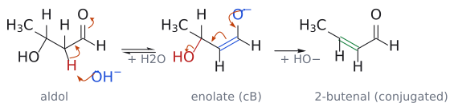
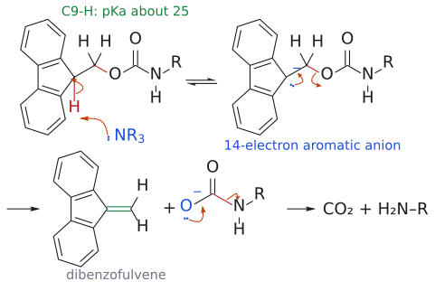

# E1cB 제거

> 먼저 산성 H를 떼어 **conjugate base(anion, cB, 짝염기)**를 만든 다음, 그 anion이 이웃한 leaving group을 밀어내는 2단계 제거. 원래 나쁜 leaving group인 HO⁻도 떨어질 수 있다는 것이 특징이다. aldol 탈수와 Fmoc deprotection이 대표 예다.

## 개요

E2는 H와 leaving group이 한 번에 떨어지고, E1은 leaving group이 먼저 떨어져 carbocation이 생긴다. E1cB는 순서가 반대다. **H가 먼저** 떨어져 anion이 생기고, leaving group은 나중에 떨어진다. 그래서 떼어 낼 H가 충분히 산성이어서 anion이 안정해야 한다. carbonyl의 $\alpha$-H나 fluorene 9번 H가 그런 예다(→ [alpha-hydrogen acidity](α-수소의%20산도.md)). (출처: L8 p.10; L12 p.11)

## 메커니즘: aldol 탈수

[aldol](../반응/알돌%20반응.md) 생성물 CH₃CH(OH)CH₂CHO에 염기를 더 오래, 더 세게 작용시키면 물이 빠진다. 그런데 HO⁻는 원래 나쁜 leaving group인데 어떻게 떨어질까? 비결은 이탈 전에 먼저 anion(conjugate base)을 만드는 데 있다. (출처: L8 p.10)

1. aldol의 $\alpha$-H는 여전히 carbonyl 옆에 있으므로 산성이다. HO⁻가 이 H를 떼어 [enolate](엔올과%20엔올레이트.md)(conjugate base)를 만든다. 이때 $\beta$-탄소의 OH는 그대로 붙어 있다.
2. enolate의 전자쌍이 내려오며 C$\alpha$=C$\beta$ 이중결합을 만들고, $\beta$-탄소의 HO⁻를 밀어낸다.

$$
\begin{aligned} &\mathrm{CH_3CH(OH)CH_2CHO} \cr &\qquad \longrightarrow \mathrm{CH_3CH{=}CHCHO}\ (\text{2-butenal},\ \text{enal}) \cr &\qquad + \mathrm{H_2O}\ (\mathrm{HO^-}\ \text{재생}) \end{aligned}
$$

이 반응이 앞으로 가는 원동력은 생성물의 **conjugation**이다. alkene과 carbonyl이 이어져 전자가 넓게 퍼지므로 $\alpha,\beta$-unsaturated carbonyl 화합물이 안정하다. 더 강한 염기, 더 높은 온도, 더 긴 반응 시간일수록 탈수 생성물이 나오기 쉽다. (출처: L8 p.10, p.11)

그림: 왼쪽 단계에서 HO⁻(파랑)가 산성 $\alpha$-H(빨강)를 떼고, C–H 결합 전자가 C–C 쪽으로 옮겨 가며, C=O $\pi$ 전자가 산소로 올라가 enolate(conjugate base, cB)가 된다. 가운데 단계에서는 O⁻의 전자쌍이 C=O를 다시 만들고, enolate의 C=C(파랑) 전자가 C$\alpha$–C$\beta$ 사이로 내려와 새 이중결합을 만들며, C–OH 결합(빨강) 전자가 산소로 가서 HO⁻가 떨어진다. 초록 결합이 C=O와 공액된 새 C=C다. 첫 단계는 평형이고, 둘째 단계는 conjugation 안정화 덕분에 앞으로 진행된다. (출처: L8 p.10)

## 예

- **aldol condensation:** PhCHO + PhCOCH₃ --[HO⁻, 20 °C]--> (*E*)-chalcone(85%). [Knoevenagel](../반응/크뇌베나겔%20축합.md) 생성물과 intramolecular aldol의 2-acetylcyclopentan-1-ol → 1-acetylcyclopentene도 같은 단계다(→ [aldol reaction](../반응/알돌%20반응.md), [intramolecular aldol reaction](../반응/분자내%20알돌%20반응.md)). (출처: L8 p.28, p.29, p.31)
- **[Fmoc protecting group](../시약/Fmoc%20보호기.md) 제거:** amine 염기가 fluorene 9번 C–H(pKa 약 25)를 떼면 14전자 aromatic anion이 생기고, 이것이 CH₂–O 결합을 밀어내 dibenzofulvene과 carbamate anion이 된다. carbamate는 CO₂를 잃고 amine이 된다. (출처: L12 p.11)

그림: NR₃가 fluorene 9번 H를 떼고(가역), 생긴 aromatic anion의 전자쌍이 C9=CH₂를 만들며 CH₂–O 결합이 끊어진다.

## 비교: 산 조건 탈수는 다르다

산 촉매 aldol에서는 3차 OH가 protonate되어 물로 떨어지고 carbocation이 생긴 뒤 $\alpha$-H가 빠진다. 슬라이드는 이것을 **E1**로 표기한다. 같은 "aldol 탈수"라도 조건에 따라 경로가 다르다. (출처: L8 p.13; L10 p.3)

보충: [addition–elimination 반응](../반응/첨가-제거%20반응.md)에서 $\beta$-leaving group을 가진 enone에 nucleophile이 conjugate addition한 뒤 enolate가 leaving group을 밀어내는 두 번째 단계도, "anion이 먼저 생기고 leaving group이 나중에 떨어진다"는 점에서 같은 모양이다(L11 p.22). 슬라이드는 이 단계를 E1cB라고 부르지 않는다. (보충 근거: Clayden p.399, p.511)

## 흔한 오해

- "염기성 aldol 탈수는 E2다": enolate(conjugate base)가 먼저 생긴 뒤 HO⁻가 떨어지는 E1cB다. 산성 탈수는 슬라이드에서 E1로 표기한다. (출처: L8 p.10, p.13)
- "Fmoc의 pKa 25짜리 C–H를 떼려면 강염기가 필요하다": amine 염기로 충분하다. deprotonation이 가역이어도 이어지는 E1cB elimination과 decarboxylation이 반응을 끌고 간다. (출처: L12 p.11)
- "$\alpha$-H만 있으면 aldol은 항상 탈수된다": 탈수에는 OH 탄소 옆 $\alpha$-탄소의 H가 필요하다. 보충: $\alpha$-탄소가 4차인 aldol(예: (CH₃)₂CHCO₂Et의 LDA aldol 생성물)은 E1cB로 탈수될 수 없다(L8 p.19 연습 문제 4 해설). (보충 근거: Clayden p.616)

## 관련 문서

- 반응: [aldol reaction](../반응/알돌%20반응.md), [intramolecular aldol reaction](../반응/분자내%20알돌%20반응.md), [retro-aldol reaction](../반응/역알돌%20반응.md), [addition–elimination 반응](../반응/첨가-제거%20반응.md)
- 시약: [Fmoc protecting group](../시약/Fmoc%20보호기.md)
- 개념: [enol and enolate](엔올과%20엔올레이트.md), [alpha-hydrogen acidity](α-수소의%20산도.md), [carbocation](탄소%20양이온.md), [aromaticity](방향족성.md)

## 출처

- [L8 aldol reaction](../../notes/L08_Aldol_Reactions.md) 2절, 3절
- [L12 protecting group](../../notes/L12_Protecting_Groups.md) 7절
- [L11 conjugate addition](../../notes/L11_Conjugate_Addition.md) 7절
