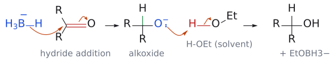

# 금속 수소화물의 반응성

> 어떤 carbonyl이 환원되는지는 **시약의 세기**(LiAlH₄ > LiBH₄ > NaBH₄ > NaBH₃CN)와 **carbonyl의 반응성**(aldehyde > ketone > ester > amide > carboxylate)을 함께 보면 정해진다. BH₃와 DIBAL-H는 이 서열을 벗어나는 특수 시약이다.

## 개요

분자에 carbonyl이 여럿 있으면 어느 것이 먼저 환원될까? "분자 안에 환원될 수 있는 자리가 여러 개일 때, 원하는 곳만 환원하려면 어떤 시약을 골라야 하나?"가 L5의 핵심 질문이다. 답하려면 두 가지 서열을 함께 봐야 한다. 하나는 시약의 세기, 다른 하나는 carbonyl의 반응성이다.

시약의 세기는 [LiAlH4](../시약/LiAlH4.md) > [LiBH4](../시약/LiBH4.md) > [NaBH4](../시약/NaBH4.md) > [NaBH3CN](../시약/NaBH3CN.md) 순이고, 강할수록 chemoselectivity는 떨어진다. carbonyl 쪽은 aldehyde > ketone > ester > amide > carboxylate 순으로 반응성이 크다. 그래서 약한 시약일수록 왼쪽(반응성 큰 carbonyl)만 건드리고, 강한 시약은 오른쪽까지 다 환원한다. 여기에 [BH₃](../시약/보레인.md)와 [DIBAL](../시약/DIBAL-H.md)이라는 "특수 시약"이 이 단순한 서열을 벗어나는 독특한 선택성을 보인다. (출처: L5 p.18)

## 반응성 표

슬라이드 p.17의 반응성 표를 정리하면 다음과 같다(O = 환원됨, 느림 = 느리게 환원, X = 보통 환원 안 됨).

| 시약 | imine | aldehyde | ketone | ester | amide | carboxylic acid |
|---|---|---|---|---|---|---|
| [NaCNBH₃](../시약/NaBH3CN.md) | O | 느림 | 느림 | X | X | X |
| [NaBH₄](../시약/NaBH4.md) | O | O | O | 느림 | X | X |
| [LiBH₄](../시약/LiBH4.md) | O | O | O | O | X | X |
| [LiAlH₄](../시약/LiAlH4.md) | O | O | O | O | O | 느림 |
| [BH₃](../시약/보레인.md) | O | 느림 | 느림 | 느림 | O | O |

생성물은 imine → RCH₂NHR, aldehyde → RCH₂OH, ketone → R₂CHOH, ester → RCH₂OH, amide → RCH₂NR₂, carboxylic acid → RCH₂OH다. (출처: L5 p.17)

### aldehyde에서 멈추려면

aldehyde 단계에서 멈추고 싶다면 우회로가 필요하다. ester는 alcohol을 거치거나(환원 후 산화, → [alcohol oxidation](../반응/알코올%20산화.md)) DIBAL을 쓰고(→ [partial reduction of esters](../반응/에스터%20부분%20환원.md)), amide는 LiAlH₄를 0 °C에서 쓰며, carboxylic acid는 acid chloride를 거친다([Rosenmund reduction](../반응/로젠문트%20환원.md)). (출처: L5 p.17)

### 표에서 눈여겨볼 두 칸

- **NaCNBH₃ 줄**: imine은 환원하면서 aldehyde·ketone은 느리게만 건드린다. 게다가 pH > 3의 수용액에서도 안정하다. 그래서 [reductive amination](../반응/환원성%20아미노화.md)에 흔히 쓰인다. 슬라이드는 "왜 NaBH₄는 안 쓰나?"라고 묻는데, 이 질문은 [L5 연습 문제](../../practice/L05_Exercises.md) 4번으로 옮겼다. (출처: L5 p.17)
- **LiAlH₄의 carboxylic acid 칸**: 표에서는 "느림"인데, p.23에서는 LiAlH₄가 carboxylic acid를 92%로 잘 neopentyl alcohol. 모순처럼 보이지만, 산의 O–H가 먼저 hydride와 반응해 H₂를 내고 carboxylate가 되기 때문에 느려질 뿐이며 충분한 양을 쓰면 환원된다.[^1] (출처: L5 p.17, p.23)

## 원리: 왜 이런 서열이 생기나

- **anion hydride(BH₄⁻, AlH₄⁻)는 nucleophile**이다. 전자가 electrophilic carbonyl을 좋아하므로 aldehyde > ketone > ester 순이다. carboxylate는 음전하라 맨 끝이다(→ [electrophile과 nucleophile](친전자체와%20친핵체.md)). (출처: L5 p.18, p.27)
- **BH₃는 Lewis acid**다. 먼저 carbonyl O의 전자쌍을 받아야 반응이 시작되므로, Lewis 염기성이 큰 amide·carboxylic acid가 빠르고 ester·ketone이 느리다. 서열이 뒤집힌다. 같은 기질 MeO₂C–CH₂CH(CH₃)CH₂–CO₂H에 LiBH₄를 쓰면 ester가, BH₃를 쓰면 산이 환원된다. 두 시약은 거울처럼 상보적이다. (출처: L5 p.22, p.27)
- **중심 B vs Al**: 보충: NaBH₄가 물·alcohol에서도 쓸 수 있을 만큼 "약한" hydride 공여체인 반면 LiAlH₄가 물과 격렬히 반응할 만큼 센 이유는 중심 원자에 있다. Al이 B보다 전기 양성적(더 금속적)이라 Al–H의 hydride를 더 쉽게 내주기 때문이다. (보충 근거: Clayden p.132)
- **cation 효과**: NaBH₄는 ethyl acetate나 ethyl benzoate 같은 ester를 아주 느리게만 환원하지만, LiBH₄는 쉽게 환원한다. 슬라이드는 "cation에 따라 반응성 차이가 크다"는 관찰만 제시한다. 설명은 [LiBH4](../시약/LiBH4.md) 문서에 있다. (출처: L5 p.21–22)
- **CN의 효과**: 보충: 전자를 끄는 CN 때문에 NaBH₃CN의 B–H 공여력이 약해져, 더 electrophilic한 protonate된 iminium만 빠르게 환원된다(→ [NaBH3CN](../시약/NaBH3CN.md)). (보충 근거: Clayden p.234)

그림: nucleophilic hydride의 기본 동작. BH₄⁻의 B–H(파랑)가 carbonyl 탄소(빨강)를 공격하고, alkoxide가 EtOH에서 양성자를 받는다. 자세한 단계와 화학량론은 [NaBH4](../시약/NaBH4.md) 문서에 있다.

## 선택성의 실제: aldehyde와 ketone을 구별할 수 있을까

NaBH₄는 aldehyde와 ketone을 둘 다 환원하지만, 속도는 크게 다르다. isopropyl alcohol에서 0 °C의 2차 속도상수는 benzaldehyde가 820 × 10⁻⁴, acetophenone이 2.05 × 10⁻⁴ M⁻¹s⁻¹로, 약 400배 차이다. 그러니 ketone이 함께 있어도 aldehyde만 골라 환원할 수 있다. (출처: L5 p.21)

보충: 이 400배 차이를 교과서는 주로 입체 장애로 설명한다. aldehyde 탄소에는 작은 H가 붙어 있지만 ketone 탄소에는 탄소 치환기가 둘이라, hydride가 접근하기 더 어렵다. (보충 근거: Clayden p.132)

용매를 바꾸면 이 차이가 더 극단적이 된다. 비양성자성 용매 diglyme(CH₃OCH₂CH₂OCH₂CH₂OCH₃)에서는 aldehyde는 환원되지만 ketone(acetone)은 전혀 환원되지 않는다. (출처: L5 p.21)

## 용매와 취급

- NaBH₄는 MeOH와 빠르게 반응해 H₂를 낸다(60 °C, 24분에 100%). EtOH에서는 같은 조건에서 2%도 안 되므로, 슬라이드는 EtOH를 더 좋은 용매로 꼽는다(→ [NaBH4](../시약/NaBH4.md)). (출처: L5 p.20)
- LiAlH₄는 너무 반응성이 커서 쓸 수 있는 용매가 탄화수소, ether, 3차 amine으로 제한되며, 보통 diethyl ether, THF, diglyme을 쓴다. 물과 격렬히 반응한다(→ [LiAlH4](../시약/LiAlH4.md)). (출처: L5 p.21, p.23)

## metal hydride가 못 하는 것

metal hydride는 극성인 C=O, C=N에는 잘 듣지만 무극성 C=C에는 거의 반응하지 않는다. alkene은 H₂와 금속 촉매로 환원한다(→ [catalytic hydrogenation](../반응/촉매%20수소화.md)). (출처: L5 p.30)

## 흔한 오해

- **"BH₃도 LiBH₄처럼 ester를 환원한다"고 생각하기 쉽지만 사실은** 정반대다. LiBH₄는 ester를(산 유지), BH₃는 산과 amide를(ester 유지) 환원한다. BH₃는 Lewis acid라 Lewis 염기성이 큰 carbonyl을 좋아한다. (출처: L5 p.22, p.27)
- **"metal hydride로 alkene도 환원된다"**: 극성이 없는 C=C에는 거의 반응하지 않는다. (출처: L5 p.30)
- **"LiAlH₄는 alkyl halide를 건드리지 않는다"**: C–X를 SN2형으로 공격해 R–H로 만든다(LiAlD₄로 확인, → [LiAlH4](../시약/LiAlH4.md)). (출처: L5 p.24)

## 관련 문서

- 시약: [NaBH4](../시약/NaBH4.md), [NaBH3CN](../시약/NaBH3CN.md), [LiBH4](../시약/LiBH4.md), [LiAlH4](../시약/LiAlH4.md), [borane](../시약/보레인.md), [DIBAL-H](../시약/DIBAL-H.md)
- 반응: [amide reduction](../반응/아마이드%20환원.md), [partial reduction of esters](../반응/에스터%20부분%20환원.md), [reductive amination](../반응/환원성%20아미노화.md), [catalytic hydrogenation](../반응/촉매%20수소화.md), [Rosenmund reduction](../반응/로젠문트%20환원.md), [alcohol oxidation](../반응/알코올%20산화.md)
- 개념: [tetrahedral intermediate](사면체%20중간체.md), [electrophile과 nucleophile](친전자체와%20친핵체.md), [amine synthesis (overview)](아민%20합성%20개관.md)

## 출처

- [L5 환원](../../notes/L05_Reduction.md) 2절 (슬라이드 p.17–29)
- [L6 산화와 alkene 합성](../../notes/L06_Oxidation_and_Alkene_Synthesis.md) 0절 (DIBAL-H 복습, L6c p.2)
- [L5 연습 문제](../../practice/L05_Exercises.md) 4, 5, 8번

[^1]: 이 때문에 LiAlH₄로 carboxylic acid를 환원할 때는 첫 hydride 1당량이 H₂ 발생에 소모된다는 점을 감안해 시약을 넉넉히 쓴다.
