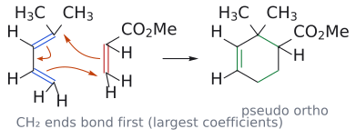
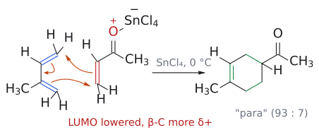

# 딜스-알더 위치선택성

> 비대칭 다이엔 + 비대칭 친다이엔체의 [[딜스-알더 반응]]에서는 **1-치환 다이엔 → "ortho"(1,2), 2-치환 다이엔 → "para"(1,4)** 생성물이 주로 생긴다. "meta"(1,3)는 부생성물이다.

## 개요

2-메톡시부타-1,3-다이엔 + 아크릴로나이트릴은 "1,4" 생성물과 "1,3" 생성물을 줄 수 있다. 어느 쪽이 나올까? 슬라이드의 답은 **π 전자의 편극(polarization)이 결정한다**는 것이다. 즉 **친다이엔체의 친전자성 위치가 다이엔의 친핵성 위치와 결합한다.** DA는 협동 반응이라 진짜 이온 중간체는 없지만, 각 성분이 극성 반응에서 어디가 반응할지 상상하면 답을 맞힐 수 있다. (출처: L14 p.11)

## 원리: 세 단계 사고 실험

1. **다이엔의 친핵성 말단 찾기.** 다이엔이 E⁺와 반응한다고 상상한다. 2-OMe 다이엔에서는 O의 비공유 전자쌍이 밀어 주어 OMe 옆 말단 C1이 E⁺를 공격하고, 산소가 안정화하는 옥소카베늄 이온이 생긴다. → **C1이 친핵성**.
2. **친다이엔체의 친전자성 탄소 찾기.** Nu⁻가 CH2=CH–CN의 **β-탄소**를 공격한다([[공액 첨가|마이클형]]). → **β-탄소가 친전자성**.
3. **둘을 잇는다.** OMe 탄소와 CN 탄소가 1,4 관계가 되어 4-메톡시사이클로헥스-3-엔-1-카보나이트릴("pseudo para")이 생긴다. (출처: L14 p.12)

FMO로 말하면 다이엔 HOMO 계수가 가장 큰 말단과 친다이엔체 LUMO 계수가 가장 큰 탄소(β-탄소)가 결합하는 것이다(→ [[프런티어 분자 오비탈]]). (출처: L15 p.25)

**1-치환 다이엔에서는?** 4-메틸펜타-1,3-다이엔(Me2C=CH–CH=CH2) + 아크릴산 메틸에서 계수가 가장 큰 곳은 치환기에서 **먼** 말단(CH2)과 친다이엔체 β-CH2다. 이 둘이 먼저 결합하므로 CMe2와 CH(CO2Me)가 이웃한 "pseudo ortho" 생성물(메틸 2,2-다이메틸사이클로헥스-3-엔-1-카복실레이트)이 된다. TS는 **협동적이지만 비동시적(concerted, but unsynchronous)**이다. 큰 계수끼리의 결합은 거의 완성되고, 반대편에는 부분 전하가 생긴다. (출처: L14 p.13)

*그림: 파란색은 다이엔의 π 결합, 빨간색은 친다이엔체의 C=C, 초록색은 새 결합이다. 계수가 큰 두 CH2 말단 사이 결합이 먼저 많이 생기는 비대칭 협동 TS를 거쳐 CMe2와 CH(CO2Me)가 이웃하게 된다.*

## 규칙 요약

| 다이엔 | 가장 친핵적인 말단 | 생성물 |
|---|---|---|
| C1에 X (1-치환) | X에서 **먼** 말단 C4 | X와 Z가 1,2: **"ortho"** |
| C2에 X (2-치환) | X에 **가까운** 말단 C1 | X와 Z가 1,4: **"para"** |

X(전자 주개): 알킬, 아릴, RO, Me3SiO, R2N. Z: CHO, COR, CO2H, CO2R, CN, NO2, 할로젠, 알켄일, 아릴. (출처: L14 p.14)

**실제 선택성은 100%가 아니다.** (출처: L14 p.15)

- (E)-펜타-1,3-다이엔 + CH2=CHW: ortho : meta = 9 : 1(W = CN, 100 °C), 6.8 : 1(W = COOR, 200 °C)
- 2-X-부타다이엔 + 아크릴산 메틸: para : meta = 6 : 1(X = Me, 아이소프렌), 10 : 1(X = OMe). 주개가 강할수록 편극이 커져 선택성이 높다.

**[[루이스 산 촉매]]는 선택성을 높인다.** 아이소프렌 + 메틸 바이닐 케톤: 톨루엔 120 °C에서 para : meta = 71 : 29, SnCl4·5H2O 0 °C에서 93 : 7. 카보닐 배위로 C=C 편극이 커져 β-탄소 계수가 더 커지기 때문이다. (출처: L14 p.20)

*그림: SnCl4가 카보닐 O에 배위하면 친다이엔체 LUMO가 낮아지고 β-CH2가 더 강하게 δ+가 된다. 메틸 옆 CH2 말단이 β-CH2와 결합해 "para" 생성물이 된다.*

## 입체선택성과 합치기

시험형 문제는 세 단계로 푼다. 예: (E)-1-아세톡시부타-1,3-다이엔 + (E)-크로톤알데하이드 (출처: L14 p.18–19; L15 p.3)

1. **위치:** 1-OAc 다이엔 → OAc 탄소 옆에 CHO 탄소가 온다("ortho"). CHO(Z)가 Me(약한 X)보다 지배적이라 크로톤알데하이드의 β-탄소(CHMe)가 다이엔 C4와 결합한다.
2. **endo:** OAc는 "out"이므로 endo 생성물에서 OAc와 CHO는 **cis**(→ [[endo 규칙]]).
3. **입체특이성:** (E)-친다이엔체라 CHO와 Me는 **trans**.
→ 2-acetoxy-6-methylcyclohex-3-ene-1-carbaldehyde(OAc/CHO cis, CHO/Me trans, 라세미).

**두 치환기가 협력하는 경우:** Danishefsky 다이엔(1-OMe, 3-OSiR3)은 두 규칙("ortho"와 "para")이 같은 생성물을 가리켜 선택성이 높다. 산 처리하면 사이클로헥센온이 된다(→ [[실릴 엔올 에터]]). Tutorial 4 문제 1이 이 경우이며, 풀이는 공식 답이 없는 제안이다. (출처: L15 p.26; Tutorial 4 문제 1)

## 흔한 오해

- "ortho/para는 벤젠 이야기": 사이클로헥센 생성물에서 두 치환기가 1,2 또는 1,4라는 것을 빌려 쓴 **기억법**이다. 그래서 "pseudo"를 붙인다. (출처: L14 p.14)
- "1-치환 다이엔이면 치환기 붙은 탄소가 친핵성": 반대편 말단 C4가 친핵성이다. 그래서 X와 Z가 이웃한다. (출처: L14 p.13)
- "루이스 산은 속도만 높인다": 편극을 키워 위치선택성도 높인다(71:29 → 93:7). (출처: L14 p.20)

## 관련 문서

- 반응: [[딜스-알더 반응]], [[공액 첨가]], [[나이트론 고리화 첨가]]
- 개념: [[프런티어 분자 오비탈]], [[endo 규칙]], [[s-cis 형태]], [[친전자체와 친핵체]], [[치환기 효과]]
- 시약: [[루이스 산 촉매]], [[실릴 엔올 에터]], [[대니셰프스키 다이엔]]

## 출처

- [L14 고리화 첨가 2부](../../notes/L14_Cycloaddition_Part2.md) 5–7절, 정답 3, 6, 7
- [L15 고리화 첨가 3부](../../notes/L15_Cycloaddition_Part3.md) 0절, 17.1절
- [L13 고리화 첨가 1부](../../notes/L13_Cycloaddition_Part1.md) 9절(보충 예고)
- [Tutorial 4](../../practice/Tutorial_4.md) 문제 1 (공식 답 없음)
