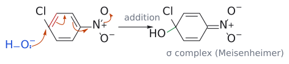

# 마이젠하이머 착물

> [nucleophilic aromatic substitution](../반응/친핵성%20방향족%20치환.md)(SNAr)에서 nucleophile이 halogen이 붙은 고리 탄소에 첨가해 생기는 **anion성 σ complex**. aromaticity를 잠시 잃은 sp³ 탄소를 가지며, 음전하는 고리와 EWG로 퍼진다.

## 개요

SNAr는 왜 강한 EWG가 ortho나 para에 있어야만 잘 될까? 그 답이 이 intermediate에 있다. 첨가 단계에서 생긴 음전하가 EWG까지 퍼져 안정화될 수 있어야 첨가가 일어날 만큼 빨라진다. 이 intermediate는 [electrophilic aromatic substitution](../반응/친전자성%20방향족%20치환.md)의 [arenium ion](아레늄%20이온.md)(cationic σ complex)을 음전하로 뒤집어 놓은 짝이라고 볼 수 있다. 슬라이드에는 이름이 나오지 않으며, "Meisenheimer complex"라는 이름은 보충이다. (출처: L11 p.23)

## 구조와 생성

1. **addition(느림)**: Nu⁻가 X가 붙은 ipso 탄소를 공격한다. 그 탄소는 sp³가 되어 Nu와 X를 함께 가진다.
2. 고리의 π 전자가 밀려나, 음전하가 고리 안의 ortho·para 탄소와 그 자리의 EWG로 퍼진다. 슬라이드 그림에서는 음전하가 acetyl 산소로 가 enolate 형태가 되거나, NO₂의 산소로 가 nitronate 형태가 된다.
3. **elimination**: X⁻가 떨어지며 aromaticity가 회복된다.

(출처: L11 p.23)

그림: Meisenheimer complex가 생기는 addition 단계(4-chloronitrobenzene + HO⁻). HO⁻(파랑)의 비공유 전자쌍이 Cl이 붙은 ipso 탄소를 공격하고, 빨간 C=C의 π 전자는 옆 C–C 자리로, 그다음 고리 C=C의 π 전자는 C–N 자리로, N=O의 π 전자는 산소로 차례로 밀려난다(주황 화살표 네 개). 오른쪽 σ complex(Meisenheimer complex)에서 ipso 탄소는 sp³이고 HO와 Cl을 함께 가지며(초록이 새 C–O 결합), 음전하는 NO₂의 두 산소에 놓인 nitronate 형태다. (출처: L11 p.23)

## 증거: 음전하는 어디에 놓이나

보충: cyclohexadienyl anion(SNAr intermediate의 모형)의 ¹³C NMR에서 공격 자리 기준 ortho·para 탄소는 benzene(약 130 ppm)보다 훨씬 고장(약 76–78 ppm)으로, meta 탄소는 거의 그대로(약 132 ppm) 나타난다. 음전하가 사실상 ortho·para에만 놓인다는 뜻이다. 그래서 EWG도 ortho·para에 있어야 음전하를 받아 줄 수 있다. (보충 근거: Clayden p.517–518)

## 왜 ortho/para, 왜 F인가

- **EWG의 위치**: leaving group이 EWG의 ortho나 para에 있어야, 공명으로 퍼진 음전하가 EWG가 붙은 탄소에 놓이고 EWG의 산소까지 갈 수 있다. meta에서는 음전하가 EWG가 붙은 탄소에 오지 않는다. 그래서 3-chloronitrobenzene은 HO⁻와 쉽게 반응하지 않는다. (출처: L11 p.23)
- **EWG의 세기**: 상대 속도 NO₂ 1, SO₂Me 1/18, CN 1/32, COMe 1/80. 음전하를 잘 받아 주는 기일수록 intermediate가 안정해진다(→ [substituent effect](치환기%20효과.md)). (출처: L11 p.23)
- **leaving group 순서 F >> Cl ~ Br >> I**: 속도를 정하는 것은 C–X가 끊기는 단계가 아니라 이 intermediate가 생기는 첨가 단계다. 이유는 [nucleophilic aromatic substitution](../반응/친핵성%20방향족%20치환.md) 문서의 각주에 정리했다. (출처: L11 p.23)

## 예

- 2-fluoroacetophenone + R₂NH → (음전하가 acetyl 산소에 놓인 intermediate) → 2-(NR₂)acetophenone (L11) (출처: L11 p.23)
- 4-chloronitrobenzene + HO⁻ → (음전하가 NO₂ 산소에 놓인 intermediate) → 4-nitrophenol (L11) (출처: L11 p.23)

## 흔한 오해

- **"SNAr는 SN2처럼 한 번에 일어난다"고 생각하기 쉽지만, 사실은** 슬라이드는 첨가 후 제거의 두 단계로 그리며, 그 사이에 이 intermediate가 있다. (출처: L11 p.23)
- **"arenium ion과 같은 것이다"라고 생각하기 쉽지만, 사실은** 둘 다 sp³ 탄소를 가진 σ complex이지만, arenium ion은 electrophile이 붙은 **cation**이고(EDG가 안정화), Meisenheimer complex는 nucleophile이 붙은 **anion**이다(EWG가 안정화). 그래서 directing effect도 정반대로 작동한다. 보충. (보충 근거: Clayden p.517)

## 관련 문서

- 반응: [nucleophilic aromatic substitution](../반응/친핵성%20방향족%20치환.md), [addition-elimination](../반응/첨가-제거%20반응.md), [electrophilic aromatic substitution](../반응/친전자성%20방향족%20치환.md), [conjugate addition](../반응/공액%20첨가.md)
- 개념: [arenium ion](아레늄%20이온.md), [substituent effect](치환기%20효과.md), [aromaticity](방향족성.md), [enol and enolate](엔올과%20엔올레이트.md)

## 출처

- [L11 conjugate addition](../../notes/L11_Conjugate_Addition.md) 7절 (L11 p.23)
