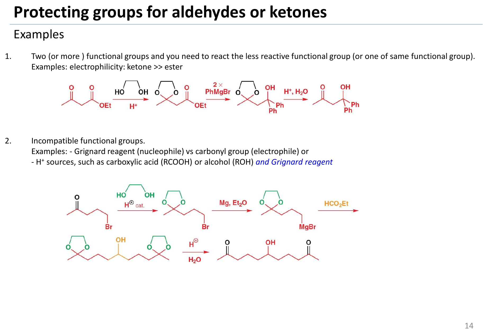

# 보호기

> 분자의 다른 곳에서 반응이 일어나는 동안 한 작용기를 잠시 가려 두는 **일시적인 마스크**다. protection, 반응시키고, deprotection.

## 개요

protecting group은 분자 안의 어떤 작용기를 잠시 "가려 두는" 장치다. 지금까지 배운 반응들은 대부분 시약이 반응할 자리가 하나뿐인 깔끔한 분자를 상정했지만, 실제 합성 표적은 그렇지 않다. ketone과 ester가 한 분자에 같이 있으면 [Grignard reagent](../시약/그리냐르%20시약.md)는 더 반응성이 큰 ketone으로 먼저 달려가고, OH가 하나라도 있으면 강염기는 엉뚱하게 그 양성자부터 떼어 버린다. 그래서 합성화학자는 방해되는 작용기에 일시적인 마스크를 씌우고, 원하는 반응을 끝낸 뒤 마스크를 벗기는 방법을 쓴다. L12는 alcohol([silyl ether](../시약/실릴%20에터%20보호기.md)), amine(carbamate: [Boc](../시약/Boc%20보호기.md), [Cbz](../시약/Cbz%20보호기.md), [Fmoc](../시약/Fmoc%20보호기.md)), aldehyde·ketone([acetal](../반응/아세탈%20형성.md))이라는 세 가지 대표 protecting group을 중심으로, 각 protecting group을 어떻게 씌우고 벗기는지, 그리고 왜 그 조건에서만 벗겨지는지를 메커니즘으로 설명한다. 마지막에는 이 모든 것이 [peptide synthesis](../반응/펩타이드%20합성.md)이라는 실전 무대에서 어떻게 조합되는지 본다(→ [orthogonal protection](직교%20보호.md)). 참고 교재는 Clayden 2판 23장(Protecting groups)이다.

### 표적 분자: 왜 이런 게 필요할까

protecting group 이야기는 palytoxin이라는 괴물 같은 분자에서 시작한다. palytoxin은 탄소 사슬이 아주 긴 polyhydroxy 화합물로, 이중결합 8개, hydroxy group 40개, 키랄 중심 64개를 가진다. 키랄 중심과 이중결합의 cis/trans 가능성을 모두 따지면 가능한 입체이성질체가 10^21개를 넘는다. 그래서 "유기합성의 에베레스트"라고 불렸다.[^1]

그림: 보충: palytoxin의 구조( $C_{129}H_{223}N_3O_{54}$, PubChem CID 11105289의 SMILES로 그림). 너무 길어서 세 조각으로 나눴고, 점선 결합이 다음 조각으로 이어지는 자리다. 파랑은 모두 OH로, protecting group 없이는 이 중 하나만 골라 반응시킬 수 없다.

그런데 이 분자를 만들 때 진짜 골칫거리는 무엇일까? 바로 거의 똑같이 생긴 OH가 40개나 있다는 점이다. 그중 하나만 반응시키고 나머지는 그대로 두고 싶다면, 나머지 OH를 어떻게든 반응하지 못하게 막아야 한다. 즉 protecting group 없이는 이런 분자의 합성을 시도조차 할 수 없다. (출처: L12 p.2)

## 언제 쓰나

protecting group이 필요한 상황은 크게 두 가지로 정리된다.

**첫째, 덜 반응성인 작용기를 반응시켜야 할 때다.** electrophilicity(친전자성)는 ketone이 ester보다 훨씬 크다(ketone >> ester). 그런데 ethyl acetoacetate(CH3COCH2CO2Et)에서 ester 쪽에만 PhMgBr 2당량을 붙여 CH3COCH2C(OH)Ph2를 얻고 싶다면 어떻게 될까? 그냥 PhMgBr을 넣으면 시약은 당연히 더 반응성 큰 ketone을 공격하고, 결과물은 CH3C(OH)(Ph)CH2CO2Et가 된다(슬라이드상 52% 수율). 원하는 것과 정반대다. 그래서 반응성이 큰 쪽을 먼저 가려 두는 수밖에 없다(풀이 → [acetal formation](../반응/아세탈%20형성.md)의 예 1).

**둘째, 애초에 한 분자 안에 공존할 수 incompatible 작용기가 있을 때다.** Grignard reagent는 nucleophile이고 carbonyl은 electrophile이므로, 둘을 한 분자에 넣으면 스스로를 공격해 버린다. 또 carboxylic acid(RCOOH)이나 alcohol(ROH) 같은 H⁺ 공급원이 있으면 Grignard reagent는 그 양성자에 의해 그냥 파괴된다. 슬라이드의 예가 바로 이것이다. ethyl formate(HCO2Et)에 CH3CO(CH2)3MgBr 2당량을 붙여 대칭 hydroxy diketone을 만들고 싶지만, 이 Grignard reagent는 자기 분자 안에 ketone을 품고 있으므로 만들어지는 순간 다른 분자의 ketone을 공격한다. 슬라이드는 이를 "불가능한 Grignard reagent(impossible Grignard reagent)"이라고 부른다(풀이 → [acetal formation](../반응/아세탈%20형성.md)의 예 2).

(출처: L12 p.3)

## 원리: protecting group은 어떻게 쓰는가

그렇다면 해결책은 무엇일까? 답은 단순하다. FG1과 FG2가 있는 분자에서 FG2를 반응시키고 싶은데 FG1이 방해한다면, FG1을 보호하고 → FG2에서 반응시키고 → FG1을 탈보호하면 된다.

$$
\begin{aligned}
& \mathrm{FG_1{\sim}FG_2} \\
& \xrightarrow{\text{보호}} \mathrm{PG{-}FG_1{\sim}FG_2} \\
& \xrightarrow{\text{FG2에서 반응}} \mathrm{PG{-}FG_1{\sim}EE} \\
& \qquad \xrightarrow{\text{탈보호}} \mathrm{FG_1{\sim}EE}
\end{aligned}
$$

말은 쉽지만 여기에는 두 가지 조건이 붙는다. 하나는 보호와 탈보호 반응 자체가 깔끔하게 일어나야 한다는 것이고, 다른 하나는 protecting group이 FG2에서 일어나는 반응 조건을 견딜 만큼 안정해야 한다는 것이다. 결국 protecting group 선택이란 "어떤 조건에서 버티고, 어떤 조건에서 벗겨지는가"를 맞추는 퍼즐이다.

대표적인 조합은 다음과 같다. alcohol은 silyl ether나 [benzyl ether](../시약/벤질%20에터%20보호기.md), amine은 carbamate(RO-C(=O)-NR2), aldehyde·ketone은 acetal, carboxylic acid은 ester로 보호한다. 다만 슬라이드에서 benzyl ether와 ester는 회색으로 처리되어 있고, 마지막 요약에도 silyl ether·carbamate·acetal 세 가지만 나온다. 즉 이 강의의 주인공은 이 셋이다. (출처: L12 p.4, p.16)

보충: 그러면 alcohol을 그냥 methyl ether로 막아 두면 안 될까? methyl ether는 만들기 쉽고 웬만한 반응을 다 견디지만, 문제는 **다시 벗기기가 너무 어렵다**는 것이다. 좋은 protecting group은 대부분의 조건에서 튼튼하되 특정 시약 하나에만 약한 "아킬레스건"을 가져야 한다. 이 관점으로 아래 표를 다시 보면 각 protecting group의 약점이 분명하다. [THP](../시약/THP%20보호기.md)는 에테르처럼 보이지만 사실 acetal이라 두 번째 산소가 산에서 약점이 되고, benzyl ether와 Cbz는 benzyl C–O 결합이 [hydrogenolysis](../반응/수소화분해.md)에 약하고, silyl ether는 Si가 F⁻를 유난히 좋아하며, Boc와 t-Bu ester는 안정한 t-butyl cation을 내놓을 수 있어 산에 약하다. 예외적으로 phenol의 methyl ether는 ArO⁻가 RO⁻보다 좋은 leaving group라서 BBr3나 HBr로 벗길 수 있어 protecting group으로 쓰인다. (보충 근거: Clayden p.550–552, p.556)

보충: protecting group은 공짜가 아니다. 씌우고 벗기는 두 단계가 더 들고, 각 단계 수율이 100%가 아니므로 시간과 물질을 모두 잃는다. 그래서 가능하면 protecting group 없이 가는 길도 먼저 검토한다. 예컨대 산성 양성자(OH, NH)가 몇 개 있는 ester에 값싼 Grignard reagent를 아주 과량 넣어, 양성자를 다 떼고도 남은 시약이 ester에 첨가하게 하는 방법이 실제로 쓰였다. 다만 이런 방법이 통할지는 해 보기 전에는 알 수 없다. (보충 근거: Clayden p.552)

## 한눈에 보는 protecting group 표

슬라이드는 Clayden 23장의 표를 그대로 보여 주며, 그중 acetal, trialkylsilyl, carbamate(Cbz, Boc, Fmoc)를 박스로 강조한다. "무엇으로부터 From" 칸을 눈여겨보면 각 protecting group의 성격이 보인다.

| protecting group | 구조 | 보호 대상 | 무엇으로부터 보호 | 도입 | 제거 |
|---|---|---|---|---|---|
| [acetal(dioxolane)](../반응/아세탈%20형성.md) | 1,3-dioxolane 고리 | ketone, aldehyde | nucleophile, 염기 | HOCH2CH2OH, H⁺ 촉매 | H⁺, H2O |
| [trialkylsilyl R3Si](../시약/실릴%20에터%20보호기.md) (예: TBDMS) | RO-SiMe3, RO-SiMe2t-Bu | alcohol | nucleophile, C 또는 N 염기 | R3SiCl, 염기 | H⁺, H2O 또는 F⁻ |
| [tetrahydropyranyl(THP)](../시약/THP%20보호기.md) | 2-alkoxytetrahydropyran | alcohol | 강염기 | dihydropyran + 산 | H⁺, H2O |
| [benzyl ether(OBn)](../시약/벤질%20에터%20보호기.md) | RO-CH2Ph | alcohol | 거의 모든 조건 | NaH, BnBr | H2, Pd/C 또는 HBr |
| methyl ether(ArOMe) | ArOMe | phenol | 염기 | NaH, MeI 또는 (MeO)2SO2 | BBr3, HBr, HI, Me3SiI |
| t-butyl ester(CO2t-Bu) | RCO2C(CH3)3 | carboxylic acid | nucleophile | isobutene, H⁺ | 강산 |
| [Cbz (Z)](../시약/Cbz%20보호기.md) | RNH-CO-OCH2Ph | amine | electrophile | BnOCOCl, 염기 | HBr/AcOH 또는 H2, Pd |
| [t-Boc](../시약/Boc%20보호기.md) | RNH-CO-OC(CH3)3 | amine | electrophile | (t-BuOCO)2O, 염기 | H⁺, H2O |
| [Fmoc](../시약/Fmoc%20보호기.md) | 9-fluorenylmethyl carbamate | amine | electrophile | Fmoc-Cl | 염기(예: amine) |

(출처: L12 p.5)

## amine의 protecting group: 왜 carbamate인가

amine은 좋은 nucleophile이자 염기라서, electrophile이 있는 반응에서는 거의 항상 끼어든다. 그렇다면 amine의 질소를 어떻게 "얌전하게" 만들 수 있을까? 답은 질소를 carbonyl에 붙여 carbamate(RO-C(=O)-NR2)로 만드는 것이다. 그러면 질소의 비공유 전자쌍이 C=O와 공명하며 비편재화되어 친핵성과 염기성이 크게 떨어진다.[^2] 표에서 carbamate가 "electrophile로부터" amine을 보호한다고 적힌 이유가 이것이다.

carbamate는 두 가지 시약으로 만든다. chloroformate(Cl-CO-OR'')를 쓰거나, dicarbonate(R''O-CO-O-CO-OR'', 일종의 무수물)를 쓴다. 둘 다 염기를 함께 넣는다.

$$
\mathrm{RR'NH} \xrightarrow{\mathrm{Cl{-}CO{-}OR''},\ \text{base}} \mathrm{R'RN{-}CO{-}OR''}
$$

$$
\mathrm{RR'NH} \xrightarrow[\text{base}]{\mathrm{R''O{-}CO{-}O{-}CO{-}OR''}} \mathrm{R'RN{-}CO{-}OR''}
$$

대표 선수는 두 명이다. benzyl carbamate인 [Cbz](../시약/Cbz%20보호기.md)(CBz, Z라고도 함, R'RN-CO-OCH2Ph)는 BnOCOCl과 염기로 씌우고, t-butyl carbamate인 [Boc](../시약/Boc%20보호기.md)(R'RN-CO-OC(CH3)3)는 (t-BuOCO)2O, 흔히 Boc2O라 부르는 시약과 염기로 씌운다. 세 번째 carbamate [Fmoc](../시약/Fmoc%20보호기.md)는 Fmoc-Cl로 씌운다. 세 carbamate 모두 마지막에는 "carbamic acid(또는 carbamate anion) → CO2 + amine" 단계로 끝나지만, 거기까지 가는 길(Boc: 산과 t-butyl cation, Cbz: hydrogenolysis, Fmoc: 염기와 [E1cB](E1cB%20제거.md))이 서로 달라 [orthogonal](직교%20보호.md)하게 쓸 수 있다. (출처: L12 p.8, p.10–11)

## 더 찾아보려면

슬라이드는 protecting group 정보를 찾을 곳으로 SynArchive(https://synarchive.com/protecting-group)를 소개한다. protecting group별로 도입·제거 조건과 실제 합성 사례가 정리된 데이터베이스다. 화면에는 1,2-aminoalcohol을 고리형 carbamate(oxazolidinone)로, 1,2-diol을 acetonide(Me2C acetal), benzaldehyde acetal(PhCH acetal), 고리형 carbonate로 보호하는 예가 보인다. 두 작용기를 한 고리로 묶어 동시에 가리는 방법이다. (출처: L12 p.15)

## 요약

정리하면, protecting group은 분자의 다른 곳에서 변환이 일어나는 동안 한 작용기를 막아 두는 일시적인 "마스크"다. FG1이 반응 조건과 맞지 않으면 FG1 보호 → FG2에서 반응 → FG1 탈보호. 그리고 alcohol은 silyl ether, amine은 carbamate, aldehyde·ketone은 acetal이다. (출처: L12 p.16)

## 예

- ethyl acetoacetate의 ester만 반응시키기, "impossible Grignard reagent" 만들기 → [acetal formation](../반응/아세탈%20형성.md)의 예. (L12) (출처: L12 p.3, p.14)
- OH가 있는 bromide에 lithium acetylide 붙이기 → [silyl ether protecting group](../시약/실릴%20에터%20보호기.md)의 예. (L12) (출처: L12 p.6)
- dipeptide LeuGly, SPPS → [peptide synthesis](../반응/펩타이드%20합성.md). (L12) (출처: L12 p.9, p.12)
- **미리 본 protecting group: $\begin{aligned} & \text{aniline의 acetylation. aniline} \\ & \xrightarrow{\mathrm{Ac_2O}} \text{acetanilide}(\mathrm{PhNHCOCH_3}) \\ & \xrightarrow[\mathrm{HOAc}]{\mathrm{Br_2},\ \text{실온}} \mathit{p}\ \text{-bromoacetanilide} \\ & \xrightarrow[\mathrm{EtOH/H_2O},\ \text{가열 환류}]{\mathrm{HCl}} \mathit{p}\ \text{-bromoaniline} \end{aligned}$. amide N의 비공유 전자쌍이 C=O와 conjugate되어 고리 activating 능력이 줄어들므로, 여전히 ortho/para(주로 para)이지만 한 번만 brominate된다. 이 "보호 → 반응 → 탈보호" 흐름이 L12에서 일반화된다. 메커니즘과 그림은 [aromatic halogenation](../반응/방향족%20할로젠화.md)에 있다. (L4) (출처: L4 p.5)

그림: 보충: protecting group 전략의 흐름. 방해되는 FG1을 PG로 보호하고, FG2에서 원하는 반응을 한 뒤(EE), PG를 떼어 FG1을 되살린다.

그림: 보충: 이 강의의 세 주인공. alcohol의 silyl ether(TBS, $R-O-SiMe_2tBu$ ), amine의 carbamate(Boc, Cbz), aldehyde·ketone의 acetal(1,3-dioxolane). R은 나머지 분자. 파랑은 보호되는 heteroatom(nucleophile), 빨강은 탈보호 때 공격·절단되는 자리(Si는 $F^-$, t-Bu C는 $H^+$, benzyl C는 $H_2/Pd$, acetal C는 $H_3O^+$ ).

## 흔한 오해

- **"protecting group은 튼튼할수록 좋다"고 생각하기 쉽지만 사실은** 필요할 때 원하는 조건에서 깔끔하게 벗겨지는 것이 더 중요하다. 그래서 TMS부터 TBDPS까지 튼튼함이 다른 silyl group이 여럿 존재하고, 상황에 맞춰 골라 쓴다(→ [silyl ether protecting group](../시약/실릴%20에터%20보호기.md)). (출처: L12 p.7)
- **"ethyl formate에 Grignard 2당량을 넣으면 3차 alcohol"이라고 생각하기 쉽지만 사실은** formate의 carbonyl 탄소에는 H가 붙어 있으므로 2차 alcohol R2CHOH가 생긴다. 일반 ester + Grignard 2당량이 3차 alcohol이다(→ [Grignard reagent](../시약/그리냐르%20시약.md)). (출처: L12 p.14)

## 보호기를 선택하기 전에 실패 경로부터 그린다

보호기는 원하는 작용기를 반응시키기 위한 임시 장치다. 예를 들어 ketone과 ester가 함께 있을 때 더 반응성 큰 ketone을 남겨 두고 ester만 선택적으로 바꾸려 하면 nucleophile이 ketone부터 공격한다. ketone을 acetal로 가리면 이 경쟁을 없앨 수 있다. 또 Grignard reagent와 free OH가 만나면 원하는 C–C 결합 형성 전에 acid–base 반응으로 reagent가 소모될 수 있다. 이 둘은 각각 electrophilic 작용기 경쟁과 proton source의 비호환성이라는 서로 다른 실패다. (출처: L12 p.3–4,13–14)

설계는 세 번 검산한다. 보호 조건이 다른 작용기를 손상하지 않는가, 핵심 변환 동안 보호기가 버티는가, 마지막 탈보호 조건을 생성물이 견디는가다. 보호 자체가 잘 된다는 사실만으로 좋은 선택이 되지는 않는다. acetal은 염기·nucleophile에는 안정하지만 산성 수용액에서 벗겨지므로 Grignard 단계와 산성 후처리를 각각 다른 단계로 표시해야 한다. (출처: L12 p.4,13–14)

### 시험 답안에 남겨야 할 세 줄

| 단계 | 써야 할 것 | 확인할 실패 |
|---|---|---|
| protection | 어느 작용기가 어떤 구조로 바뀌는가 | 보호하지 않은 carbonyl 또는 OH와 reagent의 반응 |
| transformation | 원하는 새 결합과 남겨 둔 보호기 | 보호기가 반응 조건에서 제거되는가 |
| deprotection | 원래 작용기의 회복과 조건 | 원하는 생성물도 함께 분해되는가 |

(출처: L12 p.3–4,13–16)

## 그림으로 확인하기

그림: 반응성이 큰 carbonyl을 가리는 전략과 Grignard 비호환성을 해결하는 전략을 비교한다. (출처: L12 p.14)

## 관련 문서

- 시약: [silyl ether protecting group](../시약/실릴%20에터%20보호기.md), [Boc protecting group](../시약/Boc%20보호기.md), [Cbz protecting group](../시약/Cbz%20보호기.md), [Fmoc protecting group](../시약/Fmoc%20보호기.md), [THP protecting group](../시약/THP%20보호기.md), [benzyl ether protecting group](../시약/벤질%20에터%20보호기.md), [Grignard reagent](../시약/그리냐르%20시약.md)
- 반응: [acetal formation](../반응/아세탈%20형성.md), [peptide synthesis](../반응/펩타이드%20합성.md), [hydrogenolysis](../반응/수소화분해.md), [aromatic halogenation](../반응/방향족%20할로젠화.md)
- 개념: [orthogonal protection](직교%20보호.md), [E1cB elimination](E1cB%20제거.md)

## 출처

- [L12 protecting group](../../notes/L12_Protecting_Groups.md) 1–4절, 6절, 9절 (L12 p.2–5, p.8, p.15–16)
- [L4 electrophilic aromatic substitution 2부](../../notes/L04_Electrophilic_Aromatic_Substitution_Part2.md) (슬라이드 p.5)

[^1]: 슬라이드에 인용된 문구는 "the Mount Everest of organic synthesis, the largest single molecule that anyone has ever even thought about making"이며, 출처로 위키백과 Palytoxin 문서가 링크되어 있다. (출처: L12 p.2)
[^2]: 보충: carbamate 질소의 낮은 친핵성은 amide 질소가 친핵성이 낮은 것과 같은 이유(N 비공유 전자쌍의 C=O로의 비편재화)다. (보충 근거: Clayden p.556)
