# 브로모늄 이온

> alkene에 Br₂가 첨가될 때 생기는, Br⁺가 두 탄소에 동시에 걸쳐 앉은 **3원 고리 cation intermediate**다. 이 intermediate 하나로 anti 첨가와 halohydrin의 regioselectivity가 모두 설명된다.

## 개요

alkene이 Br₂와 만나면 carbocation이 생길 것 같지만, 실제로는 Br이 두 탄소를 동시에 붙잡은 고리 구조가 생긴다. 고리가 한쪽 면을 막고 있기 때문에 다음 nucleophile은 **반대쪽 면**에서만 들어올 수 있다. 이것이 [halogen addition](../반응/할로젠%20첨가.md)이 anti로 일어나는 이유다. 이 단계 덕분에 이 반응을 "이중결합에 대한 electrophilic addition"이라 부르며, 여기서 electrophile은 bromine이다. bromonium ion은 L1에서 처음 나와 L2, L3, L4까지 계속 다시 등장한다. (출처: L1 p.4, p.10)

epoxide는 이 고리의 Br⁺ 자리에 O가 들어간 "산소판 bromonium ion"이라고 볼 수 있다. 차이는 epoxide가 **중성이고 꽤 안정**해서 분리해 보관할 수 있다는 점이다(→ [epoxidation](../반응/에폭시화.md)). (출처: L1 p.13)

## 메커니즘

### 왜 반응하는가: orbital로 보기

Br–Br 결합은 약하다. 그래서 nucleophile(Nu⁻)이 한쪽 Br을 공격하면 다른 쪽 Br이 Br⁻로 떨어져 나간다. 그런데 alkene에는 음전하가 없다. 무엇이 nucleophile 역할을 할까? 답은 **alkene의 HOMO, 즉 채워진 C=C π orbital**이다. 이 전자쌍이 Br₂의 **LUMO, 즉 비어 있는 Br–Br σ\* orbital**로 흘러 들어간다. σ\*에 전자가 차면 Br–Br 결합이 끊어진다(→ [electrophile and nucleophile](친전자체와%20친핵체.md)). (출처: L1 p.9)

### 1단계: bromonium ion 형성

*그림: Br₂가 π 결합의 가운데로 end-on 다가온다. 파란색은 nucleophile 쪽(π 결합, HOMO), 빨간색은 electrophile 쪽(Br–Br σ\*, LUMO), 주황색 굽은 화살표는 전자쌍의 이동이다. 화살표 셋은 (1) π 전자가 가까운 Br로, (2) Br–Br 결합 전자가 먼 Br로(Br⁻로 이탈), (3) 가까운 Br의 비공유 전자쌍이 반대쪽 탄소로 가서 3원 고리를 닫는 과정을 나타낸다.*

π orbital의 전자 밀도는 두 탄소의 **정중앙**에서 가장 높다. 그리고 π HOMO가 σ\* LUMO와 결합성으로 겹치려면 Br₂가 **end-on**, 즉 Br–Br 결합축을 따라 다가와야 한다. 그 결과 Br 원자 하나가 두 탄소에 동시에 걸쳐 앉은 3원 고리 cation이 생기고 Br⁻ 하나가 떨어져 나간다. (출처: L1 p.10)

### 2단계: Br⁻의 SN2 공격

*그림: Br⁻(파랑, nucleophile)가 C–Br⁺ 결합(빨강)의 정반대편에서 탄소를 backside attack. C–Br 결합 전자는 Br로 돌아가고, 새로 생긴 C–Br 결합(초록)은 원래 Br의 반대편에 놓이므로 두 Br이 anti가 된다.*

bromonium ion은 양전하를 띤 electrophile이고, 1단계에서 떨어져 나간 Br⁻는 nucleophile이다. 이 둘의 반응은 **평범한 [SN2](../반응/SN2%20반응.md) 치환**이다. nucleophile은 C–Br σ\* orbital과 최대로 겹치기 위해 **leaving group의 정반대편에서** 일직선으로 들어온다. 그래서 공격받는 탄소의 배치가 **inversion**되고, 두 Br은 서로 반대 면(anti)에 붙는다. 이 anti 첨가의 고리 예(cyclohexene → *trans*-dibromide)는 [halogen addition](../반응/할로젠%20첨가.md)에서 다룬다. (출처: L1 p.12, L2 p.10)

보충: Br⁻가 탄소가 아니라 양전하를 띤 Br을 공격할 수도 있을까? 실제로 그럴 수 있지만, 그 결과는 Br₂와 alkene이 다시 생기는 것뿐이다. 즉 1단계(bromonium ion 형성)는 **가역적**이고, 생성물로 이어지는 길은 탄소를 공격하는 SN2뿐이다. 또 bromonium ion은 "carbocation 옆의 Br이 비공유 전자쌍을 내주어 양전하를 달래 준 구조"로 볼 수도 있다. Br은 주기율표 아래쪽 원소라 비공유 전자쌍이 넓게 퍼져 있어서, 3원 고리의 각 긴장을 감수하고도 이런 안정화가 가능하다. 이 관점이 [loose SN2 transition state](느슨한%20SN2%20전이%20상태.md)를 이해하는 다리가 된다. (보충 근거: Clayden p.429)

*그림: ethylene에서 생긴 bromonium ion의 3D 구조(GFN2-xTB). $Br^+$가 두 탄소 위에 다리를 놓아 3원 고리를 만들고(C–Br 1.98 Å), 한쪽 면이 $Br^+$로 막힌다. 파란 화살표는 $Br^-$가 들어오는 방향으로, $Br^+$의 정반대편(anti)이다. 보충: 슬라이드 밖의 3D 모델 그림이다.*

## 선택성

### 어느 면: anti

nucleophile(Br⁻, H₂O, MeOH 등)은 언제나 C–Br 결합의 정반대편에서 들어오므로 첨가 전체로는 anti다(→ [stereospecificity and stereoselectivity](입체특이성과%20입체선택성.md)). 자유로운 carbocation이었다면 양쪽 면 공격으로 syn과 anti가 섞였을 것이다. (출처: L1 p.12, L2 p.10)

### 어느 탄소: 더 치환된 쪽

- **대칭 고리**(ethylene에서 생긴 것): 어느 탄소를 공격해도 결과가 같다.
- **비대칭 고리**: nucleophile은 **더 치환된 탄소**를 공격한다. C–Br 결합이 먼저 늘어나면서 부분 양전하가 그 탄소에 쌓이기 때문이다. 입체 효과가 아니라 전자 효과가 regioselectivity를 정한다(→ [loose SN2 transition state](느슨한%20SN2%20전이%20상태.md), [halohydrin formation](../반응/할로하이드린%20형성.md)). (출처: L1 p.22–23)

*그림: isobutene에서 생긴 bromonium ion에서 C–Br 결합이 늘어나 3차 탄소에 δ+가 쌓이고, MeOH가 그 탄소를 뒤쪽에서 공격한다.*

## 증거

bromonium ion은 보통 금방 반응해 사라지는 불안정한 intermediate다. 그런데 bi(adamantylidene)에서 만든 bromonium ion은 양쪽의 거대한 adamantyl기가 뒤쪽 공격을 막아서 **분리할 수 있을 만큼 안정**하다. 이 화합물은 bromonium ion이 실제로 존재한다는 구조적 증거가 되었다.[^1] (출처: L1 p.11)

또 하나의 증거는 stereospecificity다. *Z*-2-butene과 *E*-2-butene이 Br₂와 반응해 서로 다른 diastereomer를 하나씩만 준다는 사실 자체가 고리형 intermediate를 가리킨다(→ [halogen addition](../반응/할로젠%20첨가.md)). (보충 근거: Clayden p.439–440)

## 흔한 오해

- "Br₂ 첨가는 carbocation을 거친다": carbocation이었다면 nucleophile이 양쪽 면에서 들어와 syn과 anti가 섞였을 것이다. 실제로는 anti 생성물 하나만 생긴다(cyclohexene → *trans*-1,2-dibromide). (출처: L2 p.10)
- "Br₂ 첨가에서 Br⁻는 덜 붐비는 탄소를 공격한다": 대칭 bromonium ion에서는 상관이 없다. 비대칭 bromonium ion에서는 오히려 **더 치환된 탄소**가 공격받는다. loose SN2 transition state에서 양전하가 그쪽에 더 잘 쌓이기 때문이다. (출처: L1 p.22–23)
- "HBr 첨가도 Br₂처럼 고리형 intermediate를 거친다": H에는 비공유 전자쌍이 없어 3원 고리를 닫을 수 없다(→ [hydrohalogenation](../반응/할로젠화수소%20첨가.md)). (보충 근거: Clayden p.433)

## 관련 문서

- 반응: [halogen addition](../반응/할로젠%20첨가.md), [halohydrin formation](../반응/할로하이드린%20형성.md), [epoxidation](../반응/에폭시화.md), [electrophilic addition to dienes](../반응/다이엔의%20친전자성%20첨가.md), [SN2 reaction](../반응/SN2%20반응.md)
- 개념: [carbocation](탄소%20양이온.md), [loose SN2 transition state](느슨한%20SN2%20전이%20상태.md), [stereospecificity and stereoselectivity](입체특이성과%20입체선택성.md), [electrophile and nucleophile](친전자체와%20친핵체.md), [electrophilic addition to alkenes (overview)](알켄의%20친전자성%20첨가%20개관.md)
- 시약: [NBS](../시약/NBS.md)

## 출처

- [L1 Electrophilic Addition to Alkenes, Part 1](../../notes/L01_Electrophilic_Addition_to_Alkenes_Part1.md): 슬라이드 L1 p.9–12, p.22–23
- [L2 Electrophilic Addition to Alkenes, Part 2](../../notes/L02_Electrophilic_Addition_to_Alkenes_Part2.md): 슬라이드 L2 p.10

[^1]: 슬라이드 p.11에는 cyclopentene에서 만든 bromonium ion의 3D 모형과 bi(adamantylidene) bromonium cation이 "stable"이라는 설명과 함께 나온다.
