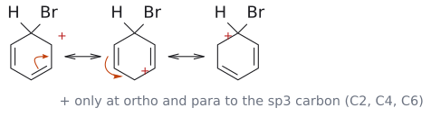

# 아레늄 이온

> [electrophilic aromatic substitution](../반응/친전자성%20방향족%20치환.md)에서 고리가 E⁺를 공격한 직후 생기는 cation intermediate. 강의에서는 **cyclohexadienyl cation**이라 부른다. 양전하가 ortho와 para 탄소에만 놓인다는 사실이 [substituent effect](치환기%20효과.md)의 뿌리다.

## 개요

고리의 $\pi$ 전자가 electrophile을 공격하면, E와 H가 함께 붙은 sp³ 탄소 하나와 양전하가 퍼진 나머지 다섯 탄소가 남는다. 이 단계에서 [aromaticity](방향족성.md)가 깨지므로 SEAr의 **rate-determining step**이 된다. 다음 단계에서 H⁺가 빠지면 aromaticity가 회복된다. 보충: "arenium ion", "Wheland intermediate", "$\sigma$ complex"는 모두 같은 intermediate를 가리키는 다른 이름이다. (보충 근거: Wade p.756) (출처: L3 p.11)

## 원리

### 양전하는 어디에 놓이나

공명 구조 세 개를 그리면 양전하는 공격받은 탄소(E가 붙은 sp³ 탄소)를 기준으로 **두 ortho 위치와 para 위치**에만 놓이고, meta 위치에는 오지 않는다. (출처: L3 p.11)

그래서 고리에 이미 치환기가 있으면, 그 치환기가 붙은 ipso에 양전하가 놓이는 공명 구조가 생기느냐가 중요하다.

- 원래 치환기의 **ortho/para를 공격**하면 공명 구조 하나에서 양전하가 치환기가 붙은 탄소에 놓인다. EDG라면 안정화되고, EWG라면 크게 불안정해진다.
- **meta를 공격**하면 양전하가 치환기가 붙은 탄소에 한 번도 오지 않는다.

(출처: L4 p.8, p.12)

L4의 원리는 이 한 문장으로 정리된다. **cyclohexadienyl cation intermediate를 더 안정하게 만드는 경로가 이긴다.** 구체적인 예(toluene, CF₃-benzene)와 그림은 [substituent effect](치환기%20효과.md)에 있다. (출처: L4 p.2)

그림: E(여기서는 Br)가 붙은 sp³ 탄소를 기준으로 양전하(빨강)는 두 ortho 위치와 para 위치에만 놓인다. 주황 화살표는 $\pi$ 전자쌍이 이웃한 양전하 쪽으로 옮겨 가 다음 공명 구조가 되는 과정이다. meta 위치에는 양전하가 오지 않는다. (출처: L3 p.11)

그림: 첫 단계(방향족성을 잃는 친전자체 공격)가 느리고, $\sigma$ complex에서 $H^+$ 를 잃으면 방향족성을 되찾아 낮은 에너지의 치환 생성물이 된다(초록). nucleophile이 첨가하면(빨간 점선) 방향족성이 없는 생성물이라 불리하다. 보충: 정성적 도표다.

### 왜 intermediate만 보면 되는가

보충: 반응 속도를 정하는 것은 intermediate가 아니라 transition state다. 그런데도 intermediate의 안정성만 따져도 되는 이유는 이렇다. cyclohexadienyl cation은 출발 물질보다 에너지가 훨씬 높아서, 그것이 생기는 transition state와 에너지가 가깝다. 에너지가 비슷하고 서로 바로 이어지는 구조는 생김새도 비슷하다는 **Hammond postulate**에 따라, intermediate를 첫 번째 transition state의 모형으로 쓸 수 있다. 그래서 "intermediate를 안정화하는 치환기는 transition state도 안정화해 반응을 빠르게 한다"는 L4의 논리가 성립한다. (보충 근거: Clayden p.478)

## 증거: 직접 관찰

benzene을 superacid(SbF₅/FSO₃H, SO₂FCl 용매, −120 °C)으로 처리하면 **protonate된 benzene(cyclohexadienyl cation)** 이 SbF₆⁻ 염으로 관찰된다. NMR 데이터와 계산된 전하는 다음과 같다. (출처: L4 p.20)

| 위치 | $\delta_{\mathrm{H}}$ | $\delta_{\mathrm{C}}$ | 계산 전하 |
|---|---|---|---|
| 1 (sp³, CH₂) | 5.6 | 52.2 | |
| 2, 6 (ortho) | 9.7 | 186.6 | 0.26+ |
| 3, 5 (meta) | 8.6 | 136.9 | 0.09+ |
| 4 (para) | 9.3 | 178.1 | 0.30+ |
| benzene (비교) | 7.33 | 129.7 | |

**ortho(2,6)와 para(4)** 위치가 크게 deshielding(downfield)되어 있다. 양전하가 ortho와 para에 놓인다는 공명 그림이 실험으로 확인된 것이다. meta(136.9 ppm)에는 양전하가 적다. (출처: L4 p.20)

## 흔한 오해

- "다음 단계에서 nucleophile이 cation에 첨가한다": alkene의 [carbocation](탄소%20양이온.md)과 달리 H⁺를 잃고 aromaticity를 회복한다(→ [electrophilic aromatic substitution](../반응/친전자성%20방향족%20치환.md)). (출처: L3 p.11)
- "양전하가 고리 다섯 탄소에 고르게 퍼진다": ortho와 para에 몰려 있고 meta에는 거의 없다(0.09+). (출처: L4 p.20)

## 관련 문서

- 반응: [electrophilic aromatic substitution](../반응/친전자성%20방향족%20치환.md), [aromatic halogenation](../반응/방향족%20할로젠화.md), [nitration](../반응/나이트로화.md)
- 개념: [aromaticity](방향족성.md), [substituent effect](치환기%20효과.md), [carbocation](탄소%20양이온.md), [bromonium ion](브로모늄%20이온.md) (alkene의 intermediate와 비교), [Meisenheimer complex](마이젠하이머%20착물.md)

## 출처

- [L3 electrophilic aromatic substitution 1부](../../notes/L03_Electrophilic_Aromatic_Substitution_Part1.md) 2절 (슬라이드 p.11)
- [L4 electrophilic aromatic substitution 2부](../../notes/L04_Electrophilic_Aromatic_Substitution_Part2.md) 개요, 2절, 3절, 7절 (슬라이드 p.2, p.8, p.12, p.20)
