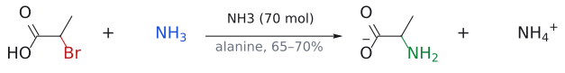
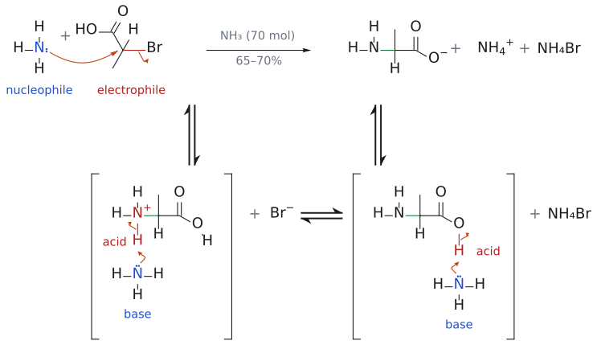
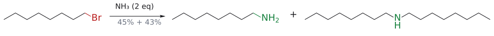
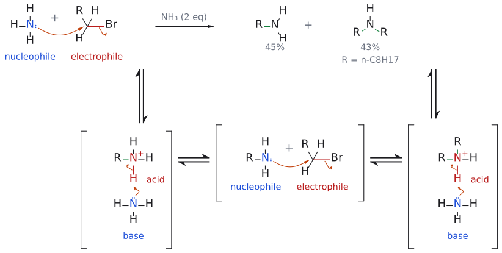
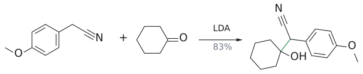

# 아민 합성 개관

> amine은 N의 lone pair 때문에 base이자 nucleophile이다. 그래서 NH₃로 R–X를 직접 SN2 하면 생성물이 더 좋은 nucleophile이 되어 **over-alkylation**이 일어난다. L5의 모든 amine 합성법은 "N을 한 번만 붙이고 나중에 reduction으로 amine을 드러내는" 전략이다.

## 개요

L5는 reduction(환원) 강의이지만 출발점은 amine이다. 몸과 약에서 중요한 분자 상당수가 질소를 품고 있는데, 정작 amine을 깔끔하게 만드는 일은 생각보다 까다롭다. 강의는 이 문제를 실마리 삼아 azide·nitrile·amide·imine을 환원하는 방법으로 넘어가고, 거기서 [metal hydride](금속%20수소화물의%20반응성.md) 시약 세트와 [catalytic hydrogenation](../반응/촉매%20수소화.md)을 정리한다. 이 문서는 그 출발점, 즉 "amine이란 무엇이고 왜 만들기 어려운가"와 여러 방법을 엮은 응용(venlafaxine 합성)을 모은다. (출처: L5 p.2–6, p.16)

## 일상 속 질소 화합물

왜 하필 amine부터 시작할까? 슬라이드는 serotonin과 dopamine 이야기로 답한다. 둘 다 neurotransmitter(신경전달물질)로, 한 신경에서 다음 신경으로 시냅스 간극을 건너 전기 신호를 전달한다. serotonin은 뇌와 중추신경계 전반에서 식욕, 수면 주기, 기분, 기억과 학습을 조절한다.[^1] 그 밖에도 pyridoxine(vitamin B6), thiamine vitamin B1, nicotine, nicotinic acid(niacin, vitamin B3), 불안·alcohol 금단·발작 치료제인 diazepam(Valium), antihistamine chlorpheniramine, histamine이 모두 질소 화합물이다. 생선 비린내의 원인 중 하나인 trimethylamine도 여기에 속한다. 즉 질소 화합물은 생화학적 성질의 폭이 매우 넓고, 그래서 amine을 만드는 법은 유기합성의 기본기가 된다. (출처: L5 p.2–3)

## amine의 분류와 성질

amine은 N에 붙은 탄소 수에 따라 1차(RNH₂), 2차(R₂NH), 3차(R₃N)로 나뉜다. N에 기가 네 개 붙을 수도 있는데, 이때는 N이 형식 양전하를 띠어야 하므로 quaternary ammonium salt(4차 ammonium염)가 된다. 또 alkyl group이 붙은 alkylamine과 aryl기가 붙은 arylamine으로도 나누는데, 화학은 대체로 비슷하지만 차이도 상당하다. (출처: L5 p.4)

amine의 화학을 한 줄로 요약하면 "N의 lone pair(비공유 전자쌍)"이다. 이 전자쌍 때문에 amine은 base이자 nucleophile이 된다. 그런데 같은 N을 가진 amide(RCONH₂)는 사정이 다르다. amide는 수용성 산에 protonate되지 않을 만큼 염기성이 없고, nucleophilicity도 약하다.[^2] 이 차이는 "acylation 후 reduction"이라는 우회로([amide reduction](../반응/아마이드%20환원.md))의 근거가 된다. (출처: L5 p.4)

고리형 amine도 이름을 익혀 두자. 7원 고리 azepane, 6원 고리 piperidine·piperazine·morpholine, 5원 고리 pyrrolidine([pyrrolidine](../시약/피롤리딘.md)), 4원 고리 azetidine, 3원 고리 aziridine이다.[^3] (출처: L5 p.4)

## SN2로 amine 만들기: 왜 생각대로 안 되나

가장 단순한 발상은 NH₃를 nucleophile로 써서 alkyl halide를 [SN2](../반응/SN2%20반응.md)로 치환하는 것이다.

$$
\mathrm{NH_3}\ (\text{대과량}) + \mathrm{R{-}X} \longrightarrow \mathrm{[R{-}NH_3^+\thinspace X^-]} \longrightarrow \mathrm{RNH_2} + \mathrm{NH_4^+\thinspace X^-}
$$

1. NH₃(nucleophile)의 N lone pair가 R–X의 electrophile을 뒤에서 공격하고, C–X 결합이 끊어지면서 C–N 결합이 생긴다. 결과물은 alkylammonium salt R–NH₃⁺X⁻다.
2. 옆에 있던 NH₃가 N–H 양성자를 떼어 가면 중성 RNH₂와 NH₄⁺X⁻가 남는다.

실제로 2-bromopropanoic acid 1 mol에 NH₃를 무려 70 mol 넣으면 alanine(ammonium염 형태)을 65–70%로 얻을 수 있다.

$$
\mathrm{CH_3CH(Br)COOH}\ (1\ \text{mol}) \xrightarrow{\mathrm{NH_3}\ (70\ \text{mol})} \underbrace{\mathrm{CH_3CH(NH_2)COO^-}}_{\text{alaninate}} + \mathrm{NH_4^+} + \mathrm{NH_4Br}
$$
(수율 65–70%)

그런데 왜 NH₃를 그렇게 많이 넣어야 할까? 1-bromooctane에 NH₃를 2 eq만 넣어 보면 답이 나온다.

$$
\begin{aligned}
\mathrm{CH_3(CH_2)_6CH_2Br} + \mathrm{NH_3}\ (2\ \text{eq}) &\longrightarrow \text{octylamine} + \text{dioctylamine} \\
&\qquad + \text{trioctylamine}\ (\text{미량}) + \text{tetraoctylammonium bromide}\ (\text{미량})
\end{aligned}
$$
(수율 octylamine 45%, dioctylamine 43%)

원하는 1차 amine과 거의 같은 양의 2차 amine이 섞여 나온다. 이것이 **over-alkylation**(over-alkylation)이다. 원인은 생성물 자체에 있다. 새로 생긴 RNH₂는 alkyl group의 전자 공여 덕분에 NH₃보다 오히려 더 좋은 nucleophile이라서, 남은 RX를 먼저 낚아채 버린다.[^4] 즉 반응이 "한 번만 일어나고 멈추는" 장치가 없다. (출처: L5 p.5–6)

## 해결 전략: N을 한 번만 붙이고 환원으로 드러낸다

| 방법 | 핵심 | 얻는 amine | 문서 |
|---|---|---|---|
| azide alkylation 후 환원 | R–N₃는 더 이상 nucleophile이 아님 | 1차 | [amine synthesis via azide and nitrile](../반응/아자이드·나이트릴을%20거친%20아민%20합성.md), [Staudinger reduction](../반응/스타우딩거%20환원.md) |
| cyanide alkylation 후 환원 | 탄소가 하나 늘어남 | 1차 (RCH₂CH₂NH₂) | [amine synthesis via azide and nitrile](../반응/아자이드·나이트릴을%20거친%20아민%20합성.md) |
| amide 환원 | acylation은 한 번에서 멈춤, C=O → CH₂ | 1·2·3차 | [amide reduction](../반응/아마이드%20환원.md) |
| reductive amination | C=N(imine/iminium)을 환원 | 한 단계 더 치환된 amine | [reductive amination](../반응/환원성%20아미노화.md) |
| Eschweiler–Clarke | HCOOH가 hydride 공급원 | N,N-dimethyl 3차 | [Eschweiler–Clarke reaction](../반응/에슈바일러-클라크%20반응.md) |

(출처: L5 p.7–15)

## 응용: venlafaxine 합성

지금까지의 도구가 실제 약 합성에서 어떻게 엮이는지 보자. venlafaxine은 뇌의 serotonin과 noradrenaline 농도를 높이는 것으로 생각되는 항우울제다.

1. **C–C 결합 만들기** (슬라이드 표기: "enolate chemistry"):

   $\text{4-methoxyphenylacetonitrile} \xrightarrow[\text{cyclohexanone}]{\mathrm{LDA}} \text{1-[사이아노(4-methoxyphenyl)methyl]cyclohexanol}$ (수율 83%)

   [LDA](../시약/LDA.md)가 nitrile α-H를 떼고, 생긴 carbanion이 ketone C=O에 첨가한다.[^5] (→ [enolate](엔올과%20엔올레이트.md))
2. **nitrile → 1차 amine** (nitrile 환원, → [amine synthesis via azide and nitrile](../반응/아자이드·나이트릴을%20거친%20아민%20합성.md)):

   $\xrightarrow{\mathrm{H_2},\ \mathrm{Rh/Al_2O_3}} \text{1-[2-amino-1-(4-methoxyphenyl)ethyl]cyclohexanol}$ (수율 57%; 5% $\mathrm{Rh/Al_2O_3}$)
3. **N,N-dimethylation** ([Eschweiler–Clarke](../반응/에슈바일러-클라크%20반응.md)):

   $\xrightarrow[\text{reflux}]{\mathrm{HCHO},\ \mathrm{HCOOH}} \text{venlafaxine}\ (\mathrm{HCl}\ \text{염})$ (수율 80%)

그런데 2와 3을 한 번에 할 수는 없을까? 특허 경로[^6]가 바로 그것이다. cyano alcohol을 `H2 (12 bar), Pd/C (5%), HCHO (2.2 eq)`로 처리하면 venlafaxine이 94%로 나온다. nitrile hydrogenation으로 생긴 1차 amine이 같은 용기 안의 HCHO와 [reductive amination](../반응/환원성%20아미노화.md)(H₂/Pd가 환원제)을 두 번 연달아 겪는 것이다. HCHO가 2.2 eq인 이유도 methyl group 두 개를 붙여야 하기 때문이다. 슬라이드의 빈 상자 두 개는 [L5 연습 문제](../../practice/L05_Exercises.md) 3번으로 옮겼다. (출처: L5 p.16)

그림: $NH_3$ (파랑)가 C–Br(빨강)을 SN2로 치환한다. 대과량 $NH_3$ 로 과알킬화를 막는다.

그림: 위 반응식의 메커니즘이다. 위 줄이 전체 반응이고 아래 줄은 단계별 풀이다(대괄호는 중간체, ⇌는 평형). 1단계(위 줄의 화살표): $\mathrm{NH}_3$ 의 비공유 전자쌍(파랑, nucleophile)이 C–Br 탄소(빨강, electrophile)를 Br의 반대쪽에서 공격해 새 C–N 결합이 생기고, C–Br 결합 전자는 Br로 가서 $\mathrm{Br}^-$ 가 떠난다(SN2). 2단계: 생긴 ammonium의 N–H 양성자(산, 빨강)를 다른 $\mathrm{NH}_3$ (염기, 파랑)가 가져가 중성 amine이 되고 $\mathrm{NH}_4^+$ 가 생긴다. 3단계: carboxylic acid의 O–H 양성자(산, 빨강)도 또 하나의 $\mathrm{NH}_3$ (염기, 파랑)가 가져가 alaninate가 된다. 위 줄의 $\mathrm{NH}_4\mathrm{Br}$ 는 $\mathrm{NH}_4^+$ 와 $\mathrm{Br}^-$ 이고, 모두 $\mathrm{NH}_3$ 세 분자가 쓰인다. $\mathrm{NH}_3$ 를 70 mol이나 쓰는 이유(over-alkylation 방지)는 아래 octylamine 그림에서 본다. 보충: 곡선 화살표와 3단계의 양성자 이동은 표준 SN2 메커니즘과 산-염기 반응에 따라 그린 것이다. (보충 근거: Clayden p.353)

그림: $NH_3$ 가 적으면 생성된 amine이 다시 알킬화되어 dioctylamine이 거의 같은 양 생긴다.

그림: 위 반응식의 메커니즘이다. 위 줄이 전체 반응이고 아래 줄은 단계별 풀이다(대괄호는 중간체, ⇌는 평형). $\mathrm{R}$ 은 n-$\mathrm{C}_8\mathrm{H}_{17}$ 이다. 1단계(위 줄의 화살표): $\mathrm{NH}_3$ (파랑, nucleophile)가 C–Br 탄소(빨강, electrophile)를 SN2로 공격해 $\mathrm{RNH}_3^+$ 가 된다. 2단계: 다른 $\mathrm{NH}_3$ (염기)가 N–H 양성자(산)를 가져가 octylamine $\mathrm{RNH}_2$ 가 된다. 3단계: 생긴 $\mathrm{RNH}_2$ 는 alkyl group의 전자 공여 때문에 $\mathrm{NH}_3$ 보다 더 좋은 nucleophile이라 남은 1-bromooctane을 다시 SN2로 공격해 $\mathrm{R}_2\mathrm{NH}_2^+$ 가 된다(새 C–N은 초록). 4단계: 이 ammonium도 $\mathrm{NH}_3$ 에게 양성자를 주어 dioctylamine $\mathrm{R}_2\mathrm{NH}$ 가 된다. 그래서 $\mathrm{NH}_3$ 가 2 eq뿐이면 octylamine(45%)과 dioctylamine(43%)이 거의 같은 양 생긴다. 같은 두 단계가 한 번 더 일어나면 trioctylamine과 4차 암모늄염까지 가지만 미량이라 그리지 않았다. 단계마다 생기는 $\mathrm{Br}^-$ 와 $\mathrm{NH}_4^+$ 짝이온도 그리지 않았다. 보충: 곡선 화살표는 표준 SN2 메커니즘과 산-염기 반응에 따라 그린 것이다. (보충 근거: Clayden p.353)

그림: venlafaxine 1단계: nitrile α-탄소 anion(파랑)이 ketone C(빨강)에 첨가한다(새 C–C, 초록).

## 흔한 오해

- **"NH₃를 RX와 반응시키면 1차 amine이 생긴다"고 생각하기 쉽지만 사실은** 생성 amine이 더 좋은 nucleophile이라 2차·3차 amine과 4차 염이 섞인다. NH₃ 2 eq에서는 1차와 2차가 거의 반반이다. 깔끔한 1차 amine은 azide, nitrile, amide 환원, reductive amination으로 만든다. (출처: L5 p.6)
- **"amide도 amine처럼 염기성이다"**: amide N의 lone pair는 C=O와 공명해 있어 수용성 산에 protonate되지 않는다. (출처: L5 p.4)

## 관련 문서

- 반응: [amine synthesis via azide and nitrile](../반응/아자이드·나이트릴을%20거친%20아민%20합성.md), [amide reduction](../반응/아마이드%20환원.md), [reductive amination](../반응/환원성%20아미노화.md), [Eschweiler–Clarke reaction](../반응/에슈바일러-클라크%20반응.md), [Staudinger reduction](../반응/스타우딩거%20환원.md), [SN2 reaction](../반응/SN2%20반응.md)
- 시약: [LiAlH4](../시약/LiAlH4.md), [NaBH3CN](../시약/NaBH3CN.md), [LDA](../시약/LDA.md), [pyrrolidine](../시약/피롤리딘.md)
- 개념: [imine](이민.md), [iminium ion](이미늄%20이온.md), [metal hydride의 반응성](금속%20수소화물의%20반응성.md), [electrophile과 nucleophile](친전자체와%20친핵체.md)

## 출처

- [L5 환원](../../notes/L05_Reduction.md) 1절 (슬라이드 p.2–6, p.16)
- [L5 연습 문제](../../practice/L05_Exercises.md) 3번

[^1]: 슬라이드는 May, *Molecules That Amaze Us*(CRC Press)를 인용해 "serotonin이 dopamine과 함께 인류 진화와 과학·예술·문화 발전의 원동력이었다고까지 주장할 수 있다"는 다소 과감한 문장을 소개한다. 경쟁심과 남보다 앞서려는 욕구에도 관여할 수 있다고 한다. (출처: L5 p.2)
[^2]: amide N의 lone pair는 C=O와 공명하며 비편재화되어 있어서, 양성자나 electrophile에 내줄 여유가 적다. amide가 protonation될 때도 N이 아니라 O에서 일어난다.
[^3]: 슬라이드에는 azetidine이 "Azeditine"으로, morpholine이 "Morph oline"으로 표기되어 있는데 오타다. 바른 이름은 azetidine, morpholine이다. (출처: L5 p.4)
[^4]: alkyl group의 inductive effect(전자 공여)로 N이 더 전자가 풍부해지기 때문이다. 2차 amine부터는 입체 장애도 커지므로 3차, 4차로 갈수록 생성량이 줄어 p.6처럼 "미량"이 된다.
[^5]: 슬라이드는 "enolate chemistry"라고 적지만, 엄밀히는 nitrile α-H를 뗀 nitrile 안정화 carbanion(enolate 유사체)이다. anion 전하가 C≡N 쪽으로 비편재화되어 안정해지는 원리는 enolate와 같다.
[^6]: Burgos et al. 2008 (US Patent). (출처: L5 p.16)
