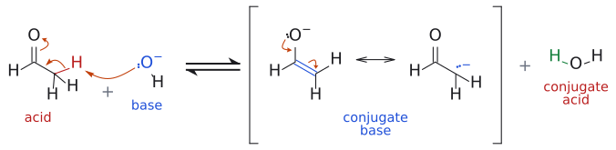

# 엔올과 엔올레이트

> carbonyl 화합물의 $\alpha$-탄소를 nucleophile로 바꾼 두 형태. **enol**은 C=C–OH(산 조건, 중성), **enolate**는 $\alpha$-H를 염기로 떼어 낸 C=C–O⁻(염기 조건, anion)다. L7–L11의 거의 모든 C–C 결합 형성이 이 둘에서 출발한다.

## 개요

carbonyl은 원래 nucleophile에게 공격당하는 electrophile이다. nucleophile은 C=O 탄소에 nucleophilic addition leaving group을 밀어낸다. 그런데 $\alpha$-H를 떼어 enolate로 만들면 $\alpha$-탄소가 전자가 풍부해져 electrophile(E⁺)과 잘 반응하는 nucleophile로 변신한다. 그래서 carbonyl 화합물 하나가 조건에 따라 electrophile도 되고 nucleophile도 된다. aldol에서 같은 acetaldehyde가 두 역할을 동시에 맡는 것도 이 때문이다. enolate가 어떤 상대와 만나 무엇이 되는지의 전체 지도는 [enolate chemistry (overview)](엔올레이트%20화학%20개관.md)에 있다. (출처: L7 p.9; L8 p.9)

## 이미 만나 본 enolate: 안정화 ylide

L6에서 ylide는 보통 BuLi 같은 강염기로 만들었다. 그런데 bromoacetic acid ester에서 출발한 phosphonium salt는 Na₂CO₃ 같은 약염기로도 ylide가 된다. 왜 그럴까? (출처: L7 p.3)

답은 음전하 옆에 붙은 C=O에 있다. $\mathrm{BrCH_2CO_2R} \xrightarrow{\ \mathrm{PPh_3}\ \mathstrut} \mathrm{Ph_3P^+{-}CH_2CO_2R}$ $\xrightarrow{\ \mathrm{Na_2CO_3}\ \mathstrut} \mathrm{Ph_3P^+{-}CH^-{-}CO_2R}$ 에서 생긴 음전하는 carbonyl 산소까지 퍼져 나가, enolate와 똑같은 모양의 공명 구조(O⁻가 있는 C=C)를 갖는다. anion이 안정해진 만큼 C–H가 산성이 되어 약한 염기로도 충분하다. 이렇게 공액하거나 anion을 안정화하는 치환기(R = H, OR, alkyl인 C(=O)R)를 가진 것을 stabilized ylide라 한다(→ [phosphorus ylide](../시약/인%20일라이드.md)). (출처: L7 p.3)

[HWE](../반응/HWE%20반응.md)(Horner–Wadsworth–Emmons) 반응의 phosphonate도 같다. $\mathrm{(EtO)_2P({=}O)CH_2C({=}O)R} \xrightarrow{\mathrm{EtO^-}\ \text{또는}\ \mathrm{NaH}}$ 로 생긴 anion은 P=O 쪽과 C=O 쪽으로 동시에 비편재화된 세 공명 구조를 갖는다.[^1] 결국 L7의 주인공인 enolate는 이미 한 번 만나 본 셈이다. (출처: L7 p.3)

## 구조: 음전하는 어디에 있나

carbonyl 화합물이 $\alpha$-H를 잃어 생긴 anion이 enolate이고, 음전하가 $\alpha$-C와 O에 나뉘어(공명, 전자 비편재화) 안정하다. enolate는 O, C, C 세 원자에 $\pi$ 전자 4개가 퍼진 **3-atom, 4-electron 계**로, allyl anion과 같은 모양이다. acetaldehyde에 HO⁻를 작용시켜 만든 enolate는 oxyanion(CH₂=CH–O⁻)과 carbanion(⁻CH₂–CH=O)의 공명 혼성체로 그린다. (출처: L7 p.5, p.24)

그림: 슬라이드 p.24의 acetaldehyde 예다. 한 단계 산-염기 반응이라 중간체 없이 한 줄로 그렸고, 대괄호는 공명 혼성체의 두 극한 구조를 묶은 것이며 ⇌는 평형이다. 왼쪽: $\mathrm{HO}^-$ (파랑, base)의 비공유 전자쌍이 $\alpha$-H(빨강, acid)를 떼어 가고(화살표 1), 끊어진 C–H 결합 전자쌍이 C–C 사이로 들어가 C=C가 되며(화살표 2), 원래 C=O의 $\pi$ 전자가 산소로 밀려나 $\mathrm{O}^-$ 가 된다(화살표 3). 오른쪽: 생긴 enolate(conjugate base, 파랑)는 음전하가 O에 있는 oxyanion과 $\alpha$-C에 있는 carbanion의 공명 혼성체이고, $\mathrm{H_2O}$ 는 conjugate acid(빨강)다. oxyanion 위의 두 화살표(O의 전자쌍이 C=O로, C=C의 $\pi$ 전자가 $\alpha$-C로)가 두 공명 구조를 잇는다. 염기를 LDA로 바꿔도 화살표의 흐름은 같다. 짝이온($\mathrm{Na}^+$ 등)은 그리지 않았다. (출처: L7 p.5, p.24)

분자 오비탈로 보면 반응 위치가 설명된다. allyl anion의 HOMO($\psi_{2}$)는 양 말단 탄소에 같은 크기의 오비탈을 갖는데, enolate의 HOMO($\psi_{2}$)는 말단 탄소 쪽 오비탈이 더 크다. 반면 전체 음전하는 전기음성도가 큰 산소에 더 많이 모여 있다.

- 오비탈 겹침이 중요한 반응(MeI 같은 soft electrophile) → 탄소에서
- $\begin{aligned} & \text{정전기적 끌림이 중요한}\ \text{반응}(\mathrm{Me_2SO_4},\ \mathrm{Me_3O^+}\  \\ & \text{같은 hard electrophile}) \\ & \longrightarrow \text{산소에서} \end{aligned}$

C 대 O를 가르는 요인(electrophile, 금속 cation, 용매)은 [hard and soft acids and bases (HSAB)](하드-소프트%20산염기.md)에 정리했다. (출처: L7 p.24–25)

## 얼마나 많이 생기나

enolate가 "얼마나 많이" 생기는지는 염기 세기에 달려 있다. NaOEt로는 ketone enolate가 소량만, [LDA](../시약/LDA.md)로는 사실상 전부 생긴다. 판단은 [pKa 비교](α-수소의%20산도.md)로 한다. (출처: L7 p.5–6)

## enol과 enolate는 어떻게 다른가

| | enol | enolate |
|---|---|---|
| 조건 | 산 촉매 | 염기 |
| 전하 | 중성 | anion |
| 친핵성 | 약함(상대를 산으로 활성화해야 함) | 강함 |
| 예 | 산 촉매 aldol, Br₂/HOAc [$\alpha$-halogenation](../반응/α-할로젠화.md) | alkylation, aldol, Claisen, Michael |

enol과 keto형은 H 위치가 다른 별개의 화합물(호변이성체)이다(→ [keto-enol tautomerization](../반응/케토-엔올%20토토머화.md)). 단순 ketone의 enol 함량은 acetone 1.5 × 10⁻⁴ %, cyclohexanone 1.2 % 정도로 매우 적다. C=O $\pi$ 결합이 C=C $\pi$ 결합보다 강하기 때문이다. 반면 pentane-2,4-dione은 공액과 분자 내 수소결합 덕분에 enol이 76 %다. (출처: L10 p.3–6)

## 무엇이 enolization될 수 있나

### carbonyl 화합물

조건은 단순하다. $\alpha$-H가 있으면 된다. cyclohexanone은 enol 및 enolate로 바뀔 수 있고, $\alpha$-탄소가 두 개인 2-뷰타논은 regioisomeric enol 두 개와 regioisomeric enolate 두 개(CH₃CH=C(O⁻)CH₃, CH₂=C(O⁻)CH₂CH₃)를 갖는다(어느 쪽이 생기는지는 → [kinetic vs thermodynamic enolate](속도론적%20엔올레이트와%20열역학적%20엔올레이트.md)). aldehyde도 cyclopentanecarbaldehyde처럼 $\alpha$-H가 있으면 enol/enolate(cyclopentyl리덴 C=CH–O⁻)가 된다. (출처: L7 p.21)

반대로 $\alpha$-H가 하나도 없으면 enolization이 non-enolizable. benzophenone(Ph₂CO), benzaldehyde(PhCHO), 2,2-dimethylpropanal(pivaldehyde, (CH₃)₃CCHO), formaldehyde(HCHO)가 그렇다. ester는 methoxide 같은 alkoxide와 가역 평형을 이루며 enolate를 소량 만든다($\text{에스터} + \mathrm{MeO^-} \rightleftharpoons \text{에스터 enolate} + \mathrm{MeOH}$). (출처: L7 p.21)

acid chloride, carboxylic acid, N–H amide는 $\alpha$-H가 있어도 쓸 만한 enolate를 주지 않는다. 이유는 [alpha-hydrogen acidity](α-수소의%20산도.md)에 있다. (출처: L7 p.23)

### carbonyl이 아닌 작용기

질소를 포함한 작용기도 enolate 같은 anion을 만든다. (출처: L7 p.22)

- **nitrile:** $\begin{aligned} & \mathrm{PhCH_2C{\equiv}N} \\ & \xrightarrow{\text{base}} \mathrm{[PhCH{=}C{=}N^-}\ \\ & \leftrightarrow \ \mathrm{PhCH^-{-}C{\equiv}N]} \end{aligned}$ 처럼 음전하를 질소로 넘길 수 있다.
- **imine(C=N):** $\mathrm{(CH_3)_2CH{-}CH{=}NPh} \xrightarrow{\text{base}} \mathrm{(CH_3)_2C{=}CH{-}N^-Ph}$ 로 aza-enolate를 만든다(→ [imine](이민.md)).
- **nitro 화합물(N=O):** 특히 산성이라 nitro메테인은 Et₃N 같은 약한 amine으로도 nitronate(CH₂=N⁺(O⁻)O⁻)가 된다(→ [Henry reaction](../반응/헨리%20반응.md)).

공통점을 슬라이드는 한 문장으로 정리한다. $\pi$ 결합 하나를 가진 전자 끄는 작용기가, 수소를 하나 이상 가진 포화(sp³) 탄소에 붙어 있으면 된다. (출처: L7 p.22)

## 흔한 오해

- "keto형과 enol형은 공명 구조다": $\text{H의 위치가 다른 별개의 화합물이고 둘 사이는}\ \text{평형}() \rightleftharpoons \text{)이다}$. 공명(↔)은 enolate의 두 구조처럼 전자만 움직인 경우다. (출처: L10 p.4)
- "음전하가 산소에 많으니 enolate는 늘 산소에서 반응한다": HOMO가 탄소에 크게 걸려 있어 MeI 같은 soft electrophile은 탄소에서 반응한다. O-반응은 hard electrophile(Me₂SO₄, MeOMs, Me₃O⁺)이나 큰 cation(K⁺, Cs⁺)일 때 두드러진다. (출처: L7 p.24–25)
- "pivaldehyde는 methyl이 아홉 개나 있으니 enolization된다": carbonyl 옆 $\alpha$-탄소가 4차 탄소라 $\alpha$-H가 없다. (출처: L7 p.21)
- "enol이 1 %도 없으니 반응에 중요하지 않다": 산 조건 aldol과 halogenation의 실제 nucleophile이 바로 그 소량의 enol이다. (출처: L10 p.3, p.9)

## 관련 문서

- 반응: [enolate alkylation](../반응/엔올레이트%20알킬화.md), [aldol reaction](../반응/알돌%20반응.md), [Claisen condensation](../반응/클라이젠%20축합.md), [Michael reaction](../반응/마이클%20반응.md), [keto-enol tautomerization](../반응/케토-엔올%20토토머화.md), [$\alpha$-halogenation](../반응/α-할로젠화.md), [Horner–Wadsworth–Emmons reaction](../반응/HWE%20반응.md)
- 시약: [LDA](../시약/LDA.md), [alkoxide base](../시약/알콕사이드%20염기.md), [silyl enol ether](../시약/실릴%20엔올%20에터.md), [phosphorus ylide](../시약/인%20일라이드.md)
- 개념: [enolate chemistry (overview)](엔올레이트%20화학%20개관.md), [alpha-hydrogen acidity](α-수소의%20산도.md), [kinetic vs thermodynamic enolate](속도론적%20엔올레이트와%20열역학적%20엔올레이트.md), [enamine](엔아민.md), [hard and soft acids and bases (HSAB)](하드-소프트%20산염기.md), [imine](이민.md)

## 출처

- [L7 enolate와 $\alpha$-alkylation](../../notes/L07_Enolate_Alkylation.md) 0절(p.3), I절(p.5), IV절(p.21–22), V절(p.24)
- [L8 aldol reaction](../../notes/L08_Aldol_Reactions.md) 2절(p.9)
- [L9 Claisen condensation](../../notes/L09_Claisen_Condensation.md) 1절
- [L10 enol과 enamine](../../notes/L10_Enol_and_Enamine.md) keto-enol 호변이성체 절

[^1]: 슬라이드는 HWE anion도 "stabilized ylide"라고 부르지만, 엄밀히 말하면 인 원자에 양전하가 없으므로 ylide라기보다 phosphonate 안정화 carbanion(phosphonate carbanion)이다. (출처: L7 p.3)
