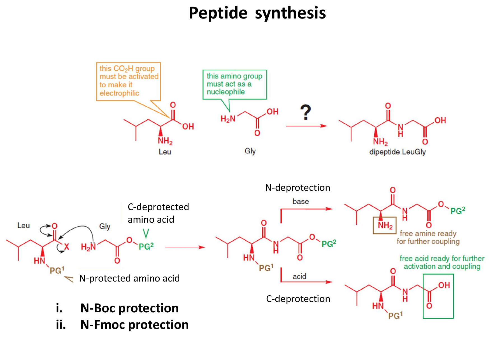

# 직교 보호

> 한 분자에 있는 여러 [protecting group](보호기.md)을 **서로 간섭하지 않는 조건**으로 하나씩 골라 벗길 수 있게 짜는 전략이다.

## 개요

[peptide synthesis](../반응/펩타이드%20합성.md)에서 사슬을 N 쪽으로 늘리려면 N-protecting group만, C 쪽으로 늘리려면 C-protecting group만 벗겨야 한다. 한쪽을 벗기는 조건에서 다른 쪽이 멀쩡히 버텨야 하는 것이다. 이렇게 서로 간섭하지 않고 각각 선택적으로 제거할 수 있는 protecting group 조합을 orthogonal(직교) protection이라고 한다. 고체상 peptide 합성(SPPS)은 반복해서 벗기는 N-protecting group, 끝까지 남는 곁사슬 protecting group, 수지 연결부가 각기 다른 시점에 끊어지도록 설계되어 있어, orthogonal protection 없이는 성립하지 않는다. (출처: L12 p.9, p.12)

## 원리: 벗기는 조건으로 나눈다

| 제거 조건 | protecting group | 이 조건에 견디는 것 |
|---|---|---|
| 산 | [Boc](../시약/Boc%20보호기.md), acetal, THP, t-Bu ester (silyl ether도 산에 약함) | Fmoc, Cbz(TFA 수준) |
| amine 염기 | [Fmoc](../시약/Fmoc%20보호기.md) | Boc, acetal, silyl ether |
| H₂, Pd | [Cbz](../시약/Cbz%20보호기.md), benzyl ether | Boc |
| F⁻ (TBAF) | [silyl ether](../시약/실릴%20에터%20보호기.md) | Boc, acetal |

(출처: L12 p.5, p.6, p.8, p.11, p.13)

orthogonality 요약: Boc(산) / Fmoc(염기) / Cbz(H2, Pd) / silyl ether(F⁻)는 서로 다른 조건으로 골라 벗길 수 있다. 반면 산 불안정 protecting group(Boc, acetal, silyl ether, THP, t-Bu ester)끼리, 그리고 hydrogenolysis되는 Cbz와 benzyl ether끼리는 orthogonal하지 않다. (출처: L12 p.5)

Boc(산에 약하고 염기에 강함)와 Fmoc(산에 강하고 염기에 약함)는 거울상처럼 서로 보완하는 대표 짝이다. Boc는 안정한 t-butyl cation을 낼 수 있어 산에 약하고, Fmoc는 1차 CH₂라 그 경로가 막힌 대신 9번 C–H가 산성이라 염기에 약하다. 산 절단 안에서도 경로가 갈린다. Boc는 SN1이라 아무 산이나 되지만 Cbz는 Br⁻의 SN2가 필요해, TFA로 Boc만 벗기고 Cbz를 남길 수 있다(→ [Cbz](../시약/Cbz%20보호기.md)). (출처: L12 p.10–11)

## 같은 protecting group 안에서의 차등

같은 종류라도 튼튼함이 크게 다르면 골라 벗길 수 있다. 산에서 TMS(1)와 TBDPS(5,000,000)는 안정성이 수백만 배 차이 나므로, 약한 산으로 TMS만 벗길 수 있다(→ [silyl ether](../시약/실릴%20에터%20보호기.md)). (출처: L12 p.7)

## 예

- L12 연습문제 3번: Phe의 amine은 Boc, Ala의 carboxylic acid는 methyl ester로 가린다. DCC coupling 뒤 TFA로 Boc만 벗기고(methyl ester와 amide는 견딤), NaOH로 methyl ester를 가수분해한다. (L12 Practice) (출처: L12 연습 풀이 p.3)
- amine은 Boc, alcohol은 TBS, ketone은 acetal로 보호된 분자: TBAF는 TBS만 벗기고, piperidine은 아무것도 벗기지 않는다(Fmoc 제거용). TFA는 Boc를 벗기지만 acetal과 TBS도 손상시킬 수 있다(→ [L12 연습 문제](../../practice/L12_Exercises.md) 문제 8). (L12) (출처: L12 p.5–6, p.8, p.13)

## 흔한 오해

- **"산에 불안정한 protecting group끼리도 조심하면 구분해서 벗길 수 있다"고 쉽게 가정하기 쉽지만 사실은** Boc, acetal, silyl ether, THP, t-Bu ester는 모두 산에 약해서 산 조건에서는 서로 orthogonal하지 않다(silyl ether는 F⁻로 따로 벗길 수 있다). 마찬가지로 Cbz와 benzyl ether는 둘 다 H2/Pd로 벗겨진다. (출처: L12 p.5)
- **"p.9 그림의 PG1은 Boc다"라고 읽기 쉽지만 사실은** "N-탈보호는 염기, C-탈보호는 산"이므로 PG1은 Fmoc형, PG2는 산 불안정 ester로 읽는 것이 일관적이다(→ [peptide synthesis](../반응/펩타이드%20합성.md)). (출처: L12 p.9)

## orthogonal은 “둘 다 안정하다”와 다르다

두 보호기를 함께 붙일 수 있다는 것만으로 직교성이 생기지는 않는다. 한쪽을 선택적으로 제거할 때 다른 쪽이 남아 있어야 한다. L12의 peptide 합성에서는 N 쪽을 여는 단계와 C 쪽을 여는 단계를 분리한다. Boc의 산 민감성, Cbz의 hydrogenolysis, Fmoc의 염기성 제거를 한 가지 “amine 보호”로 묶으면 합성 순서를 결정할 수 없다. (출처: L12 p.8–11)

다만 직교성은 분자 전체와 조건에 관한 판단이다. hydrogenolysis가 가능한 benzyl계 보호기를 골랐더라도 분자에 환원될 alkene이 있다면 무조건 안전하다고 할 수 없다. 따라서 표의 기호만 보고 보호기를 선택하지 말고, 실제 substrate에 있는 다른 작용기와 제거 조건을 함께 그려야 한다. (출처: L12 p.3–4,8–11)

## 그림으로 확인하기

그림: N-deprotection과 C-deprotection은 다른 단계다. (출처: L12 p.9)

그림: 보충: glycine 보호체를 모델로 산에 의한 Boc 제거와 hydrogenolysis에 의한 benzyl ester 제거를 대비했다. counterion은 생략했다. 강의의 보호기 선택 논리를 보여 주는 모델이며 강의에 제시된 동일 substrate라고 주장하지 않는다. (출처: L12 p.8–11)

## 관련 문서

- 시약: [Boc protecting group](../시약/Boc%20보호기.md), [Fmoc protecting group](../시약/Fmoc%20보호기.md), [Cbz protecting group](../시약/Cbz%20보호기.md), [silyl ether protecting group](../시약/실릴%20에터%20보호기.md), [TFA](../시약/TFA.md), [THP protecting group](../시약/THP%20보호기.md), [benzyl ether protecting group](../시약/벤질%20에터%20보호기.md)
- 반응: [peptide synthesis](../반응/펩타이드%20합성.md), [acetal formation](../반응/아세탈%20형성.md), [hydrogenolysis](../반응/수소화분해.md)
- 개념: [protecting group](보호기.md)

## 출처

- [L12 protecting group](../../notes/L12_Protecting_Groups.md) 7절, 반응 정리표의 직교성 요약 (L12 p.5, p.9–13)
- [L12 연습문제](../../practice/L12_Practice.md) 문제 3
