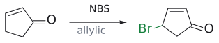
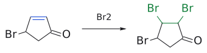
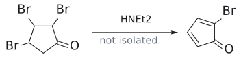

# 큐베인

> C8H8. 탄소 8개가 정육면체의 꼭짓점에 놓인 극도로 strained된 분자(cubane). Eaton과 Cole의 합성은 **[4+2]로 뼈대를 세우고, photochemical [2+2]로 상자를 닫는** cycloaddition 응용의 대표 예다.

## 개요

**Cubane(C8H8)**은 탄소 8개가 정육면체의 꼭짓점에 놓인 분자다. 모든 C–C–C 결합각이 90°라서 결합이 극도로 **strained**되어 있다. 1964년 Philip Eaton과 Thomas Cole이 처음 합성했다. 모든 H를 NO2로 바꾼 **octanitrocubane(C8(NO2)8)**은 1999년 Eaton과 Mao-Xi Zhang이 합성했다. 분해되면 CO2와 N2만 생기며, 슬라이드는 이 화합물을 "가장 빠르고 효과적인 화학 폭약이면서 충격에 둔감하다"고 소개한다.[^1] (출처: L14 p.29)

## 합성 (Eaton & Cole, 1964)

그렇다면 이런 정육면체는 어떻게 만드는가? 이 합성의 핵심은 **[4+2] ([Diels–Alder](../반응/딜스-알더%20반응.md))로 뼈대를 세우고, [photochemical \[2+2\] cycloaddition](../반응/광화학%202+2%20고리화%20첨가.md)로 상자를 닫는 것**이다. 단계는 다음과 같다(슬라이드 표기 그대로). (출처: L14 p.30)

1. $\begin{aligned} & \text{cyclopent-2-enone} \\ & \xrightarrow{\mathrm{NBS}} \text{4-bromocyclopent-2-enone}\ (\text{allylic bromination}), \end{aligned}$ → [NBS](../시약/NBS.md))
2. $\xrightarrow{\mathrm{Br_2}} \text{2,3,4-tribromocyclopentanone}\ (\text{alkene에}\ \mathrm{Br_2}\ \text{첨가}),$ → [halogen addition](../반응/할로젠%20첨가.md))
3. $\xrightarrow{\mathrm{HNEt_2}} \text{2-bromocyclopentadienone}\ (\text{dehydrohalogenation})$. 반응성이 매우 커서 분리하지 않음)
4. **자발적 Diels–Alder [4+2] dimerization.** 한 분자가 diene, 다른 분자가 dienophile로 작용하여 endo dimer가 생긴다. 슬라이드에서 상자로 강조한 부분이다(→ [endo rule](endo%20규칙.md)).
5. $\xrightarrow{\mathrm{(CH_2OH)_2},\ \mathrm{TsOH}} \text{두 ketone을 모두 ketal로 보호}$

6. $\xrightarrow{\mathrm{HCl},\ \mathrm{H_2O}} \text{enone 쪽 ketal만 다시 ketone으로 되돌림}$

7. **$\xrightarrow{h\nu} \text{intramolecular}\ \mathrm{[2^+2]}\ \text{cycloaddition으로 cage 구조가 완성된다}$. endo dimer이기 때문에 두 C=C가 서로 가까이 마주 보고 있어서 이 반응이 가능하다.[^2]
8. $\begin{aligned} & \xrightarrow{\mathrm{KOH}} \text{Favorskii ring contraction} \\ & \longrightarrow \text{carboxylic acid} \end{aligned}$

9. $\xrightarrow{1.\ \mathrm{SOCl_2},\ 2.\ \mathrm{tBuOOH},\ \text{pyridine}} \text{tert-butyl perester}$

10. $\xrightarrow[152\,{}^\circ\mathrm{C}]{\Delta,\ \text{cumene}} \text{decarboxylation}(\mathrm{CO_2H}\ \text{자리를 H로 교체})$

11. $\begin{aligned} & \xrightarrow{1.\ \mathrm{H_2SO_4},\ 2.\ \mathrm{KOH}} \\ & \begin{gathered}\text{남은 ketal을 ketone으로 되돌린 뒤 두 번째 Favorskii ring } \\  \\ & \text{contraction}\end{gathered} \\ & \longrightarrow \text{cubanecarboxylic acid} \end{aligned}$

12. $\begin{aligned} & \xrightarrow{1.\ \mathrm{SOCl_2},\ 2.\ \mathrm{tBuOOH},\ \mathrm{Py}} \text{perester} \\ & \xrightarrow[150\,{}^\circ\mathrm{C},\ \text{diisopropylbenzene}]{\Delta} \text{cubane} \end{aligned}$**

### 왜 [2+2] 단계는 빛이어야 하나

suprafacial–suprafacial [2+2]는 열적으로 금지(합 2, 짝수)이고 photochemically 허용되기 때문이다(→ [Woodward–Hoffmann rule](우드워드-호프만%20규칙.md)). 반면 [4+2] dimerization은 열적으로 허용되어 저절로 일어난다. (출처: L14 p.25, p.30)

그림: cubane 합성 1단계: allyl 자리(빨강) bromination.

그림: 2단계: C=C(파랑)에 $Br_2$ 첨가.

그림: 3단계: HBr 두 번 제거.

## 흔한 오해

- **"[2+2]는 무조건 안 되니 4원 고리 새장은 cycloaddition으로 못 만든다"고 생각하기 쉽지만 사실은** photochemical [2+2]는 허용이고, cubane 합성이 바로 그 예다. (출처: L14 p.30–31)
- **"endo rule은 stereochemistry 문제에만 쓰인다"고 생각하기 쉽지만 사실은** endo dimer에서 두 C=C가 가까이 놓이는 것이 다음 intramolecular [2+2]를 가능하게 했다. endo rule이 합성에서 결정적인 역할을 한 예다. (출처: L14 p.30)

## 관련 문서

- 반응: [Diels–Alder reaction](../반응/딜스-알더%20반응.md), [photochemical \[2+2\] cycloaddition](../반응/광화학%202+2%20고리화%20첨가.md), [halogen addition](../반응/할로젠%20첨가.md)
- 개념: [endo rule](endo%20규칙.md), [Woodward–Hoffmann rule](우드워드-호프만%20규칙.md)
- 시약: [NBS](../시약/NBS.md)

## 출처

- [L14 cycloaddition 2부](../../notes/L14_Cycloaddition_Part2.md) 11절 (p.29–30)

[^1]: octanitrocubane이 매우 강력한 폭약이라는 평가는 주로 높은 밀도와 큰 strain energy를 근거로 한 *예측*에 기반한다. 슬라이드의 문구를 그대로 옮겼다. (출처: L14 p.29)
[^2]: 보충: endo DA dimer에서는 두 C=C가 고리 골격의 같은 쪽에 가까이 놓인다. 이 근접성 덕분에 intramolecular photochemical [2+2]가 가능해진다. endo rule이 합성에서 결정적인 역할을 한 예다. (출처: L14 p.30)
