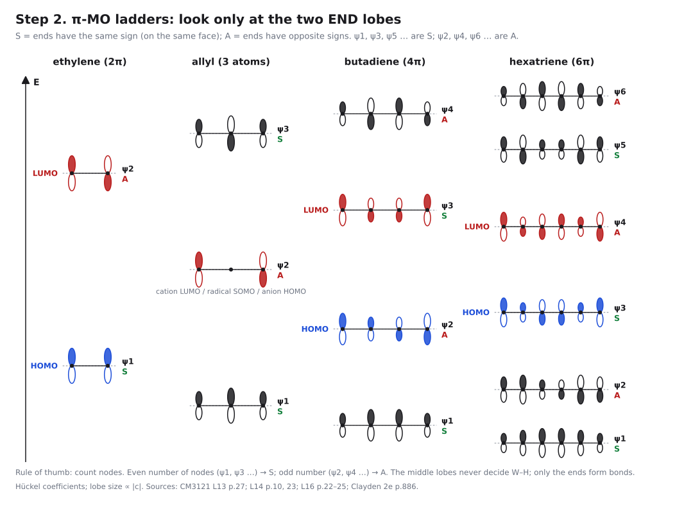
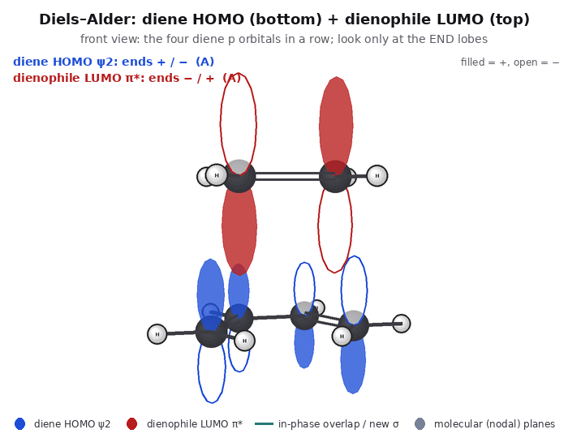
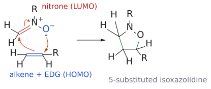

# 프런티어 분자 오비탈

> 반응은 한쪽의 **HOMO**(가장 높은 채워진 오비탈) 전자가 다른 쪽의 **LUMO**(가장 낮은 빈 오비탈)로 흘러 들어가며 시작된다는 frontier molecular orbital, FMO. cycloaddition이 허용되는지(위상), 얼마나 빠른지(에너지 간격), 어느 방향으로 붙는지(계수)를 모두 이것으로 판단한다.

## 개요

L13은 [Diels–Alder reaction](../반응/딜스-알더%20반응.md)의 "왜?"들을 오비탈로 다시 본다. L14는 남은 질문들을 이어서 묻는다. 왜 어떤 [4+2]는 잘 되는데 [4+4]나 열적 [2+2]는 안 되는가? 왜 전자가 풍부한 diene과 전자가 부족한 dienophile의 조합이 빠른가? 비대칭 diene과 dienophile이 만나면 두 가지 위치 이성질체 중 어느 쪽이 나오는가? 이 질문들을 [Woodward–Hoffmann rules](우드워드-호프만%20규칙.md)과 FMO 이론 두 가지로 답한다. 결국 핵심 질문은 "반응이 *허용되는가*, 얼마나 *빠른가*, 그리고 *어느 방향으로* 일어나는가"이다. (출처: L13 p.25; L14 p.1–3; L15 p.25)

| 질문 | FMO에서 보는 것 |
|---|---|
| 허용되는가? | 두 오비탈의 **말단 위상**이 양 끝에서 모두 맞는가 |
| 얼마나 빠른가? | HOMO–LUMO **에너지 간격**이 얼마나 작은가 |
| 어느 방향인가? | 어느 원자의 **계수(로브 크기)**가 가장 큰가 |

## 재료: alkene, diene, allyl cation의 $\pi$ 오비탈

- **Ethylene:** H–C–H 각은 117.8°, C–H는 108 pm, C=C는 133 pm이다. C–C $\sigma$ 결합은 sp2 오비탈끼리, $\pi$ 결합은 p 오비탈끼리 겹쳐 생긴다. 두 p 오비탈이 같은 위상으로 합쳐지면 결합성 $\pi$ 오비탈(전자 2개, HOMO, 두 로브 위상 같음)이 되고, 반대 위상으로 합쳐지면 마디 평면이 하나 있는 반결합성 $\pi^{*}$ 오비탈(LUMO, 두 로브 위상 반대)이 된다. (출처: L13 p.25)
- **Butadiene:** alkene 두 개의 $\pi$와 $\pi^{*}$를 섞어 만든다고 생각하면 된다. 그러면 에너지 순서대로 $\psi_{1}$(마디 0개), $\psi_{2}$(마디 1개), $\psi_{3}$(마디 2개), $\psi_{4}$(마디 3개)의 네 MO가 생긴다. 전자 4개는 $\psi_{1}$과 $\psi_{2}$에 들어가므로 **HOMO는 $\psi_{2}$, LUMO는 $\psi_{3}$**다. $\psi_{2}$의 양 끝 로브는 위상이 반대이고, $\psi_{3}$의 양 끝 로브는 위상이 같다는 점을 기억해 두면 이후 설명이 쉬워진다. (출처: L13 p.26)
- **Allyl cation($2\pi$):** $\pi$ MO는 세 개다. $\psi_{1}$(HOMO, 전자 2개)은 세 로브의 위상이 모두 같다. $\psi_{2}$(LUMO)는 가운데 탄소에 마디가 있고 두 말단의 위상이 반대다. $\psi_{3}$는 계수가 0.50, 0.71, 0.50이고 위상이 교대한다(→ [allyl cation](알릴%20양이온.md), [4+3 cycloaddition](../반응/4+3%20고리화%20첨가.md)). (출처: L14 p.22–23)

그림: ethylene, allyl, butadiene, hexatriene의 π MO를 에너지 순으로 쌓았다. 로브 크기는 Hückel 계수에 비례한다. 마디 수가 짝수(ψ1, ψ3…)면 양 끝 부호가 같고, 홀수(ψ2, ψ4…)면 반대다. 가운데 로브는 결합을 만들지 않으므로 Woodward–Hoffmann 판정에는 양 끝만 본다. 보충: 그림의 대문자 S/A(양 끝 부호가 같음/반대)는 설명용 표기이고 강의 표기가 아니다. (출처: L13 p.27; L14 p.10, 23; L16 p.22–25)

## 1. 허용 여부: 말단 위상 맞추기

새 $\sigma$ 결합 두 개가 동시에 생기려면 HOMO와 LUMO가 **양 끝에서 모두** 같은 위상으로 겹쳐야 한다(suprafacial–suprafacial 가정, → [suprafacial and antarafacial](초면과%20대면.md)).

| 반응 | HOMO | LUMO | 양 끝 겹침 | 결과 |
|---|---|---|---|---|
| [4+2] DA | diene $\psi_{2}$ (반대) | alkene $\pi^{*}$ (반대) | 둘 다 결합성 | 열적 허용 |
| [4+4] | diene $\psi_{2}$ (반대) | diene $\psi_{3}$ (같음) | 한쪽 반결합성 | 열적 금지 |
| [2+2] | alkene $\pi$ (같음) | alkene $\pi^{*}$ (반대) | 한쪽 반결합성 | 열적 금지 |
| [4+3] | diene $\psi_{2}$ (반대) | allyl cation $\psi_{2}$ (반대) | 둘 다 결합성 | 열적 허용 |

(출처: L13 p.30; L14 p.3, p.22–24)

![FMO: thermal [4+2] vs thermal and photochemical [2+2]](../../figures/Test2_figures/02_cycloaddition_L13-L15/CY_02_FMO_allowed_vs_forbidden.svg)

그림: 채운 로브는 +, 빈 로브는 −다. 새 σ 결합 두 곳이 모두 같은 위상으로 겹쳐야(초록) 반응이 허용된다. 열적 [2+2]는 한쪽 끝이 어긋나고(빨강 ×), 빛을 받으면 HOMO가 π*로 바뀌어 다시 맞는다. (출처: L13 p.27–30; L14 p.24–26)

L14 p.3이 이것을 butadiene + maleic anhydride로 다시 보여 준다. diene $\psi_{2}$의 두 말단 로브는 위상이 서로 반대이고, dienophile $\pi^{*}$의 두 로브도 위상이 서로 반대다. 그래서 두 성분이 같은 면끼리 마주 보면 양 끝 모두에서 위상이 맞는(결합성) 겹침이 생긴다. 슬라이드에서 동그라미로 강조한 부분이 바로 이 말단 겹침이다. (출처: L14 p.3)

그림: diene HOMO ψ2와 dienophile LUMO π*는 둘 다 양 끝 부호가 반대라서 비틀지 않고 포개기만 해도 양 끝이 맞는다. 두 성분 모두 한쪽 면만 쓰므로 π4s + π2s다. 수소를 표시했고 로브 크기는 Hückel 계수에 비례한다. (출처: L13 p.10, 27; L14 p.6)

### 그럼 diene 두 개는 왜 [4+4]를 하지 않을까?

butadiene 두 분자를 가열하면 [4+2] 생성물인 4-vinylcyclohexene은 생기지만, [4+4] 생성물인 cycloocta-1,5-diene은 생기지 않는다. 같은 diene 두 개인데 왜 한쪽만 될까? 오비탈을 겹쳐 보면 답이 보인다. [4+2]에서는 한 분자의 HOMO($\psi_{2}$)와 다른 분자의 LUMO(dienophile 역할을 하는 C=C 부분)의 양 끝이 모두 위상이 맞아 결합성이다. 그런데 [4+4]에서는 HOMO($\psi_{2}$)와 다른 분자의 LUMO($\psi_{3}$)를 겹치면, 한쪽 끝은 결합성이지만 다른 끝은 위상이 어긋나 반결합성이다. 두 결합을 동시에 만들 수 없으므로 열적으로는 진행되지 않는다. 전자 수로 보면 총 8개, 즉 4n이다. (출처: L13 p.30; L14 p.7)

보충: "열적으로는"이라는 단서가 중요하다. 같은 [4+4]가 광화학 조건이나 Ni(0) 같은 전이 금속 촉매를 쓰면 가능하다. 광화학 조건에서 선택 규칙이 뒤집히는 이유는 [photochemical \[2+2\] cycloaddition](../반응/광화학%202+2%20고리화%20첨가.md)와 같다. (보충 근거: Clayden p.887; Wade p.695) (출처: L13 p.30)

이 결론을 그림 없이 세는 방법이 [Woodward–Hoffmann rules](우드워드-호프만%20규칙.md)이다. 빛을 쪼이면 들뜬 alkene의 HOMO/HOMO와 LUMO/LUMO 상호작용이 모두 알짜 결합성이 되어 [2+2]가 허용된다(→ [photochemical \[2+2\] cycloaddition](../반응/광화학%202+2%20고리화%20첨가.md)). (출처: L14 p.26)

## 2. 반응 속도: 에너지 간격 좁히기

### 어느 짝이 주도하나

FMO 이론에 따르면 두 오비탈의 에너지가 가까울수록 상호작용이 강하다. DA에서 가능한 짝은 두 가지다. diene HOMO($\psi_{2}$)와 dienophile LUMO($\pi^{*}$)의 짝은 에너지 차이가 작아 겹침이 좋다. 반대로 diene LUMO($\psi_{3}$)와 dienophile HOMO($\pi$)의 짝은 에너지 차이가 커서 겹침이 나쁘다. 그래서 주된 상호작용은 앞의 짝이다. L14의 예인 maleic anhydride는 carbonyl 두 개 때문에 $\pi^{*}$(LUMO)가 아주 낮아서, diene HOMO와의 간격이 작고 겹침이 좋다. 즉 반응은 주로 **HOMO(diene)–LUMO(dienophile)** 상호작용으로 일어나고, 이 간격이 좁을수록 빠르다. (출처: L13 p.27; L14 p.3)

이제 답이 나온다. diene에 EDG를 붙이면 HOMO가 올라가고, dienophile에 EWG를 붙이면 LUMO가 내려간다. 둘 다 HOMO(diene)–LUMO(dienophile) 사이 간격을 좁혀 TS를 안정화하므로 반응이 빨라진다. ethylene이 900 atm을 요구했던 것도, acrolein이나 maleic anhydride가 쉽게 반응하는 것도 같은 이유다.[^1] (출처: L13 p.27)

보충: 여기서 헷갈리기 쉬운 점이 있다. 두 짝 가운데 하나를 고르는 기준은 **대칭이 아니라 에너지**다. diene $\psi_{2}$(가운데 마디 1개)와 dienophile $\pi^{*}$(마디 1개)도, diene $\psi_{3}$(마디 2개)와 dienophile $\pi$(마디 0개)도 양 끝의 위상 관계가 같아서 둘 다 대칭은 맞는다. 단지 앞의 짝이 에너지가 더 가까워 주도할 뿐이다. 반대로 alkene + alkene(예: alkene + maleic anhydride를 가열)에서는 HOMO/LUMO를 어느 쪽으로 짝지어도 한쪽 끝이 반결합성이라, 에너지를 아무리 맞춰도 열적으로는 반응하지 않는다(→ [photochemical \[2+2\] cycloaddition](../반응/광화학%202+2%20고리화%20첨가.md)). (보충 근거: Clayden p.886) (출처: L13 p.27)

### 치환기의 분류: C, Z, X

"전자가 풍부한 diene"이나 "전자가 부족한 dienophile"을 좀 더 체계적으로 말할 방법은 없을까? L14와 L15 슬라이드는 치환기를 전자적 성격에 따라 세 부류로 나눈다(→ [substituent effect](치환기%20효과.md)). (출처: L14 p.8; L15 p.4)

| 기호 | 예 | 전자적 성격 |
|---|---|---|
| **C** | vinyl(–CH=CH2), phenyl(–Ph) 등 공액 치환기 | $\pi$ 주개 또는 $\pi$ 받개, $\sigma$ 중성. 즉 conjugation을 늘리는 기 |
| **Z** | –COR, –CO2Me, –C≡N, –NO2 등 | $\pi$ 받개이자 $\sigma$ 받개 |
| **Z** | –metal(예: –SiMe3, –BR2) | $\pi$ 받개이지만 $\sigma$ 주개 |
| **X** | –OMe, –NMe2 등 | $\pi$ 주개이지만 $\sigma$ 받개 |
| **X** | –CH3 등 | $\pi$ 주개, $\sigma$ 중성 |

즉 C는 conjugation을 늘리는 치환기, Z는 $\pi$ 전자를 끌어가는 치환기, X는 $\pi$ 전자를 밀어 주는 치환기다. 여기서 눈여겨볼 점은 같은 Z라도 silyl기나 boryl기는 $\sigma$ 쪽으로는 오히려 전자를 준다는 것, 같은 X라도 OMe는 $\sigma$ 쪽으로는 전자를 끈다는 것이다. cycloaddition의 반응성과 regioselectivity를 좌우하는 것은 주로 $\pi$ 효과이므로, 분류도 $\pi$ 성격을 기준으로 한다. (출처: L15 p.4)

그러면 이 치환기들은 오비탈 에너지를 어떻게 바꾸는가? (출처: L14 p.9)

| 치환기 | HOMO | LUMO | 이유 |
|---|---|---|---|
| **C** (conjugation 확장) | 올림 | 내림 | $\pi$계가 길어지면 HOMO–LUMO 간격이 좁아지는 것과 같은 원리 |
| **Z** (EWG) | 약간 내림 | **크게 내림** | |
| **X** (EDG) | **크게 올림** | 약간 올림 | |

L15의 연습 슬라이드(p.5)는 화합물을 점선 양쪽으로 갈라 놓았다. 왼쪽은 2-methylpropene, toluene, cyclohexanone의 pyrrolidine enamine, lithium enolate(–OLi), 2-methoxy-1,3-butadiene, (E)-1,3-pentadiene처럼 X형 치환기를 가진 전자 풍부 화합물이고, 오른쪽은 methyl acrylate, cyclohex-2-enone, benzonitrile처럼 Z형 치환기를 가진 전자 부족 화합물이다.[^2] (출처: L15 p.5)

### 세 단계 비교

이제 속도를 정량적으로 비교할 수 있다. L14 슬라이드는 FO(frontier orbital) 상호작용을 세 단계로 비교한다. (출처: L14 p.10)

1. **(a) butadiene + 치환기 없는 ethylene:** 두 HOMO–LUMO 조합의 간격이 모두 크다. 그래서 반응이 느리다. 실제로 ethylene은 아주 나쁜 dienophile이다.
2. **(b) butadiene + Z-dienophile:** Z가 dienophile LUMO를 크게 내린다. 그래서 HOMO(diene)–LUMO(dienophile) 간격이 좁아진다(굵은 화살표).
3. **(c) X-diene + Z-dienophile:** 여기에 더해 X가 diene HOMO를 올린다. 그래서 간격이 가장 좁고 반응이 가장 빠르다.

정리하면 **LUMO(dienophile)–HOMO(diene) 간격이 작을수록 반응이 빠르다.** 이렇게 diene이 전자를 주고 dienophile이 전자를 받는 일반적인 경우를 normal electron demand(정상 전자 요구) DA라고 부른다.[^3] [Lewis acid](../시약/루이스%20산%20촉매.md)는 carbonyl에 배위해 Z를 더 강하게 만들어 LUMO를 더 낮춘다(→ [Diels–Alder regioselectivity](딜스-알더%20위치선택성.md)). (출처: L14 p.10, p.20)

## 3. regioselectivity: 큰 계수끼리

치환기는 오비탈 에너지뿐 아니라 계수의 크기도 비대칭으로 만든다. **계수가 가장 큰 원자끼리** 결합한다. (출처: L14 p.11–14; L15 p.25)

- dienophile CH2=CH–Z: LUMO 계수는 **$\beta$-탄소**가 크다.
- 1-X diene: HOMO 계수는 X에서 **먼 말단(C4)**이 크다 → "ortho" 생성물.
- 2-X diene: HOMO 계수는 X에 **가까운 말단(C1)**이 크다 → "para" 생성물.

자세한 내용은 [Diels–Alder regioselectivity](딜스-알더%20위치선택성.md)에 있다. 1,3-dipole은 상대에 따라 HOMO를 쓰기도 LUMO를 쓰기도 해서 regioselectivity가 바뀐다(→ [nitrone cycloaddition](../반응/나이트론%20고리화%20첨가.md)). 광화학 [2+2]에서는 LUMO/LUMO 계수를 맞춘다(→ [photochemical \[2+2\] cycloaddition](../반응/광화학%202+2%20고리화%20첨가.md)). (출처: L14 p.28; L15 p.15)

## 흔한 오해

- **"EWG는 HOMO를 낮추니 dienophile의 HOMO가 중요하다"고 생각하기 쉽지만 사실은** 정상 DA의 핵심 짝은 diene HOMO($\psi_{2}$)와 dienophile LUMO($\pi^{*}$)다. EWG는 dienophile의 LUMO를 낮추고 EDG는 diene의 HOMO를 올려서 둘 사이 간격을 줄인다. (출처: L13 p.27)
- **"1-치환 diene이면 치환기 붙은 탄소가 nucleophilic"이라고 생각하기 쉽지만 사실은** HOMO 계수가 가장 큰 곳은 반대편 말단 C4다. (출처: L14 p.13)
- **"2차 오비탈 겹침이 새 결합을 만든다"고 생각하기 쉽지만 사실은** 결합으로 이어지지 않고 endo TS만 안정화한다(→ [endo rule](endo%20규칙.md)). (출처: L13 p.29)
- **"HOMO/LUMO 짝은 대칭으로 고른다"고 생각하기 쉽지만 사실은** DA에서는 두 짝 모두 대칭이 맞고, 에너지 간격이 작은 쪽이 주도한다. (보충 근거: Clayden p.886)

## 세 질문을 나누면 orbital 그림을 읽기 쉽다

첫 질문은 **겹침의 위상이 맞는가**다. 서로 결합할 두 접촉점에서 동시에 bonding overlap이 가능해야 concerted 경로를 허용으로 설명할 수 있다. 두 번째는 **에너지 차이가 작은가**다. electron-rich diene과 electron-poor dienophile의 조합은 HOMO(diene)–LUMO(dienophile) 간격을 줄여 반응성을 높인다. 세 번째는 **어느 원자 계수가 큰가**다. 같은 허용 반응 안에서도 큰 계수끼리 맞추는 방향이 regioselectivity를 설명한다. 위상, 에너지, 계수를 한 색칠 그림에서 모두 같은 뜻으로 읽으면 안 된다. (출처: L13 p.13–17; L14 p.3,10–15)

### 모든 p orbital 그림이 HOMO는 아니다

Claisen chair TS 그림은 참여 p orbital들의 공간 배치를 보여 줄 수 있지만, 그 자체가 특정한 HOMO 또는 LUMO eigenfunction인 것은 아니다. L16 p.6은 이 점을 명시하고 별도의 fragment HOMO–LUMO 그림과 WH 판정을 제시한다. 반대로 L17 p.19의 polyene 그림은 실제 frontier orbital의 말단 위상을 회전 방식과 연결한다. “orbital 그림”이라는 이름 아래 이 두 용도를 섞지 않는 것이 중요하다. (출처: L16 p.6; L17 p.19)

## 같은 dipole도 상대에 따라 donor 또는 acceptor가 된다

그림: nitrone LUMO와 electron-rich alkene HOMO를 짝짓는 경우다. electron-poor alkene에서는 nitrone HOMO가 주는 쪽이 될 수 있으므로 이 한 도식을 모든 기질에 복사하지 않는다. (원본 대조: L15_cycloaddition part 3.pdf p.15)

[원본 자료에서 세부 구조·입체배치 확인: L15_cycloaddition part 3.pdf p.15](../../figures/L15/source/L15_p15.png)

## 관련 문서

- 반응: [Diels–Alder reaction](../반응/딜스-알더%20반응.md), [inverse electron demand Diels–Alder](../반응/역전자%20요구%20딜스-알더%20반응.md), [photochemical \[2+2\] cycloaddition](../반응/광화학%202+2%20고리화%20첨가.md), [4+3 cycloaddition](../반응/4+3%20고리화%20첨가.md), [nitrone cycloaddition](../반응/나이트론%20고리화%20첨가.md)
- 개념: [Woodward–Hoffmann rules](우드워드-호프만%20규칙.md), [Diels–Alder regioselectivity](딜스-알더%20위치선택성.md), [endo rule](endo%20규칙.md), [suprafacial and antarafacial](초면과%20대면.md), [allyl cation](알릴%20양이온.md), [electrophile and nucleophile](친전자체와%20친핵체.md), [substituent effect](치환기%20효과.md)
- 시약: [Lewis acid catalyst](../시약/루이스%20산%20촉매.md), [Danishefsky diene](../시약/대니셰프스키%20다이엔.md)

## 출처

- [L13 cycloaddition 1부](../../notes/L13_Cycloaddition_Part1.md) 7절 (p.25–27, p.30)
- [L14 cycloaddition 2부](../../notes/L14_Cycloaddition_Part2.md) 1절, 3–4절, 정답 4 (p.3, p.7–10, p.22–23)
- [L15 cycloaddition 3부](../../notes/L15_Cycloaddition_Part3.md) 1절, 중간 정리 (p.4–5, p.25)

[^1]: 보충: 이렇게 diene HOMO–dienophile LUMO 상호작용이 지배하는 전형적인 경우를 normal electron demand(정상 전자 요구) DA라고 부른다. (보충 근거: Clayden p.886–887) (출처: L13 p.27)
[^2]: 보충: X형 치환기는 HOMO(및 LUMO)를 올려 nucleophilicity를 키우고, Z형 치환기는 LUMO(및 HOMO)를 낮춰 electrophilicity를 키운다. 그래서 정상 전자 요구 Diels–Alder는 "X/C-diene + Z-dienophile" 조합에서 빠르다. (보충 근거: Clayden p.886–887, 890) (출처: L15 p.4–5)
[^3]: 보충: diene이 전자 부족하고 dienophile이 전자 풍부해서 HOMO(dienophile)–LUMO(diene) 간격이 더 작은 경우도 있다. 이를 inverse electron demand(역전자 요구) DA라고 한다. L14 슬라이드에서는 다루지 않지만, L15의 tetrazine–TCO 반응이 그 예다(→ [inverse electron demand Diels–Alder](../반응/역전자%20요구%20딜스-알더%20반응.md)). (보충 근거: Clayden p.887) (출처: L14 p.10; L15 p.30)
