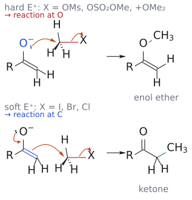

# 하드-소프트 산염기

> 전하가 작은 원자에 몰린 **단단한(hard)** 친핵체는 단단한 친전자 자리와, 전하가 퍼져 있고 분극되기 쉬운 **무른(soft)** 친핵체는 무른 자리와 반응하는 경향이 있다. 강의에서는 엔온의 [[1,2-첨가와 1,4-첨가|1,2 대 1,4]]와 엔올레이트의 C 대 O 반응을 이 원리로 설명한다.

## 개요

친핵체가 고를 수 있는 자리가 둘일 때, 어느 쪽을 고를지를 정하는 경험 법칙이다. 단단한 쪽은 정전기적 끌림(전하)이 큰 자리를, 무른 쪽은 오비탈 겹침이 좋은 자리를 고른다고 보면 된다(enolate에서의 근거는 아래 쓰임 2). (출처: L11 p.12; L7 p.24)

## 분류 (L11 슬라이드 표)

| 단단한 친핵체 | 경계 | 무른 친핵체 |
|---|---|---|
| F⁻, OH⁻, RO⁻, Cl⁻ | N₃⁻, CH⁻(원문 표기)[^2] | I⁻, RS⁻, RSe⁻ |
| H₂O, ROH, ROR, RCOR' | RNH₂, RR'NH | RSH, RSR', R₃P |
| RMgBr, RLi | Br⁻ | 알켄, 방향족 고리, R₂CuLi |

(출처: L11 p.12)

## 쓰임 1: 엔온에서 1,2 대 1,4

α,β-불포화 카보닐에는 δ+ 자리가 둘이다. 카보닐 탄소는 단단한 자리, β-탄소는 무른 자리다. (출처: L11 p.3, p.12)

- [[그리냐르 시약]]과 RLi(단단함) → C=O에 1,2-첨가. 2-사이클로헥센온 + CH₃MgBr → 1-메틸-2-사이클로헥센-1-올(95%).
- [[유기구리 시약]] (무름) → β-탄소에 1,4-첨가. 2-사이클로헥센온 + (CH₃)₂CuLi → 3-메틸사이클로헥산온(97%).
- 큐프레이트가 무른 이유: Cu(1.9)가 Mg(1.3)보다 전기음성도가 커서 C–Cu 결합의 분극이 작다.
- 티올, 안정한 엔올레이트(1,3-다이카보닐, 나이트로네이트), [[엔아민]]도 무른 친핵체라 [[공액 첨가]]를 잘 한다.

(출처: L11 p.4, p.6, p.11, p.17, p.19)

## 쓰임 2: enolate의 C 대 O

### 음전하는 O에 많은데 왜 보통 C에서 반응하나

[[엔올과 엔올레이트|enolate]]는 O, C, C 세 원자에 π 전자 4개가 퍼진 3-atom, 4-electron 계로, allyl anion과 같은 구조다. allyl anion의 HOMO(ψ₂)는 양 말단 탄소에 같은 크기의 오비탈을 갖는데, enolate의 HOMO(ψ₂)는 말단 탄소 쪽 오비탈이 더 크다. 그래서 오비탈 겹침이 중요한 반응은 탄소에서 일어난다. 반면 전체 음전하는 전기음성도가 큰 산소에 더 많이 모여 있어서, 정전기적 끌림이 중요한 반응은 산소에서 일어날 수 있다.[^1] (출처: L7 p.24)

### 무엇이 C냐 O냐를 가르나

**첫째, electrophile의 성질.** soft electrophile은 C에서, hard electrophile은 O에서 반응한다. Me–X에서 X가 I, Br, Cl이면 soft라서 C-메틸화(`R–C(O⁻)=CH₂ + MeI → RCOCH₂Me`)가, X가 OMs, OSO₂OMe(다이메틸 설페이트), ⁺OMe₂(트라이메틸옥소늄)이면 hard라서 O-메틸화(`→ R–C(OMe)=CH₂`, enol ether)가 일어난다. (출처: L7 p.25)

*그림: 위: hard electrophile(X = OMs, OSO₂OMe, ⁺OMe₂)은 음전하가 많이 모인 O⁻(파랑)의 비공유 전자쌍이 CH₃(빨강)를 직접 공격하고, C–X 결합 전자가 X로 떠나 enol ether가 된다(초록: 새 O–C 결합). 아래: soft electrophile(X = I, Br, Cl)은 O⁻의 전자쌍이 C=O를 다시 만들면서 밀려난 C=C π 전자(파랑)가 CH₃를 공격해 케톤이 된다(초록: 새 C–C 결합). 두 경로 모두 마지막 화살표는 C–X 결합이 끊어지는 것이다. (출처: L7 p.25)*

**둘째, 금속 양이온.** 큰 알칼리 금속(Cs > K > Na > Li)일수록 enolate와 이온쌍이 더 분리되어 있어 O에서 반응하는 경향이 커진다.[^3] (출처: L7 p.25)

**셋째, 용매.** 보충: DMSO, DMF 같은 극성 비양성자성 용매는 enolate를 금속 양이온과 떼어 놓아 산소의 전하가 더 드러나게 하므로 O-alkylation을 돕고, THF·DME 같은 에테르 용매는 C-alkylation을 돕는다. 강의의 LDA alkylation이 THF나 DME에서 진행되는 것과 맞아떨어진다(→ [[엔올레이트 알킬화]]). (보충 근거: Clayden p.590)

같은 원리로, 규소 electrophile(Me₃SiCl)은 hard해서 enolate의 O에 붙어 [[실릴 엔올 에터|silyl enol ether]]를 준다. (출처: L8 p.22)

## 흔한 오해

- "아민은 경계 친핵체니까 1,4를 안 한다": 1차·2차 아민은 엔온과 아크릴레이트에 1,4로 첨가해 β-아미노 카보닐을 준다(아민 첨가는 가역이라 안정한 1,4 생성물이 쌓인다). (출처: L11 p.5, p.10)
- "음전하가 산소에 많으니 enolate는 늘 산소에서 반응한다": HOMO가 탄소에 크게 걸려 있어 MeI 같은 soft electrophile은 탄소에서 반응한다. O-반응은 hard electrophile(Me₂SO₄, MeOMs, Me₃O⁺)이나 큰 양이온(K⁺, Cs⁺)일 때 두드러진다. (출처: L7 p.24, p.25)
- "HSAB만 보면 생성물이 정해진다": 같은 CN⁻도 저온에서는 1,2(속도론적), 고온에서는 1,4(열역학적) 생성물을 준다. 기질의 작용기와 반응 조건도 함께 본다(→ [[속도론적 지배와 열역학적 지배]]). (출처: L11 p.9, p.13)

## 관련 문서

- 반응: [[공액 첨가]], [[마이클 반응]], [[엔올레이트 알킬화]]
- 시약: [[그리냐르 시약]], [[유기구리 시약]], [[실릴 엔올 에터]]
- 개념: [[1,2-첨가와 1,4-첨가]], [[엔올과 엔올레이트]], [[친전자체와 친핵체]], [[속도론적 지배와 열역학적 지배]]

## 출처

- [L11 짝지음 첨가](../../notes/L11_Conjugate_Addition.md) 2.2절, 3.1–3.3절
- [L7 엔올레이트와 α-알킬화](../../notes/L07_Enolate_Alkylation.md) 5.1–5.2절(p.24–25)
- [L8 알돌 반응](../../notes/L08_Aldol_Reactions.md) 5.3절(p.22, 실릴 엔올 에터)

[^1]: 이것이 hard/soft 구분의 근거다. 전하 밀도가 큰 O는 전하 지배(charge-controlled) 반응을 하는 hard electrophile과, HOMO 계수가 큰 C는 오비탈 지배(orbital-controlled) 반응을 하는 soft electrophile과 잘 맞는다. (보충 근거: Clayden p.453) (출처: L7 p.24–25 관련 보충)
[^2]: 슬라이드 경계 칸의 "CH⁻"가 무엇을 뜻하는지는 슬라이드만으로 분명하지 않다. CN⁻의 오타일 가능성이 크다. 보충: Clayden의 단단한/무른 친핵체 표는 슬라이드와 칸 배치가 같고, 경계 칸에 N₃⁻와 CN⁻를 넣는다(보충 근거: Clayden p.507). 다른 HSAB 표에서는 CN⁻를 무른 염기로 분류하기도 한다. (출처: L11 p.12)
[^3]: 반대로 작은 Li⁺는 산소에 단단히 배위해 산소를 가려 주므로, lithium enolate는 C-반응에 유리하다. 강의에서 alkylation에 LDA(lithium enolate)와 할로젠화 알킬을 쓰는 것과 맞아떨어진다. (보충 근거: Clayden p.590, p.648) (출처: L7 p.25 관련 보충)
