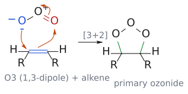

# 1,3-쌍극자 고리화 첨가

> [[1,3-쌍극자]] (3원자, 4π) + 쌍극친화체(dipolarophile, 2π) → 5원자 헤테로고리. 이름은 [3+2]지만 전자는 6개라 열적으로 허용된다.

## 개요

4원자 다이엔 대신 3원자 π계가 알켄과 만나면 5원 고리가 생긴다. 니트론·니트릴 옥사이드·아자이드 같은 쌍극자를 바꿔 끼우면 isoxazolidine, isoxazoline, 트라이아졸 등 다양한 헤테로고리를 만들 수 있다. [[오존 분해]]조차 이 반응이 세 번 이어진 것이다. (출처: L13 p.5; L15 p.13–14)

## 원리

1,3-쌍극자 a–b–c(4π)와 d=e(2π)가 초면-초면으로 만나 a–e, c–d 결합을 동시에 만든다. 전자 수 4 + 2 = 6 = 4n+2이므로 [[딜스-알더 반응]]과 똑같이 열적으로 허용된다(→ [[우드워드-호프만 규칙]]). 쌍극자가 삼중결합형(a≡b–c, 예: 니트릴 옥사이드, 아자이드)이면 생성물 고리에 a=b 이중결합이 하나 남는다. (출처: L15 p.14)

## 선택성

- **위치선택성:** [[프런티어 분자 오비탈]] 계수가 가장 큰 원자끼리 결합한다. 쌍극자는 친전자성 끝과 친핵성 끝을 함께 가지므로, 상대 알켄의 성격에 따라 HOMO를 쓸지 LUMO를 쓸지가 바뀐다(→ [[나이트론 고리화 첨가]]). (출처: L15 p.15, p.25)
- **입체특이성:** 협동적 초면-초면 반응이라 알켄의 Z/E 기하가 생성물의 cis/trans로 보존된다(→ [[나이트릴 옥사이드 고리화 첨가]]). (출처: L15 p.19)
- **입체선택성:** DA의 [[endo 규칙]]은 그대로 옮겨지지 않는다. 니트론은 입체 장애가 작은 exo TS를 선호한다. (출처: L15 p.16)

## 예

| 쌍극자 | 쌍극친화체 | 생성물 | 문서 |
|---|---|---|---|
| 니트론 | 알켄 | isoxazolidine(포화) | [[나이트론 고리화 첨가]] |
| 니트릴 옥사이드 | 알켄 / 알카인 | isoxazoline / isoxazole(방향족) | [[나이트릴 옥사이드 고리화 첨가]] |
| 오존, 카보닐 옥사이드 | 알켄, C=O | 1차 오조나이드 → 1,2,4-trioxolane | [[오존 분해]] |
| 아자이드 | 사이클로옥타인 | 융합 1,2,3-트라이아졸 | [[클릭 반응]] |

(출처: L15 p.13–23, p.30)

**오존 분해의 세 단계:** (1) O3 + 알켄 [3+2] → 1차 오조나이드(1,2,3-trioxolane) (2) 역 [3+2] → 알데하이드 + 카보닐 옥사이드 (3) 재배향 후 다시 [3+2] → 1,2,4-trioxolane. 이어서 Me2S로 환원하면 카보닐 화합물 두 개와 DMSO가 된다. (출처: L15 p.23)

*그림: 파란 O⁻(오존의 친핵성 말단)와 파란 C=C, 빨간 말단 O와 O=O 결합(친전자성 말단)이다. 세 화살표는 같은 방향으로 돌고, 초록 결합이 새 C–O 결합 두 개다.*

## 흔한 오해

- "[3+2]이니 5전자 반응": 4π + 2π = 6전자이며 그래서 열적으로 허용된다. (출처: L15 p.14)
- "고리화 첨가는 다 endo를 선호한다": endo 규칙은 [4+2]의 이야기다. 니트론은 exo를 선호한다. (출처: L15 p.16)
- "오존은 한 번 붙고 끝난다": 정방향 → 역방향 → 정방향 고리화 첨가의 세 단계를 거친다. (출처: L15 p.23)

## 관련 문서

- 반응: [[나이트론 고리화 첨가]], [[나이트릴 옥사이드 고리화 첨가]], [[클릭 반응]], [[오존 분해]], [[딜스-알더 반응]]
- 개념: [[1,3-쌍극자]], [[프런티어 분자 오비탈]], [[우드워드-호프만 규칙]], [[페리고리 반응]]
- 시약: [[오존]]

## 출처

- [L15 고리화 첨가 3부](../../notes/L15_Cycloaddition_Part3.md) 15–16절, 18절, 중간 정리
- [L13 고리화 첨가 1부](../../notes/L13_Cycloaddition_Part1.md) 1절(분류)
