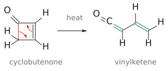
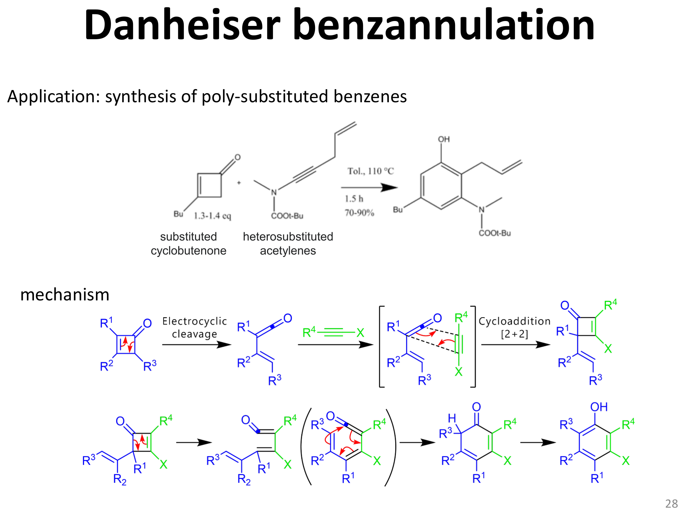

# Danheiser benzannulation

> substituted cyclobutenone과 heterosubstituted alkyne을 연결해 치환 benzene, 강의 예에서는 phenol을 만드는 연속 반응이다. electrocyclic cleavage, ketene [2+2], 다시 고리 열림과 $6\pi$ closure가 이어진다. (출처: L17 p.28)

## 왜 작은 고리에서 benzene이 나오는가

출발 cyclobutenone의 네 탄소와 alkyne의 두 탄소가 최종 여섯 탄소 고리에 기여한다. 그러나 처음부터 4원자 diene과 2원자 dienophile이 만나는 Diels–Alder로 그리면 carbonyl과 누적 이중결합의 역할을 놓친다. 강의는 먼저 cyclobutenone의 ring opening으로 vinylketene을 만들고, 그 ketene을 alkyne이 포획하는 경로를 보여 준다. (출처: L17 p.28)

## 단계별 결합 추적

1. **electrocyclic cleavage:** cyclobutenone의 C–C $\sigma$ 결합 하나가 끊어지고 C=C가 이동해 vinylketene이 된다. 기존 C=O가 그대로 남으며 O=C=C 누적 결합이 생긴다.
2. **ketene [2+2]:** heterosubstituted alkyne이 ketene과 반응해 새 cyclobutenone을 만든다. thermal ketene [2+2]의 근거는 [ketene cycloaddition](케텐%202+2%20고리화%20첨가.md)에 있다.
3. **두 번째 ring opening:** 새 4원 고리가 열려 conjugated ketene 계가 된다.
4. **$6\pi$ closure와 tautomerization:** 여섯 원자의 conjugated 경로가 닫혀 cyclohexadienone을 만들고, proton transfer로 aromatic phenol이 된다. 마지막 단계의 추진력은 aromaticity 회복이다.

모든 굽은 화살표를 한 구조 위에 겹쳐 그리지 말고 intermediate마다 네 탄소와 alkyne 두 탄소의 번호를 유지한다. 각 고리 열림에서 $\Delta\sigma$ = −1, 각 닫힘에서 $\Delta\sigma$ = +1인지도 확인할 수 있다. (출처: L17 p.28)

## 조건과 범위

강의의 구체 예는 substituted cyclobutenone과 heterosubstituted acetylene을 toluene, 110 °C, 1.5 h 조건에서 반응시키며 수율은 70–90%로 표시한다. 이 숫자를 모든 Danheiser substrate의 일반 수율로 쓰지는 않는다. 구조의 X와 R 치환기는 도식에서 정의된 자리에서만 옮기고, alkyne을 alkene으로 바꿔도 같은 benzene이 나온다고 일반화하지 않는다. (출처: L17 p.28)

## 흔한 오해

- “이름이 benzannulation이니 한 번의 [4+2]다”: 강의 경로는 여러 pericyclic 단계의 연결이다.
- “고리 열림에서 carbonyl O가 떨어진다”: O는 최종 phenol의 OH로 남는다.
- “마지막 proton transfer도 electrocyclic이다”: 방향족화 tautomerization은 고리 닫힘과 구별한다.

(출처: L17 p.28)

## 그림으로 확인하기

그림: 보충: 강의 p.28의 첫 고리 열림을 무치환 core로 단순화했다. 빨강 C–C $\sigma$ 결합이 끊어지고 초록 두 C=C가 생긴다. C=O는 유지된다. (출처: L17 p.28)

그림: 복잡한 치환기와 전체 단계는 원본 그림에서 확인한다. 새로 그린 앞 그림은 첫 단계만 설명한다. (출처: L17 p.28)

## 관련 문서

- [electrocyclic reaction](전자고리화%20반응.md), [ketene cycloaddition](케텐%202+2%20고리화%20첨가.md), [aromaticity](../개념/방향족성.md), [keto–enol tautomerization](케토-엔올%20토토머화.md)
