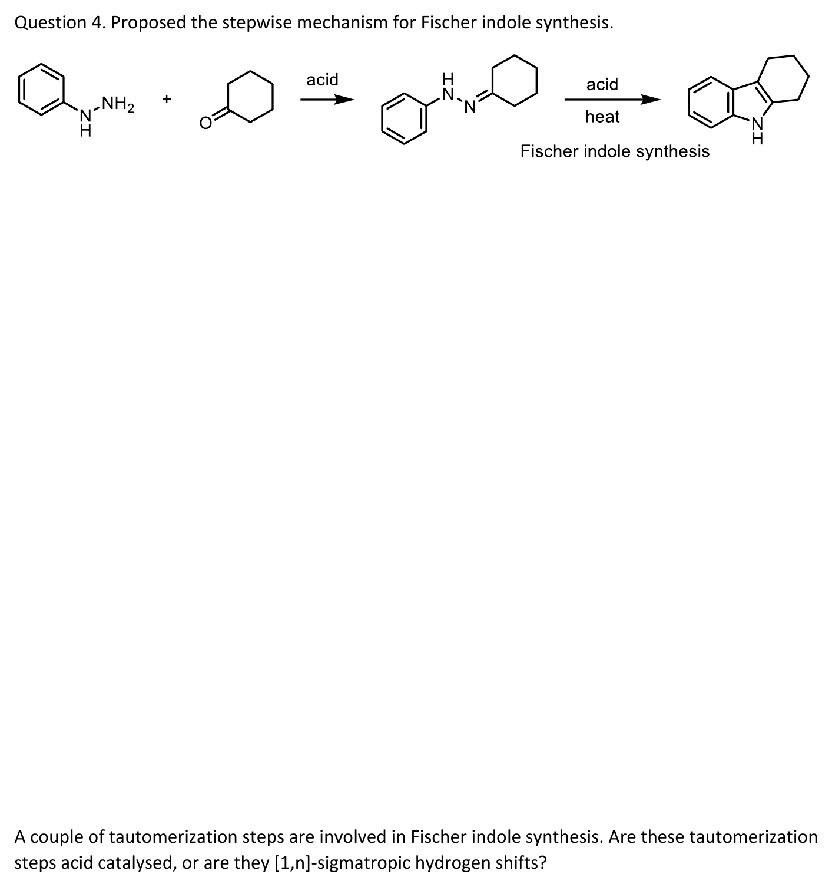
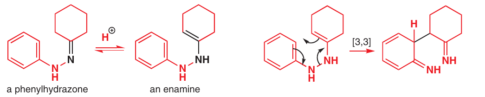
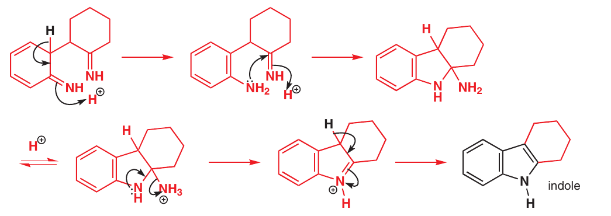

# Fischer indole synthesis

> phenylhydrazone을 산·가열 조건에서 indole로 바꾸는 합성이다. 핵심 pericyclic 단계는 enehydrazine의 [3,3]이며, 앞뒤의 acid-catalysed tautomerization과 고리화·NH3 이탈은 별도 단계다. (보충 근거: Clayden p.916; 출제: Tutorial Questions 5 p.4)

## 질소 두 개를 먼저 구별한다

phenylhydrazine의 aryl에 직접 붙은 질소를 $\mathrm{N}_{A}$, 원래 NH2였던 질소를 $\mathrm{N}_{B}$라고 하자. carbonyl과 축합해 hydrazone $\mathrm{C{=}N_B{-}N_A(H){-}Ph}$를 만든다. 최종 indole에 남는 것은 aryl과 처음부터 결합한 $\mathrm{N}_{A}$이며 $\mathrm{N}_{B}$는 NH3로 나간다. 두 N을 같은 N 기호로만 그리면 어느 결합이 끊어져야 하는지 놓치기 쉽다. (보충 근거: Clayden p.916)

## 단계별 메커니즘

1. **hydrazone 형성:** ketone과 phenylhydrazine이 축합한다. Tutorial 5는 cyclohexanone에서 이 구조까지 제시한다.
2. **enehydrazine 형성:** protonation/deprotonation으로 imine/enamine형 tautomer 평형을 만든다. $\pi$ 결합이 [3,3]에 참여할 수 있도록 이어진 구조를 확인한다.
3. **[3,3]:** N–N $\sigma$ 결합이 끊어지고, aryl ortho 탄소와 carbonyl 기질에서 유래한 탄소 사이에 새 C–C 결합이 생긴다. 이 단계의 직접 생성물은 aromatic indole이 아니라 diimine형 구조다.
4. **aromaticity 회복:** proton transfer로 benzene 고리가 다시 aromatic해진다.
5. **C–N 고리화:** aryl에 남은 $\mathrm{N}_{A}$가 imine carbon을 공격해 다섯 원자 고리를 만든다.
6. **NH3 이탈과 방향족화:** $\mathrm{N}_{B}$가 NH3로 빠져나가고 proton transfer로 indole의 conjugated 계를 완성한다.

고리형 화살표 세 개는 3단계에만 쓴다. 전체 반응을 한 번의 [3,3] 화살표로 건너뛰면 질소 하나가 사라지고 H가 옮겨지는 이유를 설명할 수 없다. (보충 근거: Clayden p.916; 출제: Tutorial Questions 5 p.4)

## 왜 tautomerization을 [1,n]H shift로 그리지 않나

산 촉매 조건에서는 질소나 탄소가 외부 acid/base와 양성자를 주고받을 수 있다. 이것은 한 분자 안에서 H와 $\sigma$ 결합 전자가 동시에 이동하는 concerted sigmatropic shift와 다르다. 강의의 thermal [1,3]H 이동은 짧은 사슬에서 필요한 antarafacial 기하를 만들 수 없어 불가능하다는 점도 기억해야 한다. 문제는 바로 이 구분을 명시적으로 묻는다. (출처: L16 p.24; 보충 근거: Clayden p.916; 출제: Tutorial Questions 5 p.4)

그림: hydrazone과 최종 fused indole은 문제에 주어진 구조다. 상세 중간체에 대한 설명은 Clayden p.916을 근거로 했으며 공식 tutorial 답안을 옮긴 것은 아니다. (출처: Tutorial Questions 5 p.4; 보충 근거: Clayden p.916)

## 흔한 오해

- “질소 두 개가 모두 indole에 남는다”: aryl에 붙었던 질소 하나만 남는다.
- “N–N 결합을 먼저 이온성으로 끊으면 된다”: 핵심 [3,3]은 적절한 enehydrazine에서 concerted 결합 재배열로 그린다.
- “tautomerization은 모두 H sigmatropic shift다”: acid-catalysed proton transfer와 구별한다.

(보충 근거: Clayden p.916)

## 중간체를 원본 도식과 대조하기

그림: hydrazone/enamine 평형과 [3,3]을 구별한 교재 도식이다. rearrangement 뒤 아직 benzene의 aromaticity가 회복되지 않은 diimine이 생긴다. 원본 도식의 전자 이동을 보존했으며 새 ReShiki 그림은 아니다. (보충 근거: Clayden p.916)

그림: proton transfer, C–N 고리화, NH3 이탈, 최종 방향족화를 나누어 보여 준다. aryl에 처음부터 붙었던 질소가 indole N으로 남는지 추적한다. (보충 근거: Clayden p.916)

## 관련 문서

- [sigmatropic rearrangement](시그마트로픽%20자리옮김.md), [enamine](../개념/엔아민.md), [hydrogen shifts](1,5-수소%20이동.md), [Tutorial 5](../../practice/Tutorial_5.md)
