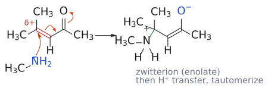
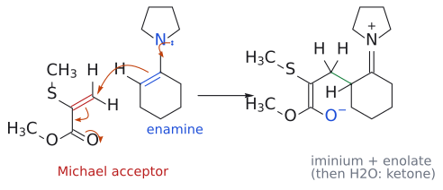

# 공액 첨가

> α,β-unsaturated carbonyl 화합물의 **β-탄소**에 nucleophile이, α-탄소에 H가 붙는 반응이다. alkene이 electrophile이 되는 "뒤집힌 alkene"의 화학이다.

## 개요

conjugate addition(공액 첨가, 짝지음 첨가, 1,4-addition)은 α,β-unsaturated carbonyl 화합물의 C=C에 nucleophile이 붙는 반응이다. L1–L2에서 본 alkene은 전자가 풍부해서 electrophile(E⁺)을 받아들이는 쪽이었다. 그런데 이중결합 옆에 carbonyl 같은 전자 끄는 기(EWG)가 짝지어 붙으면 성격이 뒤집혀, alkene이 오히려 nucleophile을 받는 **electrophile**이 된다. amine, thiol, cyanide ion, [organocuprate](../시약/유기구리%20시약.md), enolate, enamine이 모두 이 방식으로 β-탄소에 붙는다. 탄소 nucleophile을 쓰면 새 C–C 결합이 생기므로 [Michael reaction](마이클%20반응.md)으로 이어진다. nucleophile이 carbonyl 탄소를 칠지(1,2) β-탄소를 칠지(1,4)는 [1,2-addition과 1,4-addition](../개념/1,2-첨가와%201,4-첨가.md)에서 따로 다룬다. β-탄소에 leaving group이 있으면 첨가 뒤 제거가 일어나 치환으로 끝나며([addition-elimination](첨가-제거%20반응.md)), 이를 benzene 고리에 옮긴 것이 [SNAr](친핵성%20방향족%20치환.md)다. (출처: L11 p.3–4)

## 원리: 왜 β-탄소가 양전하를 띠나

### α,β-unsaturated carbonyl이란

α,β-unsaturated carbonyl 화합물은 C=C가 C=O와 바로 붙어(conjugated) 있는 분자다. carbonyl 탄소 옆이 α-탄소, 그 다음이 β-탄소다. 슬라이드에 나온 대표 예는 다음과 같다.

| 종류 | 체계명 | 관용명 | 구조 |
|---|---|---|---|
| α,β-unsaturated aldehyde(enal) | propenal | acrolein | CH2=CH-CHO |
| α,β-unsaturated ketone(enone) | but-3-en-2-one | methyl vinyl ketone(MVK) | CH2=CH-CO-CH3 |
| α,β-unsaturated acid | propenoic acid | acrylic acid | CH2=CH-COOH |
| α,β-unsaturated ester | ethyl propenoate | ethyl acrylate | CH2=CH-CO2Et |

이중결합이 carbonyl에서 한 칸 더 떨어진 β,γ-unsaturated ketone(예: CH3CO-CH2-CH=CH2)은 conjugated system이 아니라서 이 반응성을 보이지 않는다. (출처: L11 p.3)

### 공명 구조

그렇다면 왜 β-탄소가 nucleophile을 끌어당길까? 공명 구조를 그려 보면 답이 나온다. 중성 구조(A)에서 C=O의 π 전자를 산소로 밀면 carbonyl 탄소에 양전하가 생기고(B), 이어서 C=C의 π 전자를 옮기면 **β-탄소에 양전하**가 생긴다(C). 즉 β-탄소와 carbonyl 탄소 둘 다 δ+를 띤다. 그래서 일반 alkene은 E⁺를 공격하지만, conjugated alkene은 Nu⁻에게 공격받는다. (출처: L11 p.3)

*그림: methyl vinyl ketone으로 그린 공명 구조 A ↔ B ↔ C. A의 주황 화살표는 C=O의 π 전자가 산소로 가는 것을, B의 화살표는 C=C의 π 전자가 옆의 C–C 자리로 옮겨 가는 것을 나타낸다. 파란 O⁻는 음전하를 받은 산소, 빨간 +는 양전하가 놓이는 탄소다. B에서는 carbonyl 탄소, C에서는 β-탄소가 양전하를 띤다. 그래서 nucleophile이 노릴 수 있는 δ+ 자리가 두 곳이 된다.*

보충: 공명 구조는 "어디가 δ+인가"를 보여 줄 뿐이고, 실제 결합이 생기는 단계는 nucleophile의 HOMO에서 받개의 LUMO로 전자가 들어가는 과정이다. acrolein(propenal)의 LUMO는 β-탄소에서 계수가 가장 크고, carbonyl 탄소에서 두 번째로 크다. 그래서 β-탄소가 1순위 공격 자리이고, carbonyl 탄소도 경쟁 자리로 남는다. [1,2/1,4 경쟁](../개념/1,2-첨가와%201,4-첨가.md)은 이 "두 번째로 큰 계수"에서 나온다(→ [frontier molecular orbital](../개념/프런티어%20분자%20오비탈.md)). (보충 근거: Clayden p.502)

### 분광학적 증거

이 분극은 분광학에서도 보인다.
- IR: 단순 ketone C=O는 1715 cm⁻¹인데 conjugated C=O는 1675 cm⁻¹다. 공명으로 C=O가 단일결합 성격을 일부 띠어 결합이 약해졌다는 뜻이다(비교: C–O 단일결합 1050 cm⁻¹).
- ¹³C NMR: β-탄소는 약 140 ppm에서 나타나 일반 C=C(약 120 ppm)보다 저장(deshielded)이다. β-탄소의 전자 밀도가 낮다는 증거다.

(출처: L11 p.3)

보충: IR에서는 C=C 흡수도 함께 변한다. 고립된 C=C는 약 1650 cm⁻¹에서 약하게 흡수하지만, conjugated system에서는 약 1615 cm⁻¹로 내려가고 세기가 커진다. 진동수가 내려간 것은 C=C도 약해졌다는 뜻이고, 세기가 커진 것은 C=O와 짝지으면서 C=C의 dipole moment가 커졌다는 뜻이다. 또 ¹³C NMR에서 α-탄소는 약 120 ppm 근처에 머문다. 전자가 빠지는 자리는 α가 아니라 β라는 점이 숫자로도 보인다. (보충 근거: Clayden p.501)

## 일반형

conjugate addition은 **Michael addition**이라고도 부른다. 일반식은 다음과 같다.

`CH2=CH-CO-R(OR) --[(1) Nu⁻ (또는 H-Nu), (2) HA]--> Nu-CH2-CH2-CO-R(OR)`

결과적으로 Nu와 H가 C=C를 가로질러 붙는다. Nu는 β-탄소에, H는 α-탄소에 붙는다. 이 반응에는 세 가지 조건이 있다.
- alkene이 electrophile로 작용한다.
- Nu와 H가 C=C에 첨가된다.
- alkene 옆에 짝지은 EWG(CHO, COR, COOR 등)가 반드시 있어야 한다.

슬라이드가 든 nucleophile은 CN⁻, RNH2, RSH, R2CuLi, enolate 등이다. (출처: L11 p.4)

## 메커니즘: amine의 첨가

1차 또는 2차 amine은 α,β-unsaturated carbonyl 화합물에 첨가해서 **β-amino carbonyl 화합물**을 준다.

`(CH3)2C=CH-CO-CH3 --[MeNH2, H2O]--> (CH3)2C(NHMe)-CH2-CO-CH3` (75%)

*그림: 아래 1단계를 그린 것이다. 화살표는 셋이다. (1) MeNH2 질소(파랑, nucleophile)의 비공유 전자쌍이 δ+인 β-탄소(빨간 C=C 쪽)를 공격한다. (2) C=C의 π 전자가 carbonyl 쪽 C–C 자리로 밀려 간다. (3) C=O의 π 전자가 산소로 올라가 O⁻(파랑)가 된다. 초록 결합은 새로 생긴 C–N 결합이다. 생성물은 N⁺와 O⁻를 함께 가진 zwitterion이며, 이어서 양성자 이동과 tautomerization이 일어난다(2–4단계).*

메커니즘은 네 단계로 나뉜다.
1. **nucleophilic attack**: MeNH2의 질소 비공유 전자쌍(nucleophile)이 δ+인 β-탄소(electrophile)를 공격한다. 새 C–N 결합이 생기고, C=C의 π 전자는 C=O 쪽으로 밀려 산소 음이온이 된다. 이렇게 한 분자 안에 ammonium(+)과 enolate(−)가 같이 있는 zwitterion이 생긴다.
2. **proton transfer**: ammonium N–H의 양성자가 산소로 옮겨 간다. 중성 amine과 enol이 된다.
3. **tautomerization**: enol이 keto형으로 바뀐다. α-탄소에 H가 붙고 C=O가 다시 생긴다(→ [keto–enol tautomerization](케토-엔올%20토토머화.md)).
4. 그 결과 β-amino ketone이 남는다.

슬라이드에는 각 단계가 가역(⇌)으로 그려져 있다.[^1] (출처: L11 p.5)

보충: amine은 중성 nucleophile이므로 따로 산을 넣지 않아도 amine 자신(N–H)이 enolate에 줄 양성자를 공급한다. conjugate addition은 언제나 enolate(또는 enol)를 거치므로, 이 양성자를 공급할 곳이 필요하다. 그래서 conjugate addition은 보통 물이나 alcohol 같은 protic 용매에서 하고, alcohol을 nucleophile로 쓸 때는 촉매량의 염기만 있으면 된다(enolate가 물에서 양성자를 받으며 OH⁻를 다시 내놓는다). 또 1차 amine 생성물은 아직 N–H가 남아 nucleophilicity를 띠므로, 받개가 충분하면 **두 번째 conjugate addition**이 일어날 수 있다(예: MeNH2 + acrylonitrile 2분자). (보충 근거: Clayden p.503, p.510)

### 공통 뼈대

nucleophile이 무엇이든 뼈대는 같다. Nu⁻가 β-탄소를 공격하면 enolate가 생긴다(공명으로 α-탄소 음이온과 같다). 이것이 H⁺를 받으면 enol이 되고, tautomerize하면 ketone이 된다. 이 enolate가 양성자 대신 β-leaving group을 내보내면 [addition-elimination](첨가-제거%20반응.md)이 된다. (출처: L11 p.24)

## 선택성: 1,2냐 1,4냐

δ+ 자리가 carbonyl 탄소와 β-탄소 두 곳이므로, nucleophile은 직접 첨가(1,2)와 conjugate addition(1,4) 중 하나를 고른다. 슬라이드가 꼽는 요인은 (1) α,β-unsaturated 계의 작용기, (2) nucleophile, (3) 반응 조건이다. 단단한(hard) RMgBr·RLi는 1,2로, 무른(soft) R2CuLi와 thiol은 1,4로 가고, MVK + CN⁻는 저온에서 1,2(kinetic), 80 °C에서 1,4(thermodynamic) 생성물을 준다. 자세한 설명은 [1,2-addition과 1,4-addition](../개념/1,2-첨가와%201,4-첨가.md), [HSAB](../개념/하드-소프트%20산염기.md), [kinetic control과 thermodynamic control](../개념/속도론적%20지배와%20열역학적%20지배.md) 문서에 있다. (출처: L11 p.9–13)

## 예

- mesityl oxide((CH3)2C=CH-CO-CH3) `--[PhSH, 25 °C, 5 h]-->` 4-methyl-4-(phenylthio)pentan-2-one, (CH3)2C(SPh)-CH2-CO-CH3 (94%). thiol의 황은 β-탄소에 붙는다. (L11) (출처: L11 p.4)
- chalcone(Ph-CH=CH-CO-Ph) `--[⁻CN, EtOH, HOAc]-->` Ph-CH(CN)-CH2-CO-Ph (95%). CN이 β-탄소(Ph가 붙은 탄소)에 붙는다. (L11) (출처: L11 p.4)
- mesityl oxide `--[MeNH2, H2O]-->` (CH3)2C(NHMe)-CH2-CO-CH3 (75%). (L11) (출처: L11 p.5)
- methyl acrylate CH2=CH-CO2Me `--[NH3]-->` H2N-CH2CH2-CO2Me (1,4). (L11) (출처: L11 p.10)
- isophorone `--[MeMgBr, CuCl(0.01 eq), Et2O]-->` 3,3,5,5-tetramethylcyclohexanone (83%). CuCl이 없으면 C=O에 1,2-addition한다(→ [organocuprate](../시약/유기구리%20시약.md)). (L11) (출처: L11 p.6–7)
- enolate·enamine을 nucleophile로 쓰는 예는 [Michael reaction](마이클%20반응.md), 받개를 iminium으로 활성화하는 예는 [iminium-catalyzed conjugate addition](이미늄%20촉매%20공액%20첨가.md) 문서에 있다.

*그림: [enamine](../개념/엔아민.md)의 conjugate addition(cyclohexanone의 pyrrolidine enamine + CH₂=C(SMe)CO₂Me). 질소의 비공유 전자쌍(파랑)이 N–C 결합 쪽으로 밀려 C=N⁺를 만들고, 파란 C=C의 π 전자가 받개의 β-탄소(빨간 C=C의 말단 CH₂)를 공격한다. 받개 쪽에서는 C=C의 π 전자가 C–C(O) 자리로, C=O의 π 전자가 산소로 간다. 결과는 iminium과 ester enolate가 한 분자에 있는 zwitterion이고(초록이 새 C–C 결합), H₂O 후처리로 1,5-dicarbonyl 화합물이 된다. 보충: 슬라이드는 반응식만 보여 주며, zwitterion intermediate는 Clayden의 설명을 따랐다. (출처: L11 p.19) (보충 근거: Clayden p.608)*

## 흔한 오해

- **"1,4-addition은 Nu와 H가 1번과 4번 원자에 붙어 enol로 끝난다"고 생각하기 쉽지만, 사실은** enol은 intermediate일 뿐이고 곧 tautomerize해서 최종적으로는 C=C에 Nu와 H가 붙은 포화 ketone이 된다. (출처: L11 p.9)
- **"amine은 경계(borderline) nucleophile이니까 1,4를 안 한다"고 생각하기 쉽지만, 사실은** 슬라이드 예시처럼 1차·2차 amine은 enone과 acrylate에 1,4로 첨가해서 β-amino carbonyl을 준다. (출처: L11 p.5, p.10)
- **"conjugated alkene은 electrophile이 되었으니 Br2 같은 electrophile과는 반응하지 않는다"고 생각하기 쉽지만, 사실은** α,β-unsaturated carbonyl 화합물도 Br2 첨가는 (더 느리게나마) 한다. EWG는 alkene의 nucleophilicity를 줄일 뿐 없애지 않는다. alkene과 방향족 고리의 기본 성격은 여전히 nucleophile이고, 이 강의는 예외적으로 electrophile처럼 구는 경우를 다룬다. (보충 근거: Clayden p.499, p.526)

## 관련 문서

- 반응: [마이클 반응](마이클%20반응.md), [이미늄 촉매 공액 첨가](이미늄%20촉매%20공액%20첨가.md), [첨가-제거 반응](첨가-제거%20반응.md), [친핵성 방향족 치환](친핵성%20방향족%20치환.md), [케토-엔올 토토머화](케토-엔올%20토토머화.md)
- 시약: [유기구리 시약](../시약/유기구리%20시약.md), [그리냐르 시약](../시약/그리냐르%20시약.md)
- 개념: [1,2-첨가와 1,4-첨가](../개념/1,2-첨가와%201,4-첨가.md), [하드-소프트 산염기](../개념/하드-소프트%20산염기.md), [엔올과 엔올레이트](../개념/엔올과%20엔올레이트.md), [프런티어 분자 오비탈](../개념/프런티어%20분자%20오비탈.md)

## 출처

- [L11 짝지음 첨가](../../notes/L11_Conjugate_Addition.md) 1절, 2절, 8절 (L11 p.3–5, p.9–10, p.24)

[^1]: 보충: amine의 conjugate addition은 가역적이다. amine은 carbonyl에 1,2로도 첨가할 수 있지만 그 생성물(hemiaminal)은 쉽게 되돌아간다. 그래서 결국 안정한 1,4 생성물이 쌓인다. MVK + CN⁻의 kinetic/thermodynamic 논리([1,2-addition과 1,4-addition](../개념/1,2-첨가와%201,4-첨가.md))와 같은 구도다. (보충 근거: Clayden p.582)
