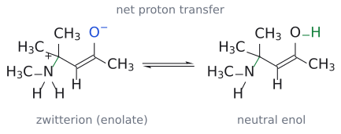
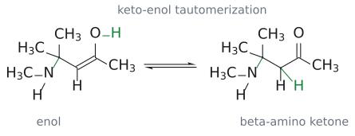

# 공액 첨가

> $\alpha,\beta$-unsaturated carbonyl 화합물의 **$\beta$-탄소**에 nucleophile이, $\alpha$-탄소에 H가 붙는 반응이다. alkene이 electrophile이 되는 "뒤집힌 alkene"의 화학이다.

## 개요

conjugate addition(1,4-addition)은 $\alpha,\beta$-unsaturated carbonyl 화합물의 C=C에 nucleophile이 붙는 반응이다. L1–L2에서 본 alkene은 전자가 풍부해서 electrophile(E⁺)을 받아들이는 쪽이었다. 그런데 이중결합 옆에 carbonyl 같은 전자 끄는 기(EWG)가 짝지어 붙으면 성격이 뒤집혀, alkene이 오히려 nucleophile을 받는 **electrophile**이 된다. amine, thiol, cyanide ion, [organocuprate](../시약/유기구리%20시약.md), enolate, enamine이 모두 이 방식으로 $\beta$-탄소에 붙는다. 탄소 nucleophile을 쓰면 새 C–C 결합이 생기므로 [Michael reaction](마이클%20반응.md)으로 이어진다. nucleophile이 carbonyl 탄소를 칠지(1,2) $\beta$-탄소를 칠지(1,4)는 [1,2-addition과 1,4-addition](../개념/1,2-첨가와%201,4-첨가.md)에서 따로 다룬다. $\beta$-탄소에 leaving group이 있으면 첨가 뒤 제거가 일어나 치환으로 끝나며([addition-elimination](첨가-제거%20반응.md)), 이를 benzene 고리에 옮긴 것이 [SNAr](친핵성%20방향족%20치환.md)다. (출처: L11 p.3–4)

## 원리: 왜 $\beta$-탄소가 양전하를 띠나

### $\alpha,\beta$-unsaturated carbonyl이란

$\alpha,\beta$-unsaturated carbonyl 화합물은 C=C가 C=O와 바로 conjugated 있는 분자다. carbonyl 탄소 옆이 $\alpha$-탄소, 그 다음이 $\beta$-탄소다. 슬라이드에 나온 대표 예는 다음과 같다.

| 종류 | 체계명 | 관용명 | 구조 |
|---|---|---|---|
| $\alpha,\beta$-unsaturated aldehyde(enal) | propenal | acrolein | CH2=CH-CHO |
| $\alpha,\beta$-unsaturated ketone(enone) | but-3-en-2-one | methyl vinyl ketone(MVK) | CH2=CH-CO-CH3 |
| $\alpha,\beta$-unsaturated acid | propenoic acid | acrylic acid | CH2=CH-COOH |
| $\alpha,\beta$-unsaturated ester | ethyl propenoate | ethyl acrylate | CH2=CH-CO2Et |

이중결합이 carbonyl에서 한 칸 더 떨어진 $\beta,\gamma$-unsaturated ketone(예: CH3CO-CH2-CH=CH2)은 conjugated system이 아니라서 이 반응성을 보이지 않는다. (출처: L11 p.3)

### 공명 구조

그렇다면 왜 $\beta$-탄소가 nucleophile을 끌어당길까? 공명 구조를 그려 보면 답이 나온다. 중성 구조(A)에서 C=O의 $\pi$ 전자를 산소로 밀면 carbonyl 탄소에 양전하가 생기고(B), 이어서 C=C의 $\pi$ 전자를 옮기면 **$\beta$-탄소에 양전하**가 생긴다(C). 즉 $\beta$-탄소와 carbonyl 탄소 둘 다 $\delta^{+}$를 띤다. 그래서 일반 alkene은 E⁺를 공격하지만, conjugated alkene은 Nu⁻에게 공격받는다. (출처: L11 p.3)

그림: methyl vinyl ketone으로 그린 공명 구조 A ↔ B ↔ C. A의 주황 화살표는 C=O의 $\pi$ 전자가 산소로 가는 것을, B의 화살표는 C=C의 $\pi$ 전자가 옆의 C–C 자리로 옮겨 가는 것을 나타낸다. 파란 O⁻는 음전하를 받은 산소, 빨간 +는 양전하가 놓이는 탄소다. B에서는 carbonyl 탄소, C에서는 $\beta$-탄소가 양전하를 띤다. 그래서 nucleophile이 노릴 수 있는 $\delta^{+}$ 자리가 두 곳이 된다.

보충: 공명 구조는 "어디가 $\delta^{+}$인가"를 보여 줄 뿐이고, 실제 결합이 생기는 단계는 nucleophile의 HOMO에서 받개의 LUMO로 전자가 들어가는 과정이다. acrolein(propenal)의 LUMO는 $\beta$-탄소에서 계수가 가장 크고, carbonyl 탄소에서 두 번째로 크다. 그래서 $\beta$-탄소가 1순위 공격 자리이고, carbonyl 탄소도 경쟁 자리로 남는다. [1,2/1,4 경쟁](../개념/1,2-첨가와%201,4-첨가.md)은 이 "두 번째로 큰 계수"에서 나온다(→ [frontier molecular orbital](../개념/프런티어%20분자%20오비탈.md)). (보충 근거: Clayden p.502)

### 분광학적 증거

이 분극은 분광학에서도 보인다.
- IR: 단순 ketone C=O는 1715 cm⁻¹인데 conjugated C=O는 1675 cm⁻¹다. 공명으로 C=O가 단일결합 성격을 일부 띠어 결합이 약해졌다는 뜻이다(비교: C–O 단일결합 1050 cm⁻¹).
- ¹³C NMR: $\beta$-탄소는 약 140 ppm에서 나타나 일반 C=C(약 120 ppm)보다 deshielded이다. $\beta$-탄소의 전자 밀도가 낮다는 증거다.

(출처: L11 p.3)

보충: IR에서는 C=C 흡수도 함께 변한다. 고립된 C=C는 약 1650 cm⁻¹에서 약하게 흡수하지만, conjugated system에서는 약 1615 cm⁻¹로 내려가고 세기가 커진다. 진동수가 내려간 것은 C=C도 약해졌다는 뜻이고, 세기가 커진 것은 C=O와 짝지으면서 C=C의 dipole moment가 커졌다는 뜻이다. 또 ¹³C NMR에서 $\alpha$-탄소는 약 120 ppm 근처에 머문다. 전자가 빠지는 자리는 $\alpha$가 아니라 $\beta$라는 점이 숫자로도 보인다. (보충 근거: Clayden p.501)

## 일반형

conjugate addition은 **Michael addition**이라고도 부른다. 일반식은 다음과 같다.

$$
\mathrm{CH_2{=}CH{-}CO{-}R(OR)} \xrightarrow[(2)\ \mathrm{HA}]{(1)\ \mathrm{Nu^-}\ (\text{또는}\ \mathrm{H{-}Nu})} \mathrm{Nu{-}CH_2{-}CH_2{-}CO{-}R(OR)}
$$

결과적으로 Nu와 H가 C=C를 가로질러 붙는다. Nu는 $\beta$-탄소에, H는 $\alpha$-탄소에 붙는다. 이 반응에는 세 가지 조건이 있다.
- alkene이 electrophile로 작용한다.
- Nu와 H가 C=C에 첨가된다.
- alkene 옆에 짝지은 EWG(CHO, COR, COOR 등)가 반드시 있어야 한다.

슬라이드가 든 nucleophile은 CN⁻, RNH2, RSH, R2CuLi, enolate 등이다. (출처: L11 p.4)

## 메커니즘: amine의 첨가

1차 또는 2차 amine은 $\alpha,\beta$-unsaturated carbonyl 화합물에 첨가해서 **$\beta$-amino carbonyl 화합물**을 준다.

$$
\mathrm{(CH_3)_2C{=}CH{-}CO{-}CH_3} \xrightarrow{\ \mathrm{MeNH_2},\ \mathrm{H_2O}\ \mathstrut} \mathrm{(CH_3)_2C(NHMe){-}CH_2{-}CO{-}CH_3}
$$

(수율 75%)

그림: 아래 1단계를 그린 것이다. 화살표는 셋이다. (1) $MeNH_2$ 질소(파랑, nucleophile)의 비공유 전자쌍이 $\delta^{+}$인 $\beta$-탄소(빨간 C=C 쪽)를 공격한다. (2) C=C의 $\pi$ 전자가 carbonyl 쪽 C–C 자리로 밀려 간다. (3) C=O의 $\pi$ 전자가 산소로 올라가 O⁻(파랑)가 된다. 초록 결합은 새로 생긴 C–N 결합이다. 생성물은 N⁺와 O⁻를 함께 가진 zwitterion이며, 이어서 양성자 이동과 tautomerization이 일어난다(2–4단계).

메커니즘은 네 단계로 나뉜다.
1. **nucleophilic attack**: MeNH2의 질소 비공유 전자쌍이 $\delta^{+}$인 $\beta$-탄소(electrophile)를 공격한다. 새 C–N 결합이 생기고, C=C의 $\pi$ 전자는 C=O 쪽으로 밀려 산소 anion이 된다. 이렇게 한 분자 안에 ammonium(+)과 enolate(−)가 같이 있는 zwitterion이 생긴다.
2. **proton transfer**: ammonium N–H의 양성자가 산소로 옮겨 간다. 중성 amine과 enol이 된다.
3. **tautomerization**: enol이 keto형으로 바뀐다. $\alpha$-탄소에 H가 붙고 C=O가 다시 생긴다(→ [keto–enol tautomerization](케토-엔올%20토토머화.md)).
4. 그 결과 $\beta$-amino ketone이 남는다.

그림: 2단계. N⁺–H와 O⁻를 가진 zwitterion이 proton transfer를 거쳐 중성 amine과 enol로 바뀐다. 초록 O–H는 이동한 proton의 도착 위치이며, 평형 화살표는 강의의 가역 단계를 따른다. 이 그림은 순변화를 나타내며 직접적인 분자 내 N→O proton 이동을 뜻하지 않는다. (출처: L11 p.5)

그림: 3–4단계. enol의 C=C가 C–C로 바뀌고 C=O가 회복되어 $\beta$-amino ketone이 된다. 초록 H는 $\alpha$-탄소에 새로 붙은 H이다. 이는 tautomerization의 순변화이며 O–H가 한 번에 C–H로 이동하는 elementary step을 그린 것이 아니다. (출처: L11 p.5)

슬라이드에는 각 단계가 가역(⇌)으로 그려져 있다.[^1] (출처: L11 p.5)

보충: amine은 중성 nucleophile이므로 따로 산을 넣지 않아도 amine 자신(N–H)이 enolate에 줄 양성자를 공급한다. 이 절의 carbonyl 받개에 대한 conjugate addition은 enolate(또는 enol)를 거치므로, 이 양성자를 공급할 곳이 필요하다. 그래서 conjugate addition은 보통 물이나 alcohol 같은 protic 용매에서 하고, alcohol을 nucleophile로 쓸 때는 촉매량의 염기만 있으면 된다(enolate가 물에서 양성자를 받으며 OH⁻를 다시 내놓는다). 또 1차 amine 생성물은 아직 N–H가 남아 nucleophilicity를 띠므로, 받개가 충분하면 **두 번째 conjugate addition**이 일어날 수 있다(예: MeNH2 + acrylonitrile 2분자). (보충 근거: Clayden p.503, p.510)

### 공통 뼈대

nucleophile이 무엇이든 뼈대는 같다. Nu⁻가 $\beta$-탄소를 공격하면 enolate가 생긴다(공명으로 $\alpha$-탄소 anion과 같다). 이것이 H⁺를 받으면 enol이 되고, tautomerize하면 ketone이 된다. 이 enolate가 양성자 대신 $\beta$-leaving group을 내보내면 [addition-elimination](첨가-제거%20반응.md)이 된다. (출처: L11 p.24)

## 선택성: 1,2냐 1,4냐

$\delta^{+}$ 자리가 carbonyl 탄소와 $\beta$-탄소 두 곳이므로, nucleophile은 직접 첨가(1,2)와 conjugate addition(1,4) 중 하나를 고른다. 슬라이드가 꼽는 요인은 (1) $\alpha,\beta$-unsaturated 계의 작용기, (2) nucleophile, (3) 반응 조건이다. hard RMgBr·RLi는 1,2로, soft R2CuLi와 thiol은 1,4로 가고, MVK + CN⁻는 저온에서 1,2(kinetic), 80 °C에서 1,4(thermodynamic) 생성물을 준다. 자세한 설명은 [1,2-addition과 1,4-addition](../개념/1,2-첨가와%201,4-첨가.md), [HSAB](../개념/하드-소프트%20산염기.md), [kinetic control과 thermodynamic control](../개념/속도론적%20지배와%20열역학적%20지배.md) 문서에 있다. (출처: L11 p.9–13)

## 예

mesityl oxide

$$
\mathrm{((CH_3)_2C{=}CH{-}CO{-}CH_3)} \quad \xrightarrow[25\thinspace{}^\circ\mathrm{C},\ 5\ \text{h}]{\mathrm{PhSH}} \mathrm{(CH_3)_2C(SPh){-}CH_2{-}CO{-}CH_3}
$$

mesityl oxide → 4-methyl-4-(phenylthio)pentan-2-one.

(수율 94%)

  thiol의 황은 $\beta$-탄소에 붙는다. (L11) (출처: L11 p.4)
chalcone

$$
\mathrm{(Ph{-}CH{=}CH{-}CO{-}Ph)} \quad \xrightarrow[\mathrm{EtOH},\ \mathrm{HOAc}]{\mathrm{CN^-}} \mathrm{Ph{-}CH(CN){-}CH_2{-}CO{-}Ph}
$$

(수율 95%)

  CN이 $\beta$-탄소(Ph가 붙은 탄소)에 붙는다. (L11) (출처: L11 p.4)
$$
\text{mesityl oxide} \xrightarrow{\ \mathrm{MeNH_2},\ \mathrm{H_2O}\ \mathstrut} \mathrm{(CH_3)_2C(NHMe){-}CH_2{-}CO{-}CH_3}
$$

(수율 75%)

  (L11) (출처: L11 p.5)
methyl acrylate

$$
\mathrm{CH_2{=}CH{-}CO_2Me} \quad \xrightarrow{\ \mathrm{NH_3}\ \mathstrut} \mathrm{H_2N{-}CH_2CH_2{-}CO_2Me}
$$

  (1,4). (L11) (출처: L11 p.10)
$$
\text{isophorone} \xrightarrow[\mathrm{CuCl}(0.01\ \text{eq}),\ \mathrm{Et_2O}]{\mathrm{MeMgBr}} \text{3,3,5,5-tetramethylcyclohexanone}
$$

(수율 83%)

  CuCl이 없으면 C=O에 1,2-addition한다(→ [organocuprate](../시약/유기구리%20시약.md)). (L11) (출처: L11 p.6–7)
- enolate·enamine을 nucleophile로 쓰는 예는 [Michael reaction](마이클%20반응.md), 받개를 iminium으로 활성화하는 예는 [iminium-catalyzed conjugate addition](이미늄%20촉매%20공액%20첨가.md) 문서에 있다.

그림: [enamine](../개념/엔아민.md)의 conjugate addition(cyclohexanone의 pyrrolidine enamine + CH₂=C(SMe)CO₂Me). 질소의 비공유 전자쌍(파랑)이 N–C 결합 쪽으로 밀려 C=N⁺를 만들고, 파란 C=C의 $\pi$ 전자가 받개의 $\beta$-탄소(빨간 C=C의 말단 CH₂)를 공격한다. 받개 쪽에서는 C=C의 $\pi$ 전자가 C–C(O) 자리로, C=O의 $\pi$ 전자가 산소로 간다. 결과는 iminium과 ester enolate가 한 분자에 있는 zwitterion이고(초록이 새 C–C 결합), H₂O 후처리로 1,5-dicarbonyl 화합물이 된다. 보충: 슬라이드는 반응식만 보여 주며, zwitterion intermediate는 Clayden의 설명을 따랐다. (출처: L11 p.19) (보충 근거: Clayden p.608)

그림: S(파랑)가 $\beta$-탄소(빨강)에 붙는다.

그림: CN(파랑)이 $\beta$-탄소(빨강)에 붙는다.

## 흔한 오해

- **"1,4-addition은 Nu와 H가 1번과 4번 원자에 붙어 enol로 끝난다"고 생각하기 쉽지만, 사실은** enol은 intermediate일 뿐이고 곧 tautomerize해서 최종적으로는 C=C에 Nu와 H가 붙은 포화 ketone이 된다. (출처: L11 p.9)
- **"amine은 borderline nucleophile이니까 1,4를 안 한다"고 생각하기 쉽지만, 사실은** 슬라이드 예시처럼 1차·2차 amine은 enone과 acrylate에 1,4로 첨가해서 $\beta$-amino carbonyl을 준다. (출처: L11 p.5, p.10)
- **"conjugated alkene은 electrophile이 되었으니 Br2 같은 electrophile과는 반응하지 않는다"고 생각하기 쉽지만, 사실은** $\alpha,\beta$-unsaturated carbonyl 화합물도 Br2 첨가는 (더 느리게나마) 한다. EWG는 alkene의 nucleophilicity를 줄일 뿐 없애지 않는다. alkene과 방향족 고리의 기본 성격은 여전히 nucleophile이고, 이 강의는 예외적으로 electrophile처럼 구는 경우를 다룬다. (보충 근거: Clayden p.499, p.526)

## L11을 읽으며 원자와 전자를 추적하기

### 공명식에서 읽어야 할 것과 실제 반응에서 바뀌는 것

공명식을 그릴 때에는 원자나 H를 움직이지 않고 전자만 옮긴다. 따라서 A, B, C는 차례로 생성되는 세 intermediate가 아니라 **같은 분자를 나타내는 기여 구조**다. C에 $\beta$-탄소의 양전하를 그릴 수 있다는 것은 그 자리가 electrophilic하다는 뜻이지, 용액에 자유로운 $\beta$-carbocation이 먼저 생긴다는 뜻은 아니다. 실제 nucleophilic addition에서는 Nu와 탄소 사이에 새 결합을 만들면서 conjugated 계의 전자를 O 쪽으로 밀어 octet을 유지한다. (출처: L11 p.3–5)

번호는 두 체계를 구분해서 읽는다. 분자 이름에서 carbonyl 탄소가 C1이면 이웃 탄소가 C2($\alpha$), 다음이 C3($\beta$)다. 반면 **1,4-addition의 번호는 O–C–C–C를 세는 번호**이므로 O가 1, carbonyl 탄소가 2, $\alpha$-탄소가 3, $\beta$-탄소가 4다. 따라서 “1,4라서 분자 이름의 C4에 붙는다”는 뜻이 아니다. 두 체계에서 실제 공격 원자는 똑같은 $\beta$-탄소다. (출처: L11 p.3,9)

### 출발물에서 생성물까지 결합을 따라 읽기

받개를 먼저 $\mathrm{C(=O)}{-}C_{\alpha}{-}C_{\beta}$ 순서로 표시하고, Nu에서 실제로 결합할 원자를 고른다. thiophenol에서는 S, cyanide에서는 C, methylamine에서는 N이 그 원자다. 이 원자를 $\beta$-탄소에 붙인 뒤 원래 $\alpha{-}\beta$의 이중결합을 단일결합으로 바꾸고, 최종 carbonyl을 회복하면 기본 생성물의 골격을 얻는다. 원래 $\beta$-탄소에 있던 methyl·phenyl 같은 치환기는 그대로 남는다. (출처: L11 p.4–5,9)

중성 nucleophile과 음이온 nucleophile의 첫 intermediate는 전하가 다르다. $\mathrm{CN^-}$ 같은 음이온이 1,4로 붙으면 주개의 음전하가 소비되고 받개 쪽 enolate에 음전하가 남는다. 반면 중성 amine은 비공유 전자쌍을 새 결합에 쓰면서 N이 양전하를 띠고, 받개 O에는 음전하가 생겨 zwitterion이 된다. 따라서 중성 amine의 첨가에 전하 표시를 모두 생략하면 뒤의 proton transfer가 왜 필요한지 설명할 수 없다. (출처: L11 p.5,7,13)

### amine의 전하와 H를 세어 보는 법

첫 공격 전 $\mathrm{MeNH_2}$의 N은 C–N 하나와 N–H 둘, 총 세 결합과 전자쌍 하나를 가진다. 새 C–N 결합을 만들면 네 결합이 되어 $\mathrm{N^+}$가 된다. 이후 N–H에서 proton을 잃을 때 그 결합의 전자는 N에 남으므로, N은 다시 세 결합과 전자쌍을 가진 중성 amine으로 돌아온다. **전자쌍 화살표는 H⁺의 이동 경로가 아니라 결합 전자의 이동 경로**라는 점을 이 단계에서 확인할 수 있다. (출처: L11 p.5)

최종 생성물에서는 출발 enone의 $\alpha$-탄소가 CH에서 CH₂로 바뀌고, $\beta$-탄소에는 NHMe가 붙는다. mesityl oxide의 $\beta$-탄소에는 원래 methyl 둘이 있으므로, 그 탄소에 H를 하나 더 붙이는 것이 아니다. “Nu와 H가 C=C를 가로질러 붙는다”는 말을 각 탄소의 원래 치환기와 원자가에 맞춰 적용해야 한다. (출처: L11 p.4–5)

### 처음 보는 반응식을 읽는 순서

받개를 찾은 다음 carbonyl 또는 EWG를 기준으로 $\alpha$와 $\beta$를 먼저 표시한다. 이어 시약에서 **실제로 전달되는 원자 또는 탄소 조각**을 고른다. amine이면 N, organocuprate이면 R의 탄소, enolate/enamine이면 donor carbonyl의 $\alpha$-탄소다. 그다음 1,2/1,4와 첨가/치환을 고르고, 마지막으로 proton transfer·가수분해·추가 환원을 적용한다. (출처: L11 p.4–24)

| 답안에서 확인할 질문 | 확인 이유 |
|---|---|
| donor와 acceptor의 어느 원자가 연결되었나? | 1,2/1,4 및 donor 위치 오류 방지 |
| 중간체의 O와 N 전하가 맞나? | alkoxide·enolate·zwitterion·iminium 구분 |
| 최종 C=C와 C=O 중 무엇이 남았나? | 단순 첨가·conjugate addition·치환 구분 |
| H₂O/H₃O⁺ 뒤 carbonyl이 회복되었나? | enamine/iminium 중간체를 최종 답으로 쓰는 오류 방지 |
| 탄소 수와 고리 원자 수가 맞나? | Michael 연결·nitrile 환원·연속 고리화 검산 |

특히 **조건이 달라진 이유를 한 문장으로 설명**해 본다. “Cu를 넣어 전달되는 탄소의 반응 성격이 달라졌다”, “가역적인 1,2 경로에서 출발물이 회복될 시간이 생겼다”, “donor enolate의 평형이 더 치환된 쪽을 선택했다”, “EWG가 addition intermediate의 음전하를 받아 준다”처럼 실제로 바뀐 대상을 말할 수 있어야 한다. 이 네 설명은 서로 다른 문제를 다루므로 하나의 “더 안정하다”로 뭉뚱그리지 않는다. (출처: L11 p.6–7,13,16,23)

## 관련 문서

- 반응: [Michael reaction](마이클%20반응.md), [iminium-catalysed conjugate addition](이미늄%20촉매%20공액%20첨가.md), [addition-elimination](첨가-제거%20반응.md), [nucleophilic aromatic substitution](친핵성%20방향족%20치환.md), [keto-enol tautomerization](케토-엔올%20토토머화.md)
- 시약: [organocuprate](../시약/유기구리%20시약.md), [Grignard reagent](../시약/그리냐르%20시약.md)
- 개념: [1,2-addition vs 1,4-addition](../개념/1,2-첨가와%201,4-첨가.md), [hard and soft acids and bases (HSAB)](../개념/하드-소프트%20산염기.md), [enol and enolate](../개념/엔올과%20엔올레이트.md), [frontier molecular orbital](../개념/프런티어%20분자%20오비탈.md)

## 출처

- [L11 conjugate addition](../../notes/L11_Conjugate_Addition.md) 1절, 2절, 8절 (L11 p.3–5, p.9–10, p.24)

[^1]: 보충: amine의 conjugate addition은 가역적이다. amine은 carbonyl에 1,2로도 첨가할 수 있지만 그 생성물(hemiaminal)은 쉽게 되돌아간다. 그래서 결국 안정한 1,4 생성물이 쌓인다. MVK + CN⁻의 kinetic/thermodynamic 논리([1,2-addition과 1,4-addition](../개념/1,2-첨가와%201,4-첨가.md))와 같은 구도다. (보충 근거: Clayden p.582)
