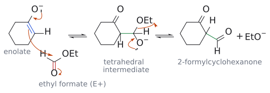
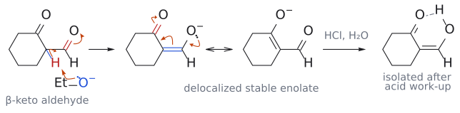
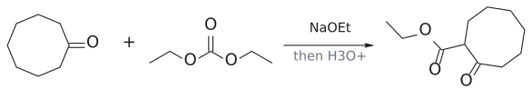

# 교차 클라이젠 축합

> enolizable carbonyl 화합물 + enolizable하지 않은 "활성화된" ester --[NaOEt; H₃O⁺]--> $\beta$-keto ester 또는 $\beta$-dicarbonyl. 한쪽을 electrophile 전용으로 골라 혼합물을 피한다.

## 개요

서로 다른 두 ester를 섞으면 어떻게 될까? 둘 다 enolization될 수 있다면 각자 nucleophile도 되고 electrophile도 되므로 self-condensation 2가지, crossed condensation 2가지, 최대 4가지 생성물이 뒤섞인다.[^1] 그래서 crossed Claisen의 요령은 한쪽을 $\alpha$-H가 없는(enolization할 수 없는) ester로 골라, 그것이 electrophile 역할만 하도록 만드는 것이다. mechanism과 원동력(생성물의 deprotonation)은 [Claisen condensation](클라이젠%20축합.md)과 같다. (출처: L9 p.8)

## 원리: electrophile ester의 반응성

슬라이드는 enolization되지 않는 ester를 electrophile 반응성 순서로 줄 세운다. (출처: L9 p.8)

diethyl oxalate(EtO₂C–CO₂Et) > ethyl formate(HCO₂Et) > diethyl carbonate((EtO)₂C=O) > ethyl benzoate(PhCO₂Et)

그리고 ethyl acetate(CH₃CO₂Et)를 주황색 화살표로 diethyl carbonate와 ethyl benzoate 사이에 표시해 두었다. 즉 일반적인 ester인 ethyl acetate와 비교하는 기준선 역할로 읽힌다.[^2] 이 순서는 왜 이렇게 될까? oxalate는 바로 옆의 ester기가 전자를 끌어 carbonyl을 더 electrophilic하게 만들고(두 C=O의 $\pi^{*}$가 섞여 LUMO가 더 낮아진다), formate는 steric hindrance(입체 장애)도 alkyl group의 전자 공여도 없다. 반대로 benzoate는 phenyl 고리와의 conjugation 때문에 일반 ester보다도 덜 electrophilic하다.[^3] (출처: L9 p.8)

보충: carbonate가 일반 ester보다 위에 오는 이유는 직관과 다르다. ester 산소는 lone pair를 C=O에 resonance electrophilicity를 낮추고, electronegativity로 전자를 inductive effect electrophilicity를 높인다. 보통 ester에서는 앞의 효과가 조금 더 커서 ketone보다 약간 덜 electrophilic하다. carbonate에서는 두 산소가 각각 inductive effect를 온전히 발휘하지만, resonance 전자 공여는 같은 $\pi^{*}$ 하나를 나눠 써야 하므로 합이 inductive effect 쪽으로 기운다. 그래서 diethyl carbonate는 일반 ester(ethyl acetate)보다 더 electrophilic하고(oxalate·formate보다는 덜하다), 이는 슬라이드의 주황 화살표 위치와도 맞는다. (보충 근거: Clayden p.643, p.644)

## 메커니즘: ketone + ester

이번엔 enolate를 ester가 아니라 ketone에서 만들어 보자. 그런데 왜 ester가 아니라 ketone이 enolate가 될까? ketone $\alpha$-H(pKa 약 20)가 ester $\alpha$-H(약 25)보다 산성이 크기 때문이다(→ [$\alpha$-H acidity](../개념/α-수소의%20산도.md)). 게다가 여기서 쓴 ester는 애초에 $\alpha$-H가 없다. 그래서 역할 분담이 자연스럽게 정해진다. (출처: L9 p.10)

슬라이드는 cyclohexanone + ethyl formate로 mechanism을 자세히 보여 준다. (출처: L9 p.10)

1. EtO⁻가 cyclohexanone의 $\alpha$-H를 떼어 enolate를 만든다(가역).
2. enolate $\alpha$-탄소가 HCO₂Et의 carbonyl 탄소를 공격해 [tetrahedral intermediate](../개념/사면체%20중간체.md)가 된다(가역).
3. EtO⁻가 떨어지며 2-formylcyclohexanone, 즉 $\beta$-keto aldehyde가 생긴다(가역).

그림: 2–3단계(첨가와 제거). 왼쪽 화살표 셋은 (1) enolate O⁻의 전자쌍이 C–O 쪽으로 밀어 주고 (2) 파란 C=C가 ethyl formate의 carbonyl 탄소를 공격하며 (3) 빨간 C=O의 $\pi$ 전자가 산소로 올라가는 과정이다. 가운데 tetrahedral intermediate에서는 O⁻의 전자쌍이 C=O를 되살리고 C–OEt 결합 전자가 떨어져 EtO⁻가 나간다. 초록색이 새 C–C 결합이며, 두 단계 모두 가역(⇌)이다. 반응하는 C2의 H는 다음 단계에서 떨어질 수소라 명시했다.
4. EtO⁻가 두 carbonyl 사이의 C–H를 떼어 낸다. 생긴 anion은 두 산소에 전하가 퍼진 "delocalized stable enolate(비편재화된 안정한 enolate)"로, 반응 조건에서 형성되며 바로 이것이 원동력이다. 그래서 여기서도 염기 1당량이 필요하다.
5. HCl/H₂O로 후처리하면 생성물은 "CHO" 형태가 아니라, =CH–OH의 OH가 ketone C=O와 분자 내 수소 결합을 이룬 enol형, 2-(hydroxymethylene)cyclohexanone으로 분리된다(→ [keto–enol tautomerization](케토-엔올%20토토머화.md)).

그림: 4–5단계. 왼쪽에서 EtO⁻(파랑)의 전자쌍이 두 carbonyl 사이의 산성 H(빨강)를 떼어 가고, C–H 결합 전자(파란 결합)는 C2–CHO 쪽으로 가서 C=C를 만들며, CHO의 C=O $\pi$ 전자는 산소로 올라간다. 가운데 두 구조는 같은 delocalized stable enolate의 resonance structure(↔)다. 화살표 셋은 (1) 바깥 O⁻의 전자쌍이 C=O를 만들고 (2) 바깥 C=C(파랑)의 $\pi$ 전자가 고리 C1–C2로 옮겨 가며 (3) 고리 C=O(빨강)의 $\pi$ 전자가 산소로 올라가 음전하가 고리 산소로 가는 과정이다. 이 anion 형성이 반응을 끌고 간다. 오른쪽은 HCl/H₂O 후처리로 분리되는 2-(hydroxymethylene)cyclohexanone이며, 점선이 O–H···O=C 분자 내 수소 결합이다.

결국 ketone끼리의 aldol은 되돌아갈 수 있지만 Claisen 생성물은 deprotonate되어 "갇히므로", 계 전체가 Claisen 생성물 쪽으로 모인다. (출처: L9 p.10)

## 선택성

### 비대칭 ketone의 regioselectivity

보충: 같은 원리가 비대칭 ketone의 regioselectivity도 정한다. 비대칭 ketone을 diethyl carbonate와 NaH로 처리하면 대개 덜 치환된 쪽(예: methyl 쪽)이 acylate된 생성물 하나만 얻어진다. 더 치환된 쪽에서 반응한 생성물은 두 carbonyl 사이 탄소에 H가 없으면 안정한 enolate로 갇히지 못해 평형 조건에서 되돌아가고, 둘 다 deprotonation될 수 있더라도 덜 치환된 dicarbonyl enolate 쪽이 tetrasubstituted C=C를 피할 수 있어 유리하다. 결과는 [LDA](../시약/LDA.md)로 만드는 kinetic enolate와 같은 쪽이지만(→ [kinetic vs thermodynamic enolate](../개념/속도론적%20엔올레이트와%20열역학적%20엔올레이트.md)), 이유는 "마지막 deprotonation이 비가역 단계"라는 thermodynamic 이유라는 점이 다르다. (보충 근거: Clayden p.645, p.646)

### Aldol이 아니라 Claisen인 이유

슬라이드는 ethyl benzoate + acetophenone(PhCOCH₃)을 1. NaOCH₂CH₃, 2. H₃O⁺로 처리하면 acetophenone의 aldol 생성물이 아니라 PhCO–CH₂–COPh(1,3-diphenylpropane-1,3-dione)가 생기는 이유를 묻는다. ethyl benzoate는 $\alpha$-H가 없어 electrophile로만 작용하고, enolate가 될 수 있는 것은 acetophenone의 CH₃뿐이다. acetophenone끼리의 aldol은 가역이라 [retro-aldol](역알돌%20반응.md)로 되돌아가고, benzoate에 첨가한 tetrahedral intermediate는 EtO⁻를 내보낸 뒤 매우 산성인 CH₂가 deprotonate되어 갇힌다. 자세한 해설은 [L9 연습 문제](../../practice/L09_Exercises.md) 5번에 있다. (출처: L9 p.11)

## 예

### Ester + ester(또는 carbonate)

- PhCH₂CO₂Et + (EtO)₂C=O --[NaOEt, EtOH]--> diethyl phenylmalonate Ph–CH(CO₂Et)₂, 86% (출처: L9 p.9)

enolization할 수 있는 쪽은 phenylacetate뿐이다. 그 enolate가 carbonate C=O를 공격하고 EtO⁻가 떨어진다. 물론 이번에도 생성물의 CH(두 ester 사이)가 deprotonate되며 반응이 완결된다. 보충: diethyl phenylmalonate를 [malonic ester alkylation](말론산%20에스터%20합성.md)(malonate + PhBr)으로는 만들 수 없다는 점도 이 반응의 쓸모다. bromobenzene 같은 aryl halide는 SN2를 하지 않기 때문이다. (보충 근거: Clayden p.645) (출처: L9 p.9)

- CH₃(CH₂)₅CO₂Et + (CO₂Et)₂ --[EtONa, EtOH]--> EtO₂C–CO–CH(CO₂Et)–(CH₂)₄CH₃, 83% (출처: L9 p.9)

oxalate를 쓰면 더 반응성이 좋다. heptanoate의 $\alpha$-탄소가 oxalate의 한쪽 C=O를 공격해, $\alpha$-위치에 oxalyl기(–CO–CO₂Et)가 들어간 셈이다. 새 $\alpha$-C stereocenter는 racemic이다. (출처: L9 p.9)

### Ketone + ester(또는 carbonate)

- cyclohexanone --[NaOEt; (1) (CO₂Et)₂, (2) H₃O⁺]--> 2-(ethoxyoxalyl)cyclohexanone(C2에 –CO–CO₂Et, racemic), 67% (출처: L9 p.10)
- cyclohexanone + HCO₂Et --[EtO⁻; HCl/H₂O]--> 2-(hydroxymethylene)cyclohexanone (위 mechanism) (출처: L9 p.10)
- PhCO₂Et + PhCOCH₃ --[NaOEt; H₃O⁺]--> PhCOCH₂COPh (출처: L9 p.11)

### 합성 설계

슬라이드는 두 표적을 주고 Claisen 반응으로 만들어 보라고 한다. (a) Ph–C(CH₃)(OH)–CO–CH₂–CO–CO₂Et, (b) ethyl 2-oxocyclooctanecarboxylate(cyclooctanone C2에 CO₂Et). retrosynthesis(역합성)의 요령은 1,3-dicarbonyl 사이의 C–C 결합을 끊어 "enolate 조각 + ester 조각"으로 나누는 것이다. (a)는 methyl ketone + diethyl oxalate, (b)는 cyclooctanone + diethyl carbonate가 답이다(8원 고리라 [Dieckmann](디크만%20축합.md)보다 낫다). 해설은 [L9 연습 문제](../../practice/L09_Exercises.md) 6, 7번. (출처: L9 p.13)

L10 연습문제 2에서는 glutarate + oxalate로 5원 고리 1,2-dione을 만든다([L10 연습문제](../../practice/L10_Practice.md)).

그림: ketone enolate(파랑)가 carbonate C(빨강)를 공격한다.

## 흔한 오해

- **"ketone + ester crossed Claisen에서 ester가 enolate가 된다"**: 더 산성인 ketone $\alpha$-H가 떨어지고, non-enolizable ester는 electrophile로만 쓰인다. (출처: L9 p.10, p.11)
- **"ethyl formate와의 생성물은 2-formyl ketone(CHO)으로 분리된다"**: 산 처리 후 분자 내 수소 결합을 가진 hydroxymethylene(enol)형으로 분리된다. (출처: L9 p.10)

## 관련 문서

- 반응: [Claisen condensation](클라이젠%20축합.md), [Dieckmann condensation](디크만%20축합.md), [crossed aldol reaction](교차%20알돌%20반응.md), [malonic ester synthesis](말론산%20에스터%20합성.md), [retro-aldol reaction](역알돌%20반응.md), [keto-enol tautomerization](케토-엔올%20토토머화.md)
- 시약: [alkoxide base](../시약/알콕사이드%20염기.md), [LDA](../시약/LDA.md)
- 개념: [alpha-hydrogen acidity](../개념/α-수소의%20산도.md), [tetrahedral intermediate](../개념/사면체%20중간체.md), [kinetic vs thermodynamic enolate](../개념/속도론적%20엔올레이트와%20열역학적%20엔올레이트.md)

## 출처

- [L9 Claisen condensation](../../notes/L09_Claisen_Condensation.md) 4절, 6절 (슬라이드 p.8–11, p.13)
- 연습: [L9 연습 문제](../../practice/L09_Exercises.md) 4–7번, [L10 연습문제](../../practice/L10_Practice.md) 문제 2

[^1]: 보충: 이 "4가지 혼합물" 문제와 그 해결책(한쪽을 enolization 불가능하게)은 crossed aldol에서의 논리와 같다(→ [crossed aldol reaction](교차%20알돌%20반응.md)). (보충 근거: Clayden p.643)
[^2]: 슬라이드에는 이 화살표의 의미가 설명되어 있지 않다. 일부 교재에서는 diethyl carbonate를 일반 ester보다 덜 반응적인 쪽으로 분류하기도 하므로, 화살표의 정확한 위치는 강의에서 확인하는 것이 좋다. 보충: Clayden은 oxalate > formate > carbonate > benzoate 순으로 놓고 앞의 셋이 대부분의 ester보다 electrophilic하다고 하므로, 일반 ester가 carbonate와 benzoate 사이에 온다는 슬라이드의 화살표와 일치한다(이유는 위 carbonate 보충 참고). (보충 근거: Clayden p.643, p.644) (출처: L9 p.8)
[^3]: 보충: 반응성이 낮은 non-enolizable ester(carbonate, benzoate)를 쓸 때는 그것을 과량 사용하거나, enolizable 성분을 천천히 가해 self-condensation을 억제하는 것이 일반적인 실험 요령이다. (보충 근거: Wade p.1075)
