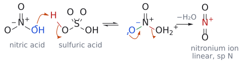
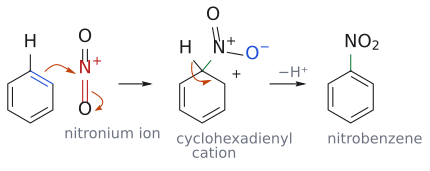

# 나이트로화

> 방향족 고리 + 진한 HNO₃/진한 H₂SO₄ → ArNO₂. electrophile은 직선형 [nitronium ion](../개념/나이트로늄%20이온.md)(NO₂⁺)이고, 생긴 nitro group은 amine, diazonium salt로 가는 출발점이 된다.

## 개요

nitro기(NO₂)를 방향족 고리에 도입하면 방향족 질소 화합물로 가는 일반적인 길이 열린다. nitro group은 환원하면 amino기가 되고, amine은 다시 [diazonium salt](다이아조늄%20염%20반응.md)를 거쳐 다른 작용기로 바뀐다. 이런 방법은 지방족 질소 화합물에는 쓸 수 없다. 방향족 nitration에는 매우 강력한 시약, 보통 **진한 nitric acid과 진한 sulfuric acid의 혼합물**([mixed acid](../시약/혼산.md))이 필요하다. (출처: L3 p.12–13)

## 메커니즘

**1단계: nitronium ion(NO₂⁺) 생성.** H₂SO₄가 HNO₃의 OH를 protonate하고, H₂O가 leaving group으로 떨어져 나가 직선형 O=N⁺=O(sp N)가 생긴다. 단계별 화살표와 구조는 [nitronium ion](../개념/나이트로늄%20이온.md)에 있다. (출처: L3 p.12)

*그림: nitric acid OH의 산소(파랑)가 sulfuric acid의 H를 받고, 물이 떠나며 직선형 NO₂⁺가 남는다.*

**2단계: 고리의 공격.** benzene이 양전하를 띤 질소를 공격한다. 이때 질소가 5가가 되는 것을 피하려면 **N=O 결합 하나가 동시에 끊어져야 한다**. 그다음 H⁺가 빠지면 nitrobenzene이 된다. (출처: L3 p.12)

*그림: π 결합(파랑)이 N⁺(빨강)를 공격하는 화살표와, N=O 결합 하나(빨강)의 π 전자가 산소로 올라가는 화살표가 동시에 움직인다. 그래서 질소는 4개의 결합만 유지하고, 산소는 O⁻(파랑)가 된다. 새 C–N 결합은 초록색이다. 이어서 C–H 결합 전자가 고리로 들어가며 H⁺가 빠진다.*

## 선택성

- nitro group은 **강한 deactivating, meta-directing**이다. 그래서 보통 조건에서는 한 번 치환되고 멈춘다. 두 번째를 넣으려면 발연 HNO₃/진한 H₂SO₄, 100 °C 가열 환류(30분)가 필요하고, *m*-dinitrobenzene(75%)이 된다. (출처: L4 p.14, p.16)
- toluene: ortho 63%, meta 3%, para 34%. (출처: L4 p.9)
- PhN⁺Me₃: meta 90%, para 10%. PhCF₃: meta 96%. (출처: L4 p.13)
- halobenzene: benzene보다 느리지만 ortho/para(주로 para). (출처: L4 p.15)
- *p*-nitrotoluene → 2,4-dinitrotoluene: Me와 NO₂가 같은 자리를 가리킨다. (출처: L4 p.18)

자세한 이유와 데이터 표는 [substituent effect](../개념/치환기%20효과.md)에 있다.

## nitro group의 활용

- **환원해서 amino기로**: nitrobenzene --[H₂, [Pd/C](../시약/Pd-C.md) 또는 Sn, 묽은 HCl]--> aniline (→ [catalytic hydrogenation](촉매%20수소화.md))
- **diazonium 화학**: aniline --[NaNO₂, HCl, 0 °C]--> ArN₂⁺Cl⁻ --[H₂O, 가열]--> phenol (→ [diazonium salt reactions](다이아조늄%20염%20반응.md))

(출처: L3 p.13)

보충: nitro group을 amino기로 환원하면 치환기의 성격이 정반대로 바뀐다는 점도 중요하다. NO₂는 deactivating·meta-directing이고, NH₂는 강한 activating·ortho/para-directing이다(→ [substituent effect](../개념/치환기%20효과.md)). 그래서 NO₂가 있는 동안 meta 위치에 다른 치환기를 넣은 뒤 환원하면, amino기에 대해 meta인 화합물처럼 직접 만들기 어려운 구조를 얻을 수 있다. (보충 근거: Clayden p.495)

반응 순서가 결과를 바꾸는 예: benzene에서 *m*-bromonitrobenzene은 nitration을 먼저 하고 bromination을 나중에(NO₂가 meta-directing), *p*-bromonitrobenzene은 bromination을 먼저 하고 nitration을 나중에(Br이 o,p-directing, para를 분리) 한다(L4 연습 문제 7). (출처: L4 p.14–16)

*그림: $NMe_3^+$는 강한 meta 지향기다(초록 = 새 $NO_2$, 주생성물만 그림).*

*그림: $CF_3$도 meta 지향기다(96%).*

*그림: nitration. 새 C–N 결합(초록).*

*그림: 가혹한 조건에서는 두 번째 $NO_2$가 meta로 들어간다(75%).*

*그림: methyl의 ortho이자 nitro의 meta인 자리로 새 $NO_2$(초록)가 들어간다(효과가 더해짐).*

## 흔한 오해

- "nitric acid만 있으면 된다": nitric acid 자체는 electrophilicity가 부족하다. sulfuric acid이 nitric acid을 protonate해 물을 떼어내야 NO₂⁺가 생긴다. (출처: L3 p.12)
- "N이 고리와 결합하면서 결합이 다섯 개가 된다": N=O 하나가 동시에 끊어져 O⁻가 되므로 N은 결합 네 개를 유지한다. (출처: L3 p.12)

## 관련 문서

- 반응: [electrophilic aromatic substitution](친전자성%20방향족%20치환.md), [diazonium salt reactions](다이아조늄%20염%20반응.md), [catalytic hydrogenation](촉매%20수소화.md), [sulfonation](설폰화.md), [aromatic halogenation](방향족%20할로젠화.md)
- 시약: [mixed acid](../시약/혼산.md), [Pd/C](../시약/Pd-C.md)
- 개념: [nitronium ion](../개념/나이트로늄%20이온.md), [arenium ion](../개념/아레늄%20이온.md), [substituent effect](../개념/치환기%20효과.md)

## 출처

- [L3 electrophilic aromatic substitution 1부](../../notes/L03_Electrophilic_Aromatic_Substitution_Part1.md) 3절 (슬라이드 p.12–13)
- [L4 electrophilic aromatic substitution 2부](../../notes/L04_Electrophilic_Aromatic_Substitution_Part2.md) 2절, 3절, 4절 (슬라이드 p.9, p.13–16, p.18)
